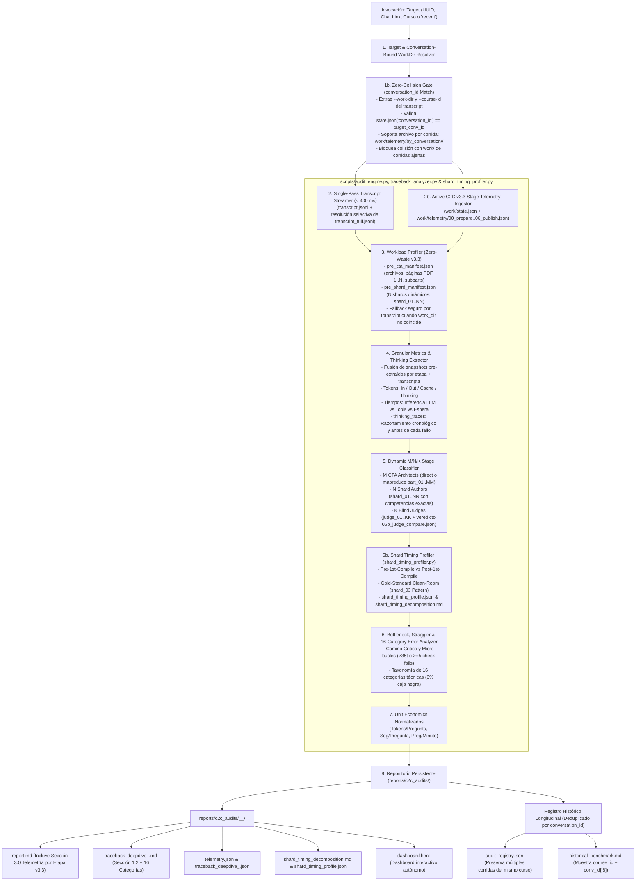

# C2C Run Auditor Skill (Google Antigravity SDK Telemetry & Optimization Engine)

Herramienta de auditoría forense y análisis de rendimiento para pipelines de orquestación multi-agente en Antigravity, especializada en **Content-to-Course**. Permite a ingenieros de prompts y optimizadores de workflows inspeccionar cualquier corrida con máxima granularidad, evaluar cuellos de botella y registrar la evolución de eficiencia del sistema a lo largo del tiempo.

---

## 1. Arquitectura de Telemetría, Zero-Collision Gate y Persistencia (C2C v3.3)



---

## 2. Protocolo Dual de Ejecución (Headless vs. Mediante Agente / No-Headless)

El skill soporta **tres modos de operación** según la escala y solicitud explícita del usuario:

### Modo 1: Ejecución Determinista Headless (< 5 segundos — Por Defecto)
Cuando el usuario solicita una auditoría estándar sin pedir intervención agéntica:
1. Ejecuta directamente en el primer turno:
   ```bash
   python .agents/skills/c2c-run-auditor/scripts/audit_engine.py --conversation <ID_O_ENLACE> --traceback
   ```
2. Lee el `report.md` y `traceback_deepdive_<id>.md` generados y presenta el resumen ejecutivo con enlaces clicables.

### Modo 2: Auditoría Forense Mediante Agente ("No Headless" / "Mediante Agente" / "Con Subagente")
> [!IMPORTANT]
> Cuando el usuario especifica explícitamente **`mediante agente`**, **`no headless`**, **`con subagente`** o solicita una **investigación forense profunda de causa raíz**:
> 1. **Paso A (Baseline Cuantitativo Determinista):** Ejecuta primero `audit_engine.py --conversation <ID_O_ENLACE> --traceback` para generar la estructura base (`telemetry.json`, `traceback_deepdive_<id>.json`, `shard_timing_profile.json`, `dashboard.html`).
> 2. **Paso B (Despacho del Subagente Especializado `c2c_run_auditor`):** Define e invoca mediante `define_subagent` + `invoke_subagent` un subagente forense dedicado (`c2c_run_auditor`, con `enable_write_tools=True`) encargado de verificar el aislamiento estricto de `conversation_id`, inspeccionar turnos de fallos y redactar el reporte forense enriquecido.

### Modo 3: Orquestación Forense Jerárquica Paralela (Ultra-Escala $\ge 10$ Shards / Gavilano Pattern)
> [!TIP]
> Cuando se auditan corridas de escala masiva ($\ge 10$ shards, o cursos tipo Gavilano con hasta 83 shards, 10 CTAs y 22 jueces, o comparativas entre múltiples cursos):
> 1. **Paso A (Baseline Determinista Integrado):** Ejecutar `audit_engine.py --traceback` (que a su vez ejecuta automáticamente `shard_timing_profiler.py`).
> 2. **Paso B (Despacho Concurrente de Team Leads):**
>    - El agente principal asume el rol de **Chief Orchestrator** y define/despacha en paralelo subagentes `c2c_lead_auditor` (con `EnableWriteTools=True` y `EnableSubagentTools=True`).
>    - Cada Team Lead analiza su conversación o clúster de shards de forma aislada, previniendo el agotamiento del contexto principal, y escribe su informe individual en `reports/c2c_audits/forensic_lead_<course_id>.md`.
> 3. **Paso C (Síntesis Transversal del Orquestador):**
>    - El orquestador consolida la matriz comparativa de unit economics, velocidad concurrente, fallos sistémicos vs. anomalías aisladas, y emite el reporte consolidado `cross_reference_synthesis_report.md`.

---

## 3. Garantías de Aislamiento Zero-Collision y Telemetría C2C v3.2

1. **Aislamiento Estricto por `conversation_id` (Zero Telemetry Collision):**
   - `telemetry_collector.py` estampa `conversation_id` tanto en `work/state.json` como en cada `work/telemetry/<stage_idx>_<stage_name>.json`, además de archivar automáticamente corridas previas en `work/telemetry/by_conversation/<old_conv_id>/` cuando se reutiliza un directorio `work/` y mantener una copia espejo en `work/telemetry/by_conversation/<conv_id>/`.
   - `WorkloadExtractor` extrae primero `--work-dir` y `--course-id` de las llamadas `run.py` del transcript de la conversación auditada y valida mediante `_validate_work_dir_for_conversation(candidate_dir, target_conv_id)` que `state.json` y `work/telemetry/*.json` pertenezcan exactamente a `target_conv_id`.
   - Si un directorio `work/` en disco pertenece a otra corrida, **se rechaza inmediatamente** (bloqueando cualquier contaminación cruzada de `course_id`, `pre_shard_manifest.json` o snapshots de etapas) y los artefactos se reconstruyen desde `by_conversation/<conv_id>/` o desde el propio transcript de `target_conv_id`.
2. **Consumo Activo de Telemetría Incremental C2C v3.2 (`work/telemetry/*.json` & `state.json`):**
   - Los snapshots `00_prepare.json`, `01_ingest.json`, `02_shard.json`, `04_build.json`, `05_verify.json`, `05b_judge_compare.json` y `06_publish.json` no se quedan como material sin uso: `ExecutionAuditor` fusiona sus métricas pre-extraídas de subagentes, valida el pase al primer intento de los Blind Judges desde `05b_judge_compare.json` (`metadata.passed`) y `judge_report.json` (`agreement_rate == 1.0`), y renderiza la tabla **Sección 3.0 (`report.md`)** y **Sección 1.2 (`traceback_deepdive_<id>.md`)**.
3. **Deduplicación Histórica por `conversation_id` (No por `course_id`):**
   - `HistoricalRegistry` deduplica exclusivamente por `conversation_id`, permitiendo conservar y comparar en `audit_registry.json` y `historical_benchmark.md` múltiples corridas históricas del mismo curso (ej. Corrida 10 vs. Corrida 11 de `solow_model`).

---

## 4. Guía de Interpretación de Unit Economics

Para comparar justamente corridas de diferente tamaño y complejidad pedagógica:

| Métrica | Definición | Interpretación Óptima | Alerta / Anomalía |
| :--- | :--- | :--- | :--- |
| **Tokens / Pregunta** | $\frac{\text{Tokens Totales}}{\text{Preguntas Finales}}$ | 15,000 – 35,000 tokens/preg | $> 50,000$: Prompts sobrecargados o bucles de reescritura |
| **Segundos / Pregunta** | $\frac{\text{Segundos de Pared}}{\text{Preguntas Finales}}$ | 2 – 5 s/preg | $> 10$ s/preg: Straggler en barrera o validaciones lentas |
| **Throughput (QPM)** | $\frac{\text{Preguntas} \times 60}{\text{Segundos de Pared}}$ | 12 – 30 preguntas/min | $< 6$ preg/min: Cuello de botella en etapa de autores |
| **Speedup Concurrente** | $\frac{\text{Tiempo Cómputo}}{\text{Tiempo Pared}}$ | $> 2.5\times$ en fan-out de autores | $\approx 1.0\times$: Subagentes operando de forma secuencial |
| **Tokens / Página** | $\frac{\text{Tokens Totales}}{\text{Páginas Fuente}}$ | $30,000 – 80,000$ tokens/pág | $> 200,000$: Lectura redundante de corpus o transcripción dispersa |

---

## 5. Opciones de los CLIs del Sistema

### 5.1. CLI Global: `audit_engine.py`
```text
Uso: audit_engine.py [-h] [--conversation CONVERSATION] [--output-dir OUTPUT_DIR]
                     [--work-dir WORK_DIR] [--format {all,md,json,html}]
                     [--recent] [--history] [--compare [RUN_A] [RUN_B]]
                     [--traceback]

Opciones:
  -c, --conversation   UUID, chat link o ruta al transcript del orquestador.
  -o, --output-dir     Directorio raíz para los reportes (default: reports/c2c_audits).
  -w, --work-dir       Directorio de trabajo con artefactos intermedios del run (se verifica contra conversation_id).
  --recent             Muestra las ejecuciones recientes de C2C en el brain.
  --history            Muestra el histórico comparativo y matriz longitudinal.
  --compare            Genera la comparativa forense entre dos corridas (por run_id, course_id o conversation_id).
  --traceback          Ejecuta además el análisis forense profundo de traceback en la misma corrida.
  --format             Formatos a emitir: all, md, json, html.
```

### 5.2. CLI de Traceback Granular: `traceback_analyzer.py`
```text
Uso: traceback_analyzer.py [-h] [-c CONVERSATION] [-o OUTPUT_DIR] [-w WORK_DIR] [--recent]

Opciones:
  -c, --conversation   UUID, chat link o ruta al transcript del orquestador.
  -o, --output-dir     Directorio raíz para los reportes (default: reports/c2c_audits).
  -w, --work-dir       Directorio de trabajo opcional (verificado contra conversation_id).
  --recent             Muestra las conversaciones recientes encontradas en el brain.
```

### 5.3. CLI de Descomposición Temporal Multi-Shard: `shard_timing_profiler.py`
```text
Uso: shard_timing_profiler.py [-h] -c CONVERSATION [-r RUN_DIR]

Opciones:
  -c, --conversation   UUID o prefijo de la conversación auditada.
  -r, --run-dir        Directorio de corrida auditada (default: busca el último run).

Artefactos generados automáticamente:
  - shard_timing_profile.json: Métricas de Pre/Post compile, compiles, fails, edits, tokens por shard.
  - shard_timing_decomposition.md: Tabla formateada con diagnóstico de causa raíz por shard.
```


---

## 6. Protocolo Forense de Varianza Multi-Shard y Benchmarking Clean-Room (>= 10 Shards)

Cuando el pipeline ejecute corridas masivas ($\ge 10$ shards, o cursos tipo Gavilano con 80+ shards) o se investiguen causas de varianza, reintentos de compilación o retrasos de sincronización:

1. **Perfilado Determinista Automatizado con `shard_timing_profiler.py` (< 1 segundo):**
   - No es necesario inspeccionar manualmente decenas de transcripts de subagentes. Invocar `shard_timing_profiler.py` o ejecutar `audit_engine.py --traceback` (que lo invoca automáticamente).
   - Genera de forma instantánea el ranking completo de shards, la duración mediana, el Gold Standard Clean-Room y la lista de stragglers.

2. **Benchmarking Universal contra el Shard `reference_cleanroom` (`shard_03` Pattern):**
   - Identificar siempre el shard **Gold-Standard Clean-Room** de la corrida (aquel con `1` compilación, `0` reintentos, `0` edits post-escritura y `0` llamadas erróneas a `view_file` buscando archivos inexistentes; típicamente ejemplificado por `shard_03`).
   - Contrastar la adherencia estricta al *Turn-0 Autosufficiency Contract* frente a los shards que requirieron ciclos de remediación.

3. **Diagnóstico Bimodal de Stragglers:**
   - **Straggler de Pre-Compilación ($t_{\text{pre}} > 240\text{s}$):** Mide el tiempo antes del primer `compile_shard.py`. Causas raíz: (a) sondeo ciego de archivos no creados (`FileNotFoundError` al buscar `shard_XX_data.py` o `templates/`), (b) intento de clonación o inspección de shards vecinos, (c) vagabundeo en `cta.json`, o (d) overthinking en thinking blocks calculando álgebra en vez de delegar a Python.
   - **Straggler de Post-Compilación ($t_{\text{post}} > 120\text{s}$):** Mide el bucle de remediación tras fallos de validación. Causas raíz: (a) falsos positivos de `[R-15]` por código LaTeX no normalizado, (b) distractores boilerplate sintéticos `[R-18]`, (c) cuota de diversidad RNG insuficiente `[TPL-VAR]`, (d) llaves no escapadas `[R-20]` o (e) errores de whitespace en `edit_file`.

4. **Estándares y Reglas del Nuevo Pipeline (C2C v3.3):**
   - **Capa A (Orquestación & Guardas):**
     - *Turn-0 Autosufficiency Enclosure*: Pre-cargar rebanadas autosuficientes en `work/dispatch/items/author_NN.json` y bloquear mediante pre-tool hooks llamadas a `view_file` en archivos no existentes o shards ajenos.
     - *Particionamiento Isomórfico Estricto*: **1 Shard = 1 Competencia** en cursos medianos y grandes ($\ge 15$ competencias), evitando la dispersión de varianza que duplica el tiempo de pared al empaquetar 2-3 competencias por script.
     - *CTA Page-Weighted Dynamic Splitting*: Partición de PDFs > 25 páginas en chunks dinámicos de 20 páginas para eliminar barreras ociosas de 5+ minutos en Stage 1B.
   - **Capa B (Compilador & Validador `invariants.py` / `rules.py`):**
     - *Normalización Regex en `[R-15]`*: Despojar macros de formato LaTeX (`\operatorname`, `\mathbf`, `\frac`) antes de comparar ratios de longitud de caracteres entre opciones y distractores.
     - *Regla Psicométrica `[R-19: Minimum Distractor Epsilon]`*: Forzar que todo distractor numérico mantenga una distancia relativa mínima $|\text{distractor} - \text{correct}| / |\text{correct}| \ge 1.5\%$, previniendo colisiones asintóticas teóricas.
     - *Pre-Flight In-Memory Assert (`[TPL-VAR]`)*: Validación previa en memoria de 20 reactivos únicos sobre 50 semillas antes de escribir a disco.
