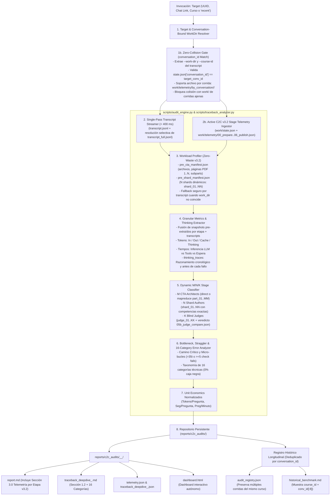

# C2C Run Auditor Skill (Google Antigravity SDK Telemetry & Optimization Engine)

Herramienta de auditoría forense y análisis de rendimiento para pipelines de orquestación multi-agente en Antigravity, especializada en **Content-to-Course**. Permite a ingenieros de prompts y optimizadores de workflows inspeccionar cualquier corrida con máxima granularidad, evaluar cuellos de botella y registrar la evolución de eficiencia del sistema a lo largo del tiempo.

---

## 1. Arquitectura de Telemetría, Zero-Collision Gate y Persistencia (C2C v3.2)



---

## 2. Protocolo Dual de Ejecución (Headless vs. Mediante Agente / No-Headless)

El skill soporta **dos modos de operación** según la solicitud explícita del usuario:

### Modo 1: Ejecución Determinista Headless (< 5 segundos — Por Defecto)
Cuando el usuario solicita una auditoría estándar sin pedir intervención agéntica:
1. Ejecuta directamente en el primer turno:
   ```bash
   python .agents/skills/c2c-run-auditor/scripts/audit_engine.py --conversation <ID_O_ENLACE> --traceback
   ```
2. Lee el `report.md` y `traceback_deepdive_<id>.md` generados y presenta el resumen ejecutivo con enlaces clicables.

### Modo 2: Auditoría Forense Mediante Agente ("No Headless" / "Mediante Agente" / "Con Subagente")
> [!IMPORTANT]
> Cuando el usuario especifica explícitamente **`mediante agente`**, **`no headless`**, **`con subagente`** o solicita una **investigación forense profunda de causa raíz**:
> 1. **Paso A (Baseline Cuantitativo Determinista):** Ejecuta primero `audit_engine.py --conversation <ID_O_ENLACE> --traceback` para generar la estructura base (`telemetry.json`, `traceback_deepdive_<id>.json`, `dashboard.html`, y el desglose inicial de etapas C2C v3.2).
> 2. **Paso B (Despacho del Subagente Especializado `c2c_run_auditor`):** Define e invoca mediante `define_subagent` + `invoke_subagent` un subagente forense dedicado (`c2c_run_auditor`, con `enable_write_tools=True`) encargado de:
>    - Verificar el aislamiento estricto de `conversation_id` (que la corrida auditada —p. ej., la 11.ª corrida de `solow_model`— use exclusivamente su propia telemetría en `courses/<course_id>/work/telemetry/` o su archivo en `by_conversation/<conv_id>/` y jamás colisione con `work/` de corridas anteriores o posteriores).
>    - Inspeccionar directamente los pasos clave del transcript del orquestador y de los subagentes con más errores o turnos (p. ej., truncamientos o escapes LaTeX en Stage 1B, micro-bucles de edición granular en Stage 3, o discrepancias de rutas en Stage 5).
>    - Auditar las intervenciones manuales del orquestador explicando qué ocurrió exactamente en cada script o archivo intervenido y cuál fue el `thinking` previo.
>    - Verificar que **ningún error quede en una categoría genérica ("caja negra")** y enriquecer `report.md` y `traceback_deepdive_<id>.md` con diagnósticos causales y recomendaciones accionables para el pipeline.

---

## 3. Garantías de Aislamiento Zero-Collision y Telemetría C2C v3.2

1. **Aislamiento Estricto por `conversation_id` (Zero Telemetry Collision):**
   - `telemetry_collector.py` estampa `conversation_id` tanto en `work/state.json` como en cada `work/telemetry/<stage_idx>_<stage_name>.json`, además de archivar automáticamente corridas previas en `work/telemetry/by_conversation/<old_conv_id>/` cuando se reutiliza un directorio `work/` y mantener una copia espejo en `work/telemetry/by_conversation/<conv_id>/`.
   - `WorkloadExtractor` extrae primero `--work-dir` y `--course-id` de las llamadas `run.py` del transcript de la conversación auditada y valida mediante `_validate_work_dir_for_conversation(candidate_dir, target_conv_id)` que `state.json` y `work/telemetry/*.json` pertenezcan exactamente a `target_conv_id`.
   - Si un directorio `work/` en disco pertenece a otra corrida, **se rechaza inmediatamente** (bloqueando cualquier contaminación cruzada de `course_id`, `pre_shard_manifest.json` o snapshots de etapas) y los artefactos se reconstruyen desde `by_conversation/<conv_id>/` o desde el propio transcript de `target_conv_id`.
2. **Consumo Activo de Telemetría Incremental C2C v3.2 (`work/telemetry/*.json` & `state.json`):**
   - Los snapshots `00_prepare.json`, `01_ingest.json`, `02_shard.json`, `04_build.json`, `05_verify.json`, `05b_judge_compare.json` y `06_publish.json` no se quedan como material sin uso: `ExecutionAuditor` fusiona sus métricas pre-extraídas de subagentes, valida el pase al primer intento de los Blind Judges desde `05b_judge_compare.json` (`metadata.passed`) y `judge_report.json` (`agreement_rate == 1.0`), y renderiza la tabla **Sección 3.0 (`report.md`)** y **Sección 1.2 (`traceback_deepdive_<id>.md`)**.
3. **Deduplicación Histórica por `conversation_id` (No por `course_id`):**
   - `HistoricalRegistry` deduplica exclusivamente por `conversation_id`, permitiendo conservar y comparar en `audit_registry.json` y `historical_benchmark.md` múltiples corridas históricas del mismo curso (ej. Corrida 10 vs. Corrida 11 de `solow_model`).

---

## 4. Guía de Interpretación de Unit Economics

Para comparar justamente corridas de diferente tamaño y complejidad pedagógica:

| Métrica | Definición | Interpretación Óptima | Alerta / Anomalía |
| :--- | :--- | :--- | :--- |
| **Tokens / Pregunta** | $\frac{\text{Tokens Totales}}{\text{Preguntas Finales}}$ | 15,000 – 35,000 tokens/preg | $> 50,000$: Prompts sobrecargados o bucles de reescritura |
| **Segundos / Pregunta** | $\frac{\text{Segundos de Pared}}{\text{Preguntas Finales}}$ | 2 – 5 s/preg | $> 10$ s/preg: Straggler en barrera o validaciones lentas |
| **Throughput (QPM)** | $\frac{\text{Preguntas} \times 60}{\text{Segundos de Pared}}$ | 12 – 30 preguntas/min | $< 6$ preg/min: Cuello de botella en etapa de autores |
| **Speedup Concurrente** | $\frac{\text{Tiempo Cómputo}}{\text{Tiempo Pared}}$ | $> 2.5\times$ en fan-out de autores | $\approx 1.0\times$: Subagentes operando de forma secuencial |
| **Tokens / Página** | $\frac{\text{Tokens Totales}}{\text{Páginas Fuente}}$ | $30,000 – 80,000$ tokens/pág | $> 200,000$: Lectura redundante de corpus o transcripción dispersa |

---

## 5. Opciones de los CLIs del Sistema

### 5.1. CLI Global: `audit_engine.py`
```text
Uso: audit_engine.py [-h] [--conversation CONVERSATION] [--output-dir OUTPUT_DIR]
                     [--work-dir WORK_DIR] [--format {all,md,json,html}]
                     [--recent] [--history] [--compare [RUN_A] [RUN_B]]
                     [--traceback]

Opciones:
  -c, --conversation   UUID, chat link o ruta al transcript del orquestador.
  -o, --output-dir     Directorio raíz para los reportes (default: reports/c2c_audits).
  -w, --work-dir       Directorio de trabajo con artefactos intermedios del run (se verifica contra conversation_id).
  --recent             Muestra las ejecuciones recientes de C2C en el brain.
  --history            Muestra el histórico comparativo y matriz longitudinal.
  --compare            Genera la comparativa forense entre dos corridas (por run_id, course_id o conversation_id).
  --traceback          Ejecuta además el análisis forense profundo de traceback en la misma corrida.
  --format             Formatos a emitir: all, md, json, html.
```

### 5.2. CLI de Traceback Granular: `traceback_analyzer.py`
```text
Uso: traceback_analyzer.py [-h] [-c CONVERSATION] [-o OUTPUT_DIR] [-w WORK_DIR] [--recent]

Opciones:
  -c, --conversation   UUID, chat link o ruta al transcript del orquestador.
  -o, --output-dir     Directorio raíz para los reportes (default: reports/c2c_audits).
  -w, --work-dir       Directorio de trabajo opcional (verificado contra conversation_id).
  --recent             Muestra las conversaciones recientes encontradas en el brain.
```


---

## 6. Protocolo Forense de Varianza Multi-Shard y Benchmarking Clean-Room (>= 10 Shards)

Cuando el usuario solicite auditar corridas masivas ($\ge 10$ shards) o investigar causas de varianza entre shards, reintentos de compilación, colisiones de artefactos o desviaciones respecto a un shard de referencia:

1. **Despacho Paralelo en `Model="flash"` (Protección de Contexto del Orquestador):**
   - Nunca leer secuencialmente $\ge 10$ `transcript.jsonl` de subagentes desde el agente principal.
   - Agrupar los shards en bloques de 5 (p. ej., `G1: Shards 01-05`, `G2: Shards 06-10`, `G3: Shards 11-15`, `G4: Shards 16-20`) e invocar subagentes `research` con `Model="flash"` en paralelo.
   - Cada subagente debe escribir su tabla forense en `<artifact_dir>/scratch/audit_shards_XX_YY.md` para mantener limpio el contexto principal.

2. **Descomposición Temporal Obligatoria por Shard (`Pre-1st-Compile` vs `Post-1st-Compile`):**
   - Desglosar la duración total de cada shard en dos fases:
     - **Tiempo `Pre-1st-Compile` ($t_{\text{1st\_compile}} - t_{\text{spawn}}$):** Mide cuánto tardó el autor antes de ejecutar su primer `compile_shard.py --strict`. Si supera los `240s`, auditar los `thinking` blocks del Turno 0/1 en busca de: (a) exploración prohibida de otros cursos (`Get-ChildItem courses/`), (b) colisión de punteros (`author_XX.json` apuntando a otro shard) o (c) `Overthinking` calculando álgebra/derivadas simbólicas en el `thinking` block en vez de delegar a Python en `gen_<cid>(rng)`.
     - **Tiempo `Post-1st-Compile` ($t_{\text{end}} - t_{\text{1st\_compile}}$):** Mide el bucle de remediación tras el primer intento de compilación, enumerando cada código de rechazo exacto (`[TPL-VAR]`, `[R-15]`, `[R-18]`, `[GATEKEEPER]`, `SyntaxError`) y cuántos ciclos `edit_file` + `compile_shard.py` consumió cada error.

3. **Detección de Contaminación Cross-Course (`Copy-Item` / Clonación entre Cursos):**
   - Verificar en las llamadas a `run_command` de los subagentes si existió `Copy-Item`, `cp` o lectura de `courses/<otro_curso>/work/shards/*_data.py` seguida de reemplazos regex masivos (`-replace`), lo cual introduce `NameError`, `SyntaxError` o desalineación de `competency_id`.

4. **Benchmarking contra el Shard `reference_cleanroom` (`shard_08` Pattern):**
   - Identificar siempre el shard **Gold-Standard Clean-Room** de la corrida (aquel con `1` compilación, `0` reintentos, `0` edits post-escritura y `0` exploraciones fuera de su `<work_dir>`) y contrastar su estructura de `gen_<cid>(rng)`, `ver_<cid>(res)`, `stem_variants` y `distractor_map` línea por línea frente a los shards que requirieron múltiples ciclos o entraron en `dispatch-repair`.

5. **Estructura Dual del Reporte (`Ya Parcheado` vs `Diagnóstico + Pendiente de Parchear`):**
   - Separar explícitamente en el reporte consolidado:
     - **Capa A (Orquestación, Guardas y Despacho):** Hiper-paralelismo en 1 ola, aislamiento Cross-Course en `c2c_hook_guard.py`, nombres deterministas de work orders (`author_01..20.json`, `repair_<CID>.json`) y reseteo de `.check_attempts/` al entrar a `dispatch-repair`.
     - **Capa B (Motor `compile_shard.py`, Validador `invariants.py`/`rules.py` y Prompts):** Falsos positivos del validador (p. ej. `R-18` sobre opciones matemáticas puras), desincronización de `healed_source` vs archivo en disco, auto-healing de LaTeX (`\implies`, `\iff`, `$$`) y alineación del contrato Turn-0 en `prompt_shard_author.md`.
