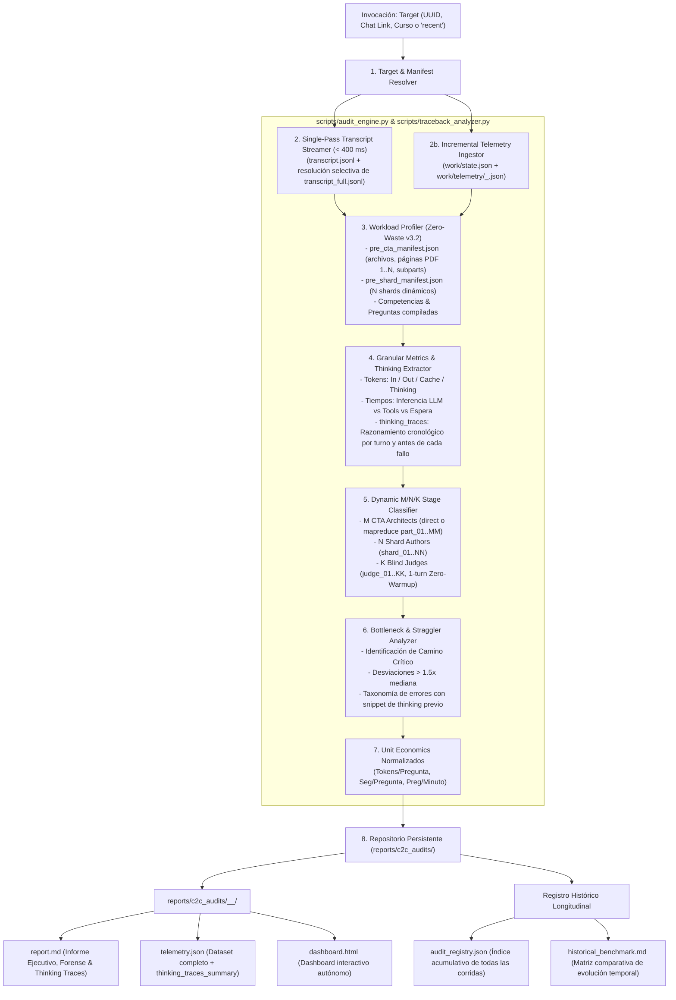

# C2C Run Auditor Skill (Google Antigravity SDK Telemetry & Optimization Engine)

Herramienta de auditoría forense y análisis de rendimiento para pipelines de orquestación multi-agente en Antigravity, especializada en **Content-to-Course**. Permite a ingenieros de prompts y optimizadores de workflows inspeccionar cualquier corrida con máxima granularidad, evaluar cuellos de botella y registrar la evolución de eficiencia del sistema a lo largo del tiempo.

---

## 1. Arquitectura de Telemetría y Persistencia (C2C v3.2)



---

## 2. Protocolo de Ejecución del Agente

> [!IMPORTANT]
> **Invocación Determinista Directa (< 5 segundos):** El motor `audit_engine.py` es completamente autónomo y resiliente. NO ejecutes scripts manuales en `scratch/` ni inspecciones intermedias de transcripciones. Ejecuta el CLI directamente en el primer turno.

Cuando el usuario solicita auditar una corrida, el agente debe seguir estos pasos deterministas:

### Paso 1: Resolver y Ejecutar Directamente
- Para auditoría ejecutiva de telemetría, unit economics, `thinking_traces` y dashboard:
  ```bash
  python .agents/skills/c2c-run-auditor/scripts/audit_engine.py --conversation <ID_O_ENLACE>
  ```
- Para auditoría integral completa con **Traceback Deep-Dive** (turnos de subagentes, escalado dinámico de $M$ CTA Architects / $N$ Shards / $K$ Judges, `thinking_traces` previos a cada error y taxonomía de fricciones):
  ```bash
  python .agents/skills/c2c-run-auditor/scripts/audit_engine.py --conversation <ID_O_ENLACE> --traceback
  ```
- Para análisis forense granular directo de traceback exclusivamente:
  ```bash
  python .agents/skills/c2c-run-auditor/scripts/traceback_analyzer.py --conversation <ID_O_ENLACE>
  ```
- Si el usuario no especificó ID o solicita ver las corridas recientes:
  ```bash
  python .agents/skills/c2c-run-auditor/scripts/audit_engine.py --recent
  ```

### Paso 2: Capacidades C2C v3.2, Resiliencia y Deduplicación Canónica
El motor maneja de forma autónoma:
1. **Ingesta de Telemetría Incremental (`telemetry_collector.py`):** Fusiona los snapshots deterministas por etapa (`work/telemetry/00_prepare.json` .. `06_publish.json`) y el estado maestro acumulativo (`work/state.json`), cruzando los manifiestos `work/pre_cta_manifest.json` y `work/shards/pre_shard_manifest.json`.
2. **Escalado Dinámico $M \times N \times K$:** Descubre y clasifica automáticamente **cualquier número $M$ de CTA Architects** (modo `direct` o `mapreduce` con `part_01..part_MM` y `cta_harmonizer`), **cualquier número $N$ de Shard Authors** (`shard_01..shard_NN`) y **cualquier número $K$ de Blind Judges** (`judge_01..judge_KK`).
3. **Extracción Forense de `thinking_traces` (Qué pensaron los subagentes):** Lee en streaming de una sola pasada `transcript.jsonl` y resuelve selectivamente desde `transcript_full.jsonl` únicamente los pasos con `truncated_fields`, extrayendo el razonamiento interno (`thinking`) de cada subagente turno por turno y adjuntando el pensamiento exacto previo a cada error de compilación o validación (`last_thinking`).
4. **Resiliencia post-publicación:** Si la carpeta temporal `work/` ya fue eliminada, el motor resuelve el curso publicado en `courses/<course_id>.json` (preguntas validadas), reconstruye la carga desde logs y calcula unit economics sin errores.
5. **Deduplicación canónica por corrida:** Mantiene estrictamente **1 sola entrada por conversación** en `audit_registry.json` y `historical_benchmark.md`, reemplazando automáticamente auditorías preliminares y evitando duplicados artificiales.

### Paso 3: Presentar el Resumen Ejecutivo Inmediato
Inmediatamente tras la ejecución del CLI (< 1.5s), el agente lee el `report.md` emitido y presenta al usuario:
- **Ficha de Carga (Workload Context v3.2)**: Cuántas páginas PDF (`pre_cta_manifest.json`), archivos fuente, $M$ subpartes CTA, $N$ shards (`pre_shard_manifest.json`) y preguntas/competencias se procesaron.
- **Métricas Clave de Rendimiento**:
  - Tiempo de pared (*wall-clock*) y factor de aceleración (*speedup*).
  - Tokens totales (incluyendo desglose de tokens de `thinking`) y densidad normalizada: **Tokens por pregunta** y **Segundos por pregunta**.
- **Diagnóstico Principal de Cuellos de Botella y `thinking_traces`**:
  - Identificar si hubo subagentes *stragglers* (rezagados) entre los $M$ CTA Architects o los $N$ Shard Authors.
  - Reportar exceso de turnos, errores de compilación de tuplas (`compile_cta.py` / `compile_shard.py`) y qué pensó el subagente (`thinking_traces`) antes del fallo.
- **Dictamen de Blind Judges ($K$ Jueces en 1 Turno Zero-Warmup)**:
  - Indicar explícitamente si el lote estratificado pasó 100% perfecto en 1 turno sin llamadas adicionales.
  - En caso contrario, catalogar detalladamente las acciones tomadas: fallos psicométricos iniciales, rondas de auto-reparación e intervenciones directas del supervisor.
- **Enlaces Clicables**:
  - Enlace al informe Markdown generado: `[report.md](file:///.../report.md)`
  - Enlace al dashboard HTML: `[dashboard.html](file:///.../dashboard.html)`
  - Enlace a la evolución histórica: `[historical_benchmark.md](file:///.../historical_benchmark.md)`

---

## 3. Guía de Interpretación de Unit Economics

Para comparar justamente corridas de diferente tamaño y complejidad pedagógica:

| Métrica | Definición | Interpretación Óptima | Alerta / Anomalía |
| :--- | :--- | :--- | :--- |
| **Tokens / Pregunta** | $\frac{\text{Tokens Totales}}{\text{Preguntas Finales}}$ | 15,000 – 35,000 tokens/preg | $> 50,000$: Prompts sobrecargados o bucles de reescritura |
| **Segundos / Pregunta** | $\frac{\text{Segundos de Pared}}{\text{Preguntas Finales}}$ | 2 – 5 s/preg | $> 10$ s/preg: Straggler en barrera o validaciones lentas |
| **Throughput (QPM)** | $\frac{\text{Preguntas} \times 60}{\text{Segundos de Pared}}$ | 12 – 30 preguntas/min | $< 6$ preg/min: Cuello de botella en etapa de autores |
| **Speedup Concurrente** | $\frac{\text{Tiempo Cómputo}}{\text{Tiempo Pared}}$ | $> 2.5\times$ en fan-out de autores | $\approx 1.0\times$: Subagentes operando de forma secuencial |
| **Tokens / Página** | $\frac{\text{Tokens Totales}}{\text{Páginas Fuente}}$ | $30,000 – 80,000$ tokens/pág | $> 200,000$: Lectura redundante de corpus o transcripción dispersa |

---

## 4. Opciones de los CLIs del Sistema

### 4.1. CLI Global: `audit_engine.py`
```text
Uso: audit_engine.py [-h] [--conversation CONVERSATION] [--output-dir OUTPUT_DIR]
                     [--work-dir WORK_DIR] [--format {all,md,json,html}]
                     [--recent] [--history] [--compare [RUN_A] [RUN_B]]
                     [--traceback]

Opciones:
  -c, --conversation   UUID, chat link o ruta al transcript del orquestador.
  -o, --output-dir     Directorio raíz para los reportes (default: reports/c2c_audits).
  -w, --work-dir       Directorio de trabajo con artefactos intermedios del run.
  --recent             Muestra las ejecuciones recientes de C2C en el brain.
  --history            Muestra el histórico comparativo y matriz longitudinal.
  --compare            Genera la comparativa forense entre dos corridas (o versus baseline).
  --traceback          Ejecuta además el análisis forense profundo de traceback en la misma corrida.
  --format             Formatos a emitir: all, md, json, html.
```

### 4.2. CLI de Traceback Granular: `traceback_analyzer.py`
```text
Uso: traceback_analyzer.py [-h] [-c CONVERSATION] [-o OUTPUT_DIR] [--recent]

Opciones:
  -c, --conversation   UUID, chat link o ruta al transcript del orquestador.
  -o, --output-dir     Directorio raíz para los reportes (default: reports/c2c_audits).
  --recent             Muestra las conversaciones recientes encontradas en el brain.
```

