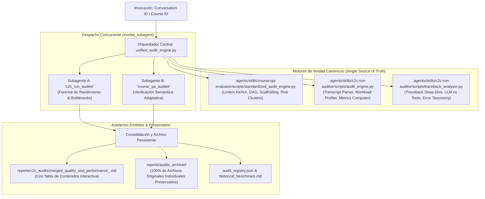

# C2C Unified Auditor Skill (Pipeline Integral de Calidad y Rendimiento)

Esta skill orquesta la **auditoría completa y automática post-creación de cursos** en Top's Academy, fusionando de manera nativa e isomórfica las dos dimensiones críticas del ciclo de vida educativo:

1. **Calidad Pedagógica y Psicométrica (Quality Matters, OSCQR & Mastery Learning):**
   - Arquitectura curricular y modelado formal del Grafo Acíclico Dirigido (DAG).
   - Balance tipológico de reactivos (MC7, MS, FIB) y cobertura del 100% en `error_rationale` diagnósticos.
   - Andamiaje socrático progresivo (3 a 5 pistas por ítem) y soluciones analíticas detalladas.
   - Congruencia semántica con taxonomía de Bloom (niveles de Aplicación y Análisis).
   - Ergonomía técnica de expresiones matemáticas KaTeX y erradicación de residuos de f-strings.
2. **Telemetría Forense, Rendimiento y Cuellos de Botella (Google Antigravity SDK):**
   - Descomposición empírica de tiempos: **Inferencia LLM (thinking + tokens) vs. Ejecución de herramientas locales**.
   - Consumo granular de tokens por subagente (entrada, salida, caché y tokens activos).
   - Detección de cuellos de botella en camino crítico, fenómenos *straggler* y barreras síncronas.
   - Taxonomía consolidada de errores y fricciones operativas en 12 categorías.
   - Unit Economics normalizados (Tokens/pregunta, Segundos/pregunta, Preguntas/minuto).

---

## 1. Arquitectura de Cero Desincronización (Single Source of Truth)

> [!IMPORTANT]
> **Sin duplicación de código ni bifurcaciones:** La skill `c2c-unified-auditor` importa dinámicamente y ejecuta directamente los motores originales de `course-qa-evaluator` (`standardized_audit_engine.py`, `prepare_course_payload.py`) y de `c2c-run-auditor` (`audit_engine.py`, `traceback_analyzer.py`). Cualquier mejora o regla nueva de linting añadida a las skills individuales (ej. vía el loop `/learn` de auto-mejora) es **heredada de forma automática e inmediata** por esta skill sin requerir ajustes manuales.



---

## 2. Preservación Estricta de Archivos Originales

Siguiendo los requisitos de auditoría de la plataforma:
- **No se emite únicamente el reporte consolidado.**
- El sistema guarda y replica **todos los archivos originales individuales** en `reports/audits_archive/<course_id>/`:
  1. `qa_report.md` (Informe individual de calidad QM-OSCQR).
  2. `qa_report.json` (Dataset estructurado de puntuaciones y rúbrica).
  3. `qa_payload.json` (Muestras estratificadas y clusters de riesgo calculados por `StandardizedAuditEngine`).
  4. `telemetry_report.md` (Informe de unit economics de `audit_engine.py`).
  5. `telemetry.json` (Consumo detallado de tokens, tiempos y herramientas).
  6. `traceback_deepdive.md` (Análisis forense turno por turno).
  7. `traceback_deepdive.json` (Dataset forense de inferencia vs. herramientas y taxonomía).
  8. `dashboard.html` (Tablero visual interactivo).
  9. `merged_quality_and_performance.md` (Reporte unificado con Tabla de Contenidos).
  10. `README.md` (Catálogo interactivo con enlaces clicables a cada documento).

---

## 3. Protocolo de Ejecución del Agente Orquestador

Cuando el usuario solicita auditar una creación de curso, el agente debe seguir estos pasos:

### Paso 1: Resolución de Entidades
Identificar la conversación creadora y el identificador del curso. Si el usuario proporciona solo uno de ellos, el motor `unified_audit_engine.py` resuelve automáticamente la contraparte:
```powershell
python .agents/skills/c2c-unified-auditor/scripts/unified_audit_engine.py --course <course_id> --conversation <conv_id>
```

### Paso 2: Despacho Concurrente de Subagentes (`invoke_subagent`)
En el modo conversacional estándar, el orquestador lanza **ambos subagentes en una sola llamada a `invoke_subagent`**:

```json
{
  "Subagents": [
    {
      "Role": "C2C Run Auditor",
      "TypeName": "c2c_run_auditor",
      "Model": "inherit",
      "Prompt": "Audita la telemetría forense de la conversación <conv_id> para el curso '<course_id>'. Ejecuta el análisis de camino crítico, descomposición de inferencia LLM vs herramientas y taxonomía de errores. Asegúrate de emitir 'telemetry.json' y 'traceback_deepdive.json'."
    },
    {
      "Role": "Course QA Evaluator",
      "TypeName": "course_qa_auditor",
      "Model": "inherit",
      "Prompt": "Audita la calidad técnica y pedagógica del curso '<course_id>'. Ingiere el payload en 'reports/qa_audits/<course_id>_payload.json', aplica el Loop de Verificación Semántica sobre los risk clusters y califica las 5 dimensiones normativas de la rúbrica QM-OSCQR emitiendo '<course_id>_qa_report.json' y '<course_id>_qa_report.md'."
    }
  ]
}
```

> [!NOTE]
> **Fin del Turno Reactivo:** Inmediatamente después de llamar a `invoke_subagent` con ambos subagentes, el orquestador **NO realiza más llamadas a herramientas** en ese turno para permitir el procesamiento en paralelo y el despertar reactivo automático.

### Paso 3: Consolidación y Generación del Punto Medio
Al recibir la notificación de finalización de ambos agentes, el orquestador ejecuta la consolidación:
```powershell
python .agents/skills/c2c-unified-auditor/scripts/unified_audit_engine.py --course <course_id> --conversation <conv_id> --headless
```

### Paso 4: Presentación al Usuario
El orquestador presenta un resumen ejecutivo que incluye:
- **Calificación Final Certificada** sobre 20.0 pts y Quality Tier.
- **Métricas Forenses Clave**: Tiempo de pared, factor de aceleración (*speedup*), tokens totales y densidad (tokens/pregunta, seg/pregunta).
- **Diagnóstico Principal de Rendimiento**: Cuello de botella detectado (CTA, straggler de autores o llamadas web de jueces).
- **Enlaces Clicables**:
  - [Reporte Unificado de Calidad y Rendimiento](file:///d:/Augusto/personal_portfolio/Tops_academy/reports/c2c_audits/merged_quality_and_performance_<course_id>.md) *(con Tabla de Contenidos interactiva)*.
  - [Repositorio Permanente de Archivos Originales](file:///d:/Augusto/personal_portfolio/Tops_academy/reports/audits_archive/<course_id>/README.md).
  - [Dashboard HTML Interactivo](file:///d:/Augusto/personal_portfolio/Tops_academy/reports/audits_archive/<course_id>/dashboard.html).

---

## 4. Opciones del CLI `unified_audit_engine.py`

```text
Uso: unified_audit_engine.py [-h] [-c CONVERSATION] [--course COURSE]
                             [--headless] [--output-dir OUTPUT_DIR]
                             [--archive-dir ARCHIVE_DIR] [--recent]

Opciones:
  -c, --conversation   ID o enlace markdown de la conversación creadora del curso.
  --course, --course-id Identificador del curso o ruta al archivo JSON.
  --headless           Ejecuta la auditoría determinista completa de forma directa.
  --recent             Muestra las ejecuciones y cursos registrados en el histórico.
  --output-dir         Directorio de salida para reportes (default: reports/c2c_audits).
  --archive-dir        Directorio de archivo histórico (default: reports/audits_archive).
```

---

## 5. Tabla de Contenidos del Reporte Unificado

El archivo emitido `merged_quality_and_performance_<course_id>.md` incorpora de manera estricta la siguiente Tabla de Contenidos navegable:

- [PARTE I: AUDITORÍA TÉCNICA Y PEDAGÓGICA DE CALIDAD INSTRUCCIONAL (QA EVALUATOR)](#parte-i-auditoría-técnica-y-pedagógica-de-calidad-instruccional-qa-evaluator)
  - [1. Resumen Ejecutivo de Calidad Pedagógica](#1-resumen-ejecutivo-de-calidad-pedagógica)
  - [2. Desglose y Calificación por Dimensiones Normativas](#2-desglose-y-calificación-por-dimensiones-normativas)
  - [3. Análisis Cualitativo Detallado por Dimensión de Calidad](#3-análisis-cualitativo-detallado-por-dimensión-de-calidad)
    - [Dimensión 1: Arquitectura y Granularidad](#dimensión-1-arquitectura-y-granularidad)
    - [Dimensión 2: Calidad de Evaluación y Reactivos](#dimensión-2-calidad-de-evaluación-y-reactivos)
    - [Dimensión 3: Andamiaje y Feedback Progresivo](#dimensión-3-andamiaje-y-feedback-progresivo)
    - [Dimensión 4: Alineación Instruccional](#dimensión-4-alineación-instruccional)
    - [Dimensión 5: Accesibilidad y Ergonomía Técnica / KaTeX](#dimensión-5-accesibilidad-y-ergonomía-técnica--katex)
  - [4. Loop de Verificación Semántica sobre Muestras Estratificadas](#4-loop-de-verificación-semántica-sobre-muestras-estratificadas)
  - [5. Registro de Nuevas Reglas de Linting (`discovered_lint_rules`)](#5-registro-de-nuevas-reglas-de-linting-discovered_lint_rules)
- [PARTE II: AUDITORÍA FORENSE DE RENDIMIENTO, TELEMETRÍA Y BOTTLENECKS (RUN AUDITOR)](#parte-ii-auditoría-forense-de-rendimiento-telemetría-y-bottlenecks-run-auditor)
  - [6. Consolidación de Métricas de Rendimiento y Ratios Unitarios](#6-consolidación-de-métricas-de-rendimiento-y-ratios-unitarios)
  - [7. Descomposición Empírica del Tiempo: Inferencia LLM vs. Ejecución de Herramientas](#7-descomposición-empírica-del-tiempo-inferencia-llm-vs-ejecución-de-herramientas)
  - [8. Causa Raíz de la Latencia por Etapa](#8-causa-raíz-de-la-latencia-por-etapa)
    - [8.1. Direct CTA Architect](#81-direct-cta-architect)
    - [8.2. Shards de Autoría y el Fenómeno Straggler](#82-shards-de-autoría-y-el-fenómeno-straggler)
    - [8.3. Blind Judges y Llamadas Externas (Stage 5)](#83-blind-judges-y-llamadas-externas-stage-5)
    - [8.4. Fricción del Orquestador y Etapa de Publicación](#84-fricción-del-orquestador-y-etapa-de-publicación)
  - [9. Taxonomía Consolidada de Errores y Retrabajo](#9-taxonomía-consolidada-de-errores-y-retrabajo)
  - [10. Conclusión y Síntesis Global](#10-conclusión-y-síntesis-global)
