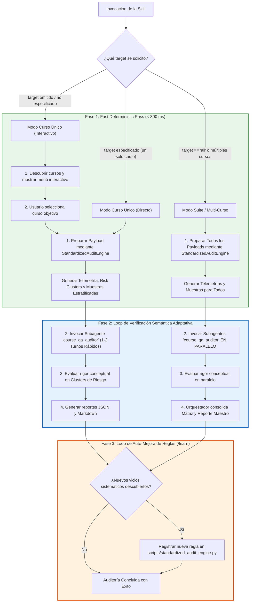

# Course QA Evaluator Skill

Esta skill orquesta la auditoría de calidad pedagógica y técnica sobre cursos de la plataforma, utilizando una arquitectura multi-agente híbrida de alta velocidad basada en el **Google Antigravity SDK**:

1. **Fast Deterministic Pass (< 300 ms):** El motor estático `StandardizedAuditEngine` extrae la telemetría métrica universal (KaTeX, distractores delatores, andamiaje, f-strings, grafos de prerrequisitos y distribución de Bloom) sobre el 100% de los reactivos de forma invariante y homogénea.
2. **Loop de Verificación Semántica Adaptativa:** Los subagentes no pierden tiempo creando scripts exploratorios en disco; inspeccionan directamente los *risk clusters* y muestras estratificadas para juzgar el rigor conceptual y pedagógico en 1-2 turnos rápidos.
3. **Loop de Auto-Mejora de Reglas (Self-Improving Engine):** Los nuevos vicios detectados en cursos futuros se reportan como reglas candidatas para retroalimentar el catálogo de linters del motor.

---

## 1. Arquitectura de Flujo Híbrido con Loops



---

## 2. Modo A: Auditoría de Curso Individual

### Paso 1: Determinación del Curso Objetivo
1. **Si el usuario especificó el curso directamente**:
   - Ejecutar la preparación enriquecida:
     ```powershell
     python .agents/skills/course-qa-evaluator/scripts/prepare_course_payload.py --course-id <nombre>
     ```
2. **Si el usuario NO especificó qué curso auditar**:
   - Listar los cursos descubiertos ejecutando:
     ```powershell
     python .agents/skills/course-qa-evaluator/scripts/prepare_course_payload.py --list
     ```
   - Preguntar al usuario con `ask_question` para seleccionar el curso.

### Paso 2: Generación del Payload Enriquecido
El script ejecuta internamente `StandardizedAuditEngine`, evaluando el 100% de las preguntas y generando `reports/qa_audits/<course_id>_payload.json` con:
- `audit_telemetry`: Conteo exacto de KaTeX corrupto, distractores delatores, pistas faltantes, placeholders f-string, penalizaciones duras y risk score.
- `risk_cluster_samples`: Muestras de reactivos afectados listas para citar.
- `stratified_samples`: Muestras de control por competencia.

### Paso 3: Invocación Rápida del Subagente Evaluador
Invocar a un único subagente mediante `invoke_subagent`:
- **Role**: `Course QA Auditor`
- **TypeName**: `course_qa_auditor`
- **Model**: `inherit` (Gemini 3.8 Flash High)
- **Prompt**:
  > *"Audita la calidad técnica y pedagógica del curso '<course_id>'. Lee el payload enriquecido en 'reports/qa_audits/<course_id>_payload.json'. Toda la telemetría métrica determinista ha sido calculada en 'audit_telemetry'; NO escribas scripts de Python para escanear el curso. Aplica el Loop de Verificación Semántica sobre los 'risk_clusters', evalúa el rigor conceptual y pedagógico según la rúbrica normativa de 20 puntos en '.agents/skills/course-qa-evaluator/references/qa_rubric.md' y genera directamente 'reports/qa_audits/<course_id>_qa_report.json' y 'reports/qa_audits/<course_id>_qa_report.md'. Si detectas nuevos patrones de error no cubiertos por los linters, inclúyelos en 'discovered_lint_rules'."*

### Paso 4: Presentación del Veredicto
Presentar al usuario:
- Calificación final sobre 20.0 y Tier de Calidad.
- Desglose por las 5 dimensiones.
- Penalizaciones aplicadas.
- Acciones de remediación prioritarias y nuevas reglas aprendidas si las hubiera.

---

## 3. Modo B: Auditoría Multi-Curso / Suite Completa en Paralelo

### Paso 1: Descubrimiento y Preparación Masiva
1. Ejecutar la preparación de todos los cursos válidos:
   ```powershell
   python .agents/skills/course-qa-evaluator/scripts/prepare_course_payload.py --all
   ```

### Paso 2: Despacho Concurrente en Paralelo
Invocar concurrentemente un subagente por cada curso en una **única llamada** a `invoke_subagent`:
```json
{
  "Subagents": [
    {
      "Role": "Course QA Auditor - Curso A",
      "TypeName": "course_qa_auditor",
      "Model": "inherit",
      "Prompt": "Audita el curso 'curso_a' usando 'reports/qa_audits/curso_a_payload.json' de forma directa sin crear scripts de Python..."
    },
    {
      "Role": "Course QA Auditor - Curso B",
      "TypeName": "course_qa_auditor",
      "Model": "inherit",
      "Prompt": "Audita el curso 'curso_b' usando 'reports/qa_audits/curso_b_payload.json' de forma directa sin crear scripts de Python..."
    }
  ]
}
```

### Paso 3: Consolidación de Findings y Loop de Aprendizaje
Al recibir las notificaciones de finalización:
1. El orquestador lee los reportes JSON individuales en `reports/qa_audits/*_qa_report.json`.
2. Genera la **Matriz Comparativa Consolidada** en `reports/qa_audits/SUITE_QA_AUDIT_REPORT.md`.
3. Revisa los campos `discovered_lint_rules` reportados por los subagentes para retroalimentar `scripts/standardized_audit_engine.py` en caso de nuevos patrones.

---

## 4. Definición del Subagente `course_qa_auditor`

Al registrar el subagente vía `define_subagent`:
- **Name**: `course_qa_auditor`
- **Description**: *"Auditor Técnico Pedagógico y Validador de Calidad Instruccional (Fast Hybrid Evaluation) bajo estándares QM, OSCQR y Mastery Learning."*
- **System Prompt**:
  - Ingerir directamente `audit_telemetry` de `<course_id>_payload.json`.
  - **Prohibición estricta:** NO crear ni ejecutar scripts temporales en disco para escanear el JSON.
  - Ejecutar el Loop de Verificación Semántica sobre los `risk_clusters` y muestras estratificadas.
  - Evaluar la veracidad y solidez del dominio pedagógico.
  - Generar el JSON y Markdown en 1 o 2 turnos eficientes.
- **Tools**: Herramientas de lectura y escritura de archivos.

---

## 5. Rúbrica Resumida de las 5 Dimensiones (20 Puntos)

1. **Arquitectura y Granularidad (0 a 4 pts)**: Atomicidad de micro-competencias, balance cognitivo (Hechos/Conceptos/Habilidades) y modelado de prerrequisitos.
2. **Calidad de Evaluación y Reactivos (0 a 5 pts)**: Variedad de ítems (MC7, MS, FIB), distractores con rationales diagnósticos reales, cero answer leaks ni metainformación visible delatora.
3. **Andamiaje y Pistas Progresivas (0 a 5 pts)**: Exactamente 3 a 5 pistas escalonadas (Conceptual $\to$ Procedimental $\to$ Cálculo) y solución detallada con advertencia de ideas erróneas.
4. **Alineación Instruccional (0 a 4 pts)**: Congruencia semántica estricta con la teoría, sin preguntas huérfanas ni contaminación cruzada.
5. **Ergonomía Técnica y KaTeX (0 a 2 pts)**: Delimitadores `$` balanceados, sin triples `$$$`, sin llaves dobles `{{...}}` y notación matemática formal preservada.

**Penalizaciones Duras Automáticas**:
- Banco $<3$ problemas prácticos en una competencia: **-2.0 pts**
- Reactivos con `hints = 0`: **-1.0 pt c/u**
- Preguntas huérfanas críticas: **-2.0 pts**
