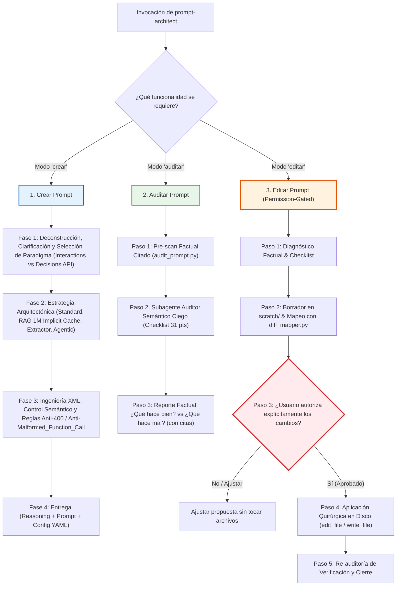

# Prompt Architect Skill (Calibrada y Basada en Fuentes Canónicas — Nov 2026)

Esta skill proporciona herramientas y metodologías de ingeniería de prompts respaldadas por las guías oficiales de **Google DeepMind / Google AI Studio** (`prompting-strategies.md`, `whats-new-gemini-4-hydrogen.md`, `whats-new-gemini-4-argon.md`, `whats-new-gemini-4-carbon.md`, `whats-new-gemini-3.8.md`, `whats-new-gemini-3.6.md`, `thinking.md`, `long-decode.md`, `caching.md`, `function-calling.md`, `decisions-api.md`) y el framework de diseño **Ultimate Prompt Architect** (`prompt_masterprompter.md`).

> [!IMPORTANT]
> **Integridad y Cero Overfitting:**
> - Cada regla de auditoría cuenta con una **cita bibliográfica directa** de las fuentes oficiales vigentes (noviembre de 2026).
> - La calibración del motor se realiza sobre un benchmark sintético con defectos inyectados (`tests/calibration_cases.json`), no sobre los prompts del proyecto.
> - Las convenciones de infraestructura de Top's Academy (señales `DONE:`, `BLOCKED:`, turnos) están desacopladas en un chequeo auxiliar (`--pipeline-check`) y **no alteran** la evaluación de calidad de ingeniería de prompts.



---

## 1. Módulos y Referencias de la Skill

| Módulo / Archivo | Propósito y Contenido |
|:---|:---|
| [`references/gemini_prompting_guide_2026.md`](references/gemini_prompting_guide_2026.md) | Catálogo Gemini 4 (`Hydrogen`/`Argon`/`Carbon`), `Orchestrator (Carbon/Argon)`, `gemini-decision-1` y `Gemma 4 26B A4B` (`LiteRTAgentConfig`), distinción entre Model IDs explícitos de API/SDK vs. tiers abstractos de subagentes de Antigravity (`inherit \| flash_lite \| flash \| pro`), justificación causal (*why behind constraints*), dimensionamiento según horizonte (System Prompt 100% autocontenido en Posición 0 / `CustomSystemInstructions` para workers de horizonte corto vs. `TemplatedSystemInstructions` para generalistas), gobernanza en 2 capas (`system_instruction` macro vs. `tool descriptions`/docstrings micro), *Attention Engineering* (curva en U, `<case_facts>`, `<documents>`), *Implicit Caching*, *Long Decode*, NLI Grounding y Jueces LLM. |
| [`references/iteration_and_decomposition.md`](references/iteration_and_decomposition.md) | Taxonomía de 3 niveles de autonomía (*Decisions API / Augmented LLM* vs. *5 Patrones de Workflow* vs. *Agent*), matriz de 6 primitivas de orquestación en Antigravity v2.32.0 (`Orchestrator`, `Subagents`, `Dynamic Workflows /run-workflow`, `/swarm`, `/boost`, `/teamwork`), entradas multimodales (`processing: "agentic"`), verificación *IFEval* vs. *INFOBench*, gobernanza `Dotprompt`, Pirámide Invertida (*Deterministic Checks > Prose* en `.agents/hooks.json` y `google-antigravity` SDK) y resolución de conflictos en Gemini 4. |
| [`references/agentic_workflows_guide.md`](references/agentic_workflows_guide.md) | Framework agéntico: precedencia, matriz Read vs Write alineada con permisos de Antigravity (`Deny > Ask > Allow`, `policy`), compromiso anti-*overthinking*, `<investigate_before_answering>` y scripts como cajas negras (`--help`), modos MCP (`McpStdioServer` local + `McpStreamableHttpServer` remoto), tríada de contexto en horizonte largo para Gemini 4 (*Append-Only History* + *Structured Note-Taking / `*.cert.json`* + *Sub-Agent Condensation / Pointer Prompts* + `CompactionConfig`), prevención de *Reflection Errors* ($N_{\text{salida}} = N_{\text{entrada}}$ + `@hooks.stop`), inmutabilidad de tests/verificadores (`ver_*`) y anti-`<UPDATE>` XML previo a tool calls. |
| [`references/agentic_si_template_original.md`](references/agentic_si_template_original.md) | Plantilla original textual en inglés evaluada en benchmarks por investigadores de Google y matriz de 9 dimensiones. |
| [`references/audit_rubric.md`](references/audit_rubric.md) | Catálogo canónico de reglas v5 con citas directas (Google AI Studio Nov 2026 + *AI Engineering* de Chip Huyen) y clasificación cualitativa de veredictos. |
| [`references/semantic_audit_checklist.md`](references/semantic_audit_checklist.md) | Checklist exhaustivo para auditoría semántica manual o por subagente. |
| [`references/semantic_auditor_subagent.md`](references/semantic_auditor_subagent.md) | Especificación y System Prompt del subagente auditor independiente y ciego. |
| [`scripts/audit_prompt.py`](scripts/audit_prompt.py) | Pre-scan determinista con citas directas; soporta múltiples archivos, reportes Markdown, JSON y `--format summary`. Flag `--pipeline-check` opcional. |
| [`scripts/calibrate_auditor.py`](scripts/calibrate_auditor.py) | Suite de calibración que valida 100% precisión y recall sobre el dataset sintético sin overfitting sobre el proyecto. |
| [`scripts/diff_mapper.py`](scripts/diff_mapper.py) | Mapeo de cambios línea a línea y verificación estricta de preservación de tokens de contrato (placeholders, claves JSON, rutas). |
| `templates/*.xml` | 5 plantillas base (Estándar, RAG Long-Context, Extractor JSON, Juez/Evaluador LLM y Subagente C2C) calibradas y verificadas contra el auditor. |

---

## 2. Los Tres Flujos Operativos

### 2.1 Flujo 1: Crear Prompt (`mode: "crear"`)
1. **Deconstrucción, Selección de Nivel de Autonomía y Paradigma:**
   - Analizar objetivo, modelo de inferencia (`gemini-4-hydrogen` por defecto; `gemini-4-argon` o `gemini-4-carbon` para razonamiento profundo; `Orchestrator (Carbon)` / `Orchestrator (Argon)` para handoff automático Planner $\leftrightarrow$ Executor en una sola conversación; `gemini-3.5-flash-lite` para alto volumen; o tiers `inherit | flash_lite | flash | pro` cuando el destino sea un subagente/workflow interno de Antigravity), esquema de entrada/salida y modos de fallo.
   - **Filtro de 3 Niveles de Autonomía y 6 Primitivas de Antigravity:** Elegir siempre el nivel más simple y predecible: (1) **Decisions API (`gemini-decision-1`)** o *Augmented LLM* de 1 llamada para decisiones cerradas (`noul`, `choice`, `score` con 0 tokens de salida) o extracción directa; (2) **Workflow de código fijo** (*Prompt Chaining*, *Routing*, *Parallelization*, *Orchestrator-Workers*, *Evaluator-Optimizer* — implementable mediante `run.py` en C2C o **`Dynamic Workflows (/run-workflow)`** con `phase()`, `parallel()`, `pipeline()` y validación por JSON `schema` en `finish`) cuando la secuencia o partición se conoce de antemano; (3) **Agent Loop / Multi-Agent** (`Subagents`, `/swarm`, `/boost`, `/teamwork`) únicamente cuando el número y orden de llamadas a herramientas o la coordinación entre pares dependa dinámicamente del *ground truth* ambiental.
2. **Clarificación Activa:** Si existen incertidumbres estructurales, formular de 1 a 3 preguntas de alto impacto con `ask_question`. Si los requerimientos son suficientes, declarar supuestos y proceder.
3. **Selección de Plantilla, *Attention Engineering* y Redacción:**
   - Usar delimitadores consistentes (`<role>`, `<instructions>`, `<constraints>`, `<case_facts>`, `<output_format>`, etc.) eliminando prosa redundante y acompañando las restricciones críticas con 1 oración de **justificación causal técnica**. En subagentes especializados de horizonte corto y misión única (ej. `c2c_shard_author` ~12 KB), **incluir el 100% de las instrucciones estáticas de frente en el `SystemPrompt` (Posición 0 / `CustomSystemInstructions` en el SDK)** sin obligar al worker a usar `read_file` para leer otro archivo de reglas (*anti-False Lean*); en agentes generalistas interactivos del SDK, preferir `TemplatedSystemInstructions`.
   - **Gobernanza en Dos Capas:** Definir la política macro en `system_instruction` y la política micro en las descripciones/docstrings de las herramientas (con la precondición crítica en la primera línea de cada herramienta).
   - Especificar verbosidad semántica (`Verbosity: Low/Medium/High`) y tono.
   - Aislar entradas del usuario dentro de etiquetas de datos inertes (`<context>`, `<input_data>`).
   - **Ingeniería de Atención e *Implicit Caching* en Gemini 4:** Ubicar el `<context>` estático al inicio (**sin variables volátiles como `timestamp` o `request_id` antes del contexto** para no invalidar el prefijo del 95% de descuento desde 4,096 tokens), anidar múltiples fuentes en `<documents><document index="n"><source>...`, colocar hechos invariantes de la instancia o de delegación a subagentes en un bloque `<case_facts>` / *Pointer Prompt* al tope, y situar la `<task>` al final absoluto.
   - Incluir de 2 a 4 ejemplos variados demostrando **únicamente patrones positivos** (más 1 ejemplo de rechazo *Negative Knowledge* si es RAG con `<grounding_contract>`).
   - **Cero configuraciones prohibidas en Gemini 3.6+/3.8/4:** sin `temperature`/`top_p`/`top_k`/`candidate_count`/`thinking_budget`, sin turnos `model` pre-llenados, sin `thinking_level: "minimal"` en Gemini 4/3.8, sin `cached_content` ni `cache_control` explícito en Gemini 4, sin truncar/mutar el historial in-place a mitad de sesión (mantener historial *append-only* para preservar *Thought Signatures*) y sin exigir bloques `<UPDATE>` XML en texto plano antes de llamadas a herramientas.
4. **Verificación Pre-Entrega:** Guardar borrador en `scratch/` y validar con `audit_prompt.py`.
5. **Entrega Formal:**
   - `<architectural_reasoning>`
   - Prompt de producción listo para usar
   - Configuración YAML recomendada (`target_model`, `thinking_level`, `max_output_tokens`, `background` para *long decode* >64K, `tools`, `response_format` y aviso de *implicit caching* / cero sampling)

---

### 2.2 Flujo 2: Auditar Prompt (`mode: "auditar"`)
La auditoría se compone de dos capas complementarias:

1. **Paso 1: Pre-Scan Factual Citado (`audit_prompt.py`):**
   ```powershell
   python .agents/skills/prompt-architect/scripts/audit_prompt.py --path "<ruta_del_prompt>"
   ```
   - Emite un veredicto cualitativo técnico.
   - Lista explícitamente **¿Qué hace bien?** y **¿Qué hace mal o riesgos detectados?**, citando en cada punto el archivo y sección de la literatura oficial que lo respalda.
2. **Paso 2: Auditoría Semántica Ciega (Subagente Independiente):**
   - Para auditorías exhaustivas o revisiones previas a refactorización, despachar un subagente utilizando el system prompt definido en [`references/semantic_auditor_subagent.md`](references/semantic_auditor_subagent.md).
   - El subagente no ve el puntaje del pre-scan; lee el prompt y el código consumidor y evalúa los ítems de [`references/semantic_audit_checklist.md`](references/semantic_audit_checklist.md), adjuntando evidencia textual para cada conclusión.

---

### 2.3 Flujo 3: Editar Prompt (`mode: "editar"`)
Sujeto a la **Regla Inviolable de Autorización**:

1. **Auditar** el archivo original para fijar la línea base y aplicar el **Filtro de la Pirámide Invertida (*Deterministic Checks > Prose Rules*)**: verificar si el fallo reportado debe resolverse con un check determinista en código/schema/linter en lugar de inflar el prompt con más prosa, y asegurar que ningún cambio sea un parche sintomático ad-hoc (*anti-over-rotation*).
2. **Generar Propuesta** en `<artifact_dir>/scratch/<archivo>.proposed.md` (nunca directamente en el repositorio).
3. **Mapear Cambios y Preservación de Contratos:**
   ```powershell
   python .agents/skills/prompt-architect/scripts/diff_mapper.py --original "<ruta_orig>" --proposed "<scratch>/<archivo>.proposed.md" --reason "<justificación>"
   ```
   - Verifica que no se hayan perdido placeholders (`{comp_id}`, `<work_dir>`), rutas o claves JSON. Si se detectan pérdidas no deseadas, el script devuelve código de salida 2 y bloquea la operación.
4. **Presentar Mapeo y Solicitar Permiso Expreso:**
   - Mostrar tabla comparativa y diff unificado.
   - Preguntar explícitamente con `ask_question` si autoriza la aplicación.
5. **Aplicación y Verificación:**
   - Solo tras la autorización expresa, aplicar cambios sobre el archivo con `edit_file` o `write_file`.
   - Ejecutar re-auditoría sobre el archivo modificado para certificar la resolución de los hallazgos.

---

## 3. Calibración y Mantenimiento

Para verificar que el motor de auditoría mantiene 100% de precisión y cero overfitting:
```powershell
python .agents/skills/prompt-architect/scripts/calibrate_auditor.py
```
Este comando corre el banco de pruebas sintético con defectos inyectados y debe certificar 0 falsos positivos y 100% recall.
