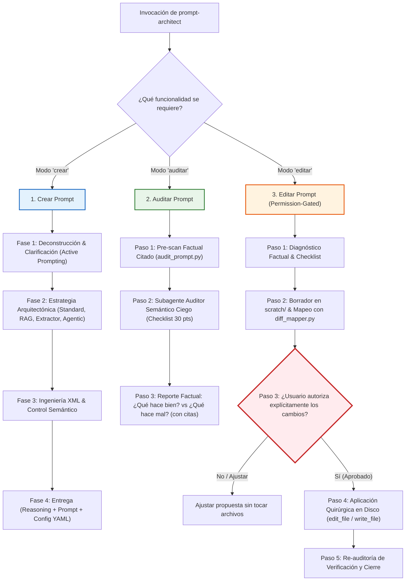

# Prompt Architect Skill (Calibrada y Basada en Fuentes Canónicas)

Esta skill proporciona herramientas y metodologías de ingeniería de prompts respaldadas por las guías oficiales de **Google DeepMind** (`prompting-strategies.md`, `prompting-strategies (1).md`) y el framework de diseño **Ultimate Prompt Architect** (`prompt_masterprompter.md`).

> [!IMPORTANT]
> **Integridad y Cero Overfitting:**
> - Cada regla de auditoría cuenta con una **cita bibliográfica directa** de las fuentes originales.
> - La calibración del motor se realiza sobre un benchmark sintético con defectos inyectados (`tests/calibration_cases.json`), no sobre los prompts del proyecto.
> - Las convenciones de infraestructura de Top's Academy (señales `DONE:`, `BLOCKED:`, turnos) están desacopladas en un chequeo auxiliar (`--pipeline-check`) y **no alteran** la evaluación de calidad de ingeniería de prompts.



---

## 1. Módulos y Referencias de la Skill

| Módulo / Archivo | Propósito y Contenido |
|:---|:---|
| `references/gemini_prompting_guide_2026.md` | Principios oficiales: delimitación XML, control semántico de verbosidad, Few-Shot afirmativo, long-context ordering, grounding estricto y razonamiento nativo. |
| `references/iteration_and_decomposition.md` | Iteración, tareas análogas, descomposición y encadenamiento, entradas multimodales y resolución de conflictos entre fuentes. |
| `references/agentic_si_template_original.md` | Plantilla original textual evaluada en benchmarks por investigadores de Google y matriz de 9 dimensiones. |
| `references/audit_rubric.md` | Catálogo canónico de reglas con citas directas y clasificación cualitativa de veredictos (Conforme / Aceptable / Requiere Refactorización / Crítico). |
| `references/semantic_audit_checklist.md` | Checklist exhaustivo de 30 ítems técnicos para auditoría semántica manual o por subagente. |
| `references/semantic_auditor_subagent.md` | Especificación y System Prompt del subagente auditor independiente y ciego. |
| `scripts/audit_prompt.py` | Pre-scan determinista con citas directas; soporta múltiples archivos, reportes Markdown, JSON y `--format summary`. Flag `--pipeline-check` opcional. |
| `scripts/calibrate_auditor.py` | Suite de calibración que valida 100% precisión y recall sobre el dataset sintético sin overfitting sobre el proyecto. |
| `scripts/diff_mapper.py` | Mapeo de cambios línea a línea y verificación estricta de preservación de tokens de contrato (placeholders, claves JSON, rutas). |
| `templates/*.xml` | Plantillas base (Estándar, RAG Long-Context, Extractor JSON y Subagente C2C) calibradas y verificadas contra el auditor. |

---

## 2. Los Tres Flujos Operativos

### 2.1 Flujo 1: Crear Prompt (`mode: "crear"`)
1. **Deconstrucción:** Analizar objetivo, modelo de inferencia, esquema de entrada/salida y modos de fallo a prevenir.
2. **Clarificación Activa:** Si existen incertidumbres estructurales, formular de 1 a 3 preguntas de alto impacto con `ask_question`. Si los requerimientos son suficientes, declarar supuestos y proceder.
3. **Selección de Plantilla y Redacción:**
   - Usar delimitadores consistentes (`<role>`, `<instructions>`, `<constraints>`, `<output_format>`, etc.).
   - Especificar verbosidad semántica (`Verbosity: Low/Medium/High`) y tono.
   - Aislar entradas del usuario dentro de etiquetas de datos inertes.
   - Incluir de 2 a 4 ejemplos variados demostrando **únicamente patrones positivos**.
   - Cero parámetros de sampling deprecados (`temperature`, `top_p`, `top_k`).
4. **Verificación Pre-Entrega:** Guardar borrador en `scratch/` y validar con `audit_prompt.py`.
5. **Entrega Formal:**
   - `<architectural_reasoning>`
   - Prompt de producción listo para usar
   - Configuración YAML recomendada (`target_model`, `thinking_level`, `tools`, `sampling notice`)

---

### 2.2 Flujo 2: Auditar Prompt (`mode: "auditar"`)
La auditoría se compone de dos capas complementarias:

1. **Paso 1: Pre-Scan Factual Citado (`audit_prompt.py`):**
   ```powershell
   python .agents/skills/prompt-architect/scripts/audit_prompt.py --path "<ruta_del_prompt>"
   ```
   - Emite un veredicto cualitativo técnico.
   - Lista explícitamente **¿Qué hace bien?** y **¿Qué hace mal o riesgos detectados?**, citando en cada punto el archivo y línea de la literatura oficial que lo respalda.
2. **Paso 2: Auditoría Semántica Ciega (Subagente Independiente):**
   - Para auditorías exhaustivas o revisiones previas a refactorización, despachar un subagente utilizando el system prompt definido en [`references/semantic_auditor_subagent.md`](references/semantic_auditor_subagent.md).
   - El subagente no ve el puntaje del pre-scan; lee el prompt y el código consumidor y evalúa los 30 ítems de [`references/semantic_audit_checklist.md`](references/semantic_audit_checklist.md), adjuntando evidencia textual para cada conclusión.

---

### 2.3 Flujo 3: Editar Prompt (`mode: "editar"`)
Sujeto a la **Regla Inviolable de Autorización**:

1. **Auditar** el archivo original para fijar la línea base.
2. **Generar Propuesta** en `<artifact_dir>/scratch/<archivo>.proposed.md` (nunca directamente en el repositorio).
3. **Mapear Cambios y Preservación de Contratos:**
   ```powershell
   python .agents/skills/prompt-architect/scripts/diff_mapper.py --original "<ruta_orig>" --proposed "<scratch>/<archivo>.proposed.md" --reason "<justificación>"
   ```
   - Verifica que no se hayan perdido placeholders (`{comp_id}`, `<work_dir>`), rutas o claves JSON. Si se detectan pérdidas no deseadas, el script devuelve código de salida 2 y bloquea la operación.
4. **Presentar Mapeo y Solicitar Permiso Expreso:**
   - Mostrar tabla comparativa y diff unificado.
   - Preguntar explícitamente con `ask_question` si autoriza la aplicación.
5. **Aplicación y Verificación:**
   - Solo tras la autorización expresa, aplicar cambios sobre el archivo con `edit_file` o `write_file`.
   - Ejecutar re-auditoría sobre el archivo modificado para certificar la resolución de los hallazgos.

---

## 3. Calibración y Mantenimiento

Para verificar que el motor de auditoría mantiene 100% de precisión y cero overfitting:
```powershell
python .agents/skills/prompt-architect/scripts/calibrate_auditor.py
```
Este comando corre el banco de pruebas sintético con defectos inyectados y debe certificar 0 falsos positivos y 100% recall.
