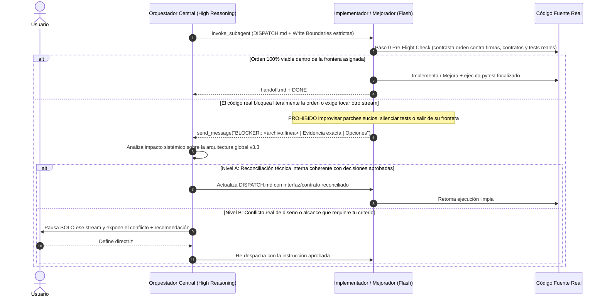
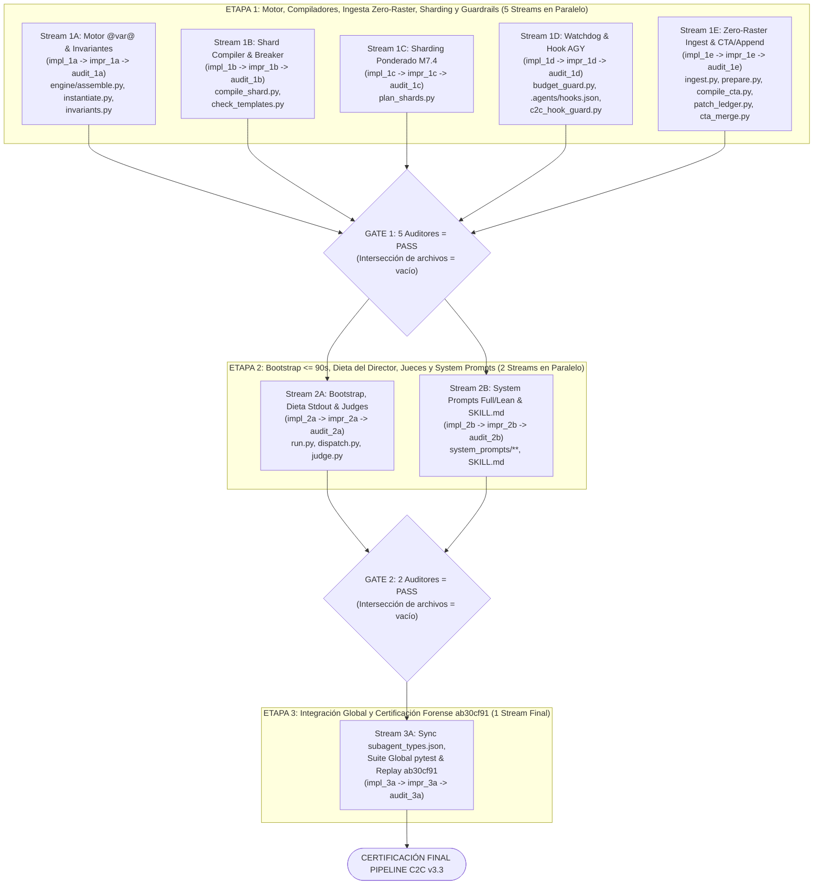

# Plan Maestro de Acción C2C v3.3: Cierre Integral de Eficiencia, Inicialización ≤ 90s, Dieta del Director y Orquestación por Tríadas (`/teamwork-preview`)

> [!IMPORTANT]
> **Síntesis de Decisiones Cerradas (`/grill-me` Rondas 1 y 2):**
> - **Perímetro Integral C2C v3.3:** Atacar **de una sola vez el 100% de los problemas de eficiencia** documentados en [`ANALISIS_DETALLADO_BOTTLENECKS_Y_TIEMPOS_ETAPAS_C2C.md`](file:///d:/Augusto/personal_portfolio/Tops_academy/reports/c2c_audits/ANALISIS_DETALLADO_BOTTLENECKS_Y_TIEMPOS_ETAPAS_C2C.md) (Bottlenecks #1 al #13), las 12 categorías de error de [`report.md` (`ab30cf91`)](file:///d:/Augusto/personal_portfolio/Tops_academy/reports/c2c_audits/20261023_163854_asyntotic_estatistics_v2_ab30cf91/report.md) y los **Milestones 3, 4 y 7** de [`FUTURE_MILESTONES.md`](file:///d:/Augusto/personal_portfolio/Tops_academy/FUTURE_MILESTONES.md) (sin cambios al frontend React).
> - **SLA de Inicialización (de 4–6+ min a ≤ 60–90s):** Ingesta PDF **Zero-Raster** en [`ingest.py`](file:///d:/Augusto/personal_portfolio/Tops_academy/.agents/skills/content-to-course/ingest.py) (desactivando el renderizado muerto de PNGs a 150 DPI para PDFs), corrección del bug `sources[0].parent` en [`prepare.py`](file:///d:/Augusto/personal_portfolio/Tops_academy/.agents/skills/content-to-course/prepare.py), y nuevo comando todo-en-uno `run.py --stage bootstrap` (`prepare` + specs `lean=True` silenciosos + `dispatch-cta` con `pointer=True`).
> - **Cero Sobresaturación de la Conversación Principal del Director (de 84 turnos a ~12–16 turnos):** `pointer=True` como estándar global en [`dispatch.py`](file:///d:/Augusto/personal_portfolio/Tops_academy/.agents/skills/content-to-course/dispatch.py), tope estricto de `stdout ≤ 1.5 KB` en [`run.py`](file:///d:/Augusto/personal_portfolio/Tops_academy/.agents/skills/content-to-course/run.py) (volcando detalle a `work/logs/`), **Protocolo de Barrera Reactiva Silenciosa** ante `DONE` parciales (`k < N`), y bloqueo por hook `PreToolUse` impidiendo que el Director lea o edite `*_data.py` (toda reparación pasa por `c2c_repair`).
> - **Desacoplamiento KaTeX-Python y Cierre Forense:** Tokens ortogonales `@var@` / `@var:fmt@` en raw strings `r"..."` en todos los campos, prohibición de `rf"..."`, bloqueo de placeholders residuales (`{delta}` / `@var@`), shuffle por reactivo `crc32(template_id:idx:seed)` en [`judge.py`](file:///d:/Augusto/personal_portfolio/Tops_academy/.agents/skills/content-to-course/judge.py), separación entre healing sintáctico inocuo y degradación real en [`patch_ledger.py`](file:///d:/Augusto/personal_portfolio/Tops_academy/.agents/skills/content-to-course/patch_ledger.py), cableado completo de `delta_manifest.json` en `--append`, y auto-resolución de `.venv/Scripts/python.exe` + `PYTHONPATH`.
> - **Ejecución Multi-Agente (`/teamwork-preview`):** Orquestador central en modelo de alto razonamiento (*Dispatch-Only & Escalation Resolver*) + **24 subagentes `Model="flash"` (Gemini 3.8 Flash)** organizados en **8 tríadas (`Implementador → Mejorador → Auditor`)** a través de **3 Etapas con máxima paralelización y 0% colisión de archivos**.

---

## 1. Diagnóstico Raíz de Inicialización (4–6 min) y Sobresaturación del Director (84 Turnos)

### 1.1. ¿Por qué la inicialización tardaba 4–6 minutos (hasta 9.2 min en `f9b9d459`)?
La inspección directa del código fuente reveló **cinco causas acumulativas**:
1. **Rasterización PNG muerta en [`ingest_course()`](file:///d:/Augusto/personal_portfolio/Tops_academy/.agents/skills/content-to-course/ingest.py#L291-L302):** En cada corrida, Stage 0 renderiza síncronamente cada página PDF a PNG de 150 DPI (`work/pages/<slug>/page_XXX.png`), pese a que **ningún módulo ni agente de C2C v3.2+ lee jamás esos PNGs** (todos leen el PDF nativo o los slices PDF sin pérdida de [`partition_corpus.py`](file:///d:/Augusto/personal_portfolio/Tops_academy/.agents/skills/content-to-course/partition_corpus.py)).
2. **Expansión accidental a toda la carpeta padre en [`prepare_course()`](file:///d:/Augusto/personal_portfolio/Tops_academy/.agents/skills/content-to-course/prepare.py#L191):** Al recibir 2+ PDFs específicos, ejecuta `input_target = sources[0] if len(sources) == 1 else sources[0].parent`, ingiriendo y renderizando a 150 DPI **todos los demás PDFs ajenos** ubicados en el mismo directorio.
3. **Volcado de 87 KB a consola en [`run_stage_define_types()`](file:///d:/Augusto/personal_portfolio/Tops_academy/.agents/skills/content-to-course/run.py#L1100):** `print(types_json)` imprime los `87,205 bytes` de `subagent_types.json` (`lean=False`), provocando truncamiento de salida y forzando turnos adicionales de `read_file` antes de registrar `define_subagent`.
4. **`pointer=False` por defecto en [`dispatch_cta()`](file:///d:/Augusto/personal_portfolio/Tops_academy/.agents/skills/content-to-course/dispatch.py#L435):** Sin `--pointer`, el comando imprime prompts completos duplicados (`Prompt` y `work_order`), obligando al Director a leerlos y re-tipearlos.
5. **Secuencia de arranque fragmentada en 5–6 turnos secuenciales del Director** en vez de una única operación atómica `bootstrap`.

### 1.2. ¿Por qué la conversación principal del Director se sobresaturaba (84 turnos y 18.4m de CLI en `ab30cf91`)?
1. **`pointer=False` global en [`dispatch.py`](file:///d:/Augusto/personal_portfolio/Tops_academy/.agents/skills/content-to-course/dispatch.py#L742) y [`run_stage_dispatch()`](file:///d:/Augusto/personal_portfolio/Tops_academy/.agents/skills/content-to-course/run.py#L1040):** Inyectaba decenas de miles de tokens de órdenes de trabajo en el historial del Director, re-facturados en caché durante los 80 turnos siguientes y disparando compactaciones `CHECKPOINT`.
2. **Tormenta de despertares reactivos (`Wakeup Storm`):** Cuando 16 autores terminan en marcas de tiempo escalonadas (`381s` a `2048s`), cada `send_message("DONE: ...")` despierta al Director. Al no existir una **Barrera Reactiva Silenciosa**, el Director ejecutaba comandos CLI exploratorios (`ls`, `check_templates`, `view_file`) en despertares intermedios.
3. **Violación del rol *Dispatch-Only*:** Ante fallos de shards, el Director leía `shard_XX_data.py` e intentaba depurarlos manualmente en su propia conversación (causando 12 `TPL-VAR`, 6 `ModuleNotFoundError` y 8 `FileNotFoundError` en el propio Orquestador), en vez de delegar inmediatamente a `c2c_repair`.

---

## 2. Matriz Maestra de Trazabilidad: Los 13 Bottlenecks + Hallazgos Forenses `ab30cf91`

Siguiendo la evaluación crítica de soluciones (guía de qué propuestas del reporte hacen sentido y cuáles debían corregirse):

| ID | Problema / Bottleneck | Evaluación de la Propuesta Original (`Quote`) | Solución Definitiva en C2C v3.3 | Stream Responsable |
| :-: | :--- | :--- | :--- | :-: |
| **#1** | Colisión KaTeX `{...}` vs f-strings (`R-20`, 42 errores en `ab30cf91`) | ⚠️ **Incompleta:** `assemble.py` ya usaba regex parcial, pero omitía `FIB`/`MS` y `prompt_shard_author.md` exigía `rf"{{{...}}}"`. | Tokens ortogonales **`@var@` / `@var:fmt@`** en `r"..."` para `MC7`, `FIB`, `MS`, `hints` y `solution`; `{var}` retrocompatible; prohibido `rf"..."`; bloqueo de placeholders `@var@`/`{key}` sin interpolar (`{delta}` en `Judge 04`). | **1A, 1B, 2B** |
| **#2** | Conflicto epistémico en Jueces Ciegos + fuga de patrón de respuesta (`B`/`C`) | ❌ **Rota con `--pointer`:** `make_pointer_prompt` pedía `view_file` mientras `judge_XX.json` lo prohibía; además `seeds=(101,202)` fijaban la respuesta correcta en la misma letra. | `pointer=True` coherente (`judge_XX.json` como **único** `READ permitido`, prohibidos `ground_truth`/`templates`/web) + **shuffle criptográfico por reactivo** `crc32(template_id:idx:seed)` en [`judge.py`](file:///d:/Augusto/personal_portfolio/Tops_academy/.agents/skills/content-to-course/judge.py). | **2A, 2B** |
| **#3** | Reescritura monolítica vs 51 micro-ediciones y `Target Mismatch` | ⚠️ **Parcial:** `prompt_shard_author.md` prohibía `Overwrite=True` y `heal_shard_source_file` mutaba `shard_XX_data.py` en compilaciones fallidas. | **Zero-Disk-Mutation** en compilación fallida (`heal` en memoria), protocolo híbrido (`edit_file` ≤ 15 líneas) y splicing modular limpio en `work/shards/shard_fixes/<CID>.py`. | **1B, 2B** |
| **#4** | Circuit Breaker ciego `[COMPILE n/6]` desconectado de `check_templates.py` | ✅ **Correcta:** Unificar estado por hash SHA-256 de código y de errores. | Máquina de estados unificada `(last_source_sha256, last_err_hash, same_error_streak >= 3, distinct_compiles > 10)` + re-ejecución idempotente `[NO-CHANGE]` sin castigo. | **1B** |
| **#5** | Introspección prohibida de `compile_shard.py` (`shard_01`) y `[TPL-DRY]` opaco | ⚠️ **Contradicción en código:** `dispatch.py` listaba `compile_shard.py` como `READ permitido` y solo se prohibía en texto. | Quitar `compile_shard.py` de `read` en `ROLE_SPECS`, enriquecer `[TPL-DRY]` con línea/seed/variable exacta, e imponer **bloqueo duro** vía `.agents/hooks.json` (`PreToolUse`). | **1B, 1D, 2A** |
| **#6** | Exploración excesiva en CTA + falso positivo `PATCH_LEDGER_ALERT > 3.0%` + `ArtifactMetadata` | ⚠️ **Fricción residual en `ab30cf91`:** Envolver `$Q_{zx}^{-1}$` contó como `degraded` (`10/16 = 62.5%`) y `part_01` falló al pasar `ArtifactMetadata`. | Excluir normalizaciones LaTeX deterministas (`healed`) del conteo `degraded` y usar el denominador real de campos en [`patch_ledger.py`](file:///d:/Augusto/personal_portfolio/Tops_academy/.agents/skills/content-to-course/patch_ledger.py); prohibir `ArtifactMetadata` en `write_file` hacia `work/`. | **1E, 2B** |
| **#7** | Quoting PowerShell, Unicode `\ufffd` y `6` `ModuleNotFoundError` | ⚠️ **Faltaba entorno Python:** El fallback `\ufffd` ya existía, pero los comandos CLI no fijaban `.venv` ni `PYTHONPATH`. | Auto-resolución determinista de `.venv/Scripts/python.exe` + inyección de `PYTHONPATH` en `dispatch.py`/`run.py`; bloqueo por hook de `python -c` con comillas anidadas en workers C2C. | **1D, 2A, 2B** |
| **#8** | Lotes monolíticos en Jueces y `CHECKPOINT` + Sobresaturación del Director | ⚠️ **`pointer=False` seguía por defecto:** Volcaba JSONs gigantes al `stdout` del Director y despertaba 24 veces con comandos exploratorios. | `pointer=True` universal + `stdout ≤ 1.5 KB` (`work/logs/<stage>.log`) + **Barrera Reactiva Silenciosa** + Hook que impide al Director leer/editar `*_data.py` + streaming por oleadas `≤ 12` ítems. | **1D, 2A, 2B** |
| **#9** | Congelamiento `429` y `budget_guard.py` ciego al transcript real | ❌ **Rota en código:** `budget_guard.py` buscaba en `work/transcripts/` e ignoraba `PLANNER_RESPONSE` y tokens cacheados. | Conectar `budget_guard.py` a `<appDataDir>/brain/<id>/.system_generated/logs/transcript.jsonl`, parsear `PLANNER_RESPONSE` + caché, oleadas `≤ 10` autores y pulsos re-armables cada 5 min. | **1C, 1D, 2A** |
| **#10** | Purga accidental de workspaces activos en `delete_course.py` | ✅ **Ya implementada:** Guardia `is_active_workspace` activa. | Proteger con test de regresión explícito sobre `work_append/` y `pre_cta_manifest.json` reciente para certificar cero regresiones. | **1E** |
| **#11** | Ceguera Delta en modo `--append` | ❌ **Rota en `cta_merge.py` y `dispatch_cta`:** `prepare.py` creaba `delta_manifest.json`, pero `cta_merge.py` reseteaba `fact_count = 0`! | Cablear `delta_manifest.json` (`next_ids_by_prefix` + resumen de competencias previas) de punta a punta en `dispatch_cta` → `compile_cta.py` → `cta_merge.py`. | **1E, 2A** |
| **#12** | Paradoja de granularidad y stragglers `Hab-*` dobles (`shard_06`: 34.1m) | ❌ **Contradictoria en reporte:** Pedía 60–70 comps fijas y asumía `N/8` cuando `plan_shards.py` agrupaba pares `Hab-03 + Hab-04`. | Mantener `standard` como **densidad relativa por páginas** (3–5 comps / 5–10 págs) y aislar **máximo 1 `Skill` (`Hab-*`) por shard** (Milestone 7.4), despachadas al frente de la Oleada 1. | **1C, 2B** |
| **#13** | Inicialización lenta de 4–6+ min (meta: **≤ 1–2 min**) | ❌ **Diagnóstico errado en reporte:** Culpaba a Python I/O y pedía Zero-Turn imposible en SDK. | **Zero-Raster PDF Ingest** en `ingest.py` (`< 0.5s` vs minutos de PNGs 150 DPI) + fix `sources` en `prepare.py` + `run.py --stage bootstrap` (`lean=True` silencioso + `dispatch-cta` pointer) en **≤ 60–90s**. | **1E, 2A, 2B** |
| **E-01 / E-06** | `TPL-VAR / TPL-COLLAPSE` (43 errores = 32.1%) y `R-16` paridad de longitud (7 errores) | ⚠️ **Sin cobertura previa:** Ejemplos usaban 1 solo stem fijo y `calibrate_option_lengths` era un stub sin diagnóstico. | Exigir `stem_variants` (3–5 variantes disjuntas) en prompts + diagnóstico exacto de colisiones/seeds (`TPL-VAR`) y tabla exacta de caracteres/ratios (`R-16`, cero relleno artificial) en `check_templates.py`. | **1A, 1B, 2B** |

---

## 3. Metodología de Ejecución Multi-Agente (`/teamwork-preview` + Tríadas `Flash`)

### 3.1. Roles, Modelos y Reglas de Fuego
1. **Orquestador Estratégico (Conversación Principal — Modelo de Alto Razonamiento):**
   - Opera estrictamente como **Dispatch-Only & Escalation Resolver**: inicializa `.agents/teamwork/c2c_v33_hardening/`, despacha subagentes en paralelo con `invoke_subagent`, consolida `GATE_STATUS.md` y resuelve bloqueos arquitectónicos.
   - **Prohibido** editar archivos de producción directamente.
2. **Tríada Secuencial por cada Stream (`Model="flash"` → Gemini 3.8 Flash):**
   Mientras distintos streams de una misma Etapa corren **en paralelo simultáneo**, cada stream $S_k$ ejecuta rigurosamente sus 3 fases:
   - **Fase 1 — Implementador (`impl_<stream>`, `Model="flash"`, `EnableWriteTools=True`):** Ejecuta el *Pre-Flight Sanity Check*, implementa los cambios dentro de su frontera exclusiva de archivos, escribe la batería de tests unitarios y entrega `handoff.md`.
   - **Fase 2 — Mejorador (`impr_<stream>`, `Model="flash"`, `EnableWriteTools=True`):** Audita críticamente el `git diff` del Implementador, pule casos borde (Windows paths, CRLF, atomicidad `os.replace`, retrocompatibilidad CLI, velocidad), amplía los tests con casos adversariales reales de `ab30cf91` y actualiza `handoff.md`.
   - **Fase 3 — Auditor Forense (`audit_<stream>`, `Model="flash"`, escritura restringida a su carpeta `.agents/teamwork/`):** Verifica con `git status`/`git diff` que **ningún archivo fuera del write-boundary** haya sido tocado, inspecciona que no existan mocks engañosos ni aserciones debilitadas, corre `pytest` de forma independiente y emite **`PASS`** o **`REJECT`**. Un `REJECT` reabre automáticamente una pasada de Mejorador antes de cruzar el Gate.

### 3.2. Protocolo Inviolable de Verificación de Orden y Escalamiento (`BLOCKER::`)



---

## 4. Topología de Etapas y Paralelismo Máximo (Cero Colisión de Archivos)



### Garantía Matemática de Disyunción de Escritura
- **Etapa 1 (5 tríadas simultáneas):** `Files(1A) ∩ Files(1B) ∩ Files(1C) ∩ Files(1D) ∩ Files(1E) = ∅`.
- **Etapa 2 (2 tríadas simultáneas):** `Files(2A) ∩ Files(2B) = ∅`.
- **Etapa 3 (1 tríada integradora):** Regenera `subagent_types.json` uniendo `2A` + `2B` y ejecuta la certificación completa.

---

## 5. Especificación Técnica por Stream — Etapa 1 (5 Streams Concurrentes)

### Stream 1A: Motor PrairieLearn `@var@`, Invariantes Anti-Placeholder y Métricas `R-16`
- **Write Boundaries:**
  - [`.agents/skills/content-to-course/engine/assemble.py`](file:///d:/Augusto/personal_portfolio/Tops_academy/.agents/skills/content-to-course/engine/assemble.py)
  - [`.agents/skills/content-to-course/engine/instantiate.py`](file:///d:/Augusto/personal_portfolio/Tops_academy/.agents/skills/content-to-course/engine/instantiate.py)
  - [`.agents/skills/content-to-course/engine/invariants.py`](file:///d:/Augusto/personal_portfolio/Tops_academy/.agents/skills/content-to-course/engine/invariants.py)
  - `tests/test_katex_prairielearn_tokens.py` *(nuevo)*
- **Implementador (`impl_1a`):**
  1. En [`render_template()`](file:///d:/Augusto/personal_portfolio/Tops_academy/.agents/skills/content-to-course/engine/assemble.py#L94-L166), implementar **Fase 0 de interpolación ortogonal `@var@` y `@var:fmt@`** (incluyendo nombres de 1 carácter como `@n@`, `@k@`, `@r@`), preservando intacta la interpolación `{var}` posterior para 100% de retrocompatibilidad.
  2. En [`assemble_question()`](file:///d:/Augusto/personal_portfolio/Tops_academy/.agents/skills/content-to-course/engine/assemble.py#L302-L505), extender `format_template_string(..., variables)` + `sanitize_katex_syntax()` a `fill_in_the_blank` (`ans_val` y `equivalents`) y `multiple_select` (`content`/`value` y `error_rationale`).
  3. Mantener [`calibrate_option_lengths()`](file:///d:/Augusto/personal_portfolio/Tops_academy/.agents/skills/content-to-course/engine/assemble.py#L275-L300) **sin relleno artificial de texto** y añadir `compute_option_length_metrics(correct_text, distractors)` para exponer longitudes exactas y ratios a los validadores.
  4. En [`invariants.py`](file:///d:/Augusto/personal_portfolio/Tops_academy/.agents/skills/content-to-course/engine/invariants.py), bloquear deterministamente cualquier instancia que conserve un token `@ident@` sin resolver **o** un placeholder `{key}` cuyo identificador exista en `vars` o sea un marcador huérfano fuera de comandos LaTeX (cerrando la fuga `{delta}` observada en `Judge 04`).
- **Mejorador (`impr_1a`):** Probar tensores/subíndices anidados (`\mathbf{I}_{@k_dim@}`, `\frac{@a1@^2}{(Z'X)^{-1}}`), formatos `@x:+.4f@`, literales `@` inocuos y velocidad de ensamblado.
- **Auditor (`audit_1a`):** `pytest tests/test_katex_prairielearn_tokens.py` + tests existentes de `engine/`.

---

### Stream 1B: Compilador de Shards Inmutable en Fallo, Circuit Breaker Unificado y Diagnósticos `TPL-VAR` / `R-16`
- **Write Boundaries:**
  - [`.agents/skills/content-to-course/compile_shard.py`](file:///d:/Augusto/personal_portfolio/Tops_academy/.agents/skills/content-to-course/compile_shard.py)
  - [`.agents/skills/content-to-course/check_templates.py`](file:///d:/Augusto/personal_portfolio/Tops_academy/.agents/skills/content-to-course/check_templates.py)
  - `tests/test_shard_compiler_hardening.py` *(nuevo)*
- **Implementador (`impl_1b`):**
  1. **Circuit Breaker Inteligente Unificado (`compile_shard.py` + `check_templates.py`):** Sustituir el contador ciego `[COMPILE n/6]` por estado `(last_source_sha256, last_err_hash, same_error_streak, distinct_compiles)`. Si el SHA-256 combinado (`shard_XX_data.py` + `shard_fixes/*.py`) no cambió, emitir `[NO-CHANGE]` sin incrementar contadores; bloquear solo si `same_error_streak >= 3` o `distinct_compiles > 10`; resetear al lograr `PASS`.
  2. **Zero-Disk-Mutation en Compilaciones Fallidas:** `heal_shard_source_file()` opera **en memoria** (o staging interno en `.check_attempts/_staged/`), jamás sobre `shard_XX_data.py` cuando la compilación falla, erradicando `Target Mismatch` en `edit_file`.
  3. **Splicing Modular `work/shards/shard_fixes/<CID>.py`:** Si existen archivos por competencia en `shard_fixes/<CID>.py`, reemplazar limpiamente las tuplas de `<CID>` al compilar y reportar números de línea exactos sobre `shard_fixes/<CID>.py`.
  4. **Diagnósticos Quirúrgicos (`[TPL-DRY]`, `TPL-VAR/COLLAPSE`, `R-16` y Placeholders):**
     - En `TPL-VAR / TPL-COLLAPSE`: reportar la primera `seed` colisionante, las opciones idénticas exactas y las claves estáticas de `vars`, más alerta AST temprana si detecta `rf"..."` con `{{{`.
     - En `R-16`: imprimir tabla exacta `len(correct)=X vs avg(distractors)=Y (ratio=Z, rango permitido=[0.65, 1.35])`.
     - En `[TPL-DRY]`: mapear excepción + `seed` + línea exacta en `shard_XX_data.py` sin exponer rutas internas del compilador, y rechazar placeholders `@ident@`/`{var_key}` sin sustituir.
- **Mejorador (`impr_1b`):** Validar concurrencia de `.check_attempts`, exactitud de `ShardDataLineLocator` con `shard_fixes/` y manejo de CRLF en Windows.
- **Auditor (`audit_1b`):** `pytest tests/test_shard_compiler_hardening.py tests/test_compile_shard.py tests/test_c2c_case_2b_mastery.py`.

---

### Stream 1C: Particionado Ponderado por Complejidad Cognitiva (`1 Hab/shard`) y Oleadas (Milestone 7.4)
- **Write Boundaries:**
  - [`.agents/skills/content-to-course/plan_shards.py`](file:///d:/Augusto/personal_portfolio/Tops_academy/.agents/skills/content-to-course/plan_shards.py)
  - `tests/test_weighted_sharding_m7.py` *(nuevo)*
- **Implementador (`impl_1c`):**
  1. Refactorizar la agrupación de `plan_shards.py` bajo Caso 2B: **toda competencia `skill` (`Hab-*`) va aislada en su propio shard individual (`max 1 Hab por shard`)**, mientras que `concept` (`C-*`) y `fact` (`H-*`) se agrupan contiguamente de 2 en 2 (o hasta 3 `fact` en cursos `N >= 30`).
  2. Calcular `estimated_weight` (`Skill=6.0`, `Concept=2.5`, `Fact=1.5`), ordenar `Heaviest-First` (todas las `Hab-*` en la primera oleada en `t=0`) y etiquetar `wave_index` (`max_wave_concurrency = 10` por defecto).
  3. Actualizar `DSL_REFERENCE` con `@var@`, `stem_variants` (3–5) y `shard_fixes/<CID>.py`.
- **Mejorador (`impr_1c`):** Garantizar retrocompatibilidad cuando tests antiguos pasan `k` o `max_comps` explícitos y probar distribuciones extremas (1 comp, 32 comps de Greene, 118 comps).
- **Auditor (`audit_1c`):** `pytest tests/test_weighted_sharding_m7.py` + tests existentes de `plan_shards`.

---

### Stream 1D: Watchdog Conectado a `<appDataDir>/brain/` y Hook Dual `.agents/hooks.json` (Workers + Director)
- **Write Boundaries:**
  - [`.agents/skills/content-to-course/budget_guard.py`](file:///d:/Augusto/personal_portfolio/Tops_academy/.agents/skills/content-to-course/budget_guard.py)
  - `.agents/hooks.json` *(nuevo)*
  - `.agents/skills/content-to-course/c2c_hook_guard.py` *(nuevo)*
  - `tests/test_watchdog_and_hooks.py` *(nuevo)*
- **Implementador (`impl_1d`):**
  1. **Conexión Real de `budget_guard.py`:** Resolver automáticamente `<appDataDir>/brain/<subagent_id>/.system_generated/logs/transcript.jsonl` (`%USERPROFILE%\.gemini\antigravity\brain`), parsear pasos `"type": "PLANNER_RESPONSE"` (`tool_calls`, longitud de `thinking` y estimación acumulada de contexto/caché), emitir órdenes `c2c_repair` apuntando a `shard_fixes/<CID>.py` e indicar `next_schedule_seconds: 300` mientras queden unidades vivas.
  2. **Guardrail Condicional `.agents/hooks.json` (`PreToolUse` → `c2c_hook_guard.py`):**
     - **Cero interferencia fuera de corridas C2C:** Si no existe `courses/*/work*/.c2c_subagent_lock.json` vigente (`< 2h`), responde `{"decision": "allow"}` en `< 15 ms`.
     - **Protección de Dieta del Director (`conversationId == director_conversation_id`):** Permite `run_command` de orquestación y lectura de reportes compactos (`state.json`, `judge_report.json`, `dispatch/*.json`), pero **DENIEGA** `read_file`/`view_file`/`edit_file`/`write_file` sobre `*_data.py`, `shard_fixes/*.py` y `judge_responses_*.json`, obligando a delegar reparaciones a `c2c_repair`.
     - **Aislamiento de Subagentes Workers (`conversationId != director_conversation_id`):** **DENIEGA** lecturas de `compile_shard.py`, `check_templates.py`, `compile_cta.py`, `check_cta.py`, `engine/`, `src/validator/`, `.check_attempts/`, `judge_ground_truth.json` y `SKILL.md`, así como `run_command` con `python -c` de comillas anidadas o manipulación de `.check_attempts`.
- **Mejorador (`impr_1d`):** Validar formato exacto JSON camelCase de `hooks.json`, normalización de rutas Windows (`/` vs `\`), exclusión limpia de agentes auditores post-corrida (cuando el lock ya se liberó) y latencia `< 50 ms`.
- **Auditor (`audit_1d`):** `pytest tests/test_watchdog_and_hooks.py`.

---

### Stream 1E: Ingesta PDF Zero-Raster (`< 1s`), Fix Multi-PDF `sources`, `PATCH_LEDGER_ALERT` y `--append` CTA End-to-End
- **Write Boundaries:**
  - [`.agents/skills/content-to-course/ingest.py`](file:///d:/Augusto/personal_portfolio/Tops_academy/.agents/skills/content-to-course/ingest.py)
  - [`.agents/skills/content-to-course/prepare.py`](file:///d:/Augusto/personal_portfolio/Tops_academy/.agents/skills/content-to-course/prepare.py)
  - [`.agents/skills/content-to-course/compile_cta.py`](file:///d:/Augusto/personal_portfolio/Tops_academy/.agents/skills/content-to-course/compile_cta.py)
  - [`.agents/skills/content-to-course/patch_ledger.py`](file:///d:/Augusto/personal_portfolio/Tops_academy/.agents/skills/content-to-course/patch_ledger.py)
  - [`.agents/skills/content-to-course/cta_merge.py`](file:///d:/Augusto/personal_portfolio/Tops_academy/.agents/skills/content-to-course/cta_merge.py)
  - `tests/test_fast_ingest_and_cta_append.py` *(nuevo)*
- **Implementador (`impl_1e`):**
  1. **Zero-Raster PDF Ingest en [`ingest_course()`](file:///d:/Augusto/personal_portfolio/Tops_academy/.agents/skills/content-to-course/ingest.py#L201-L355):** Cambiar `render_pages: bool = False` por defecto para archivos PDF (solo abre con `pymupdf`, lee `len(doc)` y metadatos en `< 0.3s` sin renderizar PNGs a 150 DPI; conserva `--render-pages` explícito y el tiling PNG para imágenes raster `> 3072px`). Añadir parámetro `input_files: Optional[Sequence[Union[str, Path]]] = None`.
  2. **Fix Multi-PDF en [`prepare_course()`](file:///d:/Augusto/personal_portfolio/Tops_academy/.agents/skills/content-to-course/prepare.py#L190-L202):** Eliminar `sources[0].parent`; pasar `input_files=sources` directamente a `ingest_course()` para no ingerir jamás archivos ajenos del directorio padre. En modo `--append`, enriquecer `delta_manifest.json` con `existing_competencies_outline` (`[{id, type, name}]`).
  3. **Separación de Healing Inocuo vs Degradación en [`compile_cta.py`](file:///d:/Augusto/personal_portfolio/Tops_academy/.agents/skills/content-to-course/compile_cta.py) y [`patch_ledger.py`](file:///d:/Augusto/personal_portfolio/Tops_academy/.agents/skills/content-to-course/patch_ledger.py):** Clasificar toda envoltura matemática determinista (`$...$`, `{{x}} -> {x}`, `r"..."`, control chars) estrictamente como `severity="healed"` (reservando `"degraded"` solo para truncamientos o escapes `\text{...}` de emergencia) y fijar el denominador de `PatchLedger` sobre el total real de campos evaluados (`total_evaluated_fields`), eliminando los falsos rechazos del 62.5%.
  4. **Cableado Continuo de `--append` en [`compile_cta.py`](file:///d:/Augusto/personal_portfolio/Tops_academy/.agents/skills/content-to-course/compile_cta.py) y [`cta_merge.py`](file:///d:/Augusto/personal_portfolio/Tops_academy/.agents/skills/content-to-course/cta_merge.py#L508-L545):** Leer `delta_manifest.json` / `pre_cta_manifest.json["delta"]["next_ids_by_prefix"]` para inicializar `fact_count = next_H - 1`, `concept_count = next_C - 1`, `skill_count = next_Hab - 1` en lugar de `0`, manteniendo numeración continua desde Stage 1 hasta Stage 6.
  5. **Test de Regresión de Bottleneck #10 (`delete_course.py`):** Incluir en `tests/test_fast_ingest_and_cta_append.py` prueba explícita verificando que `clean_orphan_course_dirs` preserva intactos tanto `work/` como `work_append/` activos.
- **Mejorador (`impr_1e`):** Verificar compatibilidad con tests heredados de `ingest.py` que esperen `work/pages/*.png` (habilitando `render_pages` cuando se pasa explícitamente `--dpi` en CLI directo de `ingest.py` o ajustando según firmas existentes detectadas en Pre-Flight).
- **Auditor (`audit_1e`):** `pytest tests/test_fast_ingest_and_cta_append.py` + suites existentes de `ingest`, `prepare`, `compile_cta`, `cta_merge` y `delete_course`.

---

## 6. Especificación Técnica por Stream — Etapa 2 (2 Streams Concurrentes Post-Gate 1)

### Stream 2A: Stage `bootstrap` (≤ 60–90s), Dieta de Stdout (`pointer=True`), Auto-`.venv` y `judge.py` Criptográfico
- **Write Boundaries:**
  - [`.agents/skills/content-to-course/run.py`](file:///d:/Augusto/personal_portfolio/Tops_academy/.agents/skills/content-to-course/run.py)
  - [`.agents/skills/content-to-course/dispatch.py`](file:///d:/Augusto/personal_portfolio/Tops_academy/.agents/skills/content-to-course/dispatch.py)
  - [`.agents/skills/content-to-course/judge.py`](file:///d:/Augusto/personal_portfolio/Tops_academy/.agents/skills/content-to-course/judge.py)
  - `tests/test_bootstrap_and_wave_streaming.py` *(nuevo)*
- **Implementador (`impl_2a`):**
  1. **Nuevo `run.py --stage bootstrap` (`< 5s` de cómputo local, arranque total ≤ 60–90s):**
     - Ejecuta en cadena atómica: `prepare` (Zero-Raster) → `generate_define_subagent_specs(work_dir, lean=True)` (escribiendo `work/dispatch/types/*.json` **sin imprimir los 87 KB a stdout**) → `dispatch_cta(work_dir, pointer=True)` → crea `work/.c2c_subagent_lock.json` (registrando `--director-id`) → imprime un resumen JSON compacto (`≤ 1.5 KB`) con las rutas de los 4 tipos `lean` y el arreglo `Subagents` de punteros listo para `invoke_subagent`.
     - Liberar `.c2c_subagent_lock.json` automáticamente al completar `publish` o con `--unlock`.
  2. **Dieta Estricta de Contexto (`pointer=True` por defecto + `stdout ≤ 1.5 KB`):**
     - Cambiar el valor por defecto a `pointer: bool = True` en [`dispatch_cta()`](file:///d:/Augusto/personal_portfolio/Tops_academy/.agents/skills/content-to-course/dispatch.py#L435), [`dispatch_authors()`](file:///d:/Augusto/personal_portfolio/Tops_academy/.agents/skills/content-to-course/dispatch.py#L742) y [`dispatch_judges()`](file:///d:/Augusto/personal_portfolio/Tops_academy/.agents/skills/content-to-course/dispatch.py#L1039) (soportando `--no-pointer` si un test unitario requiere el payload expandido).
     - En [`run.py`](file:///d:/Augusto/personal_portfolio/Tops_academy/.agents/skills/content-to-course/run.py), guardar salidas extensas y listados completos en `work/logs/<stage>.log` y mantener la salida estándar de cada etapa por debajo de `1.5 KB` para cero truncamientos en Antigravity.
     - Añadir subcomando ligero `run.py --stage wave-status --work-dir <dir>` (`< 150 ms`, salida de 5 líneas) para verificar conteo `completados / pendientes / fallidos` al cierre de una oleada.
  3. **Auto-Resolución de `.venv/Scripts/python.exe` + `PYTHONPATH` e Inyección `--append` en `dispatch.py`:**
     - Detectar automáticamente el ejecutable `.venv/Scripts/python.exe` del repositorio e inyectarlo (junto con rutas absolutas limpias POSIX) en todos los `compile_cmd` generados para CTA, Autores y `c2c_repair`, eliminando los `ModuleNotFoundError`.
     - En `dispatch_cta()`, si existe `delta_manifest.json`, inyectar en el work order la tabla de IDs iniciales (`next_ids_by_prefix`) y el resumen `existing_competencies_outline` para prohibir duplicar competencias del curso base.
     - Mover `compile_shard.py` de `read` a `forbidden` en `ROLE_SPECS["author"]` y `ROLE_SPECS["repair"]`.
  4. **Jueces Ciegos Coherentes y Shuffle Criptográfico por Reactivo (`dispatch.py` + `judge.py`):**
     - En `dispatch_judges(pointer=True)`, configurar `READ permitido: [work/dispatch/items/judge_XX.json]` sin incluir el texto contradictorio `"NO EJECUTES view_file"` dentro del propio lote leído.
     - En [`generate_judge_batch()`](file:///d:/Augusto/personal_portfolio/Tops_academy/.agents/skills/content-to-course/judge.py#L230-L250), mantener `seed` para `execute_sandbox_instance`, pero pasar `option_shuffle_seed = zlib.crc32(f"{template_id}:{inst_idx}:{seed}".encode("utf-8"))` a `assemble_question(..., seed=option_shuffle_seed)` para garantizar distribución uniforme de letras `A..G` dentro de cada lote de juez.
     - Soportar `--wave <k>` en `dispatch-authors` y evaluación incremental `--partial` / `--ready-only` hacia jueces.
- **Mejorador (`impr_2a`):** Verificar que tests existentes que llamaban `dispatch_*` esperando campos internos sigan pasando (preservando los campos completos dentro de `work/dispatch/items/*.json` mientras `Subagents` usa punteros compactos).
- **Auditor (`audit_2a`):** `pytest tests/test_bootstrap_and_wave_streaming.py` + suites existentes de `dispatch`, `judge` y `run`.

---

### Stream 2B: Reforma de System Prompts (`Full` + `Lean`) y `SKILL.md` v3.3 (Barrera Reactiva Silenciosa)
- **Write Boundaries:**
  - [`.agents/skills/content-to-course/system_prompts/prompt_shard_author.md`](file:///d:/Augusto/personal_portfolio/Tops_academy/.agents/skills/content-to-course/system_prompts/prompt_shard_author.md)
  - [`.agents/skills/content-to-course/system_prompts/lean/prompt_shard_author.md`](file:///d:/Augusto/personal_portfolio/Tops_academy/.agents/skills/content-to-course/system_prompts/lean/prompt_shard_author.md)
  - [`.agents/skills/content-to-course/system_prompts/prompt_blind_judge.md`](file:///d:/Augusto/personal_portfolio/Tops_academy/.agents/skills/content-to-course/system_prompts/prompt_blind_judge.md)
  - [`.agents/skills/content-to-course/system_prompts/lean/prompt_blind_judge.md`](file:///d:/Augusto/personal_portfolio/Tops_academy/.agents/skills/content-to-course/system_prompts/lean/prompt_blind_judge.md)
  - [`.agents/skills/content-to-course/system_prompts/prompt_cta_architect.md`](file:///d:/Augusto/personal_portfolio/Tops_academy/.agents/skills/content-to-course/system_prompts/prompt_cta_architect.md)
  - [`.agents/skills/content-to-course/system_prompts/lean/prompt_cta_architect.md`](file:///d:/Augusto/personal_portfolio/Tops_academy/.agents/skills/content-to-course/system_prompts/lean/prompt_cta_architect.md)
  - [`.agents/skills/content-to-course/SKILL.md`](file:///d:/Augusto/personal_portfolio/Tops_academy/.agents/skills/content-to-course/SKILL.md)
  - `tests/test_prompts_contract_alignment.py` *(nuevo)*
- **Implementador (`impl_2b`):**
  1. **`prompt_shard_author.md` (Full + Lean):** Migrar todos los ejemplos a `r"..."` con `@var@` / `@var:fmt@`; prohibir `rf"..."` y triples llaves `{{{`; exigir `stem_variants` de 3–5 variantes estructuralmente disjuntas; documentar la regla anti-colapso (`TPL-VAR`) y el protocolo híbrido de edición con `work/shards/shard_fixes/<CID>.py` + prohibición explícita de pasar `ArtifactMetadata` en `write_file`.
  2. **`prompt_cta_architect.md` (Full + Lean):** Prohibir explícitamente pasar `ArtifactMetadata` al escribir en `work/`; documentar respeto estricto de `existing_competencies_outline` y `next_ids_by_prefix` cuando opera en modo `--append`; mantener `granularity: standard` como densidad relativa (`3–5` competencias cada `5–10` páginas).
  3. **`prompt_blind_judge.md` (Full + Lean):** Armonizar el modo Pointer (`view_file` permitido **únicamente** sobre su archivo asignado `work/dispatch/items/judge_XX.json` en Turno 0 → resolución analítica + `write_file` sin `ArtifactMetadata` + `send_message("DONE: ...")`).
  4. **`SKILL.md` v3.3 (Runbook Anti-Sobresaturación del Director):**
     - Reemplazar los pasos 0–2 por `run.py --stage bootstrap --director-id <CONVERSATION_ID>` (SLA de arranque `≤ 60–90s`).
     - Instituir la **Regla de Oro de Barrera Reactiva Silenciosa:** cuando llegan mensajes `DONE:` parciales (`k < N` de la oleada activa) y el watchdog no ha disparado, el Director **NO invoca ninguna herramienta** (responde en 1 línea `Recibidos k/N; esperando cierre de oleada.` y termina turno en `< 2s`). Solo invoca `run.py --stage templates` (o `judge-compare`) al recibir `N/N` o al activarse el timer de `budget_guard.py`.
     - Prohibir que el Director depure shards manualmente (todo fallo va a `dispatch --role repair`) y recomendar `/compact` únicamente si una sesión encadena múltiples cursos seguidos.
  5. **Suite `tests/test_prompts_contract_alignment.py`:** Verifica que todos los snippets Python de `prompt_shard_author.md` compilen e instancien con 0 errores, 0 `rf"`, 0 `{{{`, y que todos los archivos `system_prompts/lean/*.md` respeten el presupuesto `≤ 5 KB`.
- **Mejorador (`impr_2b`):** Pulir concisión extrema en `lean/*.md` para maximizar caché y cumplir holgadamente el tope de bytes.
- **Auditor (`audit_2b`):** `pytest tests/test_prompts_contract_alignment.py` + verificación de paridad Full vs Lean.

---

## 7. Especificación Técnica — Etapa 3 (Integración Global y Replay Forense `ab30cf91`)

### Stream 3A: Sincronización de `subagent_types.json`, Suite Global `pytest` y Replay Forense `< 10s`
- **Write Boundaries:**
  - [`.agents/skills/content-to-course/subagent_types.json`](file:///d:/Augusto/personal_portfolio/Tops_academy/.agents/skills/content-to-course/subagent_types.json)
  - `tests/test_forensic_replay_ab30cf91.py` *(nuevo)*
  - `reports/c2c_audits/CERTIFICACION_HARDENING_C2C_V33.md` *(nuevo)*
- **Implementador (`impl_3a`):**
  1. Sincronizar `.agents/skills/content-to-course/subagent_types.json` ejecutando el generador oficial con los nuevos prompts v3.3.
  2. Construir `tests/test_forensic_replay_ab30cf91.py` reproduciendo deterministamente en `< 10s` los **8 vectores reales de falla** detectados en `ab30cf91`:
     - **V1 (`bootstrap` Zero-Raster Multi-PDF):** Ingiere los 2 PDFs reales de Greene (`52` páginas) en `< 2.0s` sin crear PNGs de 150 DPI ni escanear otros PDFs de `content/`, produciendo payload `bootstrap` con `stdout ≤ 1.5 KB`.
     - **V2 (`part_01` `PATCH_LEDGER_ALERT`):** Comprueba que envolver expresiones huérfanas tipo `Q_{zx}^{-1}` se registra como `healed` (`degraded_pct == 0.0%`), compilando en el intento #1.
     - **V3 (`--append` Continuidad End-to-End):** Simula `prepare --append` + `compile_cta` + `cta_merge` comprobando que los IDs continúan exactamente desde `next_ids_by_prefix` sin resetearse a `H-01 / C-01 / Hab-01`.
     - **V4 (`plan_shards` sobre las 32 Competencias de Greene):** Verifica que las `10` habilidades (`Hab-01..Hab-10`) quedan **100% aisladas a 1 `Hab` por shard** al frente de la Oleada 1.
     - **V5 (`shard_06` KaTeX `@var@` + Bloqueo `{delta}`):** Instancia matrices sandwich IV/2SLS con `@a1@` y `@k_dim@` con 0 errores `R-20`, y confirma que un placeholder `{delta}` o `@delta@` sin interpolar es bloqueado en compilación antes de llegar a Stage 5.
     - **V6 (`shard_08` Zero-Disk-Mutation + `shard_fixes/C-08.py` + Circuit Breaker `shard_13`):** Comprueba inmutabilidad byte a byte en fallo, splicing modular en 1 escritura, `[NO-CHANGE]` idempotente y corte tras 3 `err_hash` iguales.
     - **V7 (Hook Dual `c2c_hook_guard.py` + `budget_guard.py` sobre `PLANNER_RESPONSE`):** Comprueba bloqueo de `compile_shard.py` para workers, bloqueo de `shard_06_data.py` para el Director, paso libre sin lock activo, y detección de straggler de 108 pasos `PLANNER_RESPONSE`.
     - **V8 (`judge.py` Distribución Criptográfica de Opciones + Pointer Coherente):** Verifica sobre las 32 competencias de `asyntotic_estatistics_v2` que ningún lote de juez concentra todas las respuestas en una sola letra (`B` o `C`) y que el work order de `judge_XX.json` tiene 0 contradicciones con `view_file`.
  3. Ejecutar la suite completa del proyecto con `.venv\Scripts\python.exe -m pytest` y emitir `reports/c2c_audits/CERTIFICACION_HARDENING_C2C_V33.md`.
- **Mejorador (`impr_3a`):** Resolver cualquier incompatibilidad cruzada con tests antiguos y optimizar el tiempo total de `test_forensic_replay_ab30cf91.py` por debajo de `10s`.
- **Auditor Final (`audit_3a` — Victory Gate):** Certificación independiente de `git status`, `git diff`, 0 fallos en toda la suite `pytest` y cumplimiento del 100% de la Matriz de la Sección 2.

---

## 8. Gobernanza en Disco (`.agents/teamwork/c2c_v33_hardening/`)

```text
.agents/teamwork/c2c_v33_hardening/
├── ORIGINAL_REQUEST.md        # Requisitos del usuario + acuerdos de /grill-me (Rondas 1 y 2)
├── plan.md                    # Copia operativa congelada de este plan y fronteras de escritura
├── GATE_STATUS.md             # Tablero maestro de las 8 tríadas (Impl / Impr / Audit) y escalamientos
├── stream_1a_{impl,impr,audit}/
├── stream_1b_{impl,impr,audit}/
├── stream_1c_{impl,impr,audit}/
├── stream_1d_{impl,impr,audit}/
├── stream_1e_{impl,impr,audit}/
├── stream_2a_{impl,impr,audit}/
├── stream_2b_{impl,impr,audit}/
└── stream_3a_{impl,impr,audit}/
```
Cada carpeta mantiene sus 4 artefactos obligatorios (`DISPATCH.md`, `BRIEFING.md`, `progress.md`, `handoff.md`).
