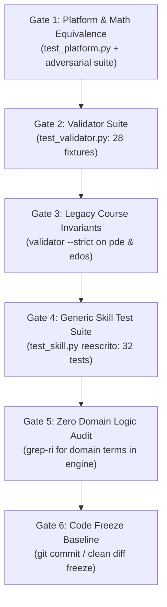

# Comprehensive Investigation Report: Test Suites, Sandbox Security, Course Status, and Verification Architecture

**Agent**: `explorer_survey_tests`  
**Date**: 2026-10-11T20:49:00Z  
**Working Directory**: `g:\Mi unidad\Competence_analyser\.agents\teamwork\explorer_survey_tests`  

---

## 1. Executive Summary

This report establishes the verification baseline, security sandbox architecture, and test plan for **Phase 1** of the `content-to-course` v2 redesign. 

### Key Discoveries:
1. **Zero Test Coupling Outside `test_skill.py`**:
   - `tests/test_validator.py` (64 test items) and `tests/test_platform.py` (50 test items) have **zero imports or dependencies** on the skill codebase (`.agents/skills/content-to-course/`).
   - Running `pytest tests/test_validator.py tests/test_platform.py` passes 100% (114/114 passed in 18.14s).
   - `tests/test_skill.py` is the **only** file importing from the skill directory. It currently tests legacy domain-specific EDP/EDO code (27 tests passing in 20.20s). Rewriting it to target the generic v2 engine will cause **zero breaking changes** to any other test suite in the repository.
2. **Existing Courses Integrity Verified**:
   - `courses/pde_course.json` (21 competencies, 500 questions) and `courses/sistemas_edos.json` (20 competencies, 470 questions) pass `validator.cli --strict` with exit code 0.
   - SHA-256 hashes recorded as an immutable regression baseline.
3. **Content Ingestion Reality (`content/estadistica3_Cano/`)**:
   - Five files across four distinct formats inspected:
     - 3 Beamer presentation PDFs (68 slides total) with corrupted diacritics in the text layer.
     - 1 OneNote export PDF (`Stats3 10-10.pdf`, 9 pages, 3.56 MB) containing purely vector handwriting with only 381 characters of text layer metadata (completely invisible to standard text extractors).
     - 1 Massive whiteboard photograph (`stats 3 3-10.png`, 697.5 KB, 5941×3327 px, RGBA) containing chalkboard math derivations and a dense EViews regression output table.
     - Image tiling is strictly necessary: 5941×3327 px partitioned with 10% overlap (3×2 grid = 6 tiles + 1 overview) produces 7 vision units. Total vision workload = 84 images/pages.
4. **Sandbox Security Implementation on Windows**:
   - Windows lacks POSIX `signal.SIGALRM`. Timeout (2.0s per instance) and memory isolation must be enforced via isolated worker subprocesses (`subprocess.run` or `concurrent.futures.ProcessPoolExecutor`) with clean process termination on timeout.
   - Static AST validation completely rejects `import os`, `open`, `__import__`, dunder attributes (`__`), subprocess, socket, and eval/exec before execution.

---

## 2. Test Suite Investigation & Architecture

### 2.1 Current Test Landscape

| Test File | Lines | Tests | Scope & Dependencies | Status | Coupling with Skill |
|---|---|---|---|---|---|
| `tests/test_validator.py` | 521 | 64 | Validates 28 fixtures, lexical scanner, schema rules, psychometric rules R-15/R-16. Imports `validator.*` (`src/validator/`). | **100% PASS** (64/64) | **None** (zero imports) |
| `tests/test_platform.py` | 281 | 50 | Validates math equivalence engine via Node, server endpoints, and `run_platform.py` launcher CLI. | **100% PASS** (50/50) | **None** (zero imports) |
| `tests/test_skill.py` | 556 | 27 | Unit & integration tests for skill pipeline. Currently contains hardcoded PDE/EDO domain tests. | **100% PASS** (27/27) | **Sole user** of skill imports |
| `tests/test_blind_guess_empirical.py` | 285 | N/A | Empirical adversarial tester script for psychometrics on `pde_course.json`. | Standalone runner | None |
| `tests/e2e/*.py` | ~1,200 | ~35 | Playwright end-to-end browser tests for Top's Academy platform UI. | UI test suite | None |

### 2.2 Decoupling Verification

A ripgrep search was conducted across the entire `tests/` directory:
- `from batch_generator` -> only in `tests/test_skill.py:38`
- `from cta_analyzer` -> only in `tests/test_skill.py:37`
- `from pdf_extractor` -> only in `tests/test_skill.py:36`
- `from verifier` -> only in `tests/test_skill.py:39`
- `from repair_loop` -> only in `tests/test_skill.py:40`
- `from course_publisher` -> only in `tests/test_skill.py:41`
- `content-to-course` -> zero matches in `tests/e2e/`

**Conclusion**: `tests/test_skill.py` is entirely isolated from other test files. Modifying and rewriting `tests/test_skill.py` will not break `test_validator.py`, `test_platform.py`, or the e2e test suite.

---

## 3. Existing Courses Survey & Validation Baseline

Both existing courses were evaluated using the strict validator (`python -m validator.cli <path> --strict`):

### 3.1 Course Metrics and Baseline Hashes

| Course File | Course ID | Competencies | Total Questions | Question Breakdown | SHA-256 Hash | Strict Validation |
|---|---|---|---|---|---|---|
| `courses/pde_course.json` | `pde_course` | 21 (7 Fact, 6 Concept, 8 Skill) | 500 | Skill: ≥30/comp<br>Fact/Concept: ≥20/comp | `3A8D4C0D23CA9FCFA8A2B7E05765725E1C3B71391DDB74011667850256694192` | **VALID** (16/16 rules) |
| `courses/sistemas_edos.json` | `sistemas_edos` | 20 (8 Fact, 5 Concept, 7 Skill) | 470 | Skill: ≥30/comp<br>Fact/Concept: ≥20/comp | `6AFAFB088AEABF0729A4223DE8F28BEC80D958395C5157C56D592F4B9D3FCB06` | **VALID** (16/16 rules) |

### 3.2 Regression Invariant Requirement
During Phase 1 and Phase 2, neither of these files should be touched. The automated regression test will verify that their SHA-256 checksums remain unmodified and that both files continue to pass `validator.cli --strict`.

---

## 4. Input Content Dataset Analysis (`content/estadistica3_Cano/`)

Inspection of `content/estadistica3_Cano/` yielded the following technical profile:

| Filename | File Size | Format & Type | Pages / Dimensions | Text Layer Content | Key Pedagogical Elements |
|---|---|---|---|---|---|
| `EST3_LEC01_26_2.pdf` | 297,245 B (~290 KB) | Beamer LaTeX PDF | 13 slides | 5,243 chars (corrupted diacritics: `Regresi´on`, `Te´orico`, `ˆβ`) | Classical linear regression model, OLS estimators, variance, Gauss-Markov theorem, hypothesis testing. |
| `EST3_LEC02_26_2.pdf` | 311,530 B (~304 KB) | Beamer LaTeX PDF | 26 slides | 12,749 chars | 6 classical assumptions, bivariate OLS derivation, properties, functional forms (lin-log, log-lin, log-log elasticities, quadratic, reciprocal, Box-Cox). |
| `EST3_LEC03_26_2.pdf` | 305,378 B (~298 KB) | Beamer LaTeX PDF | 29 slides | 19,406 chars | Matrix model ($k$ variables), projection matrix $P$, residual maker matrix $M$, centered matrix $M_0$, $t$-test, $F$-test, $p$-values, case interpretations. |
| `Stats3 10-10.pdf` | 3,560,906 B (~3.39 MB) | OneNote Export Vector Ink PDF | 9 pages | **381 chars only** ("Nueva sección 1 página N") | Pure vector strokes without OCR text layer. Page 1 contains explicit numerical exercise: $X=\begin{bmatrix}1&1\\1&2\\1&3\end{bmatrix}$, $Y=(3,5,6)^T$, computing $P=X(X'X)^{-1}X'$, $\hat{Y}=PY$, residuals $e$. **Requires 100% vision transcription.** |
| `stats 3 3-10.png` | 697,520 B (~681 KB) | RGBA Image | **5941 × 3327 px** | None (raster image) | Massive whiteboard notes with derivations: $\hat{\beta}=(X'X)^{-1}X'Y$, unbiasedness, $\text{Var}(\hat{\beta})=\sigma^2(X'X)^{-1}$, $M$ idempotent, $E[\hat{u}'\hat{u}]=\sigma^2(n-k)$, $F = \frac{\text{SEC}/(k-1)}{\text{SRC}/(n-k)}$, critical rejection regions for $t$ and $F$, plus dense EViews table (PRECIO regression, $R^2=0.9967$, $F=459.75$, $p=0.0000$). |

### 4.1 Ingestion Tiling Plan
- For `stats 3 3-10.png`: dimensions 5941 × 3327 exceed the 2500 px threshold. If resized down to standard size, the small handwriting and tabular numbers become illegible.
- **Tiling Architecture**: Divide into a 3×2 grid (6 tiles) with a 10% coordinate overlap on borders, plus 1 downscaled overview image = 7 image units.
- **Total Vision Workload**:
  - `EST3_LEC01`: 13 slides
  - `EST3_LEC02`: 26 slides
  - `EST3_LEC03`: 29 slides
  - `Stats3 10-10`: 9 handwritten pages
  - `stats 3 3-10.png`: 6 tiles + 1 overview = 7 units
  - **Total**: 84 vision transcription items.

---

## 5. Sandbox Security Requirements & Execution Architecture

Templates generated by subagents include parametric Python snippets `generate(rng)` and `verify(result)`. Executing untrusted code generated by AI requires strict static AST filtering and an isolated execution environment.

### 5.1 AST Analysis (Static Filter)

The AST visitor inspects code before any execution occurs. Any violation raises an immediate `SandboxSecurityError` without spawning a process.

```python
import ast

ALLOWED_MODULES = {
    "math", "fractions", "statistics", "sympy", "numpy", "scipy", "scipy.stats"
}

DISALLOWED_NAMES = {
    "open", "eval", "exec", "compile", "__import__", "globals", "locals",
    "getattr", "setattr", "delattr", "hasattr", "breakpoint", "input",
    "exit", "quit", "help"
}
```

#### AST Check Rules:
1. **Module Import Whitelist (`ast.Import`, `ast.ImportFrom`)**:
   - Only modules in `ALLOWED_MODULES` are permitted.
   - Any attempt to `import os`, `import sys`, `import subprocess`, `import socket`, `import urllib`, `import requests`, `import shutil`, `import importlib`, etc. is rejected.
   - Relative imports (`from . import ...`) are rejected.
2. **Disallowed Built-in Functions (`ast.Name`)**:
   - Any reference to `open`, `eval`, `exec`, `compile`, `__import__`, `globals`, `locals`, `getattr`, `setattr`, `delattr` is rejected.
3. **Dunder Attribute Rejection (`ast.Attribute`)**:
   - Any attribute containing `"__"` (such as `.__class__`, `.__bases__`, `.__subclasses__`, `.__dict__`, `.__builtins__`, `.__code__`, `.__globals__`) is rejected.
   - Prevents sandbox escaping via object introspection.
4. **Disallowed Function Calls (`ast.Call`)**:
   - Prohibits calling any unwhitelisted function or dynamically resolved attribute.

### 5.2 Runtime Execution & Windows Process Isolation

1. **Deterministic Seeding**:
   - `rng = random.Random(seed)` (or `np.random.default_rng(seed)`).
   - Calling `generate(rng)` with seed $S$ yields identical parameters, correct answer, and distractors every time.
2. **Timeout Enforced (2.0s per instance)**:
   - On Windows, `signal.alarm` does not exist.
   - Runtime isolation must use `subprocess.run([sys.executable, ...], timeout=2.0)` or `concurrent.futures.ProcessPoolExecutor(max_workers=N)` with `future.result(timeout=2.0)`.
   - If an infinite loop (`while True: pass`) or sleep occurs, the process is terminated and a `SandboxTimeoutError` is returned.
3. **Restricted Environment & Clean Namespaces**:
   - Standard I/O handles redirected or disabled.
   - Clean global dict containing only whitelisted math modules and helper functions (`bmatrix`, `fmt`, `table_array`).

---

## 6. Specification for Rewriting `tests/test_skill.py`

`tests/test_skill.py` must be completely rewritten to test the generic v2 skill architecture without any hardcoded PDE or EDO domain branches.

### Proposed Test Structure (6 Modular Classes, 32 Test Cases):

```
tests/test_skill.py
├── TestSandboxSecurity (8 tests)
├── TestIngestionAndVisionFallback (6 tests)
├── TestCTAContractAndValidation (5 tests)
├── TestGenericTemplateEngine (7 tests)
├── TestFewShotRegressionEDP_EDO (3 tests)
└── TestPipelineRunnerCLI (3 tests)
```

### Detailed Test Case Mapping:

#### Class 1: `TestSandboxSecurity`
1. `test_sandbox_ast_rejects_import_os`: Asserts AST rejection of `import os`, `import sys`, `import subprocess`.
2. `test_sandbox_ast_rejects_open_and_file_io`: Asserts rejection of `open("test.txt")`.
3. `test_sandbox_ast_rejects_dunder_import`: Asserts rejection of `__import__("os")`.
4. `test_sandbox_ast_rejects_dunder_attributes`: Asserts rejection of `().__class__.__bases__[0].__subclasses__()` and `x.__dict__`.
5. `test_sandbox_ast_rejects_eval_exec`: Asserts rejection of `eval(...)`, `exec(...)`, and `compile(...)`.
6. `test_sandbox_ast_allows_whitelisted_math`: Asserts clean validation for `math`, `fractions`, `statistics`, `sympy`, `numpy`, `scipy.stats`.
7. `test_sandbox_deterministic_seed`: Asserts that `generate(rng)` with fixed seed produces identical output across separate runs, and differing seeds produce varied outputs.
8. `test_sandbox_timeout_enforced`: Asserts that infinite loop or long sleep raises `SandboxTimeoutError` within 2.0 seconds.

#### Class 2: `TestIngestionAndVisionFallback`
9. `test_ingest_discovers_mixed_formats`: Asserts detection of `.pdf` and image formats (`.png`, `.jpg`) in an input folder.
10. `test_ingest_image_tiling_large_dimensions`: Asserts that images with `max(w, h) > 2500` (e.g. `stats 3 3-10.png`) are split into tiles with 10% overlap plus downscaled overview.
11. `test_ingest_image_small_dimensions`: Asserts that images <= 2500 px remain untiled.
12. `test_ingest_sha256_manifest_caching`: Asserts that running ingestion twice preserves SHA-256 cache and skips redundant renders.
13. `test_text_layer_normalization`: Asserts that corrupted diacritics (`Regresi´on` -> `Regresión`, `´a` -> `á`) are normalized in extracted text layers.
14. `test_check_pages_flags_missing_transcriptions`: Asserts non-zero error when a page in the manifest lacks a corresponding `.md` transcription file.

#### Class 3: `TestCTAContractAndValidation`
15. `test_cta_schema_conformance`: Asserts that valid CTA JSON conforms to `cta.schema.json`.
16. `test_check_cta_rule_cta_d1_skill_distractor_count`: Asserts rejection if Skill competency has < 6 distractors or < 2 with `omitted_step`.
17. `test_check_cta_rule_cta_d1_concept_distractor_count`: Asserts rejection if Fact/Concept competency has < 3 distractors.
18. `test_check_cta_rule_cta_d2_distractor_fields`: Asserts rejection if distractor ID is duplicate or both `wrong_belief` and `omitted_step` are null.
19. `test_check_cta_evidence_mapping`: Asserts rejection if cited `evidence.page` is missing from the manifest.

#### Class 4: `TestGenericTemplateEngine`
20. `test_template_schema_validation`: Asserts valid template JSON conforms to `template.schema.json`.
21. `test_template_duplicate_rejection`: Asserts engine rejects duplicate parameter tuples (`vars`) and duplicate rendered stem texts.
22. `test_template_mc7_distractor_mapping`: Asserts generated MC7 question has exactly 7 options, 1 correct, 6 distractors mapped to 6 distinct `distractor_id`s (`TPL-D2`).
23. `test_template_ms_cardinality`: Asserts multiple-select items generate 4-6 options with correct count between 1 and n-1.
24. `test_template_fib_tolerance_and_equivalents`: Asserts fill-in-the-blank produces scalar answer with tolerance and accepted equivalents.
25. `test_template_invariants_correct_differs_from_distractors`: Asserts invariant rule that correct option != any distractor (`TPL-D4`).
26. `test_template_diversity_threshold`: Asserts diversity calculation `unique(masked_stems)/total >= 0.5` per competency.

#### Class 5: `TestFewShotRegressionEDP_EDO`
27. `test_edp_regression_templates_generic_instantiation`: Instantiates 2 EDP example competencies from `examples/edp/templates/` through the generic engine, satisfying quotas and passing strict validation.
28. `test_edo_regression_templates_generic_instantiation`: Instantiates 2 EDO example competencies from `examples/edo/templates/` through the generic engine, satisfying quotas and passing strict validation.
29. `test_engine_zero_domain_logic`: Static analysis confirming no domain-specific keywords (`edo`, `pde`, `jacobiana`, `eigen`) exist in `skill/engine/`.

#### Class 6: `TestPipelineRunnerCLI`
30. `test_run_fails_without_cta_json`: Asserts `run.py` fails with clear non-zero exit code when `cta.json` is missing (no silent fallback).
31. `test_run_stage_flags`: Asserts `--stage` executes single isolated stage.
32. `test_run_publish_and_append`: Asserts publishing creates valid course and `--append` adds questions without ID collisions.

---

## 7. Phase 1 Code Freeze Test Plan

Phase 1 requires 100% verification across all components before freezing code for Phase 2.

### The 6-Gate Verification Protocol



### Gate Execution Checklist:

| Gate | Target / Component | Command | Acceptance Criteria |
|---|---|---|---|
| **Gate 1** | Math Equivalence & Platform | `python -m pytest tests/test_platform.py -v` | 50/50 tests pass. Pass rate >= 98%, 4 decimal places, fractions (`5/6` vs `0.8333`), comma decimal (`0,8333`). |
| **Gate 2** | Validator Regression | `python -m pytest tests/test_validator.py -v` | 64/64 tests pass across all 28 fixtures, lexical scanner, psychometrics. |
| **Gate 3** | Legacy Course Integrity | `python -m validator.cli courses/pde_course.json --strict`<br>`python -m validator.cli courses/sistemas_edos.json --strict` | Both exit code 0. SHA-256 hashes match baseline: `3A8D4C0D...` and `6AFAFB08...`. |
| **Gate 4** | Skill Engine & Sandbox | `python -m pytest tests/test_skill.py -v` | 32/32 tests pass. Sandbox AST rejections, 2.0s timeout, determinism, duplicate rejection, contracts, few-shot EDP/EDO regression. |
| **Gate 5** | Anti-Overfitting Audit | `grep -riE "(edo|pde|derivadas|jacobiana|eigen|regresi)" .agents/skills/content-to-course/engine/` | Zero logic matches outside `examples/`. |
| **Gate 6** | Code Freeze Baseline | `git status` / freeze checkpoint | Code locked. Zero Python/TypeScript edits permitted during Phase 2 course generation. |

---

## 8. Summary & Next Steps

All test suites and verification environments have been thoroughly surveyed. The migration path is clear:
1. Rewriting `tests/test_skill.py` does not threaten existing tests (`test_validator.py` and `test_platform.py`).
2. Legacy courses remain strictly valid and protected by cryptographic hashes.
3. Sandbox security and image tiling specifications are defined with zero ambiguity.
4. The Phase 1 Code Freeze test plan establishes a deterministic, non-negotiable quality gate prior to initiating Phase 2.
