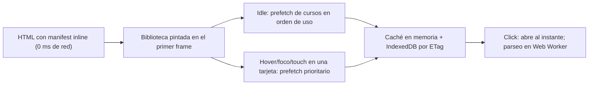

# Plan de remediación M1 v3 — Ergonomía (125%/150% de escala) + Carga rápida de cursos

Estado: **APROBADO PARCIALMENTE (12:03) — se ejecuta SOLO el Frente A (§0, §1 y AC-12…AC-18 con AC-CORE). Los Frentes B (carga de cursos, §2.1–2.3, AC-19…AC-25) y C (resiliencia, §2.4, AC-28…AC-31) NO se implementan: se registran como Milestones pendientes en `FUTURE_MILESTONES.md`.**
Ajustes al Frente A por esta decisión: 1E **no** agrega esqueletos/props de prefetch; 1F **solo** hace `MathText.tsx` y la precarga de fuentes en `index.html` (sin marcador de manifest); 1D **no** agrega `initialIndex/onProgress`; 2B **no** crea los E2E de rendimiento ni resiliencia; no hay streams P1/P2/P3/2D.

**Qué cambia respecto a la v2**
1. La matriz de pantallas incorpora el **125%** y tu ASUS TUF F15 como referencia que hoy **ya funciona** (guardia de no-regresión).
2. Se precisa el criterio de scroll: **en la primera pintura de cada pregunta, sin tocar nada, se ven las 7 opciones y el footer.**
3. **Nuevo frente de rendimiento (carga de cursos):** causa raíz medida y plan para que la biblioteca aparezca en ≤ 1 frame y los cursos se vayan cargando en segundo plano.

---

## 0. Matriz de dispositivos (px CSS = resolución física ÷ escala)

| Equipo | Resolución × escala | Viewport CSS | Contenido útil (sin chrome del navegador ni barra de tareas) | Split 50% (ancho útil, con barra de 15 px) | Rol en las pruebas |
|---|---|---|---|---|---|
| **ASUS TUF F15 (15.6")** | 1920×1080 @125% | 1536×864 | **1536×~740** | ~745–752 | **Referencia: hoy funciona. No debe regresionar.** |
| Laptop 14" | 1920×1080 @125% | 1536×864 | 1536×~740 | ~745–752 | Igual que arriba |
| **Laptop 14"** | 1920×1080 @150% | 1280×720 | **1280×~590** | **~610–617** | **Peor caso principal** |
| Laptop 14" | 1920×1200 @125% / @150% | 1536×960 / 1280×800 | 1536×~830 / 1280×~670 | ~745 / ~610 | Caso intermedio |
| Laptop 14" 2.8K | 2880×1800 @150% | 1920×1200 | 1920×~1070 | ~930 | Pantalla grande |
| Tablets 11"–14.9" | varias | 834–1400 × 834–1366 (ambas orientaciones) | — | 417–700 en split del SO | Touch (≥ 44 px) |

**Matriz de pruebas (px CSS, con barras clásicas visibles y `deviceScaleFactor` 1.25 / 1.5):**
1536×740 (TUF, baseline), 1536×620, 1280×560, 1280×590, 1280×670, 1265×590 (ventana completa con barra), 750×740, 745×620, 640×560, 617×590, 610×590, 760×700, 834×1194, 1194×834, 1024×1366, 1366×1024, 1368×912.

---

## 1. Frente A — Ergonomía de la vista de práctica y biblioteca (D1–D4 de la v2, sin cambios de fondo)

### Diagnóstico resumido (medido)
- **D1 Biblioteca en 2 columnas:** `xl:grid-cols-3` (≥ 1280 px incluyendo barra) → a 150% en 14" el viewport útil es 1265 → 2 columnas. Medido: 1280 → 3, **1265 → 2**.
- **D2 Barras de scroll horizontales en opciones/enunciados:** reglas `overflow-x:auto` sobre `.katex` inline en `index.css` (1A), copias Tailwind en las vistas (1E) y en `FeedbackToast` (1C), más el `inline-block` de `MathText.tsx` (no cubierto por ninguna frontera). Medido: hasta 11 barras por pregunta.
- **D3 Scroll del documento en práctica:** footer `fixed` + `pb-20` + bloque "Stuck?" con `mt-8` + `min-height` en vez de alto fijo. Medido: 31–97 px a 1280×600 y 78–133 px a 640×600; en split a 150% el contenedor (586–593 px) queda < 600 px → 1 columna.
- **D4 Cobertura de pruebas:** sin barras visibles, sin escala, solo opciones cortas, sin medir scroll del documento ni barras internas.

### Criterio de aceptación del usuario (definitivo)
> "Al inicio yo tenía que bajar un poquito para ver la última respuesta."
> Comentario sobre el plan: *"el criterio de aceptación es llegar a ver todas las respuestas y hasta «Stuck? Review related…» sin hacer scroll vertical; además de que todas las respuestas carguen sin scroll horizontal."*

**Criterio (AC-CORE):** en el **primer frame de cada pregunta** (scrollTop = 0, sin interacción) y mientras se responde, deben quedar visibles **a la vez, sin ningún scroll vertical**:
1. el enunciado completo,
2. las **7 opciones completas** (A–G),
3. la línea **«💡 Stuck? Review related articles/videos or use a hint.»** (`data-testid="hints-toggle"`), y
4. el footer (Skip / Check).

Y **sin ningún scroll horizontal**: ni de página, ni de enunciado, ni dentro de cada opción; todas las opciones se cargan **completas** (texto y fórmulas visibles enteros, partidos en varias líneas si hace falta).

Consecuencias de diseño:
- La línea «Stuck?» **no se puede eliminar, ocultar ni mandar fuera de pantalla**: se mantiene visible como una línea compacta (queda decidido; deja de ser una decisión abierta). Los hints **desplegados** viven en un panel con altura máxima y scroll propio (solo ese panel puede hacer scroll, y únicamente después de que el usuario lo abra); abrir el panel no empuja las opciones fuera de vista.
- Si el contenido no cabe a la densidad estándar, el layout **escala la densidad** (fuente, padding, gaps) por alto disponible hasta cumplir el AC-CORE; el límite inferior de densidad es 13 px de fuente y objetivos táctiles ≥ 44 px solo en `pointer: coarse`.
- Se prueba con el **peor caso**: enunciado de 4 líneas con KaTeX inline y 7 opciones de 2 líneas con fórmulas largas, en la matriz completa de §0 (incluyendo 1280×590 y 610×590, 150%).

Además, al pasar de pregunta (Next, Skip, Redo) el scroll del documento y de `main` se **resetea a 0** (si no, la siguiente pregunta puede abrir ya desplazada; es lo que se ve en tus capturas 4 y 5 con el header fuera de vista).

### Cambios por frontera
| Stream | Archivos | Cambio |
|---|---|---|
| **1E** | `CourseLibrary.tsx` (+ quitar `[&_.katex]:overflow-x-auto…` de `CourseOverview`, `MasteryGrid`, `PreExerciseModal`, `CompletionScreen`, `CourseChallenge`) | Grid `grid-cols-1 min-[560px]:grid-cols-2 min-[1000px]:grid-cols-3`; tarjeta compacta (≤ 190 px); **estados de carga**: tarjetas esqueleto y botón "cargando" por curso (ver Frente B). |
| **1A** | `index.css`, `QuestionCard.tsx` | Eliminar `overflow-x:auto` / `inline-block` de `.katex` inline (solo `.katex-display` mantiene scroll); umbral de 2 columnas ≤ 480 px (columnas ≥ 230 px); **densidad por altura** (`@media (max-height: 720px)` y `(max-height: 620px)`: fuentes, padding y gaps escalonados; el TUF a 740 px mantiene la densidad actual); `min-height:44px` solo con `pointer: coarse`; **«Stuck?» siempre visible** (AC-CORE): línea compacta (una sola línea, `text-xs`) pegada bajo las opciones o junto a "Choose 1 answer", mismo `data-testid="hints-toggle"`; panel de hints desplegado con `max-height` y scroll propio que no desplaza las opciones; sin `mt-8`/`pt-4` grandes. |
| **1D** | `PracticeSession.tsx` | Shell `h-dvh flex flex-col overflow-hidden`; header `shrink-0`; `main` `flex-1 min-h-0 overflow-y-auto` (solo válvula de seguridad); footer `shrink-0` en flujo (sin `fixed` ni `pb-20`); **reset de scroll a 0** al cambiar de pregunta; sin tocar estado ni atajos. |
| **1C** | `FeedbackToast.tsx` | Quitar `overflow-x` de `.katex` inline; reposicionar respecto al footer ya no fijo. |
| **1F (nuevo)** | `MathText.tsx`, `platform/index.html` | Envoltorio de fórmula inline como `span.inline` (no `inline-block`); precarga de fuentes KaTeX (`woff2` Main-Regular, Math-Italic, Size1, AMS) con `<link rel="preload">`. *Nota:* `index.html` lo comparte con el Frente B (placeholder del manifest); lo posee **solo 1F** y el placeholder se define en este plan (ver §2.2). |

---

## 2. Frente B — Carga de cursos (rendimiento)

### 2.1 Diagnóstico medido

| Medición | Valor |
|---|---|
| Tamaño de los 7 cursos en disco | 3.4 + 10.6 + 13.4 + 13.5 + 1.6 + 7.4 + 2.0 = **51.9 MB** |
| `GET /api/courses.json` (lista de la biblioteca) | **43 MB de respuesta, ~17.4–17.9 s** (por solicitud, en esta máquina) |
| `GET /api/courses/saul_control_optimo.json` (1.3 MB, un solo curso) | **~733 ms** |
| `GET /` (index.html) | 26 ms |
| Bundle JS | 1,143 KB (sin dividir) |

**Causa raíz** (`courseServer.cjs` L58-112 y L130-146; igual en el middleware de `vite.config.ts` L118-161):
1. `/api/courses` llama a `getCourseList()`, que **lee, pasa una regex de caracteres de control, hace `JSON.parse` y valida los 7 archivos completos en cada petición**, y devuelve en la lista `data: check.data` (**todo el contenido de todos los cursos**) solo para que la biblioteca pinte título, descripción y 2 contadores. Luego el navegador hace `res.json()` de 43 MB.
2. `/api/courses/:id` vuelve a ejecutar `getCourseList()` completa (los 7 archivos) solo para entregar 1 curso: por eso abrir un curso tarda 0.7 s aunque pese 1.3 MB.
3. Sin caché, sin `ETag`, sin compresión (gzip/brotli), JSON sin minificar en el build estático (`JSON.stringify(c.data, null, 2)` en `vite.config.ts` L173/L181/L186) y **el build emite cada curso 3 veces** (`api/courses.json` con todo, `api/courses/<id>.json` y `courses/<archivo>.json`).
4. `App.tsx` L46-84: `fetchCourses()` espera esa respuesta antes de dejar de mostrar "loading" y la vuelve a pedir cada vez que se regresa a la biblioteca (L296, L365).
5. `selectCourse` no hace prefetch ni usa caché; normaliza todas las preguntas (`normalizeQuestion`) en el hilo principal.

> Un parseo de 43 MB en < 16 ms es físicamente imposible; **la solución es no cargarlos**: la biblioteca solo necesita ~1–2 KB. El resto se descarga y procesa en segundo plano antes de que el usuario elija.

### 2.2 Arquitectura propuesta



**Contrato compartido (P1/P2 producen, P3 consume):**
```json
GET /api/courses(.json)  →  {
  "generated_at": "...",
  "courses": [{ "id","filename","title","description","status",
                "total_competencies","total_questions","bytes","etag","error_message?" }]
}   // SIN campo "data"; < 10 KB
GET /api/courses/:id(.json)  → curso completo, con ETag + Cache-Control, gzip/brotli, 304 si If-None-Match
```
- **Inline en HTML:** el servidor reemplaza el marcador `<!--COURSE_MANIFEST-->` de `index.html` por `<script id="course-manifest" type="application/json">…</script>` al servir `/`, de modo que **la lista de cursos llega con el HTML (sin petición adicional)** y siempre está fresca sin recompilar (nuevos cursos aparecen al instante). En `vite dev` lo hace `transformIndexHtml`; en `vite build` queda el marcador y, para hosting estático, un manifest slim a `api/courses.json`.
- **Índice con caché por `mtime+size`**: se calcula una vez en segundo plano al arrancar (sin bloquear peticiones) y se persiste en `platform/.cache/course_index.json` (carpeta ignorada por git; **no se escribe en `courses/` ni `content/`**). Validación pesada (regex de control + `JSON.parse` + tipos) una sola vez por cambio de archivo; el resultado `valid/error` se guarda en el índice.
- **Detalle por id sin escanear todo:** mapa `id → filename`; lectura directa del archivo, con versión comprimida (gzip nivel rápido o brotli) cacheada en memoria/disco.
- **Frontend (`App.tsx` + nuevo `courseLoader.ts` + `courseParse.worker.ts`):** biblioteca desde el manifest inline (fallback a `fetch` del manifest slim); `requestIdleCallback` descarga el resto **uno a uno y con prioridad baja** (el más reciente/usado primero); `pointerenter/focus/touchstart` en una tarjeta lo sube a prioridad alta; caché en memoria + IndexedDB con `ETag`; `res.json()` y `normalizeQuestion` en un Web Worker (hilo principal libre); si el usuario hace click antes de que termine, esqueleto de overview con barra de progreso real (no bloquea la biblioteca ni el resto). Volver a la biblioteca **no vuelve a pedir** la lista.
- **Build estático:** manifest slim + un archivo por curso **minificado**; eliminar la emisión duplicada `courses/<archivo>` **solo si ninguna ruta del frontend la usa** (el stream P2 debe demostrarlo con búsqueda en `src/`; si algo la usa, se conserva).
- **Estáticos del servidor:** `gzip/br` para `.js/.css/.json`, `Cache-Control: public, max-age=31536000, immutable` para assets con hash, `no-cache` para `index.html`.
- **Code-split del bundle (opcional, mismo stream P3):** `React.lazy` para `PracticeSession`/`CompletionScreen`/`CourseChallenge` (1,143 KB → carga inicial menor).

### 2.3 Streams del frente B (fronteras disjuntas)

| Stream | Archivos | Entrega |
|---|---|---|
| **P1 Server** | `platform/server/courseServer.cjs`, `platform/server/courseIndex.cjs` (nuevo, lógica compartida) | Índice con caché mtime+size persistido; manifest slim; detalle por id con ETag/304/compresión; inyección del manifest en `index.html`; estáticos con compresión y caché; sin romper `courseServer` ni sus tests existentes. |
| **P2 Vite** | `platform/vite.config.ts` | El middleware dev y `generateBundle` reutilizan `courseIndex.cjs` (import desde `vite.config.ts`); `transformIndexHtml` para el manifest inline en dev; build emite manifest slim y cursos minificados; sin duplicados innecesarios. **Depende de P1 solo por la firma de `courseIndex.cjs` definida en este plan** (`buildIndex()`, `getManifest()`, `getCoursePath(id)`); P1 publica la firma real en su `handoff.md` al inicio. |
| **P3 Frontend** | `platform/src/App.tsx`, `platform/src/utils/courseLoader.ts` (nuevo), `platform/src/workers/courseParse.worker.ts` (nuevo), `platform/src/types.ts` (solo campos opcionales del manifest) | Biblioteca desde manifest inline, prefetch idle/hover, caché IndexedDB+ETag, parseo en worker, esqueletos, sin re-fetch al volver; reset de scroll lo hace 1D (no P3). |
| **1E** | `CourseLibrary.tsx` | Esqueleto de tarjetas y estado "cargando curso" por tarjeta (consume props de P3: `loadingCourseId`, `prefetchState`); callbacks `onPrefetch(id)` en `pointerenter/focus/touchstart`. **Contrato de props definido aquí** para evitar dependencia: `onPrefetch?: (id:string)=>void`, `loadingCourseId?: string\|null`, `prefetchState?: Record<string,'idle'\|'loading'\|'ready'\|'error'>`. |

---

## 2.4 Frente C — Resiliencia ante suspensión de la laptop (nuevo)

### Diagnóstico (¿es el código?)
**No hay código nuestro que reinicie el servidor** (revisé `courseServer.cjs`, `vite.config.ts` y `src/`: no existen watchers propios, `location.reload`, WebSocket ni `visibilitychange`). Lo más probable es lo siguiente, **sin haberlo podido reproducir aquí** (no puedo suspender tu equipo):

1. **Si usas `npm run dev` (Vite):** al suspender, el WebSocket de HMR se corta. Al despertar, el cliente de Vite muestra `[vite] server connection lost. Polling for restart…` y, en cuanto responde, hace **`location.reload()` de toda la página**. Se percibe como "el servidor se reinició", pero el proceso de Node sigue vivo: es un **reload automático del navegador**. Es comportamiento de Vite en modo desarrollo; no ocurre con `npm run server` ni con `vite preview` (no tienen HMR).
2. **Nuestro código amplifica el efecto:**
   - El estado de la sesión (curso abierto, pregunta actual, respuestas, aciertos) vive **solo en memoria de React**; solo el *mastery* se guarda en `localStorage` (`masteryStorage.ts`). Tras el reload vuelves a la biblioteca y pierdes la sesión.
   - Tras el reload se vuelve a pedir la lista de cursos (43 MB, ~5–18 s): por eso parece que el servidor "tarda en volver".
3. **Alternativa menos probable:** que el proceso de Node (o la terminal/IDE donde corre) sí se haya cerrado al suspender. En ese caso, además, nuestro servidor no tiene endurecimiento (`uncaughtException`, `EADDRINUSE`, reintento) y el frontend no reintenta.

**Cómo confirmarlo en 30 s (te lo pido antes de implementar):** tras despertar la laptop, abre la consola de Brave (F12) y revisa si aparece `[vite] server connection lost` o si la pestaña se recargó sola; y mira la terminal: si el proceso sigue con su uptime y sin prompt nuevo, no se reinició. Dime cuál comando usas (`npm run dev`, `npm run server` o `vite preview`).

### Cambios al plan (válidos en cualquiera de los dos casos)
| Stream | Archivos | Cambio |
|---|---|---|
| **P3 Frontend** | `App.tsx`, nuevo `platform/src/utils/sessionStore.ts` | **Persistir y restaurar la sesión** en `sessionStorage` con versión de esquema: vista actual, curso, unidad, tipo de sesión, ids de preguntas barajadas, índice actual, resultados y aciertos. Al cargar, si hay sesión válida → se restaura en la misma pregunta (sin pantalla de biblioteca intermedia). Se invalida al completar/salir o si el curso cambió (ETag distinto). |
| **1D** | `PracticeSession.tsx` | Aceptar estado inicial opcional (`initialIndex`, `initialResults`) y notificar cambios (`onProgress`) sin tocar los handlers existentes ni los atajos. |
| **P3 Frontend** | `App.tsx`, `courseLoader.ts` | Tras reload o al volver de suspensión (`visibilitychange` / `pageshow` / evento `online`): **no** volver a descargar cursos si el `ETag` no cambió; consultar el manifest (≈1–2 KB) y reconciliar. Los cursos ya cacheados en IndexedDB se abren al instante. Reintento con *backoff* si el servidor aún no responde (sin pantalla en blanco): banner discreto "Reconectando…". |
| **P1 Server** | `courseServer.cjs`, `courseIndex.cjs` | Endurecimiento: `server.on('error')` con mensaje claro para `EADDRINUSE`, `uncaughtException`/`unhandledRejection` registrados sin matar el proceso por una petición mala, `server.keepAliveTimeout` razonable, endpoint **`/healthz`** (uptime, versión del índice) para depurar "¿se reinició?". Al arrancar, registra una línea con hora y PID. |
| **P2 Vite** | `platform/vite.config.ts`, `platform/package.json` (solo `scripts`) | Script **`study`** = `vite build && node server/courseServer.cjs` (sin HMR, modo recomendado para estudiar); en `dev` se mantiene HMR pero se documenta que un reload tras suspender es esperado. **Sin agregar dependencias.** |
| **2C** | `FUTURE_MILESTONES.md` + espejo | Documentar "modo estudio" (`npm run study`) vs "modo desarrollo". |

---

## 3. Pruebas (stages R2)

| Stream | Archivos | Entrega |
|---|---|---|
| **2A** | `tests/test_m1_zoomfix_contract.py` | Contratos de A: sin `overflow-x:auto` en `.katex` inline, umbral ≤ 480, footer sin `fixed`, reset de scroll, `min-[1000px]:grid-cols-3`, `MathText` sin `inline-block`, `hints-toggle` presente y sin `mt-8` grande; mutation checks. |
| **2D (nuevo)** | `tests/test_course_api_manifest.py` | Arranca el servidor en puerto libre y verifica: manifest **< 50 KB** y **sin** campo `data`; tiempo warm del manifest **< 100 ms**; detalle por id **< 400 ms** (curso de 13 MB comprimido); `ETag` + `304`; `Content-Encoding` gzip/br; `index.html` contiene el manifest inline; el servidor **no parsea todos los cursos por petición** (segunda llamada no incrementa lecturas/parseos: contador expuesto por `courseIndex` en modo test); archivo corrupto en un directorio temporal → `status:"error"` sin tumbar al resto. |
| **2B** | `tests/e2e_m1_viewport_matrix.mjs` + nuevo `tests/e2e_course_loading_perf.mjs` | **Layout:** matriz de §0 con escala 1.25/1.5, barras visibles, curso sintético "peor caso", barrido ≥ 12 preguntas, **primer frame de cada pregunta** (scrollTop=0) y también tras responder/Skip/Redo: **AC-CORE medido por código** — `bottom` del enunciado, de las 7 opciones **y de `[data-testid="hints-toggle"]`** ≤ `top` del footer y ≤ `innerHeight`, `document.scrollingElement.scrollHeight <= innerHeight` y `main.scrollHeight <= main.clientHeight`; **0 scrollers horizontales** dentro de enunciado y opciones y `scrollWidth <= clientWidth` de cada opción (texto/fórmulas completos); con las fuentes cargando y cargadas; 0 scroll de documento, biblioteca = 3 col con ≥ 1000 px (incluye 1265) y 2 entre 560–999, reset de scroll al cambiar de pregunta, TUF 1536×740 como baseline; sobre el curso sintético de peor caso y barrido ≥ 12 preguntas por viewport. **Rendimiento:** con `Emulation.setCPUThrottlingRate(4)`: tarjetas de curso visibles en **≤ 300 ms** desde `navigationStart` (objetivo ≤ 100 ms con manifest inline); apertura de curso **≤ 300 ms tras prefetch** (0 peticiones de red al click) y **≤ 1.2 s en frío** con esqueleto visible; volver a la biblioteca = 0 peticiones. |
| **2C** | `FUTURE_MILESTONES.md` + espejo | Spec actualizada (125%/150%, criterio AC-CORE, carga de cursos, modo estudio `npm run study`). Paridad byte a byte. |
| **2B (resiliencia)** | `tests/e2e_session_resilience.mjs` (nuevo) | Sesión a mitad (pregunta 3 de 4, 2 respuestas) → `page.reload()` → misma pregunta/resultados (AC-28); reload sin descargas de curso con el mismo `ETag` (AC-29); **mata y relanza el servidor** durante la sesión → banner "Reconectando…", recuperación sin recargar manualmente ni perder estado (AC-30); simula `visibilitychange`/`pageshow` tras "suspensión" (reloj emulado con `page.clock`). |
| **2D (resiliencia)** | `tests/test_course_api_manifest.py` | `/healthz`; `uncaughtException` en una petición no tumba el servidor; `EADDRINUSE` con mensaje claro; script `study` presente en `package.json` sin nuevas dependencias. |

---

## 4. Criterios de aceptación (AC-12…AC-31)

**Ergonomía**
- **AC-12** Biblioteca: 3 col. de 1000 a 1536 px (incluye 1265), 2 col. de 560 a 999, 1 col. por debajo.
- **AC-13** **Cero scroll horizontal** en toda la práctica: ni de página, ni de enunciado, ni dentro de cada opción (`scrollWidth <= clientWidth + 1` en cada elemento con `overflow-x` auto/scroll = 0 casos); todas las opciones cargan **completas** (texto y fórmulas enteros, partidos en líneas si hace falta), antes y después de `document.fonts.ready`.
- **AC-14 (AC-CORE)** En el **primer frame de cada pregunta** (scrollTop = 0, sin scroll ni interacción): enunciado completo + **7 opciones completas + línea «Stuck? Review related articles/videos or use a hint.» + footer** visibles a la vez, **sin scroll vertical**, en 1280×≥560 y 610–640×≥560 (peor caso a 150%), en 1536×~740 y 745–752×~740 (125%, TUF sin regresión) y en tablets 11"–14.9".
- **AC-15** El documento y `main` no hacen scroll vertical en ningún momento de la práctica (antes de responder, tras Check, Skip, Redo, Next) con contenido ≥ 560 px de alto; el reset de scroll a 0 ocurre al cambiar de pregunta. Única excepción permitida: el panel de hints **ya desplegado por el usuario** con scroll propio acotado, sin mover las opciones.
- **AC-16** Split 50% a 125% y 150% (610–752 px útiles): 2 columnas 4+3.
- **AC-17** Tablets 11"–14.9": sin scroll horizontal ni de documento, objetivo táctil ≥ 44 px.
- **AC-18** Fórmulas inline se parten de forma natural; las de bloque pueden hacer scroll solo si exceden el ancho.

**Rendimiento**
- **AC-19** `/api/courses` responde un manifest **< 50 KB** (sin `data`) en **< 100 ms** con caché caliente y **< 1 s** en la primera ejecución en frío, **sin bloquear** otras peticiones.
- **AC-20** La biblioteca pinta las tarjetas **sin esperar la red** (manifest inline): ≤ 100 ms desde que llega el HTML (≤ 300 ms con 4× throttle de CPU).
- **AC-21** Abrir un curso prefetched: **≤ 300 ms** y 0 peticiones de red; en frío: ≤ 1.2 s con esqueleto y progreso, sin congelar la UI (parseo en worker).
- **AC-22** `/api/courses/:id` no escanea ni parsea los demás cursos; devuelve `ETag`, `304` y compresión.
- **AC-23** Volver a la biblioteca no repite la petición de la lista.
- **AC-24** El build estático no duplica cursos ni los emite pretty-printed; el hosting estático sigue funcionando (manifest slim + curso por id).
- **AC-25** Cursos corruptos se reportan como `error` sin afectar a los demás.

**Resiliencia (frente C)**
- **AC-28** Tras `page.reload()` a mitad de una sesión (pregunta 3 de 4 con 2 respuestas), la app **restaura la misma pregunta, los resultados previos y la vista de práctica** sin pasar por la biblioteca.
- **AC-29** Tras un reload, la biblioteca y el curso activo aparecen sin volver a descargar cursos cuyo `ETag` no cambió (0 descargas de curso; solo el manifest).
- **AC-30** Si el servidor está caído unos segundos y vuelve (el test lo mata y relanza), el frontend reintenta con *backoff*, muestra "Reconectando…" y se recupera sin recargar manualmente ni perder la sesión.
- **AC-31** `/healthz` responde (uptime, versión del índice); `uncaughtException` en una petición no tumba el servidor; `EADDRINUSE` produce un mensaje claro; `npm run study` arranca sin HMR.

**Transversales**
- **AC-26** Sin cambios en lógica de estado, atajos ni `data-testid`; `courses/` y `content/` no se modifican.
- **AC-27** `npm run build`, `pytest -q` (solo el fallo preexistente conocido), tests de teclado y calificación, E2E ampliado: verdes; las pruebas **fallan** si reaparecen `overflow-x:auto` en `.katex` inline, `xl:grid-cols-3`, umbral ≥ 560 px, `data` dentro del manifest o un escaneo completo por petición.

---

## 5. Orden de ejecución (tras tu aprobación)

1. **R1 (paralelo, fronteras disjuntas):** mensajes a los Improvers 1A, 1C, 1D, 1E; alta de **1F, P1, P2, P3** (Implementador → Mejorador → Auditor cada uno). P2 y P3 arrancan con el contrato de §2.2; P1 publica la firma real de `courseIndex.cjs` en su `handoff.md` en el primer paso.
2. **R2:** Improvers 2A, 2B, 2C y alta de **2D** (incluye las pruebas de resiliencia del frente C).
3. **R3:** Auditores de todos los streams tocados, con su propia ejecución de la matriz y de las pruebas de rendimiento.
4. **Gate 3 global (nueva instancia):** `npm run build`, `pytest -q` completo, `node tests/e2e_m1_viewport_matrix.mjs`, `node tests/e2e_course_loading_perf.mjs`, tests de teclado/calificación, revisión de capturas (mínimo 1536×740, 1280×590, 617×590, 834×1194) y `git diff --stat` dentro de fronteras.
5. Commits atómicos por stream y push **solo con tu orden**.

## 6. Decisiones que necesito de ti [D]

1. ~~**Enlace "Stuck?"**~~ **Resuelto por tu comentario:** la línea «Stuck?» queda siempre visible sin scroll (AC-CORE); solo se decide su ubicación exacta (bajo las opciones o junto a "Choose 1 answer"), que fija el stream 1A según el espacio disponible.
2. **Fórmulas largas**: que se partan solas (recomendado) vs reducir su fuente.
3. **Footer en flujo** (deja de ser `fixed`).
4. **Umbral de 2 columnas ≤ 480 px.**
5. **Caché persistente del índice** en `platform/.cache/` (ignorado por git) e **IndexedDB** en el navegador para cursos ya descargados (recomendado; ambos se invalidan por `ETag`/`mtime+size`).
6. **Prefetch de todos los cursos en idle** (recomendado: 43 MB en disco, pero comprimidos y uno a uno; en conexión móvil se limita al curso en hover/foco). ¿Prefieres limitar el prefetch automático a los N cursos más recientes (p. ej. 2) y el resto solo por hover?
7. **Suspensión de la laptop (frente C):** ¿qué comando usas para levantar la plataforma (`npm run dev`, `npm run server` o `vite preview`) y, tras despertar, ves en la consola `[vite] server connection lost` / la pestaña se recarga sola? Con eso confirmo el diagnóstico; los cambios del frente C (restaurar sesión, no re-descargar, reintentos, `/healthz`, `npm run study`) son útiles en cualquier caso.

## 7. Riesgos
- `MathText` y `index.html` son compartidos: el E2E recorre biblioteca, overview, práctica y feedback; el marcador `<!--COURSE_MANIFEST-->` debe ser inofensivo si falta (fallback a `fetch`).
- Inyectar JSON en HTML exige escapar `</script>` y `<!--` en títulos/descripciones (el stream P1 debe cubrirlo con un test adversarial).
- Prefetch agresivo puede competir por CPU en equipos de 14" lentos: descarga uno a uno, prioridad baja, parseo en worker y pausa mientras el usuario está en una sesión de práctica.
- Quitar el `fixed` del footer exige revisar el toast (1C) y el drawer (1B no cambia).
- P2 y P1 comparten `courseIndex.cjs`: la firma se fija en este plan para evitar acople; cualquier cambio entra por `BLOCKER::` Tier A.
