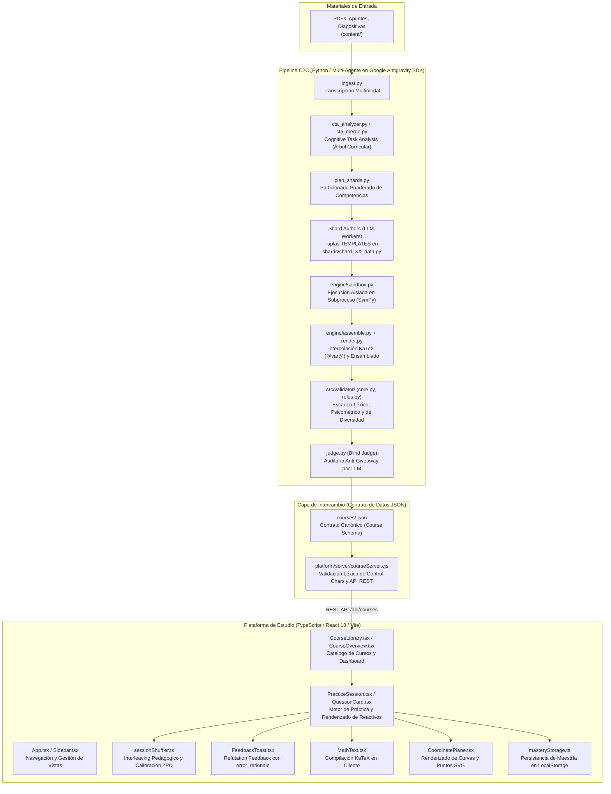
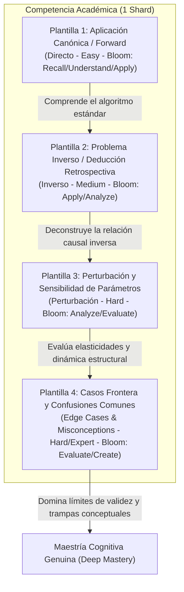

# Conocimiento Tribal y Fundamentos de Arquitectura: Tops Academy
## Manual Canónico de Física de Inferencia, Arquitectura de Sistemas End-to-End, Gobernanza Agéntica y Ergonomía

> **Documento Canónico de Conocimiento Tribal ("Tribal Knowledge")**  
> **Fecha de Actualización:** 2026-11-08 (Branch: `main` / `optimizaciones_test`)  
> **Áreas:** Pipeline Multi-Agente C2C (`.agents/skills/content-to-course/`), Motor Determinista y Simbólico (`engine/` + `SymPy`/`Z3`/`Lean 4`), Evaluador de Calidad (`course-qa-evaluator`), Plataforma Web (`React 18 + Vite + TypeScript + PWA`) y Ergonomía de Hardware Real.  
> **Propósito:** Condensar el **por qué** el ecosistema funciona como funciona, fundamentado en leyes físicas de inferencia, mediciones empíricas en hardware de referencia, causas raíz de patologías superadas y convenciones inviolables de calidad pedagógica y psicométrica.  
> **Archivos Relacionados:**
> - Hoja de Ruta Activa: [`FUTURE_MILESTONES.md`](file:///d:/Augusto/personal_portfolio/Tops_academy/FUTURE_MILESTONES.md)
> - Registro de Certificación Histórica: [`MILESTONES_COMPLETED.md`](file:///d:/Augusto/personal_portfolio/Tops_academy/MILESTONES_COMPLETED.md)
> - Especificaciones Técnicas Detalladas: [`docs/specs/`](file:///d:/Augusto/personal_portfolio/Tops_academy/docs/specs/)

---

## 1. Anatomía del Ecosistema End-to-End y Puente Inter-Lenguajes

### 1.1. Los 4 Puntos de Fricción Estructurales (Python $\longleftrightarrow$ TypeScript)
La frontera entre Python y TypeScript es el archivo `courses/<course_id>.json` (tipado en [`platform/src/types.ts`](file:///d:/Augusto/personal_portfolio/Tops_academy/platform/src/types.ts) y en `schemas/course.schema.json`). En esta frontera emergen 4 tensiones estructurales que el sistema resuelve por diseño:
1. **La Colisión de Escapado LaTeX:** Una omisión en Python de raw strings convierte comandos como `\tau` o `\beta` en caracteres de control ASCII (`\t`, `\b`). Si [`courseServer.cjs`](file:///d:/Augusto/personal_portfolio/Tops_academy/platform/server/courseServer.cjs) los detecta, bloquea la carga del curso. Por ende, todo template y generador debe emplear raw strings `r"..."` y la regla `R-23` sanitiza antes de emitir.
2. **Discrepancia del Motor de Evaluación (SymPy vs RegExp):** En backend, Python verifica equivalencias complejas con CAS (`SymPy`); en cliente, el frontend requiere heurísticas ligeras o endpoints evaluadores deterministas para evitar arrastrar bibliotecas simbólicas pesadas al navegador.
3. **Sobrecarga de Viewport por MC7:** 7 alternativas apiladas verticalmente en laptops compactas (13"-14") saturan la pantalla y exigen zoom out continuo. Se resuelve mediante el layout de 2 columnas condicional con Container Queries (`@container (min-width: 480px)`).
4. **Desajuste de Granularidad (Unidad Plana vs. PPT Real):** Tratar cada micro-competencia como una unidad independiente satura al alumno con quizzes y unit tests redundantes y rompe la jerarquía pedagógica natural. Se aborda reorganizando el contenido en torno a las presentaciones reales con Glosario, Núcleo Conceptual y Quizzes escalonados.

---

## 2. Conocimiento Tribal de la Plataforma Web: Carga, Caché y Ergonomía

> Registrado tras mediciones sistemáticas en hardware real (laptop de desarrollo ASUS TUF F15 y laptop de 14" a 150% de escala DPI). Cada dato está marcado como **medido** (con cifra) o **hipótesis** (sin medir en navegador).

### 2.1. ¿Cuándo y Cómo se Carga un Curso?
- **¿Cuándo empieza a cargarse un curso: al pulsar o antes?** Antes. Al abrir la plataforma, la biblioteca se pinta con el manifest inline (≈ 2.5 KB, sin red) y `prefetchCourses` encola todos los cursos válidos para descargarlos **en segundo plano**, uno a uno, con `requestIdleCallback`. Pasar el cursor, enfocar o tocar una tarjeta (`pointerenter` / `focus` / `touchstart`) le da prioridad inmediata a ese curso.
- **Persistencia Multinivel:** Cada curso queda en una caché en memoria y en IndexedDB (`tops_academy_cache`, almacén `courses`, validada por `ETag`). Si el usuario pulsa antes de que la cola llegue a ese curso, la carga ocurre en el momento del clic.
- **¿Al pulsar se carga todo el sistema o solo ese curso?** Solo ese curso. La petición es `GET /api/courses/<id>.json`; los demás no se tocan.

### 2.2. Costo Real de Abrir Cursos Masivos (Medido en ASUS TUF F15)

| Curso | Preguntas | Archivo | Servidor (gzip) | `JSON.parse` + `normalizeQuestion` (Node) |
| :--- | :---: | :---: | :---: | :---: |
| `saul_control_optimo` | 350 | ≈ 1.7 MB | 109 KB en ≈ 10 ms | ≈ 5 ms |
| `estadistica_3_pre_parcial_v2` | 2,770 | ≈ 13.9 MB | — | ≈ 33 ms |
| `gavilano_pre_parcial` | 2,950 | ≈ 14.1 MB | 912 KB en ≈ 66 ms | ≈ 36 ms |

### 2.3. Corrección de una Estimación Previa y Sospechosos Reales
Se había estimado inicialmente que abrir Gavilano o Estadística v2 costaba 1.5–2.5 s de parseo y normalización local. **La medición formal lo refutó:** parsear y normalizar ≈ 3,000 preguntas toma apenas ≈ 35 ms, y el servidor entrega el curso comprimido en ≈ 66 ms.
- **Conclusión de Arquitectura:** La idea de «normalización diferida por unidad» solo ahorraría ≈ 3–7 ms, lo cual no justifica su complejidad.
- **Los Sospechosos Reales de Lentitud Percibida:**
  1. `loadCourse` hacía `await saveToIndexedDB(...)` **antes** de devolver el curso en la ruta de red (`courseLoader.ts`): abrir esperaba el *structured clone* y la escritura en disco de ≈ 14 MB. Solución: desacoplar la escritura a segundo plano (*fire-and-forget*).
  2. El prefetch en segundo plano clonaba y escribía cursos de 14 MB en el hilo principal mientras el usuario interactuaba (generando jank en el clic).
  3. Renderizado de la vista de Overview con ≈ 127 competencias (`MasteryGrid`) en el hilo principal sin virtualización.
  4. En `npm run dev` las peticiones pasaban por el middleware de Vite y no por `courseServer.cjs`.

### 2.4. Cómo Comprobar que la Caché Funciona
Abrir un curso, volver a la biblioteca y reabrirlo: debe ser casi instantáneo y el panel *Network* no debe mostrar ninguna petición a `/api/courses/<id>`. El contenido persistido se inspecciona en DevTools $\to$ *Application* $\to$ *IndexedDB* $\to$ `tops_academy_cache` $\to$ `courses`.

### 2.5. Lecciones Inviolables de Ergonomía y Renderizado
- **JAMÁS forzar `white-space: normal` sobre KaTeX:** Rompe la estructura tipográfica matemática: subíndices, superíndices, relaciones de igualdad y barras de evaluación caen en líneas separadas. KaTeX **depende intrínsecamente** de `white-space: nowrap`. Para permitir que frases largas envuelvan naturalmente, la solución correcta es extraer la prosa de `\text{...}` hacia texto normal (`splitMathAndProse` en `MathText.tsx`), manteniendo operadores matemáticos breves (`\text{plim}`) dentro de KaTeX.
- **Headless Chromium oculta las scrollbars (`--hide-scrollbars`):** En pruebas automatizadas E2E, usar obligatoriamente `ignoreDefaultArgs: ['--hide-scrollbars']`, o el ancho útil real de la pantalla queda falseado por 15 px.
- **Aritmética de Anchos a 150% de Escala (Laptop 14"):** En split 50%, el ancho disponible es de ≈ 640 px CSS − 15 px de scrollbar − 32 px de padding = **586–593 px útiles** (de ahí el umbral crítico de 2 columnas fijado en 480 px). La biblioteca ve un `innerWidth` de ≈ 1265 px, no 1280 px (de ahí el breakpoint de 3 columnas fijado en 1000 px).

---

## 3. Conocimiento Tribal del Pipeline C2C: Epistemología y los 4 Arquetipos

> Convención canónica del pipeline multi-agente C2C y el evaluador de calidad (`course-qa-evaluator`). Define la vara epistemológica innegociable de Tops Academy.

### 3.1. Medición de la Excelencia Académica (Más Allá de la Compilación)
En Tops Academy, un curso **no se considera excelente simplemente porque sus archivos `.py` compilen sin errores de sintaxis** o porque el motor genere reactivos con tests pasando. La verdadera excelencia académica se evalúa bajo un estándar de maestría profunda (*Deep Mastery*) estructurado en tres dimensiones complementarias:

1. **Equilibrio Cognitivo en la Taxonomía de Bloom:**
   - Vetado el reduccionismo a reactivos de memorización o reconocimiento pasivo.
   - Cada competencia debe tener una distribución intencional entre:
     * **Niveles Fundacionales (*Recall* y *Understand*):** Evocación de definiciones canónicas y comprensión intuitiva.
     * **Niveles Intermedios (*Apply*):** Algoritmos de cálculo, álgebra matricial y derivaciones numéricas.
     * **Niveles Superiores (*Analyze*, *Evaluate* y *Create*):** Diagnóstico de violaciones de supuestos, descomposición de demostraciones, selección crítica entre estimadores y análisis de sensibilidad.
   - **Regla Tribal Inviolable:** Toda competencia debe involucrar **mínimo $\ge 2$ niveles distintos de Bloom**, con presencia obligatoria de niveles de aplicación o análisis (`Apply+`).

2. **Higiene Psicométrica y Prevención de Trampas (*Anti-Gaming*):**
   - **Longitud Calibrada:** Opciones homogéneas en extensión para evitar que la opción correcta destaque visualmente por ser más larga (`AntiGamingPsychometricLinter`).
   - **Distractores con Diagnóstico Refutacional:** Cada distractor debe reflejar una concepción errónea verosímil y documentada (*misconception*), portando su respectivo `error_rationale` para retroalimentación correctiva inmediata.
   - **Erradicación de Multiplicadores Mágicos:** Bloqueo absoluto de distractores construidos artificialmente como múltiplos fijos de la respuesta correcta (`[DIAG-MAGIC-MULT]`).

3. **Polimorfismo Estructural Anti-Overfitting (El Sistema de los 4 Arquetipos):**
   - El estudiante no debe memorizar el molde sintáctico de la pregunta; debe dominar el principio subyacente independientemente de cómo se formule el problema.

### 3.2. Los 4 Arquetipos Canónicos de Plantillas por Competencia

1. **Plantilla 1: Aplicación Canónica / Forward (`archetype: "direct"`, Banda ZPD: `easy`, Bloom: *Recall / Understand / Apply*):**
   - **Qué evalúa:** La ejecución directa del algoritmo estándar o definición base en condiciones normales.
   - **Contrato Relacional Formal:** $\forall x\,\theta,\; H_{\text{std}}(x, \theta) \implies \exists! y,\; R(x, \theta, y)$.
   - **Mecánica:** A partir de parámetros base y supuestos conocidos $H_{\text{std}}$, se calcula o deriva directamente la solución estándar $y$ (ej. calcular estimador MCO dados $X, y$, o hallar capital de estado estacionario $k^*$).

2. **Plantilla 2: Problema Inverso / Deducción Retrospectiva (`archetype: "inverse"`, Banda ZPD: `medium`, Bloom: *Apply / Analyze*):**
   - **Qué evalúa:** La capacidad de desarmar la ecuación en sentido inverso, evitando la mecanización unidireccional.
   - **Contrato Relacional Formal:** $\forall x\,y^*,\; H_{\text{inv}}(x, y^*) \implies \exists! \theta^*,\; R(x, \theta^*, y^*)$ (fórmula objetivo algebraicamente no equivalente en AST a la de `direct`).
   - **Mecánica:** Se proporciona el resultado final observado $y^*$ y se solicita despejar el valor inicial requerido, el tamaño muestral necesario $n$, o el parámetro exógeno latente $\theta^*$.

3. **Plantilla 3: Perturbación y Sensibilidad de Parámetros (`archetype: "perturbation"`, Banda ZPD: `hard`, Bloom: *Analyze / Evaluate*):**
   - **Qué evalúa:** La comprensión profunda de elasticidades, estática comparativa y comportamiento asintótico.
   - **Contrato Relacional Formal:** $\forall x\,\theta\,y\,\theta',\; H_{\text{std}}(x,\theta) \land R(x,\theta,y) \land \theta' = g(\theta) \implies \exists! y',\; R(x,\theta',y') \land y' = h(y)$ (ley de escala o razón invariante sin re-computar estados base primitivos).
   - **Mecánica:** Se introduce un choque exógeno (ej. cuadruplicar el tamaño de muestra $n \to 4n$, duplicar depreciación $\delta$), exigiendo determinar analíticamente cómo reacciona el estimador sin re-calcular todo desde cero.

4. **Plantilla 4: Ruptura de Supuestos y Casos Frontera (`archetype: "boundary_or_edge_case"`, Banda ZPD: `hard / expert`, Bloom: *Evaluate / Create*):**
   - **Qué evalúa:** El discernimiento de las **hipótesis explícitas del teorema (`assumptions`)**, las consecuencias formales de su violación (`violation_consequence`) y la superación de errores arraigados (*misconceptions*).
   - **Contrato Relacional Formal:** $\exists x\,\theta_{\text{edge}},\; \neg H_{\text{std}}(x, \theta_{\text{edge}}) \land \neg \text{PropiedadEstandar}(x, \theta_{\text{edge}})$, vinculado obligatoriamente a un `assumption_tested_id` explícito del `cta.json`.
   - **Mecánica:** Fuerza una instancia paramétrica donde se niega una hipótesis estructural y la fórmula general colapsa (ej. método Delta con $g'(\theta)=0$ que exige orden 2 $\chi^2_1$; colinealidad perfecta $\det(X^\top X)=0$; o raíces unitarias $|\rho|=1$).
   - **Invariante Anti-Clonación AST (4/4 Fórmulas Disjuntas):** En competencias `Skill` (`Hab-*`), el compilador verifica mediante normalización simbólica (`SymPy` / `compile_shard.py`) que las 4 funciones generadoras produzcan **4 expresiones algebraicas objetivo genuinamente distintas** (cerrando la brecha donde `len(set(valid_100)) >= 2` permitía clonar la misma fórmula 3 veces).

---

## 4. Física Empírica de Inferencia y Gobernanza Agéntica

### 4.1. Física Empírica de Streaming en `Model="flash"` (Google Antigravity SDK)
- **Velocidad de decodificación sostenida:** $v_{\text{out}} \approx 168\text{ tokens de salida/s}$ (~$6.0\text{ s}$ de latencia por cada $1,000$ tokens emitidos en herramientas).
- **Asimetría de latencia:** Reescribir un archivo monolítico de $30,000$ tokens consume **$180\text{ s}$ de streaming puro**. Reparar quirúrgicamente de 1 a 5 líneas mediante `edit_file` consume **$10\text{ a }25\text{ s}$** ($150\text{ s}$ de ahorro directo por turno), **siempre y cuando** el número de líneas infractoras sea $\le 5$. Cuando un mismo código de regla falla en 25 líneas distintas, forzar `edit_file` degenera en 25 turnos secuenciales (~16 min).

### 4.2. Matriz Oficial Certificada 2D (`decidirEstrategiaEdicion`)
Evaluar únicamente `erroresConsolidados < 6` sin acotar `lineasInfractoras <= 5` causó la **Trampa de Micro-Reparación Lineal** (`cta_02`: 16.5 min, 26 turnos por una sola regla `[CTA-KATEX]` dispersa en 25 líneas). La política certificada en `TopsAcademyC2C.lean` exige evaluar **ambas dimensiones** de manera conjunta:

| Nivel / Condición Formal tras Compilar | Herramienta Mandatoria (Enforced por Hook) | Alcance Operativo en CTA y Shards | Latencia Típica |
| :--- | :--- | :--- | :---: |
| **Nivel 0: Error mecánico determinista** | **Auto-Heal AST/Tokenize en Compilador** | Envoltura automática `$...$` de LaTeX huérfano, colapso R-23 y auto-exportación de `vars` en memoria. | **$< 5\text{ ms}$** |
| **Nivel 1: `1 <= errores < 6` Y `lineasInfractoras <= 5` (sin `SyntaxError`)** | **`edit_file` (`replace_file_content`) OBLIGATORIO** | Reemplazo quirúrgico en 1 turno paralelo sobre `StartLine..EndLine`. `write_file` monolítico bloqueado por hook. | **`10 – 25 s`** |
| **Nivel 2: (`errores >= 6` O `lineasInfractoras > 5`) acotados a 1–2 competencias** | **`ModularSplicing` OBLIGATORIO (`cta_fixes/<CID>.py` o `shard_fixes/<shard>/<CID>.py`)** | Sobrescritura atómica aislada del módulo `<CID>.py` (~60 líneas), ensamblada en memoria por el compilador. Bloquea edición in-place sobre el monolito. | **`20 – 40 s`** |
| **Nivel 3: `SyntaxError` global o Creación Inicial en Turno 0** | **`write_file(Overwrite=True)` Atómico Completo** | Creación inicial en Turno 0 o reescritura atómica completa únicamente si el AST global del archivo colapsó. | **`60 – 120 s`** |

---

## 5. Auditoría Forense: Las 11 Patologías Estructurales del Pipeline y su Resolución

1. **Patología 1 — Trampa de Micro-Reparación Unidimensional y Ausencia de `cta_fixes/`:** El hook bloqueaba `write_file` si `errores < 6`, pero sin contar líneas afectadas. Si una regla fallaba en 25 líneas, atrapaba al subagente en 25 turnos secuenciales. *Solución:* Matriz 2D combinando errores y líneas, más ensamblador modular `cta_fixes/` y `shard_fixes/`.
2. **Patología 2 — Ventana Ciega de Presupuesto + Bug de Exención Post-PASS y "Bomba de Depuración":** `budget_guard.py` auditaba pasivamente cada 7–10 minutos permitiendo agentes rebeldes de 136 turnos. Sumado a ello, el hook comparaba `status in ("REJECTED", ...)` en mayúsculas mientras el publicador escribía `"rejected"`, bloqueando al reparador. Además, autores inyectaban `raise RuntimeError` para debug y el hook post-pass les impedía retirarlo. *Solución:* Bloqueo duro síncrono a 40 turnos / 5M tokens en hook, normalización `status.upper()`, y compuerta AST `[TPL-DEBUG-ARTIFACT]` que prohíbe `raise` residual antes de emitir PASS.
3. **Patología 3 — Bug Silencioso `np.bool_(False) is False` en Sandbox:** Python evalúa `np.bool_(False) is False` como `False` debido a la identidad de puntero del singleton. Si un verificador devolvía `np.bool_(False)` tras fallar un test numérico, ¡el sandbox lo tomaba como aprobado! *Solución:* Conversión estricta `if isinstance(res, np.generic): res = res.item()` seguida de `if res is not True:`.
4. **Patología 4 — Brechas Shift-Left Stage 3 $\to$ Stage 4/5/6:** Reglas como `MIN_ARCHETYPES = 3` vs 4, `passes_calibrated` con `div_ratio >= 0.25` vs 0.50, linters `[DIAG-MAGIC-MULT]` que solo chequeaban `ast.Mult` omitiendo divisiones `ans / 3`. *Solución:* Sincronización contractual estricta de umbrales entre Stage 3 y compuertas finales.
5. **Patología 5 — Bola de Nieve de Caché (81.2% Tokens) y Duplicación en `dispatch.py`:** En 35M tokens de corrida, el 81% eran re-lecturas multi-turno. `dispatch.py` enviaba el prompt completo dos y tres veces (`"Prompt"`, `"work_order"`, `"items"`), desperdiciando ~2M tokens por corrida. *Solución:* Deduplicación de payloads, envío de punteros y prompts `--lean` de $\le 5\text{ KB}$.
6. **Patología 6 — System Prompts Auto-Saboteadores:** Activar `--lean` enseñaba ejemplos obsoletos `Form-A` o con 3 fórmulas clonadas y 0 FIB/MS, causando rechazo inmediato en Turno 1. *Solución:* Reescritura canónica de prompts en `Form-C` con verificación CI de auto-compilación.
7. **Patología 7 — Semillas No Verificadas en `judge.py` y Parches `_clean_ds`:** Enviar semillas aleatorias al juez sin pasar por invariantes, o autores que parchaban distractores con `cand += 0.35` rompiendo la justificación de error. *Solución:* Prohibición AST de `_clean_ds` y Rejection Sampling determinista centralizado.
8. **Patología 8 — Ausencia de Supuestos Explícitos y Violaciones de Dominio:** Omitir restricciones como $x > 0$ o $a = 1$ causaba que distractores fuesen idénticos a la clave. *Solución:* Contrato obligatorio `assumptions` en `cta.json`.
9. **Patología 9 — Puntos Ciegos en `run.py --stage gates` y `repair-matrix`:** `gates` saltaba el motor completo de auditoría, y `repair-matrix` buscaba una clave `"groups"` que no existía. *Solución:* Inclusión obligatoria de `run_full_audit` y alineación con `"grouped_by_rule"`.
10. **Patología 10 — Caché `.validation_cache` Siempre Fría y Bug `scope_check`:** Una condición `and shard_py is None` impedía que el compilador poblara el caché en Stage 3, forzando 41 s de re-ejecución inútil. *Solución:* Retiro de la guarda y generación de recibos criptográficos `shard_XX.cert.json` en `< 5 ms`.
11. **Patología 11 — Deadlock de SO por Buffer `stderr` en C++ (`pykatex` en Windows):** En cursos con >1,000 preguntas y tildes en `\text{...}`, `pykatex` emitió >3,100 warnings a `stderr`. El buffer anónimo del kernel de Windows se llenó, bloqueando la llamada C++ `WriteFile` mientras retenía el GIL de Python, congelando el proceso por >8 minutos. *Solución:* Sincronización thread-safe, paso de `strict="ignore"` a C++ y normalización previa del esqueleto KaTeX, bajando el tiempo a 12.8 s.

---

## 6. Lecciones Aprendidas: Sobreescape KaTeX R-23 y Optimización Zero-Copy

### 6.1. Diagnóstico del Sobre-Escape Multi-Barra
Durante la serialización a JSON, comandos LaTeX con caracteres que coinciden con secuencias de escape (`\b`, `\f`, `\n`, `\r`, `\t` como `\frac`, `\text`, `\beta`, `\tau`) fueron sobreescapados con 4 barras invertidas (`\\\\` en archivo, evaluado como `\\frac` en memoria).
- **Impacto Silencioso:** KaTeX no arrojaba error sintáctico porque `\\` es salto de línea (` `). En consecuencia, KaTeX renderizaba un salto de línea seguido de las letras literales del comando (`f r a c`, `t o`), deformando visualmente las fórmulas en pantalla sin romper linters tradicionales.
- **Resolución:** Regla léxica `R-23` que prohíbe doble barra seguida de letras (`r'\\\\([a-zA-Z]+)'`) respetando saltos de matrices legítimos (`r'\\\\\s+'` dentro de `\begin{bmatrix}`).

### 6.2. La Optimización Zero-Copy $O(1)$
- **El Cuello de Botella $O(N^2)$:** En cursos como `gavilano_pre_parcial.json` (14.1 MB, 125,158 barras invertidas), cada barra creaba una rebanada de memoria `raw_text[bs_end:]` (~7 MB/slice), generando **~437 Gigabytes de copias de memoria efímeras** y congelando las pruebas por más de 6 minutos.
- **La Solución Implementada:** 
  1. Precompilación de expresiones regulares.
  2. Filtro selectivo aritmético: solo evaluar si `run_len >= 4 and run_len % 4 == 0` o `run_len >= 6 and run_len % 4 == 2`, saltando el regex en el 99.9% de barras legítimas de JSON (`run_len == 2`).
  3. Coincidencia in-place de cero copias usando el argumento `pos` (`RE_ALPHA.match(raw_text, bs_end)`), eliminando las rebanadas de memoria.
- **Impacto:** Tiempo de suite reducido de **>6 minutos** a **9.16 segundos** con 100% de paridad.

---
*Fin del Manual de Conocimiento Tribal. Consúltese este archivo ante cualquier duda sobre decisiones arquitectónicas, umbrales de latencia o convenciones de calidad en Tops Academy.*
