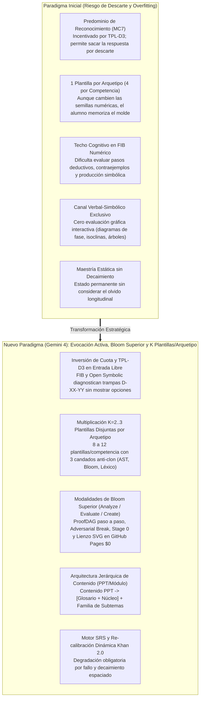

# Hoja de Ruta Maestra de Evolución y Milestones: Tops Academy
## Elevando la Vara: Certificación Formal Multi-Agente Neuro-Simbólica (Lean 4), Transición hacia Evocación Activa (Bloom Superior), Multiplicación Anti-Overfitting con Gemini 4 y "Antigravity Study Harness"

> **Documento Estratégico y Hoja de Ruta Ejecutiva de Ingeniería**  
> **Fecha de Actualización:** 2026-11-18 (Branch: `main` — Arquitectura de 4 Ejes, Reforma `TPL-D3` Anti-Descarte, Unificación M5+M20 y Multiplicación de Plantillas por Arquetipo en M19 con Gemini 4)  
> **Ubicación Canónica:** [`FUTURE_MILESTONES.md`](file:///d:/Augusto/personal_portfolio/Tops_academy/FUTURE_MILESTONES.md) *(espejo byte a byte en [`docs/future_milestones/FUTURE_MILESTONES.md`](file:///d:/Augusto/personal_portfolio/Tops_academy/docs/future_milestones/FUTURE_MILESTONES.md))*.  
> **Áreas del Ecosistema:** Pipeline Multi-Agente C2C (`.agents/skills/content-to-course/` + Kernel Formal `Lean 4`), Motor Determinista y Simbólico (`engine/` + `SymPy`/`Z3`/`Lean 4`), Evaluador de Calidad (`course-qa-evaluator`), Plataforma Web (`React 18 + Vite + TypeScript + PWA`) y Marco Neurocognitivo de Adquisición de Pericia (*The Expert Myth* + *Khan Academy Mastery*).

---

## ⚠️ Regla Fundamental de Gobernanza y Sincronización Bidireccional (Innegociable para Agentes)

> [!IMPORTANT]
> **CONVENCIÓN DE REFERENCIAS TÉCNICAS Y ACTUALIZACIÓN CRUZADA:**
> 1. **Propósito de este Archivo:** Este documento (`FUTURE_MILESTONES.md`) es la **hoja de ruta estratégica de alto nivel**. Define el *qué*, el *por qué* cognitivo, las *prioridades*, los *criterios de aceptación (AC)* y las fases de ejecución de los hitos pendientes.
> 2. **Dónde vive la especificación profunda:** Para mantener este roadmap ágil y legible, los detalles de implementación técnica pesados (contratos TypeScript, esquemas JSON, teoremas Lean 4, matrices psicométricas de 12 filas, wireframes de UI y plantillas de prompts) **residen en los archivos especializados de referencia** listados abajo.
> 3. **Protocolo para Subagentes y Desarrolladores:**
>    - **Lectura Profunda Obligatoria:** Cuando un agente vaya a diseñar, auditar o implementar un hito, **DEBE abrir y leer el archivo de especificación técnica correspondiente** citado en la ficha del hito.
>    - **Actualización Bidireccional:** Si durante el desarrollo o la toma de decisiones arquitectónicas cambia el alcance, los contratos o la lógica de un hito, el agente **DEBE actualizar simultáneamente este archivo, su espejo en `docs/future_milestones/FUTURE_MILESTONES.md` y el archivo de especificación detallada vinculado**, garantizando cero desincronización (*zero drift*).
>    - **Cierre y Migración:** Al completarse y certificarse un hito con pruebas pasando, su ficha detallada se retira de este archivo y se traslada a [`MILESTONES_COMPLETED.md`](file:///d:/Augusto/personal_portfolio/Tops_academy/MILESTONES_COMPLETED.md).

### Mapa del Ecosistema Documental

| Archivo de Referencia | Qué Contiene y Cuándo Debe Consultarse / Actualizarse |
| :--- | :--- |
| 📘 [`CONOCIMIENTO_TRIBAL.md`](file:///d:/Augusto/personal_portfolio/Tops_academy/CONOCIMIENTO_TRIBAL.md) | **Física de inferencia, causas raíz y arquitectura causal:** Velocidades de streaming de `flash`, Matriz 2D de Gobernanza, las 11 patologías del código, mediciones de hardware (ASUS TUF vs 14" 150%), lecciones KaTeX (no `white-space: normal`) y contratos de los 4 arquetipos. Consultar siempre que se modifiquen hooks, compiladores o reglas de la plataforma. |
| 📗 [`MILESTONES_COMPLETED.md`](file:///d:/Augusto/personal_portfolio/Tops_academy/MILESTONES_COMPLETED.md) | **Registro histórico de lo ya certificado:** Bitácora forense de entrega de los Milestones 1, 1-T, 2, 2a, 3, 4, 6, 7, 10, 11 (núcleo), 12, 13, 14, 15 (F1) y 16 (F1), con commits y suites de verificación. Consultar para auditar lo existente y registrar nuevos cierres. |
| 📄 [`docs/specs/m06_study_harness.md`](file:///d:/Augusto/personal_portfolio/Tops_academy/docs/specs/m06_study_harness.md) | **Especificación del Milestone 6:** Wireframes ASCII de 1/2 pantalla, máquina de estados de la cortina *Blank-First*, diagrama de secuencia, contraste de la Hipótesis Huerta y suite de 4 prompts Khanmigo \$0 API. |
| 📄 [`docs/specs/m09_hierarchical_content_khanmigo.md`](file:///d:/Augusto/personal_portfolio/Tops_academy/docs/specs/m09_hierarchical_content_khanmigo.md) | **Especificación del Milestone 9:** Tipados completos de TypeScript (`ContentCore`, `ContentModule`, `ExplicitAssumption`, `SubtopicUnit`), jerarquía de 3 niveles y extractor de Unidad 0 `PRE-XX`. |
| 📄 [`docs/specs/m14_khan_mastery_engine.md`](file:///d:/Augusto/personal_portfolio/Tops_academy/docs/specs/m14_khan_mastery_engine.md) | **Especificación del Milestone 14 y 14-B:** Matriz canónica de transición psicométrica de 12 filas, interfaces de `masteryStorage.ts`, fórmula híbrida 80/20, *Hint-Cap* y simulador adaptativo de parcial. |
| 📄 [`docs/specs/m15_m18_formal_lean4.md`](file:///d:/Augusto/personal_portfolio/Tops_academy/docs/specs/m15_m18_formal_lean4.md) | **Especificación de los Milestones 15 a 18:** Los 6 teoremas constructivos de `TopsAcademyC2C.lean`, compilación Perceus C FFI (`< 0.5 ms`), SMT Z3, arbitraje bicameral con $\alpha_{\text{Kernel}} = 0$ y arnés `#print axioms` con nonce criptográfico. |
| 📄 [`docs/specs/sintesis_plantillas_arquetipos.md`](file:///d:/Augusto/personal_portfolio/Tops_academy/docs/specs/sintesis_plantillas_arquetipos.md) | **Especificación de los Milestones 19 y 20 (Fusionado con M5):** Arquitectura de los 4 ejes (Arquetipo, Modalidad, Dificultad y Taxonomía de Bloom), reforma `TPL-D3` para entrada libre (`FIB`/`open_symbolic`), inversión de cuota anti-descarte y multiplicación $K=2..3$ plantillas disjuntas por arquetipo con 3 candados anti-clon. |
| 📚 [`docs/investigaciones/`](file:///d:/Augusto/personal_portfolio/Tops_academy/docs/investigaciones/) | **Estudios fundacionales:** Investigaciones de desacoplamiento KaTeX (01, 02), limitaciones cognitivas de la plataforma (03, 04) y análisis forenses externos. |

---

## 1. El Diagnóstico Estratégico y Neurocognitivo: De la Identificación por Descarte a la Producción Analítica y Anti-Overfitting

En auditorías automatizadas bajo estándares Quality Matters (QM), OSCQR y Mastery Learning, el pipeline C2C alcanzó puntajes de excelencia formal (**18.7 – 20.0 / 20.0 pts**) en cursos masivos de alta complejidad técnica (`solow_growth_model`, `gavilano_pre_parcial` con 127 competencias, `asymptotic_statistics_v7` con 32 competencias).

Sin embargo, el contraste estricto frente a los principios de adquisición de pericia (*The Expert Myth*) y la Taxonomía de Bloom revela una **paradoja de falsa suficiencia**:



### 1.1. La Arquitectura de los 4 Ejes en la Creación de Problemas y su Reforma

Cada plantilla en `TEMPLATES` es una tupla de 9 elementos (`[tpl_id, cid, qtype, gen_fn, ver_fn, (difficulty, bloom), stems, hints, sol]`) que cruza **4 ejes ortogonales**:

| Eje | Qué Define | Estado Actual Verificado (`compile_shard.py`) | Evolución Estratégica (Habilitada por Gemini 4) |
| :--- | :--- | :--- | :--- |
| **1. Arquetipo** | Qué razonamiento exige al estudiante. | `MIN_ARCHETYPES = 4`: `direct`, `inverse`, `perturbation`, `boundary_or_edge_case` (enlazado a `assumption_id` si existen supuestos). | Se mantienen los 4 arquetipos como columnas vertebrales, pero cada arquetipo pasa de tener 1 plantilla a tener **$K = 2..3$ plantillas estructuralmente disjuntas** (`TEMPLATES_PER_ARCHETYPE`). |
| **2. Modalidad / Tipo** | Cómo responde el estudiante (interfaz cognitiva). | `MC7`, `FIB`, `MS`. Hoy `TPL-D3` evalúa distractores solo en `MC7` (6) y `MS` (1–4) en `seed=42`, forzando a añadir más `MC7` cuando $N_d > 6$. | **Desacople `TPL-D3` de `MC7`:** `FIB` y `open_symbolic` declaran y evalúan las fórmulas de error `D-XX-YY` en segundo plano. **Inversión de cuota:** máx. 1 `MC7` por competencia (0 en `Hab-*`) y $\ge 80\%$ en producción activa (`FIB`, `open_symbolic`, `proof_dag`, `adversarial_break`, `unstructured_model`, `invariant_canvas`). |
| **3. Banda de Dificultad** | Ubicación en la Zona de Desarrollo Próximo (ZPD). | Cobertura obligatoria de las 3 bandas: `direct` $\to$ `'easy'`, `inverse` $\to$ `'medium'`, `perturbation` $\to$ `'hard'`, `boundary` $\to$ `'hard'`. | Se preserva el anclaje Tri-Banda por arquetipo para alimentar el enrutamiento ZPD (`sessionShuffler.ts`) y el simulador adaptativo en 2 módulos. |
| **4. Taxonomía de Bloom** | Profundidad del procesamiento cognitivo. | Mínimo 2 niveles por competencia. Regla dura `[M3-SKILL-BLOOM]`: prohibido `Remember`/`Understand` en `Hab-*` (exige `Apply` o superior). | **Ascenso taxonómico dentro de cada arquetipo:** Las $K$ plantillas de un mismo arquetipo deben variar su tupla `(modalidad, bloom)`, empujando sistemáticamente hacia `Analyze`, `Evaluate` y `Create` mediante evaluación paso a paso. |

### 1.2. Los 8 Puntos Ciegos Cognitivos que Definen la Nueva Vara
Fundamentados en los estudios [`docs/investigaciones/03_Limitaciones_de_la_plataforma_de_estudio.md`](file:///d:/Augusto/personal_portfolio/Tops_academy/docs/investigaciones/03_Limitaciones_de_la_plataforma_de_estudio.md) y [`04_Limites_de_la_plataforma_y_estudio.md`](file:///d:/Augusto/personal_portfolio/Tops_academy/docs/investigaciones/04_Limites_de_la_plataforma_y_estudio.md):
1. **Evocación Libre (*Free Recall*) vs. Reconocimiento:** Superar el descarte asistido exigiendo formular respuestas sin opciones visibles.
2. **Traducción Visoespacial (*Dual Channels*):** Evaluar interacción gráfico-espacial (diagramas de fase, isoclinas, campos vectoriales).
3. **Encadenamiento de Demostraciones (*Step-by-Step Proofs*):** Evaluar secuencias de micro-decisiones analíticas encadenadas.
4. **Combate a la Ilusión Explicativa:** Forzar la formulación activa y el contraste de contraejemplos.
5. **Formulación No Estructurada:** Filtrar regularidades relevantes frente a datos distractores en el enunciado.
6. **Trabajo Computacional (*Shop Time*):** Experimentación paramétrica sin solución analítica cerrada.
7. **Andamiaje Diferido (*Delayed Scaffolding*):** Retardo inicial de pistas para entrenar la metacognición.
8. **Síntesis Estructural (*Part-Whole*):** Unificar el aprendizaje en torno a la fuente real (PPT) con Glosario, Núcleo Conceptual y Challenges integradores.

### 1.3. Matriz de Contraste: *The Expert Myth* vs. Estado del Arte de Tops Academy

| Pilar de Pericia | Mecanismo Cognitivo Requerido | Estado Actual en Producción | Brecha Remanente (Gap hacia la Pericia) |
| :--- | :--- | :--- | :--- |
| **1. Evocación Pura vs. Reconocimiento** | Producir la respuesta o derivación frente a la hoja en blanco (*free recall*), sin descartar opciones. | Cortina *Blank-First* y Navegación Mouseless activas ([Milestone 6](file:///d:/Augusto/personal_portfolio/Tops_academy/MILESTONES_COMPLETED.md#milestone-6-antigravity-study-harness-20-modo-blank-first-y-transferencia-khanmigo-0-api)). Formatos `MC7`, `FIB` y `MS`. | ⚠️ Reforma `TPL-D3` para captura de distractores en `FIB`/`open_symbolic`, reducción drástica de `MC7` y despliegue de `proof_dag`, `adversarial_break`, `unstructured_model` e `invariant_canvas` ([Milestone 20 — fusiona M5 y M20](#milestone-20-fusiona-m5-y-m20-arquitectura-epistémica-de-excelencia-sobresaliente-20-modalidades-de-bloom-superior-y-reforma-anti-descarte-en-github-pages-0)). |
| **2. Variedad Estructural sin Overfitting** | Miles de intentos sobre el principio evitando que el alumno memorice un único molde de despeje. | Contrato de 4 arquetipos obligatorios (`1` plantilla por arquetipo) y verificación en `seed=100` ([Milestone 16 F1](file:///d:/Augusto/personal_portfolio/Tops_academy/MILESTONES_COMPLETED.md)). | ⚠️ Multiplicación a $K=2..3$ plantillas por arquetipo ($8..12$ por competencia) con 3 candados anti-clon ([Milestone 19](#milestone-19-multiplicación-estructural-de-plantillas-por-arquetipo-k23-con-gemini-4-y-escalamiento-2x3x-anti-overfitting)) + deducción SMT Z3 ([Milestone 16 F2](#milestone-16-fase-2-deducción-algebraica-automática-con-z3-y-lemas-lean-4)). |
| **3. Alta Validez Interna y Rigor Formal** | Garantía matemática de ausencia de colisiones, ciclos curriculares o enunciados incompletos. | Patrón PrairieLearn `@var@`, compilador AST `KaTeXAST` ([Milestone 4](file:///d:/Augusto/personal_portfolio/Tops_academy/MILESTONES_COMPLETED.md)) y Kernel Python isomórfico ([Milestone 15 F1](file:///d:/Augusto/personal_portfolio/Tops_academy/MILESTONES_COMPLETED.md)). | ⚠️ Binario nativo Perceus C Lean 4 `< 0.5 ms` ([Milestone 15 F2](#milestone-15-fase-2-kernel-nativo-perceus-c-lean-4-ffi-05-ms-y-drt-industrial)), clausura epistémica DAG ([Milestone 17](#milestone-17-certificación-formal-del-dag-curricular-clausura-epistémica-y-arbitraje-neuro-simbólico)) y arnés CI `#print axioms` ([Milestone 18](#milestone-18-arnés-de-certificación-continua-anti-drift-de-contratos-y-auditoría-print-axioms)). |
| **4. Feedback Inmediato** | Diagnóstico instantáneo de por qué falló el razonamiento. | Refutation Feedback en Toast (`FeedbackToast.tsx`) con `error_rationale`. | ⚠️ Falta bifurcación adaptativa de examen parcial en 2 módulos ([Milestone 14-B](#milestone-14-b-simulador-cronometrado-adaptativo-de-examen-parcial-en-2-módulos-sat-bluebook)); remediación y degradación core cerradas en [Milestone 14](file:///d:/Augusto/personal_portfolio/Tops_academy/MILESTONES_COMPLETED.md#milestone-14-motor-de-maestría-integral-20-estilo-khan-academy-calibración-bidireccional-híbrido-8020-fluidez-y-motor-up-next). |
| **5. Práctica Deliberada y Retención** | Operar en ZPD (70–85%), clasificar problemas ciegos y frenar olvido. | Interleaving pedagógico dinámico y ZPD implementados (`sessionShuffler.ts`). | ⚠️ Ausencia de decaimiento temporal SRS ([Milestone 8](#milestone-8-motor-de-decaimiento-en-memoria-srs-mastery-challenge-12h-misconception-ledger-y-fluidez)). Degradación y calibración completadas en [Milestone 14](file:///d:/Augusto/personal_portfolio/Tops_academy/MILESTONES_COMPLETED.md#milestone-14-motor-de-maestría-integral-20-estilo-khan-academy-calibración-bidireccional-híbrido-8020-fluidez-y-motor-up-next); resta simulador adaptativo en 2 módulos ([Milestone 14-B](#milestone-14-b-simulador-cronometrado-adaptativo-de-examen-parcial-en-2-módulos-sat-bluebook)). |

---

## 2. Consolidación de Hitos de Modalidades y Plantillas (M5 + M20 y Reforma de M19)

Para alinear la ingeniería en torno al objetivo de **mayor exigencia cognitiva (Bloom superior sin descarte) + cero overfitting (más y mejores plantillas con Gemini 4)**, se han estructurado los siguientes ejes sobre el banco de problemas:

1. 🔗 **Fusión de Milestone 5 + Milestone 20 $\longrightarrow$ [Milestone 20 (Unificado con M5)](#milestone-20-fusiona-m5-y-m20-arquitectura-epistémica-de-excelencia-sobresaliente-20-modalidades-de-bloom-superior-y-reforma-anti-descarte-en-github-pages-0):**
   - Ambos hitos buscaban superar el reconocimiento pasivo (`MC7`) mediante nuevas modalidades interactivas (`open_symbolic`, demostraciones paso a paso / Parsons, diagramas SVG y emparejamiento conceptual).
   - Se unifican bajo la arquitectura viable de **GitHub Pages (\$0 costo de infraestructura)**: las demostraciones se precompilan *Shift-Left* en Python como DAGs (`proof_dag`) validados en `< 5 ms` en el cliente (descartando el servidor pesado `lean --server` en vivo que proponía M5 originalmente), el álgebra simbólica libre (`open_symbolic`) se evalúa con `mathjs` AST en cliente + `SymPy` en compilación, se mantiene el Modo Hierro a libro cerrado (`IronExamSession.tsx` + `MetacognitiveModal.tsx`) dentro de M20 y se incorpora la **reforma `TPL-D3`** para capturar distractores en `FIB`/`open_symbolic` reduciendo `MC7` al mínimo.
2. 🔗 **Reforma de Milestone 19 con Gemini 4 $\longrightarrow$ [Milestone 19 (Multiplicación de Plantillas por Arquetipo $K=2..3$ y Anti-Overfitting)](#milestone-19-multiplicación-estructural-de-plantillas-por-arquetipo-k23-con-gemini-4-y-escalamiento-2x3x-anti-overfitting):**
   - Pasa de ser un simple incremento volumétrico en backlog a ser el motor estructural contra el overfitting del estudiante y la pereza del autor LLM: exige **$K = 2..3$ plantillas distintas por cada uno de los 4 arquetipos** ($8..12$ plantillas por competencia) gobernadas por **3 candados deterministas anti-clon** en `compile_shard.py`.

*(Nota: Los hitos **Milestone 9**, **Milestone 14-B** y **Milestone 21** se mantienen **desacoplados e independientes** en sus fichas respectivas).*

---

## 3. Matriz Maestra de Priorización de Ingeniería (Hitos Activos)

> *Nota: Los hitos completados y certificados (1, 1-T, 2, 2a, 3, 4, 6, 7, 10, 11 [núcleo], 12, 13, 14, 15 [F1], 16 [F1]) viven en [`MILESTONES_COMPLETED.md`](file:///d:/Augusto/personal_portfolio/Tops_academy/MILESTONES_COMPLETED.md).*

| Hito / Milestone | Área | Impacto Cognitivo, Formal y de Eficiencia | Esfuerzo | Estado / Prioridad | Especificación Técnica |
| :--- | :--- | :--- | :---: | :---: | :--- |
| **Milestone 20 (Fusiona M5 + M20): Arquitectura Epistémica Sobresaliente 20, Modalidades Bloom Superior y Reforma Anti-Descarte** | Full-Stack / Motor C2C | **Fin del descarte mecánico (`MC7` $\le 1$).** `TPL-D3` en `FIB`/`open_symbolic`, `proof_dag` (Parsons/DAG), `adversarial_break`, `unstructured_model` (Stage 0), `invariant_canvas` (SVG), `concept_matching` y Modo Hierro (`IronExamSession`) en GitHub Pages \$0 (`mathjs` AST + Shift-Left SymPy). | 3 a 5 d | 🎓 **P1 — Prioridad Cognitiva** | [Spec 4 Ejes y Bloom](file:///d:/Augusto/personal_portfolio/Tops_academy/docs/specs/sintesis_plantillas_arquetipos.md) |
| **Milestone 19: Multiplicación de Plantillas por Arquetipo ($K=2..3$) con Gemini 4 y Banco Anti-Overfitting 2x–3x** | Pipeline C2C / Compilador | **Erradicación del overfitting sintáctico.** `TEMPLATES_PER_ARCHETYPE = 2..3` ($8..12$ plantillas/competencia, $40..120$ problemas) con 3 candados anti-clon en `compile_shard.py`: Disyunción AST/SymPy, Disyunción `(Modalidad, Bloom)` y Distancia Léxica. | 1.5 a 2.5 d | 🧬 **P1 — Anti-Overfitting (Gemini 4)** | [Spec 4 Ejes y Bloom](file:///d:/Augusto/personal_portfolio/Tops_academy/docs/specs/sintesis_plantillas_arquetipos.md) |
| **Milestone 15 (Fase 2): Kernel Nativo Perceus C Lean 4** | Pipeline / Formal Kernel | **Sobrecarga `< 0.5 ms` y verificación matemática nativa.** Compilar `TopsAcademyC2C.lean` a binario nativo C vía FFI, *Proof-Carrying Artifacts* (`*.cert.json`) y DRT estilo AWS Cedar. | 1.5 a 2.5 d | 🛡️ **P0 — En Roadmap** | [Spec Formal Lean 4](file:///d:/Augusto/personal_portfolio/Tops_academy/docs/specs/m15_m18_formal_lean4.md) |
| **Milestone 16 (Fase 2): Deducción Simbólica Z3 / Lean 4** | Motor / Verificación | **Más calidad matemática con 0 Late-Catches.** Integración de solver SMT Z3 y lemas Lean 4 (`omega`/`ring`/`grind`) para `TPL_D4_Universal` y prueba de no-equivalencia AST entre arquetipos y sub-plantillas. | 1.5 a 2 d | 📐 **P0 — En Roadmap** | [Spec Formal Lean 4](file:///d:/Augusto/personal_portfolio/Tops_academy/docs/specs/m15_m18_formal_lean4.md) |
| **Milestone 17: Certificación DAG y Arbitraje Bayesiano** | Curricular / Arbitraje | **Cero ciclos/huérfanos y dominancia $\alpha_{\text{Kernel}} = 0$.** Conectividad/aciclicidad en `cta_merge.py`; juez 1-seed pre-verificado; clausura epistémica de símbolos libres. | 1 a 1.5 d | 🧠 **P0 — En Progreso** | [Spec Formal Lean 4](file:///d:/Augusto/personal_portfolio/Tops_academy/docs/specs/m15_m18_formal_lean4.md) |
| **Milestone 18: Arnés de Certificación Continua** | CI / Anti-Regresión | **Inmunidad permanente ante drift inter-etapa.** Schemas Pydantic inter-etapa (`interstage_schemas.py`), auto-compilación CI de prompts y auditoría `#print axioms` con nonce. | 1 a 1.5 d | 🔒 **P0 — En Progreso** | [Spec Formal Lean 4](file:///d:/Augusto/personal_portfolio/Tops_academy/docs/specs/m15_m18_formal_lean4.md) |
| **Milestone 14-B: Simulador Adaptativo de Examen Parcial (SAT Bluebook)** | Motor Maestría / Frontend | **Enrutamiento dinámico en 2 módulos y reloj de examen.** Módulo 1 diagnóstico $\to$ Módulo 2 Estándar vs. Avanzado y temporizador con cuenta regresiva universitaria. | 1 d | ⏳ **P2 — Post-M14** | [Spec Khan Mastery](file:///d:/Augusto/personal_portfolio/Tops_academy/docs/specs/m14_khan_mastery_engine.md) |
| **Milestone 9: Jerarquía PPT y ContentCore Khanmigo** | Curricular / Schema | **Alineación con material real y Unidad 0 PRE-XX.** Quick Wins completados (2026-11-14: anclaje PPT, `PRE-XX`, `ContentCoreDrawer`, `hierarchyAdapter`, backfill 8 cursos); resta Paso 4 (Quizzes Subtema 3–5, Challenge PPT 8–12 y `ContentCore` LLM nativo). | ~15 min *(Paso 4 remanente en Flash Duet)* | 🏛️ **P1 — Quick Wins Cerrados (Paso 4 Pendiente)** | [Spec Jerarquía PPT](file:///d:/Augusto/personal_portfolio/Tops_academy/docs/specs/m09_hierarchical_content_khanmigo.md) |
| **Milestone 8: Motor SRS, Retención y Fluidez** | Motor de Sesión | **Retención longitudinal y metacognición del error.** Decaimiento Ebbinghaus, tarjeta *Mastery Challenge* 12h, Cuaderno de Trampas y curva de compresión de latencia. | 2 a 3 d | 🔁 **P2 — Ciclo de Pericia** | [Ficha M8](#milestone-8-motor-de-decaimiento-en-memoria-srs-mastery-challenge-12h-misconception-ledger-y-fluidez) |
| **Milestone 21: Bloques por Documento Fuente ("Núcleo & Glosario") respetando el orden pedagógico** | Curricular / Frontend | **Agrupamiento por tramos contiguos respetando el orden del JSON.** Fase A implementada (`modulesPreserveOrder`); pendiente Fase B (emisión de `modules` explícitos ordenados tras deduplicar competencias apuntes/diapositivas). | 0.5 a 1 d | 📦 **Backlog (Fase A Lista / Fase B Pendiente)** | [Ficha M21](#milestone-21-backlog-bloques-por-documento-fuente-núcleo--glosario-respetando-el-orden-pedagógico) |
| *Opcionales A, B y C (11b): Daemon RAM, Capacitor y Carga Instantánea* | Infra / Frontend | *Optimizaciones secundarias: pool en memoria RAM, empaquetado móvil nativo y apertura asíncrona de cursos pesados.* | 3 a 8 h | ⏳ **Backlog / Opcional** | [Módulos Opcionales](#módulos-opcionales-y-de-backlog-secundario) |

---

## 4. Fichas Ejecutivas de los Milestones Pendientes

<a id="milestone-5-modalidades-interactivas-avanzadas-open-symbolic-y-demostraciones-paso-a-paso"></a>
<a id="milestone-20-arquitectura-epistémica-de-excelencia-sobresaliente-20--el-arnés-cognitivo-para-github-pages"></a>
### Milestone 20 (Fusiona M5 y M20): Arquitectura Epistémica de Excelencia (Sobresaliente 20), Modalidades de Bloom Superior y Reforma Anti-Descarte en GitHub Pages ($0)
* **Estado:** 🎓 **P1 — Prioridad Cognitiva y Excelencia Académica (~3 a 5 d).** *(Unifica e integra íntegramente el antiguo **Milestone 5: Modalidades Interactivas Avanzadas, `Open Symbolic` y Demostraciones Paso a Paso** con el **Milestone 20** bajo una única arquitectura 100% compatible con GitHub Pages estático).*
* **Objetivo:** Erradicar la ilusión de competencia por reconocimiento o descarte de opciones (`MC7`), migrando hacia la **evocación directa** y el **análisis paso a paso en los niveles superiores de la Taxonomía de Bloom (`Analyze`, `Evaluate`, `Create`)**. Capacita al estudiante para alcanzar calificaciones sobresalientes (18–20, nivel honores) en cursos de alta densidad analítica (Microeconomía I/II, Dinámica Macroeconómica, Análisis Real, Econometría Teórica) con costo \$0 de infraestructura y soporte offline PWA.

#### 1. Reforma del Contrato de Distractores (`TPL-D3`) e Inversión de la Cuota de Modalidades (Fase 1 — Back-End C2C)
Hoy `compile_shard.py` evalúa la cobertura de distractores (`TPL-D3`) contando únicamente las opciones falsas emitidas por plantillas `MC7` (6 distractores) y `MS` (1–4 distractores) en `seed=42`, mientras que `FIB` aporta 0. Esto obligaba a inflar el número de plantillas `MC7` cuando una competencia tenía $N_d > 6$ distractores.
* **Desacople de `TPL-D3` hacia Entrada Libre (`FIB` y `open_symbolic`):**
  - Las plantillas `FIB` y `open_symbolic` pasan a declarar en su retorno el mapa `ds: [("D-XX-01", trampa_val), ...]` y `rats: RATS`.
  - El estudiante enfrenta el campo de respuesta en blanco (cero opciones visibles para descartar). Cuando introduce su respuesta numérica o simbólica, el motor compara primero contra `correct`; si falla, compara contra los valores/expresiones instanciados en `ds` y despliega el `error_rationale` exacto del distractor en `FeedbackToast.tsx`.
  - `compile_shard.py` contabiliza los `D-XX-YY` declarados en `FIB` y `open_symbolic` para satisfacer el 100% de `TPL-D3` en `seed=42`, eliminando la necesidad de crear plantillas `MC7` de relleno.
* **Inversión de la Cuota de Modalidades por Competencia:**
  - En competencias de habilidad (`Hab-*`): **0 `MC7` requeridas (máximo 1 `MC7` opcional)** y **$\ge 80\%$ de plantillas en modalidades de producción activa y análisis** (`FIB`, `open_symbolic`, `proof_dag`, `adversarial_break`, `unstructured_model`, `invariant_canvas`).
  - En competencias conceptuales (`C-*`, `H-*`, `PRE-*`): máximo 1 `MC7` por competencia; el resto se distribuye en `FIB`, `MS`, `concept_matching`, `adversarial_break` y `proof_dag`.

#### 2. Catálogo Unificado de Modalidades de Bloom Superior y Frontera Técnica en GitHub Pages ($0 Infra)

| Componente / Modalidad | Nivel de Bloom Objetivo | Factibilidad GitHub Pages ($0) | Implementación Técnica Concreta (Shift-Left Python + Client-Side TS) |
| :--- | :---: | :---: | :--- |
| **1. Álgebra Simbólica Libre (`open_symbolic`)** *(de M5 + M20)* | `Apply` / `Analyze` | ✅ **100% Factible** | **Editor MathLive + Client-Side CAS con `mathjs` AST:** Ya instalado en `platform/package.json` (`mathjs ^14.3.1`). Evalúa equivalencia algebraica (`simplify(user_expr - correct_expr) == 0`) y captura expresiones de distractores `ds` en `< 5 ms` sin servidor. Alternativa modular: Pyodide en WebWorker si se requiere SymPy puro en cliente. En compilación (Stage 3/4), `SymPy` certifica la fórmula canónica. |
| **2. Demostraciones Paso a Paso y Parsons Prover (`proof_dag`)** *(fusiona Parsons/Lean de M5 + DAG de M20)* | `Analyze` / `Evaluate` | ✅ **100% Factible** | **Shift-Left en Python (`proof_compiler.py`) + Validador Topológico en React (`ProofDAG.tsx` + `StepTile.tsx`):** Las derivaciones se precompilan offline como grafos dirigidos acíclicos con pasos válidos y pasos falaces distractores. El cliente valida en tiempo real (`< 5 ms`) el ordenamiento deductivo y la justificación de lemas sin requerir `lean --server` en vivo. |
| **3. Modo Adversarial y Caza de Falacias (`adversarial_break`)** *(de M20)* | `Evaluate` | ✅ **100% Factible** | **Arena Adversarial (`AdversarialArena.tsx`):** Presenta una demostración o resolución con una falacia matemática deliberada (ej. dividir por cero, ignorar condición de 2do orden $\pi''(x) > 0$, aplicar Lagrangiano en conjunto no convexo). El alumno debe señalar el paso exacto que quiebra el supuesto o ingresar un contraejemplo numérico acotado. |
| **4. Formulación No Estructurada Stage 0 (`unstructured_model`)** *(de M20)* | `Analyze` / `Create` | ✅ **100% Factible** | **Stepper de Modelado en 3 Fases (`Stage0Modeler.tsx`):** Transición guiada desde una narrativa con datos distractores hasta el modelo formal antes de permitir el cálculo (Clasificación de Variables $\to$ Restricciones/Supuestos $\to$ Función Objetivo y CPO/CSO). |
| **5. Lienzo Visoespacial con Invariantes (`invariant_canvas` / `graph_manipulator`)** *(fusiona SVG de M5 + M20)* | `Analyze` / `Evaluate` | ✅ **100% Factible** | **Lienzo React SVG Reactivo (`InvariantCanvas.tsx` + `TopologyValidator.ts`):** Desplazamiento de curvas/isoclinas, sliders paramétricos continuos y construcción de árboles de decisión. El validador en TypeScript verifica invariantes geométricos y topológicos (pendientes, tangencias múltiples, conjuntos de información). |
| **6. Emparejamiento Estructural (`concept_matching`)** *(de M5)* | `Understand` / `Analyze` | ✅ **100% Factible** | **Matriz de Asociación Causal:** Vincular supuestos formales con sus consecuencias algebraicas o regímenes dinámicos con condiciones de estabilidad, penalizando el tanteo mediante distractores cruzados. |
| **7. Simulador de Fricción Cognitiva a Libro Cerrado** *(de M20)* | `Evaluate` | ✅ **100% Factible** | **Modo Hierro (`IronExamSession.tsx` + `MetacognitiveModal.tsx`):** Lógica pura de cliente en React + `sessionStore.ts`. Examen cronometrado con cero pistas, retención total del feedback hasta la entrega final y formulario obligatorio de auditoría metacognitiva previa. |
| *Daemon Interactivo Lean 4 en Vivo (`lean --server`)* | — | ❌ **Inviable en GH Pages** | *Fuera de alcance:* Exige VPS Linux dedicado con 4–8 GB de RAM por sesión para compilar pruebas Lean 4 interactivas. Reemplazado al 100% por la precompilación Shift-Left de `proof_dag` validada localmente con SymPy/Z3/Lean 4 durante el build del curso. |
| *Servidores de Backend C# / LINQ o Python FastAPI* | — | ❌ **Inviable en GH Pages** | *Fuera de alcance:* GitHub Pages es un CDN de archivos estáticos puros; no permite procesos de fondo ni motores en C# (.NET/LINQ) ni microservicios Python activos. Reemplazado por lógica isomórfica TS/WASM. |
| *Sandbox de Código Remoto Arbitrario en la Nube* | — | ❌ **Inviable en GH Pages** | *Fuera de alcance:* Servidores Jupyter/Julia multiusuario en cloud implican riesgos severos de seguridad (minería/abuso) y costos mensuales altos. Reemplazado por scripts locales de laboratorio. |

#### 3. Estructura de Archivos del Hito Unificado
```
Tops_academy/
├── schemas/
│   └── course.schema.json         <-- Extensión: tipos "open_symbolic", "proof_dag", "adversarial_break", "unstructured_model", "invariant_canvas", "concept_matching" + soporte "ds" en FIB/open_symbolic
├── .agents/skills/content-to-course/engine/
│   ├── compile_shard.py           <-- Reforma TPL-D3 (contabilizar ds en FIB/open_symbolic) + límite máx. 1 MC7
│   ├── proof_compiler.py          <-- Compilador Shift-Left en Python: genera DAGs válidos y pasos falaces
│   └── adversarial_generator.py   <-- Generador de resoluciones con falacias matemáticas controladas
├── platform/
│   ├── package.json               <-- mathjs (^14.3.1 activo) + integración ligera de mathlive para input LaTeX
│   └── src/
│       ├── types.ts               <-- Interfaces ProofStep, DAGEdge, MetacognitiveAudit, Stage0Data, SymbolicDistractor
│       ├── components/
│       │   ├── proof/
│       │   │   ├── ProofDAG.tsx          <-- UI de encadenamiento de demostraciones con justificación de lemas
│       │   │   └── StepTile.tsx          <-- Bloques lógicos interactivos (Parsons Prover)
│       │   ├── canvas/
│       │   │   ├── InvariantCanvas.tsx   <-- SVG interactivo para árboles de juegos e isocuantas
│       │   │   └── TopologyValidator.ts  <-- Validador de invariantes geométricos en TypeScript
│       │   ├── arena/
│       │   │   └── AdversarialArena.tsx  <-- Interfaz de caza de falacias matemáticas y contraejemplos
│       │   ├── modeling/
│       │   │   └── Stage0Modeler.tsx     <-- Stepper de formalización de narrativa difusa
│       │   └── session/
│       │       ├── IronExamSession.tsx    <-- Arnés de examen a libro cerrado con feedback diferido
│       │       └── MetacognitiveModal.tsx <-- Formulario de calibración y grado de certeza antes de calificar
│       └── services/
│           └── symbolicValidator.ts      <-- Comparador AST con mathjs (simplify(user - sol) == 0 y match de ds[])
```

#### 4. Criterios de Aceptación (AC):
1. **AC-1 (Reforma `TPL-D3` en Entrada Libre):** `compile_shard.py` valida competencias con `0` o `1` plantilla `MC7` verificando que el 100% de los `D-XX-YY` estén cubiertos a través del arreglo `ds` en plantillas `FIB` y `open_symbolic` en `seed=42`.
2. **AC-2 (Equivalencia Simbólica Client-Side y Diagnóstico de Trampas):** `symbolicValidator.ts` compara expresiones algebraicas libres con `mathjs.simplify` (100% de acierto en identidades de cálculo/microeconomía) y, ante un fallo, identifica si la expresión ingresada equivale a algún distractor `D-XX-YY` para mostrar su `error_rationale`.
3. **AC-3 (Verificación Topológica de Pruebas en $< 5\text{ ms}$):** `ProofDAG.tsx` valida la secuencia y justificación de una demostración de hasta 10 pasos en tiempo real en el navegador sin consultar servidores externos.
4. **AC-4 (Invariante Geométrico SVG y Arena Adversarial):** `InvariantCanvas.tsx` y `AdversarialArena.tsx` validan gráficamente condiciones de tangencia/partición e identifican pasos con falacias de 2do orden o contraejemplos de convexidad.
5. **AC-5 (Blindaje de Examen a Libro Cerrado):** `IronExamSession.tsx` desactiva completamente pistas, opciones y toasts durante una sesión cronometrada; almacena las respuestas y la autoevaluación metacognitiva del usuario antes de calcular la nota real.
6. **AC-6 (Presupuesto PWA Estático y Shift-Left Pipeline):** El bundle de producción (`npm run build`) mantiene compatibilidad 100% offline en GitHub Pages incrementando el App Shell en $\le 120\text{ KB}$ gzip, y `engine/proof_compiler.py` precompila los esquemas `proof_dag` con validación local en SymPy/Z3.

#### 5. Banco de Casos Canónicos: Cómo la Plataforma Entrena Frente a Exámenes de Alta Demanda (San Marcos / Eloy Ávalos)

A continuación se detallan los 4 casos arquetípicos extraídos de los exámenes reales de Microeconomía I y el flujo pedagógico exacto con el que la nueva plataforma entrena al estudiante:

##### Caso 1: Trampas de Segundo Orden y Rendimientos Crecientes (Examen 2, Pregunta 2.1)
* **Enunciado de Examen:** *«Una empresa precio-aceptante opera con una tecnología dada por $c(x) = \sqrt{x} + F$. ¿Qué acontece con la empresa en el nivel óptimo de producción? Luego, explique lo que ocurriría hacia el largo plazo.»*
* **Falla Común del 85% de Alumnos:** Despeje mecánico $p = CMg \implies p = \frac{1}{2\sqrt{x}} \implies x^* = \frac{1}{4p^2}$. Calificación: 00/05 por ignorar que $CMg$ es estrictamente decreciente y que la condición de 2do orden $\frac{d^2\pi}{dx^2} > 0$ convierte la tangencia en un **mínimo local de beneficios**.
* **Entrenamiento en la Plataforma:**
  1. *Fase Stage 0:* Bloqueo de cálculo hasta auditar la tecnología. Clasificación obligatoria: rendimientos crecientes, $c''(x) < 0$ y $\pi''(x) > 0$. Identificación de que $d\pi/dx = 0$ representa el punto de **menor beneficio posible**.
  2. *Trampa Adversarial Guiada (`open_symbolic` / `FIB` + `ds`):* Si el alumno introduce $x = 1/(4p^2)$, la plataforma evalúa numéricamente con $p=1, F=10$: beneficio en la supuesta solución $x=0.25$ es $\pi = -10.25$, mientras que para $x=100$ es $\pi = +80$. Diagnóstico en Toast: *«Has maximizado las pérdidas. Al ser el costo marginal decreciente, cada unidad adicional es más barata de producir que la anterior.»*
  3. *Lienzo SVG de Invariantes:* Gráfica dinámica de $CMg(x)$ y $CMe(x)$ mostrando que el precio corta la curva de costo marginal por debajo. Deducción asistida de monopolio natural y colapso del equilibrio competitivo de largo plazo.

##### Caso 2: Restricción Presupuestaria No Convexa con Descuento por Volumen (Examen 1, Pregunta 2.2)
* **Enunciado de Examen:** *«Un hogar posee preferencias regulares $u(x_1, x_2)$ con $p_2 = 1$. Por cada unidad adicional del bien $B_1$ recibe un descuento de $r\%$ hasta $\bar{x}_1$. Si posee ingreso $m$, explique las condiciones del óptimo del hogar.»*
* **Falla Común:** Aplicar un Lagrangiano global o asumir que existe una única tangencia interior.
* **Entrenamiento en la Plataforma:**
  1. *Formalización por Tramos (Stage 0):* Construcción de la restricción presupuestaria por partes: Tramo A ($x_1 \le \bar{x}_1$) con pendiente $-p_1$ y Tramo B ($x_1 > \bar{x}_1$) con pendiente más plana $-p_1(1-r)$.
  2. *Diagnóstico Visual de No Convexidad:* El lienzo SVG muestra el ángulo entrante (quiebre no convexo) en $(\bar{x}_1, m - p_1\bar{x}_1)$. La plataforma permite arrastrar una curva de indiferencia convexa y evidencia que **pueden existir dos tangencias locales simultáneas** en distintos tramos.
  3. *Protocolo Analítico Exhaustivo (DAG):* El estudiante encadena las condiciones de optimalidad global:
     $$x^* = \arg\max \{ u(x^A), u(x^{\text{kink}}), u(x^B) \}$$
     con la condición obligatoria en el vértice no diferenciable: $p_1(1-r) \le TMS(x^{\text{kink}}) \le p_1$.
  4. *Ruptura de Continuidad de la Demanda:* Slider paramétrico de renta $m$ donde un incremento marginal de $m=100 \to 102$ hace saltar el óptimo bruscamente de $x_1 = 2$ a $x_1 = 15$, demostrando la pérdida de continuidad de la función de demanda ordinaria.

##### Caso 3: Ruptura Axiomática y Contraejemplos en el Contorno Superior (2da PC, Pregunta 2)
* **Enunciado de Examen:** *«Sea $u(x_1, x_2) = \lfloor x_1 \rfloor + \lfloor x_2 \rfloor$. Determine analíticamente si es cuasiconcava demostrando si su conjunto contorno superior $MI(x) = \{x' : u(x') \ge u(x)\}$ es convexo para $x = (1.5, 1.5)$.»*
* **Falla Común:** Intentar calcular el orlado de la matriz hessiana en una función discontinua donde no existen derivadas.
* **Entrenamiento en la Plataforma:**
  1. *Evaluación de la Base:* Cálculo de la cota $u(1.5, 1.5) = 1 + 1 = 2$.
  2. *Arena Adversarial de Búsqueda de Contraejemplos:* El alumno debe ingresar dos canastas $A$ y $B$ que pertenezcan a un contorno superior superior ($u \ge 3$):
     * Canasta $A = (1.0, 2.0) \implies u(A) = 1 + 2 = 3 \ge 3$.
     * Canasta $B = (2.0, 1.0) \implies u(B) = 2 + 1 = 3 \ge 3$.
  3. *Verificación de la Combinación Convexa:* La plataforma calcula el punto medio con $\lambda = 0.5$:
     $$M = 0.5 A + 0.5 B = (1.5, 1.5)$$
     y evalúa la utilidad: $u(M) = \lfloor 1.5 \rfloor + \lfloor 1.5 \rfloor = 1 + 1 = 2 < 3$.
  4. *Conclusión Formal:* El punto medio $M$ queda **fuera** del conjunto contorno superior $MI$, demostrando formal y analíticamente que el conjunto no es convexo y que la función **no es cuasicóncava**.

##### Caso 4: Deducción Analítica General en Cadena Lógica (3ra PC, Pregunta 6.1)
* **Enunciado de Examen:** *«A partir de la identidad $m \equiv e(p, v(p,m))$, derive analíticamente la Identidad de Roy sin suponer una forma funcional para $v$.»*
* **Falla Común:** Saltar pasos intermedios, olvidar el Lema de Shephard o asumir implícitamente que $\partial e / \partial u = 1$.
* **Entrenamiento en la Plataforma (ProofDAG):**
  1. *Paso 1:* Diferenciación respecto a $p_i$ vía Regla de la Cadena multivariable: $0 = \partial e / \partial p_i + (\partial e / \partial u)(\partial v / \partial p_i)$.
  2. *Paso 2:* Invocación del Lema de Shephard: $\partial e / \partial p_i = x_i^h(p,u) = x_i^d(p,m)$.
  3. *Paso 3:* Diferenciación de la identidad respecto a la renta $m$ para despejar el término marginal: $1 = (\partial e / \partial u)(\partial v / \partial m) \implies \partial e / \partial u = 1 / (\partial v / \partial m)$.
  4. *Paso 4:* Sustitución algebraica de los Lemas 2 y 3 en el Paso 1.
  5. *Paso 5:* Despeje riguroso de la demanda ordinaria: $x_i^d(p,m) = - \frac{\partial v / \partial p_i}{\partial v / \partial m}$ (Q.E.D.).
  * *Refutación Inmediata ante Falacias:* Si el alumno elige el distractor con signo positivo o salta el Paso 3, la plataforma diagnostica con precisión el error conceptual antes de permitirle avanzar.

> 📄 **Especificación Técnica Completa y Síntesis de los 4 Ejes:** Consultar [`docs/specs/sintesis_plantillas_arquetipos.md`](file:///d:/Augusto/personal_portfolio/Tops_academy/docs/specs/sintesis_plantillas_arquetipos.md).

---

<a id="milestone-19-no-urgente--backlog-de-expansión-escalamiento-proporcional-2x3x-del-banco-de-preguntas-sin-degradar-calidad-form-c"></a>
### Milestone 19: Multiplicación Estructural de Plantillas por Arquetipo ($K=2..3$) con Gemini 4 y Escalamiento 2x–3x Anti-Overfitting
* **Estado:** 🧬 **P1 — Anti-Overfitting y Variabilidad Profunda con Gemini 4 (~1.5 a 2.5 d).** *(Elevado de Backlog P3 a P1 al fusionar el escalamiento volumétrico 2x–3x con la arquitectura de múltiples plantillas estructuralmente disjuntas por arquetipo habilitada por la ventana y capacidad de razonamiento de **Gemini 4**).*
* **Objetivo:** Impedir que el estudiante haga *overfitting* memorizando un único "molde" por arquetipo y evitar que el subagente autor haga trampa clonando plantillas superficiales. Se pasa del mínimo rígido de `1 plantilla × 4 arquetipos = 4 plantillas` a un contrato parametrizado **`TEMPLATES_PER_ARCHETYPE = K` ($K = 2..3$, generando de $8$ a $12$ plantillas estructuralmente distintas por competencia)**, que al instanciarse con múltiples semillas producen entre **$40$ y $120$ problemas únicos por competencia**.

#### 1. Los 3 Candados Deterministas Anti-Clon en `compile_shard.py`
Cuando se exige $K > 1$ plantillas dentro de un mismo arquetipo (por ejemplo, 3 plantillas para `inverse` y 3 para `perturbation`), el validador de Stage 3 aplica tres pruebas automáticas para garantizar que sean problemas genuinamente distintos y no simples copias con otros nombres de variables:
1. **Candado 1 — Disyunción de Árbol Sintáctico Algebraico (AST / SymPy / Z3 intra-arquetipo):**
   - Dentro de un mismo arquetipo, cada una de las $K$ funciones generadoras debe despejar una incógnita distinta, operar sobre una forma funcional distinta o requerir una transformación algebraica no equivalente en AST.
   - *Ejemplo en el arquetipo `inverse` ($K=3$):*
     - `inverse_1`: Dado el nivel óptimo $x_1^*$, recuperar el parámetro estructural $\alpha$.
     - `inverse_2`: Dada la tasa marginal de sustitución o elasticidad en el óptimo, despejar el ingreso $m$.
     - `inverse_3`: Dado el valor sombra $\lambda^*$ del Lagrangiano, despejar el precio relativo $p_1/p_2$.
   - `compile_shard.py` evalúa las salidas simbólicas/numéricas normalizadas y rechaza el shard si dos plantillas del mismo arquetipo producen árboles AST equivalentes o salidas colisionantes en las semillas de control (`seed=100, 101`).
2. **Candado 2 — Disyunción de Tupla `(Modalidad, Nivel de Bloom)` intra-arquetipo:**
   - Las $K$ plantillas de un mismo arquetipo no pueden repetir simultáneamente el mismo formato y el mismo nivel de Bloom, forzando una progresión cognitiva dentro del propio arquetipo.
   - *Ejemplo en el arquetipo `perturbation` ($K=3$, banda `hard`):*
     - `perturbation_1`: `FIB` en nivel `Apply` / `Analyze` (cuantificar el impacto exacto de un choque paramétrico).
     - `perturbation_2`: `open_symbolic` o `proof_dag` en nivel `Analyze` / `Evaluate` (derivar la expresión de estática comparativa $\partial x^* / \partial \theta$).
     - `perturbation_3`: `adversarial_break` o `MS` en nivel `Evaluate` (identificar bajo qué régimen de parámetros se invierte el signo del efecto).
3. **Candado 3 — Distancia Léxica y de Escenario en `stem_variants`:**
   - Índice de similitud Jaccard de n-gramas acotado ($\le 0.45$) entre los enunciados de las $K$ plantillas de un mismo arquetipo, obligando al autor a variar el planteamiento y evitando que el alumno identifique el procedimiento por las primeras palabras del texto.

#### 2. Matriz Canónica de Distribución por Competencia ($K = 2..3$ Plantillas por Arquetipo)

| Arquetipo (`Form-C`) | Banda ZPD | Plantillas Exigidas ($K=2..3$) | Combinación de Modalidades (Alineada con M20) | Progresión de Bloom Exigida (`Hab-*` / `C-*`) |
| :--- | :---: | :---: | :--- | :--- |
| **1. `direct`** | `easy` | $2\text{ a }3$ | `FIB`, `open_symbolic`, `MS` *(máx. 1 `MC7` en toda la competencia)* | `Apply` $\longrightarrow$ `Analyze` |
| **2. `inverse`** | `medium` | $2\text{ a }3$ | `FIB`, `open_symbolic`, `unstructured_model` | `Analyze` |
| **3. `perturbation`** | `hard` | $2\text{ a }3$ | `open_symbolic`, `proof_dag`, `FIB`, `MS` | `Analyze` $\longrightarrow$ `Evaluate` |
| **4. `boundary_or_edge_case`** | `hard` | $2\text{ a }3$ | `adversarial_break`, `proof_dag`, `MS`, `FIB` | `Evaluate` $\longrightarrow$ `Create` |
| **Total por Competencia** | **Tri-Banda** | **$8\text{ a }12$ plantillas** | **$\ge 80\%$ Evocación Activa y Análisis Paso a Paso** | **Cobertura completa de orden superior** |

#### 3. Criterios de Aceptación (AC):
1. **AC-1 (Parametrización Unificada `--templates-per-archetype K`):** `plan_shards.py`, `dispatch.py`, `compile_shard.py`, `check_templates.py` y `prompt_shard_author.md` leen `TEMPLATES_PER_ARCHETYPE` (con retrocompatibilidad $K=1$ para cursos legacy y soporte nativo $K=2, 3$ para nuevos cursos con Gemini 4).
2. **AC-2 (Enforcement de los 3 Candados Anti-Clon):** Suite de pruebas en `tests/` verificando que `compile_shard.py` rechaza automáticamente plantillas del mismo arquetipo que compartan fórmula AST equivalente, repitan `(modalidad, bloom)` sin variedad o superen el umbral de similitud léxica.
3. **AC-3 (Piloto Empírico con Gemini 4):** Corrida certificada de un shard/curso piloto con $K=3$ ($12$ plantillas por competencia, $\ge 60$ reactivos instanciados por competencia) midiendo tasa de PASS en Turno 1 ($\ge 85\%$), tiempo de compilación y costo de arbitraje 1-seed.
> 📄 **Especificación Técnica Completa y Síntesis de los 4 Ejes:** Consultar [`docs/specs/sintesis_plantillas_arquetipos.md`](file:///d:/Augusto/personal_portfolio/Tops_academy/docs/specs/sintesis_plantillas_arquetipos.md).

---

### Milestone 15 (Fase 2): Kernel Nativo Perceus C Lean 4, FFI (`< 0.5 ms`) y DRT Industrial
* **Estado:** 🛡️ **P0 — En Roadmap.** *(Fase 1 Isomórfica en Python cerrada el 2026-11-08; ver [`MILESTONES_COMPLETED.md`](file:///d:/Augusto/personal_portfolio/Tops_academy/MILESTONES_COMPLETED.md)).*
* **Objetivo:** Compilar `formal/TopsAcademyC2C.lean` a binario nativo C vía *Perceus Reference Counting* (FBIP) e invocarlo síncronamente vía FFI en `c2c_hook_guard.py` con sobrecarga $< 0.5\text{ ms}$, blindando el 100% de las herramientas.
* **Criterios de Aceptación:**
  1. Binario nativo exporta `@[export c2c_verify_transition_c]` invocado sin latencia de VM en subagentes.
  2. Emisión de *Proof-Carrying Artifacts* (`*.cert.json`) encadenando SHA-256 de transiciones válidas.
  3. Suite de *Differential Random Testing* (DRT) sobre 10,000 trazas aleatorias (`Hypothesis`) verificando paridad matemática entre Python y Lean 4.
> 📄 **Especificación Técnica Completa:** Consultar [`docs/specs/m15_m18_formal_lean4.md`](file:///d:/Augusto/personal_portfolio/Tops_academy/docs/specs/m15_m18_formal_lean4.md) para el detalle de los 6 teoremas constructivos y la interfaz FFI.

---

### Milestone 16 (Fase 2): Deducción Algebraica Automática con Z3 y Lemas Lean 4
* **Estado:** 📐 **P0 — En Roadmap.** *(Fase 1 Motor y Contratos Python cerrada el 2026-11-08; ver [`MILESTONES_COMPLETED.md`](file:///d:/Augusto/personal_portfolio/Tops_academy/MILESTONES_COMPLETED.md)).*
* **Objetivo:** Demostración analítica universal de invariantes matemáticos directamente en Stage 3, cerrando cualquier brecha de Late-Catches en Stage 6 y respaldando formalmente el **Candado 1 de Milestone 19** (no-equivalencia algebraica entre los 4 arquetipos y entre las $K$ plantillas de un mismo arquetipo).
* **Criterios de Aceptación:**
  1. Integración de solver SMT Z3 en `compile_shard.py` para verificar `TPL_D4_Universal` (la respuesta correcta no colisiona con los distractores en todo el espacio paramétrico, tanto en `MC7` como en el mapa `ds` de `FIB`/`open_symbolic`).
  2. Demostración formal con tácticas Lean 4 (`omega`, `ring`, `grind`) y SymPy/Z3 de que las $4 \times K$ funciones generadoras de una competencia producen fórmulas algebraicas objetivo genuinamente no equivalentes en AST.
> 📄 **Especificación Técnica Completa:** Consultar [`docs/specs/m15_m18_formal_lean4.md`](file:///d:/Augusto/personal_portfolio/Tops_academy/docs/specs/m15_m18_formal_lean4.md) para los contratos SMT y lemas formales.

---

### Milestone 17: Certificación Formal del DAG Curricular, Clausura Epistémica y Arbitraje Neuro-Simbólico
* **Estado:** 🧠 **P0 — En Progreso.**
* **Objetivo:** Garantizar que el árbol curricular sea un DAG acíclico, conexo, epistémicamente cerrado y monótono ($K_t \subseteq K_{t+1}$), con arbitraje bicameral donde el kernel formal domine estrictamente ($\alpha_{\text{Kernel}} = 0$).
* **Criterios de Aceptación:**
  1. Certificación constructiva en Stage 1 (`cta_merge.py` y `--append`): ordenamiento topológico certificado, cero huérfanos y preservación de definiciones previas.
  2. Auditor de Clausura Epistémica de Símbolos Libres: verifica $S_{\text{sol}} \subseteq S_{\text{stem}} \cup S_{\text{std}}$, bloqueando enunciados incompletos (como `Hab-19` sin función de utilidad o `C-01`).
  3. Arbitraje bicameral: Cámara Formal ($\alpha_{\text{Kernel}} = 0$, veto absoluto en matemáticas) + Cámara Epistémica LLM (1 semilla pre-verificada por plantilla para auditar claridad verbal y no-giveaway).
> 📄 **Especificación Técnica Completa:** Consultar [`docs/specs/m15_m18_formal_lean4.md`](file:///d:/Augusto/personal_portfolio/Tops_academy/docs/specs/m15_m18_formal_lean4.md) para el protocolo de dominancia bayesiana.

---

### Milestone 18: Arnés de Certificación Continua, Anti-Drift de Contratos y Auditoría `#print axioms`
* **Estado:** 🔒 **P0 — En Progreso.**
* **Objetivo:** Erradicar de raíz desincronizaciones silenciosas entre etapas mediante contratos unificados tipados, auditoría de axiomas en CI y benchmark SLA "Golden Runs".
* **Criterios de Aceptación:**
  1. Contrato Único Tipado Inter-Etapa (`engine/interstage_schemas.py`): schemas Pydantic compartidos para todos los JSONs intermedios.
  2. Auditoría `#print axioms` con Nonce Criptográfico: rechazo duro de cualquier prueba que contenga `sorry`, `unsafe` o axiomas no autorizados.
  3. Compuerta CI de Auto-Compilación de Prompts (`test_system_prompts_compile_clean.py`): compila los bloques Python de los prompts contra las reglas vigentes.
  4. Benchmark SLA C2C v4.0: wall-time `< 12.0 min` ($\sigma_t < 90\text{ s}$), `< 12M tokens`, PASS Turno 1 $\ge 85\%$ y 0 Late-Catches en Stage 6.
> 📄 **Especificación Técnica Completa:** Consultar [`docs/specs/m15_m18_formal_lean4.md`](file:///d:/Augusto/personal_portfolio/Tops_academy/docs/specs/m15_m18_formal_lean4.md) para el arnés anti-drift y nonce CI.

---

### Milestone 14-B: Simulador Cronometrado Adaptativo de Examen Parcial en 2 Módulos (SAT Bluebook)
* **Estado:** ⏳ **P2 — Post-M14 (Roadmap Activo).** *(El núcleo de Milestone 14 —calibración bidireccional en Challenge/Test/Quiz, degradación estricta por fallo, barra híbrida 80/20, telemetría de fluidez por reactivo y motor 'Up Next for You' de 5 niveles— fue completado y certificado en [`MILESTONES_COMPLETED.md`](file:///d:/Augusto/personal_portfolio/Tops_academy/MILESTONES_COMPLETED.md#milestone-14-motor-de-maestría-integral-20-estilo-khan-academy-calibración-bidireccional-híbrido-8020-fluidez-y-motor-up-next)).*
* **Objetivo:** Implementar la experiencia de simulador de examen parcial cronometrado adaptativo en dos etapas secuenciales (*Multistage Adaptive Testing* estilo SAT Bluebook / GRE) para evaluar la preparación de examen universitario con enrutamiento dinámico según el desempeño en el primer módulo.
* **Criterios de Aceptación:**
  1. **Enrutamiento Adaptativo en 2 Módulos:**
     - **Módulo 1 (Diagnóstico, 10–12 preguntas):** Muestreo equilibrado de todas las unidades del curso con dificultad heterogénea (ZPD media).
     - **Compuerta de Puntuación:** Al finalizar el Módulo 1, si el puntaje es $\ge 70\%$, el alumno es enrutado al **Módulo 2 Avanzado** (ZPD alta/experto); si es $< 70\%$, es enrutado al **Módulo 2 Estándar** (ZPD media/refuerzo).
  2. **Reloj de Examen Universitario y Condiciones de Prueba:**
     - Temporizador con cuenta regresiva global por módulo y advertencias visuales a los 5 minutos y 1 minuto.
     - Modalidad a libro cerrado opcional con deshabilitación de pistas y feedback diferido hasta el envío final del examen.
  3. **Diagnóstico Post-Examen y Proyección de Nota:**
     - Panel de resultados con desglose por unidad, tiempo medio por pregunta y proyección de calificación universitaria basada en la dificultad del módulo completado.
> 📄 **Especificación Técnica Completa:** Consultar [`docs/specs/m14_khan_mastery_engine.md`](file:///d:/Augusto/personal_portfolio/Tops_academy/docs/specs/m14_khan_mastery_engine.md) para el modelo de enrutamiento adaptativo de 2 etapas y diseño del temporizador.

---

### Milestone 9: Arquitectura Jerárquica de Contenido (PPT $\to$ Glosario, ContentCore Khanmigo en 5 Bloques y Unidad 0 `PRE-XX`)
* **Estado:** 🏛️ **P1 — Fase Quick Wins Completada y Certificada (2026-11-14); Paso 4 End-to-End Pendiente.** *(Quick Wins implementados en `main` bajo Flash Duet Paralelo: ver [`MILESTONES_COMPLETED.md`](file:///d:/Augusto/personal_portfolio/Tops_academy/MILESTONES_COMPLETED.md#milestone-9-fase-quick-wins-jerarquía-ppt-unidad-0-pre-xx-contentcoredrawer-y-backfill)).*
* **Objetivo:** Erradicar la fragmentación plana. Reorganizar la plataforma y el pipeline en 3 niveles anclados a las PPT reales, precedidos por la **Unidad 0 (*Get Ready*)**:
  $$\text{Unidad 0 (PRE-XX)} \longrightarrow \text{Contenido PPT (Módulo)} \longrightarrow \text{Familia de Subtemas} \longrightarrow \text{Competencias (4 Arquetipos)}$$
* **Completado en Quick Wins (2026-11-14):**
  1. ✅ **Anclaje PPT y Propagación (`run.py`, `cta.schema.json`, `schema_validator.py`):** Exportación de `evidence`, `session`, `unit_index`, `assumptions` y `source_examples` hacia `courses/<course_id>.json`.
  2. ✅ **Unidad 0 `PRE-XX` (`compile_cta.py`, `cta_merge.py`, `prompt_cta_architect.md`, `MasteryGrid.tsx`, `Sidebar.tsx`):** Soporte integral del prefijo `PRE-XX` / `is_prerequisite` al inicio del currículum con badges visuales.
  3. ✅ **`ContentCoreDrawer.tsx` + `hierarchyAdapter.ts` + Backfill:** Visor ergonómico Split 50% de 5 bloques Khanmigo, `ExplicitAssumption` y Glosario LaTeX, hidratación de 8 cursos (237 competencias) vía `scripts/backfill_m9_hierarchy.py` y fix de invalidación `ETag` en `courseLoader.ts`.
* **Criterios de Aceptación Remanentes (Paso 4 End-to-End):**
  1. Emisión nativa LLM de `modules[]` y `ContentCore` por PPT en `compile_cta.py` y `prompt_cta_harmonizer.md`.
  2. Quizzes formativos por subtema (`SubtopicUnit`, 3–5 preguntas) y Challenges integradores por PPT (8–12 preguntas) en `App.tsx` + `masteryStorage.ts`.
> 📄 **Especificación Técnica Completa:** Consultar [`docs/specs/m09_hierarchical_content_khanmigo.md`](file:///d:/Augusto/personal_portfolio/Tops_academy/docs/specs/m09_hierarchical_content_khanmigo.md) para las interfaces TypeScript, esquemas JSON, comparativa Gemini 4 Hydrogen vs. 3.8 Flash, blast radius y desglose incremental.

---

### Milestone 8: Motor de Decaimiento en Memoria (SRS), *Mastery Challenge* (12h), *Misconception Ledger* y Fluidez
* **Estado:** 🔁 **P2 — Cierre de Ciclo de Pericia (~2 a 3 d).**
* **Objetivo:** Resolver la paradoja de retención entrenando el clasificador perceptual a largo plazo mediante repetición espaciada y metacognición del error.
* **Criterios de Aceptación:**
  1. Modelo de decaimiento temporal Ebbinghaus en `masteryStorage.ts` (degradación a los 14 y 45 días sin práctica).
  2. Tarjeta *Mastery Challenge* de 6 preguntas con cooldown de 12 horas (única vía para ascender de `Proficient` a `Mastered`).
  3. Cuaderno Personal de Trampas (*Misconception Ledger*): persistencia de errores frecuentes y sesión "Practicar mis Trampas".
  4. Bitácora de Fluidez (`ProgressLogView.tsx`): curva de compresión de latencia (paso de Sistema 2 lento a Sistema 1 fluido).

---

### Milestone 21 (Backlog): Bloques por Documento Fuente ("Núcleo & Glosario") respetando el orden pedagógico
* **Estado:** Fase A implementada: bloques = tramos contiguos del orden del JSON (nuevo bloque al cambiar `evidence[0].doc`) con guarda `modulesPreserveOrder` (si la concatenación no reproduce el JSON, se muestra lista plana). Pendiente Fase B.
* **Motivo:** El agrupamiento automático por `evidence[0].doc` movía todas las unidades de un PDF al primer bloque, rompiendo el orden pedagógico de `course.competencies` (ej. PDF 02 con 22 unidades antes que PDF 01) y haciendo que los Unit Tests mezclaran temas aún no vistos.
* **Regla inviolable:** el orden del JSON manda siempre; la numeración de unidades es la posición en `competencies` (no `unit_index`, que es página del PDF).
* **Propuesta:** agrupar solo por *tramos contiguos* del mismo documento (el JSON actual daría 5 bloques: 02→3, 01→14, 02→19, 03→10, 04→8), o que el CTA emita `modules` explícitos ya ordenados. Reactivar con test que verifique que la concatenación de los módulos reproduce exactamente el orden del JSON.
* **Fase B (destino):** que el CTA/`compile_cta.py` emita `modules` temáticos explícitos (título + ids en orden) validados en `publish` con la misma regla de orden. Requiere antes fusionar competencias duplicadas apuntes/diapositivas (ver QA report), pues hoy los temas se recorren dos veces (unidades 4–17 y 18–36).

---

### Módulos Opcionales y de Backlog Secundario
- **Opcional A: Pipeline Performance Daemon en RAM / SSD:** Pool persistente en memoria para eliminar I/O de disco.
- **Opcional B: Empaquetado Nativo con Capacitor:** Wrapper binario para publicación en Google Play / App Store (la PWA actual ya cubre el 95% de casos offline).
- **Opcional C (Milestone 11b): Apertura Instantánea de Cursos Pesados:** Elimina micro-bloqueos en laptops de gama media al abrir cursos de más de 14 MB (desacoplar `await saveToIndexedDB` en `courseLoader.ts` hacia ejecución en segundo plano *fire-and-forget*, pausar la cola de prefetch mientras el usuario interactúa con la práctica, instrumentar marcas con `performance.mark` y code-splitting con `React.lazy` para `PracticeSession`, `CompletionScreen` y `CourseChallenge`). Estado: ⏳ *P3 — Optimización UX / Backlog Opcional (~0.5 a 1 d)*.

---

## 5. Gobernanza y Reglas de Workspace

1. **Regla Universal Sincronizada (`.agents/rules/c2c-quality-invariants.md`):**
   - 4 arquetipos obligatorios (`min_archetypes: 4`), escalables a $K = 2..3$ plantillas por arquetipo (`TEMPLATES_PER_ARCHETYPE`) con fórmulas AST disjuntas.
   - Reforma `TPL-D3`: captura de distractores diagnósticos en modalidades de evocación libre (`FIB`, `open_symbolic`) para minimizar el uso de `MC7`.
   - Triple contrato de verificadores `ver_*`: `soundness` positiva, refutación estricta de distractores (`ver_fn(d_i) is False`) y veto a `try/except: return True`.
   - Cero bucles ad-hoc `_clean_ds`, cero metainformación visible en opciones y pistas socráticas en 3–5 niveles libres de respuestas anticipadas.
2. **Consolidación de System Prompts Lean v4.0 y Compuertas A/B 2.0 (`.agents/skills/content-to-course/system_prompts/lean/`):** ✅ *IMPLEMENTADA*
   - Ejemplos canónicos en `Form-C` validados y consolidados; `--lean` fijado por defecto en `dispatch.py` para todos los roles; flags `--fail-total` e inyección de `assumptions` operativas.

---

## 6. Plan de Acción de Ingeniería en 4 Fases (Cronograma Maestro)

| Fase | Horizonte | Entregables Clave ("Más Exigencia Cognitiva y Menos Overfitting con Menos Tokens") | Estado |
| :--- | :---: | :--- | :---: |
| **Fase 1: Corrección de Bugs Silenciosos, Endurecimiento Isomórfico y Recorte de Tokens/Tiempo** | **Día 1 – 2** | Fix `np.bool_`, refutación estricta `ver_*`, Matriz 2D `decidirEstrategiaEdicion`, deduplicación `-2M` tokens en `dispatch.py`, recibos SHA-256 (`< 5 ms`), precheck AST `< 50 ms` y suite global de 1,404 tests en 27.76s. *(Milestones 7, 15-P1, 16-P1, 18-P1)* | ✅ **CERRADA** |
| **Fase 2: Reforma Anti-Descarte (`TPL-D3` en `FIB`), Multiplicación $K=2..3$ Plantillas/Arquetipo con Gemini 4 y Shift-Left Simbólico** | **Día 3 – 5** | Desacople de `TPL-D3` hacia `FIB`/`open_symbolic` (reducción de `MC7` a $\le 1$), parámetro `TEMPLATES_PER_ARCHETYPE = 2..3` con los 3 candados anti-clon en `compile_shard.py`, solver SMT Z3 y Juez Epistémico 1-Seed ($\alpha_{\text{Kernel}} = 0$). *(Milestones 19, 20-Fase 1, 16-P2, 17)* | 🛠️ **EN CURSO** |
| **Fase 3: Modalidades de Bloom Superior en GitHub Pages ($0) y Toolchain Formal Lean 4 (`< 0.5 ms`)** | **Día 6 – 9** | Componentes `open_symbolic` (`mathjs` AST), `ProofDAG.tsx` (Parsons/DAG), `AdversarialArena.tsx`, `Stage0Modeler.tsx`, `InvariantCanvas.tsx` e `IronExamSession.tsx`; binario nativo Perceus C de `TopsAcademyC2C.lean` (`< 0.5 ms`) y arnés `#print axioms`. *(Milestones 20-Fase 2, 15-P2, 18)* | 🚀 **ROADMAP P0/P1** |
| **Fase 4: Plataforma Khan Academy 2.0, ContentCore Khanmigo y Retención Longitudinal SRS** | **Semana 2** | Paso 4 de Jerarquía PPT + `ContentCore` (Milestone 9), Simulador Adaptativo de Examen Parcial en 2 Módulos SAT Bluebook (Milestone 14-B), motor de decaimiento Ebbinghaus SRS, *Mastery Challenge* 12h y *Misconception Ledger* (Milestone 8), y Fase B de bloques por documento fuente (Milestone 21). *(Milestones 9, 14-B, 8, 21)* | 🎯 **ROADMAP** |

---

## 7. Índice Canónico de Investigaciones y Archivos de Soporte

Los estudios técnicos, diagnósticos forenses y análisis comparativos que fundamentan esta hoja de ruta:
- 📄 [`docs/investigaciones/01_Solucion_al_conflicto_KaTeX_y_Python_en_LLMs.md`](file:///d:/Augusto/personal_portfolio/Tops_academy/docs/investigaciones/01_Solucion_al_conflicto_KaTeX_y_Python_en_LLMs.md): Desacoplamiento PrairieLearn.
- 📄 [`docs/investigaciones/02_Separacion_KaTeX_y_Python_LLM.md`](file:///d:/Augusto/personal_portfolio/Tops_academy/docs/investigaciones/02_Separacion_KaTeX_y_Python_LLM.md): Tokens ortogonales `@PARAM@` y QuickJS.
- 📄 [`docs/investigaciones/03_Limitaciones_de_la_plataforma_de_estudio.md`](file:///d:/Augusto/personal_portfolio/Tops_academy/docs/investigaciones/03_Limitaciones_de_la_plataforma_de_estudio.md): Análisis de los puntos ciegos cognitivos del paradigma cerrado.
- 📄 [`docs/investigaciones/04_Limites_de_la_plataforma_y_estudio.md`](file:///d:/Augusto/personal_portfolio/Tops_academy/docs/investigaciones/04_Limites_de_la_plataforma_y_estudio.md): Especificación psicométrica hacia *Deep Mastery*.
- 📄 [`reports/c2c_audits/historical_benchmark.md`](file:///d:/Augusto/personal_portfolio/Tops_academy/reports/c2c_audits/historical_benchmark.md): Historial de 43 corridas del pipeline C2C.
- 📄 [`reports/c2c_audits/reporte_problemas_reparacion_c2c.md`](file:///d:/Augusto/personal_portfolio/Tops_academy/reports/c2c_audits/reporte_problemas_reparacion_c2c.md): Diagnóstico forense de subagentes reparadores y stragglers.
- 📄 [`docs/investigaciones/external_analysis/`](file:///d:/Augusto/personal_portfolio/Tops_academy/docs/investigaciones/external_analysis/): Serie de 4 diagnósticos forenses sobre cuellos de botella sintácticos.

### 7.1. Auditorías Pendientes de Análisis en Modo Agéntico
Se requiere ejecutar y analizar en modo agéntico la auditoría forense de rendimiento y calidad unificada (vía skills `c2c-run-auditor` y `c2c-unified-auditor`) para las siguientes sesiones de orquestación registradas:
- ⏳ [Content to Course MapReduce Generation](conversation://66915882-b7f8-441f-9fc7-d4a964050a42) (`saul_pc_sistemas_de_ecuaciones_vmapreduce5`).
- ⏳ [Solow Model Course Generation](conversation://3981c7eb-7122-4ba2-9615-2418a55bf657) (`solow_new_pipeline_direct`).
- ⏳ [Solow Model Course Creation](conversation://539b37fa-3efe-4464-a86d-0ec0a8f8130b) (`solow_new_pipeline_mapreduce`).

---
*Documento canónico y ejecutivo de hoja de ruta. Cualquier cambio en contratos o alcance técnico debe sincronizarse de forma bidireccional con su espejo en [`docs/future_milestones/FUTURE_MILESTONES.md`](file:///d:/Augusto/personal_portfolio/Tops_academy/docs/future_milestones/FUTURE_MILESTONES.md), los archivos en [`docs/specs/`](file:///d:/Augusto/personal_portfolio/Tops_academy/docs/specs/) y [`CONOCIMIENTO_TRIBAL.md`](file:///d:/Augusto/personal_portfolio/Tops_academy/CONOCIMIENTO_TRIBAL.md).*
