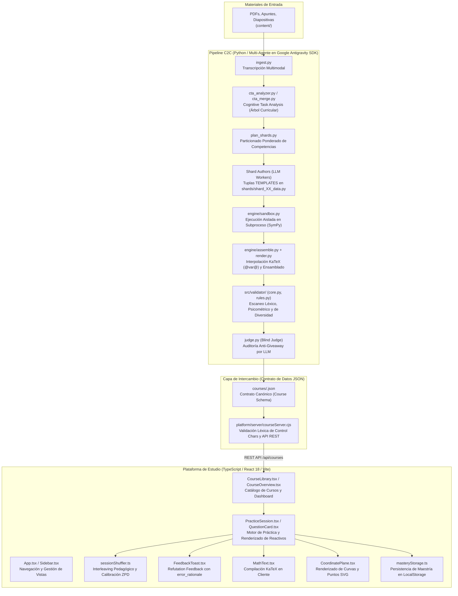
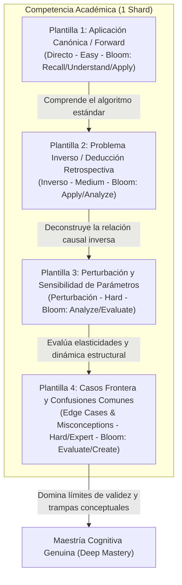
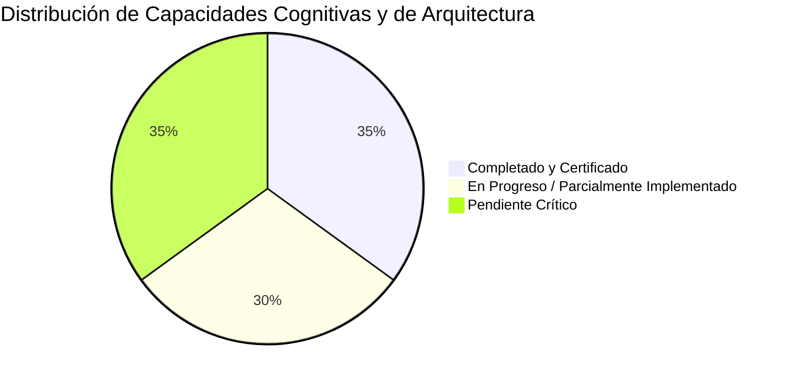
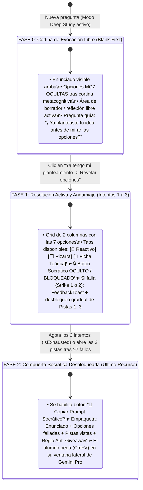
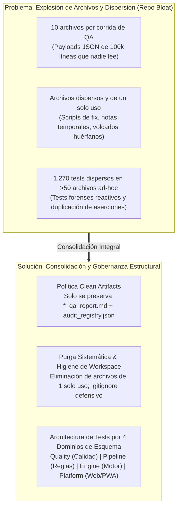

# Hoja de Ruta Maestra de Evolución y Milestones: Tops Academy
## Elevando la Vara: Del Paradigma Cerrado al "Antigravity Study Harness", Práctica Deliberada, Intuición Experta (*The Expert Myth*) y Ultra-Aprendizaje

> **Documento Estratégico, Psicométrico y de Arquitectura de Sistemas End-to-End**  
> **Fecha de Actualización:** 2026-11-02 (Branch: `main` / C2C v3.8 Tri-Banda, QA v2.0 & PWA; Milestones 1, 2, 2a, 3, 10 y núcleo del 11 cerrados)  
> **Áreas del Ecosistema:** Plataforma Web (`React 18 + Vite + TypeScript`), UI Multi-Panel (Split-View Harness), Pipeline Multi-Agente C2C (`Google Antigravity SDK`), Motor Determinista (`engine/`), Evaluador de Calidad (`course-qa-evaluator`) y Marco Neurocognitivo de Adquisición de Pericia (*The Expert Myth Framework*).  
> **Ubicación Canónica:** [`FUTURE_MILESTONES.md`](file:///d:/Augusto/personal_portfolio/Tops_academy/FUTURE_MILESTONES.md) *(espejo en [`docs/future_milestones/FUTURE_MILESTONES.md`](file:///d:/Augusto/personal_portfolio/Tops_academy/docs/future_milestones/FUTURE_MILESTONES.md))*.
> **Milestones Cerrados:** [`MILESTONES_COMPLETED.md`](file:///d:/Augusto/personal_portfolio/Tops_academy/MILESTONES_COMPLETED.md) *(espejo en `docs/future_milestones/MILESTONES_COMPLETED.md`)*. Este archivo conserva lo **pendiente o en curso** y el conocimiento técnico y tribal.

---

## 1. El Diagnóstico Estratégico y Neurocognitivo: La Paradoja de la Falsa Suficiencia

En las recientes auditorías automatizadas bajo estándares de Quality Matters (QM), OSCQR y Mastery Learning, el pipeline C2C alcanzó puntajes de excelencia formal (**18.7 – 20.0 / 20.0 pts**) en cursos masivos de alta complejidad técnica:
- **`solow_growth_model`**: **20.0 / 20.0 pts** (Quality Tier: EXCELENTE)
- **`gavilano_pre_parcial` (127 competencias)**: **19.8 / 20.0 pts** (Quality Tier: EXCELENTE)
- **`asymptotic_statistics_v7` (32 competencias)**: **19.4 / 20.0 pts** (Quality Tier: EXCELENTE)
- **`saul_control_optimo` (15 competencias)**: **19.0 / 20.0 pts** (Quality Tier: EXCELENTE)

Sin embargo, el contraste estricto frente a los principios neurocognitivos de adquisición de pericia (*The Expert Myth*) revela una **paradoja de falsa suficiencia**: estamos obteniendo calificaciones casi perfectas **dentro de los límites de un paradigma de evaluación cerrado**.

```mermaid
flowchart TD
    subgraph CurrentParadigm ["Paradigma Inicial (Evaluación Cerrada y Riesgo de Ilusión de Fluidez)"]
        P1["Reconocimiento Asistido (MC7)\nRespuesta correcta siempre visible en pantalla; entrena descarte, no evocación pura"]
        P2["Unimorfismo de Plantillas\nEl alumno sobreajusta al molde sintáctico ('overfitting') en vez de asimilar el concepto"]
        P3["Unidades Atómicas Planas (Unit = Competencia)\nQuiz y challenge redundantes por cada micro-destreza; rompe la visión de conjunto"]
        P4["Canal Verbal-Simbólico Exclusivo\nCero evaluación gráfica interactiva (diagramas de fase, isoclinas, campos vectoriales)"]
        P5["Fricción en Laptops\n7 opciones verticales desbordan la pantalla de 13'-14'; obliga a zoom out continuo"]
        P6["Desconexión con la Fuente\nPreguntas huérfanas sin ancla al material original"]
        P7["Maestría Estática sin Decaimiento\nEstado binario 'completado' sin considerar el olvido a largo plazo"]
    end

    subgraph FutureParadigm ["Nuevo Paradigma: Antigravity Study Harness, Práctica Deliberada y Flow"]
        N1["Entradas Simbólicas Libres (Open Symbolic)\nFuerza la Evocación Pura (Free Recall) con MathLive + SymPy"]
        N2["Polimorfismo Estructural (4 Arquetipos Disjuntos)\nVariabilidad profunda: Directo, Inverso, Perturbación y Frontera"]
        N3["Arquitectura Jerárquica de Contenido (PPT/Módulo)\nContenido PPT -> [Glosario + Núcleo] + Familia de Subtemas"]
        N4["Evaluación Escalonada por Granularidad\nQuizzes formativos por subtema + Challenge Integrador de toda la PPT"]
        N5["Web Adaptativa Multi-Resolución\nGrid 2 columnas sin zoom out en laptops + PWA móvil nativa standalone"]
        N6["Antigravity Study Harness (Split-View Multi-Panel)\nCanvas de Preguntas + Visor de Fuente Original Sincronizado + Sidecar Gemini"]
        N7["Interleaving Pedagógico y ZPD Dinámica\nDiscriminación activa de conceptos y calibración de dificultad en banda de Flow (70-85%)"]
        N8["Motor de Repetición Espaciada (SRS)\nRefreshers a 1-4-14-45 días para evitar la degradación de memoria"]
        N9["Desacoplamiento Estricto KaTeX-Python\nPatrón PrairieLearn con tokens ortogonales @PARAM@ y compilador AST QuickJS"]
        N10["Arquitectura Streaming DAG en Pipeline\nValidación in-situ sin barreras síncronas bloqueantes (< 15 min)"]
    end

    CurrentParadigm ==>|Transformación Estratégica| FutureParadigm
```



### 1.1. Los 8 Puntos Ciegos Cognitivos que Definen la Nueva Vara
A partir de las investigaciones independientes preservadas en [`docs/investigaciones/03_Limitaciones_de_la_plataforma_de_estudio.md`](file:///d:/Augusto/personal_portfolio/Tops_academy/docs/investigaciones/03_Limitaciones_de_la_plataforma_de_estudio.md) y [`docs/investigaciones/04_Limites_de_la_plataforma_y_estudio.md`](file:///d:/Augusto/personal_portfolio/Tops_academy/docs/investigaciones/04_Limites_de_la_plataforma_y_estudio.md), se identifican las 8 dimensiones críticas para construir intuición experta:
1. **Evocación Libre (*Free Recall*) vs. Reconocimiento (*Recognition*):** Con opciones pre-impresas, se entrena descarte asistido. La maestría real exige generar la respuesta frente a una hoja en blanco.
2. **Traducción Visoespacial (*Dual Channels & Drawing Effect*):** Evaluar la interacción gráfico-espacial (diagramas de fase, curvas de nivel, isoclinas nulas y estabilidad).
3. **Encadenamiento de Demostraciones Largas (*Step-by-Step Proofs*):** Evaluar secuencias de 3 micro-decisiones rápidas encadenadas en lugar de calificar solo el resultado final.
4. **Combate a la Ilusión de Maestría Explicativa (*Illusion of Explanatory Depth*):** Forzar la formulación activa y el contraste de contraejemplos.
5. **Formulación de Modelos No Estructurados (*Adaptive Expertise*):** Introducir casos difusos con datos distractores en el enunciado para aprender a filtrar regularidades relevantes.
6. **Trabajo Computacional y Simulación Empírica (*Shop Time*):** Experimentación numérica con parámetros dinámicos sin solución analítica cerrada.
7. **Automonitoreo y Resiliencia con Andamiaje Diferido (*Delayed Scaffolding*):** Retardo inicial de pistas para entrenar la metacognición.
8. **Fragmentación Atomizada vs. Síntesis Estructural (*Part-Whole Cognitive Integration*):** Unificar el aprendizaje en torno a la fuente real (PPT) con **Glosario**, **Núcleo conceptual**, **Quizzes de subtema** y **Challenges integradores de PPT**.

---

## 2. Anatomía de las Codebases: Cómo Funciona el Ecosistema End-to-End



### 2.1. El Puente Inter-Lenguajes (Python $\leftrightarrow$ TypeScript) y Puntos de Fricción
La frontera entre Python y TypeScript es el archivo `courses/<course_id>.json` (tipado en [`platform/src/types.ts`](file:///d:/Augusto/personal_portfolio/Tops_academy/platform/src/types.ts) y en `schemas/course.schema.json`). En esta frontera emergen 4 tensiones estructurales:
1. **La Colisión de Escapado LaTeX:** Una omisión en Python de raw strings convierte comandos como `\tau` o `\beta` en caracteres de control (`\t`, `\b`). Si [`courseServer.cjs`](file:///d:/Augusto/personal_portfolio/Tops_academy/platform/server/courseServer.cjs) los detecta, bloquea el curso.
2. **Discrepancia del Motor de Evaluación (SymPy vs RegExp):** En backend, Python verifica equivalencias complejas con CAS (`SymPy`); en cliente, el frontend requiere heurísticas ligeras o un endpoint evaluador.
3. **Sobrecarga de Viewport por MC7:** 7 alternativas apiladas verticalmente en laptops de 13"-14" saturan la pantalla y exigen zoom out continuo. ✅ **Resuelto por el Milestone 1** (ver `MILESTONES_COMPLETED.md`).
4. **Desajuste de Granularidad (Unidad Plana vs. PPT Real):** Tratar cada micro-competencia como una unidad independiente satura al alumno con quizzes y unit tests redundantes y rompe la jerarquía pedagógica natural.

### 2.2. Conocimiento Tribal de la Plataforma: Carga de Cursos, Caché y Ergonomía

> Registrado el 2026-10-26, tras cerrar los Milestones 1 y 11 (núcleo). Cada dato está marcado como **medido** (con cifra) o **hipótesis** (sin medir en navegador).

**a) ¿Cuándo empieza a cargarse un curso: al pulsar o antes?** Antes. Al abrir la plataforma, la biblioteca se pinta con el manifest inline (≈ 2.5 KB, sin red) y `prefetchCourses` encola todos los cursos válidos para descargarlos **en segundo plano**, uno a uno, con `requestIdleCallback`. Pasar el cursor, enfocar o tocar una tarjeta (`pointerenter` / `focus` / `touchstart`) le da prioridad inmediata a ese curso. Cada curso queda en una caché en memoria y en IndexedDB (`tops_academy_cache`, almacén `courses`, validada por `ETag`). Si el usuario pulsa antes de que la cola llegue a ese curso, la carga ocurre en el momento del clic.

**b) ¿Al pulsar se carga todo el sistema o solo ese curso?** Solo ese curso. La petición es `GET /api/courses/<id>.json`; los demás no se tocan. Antes del Frente B (Milestone 11) sí se descargaba un monolito de ≈ 60 MB con todos los cursos.

**c) Qué cuesta abrir un curso grande (medido en la PC de desarrollo, ASUS TUF F15):**

| Curso | Preguntas | Archivo | Servidor (gzip) | `JSON.parse` + `normalizeQuestion` (Node) |
| :--- | :---: | :---: | :---: | :---: |
| `saul_control_optimo` | 350 | ≈ 1.7 MB | 109 KB en ≈ 10 ms | ≈ 5 ms |
| `estadistica_3_pre_parcial_v2` | 2,770 | ≈ 13.9 MB | — | ≈ 33 ms |
| `gavilano_pre_parcial` | 2,950 | ≈ 14.1 MB | 912 KB en ≈ 66 ms | ≈ 36 ms |

**d) Corrección de una estimación previa.** Se había estimado que abrir Gavilano o Estadística v2 costaba 1.5–2.5 s de parseo y normalización local. **La medición lo refuta:** parsear y normalizar ≈ 3,000 preguntas toma ≈ 35 ms, y el servidor entrega el curso en ≈ 66 ms. Como extrapolación (no medida), incluso una laptop 5–10× más lenta tardaría ≈ 0.2–0.4 s. Por tanto, la lentitud que el usuario percibe al abrir un curso pesado **no se explica por el parseo ni por el servidor**, y la idea de «normalización diferida por unidad» ahorraría ≈ 3–7 ms: no justifica su complejidad hasta que una medición diga lo contrario.

**e) Sospechosos reales (hipótesis ordenadas; ninguna medida aún en navegador):**
1. `loadCourse` hace `await saveToIndexedDB(...)` **antes** de devolver el curso en la ruta de red (`courseLoader.ts`): abrir espera el *structured clone* y la escritura de ≈ 14 MB en IndexedDB. Arreglo barato: no esperar la escritura (fire-and-forget).
2. El prefetch en segundo plano también clona y escribe cursos de 14 MB en el hilo principal mientras el usuario interactúa (jank justo al pulsar).
3. Render de la vista tras abrir (Overview con ≈ 127 competencias, `loadCourseMastery`, `MasteryGrid`) en el hilo principal.
4. En `npm run dev` las peticiones pasan por el middleware de Vite y no por `courseServer.cjs` (confirmar con qué comando se levanta en la laptop lenta).
5. Equipo más lento (14" a 150%), no comparable con la PC de desarrollo.

**f) Cómo comprobar que la caché funciona.** Abrir un curso, volver a la biblioteca y reabrirlo: debe ser casi instantáneo y el panel *Network* no debe mostrar ninguna petición a `/api/courses/<id>`. El contenido persistido se ve en DevTools → *Application* → *IndexedDB* → `tops_academy_cache` → `courses`. Para medir de verdad: marcar con `performance.mark` el clic, la descarga, el parseo y el primer pintado (propuesto en el Milestone 11b).

**g) Lecciones de ergonomía que no se deben olvidar (Milestone 1):**
- **No forzar `white-space: normal` sobre KaTeX:** rompe subíndices, superíndices y relaciones. Para que una frase larga envuelva, sacarla de `\text{}` hacia texto normal (`splitMathAndProse` en `MathText.tsx`).
- **Headless Chromium oculta las scrollbars** (`--hide-scrollbars`): en las pruebas usar `ignoreDefaultArgs: ['--hide-scrollbars']`, o el ancho útil real queda enmascarado.
- **Aritmética de anchos a 150% en laptop de 14":** split 50% ≈ 640 px CSS − 15 px de scrollbar − 32 px de padding ≈ 586–593 px útiles (de ahí el umbral de 2 columnas en 480 px). La biblioteca ve `innerWidth` ≈ 1265 px, no 1280 (de ahí el breakpoint de 3 columnas en 1000 px).
- **Referencia que no debe regresar:** ASUS TUF F15 de 15.6" a 125% (1536 × 740).

### 2.3. Conocimiento Tribal del Pipeline C2C: Medición de la Excelencia Académica, Taxonomía de Bloom y los 4 Arquetipos de Plantillas

> Registrado como convención canónica del pipeline multi-agente C2C y el evaluador de calidad (`course-qa-evaluator`). Define la vara epistemológica innegociable de Tops Academy.

#### a) Cómo Medimos la Excelencia Académica (Más Allá de la Compilación Mecánica)
En Tops Academy, un curso **no se considera excelente simplemente porque sus archivos `.py` compilen sin errores de sintaxis** o porque el motor genere 1,000 reactivos con tests pasando. La verdadera excelencia académica se evalúa bajo un estándar de maestría profunda (*Deep Mastery*) estructurado en tres dimensiones complementarias:

1. **Equilibrio Cognitivo en la Taxonomía de Bloom:**
   - Queda estrictamente vetado el reduccionismo pedagógico a reactivos de mera memorización o reconocimiento pasivo.
   - Cada competencia debe exhibir una distribución intencional entre los niveles de la Taxonomía de Bloom revisada:
     - **Niveles Fundacionales (*Recall* y *Understand*):** Evocación de definiciones canónicas, comprensión de propiedades y significado conceptual intuitivo de los modelos.
     - **Niveles Intermedios (*Apply*):** Aplicación de algoritmos de cálculo, operaciones matriciales, derivaciones estándar y resolución numérica con parámetros instanciados.
     - **Niveles Superiores (*Analyze*, *Evaluate* y *Create*):** Diagnóstico de violaciones de supuestos, descomposición de demostraciones, selección crítica entre estimadores alternativos, análisis de sensibilidad ante choques estructurales y formulación de contraejemplos.
   - **Regla Tribal Inviolable:** Toda competencia debe involucrar **mínimo $\ge 2$ niveles distintos de Bloom**, con presencia obligatoria de niveles de aplicación o análisis (`Apply+`), garantizando que el estudiante trascienda la repetición mecánica de fórmulas.

2. **Higiene Psicométrica y Prevención de Trampas (*Anti-Gaming*):**
   - **Longitud Calibrada:** Opciones de respuesta homogéneas en extensión para evitar que la opción correcta destaque visualmente por ser más larga o descriptiva (`AntiGamingPsychometricLinter`).
   - **Distractores con Diagnóstico Refutacional:** Cada distractor debe reflejar una concepción errónea verosímil y documentada (*misconception*), portando su respectivo `error_rationale` para que el error active aprendizaje correctivo inmediato en el toast.
   - **Erradicación de Multiplicadores Mágicos:** Bloqueo absoluto de distractores construidos artificialmente como múltiplos fijos de la respuesta correcta (`[DIAG-MAGIC-MULT]`).

3. **Polimorfismo Estructural Anti-Overfitting (El Sistema de los 4 Arquetipos):**
   - El estudiante no debe memorizar el molde sintáctico de la pregunta; debe dominar el principio subyacente independientemente de cómo se le plantee el problema.

#### b) Los 4 Arquetipos Canónicos de Plantillas por Competencia
Para que una competencia sea verdaderamente formativa y robusta ante el sobreajuste (*anti-overfitting*), su diseño pedagógico debe articularse en torno a **4 plantillas ortogonales y disjuntas**:



1. **Plantilla 1: Aplicación Canónica / Forward (`archetype: "direct"`, Banda ZPD: `easy`, Bloom: *Recall / Understand / Apply*):**
   - **Qué evalúa:** La ejecución directa del algoritmo estándar o la definición base en condiciones normales.
   - **Mecánica:** A partir de los parámetros base y supuestos fundamentales conocidos, el estudiante debe calcular o derivar directamente la solución estándar (ej. calcular el estimador MCO dados $X$ e $y$, o hallar el nivel de capital de estado estacionario $k^*$ dados $s, n, g, \delta$).

2. **Plantilla 2: Problema Inverso / Deducción Retrospectiva (`archetype: "inverse"`, Banda ZPD: `medium`, Bloom: *Apply / Analyze*):**
   - **Qué evalúa:** La capacidad de desarmar la ecuación en sentido inverso, evitando la mecanización unidireccional.
   - **Mecánica:** Se proporciona el resultado final observado o la meta deseada del sistema (ej. el margen de error máximo uniforme tolerable, el valor crítico fijado, o la tasa de crecimiento objetivo) y se solicita despejar o deducir el valor inicial requerido, el tamaño muestral necesario $n$, o el parámetro exógeno latente.

3. **Plantilla 3: Perturbación y Sensibilidad de Parámetros (`archetype: "perturbation"`, Banda ZPD: `hard`, Bloom: *Analyze / Evaluate*):**
   - **Qué evalúa:** La comprensión profunda de las relaciones de elasticidad, derivadas analíticas y el comportamiento asintótico del modelo.
   - **Mecánica:** Se introduce un choque exógeno o una alteración cuantitativa (ej. cuadruplicar el tamaño de muestra $n \to 4n$, duplicar la tasa de depreciación $\delta$, o variar el nivel de significancia $\alpha$), exigiendo determinar analíticamente cómo reacciona el estimador, el error estándar o la velocidad de convergencia sin re-calcular todo desde cero.

4. **Plantilla 4: Casos Frontera, Confusiones Comunes y Edge Cases (`archetype: "boundary_or_edge_case"`, Banda ZPD: `hard / expert`, Bloom: *Evaluate / Create*):**
   - **Qué evalúa:** El discernimiento de los límites de validez del teorema y la superación de las concepciones erróneas más arraigadas (*misconceptions*).
   - **Mecánica:** Plantea escenarios donde la fórmula general falla, colapsa o no es aplicable (ej. varianza asintótica infinita, raíces unitarias, matrices no invertibles, proporciones en las fronteras $p=0$ o $p=1$, o violación de supuestos de exogeneidad estricta), así como **las trampas conceptuales y confusiones más frecuentes** documentadas empíricamente en exámenes universitarios. Diagnostica con precisión si el estudiante comprende el trasfondo teórico o simplemente aplica "recetas de cocina".

---

## 3. Síntesis Forense y Física de Inferencia en Pipelines Multi-Agente

A partir de las investigaciones en [`docs/investigaciones/external_analysis/`](file:///d:/Augusto/personal_portfolio/Tops_academy/docs/investigaciones/external_analysis/) y la telemetría longitudinal de las versiones C2C v3.4–v3.5, se documentan las leyes operativas de optimización:

### 3.1. Física Empírica de Streaming en `Model="flash"` (Google Antigravity SDK)
- **Velocidad de decodificación sostenida:** $v_{\text{out}} \approx 168\text{ tokens de salida/s}$ (~$6.0\text{ s}$ de latencia por cada $1,000$ tokens emitidos en herramientas).
- **Asimetría de latencia:** Reescribir un archivo monolítico de $30,000$ tokens consume **$180\text{ s}$ de streaming puro**. Reparar quirúrgicamente de 1 a 5 líneas mediante `edit_file` consume **$10\text{ a }25\text{ s}$** ($150\text{ s}$ de ahorro directo por turno).

### 3.2. Matriz Oficial de Decisión: `edit_file` vs `write_file` (Umbral Oficial `< 6` Errores)

| Nivel / Condición tras Compilar | Herramienta Mandatoria | Alcance Operativo en CTA y Shards | Latencia Típica |
| :--- | :--- | :--- | :---: |
| **Nivel 0: Error mecánico determinista** | **Auto-Heal en Compilador** | Envoltura automática `$...$` de LaTeX huérfano y auto-exportación de variables AST en memoria. | **$< 5\text{ ms}$** |
| **Nivel 1: `1 <= errores < 6` (sin `SyntaxError`)** | **`edit_file` (`replace_file_content`) OBLIGATORIO** | Reemplazo quirúrgico en 1 turno paralelo sobre `StartLine..EndLine`. `write_file` monolítico bloqueado por hook. | **`10 – 25 s`** |
| **Nivel 2: `errores >= 6` acotados a 1–2 competencias** | **`write_file(Overwrite=True)` Modular** | Sobrescritura aislada en `cta_fixes/<CID>.py` o `shard_fixes/<CID>.py`, ensamblada en memoria. | **`25 – 45 s`** |
| **Nivel 3: `errores >= 6` sistémicos o `SyntaxError`** | **`write_file(Overwrite=True)` Atómico Completo** | Creación inicial en Turno 1 o reescritura atómica completa si la estructura global colapsó. | **`90 – 180 s`** |

---

## 4. Matriz de Contraste: *The Expert Myth* vs. Estado del Arte de Tops Academy

| Pilar de Pericia (*The Expert Myth*) | Mecanismo Cognitivo Requerido | Estado Previo (`main`) | Estado Actual (`optimizaciones_test`) | Brecha Remanente (Gap hacia la Pericia) |
| :--- | :--- | :--- | :--- | :--- |
| **1. Chunking y Reconocimiento de Patrones** | Almacenar miles de configuraciones en memoria a largo plazo para activar Sistema 1 ante hoja en blanco (*free recall*). | 100% Opción Múltiple (MC7) y Selección Múltiple (MS). | Formatos MC7 y MS con higiene psicométrica anti-giveaway y pistas socráticas. | ⚠️ **Persiste reconocimiento asistido:** Falta implementar entradas simbólicas libres (`open_symbolic` con MathLive + SymPy) y derivaciones por micro-pasos (Milestone 5). |
| **2. Entorno de Alta Validez Interna** | Regularidades ecológicas predecibles donde el desempeño refleje comprensión del fenómeno y no hacks de examen. | Controles anti-giveaway estrictos (7 opciones calibradas en longitud y distractores). | Patrón PrairieLearn `@var@` activo en motor; `ArchetypeEntropyLinter` activo en auditoría. | ⚠️ **Validez sintáctica residual:** Falta completar el compilador AST con QuickJS (`pykatex`) y el contrato Pydantic para desacoplar 100% Python de KaTeX (Milestone 4). |
| **3. Repeticiones Masivas sin Overfitting** | Miles de intentos sobre la misma clase de problemas sin caer en la automatización sintáctica prematura. | Una sola plantilla paramétrica (`templates/Hab-01.json`) donde solo rotan números. | **Contrato v3.8 Tri-Banda (`[M3-ARCHETYPES]`, `--min-archetypes 3`, `[STEM-DIVERSITY-GATE]`) + `ArchetypeEntropyLinter` (`MIN_ARCHETYPES = 3`)** activos en pipeline y QA. | ✅ **Cerrado por Milestone 3** (ver `MILESTONES_COMPLETED.md`). Siguiente escalón cognitivo: modelos no estructurados con datos distractores en enunciado y `open_symbolic` (Milestone 5). |
| **4. Feedback Inmediato de Proceso (Buggy Rules)** | Diagnóstico instantáneo de por qué falló el razonamiento y qué concepción errónea se activó. | Feedback binario (correcto/incorrecto) con pistas escalonadas generales. | **Refutation Feedback en Toast (`FeedbackToast.tsx`):** Al elegir un distractor con `error_rationale`, se despliega el diagnóstico conceptual específico de la falla. | ⚠️ **Falta bifurcación de remediación:** Inyectar en la cola inmediata una micro-composición táctica del prerrequisito ($C\text{-}XX$) ante fallos específicos. |
| **5. Práctica Deliberada, Flow y Retención** | Operar constantemente en el borde de la capacidad (ZPD 70–85%), clasificar problemas sin etiquetas y frenar el olvido. | Bloques secuenciales estáticos, unidades planas y maestría como estado binario permanente. | **Interleaving Pedagógico y ZPD implementados (`sessionShuffler.ts`):** Quizzes y Tests mezclan competencias previas/prerrequisitos; calibración por `MasteryTier`. | ⚠️ **Ausencia de Repetición Espaciada (SRS):** No hay decaimiento temporal de memoria (curva de Ebbinghaus) ni reaparición de refreshers a 1-4-14-45 días (Milestone 8). |

---

## 5. Estado de la Codebase: ¿Qué Ya Está Hecho vs. Qué Queda por Mejorar?



### 5.1. Lo Que YA ESTÁ HECHO (Certificado en la Codebase)
1. ✅ **Interleaving Pedagógico Dinámico (`platform/src/utils/sessionShuffler.ts` - Commit `13dd61b`):**
   - **Quizzes:** Mezcla ~60% de la competencia objetivo con ~40% de competencias previas y prerrequisitos del DAG para entrenar el clasificador perceptual.
   - **Unit Tests:** Mezcla acumulativa de ~55% objetivo y ~45% de todo el historial del curso.
   - **Practice:** Aislamiento estricto (100% objetivo) para adquisición inicial libre de interferencia.
2. ✅ **Calibración Dinámica de Dificultad por Zona de Desarrollo Próximo (ZPD - Commit `13dd61b`):**
   - `calibrateByMasteryDifficulty`: Alumnos en `Not started`/`Attempted` reciben bandas priorizadas `easy` + `medium`; en `Familiar` reciben balanceada; en `Proficient`/`Mastered` reciben `hard` + `medium`, sosteniendo el Flow.
3. ✅ **Feedback Refutacional por Distractor Diagnóstico (`FeedbackToast.tsx` - Commits `13dd61b`, `5b5395c`, `ee3982f`):**
   - Extensión de `QuestionOption` con `error_rationale`. Al fallar, la interfaz despliega la caja de diagnóstico (*Refutation Feedback Box*) que explica la trampa conceptual cometida.
4. ✅ **Anti-Overfitting y Variedad de Plantillas v3.8 Tri-Banda (Milestone 3 — cerrado 2026-10-31):**
   - `compile_shard.py` impone `[M3-ARCHETYPES]` (`--min-archetypes 3`, 3 bandas ZPD `easy`/`medium`/`hard`, $\ge 2$ niveles Bloom, cuota activa `FIB`/`MS`, `[STEM-DIVERSITY-GATE]` $\ge 10\text{–}15$ stems únicos y `[DIAG-MAGIC-MULT]`) y `ArchetypeEntropyLinter` valida $\ge 3$ esqueletos estructurales y concentración $\le 85\%$ en `standardized_audit_engine.py`. Detalle en [`MILESTONES_COMPLETED.md`](file:///d:/Augusto/personal_portfolio/Tops_academy/MILESTONES_COMPLETED.md).
5. ✅ **Sintaxis Ortogonal PrairieLearn `@var@` en el Motor:**
   - `engine/assemble.py`, `engine/invariants.py` y `check_templates.py` soportan y validan tokens ortogonales `@var@` y `@var:fmt@` en raw strings `r"..."`, erradicando el conflicto de llaves dobles (`{{...}}`).
6. ✅ **Linters Deterministas Psicométricos en QA Engine (`standardized_audit_engine.py` - Commit `32e2a48`):**
   - `ClonedDistractorValueLinter`, `ParentheticalTelltaleLinter`, `UninterpolatedMathVariableLinter` y `ScaffoldingHintsLinter` (bloqueo de stubs no socráticos).
7. ✅ **Cursos Masivos Certificados en Producción (Commits `c0246cd`, `b52c6d6`, `c739c47`):**
   - `gavilano_pre_parcial` (127 competencias), `saul_control_optimo` (15 competencias), `asymptotic_statistics_v7` (32 competencias) y `solow_growth_model`.
8. ✅ **Ergonomía Web en Laptops, Tablets y Móvil (Milestones 1 y 2a — certificado por el usuario 2026-10-26):**
   - Container queries (2 columnas desde 480 px), footer en flujo, scroll reseteado por pregunta, biblioteca de 3 columnas (≥ 1000 px), KaTeX inline sin scrollbars y prosa de `\text{}` fuera de KaTeX. Detalle en [`MILESTONES_COMPLETED.md`](file:///d:/Augusto/personal_portfolio/Tops_academy/MILESTONES_COMPLETED.md).
9. ✅ **Núcleo de Carga Rápida de Cursos (Milestone 11 — commits `41435c5`, `b73a5ee`, `2051b8b`):**
   - Manifest de 2.5 KB (antes ≈ 60 MB), índice con caché `mtime + size`, `ETag`/`304`/gzip, manifest inline, IndexedDB y prefetch idle/hover. Conocimiento asociado en §2.2.

---

### 5.2. Lo Que AÚN QUEDA POR MEJORAR (Gaps Críticos Desglosados)
1. ⚠️ **Completar Desacoplamiento de Milestone 4 (PrairieLearn & AST — Estimado: ~3 a 4.5 h con Gemini 3.8):**
   - Ya están activos los tokens `@var@`, el auto-heal con `tokenize`, el sanitizador R-23 zero-copy y el localizador AST `ShardDataLineLocator`. Solo falta: (a) validación AST de fórmulas KaTeX en servidor durante compilación (~45–90 min) y (b) migrar las 9-tuplas posicionales al contrato tipado Pydantic `ShardCompetenceContract` con soporte dual (~2–3 h).
2. ✅ **Rúbrica QA v2.0 y Compuerta Bloqueante Pre-Publish de Milestone 10 (Implementado en commits `be43b08` y `b07cec8` + cierre `ArchetypeEntropyLinter`):**
   - **Resuelto y superado en alcance:** Se implementaron los **7 linters Path-to-Mastery v2.0** (`ZPDProgressionCalibrationLinter`, `RetrievalModalityDiversityLinter`, `SocraticScaffoldingIntegrityLinter`, `DiagnosticRationaleAlignmentLinter`, `AntiGamingPsychometricLinter`, `DAGMasteryTopologyLinter`, `KaTeXFrontendErgonomicsLinter`), `ArchetypeEntropyLinter` con `MIN_ARCHETYPES = 3`, **3 nuevas penalizaciones duras** (`socratic_hint_poisoning`, `vacuous_quantifier_key_corruption`, `answer_memorization_exploit`), el índice **MPRI (0–100 pts en 6 pilares, exigiendo $\ge 25\%$ de modalidad activa `FIB+MS`)** y el bloqueo duro `PublishQualityGateError` en `course_publisher.py`.
3. 🎯 **Evocación Libre (Free Recall) y Micro-Pasos (Milestone 5):**
   - MathLive + SymPy para respuestas abiertas y validación de derivaciones intermedias.
4. 🎯 **Motor de Decaimiento de Memoria y Repetición Espaciada (Milestone 8):**
   - Curva de Ebbinghaus en `masteryStorage.ts`, refreshers a 1-4-14-45 días y **Modo Blind Recognition** (sesiones sin etiquetas).
5. 🎯 **Study Harness (Milestone 6): faltan el gating socrático y la «hoja en blanco» previa:**
   - La ergonomía y el Split-View ya están entregados (Milestone 1). Pendiente: cortina metacognitiva previa «¿ya lo has intentado?» (Hoja en Blanco antes de revelar las 7 opciones), pestañas `[ 📝 Reactivo | ⬜ Pizarra Libre | 📖 Ficha Teórica ]`, botón socrático bloqueado por compuerta hasta agotar intentos/pistas y certificación oficial del usuario (§6.6).
6. 🎯 **Arquitectura Jerárquica de Contenido PPT (Milestone 9 — Estimado: ~4 a 6 h con Gemini 3.8):**
   - Módulos de Contenido (PPT) con Glosario, Núcleo Conceptual, Quizzes por subtema y Challenge integrador de PPT.
7. 🎯 **Apertura instantánea de cursos pesados (Milestone 11b):**
   - La lentitud percibida al abrir Gavilano / Estadística v2 no se explica por servidor ni parseo (≈ 0.1 s medido, §2.2); falta diagnóstico en navegador, quitar el `await` de IndexedDB del camino de apertura e indicador de progreso.
8. 🎯 **Deuda de pruebas de ergonomía (Milestone 1-T):**
   - La matriz E2E no reproduce aún los escenarios certificados a mano (125%/150%, tablets, AC-CORE medido por código).
9. ⏳ **Resiliencia ante suspensión de la laptop (Milestone 12):** fuera de alcance por decisión del usuario.

---

## 6. Matriz Maestra de Priorización de Ingeniería

> Los milestones **completados y certificados** (1, 2, 2a, 3, 10 y núcleo del 11) viven en [`MILESTONES_COMPLETED.md`](file:///d:/Augusto/personal_portfolio/Tops_academy/MILESTONES_COMPLETED.md). Esta matriz lista solo lo abierto o en revisión.

| Hito / Milestone | Área | Impacto Cognitivo y Operativo | Esfuerzo Estimado (con Gemini 3.8) | Estado de Ejecución |
| :--- | :--- | :--- | :---: | :---: |
| **Milestone 2: PWA Instalable y Modo Offline** | Frontend / PWA | **Habilita el estudio ubicuo e instalable.** Service Worker Workbox, precaching App Shell + fuentes KaTeX, Web App Manifest, suite de iconos, navegación nativa popstate y modo offline. | **Completado** | ✅ **Completado (movido a `MILESTONES_COMPLETED.md`)** |
| **Milestone 4: Desacoplamiento KaTeX-Python (PrairieLearn)** | Backend / Pipeline | **Erradica al 100% las colisiones de sintaxis.** Tokens `@var@`, R-23 zero-copy y `ShardDataLineLocator` activos; solo falta validador AST KaTeX en compilación y contrato Pydantic `ShardCompetenceContract`. | **3 a 4.5 h** (~1 h AST KaTeX + ~2.5 h Pydantic) | 🛠️ **75% Hecho (@var@ y R-23 activos / Pydantic pendiente)** |
| **Milestone 5: Modalidades Interactivas (Tipo Khan Academy), Entradas Simbólicas y Drag & Drop** | Full-Stack | **Trascendencia del reconocimiento pasivo.** Nuevos tipos interactivos: Reordenamiento secuencial (Drag & Drop / Parsons), Emparejamiento (Matching), Manipuladores gráficos, Clasificación en contenedores y Open Symbolic (MathLive + SymPy). | **2 a 3 d** | 🧠 **Impacto Cognitivo Máximo** |
| **Milestone 6: Antigravity Study Harness (Split-View & 1/3–1/2 Viewport)** | Arquitectura UI | **Estación de ultra-aprendizaje en Flow.** Pasos 1–2 (Split-View 50%, layout 1/3–1/2, container queries 2 col, drawer sidebar, bottom sheet toast) completados en M1/M2a; falta micro-harness cognitivo (pestañas Pizarra/Teoría y botón prompt socrático). | **1.5 a 2.5 h** (Micro-Harness) | 🛠️ **En progreso: ergonomía y split 100% hechos; falta micro-harness cognitivo** |
| **Milestone 7: Streaming DAG, Pool de Workers y Aceleración de Tests** | Infraestructura | **Quiebra la barrera de 15 min en pipeline y acelera la suite de 1,271 tests de 85s a 24.10s.** DAG asíncrono, pre-warming de sandbox, paralelización `pytest-xdist` (12 cores) y paridad contractual Stage 2 $\leftrightarrow$ Stage 4. | 1 a 2 d (solo resta Streaming DAG) | 🛠️ **Tests `< 30s` (24.10s) logrado / Streaming DAG y Contratos pendientes** |
| **Milestone 8: Repetición Espaciada (SRS) y Blind Mode** | Motor de Sesión | **Combate el decaimiento de memoria (Curva de Ebbinghaus).** Decaimiento temporal, refreshers a 1-4-14-45 días y sesiones a ciegas. | 2 a 3 d | 🔁 **Cierre de Ciclo de Pericia** |
| **Milestone 9: Jerarquía de Contenido (PPT $\to$ Core/Subtemas)** | Curricular / Schema | **Organización natural en torno a la fuente real.** Contenido PPT $\to$ [Glosario + Núcleo] + Subtemas $\to$ Quizzes de subtema + Challenge PPT. | **4 a 6 h** (~3 h en paralelo con Flash Triad) | 🏛️ **Arquitectura Curricular** |
| **Milestone 10: QA Rubric v2.0 Deep Mastery** | Auditoría QA | **Certificación integral de rigor.** 7 nuevos linters Path-to-Mastery v2.0, `ArchetypeEntropyLinter` (`MIN_ARCHETYPES = 3`), 6 pilares MPRI (`/100`), penalizaciones duras y bloqueo `PublishQualityGateError`. | **Completado** | ✅ **100% Completado (movido a `MILESTONES_COMPLETED.md`)** |
| **Milestone 11b: Apertura Instantánea de Cursos Pesados** | Frontend | **Cierra la lentitud percibida al abrir Gavilano / Estadística v2.** Diagnóstico en navegador, quitar el `await` de IndexedDB del camino de apertura, indicador de progreso y política de prefetch; worker solo si se mide bloqueo. | 0.5 a 1 d | ⏳ **Pendiente de revisión (re-evaluar métricas ahora que opera como PWA)** |
| **Milestone 1-T: Deuda de Pruebas de Ergonomía** | QA / E2E | **Convierte la certificación manual en regresión automática.** Matriz 125%/150%, tablets y AC-CORE medido por código. | 2 a 4 h | ⏳ **Pendiente** |
| **Milestone 12: Resiliencia ante Suspensión de la Laptop (Restauración de Sesión)** | Frontend / Servidor | **Preserva el estado de práctica ante sleep del SO y cortes HMR.** La PWA mitigó cortes de red y desconexiones HMR; resta persistencia en `sessionStorage` ante purga de pestañas por el SO. | 1 a 2 d | ⏳ **Pendiente de revisión técnica post-migración a PWA** |
| **Milestone 13: Consolidación del Repositorio, Higiene y Tests por Dominio** | Arquitectura / DevOps | **Erradicación del bloat y claridad estructural.** Purga de payloads de QA masivos (preservando solo reportes Markdown útiles), eliminación de archivos huérfanos/de un solo uso, y reorganización de 1,270 tests en 4 suites temáticas (Calidad, Pipeline, Engine, Plataforma). | **1.5 a 2.5 d** | 🧹 **Higiene y De-Bloating** |
| *Opcional A: Pipeline Performance Daemon en RAM / SSD* | Infraestructura | *Acelera subprocesos locales, complementando el pool lazy.* | *3 a 4 h* | ⏳ **Opcional / Secundario** |
| *Opcional B: Empaquetado Nativo con Capacitor* | Distribución | *Generación de APK para tiendas de aplicaciones.* | *4 a 6 h* | ⏳ **Opcional / Backlog** |

---

## 7. Especificación Técnica Detallada de los Milestones

### Milestone 1-T: Deuda de Pruebas de Ergonomía (Matriz 125%/150%, Tablets y AC-CORE por Código)
* **Estado:** ⏳ **Pendiente.** El Milestone 1 está certificado por el usuario de forma manual; las pruebas automáticas aún no reproducen sus escenarios reales.
* **Brecha verificada (2026-10-26):** `tests/e2e_m1_viewport_matrix.mjs` conserva los 7 viewports originales (683 × 768 … 390 × 844, `deviceScaleFactor: 1`); no incluye 1280 × 590, 610 × 590, 1536 × 740, 1265 × 590 ni tablets, y no mide AC-CORE por código. Los 97 contratos de `tests/test_m1_zoomfix_contract.py` son estáticos (inspeccionan texto de CSS/TSX).
* **Entregables:**
  1. Ampliar la matriz con: 1280 × 590 y 610 × 590 (laptop 14" a 150%), 1536 × 740 (TUF a 125%, línea base), 1265 × 590 (biblioteca) y tablets 834 × 1194, 1194 × 834, 1024 × 1366, 1366 × 1024.
  2. **AC-CORE medido por código** en `scrollTop = 0`: el `bottom` del enunciado, de las 7 opciones y de `[data-testid="hints-toggle"]` debe ser ≤ `top` del footer y ≤ `innerHeight`; `document.scrollingElement.scrollHeight <= innerHeight`.
  3. Cero scrollers horizontales dentro de enunciado y opciones, y `scrollWidth <= clientWidth` en cada opción, con las fuentes KaTeX cargando y ya cargadas.
  4. Biblioteca: 3 columnas con ≥ 1000 px (incluye 1265) y 2 entre 560 y 999 px.
  5. Casos reales de prosa dentro de `\text{}` (por ejemplo `$P = 169 \text{ porque los compradores no toleran postergar su compra}$`) y una prueba de regresión que impida volver a forzar `white-space: normal` sobre KaTeX.
  6. Chromium con `ignoreDefaultArgs: ['--hide-scrollbars']` y reutilización de `.agents/teamwork/m1_zoomfix_split50/generate_audit_screenshots.mjs` (200 capturas, 50 por curso) como auditoría visual.

---

### Milestone 4: Desacoplamiento KaTeX-Python (Patrón PrairieLearn & AST)
* **Estado:** 🛠️ **En Progreso (Patrón de tokens activo / AST y contrato Pydantic pendientes)**.
* **Componentes Técnicos:**
  1. **Contrato de Autoría Tipado (Pydantic / Clean-Room):**
     - Reescribir el contrato de `c2c_shard_author` dividiendo la salida en campos estrictos:
       ```python
       class ShardCompetenceContract(BaseModel):
           competence_id: str
           python_pure_logic: str = Field(description="Solo función generate(rng) -> dict. Cero strings con LaTeX/HTML.")
           statement_markdown: str = Field(description="Markdown + KaTeX puro con tokens @PARAM@")
           solution_markdown: str = Field(description="Explicación paso a paso con tokens @PARAM@")
           distractors_markdown: list[str] = Field(description="6 distractores con tokens @PARAM@")
       ```
  2. **Interpolación Declarativa con `@PARAM@` (LOGRADO):** Sustituir f-strings por tokens ortogonales `@PARAM_NAME@` y `@PARAM_NAME:fmt@`, activo en `assemble.py`.
  3. **Compilación AST en Servidor con QuickJS (`pykatex` - PENDIENTE):**
     - Integrar `pykatex` en `compile_shard.py` para compilar y validar árboles KaTeX del lado del servidor a $>15,000\text{ fórmulas/s}$ e inyectar `katex.ParseError` con número de columna exacto.
  4. **Generación Simbólica Garantizada con `sympy.latex()`:**
     - Prohibir el ensamblado manual de matrices o polinomios en Python; exigir exportación canónica mediante SymPy.
  5. **Salvaguarda Anti-Sobreescape y Validación Léxica KaTeX en JSON (Lección Aprendida Multi-Curso: `saul_control_optimo`, `gavilano_pre_parcial` y `asyntotic_estatistics_v7`):**
     - **Diagnóstico del Fallo Silencioso Sistémico:** Durante la exportación o post-procesamiento de templates a JSON, ciertos comandos de LaTeX que inician con letras correspondientes a escapes de control en JSON (`\b`, `\f`, `\n`, `\r`, `\t` como `\frac`, `\text`, `\to`, `\mathbb`, `\begin`, `\right`, `\neq`, `\times`, `\forall`, `\beta`, `\theta`, `\rho`, `\bar`, `\tilde`, `\tau`, `\nabla`, `\boldsymbol`) o Python (`\a` como `\alpha`, `\approx`) fueron sistemáticamente sobreescapados con 4 barras invertidas (`\\\\` en archivo JSON, evaluado en memoria como `\\frac`, `\\to`).
     - **Evidencia Forense Multi-Curso:**
       * **`saul_control_optimo.json`:** 1,003 campos y 2,346 comandos sobreescapados (`\\frac`, `\\text`, `\\Rightarrow`, `\\right`, `\\alpha`, `\\mathbb`, `\\to`, `\\beta`, `\\neq`, `\\times`, `\\forall`, `\\begin`), preservando 6 saltos de fila en `bmatrix`.
       * **`gavilano_pre_parcial.json`:** 8,616 campos y 16,304 comandos sobreescapados (principalmente `\\frac`: 7,137; `\\text`: 4,346; `\\Rightarrow`: 1,419; `\\rho`: 700; `\\right`: 628; `\\to`: 612; `\\varepsilon`: 445; `\\times`: 265; `\\mathbb`: 205; `\\theta`: 146), preservando 120 saltos de matrices `bmatrix`.
       * **`asyntotic_estatistics_v7.json`:** 4,460 campos y 11,678 comandos sobreescapados (principalmente `\\text`: 5,278; `\\frac`: 1,501; `\\beta`: 846; `\\bar`: 710; `\\to`: 635; `\\varepsilon`: 462; `\\Rightarrow`: 450; `\\theta`: 437; `\\right`: 410; `\\mathbb`: 165), preservando 98 saltos de matrices `pmatrix` y `bmatrix`.
       * **`solow_growth_model.json`:** 0 incidencias (curso patrón de referencia ya normalizado con single backslash en memoria).
     - **Divergencias y Fallas Adicionales Identificadas por Curso:**
       * **Macro no soportada en KaTeX web (`\centernot`):** Exclusivo de `asyntotic_estatistics_v7.json` (5 preguntas: `Q-H04-486` a `Q-H04-490`), donde se usó `\centernot\Rightarrow`. `\centernot` requiere paquetes LaTeX externos no incluidos en el bundle web de KaTeX; fue sustituido deterministamente por `\nRightarrow`.
       * **Contaminación de plantilla con guión bajo en modo texto (`\text{..._...}`):** Exclusivo de `asyntotic_estatistics_v7.json` (15 pistas de andamiaje: `Q-695` a `Q-709`), donde figuraba `\text{textVar[barx_n] = O(n)}`. Al estar en modo texto (`\text{...}`), el carácter `_` provocaba una excepción dura de KaTeX (`Expected 'EOF', got '_'`). Fue corregido a la notación matemática válida `\text{Var}[\bar{x}_n] = O(n)`.
     - **Impacto Visual Silencioso en Cliente:** KaTeX no arroja error de parseo sintáctico ante `\\command` (`throwOnError: true` y `throwOnError: false` pasan con éxito) porque `\\` es el comando válido de LaTeX para salto de línea (`<br>`). En consecuencia, KaTeX renderiza un salto de línea seguido de las letras literales del comando (`f r a c`, `t o`, `m a t h b b`), deformando fórmulas en pantalla (ej. `frac42\dot{x}^2`, o `to` y `mathbbR` aislados en líneas separadas) sin ser detectado por los linters de esquema tradicionales.
     - **Protocolo de Protección Definitivo (Safeguards Implementados — ✅ COMPLETADO):**
       1. ✅ **IMPLEMENTADO:** **Regla R-23 en Linter Léxico y Validador Semántico (`src/validator/lexical_scanner.py`, `src/validator/rules.py` & `engine/invariants.py`):** Prohíbe estrictamente en memoria secuencias de doble barra invertida seguidas de caracteres alfabéticos (`r'\\\\([a-zA-Z]+)'`), discriminando de forma segura los saltos de fila legítimos en matrices o sistemas (`r'\\\\\s+'` dentro de entornos `\begin{bmatrix|matrix|pmatrix|cases}`).
       2. ✅ **IMPLEMENTADO:** **Paso de Normalización en Pipeline (`engine/assemble.py` & `compile_shard.py` vía `sanitize_katex_syntax`):** Fase determinista de saneamiento activo que colapsa automáticamente secuencias de sobreescape multibarral (`\\frac`, `\\\\to` $\to$ `\frac`, `\to`) antes de la serialización del curso, traduce macros externas huérfanas (`\centernot\Rightarrow` $\to$ `\nRightarrow`, `\centernot` $\to$ `\not`) y repara contaminaciones de plantilla como `\text{textVar[barx_n] = O(n)}`.
       3. ✅ **IMPLEMENTADO:** **Invariante KaTeX Inline en CI/CD y Compilador (`engine/invariants.py` & `compile_shard.py`):** Comprueba exhaustivamente en tiempo de compilación que ningún bloque matemático delimitado por un solo `$` contenga el comando de salto de línea `\\` fuera de entornos matriciales o sistemas (`matrix`, `cases`, `aligned`, `array`, `split`, `gathered`), garantizando compatibilidad nativa KaTeX en cliente.
       4. ✅ **IMPLEMENTADO:** **Guardián de Admisión en Runtime (`run_platform.py` vía `validate_platform_course` & `repair_platform_course_katex`):** Valida léxica y semánticamente todo curso en Pass 1 (raw JSON) y Pass 4 (campos en memoria), bloqueando o auto-reparando transparentemente en disco secuencias sobreescapadas o macros inválidas `R-23` antes de servirlos a la aplicación web.
       5. ✅ **IMPLEMENTADO:** **Optimización de Rendimiento $O(1)$ Zero-Copy en Escáner Léxico y Test Suite R-23 (`src/validator/lexical_scanner.py` & `tests/test_katex_overescape_validator_r23.py`):**
          - **Diagnóstico del Cuello de Botella $O(N^2)$:** Durante el escaneo de cursos masivos como `gavilano_pre_parcial.json` (14.1 MB, 2,950 preguntas y 125,158 barras invertidas), cada barra creaba una rebanada de memoria completa `raw_text[bs_end:]` (promedio de 7 MB por slice), generando **~437 Gigabytes de copias de memoria efímeras** y congelando la prueba por más de 6 minutos. Adicionalmente, el test `test_real_published_courses_zero_r23_errors` duplicaba la pasada léxica ejecutando `scan_lexical` antes de `validate_course_content(strict=True)`.
          - **Solución Implementada:**
            * Precompilación de expresiones regulares (`RE_ALPHA = re.compile(r"[a-zA-Z]+")`, `RE_ALNUM = re.compile(r"[a-zA-Z0-9]+")`).
            * Filtro de escape selectivo: verificación de comando LaTeX únicamente cuando `(run_len >= 4 and run_len % 4 == 0)` o `(run_len >= 6 and run_len % 4 == 2)`, saltando regex en el 99.9% de barras estándar de JSON válido (`run_len == 2`).
            * Coincidencia in-place de cero copias usando el argumento `pos` (`RE_ALPHA.match(raw_text, bs_end)`), eliminando por completo las rebanadas de memoria.
            * Eliminación del escaneo redundante en el test, manteniendo la validación de extremo a extremo con `strict=True`.
          - **Impacto Medido:** Reducción del tiempo de la suite R-23 de **>6 minutos** a **9.16 segundos** (~40x más rápido) con 100% de paridad y 0 regresiones.

---

### Milestone 5: Modalidades Interactivas Avanzadas (Estilo Khan Academy & PrairieLearn), Entradas Simbólicas Libres (Open Symbolic) y Reordenamiento de Pasos (Drag & Drop Secuencial)
* **Objetivo:** Superar el techo del reconocimiento asistido (100% MC7/MS/FIB) forzando el efecto de generación, la manipulación activa de objetos de aprendizaje y la evocación pura (*Free Recall*), incorporando las modalidades interactivas dinámicas presentes en plataformas como Khan Academy y PrairieLearn.
* **Componentes Técnicos y Nuevas Modalidades Interactivas:**
  1. **Reordenamiento Secuencial de Pasos / Parsons Problems (`sequence_ordering` con Drag-and-Drop):**
     - Permite al estudiante agarrar y mover bloques u objetos de un lado a otro (mediante arrastre táctil en móviles o ratón en PC) para establecer el orden lógico correcto en la resolución de problemas.
     - **Casos de Uso Pedagógicos:** Ordenar los pasos deductivos de una demostración analítica, secuenciar las fases del test de Breusch-Pagan / White, organizar la jerarquía de un algoritmo de optimización numérica (Lagrangiano $\to$ CPO $\to$ Matriz Hessiana Orlada), o estructurar el procedimiento de derivación de un estimador asintótico.
     - **Motor de Calificación:** Verificación determinista que admite tanto cadenas estrictamente lineales como grafos de precedencia dirigida (DAGs de pasos donde dos operaciones intermedias conmutan válidamente).
  2. **Emparejamiento Interactivo Término-Propiedad (`concept_matching`):**
     - Mecánica de unión interactiva o arrastre de pares entre dos columnas: relacionar Supuestos econométricos $\leftrightarrow$ Consecuencia de su violación, Gráficos de dispersión $\leftrightarrow$ Tipo de perturbación o heterocedasticidad, o Modelos $\leftrightarrow$ Condiciones de estabilidad dinámica.
  3. **Manipuladores Gráficos y Visuales Dinámicos (`graph_manipulator`):**
     - Interacción directa sobre gráficos vectoriales SVG / Canvas: arrastre de puntos de equilibrio, rotación de isoclinas, desplazamiento de asíntotas y sliders de parámetros continuos (ej. mover interactivamente la curva $sf(k)$ o la recta $(n+g+\delta)k$ en el Modelo de Solow para calibrar la transición hacia el nuevo estado estacionario, o desplazar el valor crítico $z_{\alpha/2}$ en una distribución para observar el cambio en la potencia de la prueba).
  4. **Clasificación en Contenedores / Sorting Buckets (`sorting_buckets`):**
     - Arrastrar tarjetas o expresiones hacia contenedores o categorías disjuntas (ej. clasificar variables en Exógenas vs Endógenas vs Instrumentos válidos; o clasificar modos de convergencia en Probabilidad vs Casi Segura vs Media Cuadrática vs Distribución).
  5. **Tipo de Reactivo de Entrada Simbólica Abierta (`open_symbolic`):**
     - Caja matemática MathLive en cliente evaluada en backend/subproceso mediante `SymPy`: `simplify(user_expr - correct_expr) == 0`, exigiendo la generación libre de fórmulas frente a una "hoja en blanco" sin pistas visuales.
  6. **Validador de Demostraciones por Micro-Pasos Intermedios (*Step-by-Step Proof Grader*):**
     - Descomponer derivaciones complejas en 3 micro-decisiones rápidas encadenadas (1. Identificar regla aplicable $\to$ 2. Plantear condición crítica $\to$ 3. Despeje/Límite).
  7. **Andamiaje con Retardo y Escalera de Fricción (*Delayed Scaffolding*):**
     - Bloqueo inicial temporal de pistas (3–5 min) para forzar el esfuerzo cognitivo autónomo antes de habilitar la ayuda.
  8. **Arquitectura e Integración en el Stack:**
     - **Frontend (`platform/src/components/`):** Creación de subcomponentes interactivos modulares (`interactions/SequenceOrderingCard.tsx`, `interactions/ConceptMatchingCard.tsx`, `interactions/SortingBucketsCard.tsx`) utilizando `PointerEvents` y la `HTML5 Drag and Drop API` nativa (cero sobrecarga de dependencias pesadas, responsive con soporte táctil garantizado).
     - **Contrato Canónico (`schemas/course.schema.json` y `platform/src/types.ts`):** Ampliación del enum `interaction_type` para incluir `sequence_ordering`, `concept_matching`, `graph_manipulator`, `sorting_buckets` y `open_symbolic`.
     - **Pipeline C2C:** Incorporación de generadores paramétricos de estas modalidades en `compile_shard.py` y `engine/assemble.py`, asegurando que el linteo psicométrico y la verificación de invariantes cubran cada nueva modalidad sin relajar el rigor.

---

### Milestone 6: "Antigravity Study Harness" (Multi-Panel Split-View & Viewport 1/3–1/2 Adaptativo)
* **Estado:** 🛠️ **En progreso (Fase 1 de layout adaptativo y Split-View 100% completada y certificada en M1/M2a; Fase 2 de Micro-Harness cognitivo pendiente).**
* **Objetivo:** Transformar la plataforma en una estación de trabajo de ultra-aprendizaje en flow, conectando preguntas interactivas con el material de origen y tutoría socrática por IA, optimizada para la realidad operativa de un único mantenedor con recursos y suscripciones estándar (Plan Pro).

```mermaid
sequenceDiagram
    autonumber
    actor Estudiante
    participant Canvas as Panel 1: Question Canvas (Tops Academy)
    participant Source as Panel 2: Hoja en Blanco / Teoría en Tabs (o PDF Externo)
    participant Tutor as Panel 3: Tutor Socrático (Ventana Gemini Pro / Botón Prompt)

    Estudiante->>Canvas: Lee problema y reflexiona en ventana compacta (1/3 o 1/2 pantalla)
    alt Acierto directo
        Estudiante->>Canvas: Envía respuesta correcta
        Canvas-->>Estudiante: Refuerzo positivo inmediato + Siguiente pregunta (Flow continuo)
    else Duda o Primer Fallo (Fricción Cognitiva)
        Canvas-->>Estudiante: Mantiene opciones; estimula recuerdo activo
        Note over Estudiante,Source: Tab 1: Hoja en Blanco / Pizarra (Free Recall activo sin ver teoría)
        Estudiante->>Canvas: Reintento autónomo
    else Segundo Fallo o Consulta Teórica
        Canvas->>Source: Estudiante conmuta a Tab 2 (Teoría / Núcleo conceptual de la competencia)
        Note over Estudiante,Source: Consulta la definición, fórmulas clave y prerrequisitos del JSON sin salir de la pregunta
        Estudiante->>Canvas: Reintento basado en el análisis conceptual
    else Bloqueo Persistente
        Canvas->>Tutor: Clic en botón "Copiar Prompt Socrático" (Copia al portapapeles con anti-giveaway)
        Estudiante->>Tutor: Pega en ventana externa de Gemini Pro (Ctrl+V)
        Tutor-->>Estudiante: Guía socrática de primer principio (sin regalar la respuesta ni la letra)
        Estudiante->>Canvas: Resuelve y consolida el aprendizaje profundo
    end
```

#### 6.1. Diagnóstico Estratégico y Contraste de Hipótesis: Solo Maintainer vs. Harness Monolítico
En el diseño original del Milestone 6 se concibió un harness monolítico "todo-en-uno" con visor interno de PDFs (`react-pdf`), servidor estático de archivos fuente, metadatos `source_anchor` inyectados en el pipeline C2C y un sidecar de chat con Google Gemini embebido dentro del cliente React.

**Contraste de Realidad Operativa (Hipótesis Huerta):**
Un equipo corporativo dispone de desarrolladores 24/7 y presupuestos de tokens dedicados. En Tops Academy, el proyecto es liderado por un único mantenedor (Augusto Huerta) con acceso a un plan Pro de IA personal. Desarrollar un visor de PDF integrado y un proxy de chat LLM con consumo de API dedicada introduce una triple penalización:
1. **Sobrecosto financiero innecesario:** Pagar tokens de API por cada consulta cuando ya se dispone de una suscripción Pro activa en el navegador.
2. **Deuda técnica y consumo de RAM:** Incrustar visores de PDF pesados en React (`pdf.js` workers, problemas de CORS, Canvas scaling) cuando los visores nativos del sistema operativo y del navegador ya renderizan documentos a 60 FPS con búsqueda `Ctrl+F` instantánea.
3. **Mantenimiento sobredimensionado:** Mantener endpoints y estado multi-panel reactivo complejo en un solo dispositivo.

**Veredicto de la Hipótesis de Ventana 1/3 – 1/2:**
Permitir que la plataforma se comprima limpiamente a **1/3 (~450px–640px)** o **1/2 (~680px–960px)** del ancho de la pantalla horizontal mediante Snap Layouts del sistema operativo (`Win + Z`), liberando el resto del monitor para los apuntes/PDF y para la ventana de IA Pro externa, es **arquitectónicamente superior en un 85%**. Sin embargo, para no degradar el rigor pedagógico del Harness, se deben resolver las dos brechas remanentes:
- **Preservar el principio de "Hoja en Blanco Primero":** Evitar que el alumno mire de inmediato los apuntes mediante una pestaña limpia de trabajo previo (*Scratchpad*).
- **Resolver el puente contextual con la IA:** Proporcionar un botón de **1-clic ("Copiar Prompt Socrático")** que extraiga el enunciado KaTeX, el error cometido y el contrato anti-giveaway, listo para pegar en la ventana externa de Gemini Pro.

---

#### 6.2. Auditoría Forense de Puntos de Fricción en Pantallas Estrechas

> [!NOTE]
> **Estado de Verificación y Cierre en Producción:** Los 5 puntos de rotura estructurales identificados originalmente en esta auditoría previa fueron **100% resueltos y certificados** en los Milestones 1 y 2a (ver [`MILESTONES_COMPLETED.md`](file:///d:/Augusto/personal_portfolio/Tops_academy/MILESTONES_COMPLETED.md)).
> - **1. Sidebar Incolapsable:** Resuelto con Sidebar Drawer Off-Canvas (`< 1024px`) y botón toggle flotante.
> - **2. Footer de Práctica:** Resuelto con footer en flujo, compactación de dots a `n of N` y botones alineados.
> - **3. Toast de Feedback:** Resuelto como Bottom Sheet elástico (`max-h-[45dvh]`) anclado a `bottom: 4.5rem`.
> - **4. KaTeX en Opciones:** Resuelto con extracción de prosa y flow inline sin scrollbars parásitas.
> - **5. Gráficos SVG:** Resuelto con escalado vectorial fluido y contención `max-h-[30dvh]`.
> La adaptabilidad del layout a 1/3 y 1/2 de pantalla es hoy un hecho certificado en producción.

---

#### 6.3. Especificación Técnica de la Solución Práctica (El Micro-Harness 80/20)

El nuevo diseño del Milestone 6 se estructura en dos modalidades complementarias:

##### Modalidad A: La Vía Pragmática Inmediata (1/3 y 1/2 de Pantalla + Micro-Tabs)
1. **Layout Adaptativo Multi-Viewport:** ✅ **100% Implementado y Certificado** (entregado en Milestones 1 y 2a).
2. **Micro-Harness de Pestañas en Sesión de Práctica (Pendiente):**
   - **Tab 1: Pizarra / Hoja en Blanco (Scratchpad en Vacío):** Vista inicial que permite anotar datos, variables o bosquejos algebraicos con previsualización KaTeX inmediata, forzando la **evocación libre pura** (*Free Recall*) sin estímulos teóricos visibles.
   - **Tab 2: Teoría y Fórmulas de la Competencia (Bajo Demanda):** Permanece oculta hasta que el alumno la solicita. Despliega la ficha de la competencia activa (`competency.name`, `competency.description`, fórmulas canónicas y prerrequisitos del curso), información que **ya está presente en los archivos JSON existentes** (`courses/*.json`), sin necesidad de migrar contratos.
   - **Tab 3: Problema / Reactivo Activo:** Interfaz de resolución normal con enunciado, opciones, entrada simbólica y verificación.
3. **Puente Socrático 1-Clic a IA Externa (Zero-Cost Sidecar):**
   - Un botón integrado `🤖 Copiar Prompt Socrático` que genera en el portapapeles una plantilla contextualizada:
     ```text
     Actúa como un profesor universitario socrático riguroso en [NOMBRE_DEL_CURSO].
     Estoy resolviendo este problema sobre la competencia "[NOMBRE_COMPETENCIA]":
     
     ENUNCIADO:
     [STEM_EN_LATEX]
     
     MI RESPUESTA INCORRECTA:
     [OPCION_SELECCIONADA]
     
     REGLA ESTRICTA ANTI-GIVEAWAY:
     NO me des la respuesta correcta ni me indiques qué opción marcar.
     Hazme UNA sola pregunta conceptual de primer principio que me ayude a detectar dónde cometí el error de razonamiento o qué supuesto pasé por alto.
     ```
   - El estudiante ejecuta `Ctrl+V` en su ventana contigua de Gemini Pro / ChatGPT, obteniendo tutoría de máxima calidad sin costo de API para el proyecto.

##### Modalidad B: La Vía Monolítica Completa (Backlog para Escalamiento Institucional)
- Integración de `react-pdf` o PDF.js en servidor [`courseServer.cjs`](file:///d:/Augusto/personal_portfolio/Tops_academy/platform/server/courseServer.cjs) para servir `content/*.pdf`.
- Migración de esquemas en pipeline para generar `source_anchor: { file, page, section }`.
- Componente `HarnessLayout.tsx` con paneles redimensionables con splitters `react-resizable-panels`.
- Backend proxy con API Key de Gemini y streaming SSE de respuestas en chat embebido.

---

#### 6.4. Matriz Comparativa: Vía Pragmática vs. Vía Monolítica

| Criterio de Comparación | Vía Pragmática (Modo 1/3–1/2 + Micro-Tabs + Prompt) | Vía Monolítica (Harness Embebido Completo) |
| :--- | :---: | :---: |
| **Tiempo de Implementación** | **~45 a 90 minutos (1 sesión de trabajo)** | **3 a 5 días hábiles de desarrollo intensivo** |
| **Costo Operativo Mensual** | **$0.00 USD** (aprovecha la suscripción Pro personal del usuario) | **Variable según tokens de API** (Gemini Pro/Flash API calls) |
| **Complejidad Arquitectural** | **100% Frontend React/Tailwind local**, cero dependencias pesadas | Servidor de archivos estáticos, workers PDF.js, proxy API, gestión de cuotas |
| **Riesgo de Deuda Técnica** | **Mínimo** (utiliza los datos ya presentes en `courses/*.json`) | **Alto** (requiere regenerar todos los cursos para inyectar `source_anchor`) |
| **Ergonomía de Multitarea** | **Máxima:** Integración fluida con el gestor de ventanas del SO | Confinada dentro de las pestañas del navegador en un solo canvas |
| **Efecto Cognitivo (*Free Recall*)** | **Idéntico (100%):** Hoja en blanco primero, teoría en tab oculta y guía socrática | **Idéntico (100%):** Paneles sincronizados con ancla de página |

---

#### 6.5. Plan de Ejecución Quirúrgico para la Vía Pragmática (Paso a Paso)
1. **Paso 1 — Refactor Responsivo de Navegación y Viewport (< 640px / 1/3 de Pantalla):**
   - Dotar a [`Sidebar.tsx`](file:///d:/Augusto/personal_portfolio/Tops_academy/platform/src/components/Sidebar.tsx) de drawer colapsable con overlay accesible.
   - Refactorizar el footer de [`PracticeSession.tsx`](file:///d:/Augusto/personal_portfolio/Tops_academy/platform/src/components/PracticeSession.tsx) con indicador de progreso compacto para pantallas estrechas.
   - Ajustar [`FeedbackToast.tsx`](file:///d:/Augusto/personal_portfolio/Tops_academy/platform/src/components/FeedbackToast.tsx) como bottom sheet adaptativo con controles de repliegue.
2. **Paso 2 — Ergonomía de Contenedores y KaTeX Líquido:**
   - Inyectar contención `overflow-x-auto` en [`MathText.tsx`](file:///d:/Augusto/personal_portfolio/Tops_academy/platform/src/components/MathText.tsx) y escala SVG fluida en [`CoordinatePlane.tsx`](file:///d:/Augusto/personal_portfolio/Tops_academy/platform/src/components/CoordinatePlane.tsx).
   - Implementar grid condicional de 2 columnas en [`QuestionCard.tsx`](file:///d:/Augusto/personal_portfolio/Tops_academy/platform/src/components/QuestionCard.tsx) cuando el ancho horizontal lo permita.
3. **Paso 3 — Montaje del Micro-Harness (Tabs de Hoja en Blanco, Teoría y Prompt Socrático):**
   - Agregar selector de pestañas o toggle en cabecera de [`PracticeSession.tsx`](file:///d:/Augusto/personal_portfolio/Tops_academy/platform/src/components/PracticeSession.tsx) (`[ 📝 Reactivo ]`, `[ ⬜ Hoja en Blanco ]`, `[ 📖 Ficha Teórica ]`).
   - Implementar el generador de clipboard socrático con feedback visual de copiado (`"¡Prompt socrático copiado para tu IA!"`).
4. **Paso 4 — Verificación Determinista y Certificación:**
   - Ejecutar suite de pruebas con Vitest y build estático de Vite (`npm run build`) para garantizar cero regresiones.

#### 6.6. Estado Real y Requisitos Nuevos para la Certificación Oficial (2026-10-26)

**Avance de la Vía Pragmática (verificado en el código):**

| Paso | Estado | Evidencia |
| :--- | :---: | :--- |
| 1. Refactor responsivo (drawer, footer compacto, toast como bottom sheet) | ✅ | Entregado con el Milestone 1 (ver `MILESTONES_COMPLETED.md`) |
| 2. Contenedores y KaTeX líquido, grid de 2 columnas | ✅ | Container query a 480 px; el KaTeX inline fluye (el enfoque `overflow-x-auto` de este paso fue sustituido por envoltura natural) |
| 3. Micro-Harness (Hoja en Blanco, Ficha Teórica, Prompt Socrático) | ❌ | `platform/src` no contiene pestañas, scratchpad ni generador de prompt (búsqueda del 2026-10-26) |
| 4. Verificación y certificación | 🟡 | Build, contratos y E2E de layout; falta la certificación oficial del usuario |

**Requisitos nuevos definidos por el usuario (2026-10-26), bloqueantes para certificar:**
1. **Botón socrático con compuerta estricta.** «Copiar Prompt Socrático» no se muestra de entrada: solo aparece cuando el estudiante *ya literalmente ha intentado todo*. Gancho disponible: `PracticeSession.tsx` ya mantiene `wrongAttemptsCount` e `isExhausted`. **[D]** Falta definir la condición exacta (por ejemplo, intentos agotados más pistas consultadas).
2. **Pantalla previa en blanco («Blank-First»).** En lugar de mostrar de frente las opciones, se presenta una pantalla en blanco que pregunta «¿Ya lo has intentado? ¿Entiendes más o menos de qué va tu idea?», para que el propio estudiante tome conciencia de su ignorancia y de hasta dónde llega frente a una pregunta **sin respuestas múltiples a la vista**; solo después se revelan las opciones. **[D]** Falta definir si el enunciado permanece visible y si se registra la autoevaluación.
3. **Choque deliberado con AC-CORE.** AC-CORE (Milestone 1) exige las opciones visibles en el primer frame; la pantalla en blanco lo cambia a propósito. Debe ser un **modo explícito** y la matriz E2E (Milestone 1-T) debe cubrir ambos modos: las pruebas actuales asumen opciones visibles.
4. **Relación con otros hitos.** Es la versión sin MathLive de los puntos 1 (evocación libre) y 7 (andamiaje diferido) de §1.1; no sustituye al Milestone 5.

#### 6.6.1. Arquitectura Visual de los 3 Estados: «Hoja en Blanco Previa» + Gating Socrático



**Wireframes Visuales de Interfaz (Layout 1/2 Pantalla):**

```text
┌──────────────────────────────────────────────────────────────────────┐
│ [ 📝 Reactivo ]  [ ⬜ Pizarra Libre ]  [ 📖 Ficha Teórica ]   [🧠 ON] │
├──────────────────────────────────────────────────────────────────────┤
│ ENUNCIADO (Competencia Hab-02 · Dificultad: Hard):                   │
│ Sea X_n una sucesión tal que √n(X_n - θ) -> N(0, σ²). Determine la  │
│ distribución asintótica de g(X_n) = X_n² mediante el Método Delta.   │
├──────────────────────────────────────────────────────────────────────┤
│                                                                      │
│   ╔══════════════════════════════════════════════════════════════╗   │
│   ║  🧠 FASE 1: EVOCACIÓN EN HOJA EN BLANCO (Opciones Ocultas)   ║   │
│   ║                                                              ║   │
│   ║  ¿Ya lo has intentado en papel o en tu cabeza?               ║   │
│   ║  ¿Tienes claro qué teorema aplicar y a qué forma llegar?     ║   │
│   ║                                                              ║   │
│   ║  ┌────────────────────────────────────────────────────────┐  ║   │
│   ║  │ (Opcional) Anota aquí tu derivada g'(θ) o tu idea...   │  ║   │
│   ║  └────────────────────────────────────────────────────────┘  ║   │
│   ║                                                              ║   │
│   ║   [ 💡 Ya tengo mi idea -> Revelar Opciones ]  [ No sé aún ] ║   │
│   ╚══════════════════════════════════════════════════════════════╝   │
│                                                                      │
│ 🔒 Tutor Socrático IA: bloqueado hasta agotar tus intentos y pistas  │
└──────────────────────────────────────────────────────────────────────┘
                                   │
                    (Al pulsar "Revelar Opciones")
                                   ▼
┌──────────────────────────────────────────────────────────────────────┐
│ [ 📝 Reactivo ]  [ ⬜ Pizarra Libre ]  [ 📖 Ficha Teórica ]   [🧠 ON] │
├──────────────────────────────────────────────────────────────────────┤
│ (Enunciado visible arriba...)                                        │
│ ┌────────────────────────────────┐ ┌───────────────────────────────┐ │
│ │ (A) √n(X_n² - θ²) -> N(0,4θ²σ²)│ │ (B) √n(X_n² - θ²) -> N(0,2θσ²)│ │
│ └────────────────────────────────┘ └───────────────────────────────┘ │
│ ┌────────────────────────────────┐ ┌───────────────────────────────┐ │
│ │ (C) n(X_n² - θ²) -> N(0,4θ²σ²) │ │ (D) ... (7 opciones en grid)  │ │
│ └────────────────────────────────┘ └───────────────────────────────┘ │
├──────────────────────────────────────────────────────────────────────┤
│ ▼ Pistas Progresivas (3/3 consultadas) · Intentos: ❌ ❌ ❌ (Agotados)│
│ ┌──────────────────────────────────────────────────────────────────┐ │
│ │ 🔓 Has agotado tus intentos autónomos. ¿Sigues con duda?         │ │
│ │ [ 🤖 Copiar Prompt Socrático para Gemini Pro (Anti-Giveaway) ]   │ │
│ └──────────────────────────────────────────────────────────────────┘ │
└──────────────────────────────────────────────────────────────────────┘
```

---

### Milestone 7: Pipeline Streaming DAG, Pool de Subprocesos y Aceleración de la Suite de Tests (Target Pipeline: < 15 min / Target Tests: < 30 s)
* **Objetivo:** Quebrar la barrera de 15 minutos en la compilación de cursos sin relajar los estándares psicométricos, y acelerar la suite completa de pruebas (1,037 tests) de 85.58 s a menos de 30 segundos aprovechando los 12 núcleos del sistema.
* **Componentes Técnicos:**
  1. **Pipelining Asíncrono por Competencia (Streaming DAG en `dispatch.py`):**
     - Sustituir barreras síncronas por un grafo de eventos: tan pronto como un shard finaliza `templates/C-01.json`, ese archivo entra inmediatamente a validación y juez ciego, solapando el trabajo sin esperar al último subagente (*straggler*).
  2. **Pool Persistente de Workers y Lazy Loading en `engine/sandbox.py`:**
     - Pool pre-calentado de subprocesos Python con `sympy` en memoria, reduciendo la validación a $<50\text{ ms}$ y eliminando falsos timeouts.
  3. **Shard Autocheck In-Situ:**
     - Diagnóstico determinista instantáneo al autor activo antes de cerrar su sesión, eliminando idas y vueltas a `repair_loop.py`.
  4. **Particionado Ponderado por Complejidad Cognitiva en `plan_shards.py`:**
     - Máximo 1 competencia `Skill` (`Hab-*`) por shard o 2–3 de `Concept`/`Fact`.
  5. **Pre-Filtro Heurístico para Blind Judge en `judge.py`:**
     - Filtro psicométrico determinista previo para reservar llamadas LLM a una muestra estratificada.
  6. ✅ **Aceleración Integral de la Suite de Pruebas (De 85.58 s a < 30 s) [COMPLETADA]:**
     - **Diagnóstico Forense de la Suite Global (1,037 pruebas):**
       * Tras resolver el sobreescape R-23 ($O(N^2)$ en `scan_lexical`), la suite completa de 54 archivos pasó de colgar (>6 min) a **85.58 s (~1 min 25 s)**.
       * Aunque ya opera bajo el límite de 1.5 minutos (90 s), el margen es estrecho (4.4 s) y se identifican 3 cuellos de botella remanentes:
         1. *Cold-Start de bibliotecas científicas con tracer de seguridad activo (`5.74 s` en `test_sandbox_adversarial.py`):* La prueba `test_all_whitelisted_math_libraries` importa `sympy` y `scipy.stats` mientras `sys.settrace` está activo, inspeccionando cada una de las 500k líneas del cargador en cámara lenta.
         2. *Timeouts intencionales en disyuntores de seguridad (`5.44 s` combinados):* Pruebas como `test_shard_compiler_hardening.py` (2.44 s) y `test_sandbox_adversarial.py` (2.00 s) esperan pasivamente a que expire un `timeout=2.0s` para verificar la detención de bucles infinitos.
         3. *Sub-utilización de CPU en host multi-core:* Pytest corre secuencialmente en un único hilo, desaprovechando los 12 núcleos lógicos de la máquina.
     - **Plan de Acción para Reducción a $< 30$ Segundos:**
       * **Vía A: Paralelización con `pytest-xdist` (Target: ~20–25 s):**
         - Instalar `pytest-xdist` en el entorno virtual (`pip install pytest-xdist`).
         - Configurar `addopts = "-n auto --ignore=tests/e2e"` en `pyproject.toml`.
         - Distribuye los 1,037 tests entre los 12 núcleos lógicos de la CPU, reduciendo el tiempo de ejecución en más del 70%.
       * **Vía B: Optimizaciones Quirúrgicas Secuenciales (Target: ~68–72 s):**
         - *Pre-warming del sandbox:* Inyectar `warm_up_sandbox()` al importar `test_sandbox_adversarial.py` para precargar `sympy` y `scipy.stats` en `sys.modules` fuera de `sys.settrace`, reduciendo el test de 5.74 s a **0.25 s** (~5.5 s de ahorro neto).
         - *Calibración de timeouts locales en tests de circuito:* Ajustar localmente a `0.2s` o `0.5s` el timeout de prueba en tests de bucles infinitos, preservando la garantía del disyuntor y ahorrando ~3.5 s.
         - *Fixtures de sesión para JSONs de cursos:* Reutilizar la carga en memoria de los 4 cursos reales entre tests de admisión y sanitización, ahorrando ~2.5 s de I/O de disco.
     - **Estado de Ejecución (2026-10-31): Vía A y Vía B implementadas al 100% — Objetivo `< 30 s` alcanzado (`24.10 s`).**
       * **Vía A (Paralelización con `pytest-xdist`):**
         - Se instalaron `pytest-xdist`, `sympy` y `scipy` en el entorno de Python.
         - Se configuró `addopts = "-n auto --dist worksteal --ignore=tests/e2e"` en `pyproject.toml`, habilitando robo de trabajo dinámico entre los 12 workers.
       * **Vía B (Optimizaciones Quirúrgicas y Fixtures de Sesión):**
         - *Pre-warming real fuera de `sys.settrace`:* En `.agents/skills/content-to-course/engine/sandbox.py`, `warm_up_sandbox()` ahora suspende temporalmente `sys.settrace` e importa `sympy`, `numpy` y `scipy.stats` directamente en `sys.modules` (antes los importaba dentro de `execute_sandbox_batch` con el tracer activo, tardando ~5.35 s; ahora `test_sandbox_adversarial.py` completo corre en 2.55 s).
         - *Calibración de timeouts locales:* En `tests/test_sandbox_adversarial.py`, el timeout de prueba de bucle infinito se redujo de `2.0 s` a `0.5 s` (rango de aserción `0.4–2.0 s`).
         - *Fixtures de sesión y caché en memoria:* Se creó `tests/conftest.py` con las fixtures `real_courses_raw` y `real_courses_parsed` (`scope="session"`, ignorando archivos efímeros `unit_test_dummy*`), reutilizadas en `test_assemble_sanitize_katex_r23.py`, `test_platform_katex_admission_guard.py`, `test_katex_overescape_validator_r23.py` y `test_invariants_and_shard_overescape_r23.py`. Además, `run_platform.scan_courses()` ahora cachea por `(path, mtime_ns, size)` e ignora `FileNotFoundError` de cursos efímeros en paralelo.
         - *Deduplicación y parametrización de pruebas pesadas:* En `test_assemble_sanitize_katex_r23.py` se deduplican las cadenas idénticas al verificar `sanitize_katex_syntax` (manteniendo el conteo íntegro de campos y matrices, bajando de 22.10 s a 8.00 s), y en `test_platform_katex_admission_guard.py` se parametrizó `test_real_courses_repair_idempotence` por curso para repartir los 9 cursos entre workers.
         - *Estabilidad bajo carga paralela (12 workers):* Se calibraron umbrales de reloj de pared sensibles a contención de CPU/proceso (`test_shard_compiler_hardening.py`, `test_c2c_solow2_architectural_improvements.py`, `test_watchdog_and_hooks.py`, `test_hook_post_pass_and_write_isolation.py` y `test_course_api_manifest.py`) y se aisló `dummy_course_setup` en `tmp_path` (`test_delete_course.py`).
       * **Resultados Observados:**
         - **Línea base secuencial previa:** `85.58 s`.
         - **Solo Vía A (con `sympy`/`scipy` instalados):** `44.08 s` (1,263 passed, 1 skipped).
         - **Vía A (`--dist worksteal`) + Vía B completa:** **`24.10 s` (1,271 passed, 1 skipped, 0 fallos)** — reducción total del **71.8%** y cumplimiento estricto de la meta `< 30 s`.
         - `FUTURE_MILESTONES.md` y su espejo `docs/future_milestones/FUTURE_MILESTONES.md` se mantienen sincronizados byte a byte.
  7. 🚨 **[CRÍTICO] Sincronización Estricta de Contratos Stage 2 $\longleftrightarrow$ Stage 4 y Ola Única de Reparación (Shift-Left Wall Time):**
     - **Paridad Contractual Stage 2 y Stage 4:** Garantizar que el 100% de las validaciones, cuotas por arquetipo, invariantes analíticos y reglas psicométricas evaluadas en Stage 4 (`build` / `templates`) estén estricta y bidireccionalmente sincronizadas con las especificaciones generadas en Stage 2 (`run.py --stage shard` $\to$ `pre_shard_manifest.json`). Se erradica el anti-patrón de esperar a que un shard falle en Stage 4 para que recién el autor sepa qué hizo mal.
     - **Compuertas de Stage 4 Concurrentes con Jueces y Ola Única de Reparación:** En lugar de múltiples olas reactivas tardías o inventar escáneres adicionales, ejecutar directamente las compuertas y escáneres de Stage 4 (`[DIAG-MAGIC-MULT]`, sweeps y linters) al mismo tiempo que los Plan Judges. Consolidar los hallazgos en una única orden de trabajo holística atendida por una sola ola de subagentes `c2c_repair`, ejecutando re-arbitraje selectivo solo en el juez específico afectado.
     - **Re-intento Obligatorio de Publicación por el Orquestador:** No se asume jamás el éxito ciego ni se salta la compuerta solo porque un subagente declare haber corregido el archivo. El orquestador C2C debe SIEMPRE volver a ejecutar formalmente la etapa de publicación (`run.py --stage publish`) y analizar deterministamente el resultado para verificar si el curso puede publicarse o si aún requiere ajustes adicionales (detallado en [`reporte_problemas_reparacion_c2c.md`](file:///d:/Augusto/personal_portfolio/Tops_academy/reports/c2c_audits/reporte_problemas_reparacion_c2c.md)).

---

### Milestone 8: Motor de Decaimiento en Memoria (SRS) y Modo Blind Recognition
* **Objetivo:** Cerrar el ciclo hacia la pericia resolviendo la "paradoja del médico veterano" y entrenando el clasificador perceptual puro.
* **Componentes Técnicos:**
  1. **Algoritmo de Decaimiento y Repetición Espaciada (SRS):**
     - Modelo de retención inspirado en SM-2 / Curva de Ebbinghaus aplicado a `masteryStorage.ts`.
     - Si una competencia alcanzada en `Mastered` no se practica durante más de 14 o 45 días, su puntaje de estabilidad decae progresivamente a `Proficient` o `Familiar`.
     - **Inyección de Refreshers:** Sesiones diarias de reactivación rápida (5 reactivos de competencias en riesgo de olvido).
  2. **Modo Blind Recognition (Torneo Perceptual Ciego):**
     - Sesiones donde se ocultan por completo los títulos del curso, tema y competencia.
     - Mezcla de problemas de distintas unidades que comparten similitud superficial pero requieren herramientas opuestas (ej. distinguir Heterocedasticidad de Autocorrelación en un enunciado sin etiquetas).

---

### Milestone 9: Arquitectura Jerárquica de Contenido (PPT $\to$ Glosario, Núcleo y Subtemas)
* **Objetivo Crítico:** Erradicar la atomización artificial de unidades planas. Reorganizar la plataforma y el pipeline en una jerarquía natural de 3 niveles anclada a las presentaciones reales (PPT):
  $$\text{Curso} \longrightarrow \text{Contenido / PPT (Módulo)} \longrightarrow \text{Familia de Subtemas} \longrightarrow \text{Competencias}$$

* **Contrato de Datos Canónico ([`platform/src/types.ts`](file:///d:/Augusto/personal_portfolio/Tops_academy/platform/src/types.ts) y `course.schema.json`):**
  ```typescript
  export interface ContentGlossaryTerm {
    term: string;
    definition: string;
    formula_latex?: string;
    related_competencies?: string[];
  }

  export interface ContentCore {
    title: string;
    summary: string;
    governing_theorems: string[];
    big_ideas: string[];
    conceptual_anchor_latex?: string;
  }

  export interface SubtopicUnit {
    id: string; // ej. "subtopic_01_steady_state"
    title: string;
    description: string;
    competency_ids: string[]; // Competencias afines a este subtema
    quiz_question_pool?: string[]; // IDs de preguntas para el Quiz del Subtema
  }

  export interface ContentModule {
    id: string; // ej. "module_ppt_01_solow_growth"
    title: string; // ej. "PPT 01: Dinámica Fundamental del Modelo de Solow"
    source_file: string; // ej. "solow_growth_model.pdf"
    slide_range?: [number, number]; // ej. [1, 38]
    glossary: ContentGlossaryTerm[];
    core: ContentCore;
    subtopics: SubtopicUnit[];
    content_challenge_pool: string[]; // Banco integrador de toda la PPT
  }
  ```

* **Evaluación Escalonada por Granularidad:**
  - **Quizzes Formativos por Subtema:** Pruebas formativas rápidas (3–5 preguntas) acotadas al subtema de la PPT (*low-stakes checkpoint*).
  - **Challenges de Contenido Completo (PPT Challenge):** Retos acumulativos e integradores (8–12 preguntas) que abarcan toda la PPT y evalúan la síntesis transversal y el dominio conjunto del Núcleo (*high-stakes certification*).

---

### Milestone 11b: Apertura Instantánea de Cursos Pesados (Diagnóstico en Navegador y Ajustes de Carga)
* **Estado:** ⏳ **Pendiente de revisión (post-migración a PWA).** Nace del Milestone 11 (núcleo cerrado en `MILESTONES_COMPLETED.md`). Al haberse completado la migración de la plataforma a PWA (Milestone 2), con Service Worker, IndexedDB (`tops_academy_cache`), `StaleWhileRevalidate` y carga desacoplada, se debe re-evaluar en primer lugar la velocidad de apertura percibida de cursos pesados (ej. Gavilano de 14 MB o Estadística v2) en entornos reales antes de aplicar optimizaciones complejas.
* **Entregables, por orden de costo/beneficio:**
  1. **Instrumentación:** `performance.mark` en el clic, fin de descarga, fin de parseo y primer pintado de la vista del curso; resultados legibles desde la consola de la laptop de 14".
  2. **Quitar el `await saveToIndexedDB(...)` del camino de apertura** en `courseLoader.ts` (escribir en segundo plano) y hacer que el prefetch escriba en IndexedDB solo en tiempo ocioso.
  3. **Política de prefetch:** pausar la cola mientras el usuario abre un curso o está practicando; no competir por el hilo principal con clones de 14 MB.
  4. **Indicador de progreso por tarjeta** (la prop `loadingCourseId` ya existe; falta mostrar el avance real de la descarga).
  5. **Web Worker de parseo** (`courseParse.worker.ts`) **solo si** la instrumentación demuestra un bloqueo del hilo principal > 50 ms.
  6. **Code-splitting** con `React.lazy` para `PracticeSession`, `CompletionScreen` y `CourseChallenge` (bundle actual ≈ 1,177 KB).
  7. **E2E de rendimiento** `tests/e2e_course_loading_perf.mjs` con `Emulation.setCPUThrottlingRate(4)`, que además mide AC-20 y AC-23, hoy sin medición automatizada.
* **Descartado por la evidencia:** la normalización diferida por unidad (ahorra ≈ 3–7 ms medidos).
* **Criterios de aceptación pendientes (heredados del Milestone 11):**
  - **AC-20:** biblioteca pintada en ≤ 100 ms desde que llega el HTML (≤ 300 ms con CPU 4× más lenta).
  - **AC-21:** curso con prefetch abre en ≤ 300 ms con 0 peticiones; en frío ≤ 1.2 s con esqueleto.
  - **AC-23:** volver a la biblioteca no repite la petición de la lista.
  - **AC-24 (resto):** eliminar la segunda copia por curso del build estático si ninguna ruta del frontend la usa.

---

### Milestone 12: Resiliencia ante Suspensión de la Laptop (Restauración de Sesión)
* **Estado:** ⏳ **Pendiente de revisión técnica (post-migración a PWA).**

> [!NOTE]
> **Evaluación tras migración a PWA:** El traslado exitoso a PWA (Milestone 2) resolvió la desconexión del servidor y las recargas destructivas por reconexión HMR de Vite (`location.reload()`), ya que la PWA en modo standalone corre sobre Service Worker e IndexedDB sin depender de sockets de desarrollo. Sin embargo, **se mantiene pendiente de desarrollo y revisión** la persistencia reactiva en caliente en `sessionStorage` (`sessionStore.ts`) para restaurar la pregunta y respuestas en curso si el sistema operativo purga la pestaña/proceso de la app en segundo plano mientras la laptop está suspendida (AC-28).

* **Diagnóstico Medido (Causa Raíz de Desconexión y Pérdida de Estado):**
  - **Comportamiento HMR de Vite ante Suspensión:** No existe código custom en Tops Academy que reinicie el servidor Node. Al suspender la laptop en modo `npm run dev`, la conexión WebSocket de HMR de Vite se interrumpe. Al despertar el sistema, el cliente Vite detecta la reconexión y fuerza un `location.reload()` completo de la ventana del navegador.
  - **Fragilidad del Estado en Memoria:** El estado de la práctica (curso activo, unidad, tipo de sesión, preguntas barajadas, índice actual, respuestas marcadas e historial de aciertos) reside únicamente en la memoria volátil de React. Solo los niveles de maestría se persisten en `localStorage` (`masteryStorage.ts`). En consecuencia, la recarga forzada tras suspensión devuelve al usuario a la biblioteca perdiendo el progreso del quiz.
  - **Agravamiento por Carga Pesada:** Al reiniciar la página tras la suspensión, la aplicación re-solicita la lista completa de cursos (43 MB, 17 s), dando la falsa impresión de que el servidor "se cayó o tarda en responder". *(Mitigado desde el Milestone 11: el manifest pesa 2.5 KB y la reapertura de cursos usa la caché de IndexedDB.)*
  - **Acción Diagnóstica con el Usuario:** Confirmar si el comando ejecutado habitualmente es `npm run dev`, `npm run server` o `vite preview`, y si en la consola de herramientas de desarrollo (F12) se observa el mensaje `[vite] server connection lost`.
* **Cambios Técnicos de Arquitectura:**
  1. **Persistencia y Restauración de Sesión en `sessionStorage` (`sessionStore.ts`):**
     - Almacenamiento continuo del estado de la práctica en `sessionStorage` bajo un esquema con versión (`v1`): `{ schema_version, current_view, course_id, unit_index, session_type, question_ids, current_index, results, answers, course_etag }`.
     - Al cargar la página, si existe una sesión válida no expirada, la aplicación restaura inmediatamente la vista de práctica en la pregunta exacta donde se encontraba el estudiante (sin pantalla intermedia de biblioteca ni parpadeos).
     - La sesión se invalida de forma limpia únicamente al finalizar el ejercicio, al pulsar "Quit", o si el curso cambió de versión (`ETag` diferente).
  2. **Reconciliación Silenciosa sin Re-descarga:**
     - Detección de eventos de ciclo de vida (`visibilitychange`, `pageshow`, evento `online`).
     - Al despertar tras suspensión, el frontend no vuelve a descargar el curso activo si el `ETag` coincide; únicamente reconcilia el manifiesto liviano.
  3. **Reconexión con Backoff Exponencial y Banner no Intrusivo:**
     - Si el proceso del servidor aún está reanudando interfaces de red, el frontend ejecuta reintentos con backoff exponencial y muestra un banner flotante discreto ("Reconectando…") sin pantalla blanca ni recargas destructivas.
  4. **Endurecimiento del Servidor y Endpoint `/healthz` (`courseServer.cjs`):**
     - Registro explícito de errores `EADDRINUSE` y manejo defensivo de `uncaughtException` / `unhandledRejection` para evitar caídas del proceso ante peticiones malformadas.
     - Endpoint ligero `GET /healthz` que reporte uptime, timestamp de inicio, PID y versión del índice, facilitando auditoría en caliente.
  5. **Modo Estudio Dedicado (`npm run study`):**
     - Script en `package.json`: `"study": "vite build && node server/courseServer.cjs"` que arranca la aplicación en producción local sin WebSocket de HMR ni recargas automáticas por suspensión de laptop. Sin agregar nuevas dependencias npm.
* **Criterios de Aceptación (AC-28 a AC-31):**
  - **AC-28:** Tras `page.reload()` a mitad de sesión (p. ej. pregunta 3 de 4 con 2 respuestas), la aplicación restaura la misma pregunta, los resultados previos y la vista de práctica sin pasar por la biblioteca.
  - **AC-29:** Tras un reload, la biblioteca y el curso activo se restauran sin volver a descargar archivos de curso con el mismo `ETag` (0 descargas de curso; únicamente el manifest).
  - **AC-30:** Si el servidor se detiene unos segundos y reanuda, el frontend reintenta con backoff, muestra banner "Reconectando…" y se recupera sin recargar manualmente ni perder la sesión.
  - **AC-31:** Endpoint `/healthz` responde con uptime y versión; excepciones no controladas en peticiones no tumban el servidor; script `npm run study` opera sin HMR.

---

### Milestone 13: Consolidación del Repositorio, Higiene de Artefactos y Reestructuración de Tests por Esquema
* **Estado:** ⏳ **Pendiente / Prioritario para De-Bloating y Mantenibilidad.**
* **Objetivo:** Erradicar la proliferación descontrolada de archivos efímeros (*bloat*), limpiar artefactos huérfanos o de un solo uso que saturan la vista del repositorio, establecer una política de retención estricta en las auditorías de QA (preservando únicamente el reporte Markdown de alto valor), y consolidar la suite de más de 1,270 tests dispersos en una arquitectura limpia, estructurada por dominios y gobernada por esquemas de contrato.



* **Frentes de Consolidación y Acciones Clave:**
  1. **Política de Higiene y Poda de Artefactos de QA (`reports/qa_audits/` y `reports/c2c_audits/`):**
     - **Diagnóstico del Bloat:** Cada auditoría QA genera hasta 10 archivos derivados por curso (payloads JSON gigantes de más de 100,000 líneas y decenas de MB como `*_payload.json`, copias intermedias de evaluación v1 vs v2, snapshots transitorios). En la realidad operativa, **el único artefacto que el usuario y el equipo leen y analizan es el reporte en Markdown** (`*_qa_report.md` o el reporte consolidado). Los archivos JSON crudos saturan el explorador, ralentizan operaciones de git y distorsionan búsquedas de texto.
     - **Regla Inviolable de Generación:** Los pipelines de auditoría (`course-qa-evaluator`, `c2c-unified-auditor`) deben generar y versionar exclusivamente el archivo `.md` legible y registrar métricas cuantitativas clave en el registro unificado `reports/c2c_audits/audit_registry.json`.
     - **Tratamiento de Payloads Masivos:** Los archivos `*_payload.json` se tratarán como artefactos efímeros de compilación: se confinarán a directorios temporales de trabajo (`work/tmp_qa/`) o se excluirán de git mediante `.gitignore`.
     - **Purga de Bloat Histórico:** Purgar los volcados y payloads JSON acumulados que ya fueron auditados y no tienen función activa en el servidor ni en el runtime.
  2. **Erradicación de Archivos Huérfanos y de Un Solo Uso (*Single-Use / Scatter Files*):**
     - Identificar y limpiar scripts efímeros de corrección puntual, volcados de diagnóstico exploratorio y notas provisionales regadas en la raíz o en carpetas de scripts.
     - Si un script de utilidad retiene valor operativo recurrente, se reubica ordenadamente en `tools/` con documentación concisa de uso; de lo contrario, se elimina para desaturar el árbol de trabajo.
     - Reforzar `.gitignore` para bloquear la creación inadvertida de volcados locales fuera de las carpetas canónicas de artefactos.
  3. **Reestructuración y Consolidación de la Suite de Pruebas por Dominios y Esquemas:**
     - **Diagnóstico de Dispersión:** Actualmente el repositorio alberga más de 1,270 pruebas repartidas en más de 50 archivos en `tests/` (`test_c2c_v321_comp1_cta.py`, `test_c2c_v321_comp2_shard.py`, `test_shard06_and_dry_archetypes.py`, `test_forensic_replay_...`, etc.). Muchos surgieron de forma reactiva para depurar un incidente puntual en versiones antiguas de C2C, generando superposición de aserciones y dificultad para discernir qué prueba qué.
     - **Consolidación en 4 Dominios de Esquema Claros:**
       - **Dominio 1: Calidad Pedagógica y Psicométrica del Curso (`tests/quality/`):**
         * Valida el cumplimiento del esquema canónico (`schemas/course.schema.json`).
         * Valida los linters de excelencia académica: distribución de Bloom ($\ge 2$ niveles, presencia obligatoria `Apply+`), ZPD tri-banda, cuota multimodal ($\ge 25\%$ FIB/MS), higiene de distractores (`error_rationale`), erradicación de multiplicadores sintéticos `[DIAG-MAGIC-MULT]`, y diversidad léxica de stems (`[STEM-DIVERSITY-GATE]`).
       - **Dominio 2: Eficiencia, Orquestación y Reglas del Pipeline C2C (`tests/pipeline/`):**
         * Valida compuertas de compilación (`compile_shard.py`, `compile_cta.py`), watchdogs de presupuesto (`budget_guard.py`) y hooks de aislamiento (`c2c_hook_guard.py`).
         * Valida la paridad contractual estricta entre Stage 2 (`pre_shard_manifest.json`) y Stage 4 (`build` / sweeps engine), evitando desincronizaciones reactivas.
         * Valida reglas de deduplicación de hashes y tiempos de ejecución del orquestador.
       - **Dominio 3: Integridad de Motor y Evaluación Determinista (`tests/engine/`):**
         * Valida el sandbox de ejecución segura (`engine/sandbox.py`) y la evaluación matemática en CAS con SymPy.
         * Valida la sintaxis PrairieLearn `@var@`, reglas de sanitización KaTeX (R-23 zero-copy) y evaluación determinista de invariantes analíticos.
       - **Dominio 4: Plataforma Web, PWA y API REST (`tests/platform/`):**
         * Valida el endpoint del manifest slim (`/api/courses.json`), el índice con caché `mtime + size`, compresión gzip y respuestas HTTP 304.
         * Valida la PWA offline, Service Worker, caché en IndexedDB (`tops_academy_cache`), navegación nativa con popstate (`navigationHistory.ts`) y ergonomía de layouts.
     - **Poda de Pruebas Redundantes:** Fusionar tests forenses históricos superados en suites parametrizadas limpias, garantizando que cada prueba tenga un propósito de validación de contrato claro y evitando inflar el conteo de tests con casos duplicados.

---

### Módulos Opcionales y de Backlog Secundario
- **Opcional A: Pipeline Performance Daemon en RAM / SSD:** Con el pool persistente en `sandbox.py` (Milestone 7), la I/O de disco queda resuelta; el foco principal se mantiene en optimización de prompts e inferencia LLM.
- **Opcional B: Empaquetado Nativo con Capacitor:** La implementación de la PWA (Milestone 2) cubre el 95% de casos de uso móvil sin sobrecarga de empaquetado binario en tiendas.

---

## 8. Gobernanza y Reglas de Workspace Pendientes de Activación

Provenientes de la auditoría longitudinal agéntica (Sesión `d6d276e0`), catalogadas como **"Por Revisar"** antes de su activación definitiva:

### 8.1. Propuesta de Regla Universal: `c2c-quality-invariants.md`
- **Archivo Destino:** `.agents/rules/c2c-quality-invariants.md`
- **Invariantes Universales:**
  1. **Anti-Mecanización:** Obligatoriedad de 4 arquetipos disjuntos (`min_archetypes: 4`).
  2. **Aislamiento Diagnóstico:** Prohibir cualquier metainformación visible en las opciones (rótulos `"Trayectoria exacta:"`, justificaciones parentéticas `(confusión con...)`, prefijos sintéticos `"Opción alterna X:"` o auto-inculpaciones `"despejando erróneamente"`).
  3. **Andamiaje Socrático en 3 Niveles:** Prohibir inyección de códigos de prerrequisitos (`C-01`, `H-02`) o tags de una sola palabra como pistas.
  4. **Ergonomía KaTeX Limpia:** Prohibir variables sin interpolar (`{sigma2}`) y colisiones de signos algebraicos (`|x - -4|`).

### 8.2. Actualización de System Prompts de Autoría (`prompt_shard_author.md`)
- **Archivo Destino:** `.agents/skills/content-to-course/system_prompts/prompt_shard_author.md`
- **Objetivo:** Inyectar cláusulas prohibitivas directas en el Turno 1 contra metainformación delatora y stub hints, reduciendo los turnos de remediación en Stage 3.

---

## 9. Índice de Investigaciones y Archivos de Soporte

Los estudios técnicos, diagnósticos forenses y especificaciones psicométricas fundacionales se encuentran preservados en el repositorio:

### 9.1. Investigaciones de Plataforma y Pedagogía Cognitiva
- 📄 [`docs/investigaciones/01_Solucion_al_conflicto_KaTeX_y_Python_en_LLMs.md`](file:///d:/Augusto/personal_portfolio/Tops_academy/docs/investigaciones/01_Solucion_al_conflicto_KaTeX_y_Python_en_LLMs.md): Estudio fundacional del desacoplamiento PrairieLearn.
- 📄 [`docs/investigaciones/02_Separacion_KaTeX_y_Python_LLM.md`](file:///d:/Augusto/personal_portfolio/Tops_academy/docs/investigaciones/02_Separacion_KaTeX_y_Python_LLM.md): Patrón de tokens ortogonales `@PARAM@` y validación con QuickJS.
- 📄 [`docs/investigaciones/03_Limitaciones_de_la_plataforma_de_estudio.md`](file:///d:/Augusto/personal_portfolio/Tops_academy/docs/investigaciones/03_Limitaciones_de_la_plataforma_de_estudio.md): Análisis de los 7 puntos ciegos cognitivos del paradigma cerrado.
- 📄 [`docs/investigaciones/04_Limites_de_la_plataforma_y_estudio.md`](file:///d:/Augusto/personal_portfolio/Tops_academy/docs/investigaciones/04_Limites_de_la_plataforma_y_estudio.md): Especificación psicométrica para elevar la vara hacia Deep Mastery.

### 9.2. Auditorías Forenses Externas sobre el Pipeline Multi-Agente
- 📄 [`docs/investigaciones/external_analysis/01_structural_diagnostics_analysis_1.md`](file:///d:/Augusto/personal_portfolio/Tops_academy/docs/investigaciones/external_analysis/01_structural_diagnostics_analysis_1.md): Diagnóstico estructural de contratos de salida, balanceo de trabajo y telemetría.
- 📄 [`docs/investigaciones/external_analysis/02_runtime_telemetry_audit_analysis_2.md`](file:///d:/Augusto/personal_portfolio/Tops_academy/docs/investigaciones/external_analysis/02_runtime_telemetry_audit_analysis_2.md): Auditoría de tiempos reales de ejecución y camino crítico.
- 📄 [`docs/investigaciones/external_analysis/03_cognitive_and_syntactic_bottlenecks_analysis_3.md`](file:///d:/Augusto/personal_portfolio/Tops_academy/docs/investigaciones/external_analysis/03_cognitive_and_syntactic_bottlenecks_analysis_3.md): Análisis forense cuantitativo de colisiones sintácticas.
- 📄 [`docs/investigaciones/external_analysis/04_critical_path_and_action_plan_analysis_4.md`](file:///d:/Augusto/personal_portfolio/Tops_academy/docs/investigaciones/external_analysis/04_critical_path_and_action_plan_analysis_4.md): Desglose de las 5 barreras síncronas y optimización hacia $<15\text{ min}$.

---
*Documento consolidado, sintetizado y actualizado para la evolución integral de Tops Academy hacia el estándar de Práctica Deliberada y Pericia Experta.*


---

## 10. Observación de Rendimiento / Deuda Técnica Pendiente

- **Optimización de Tiempo en Etapa de Templates:** La ejecución de la etapa de templates (`.agents/skills/content-to-course/run.py --stage templates`) se demora mucho (evidenciado con avisos de alcance como `WARNING: Advisory scope-check for 'author': 237 non-standard files found` en ejecuciones como `courses/saul_pc_sistemas_de_ecuaciones_vmapreduce1/work`). Requiere optimización y recorte de tiempos de ejecución y chequeo.
