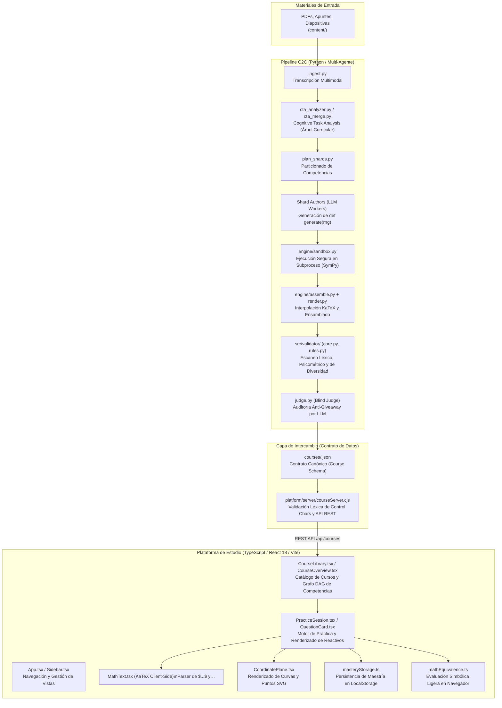
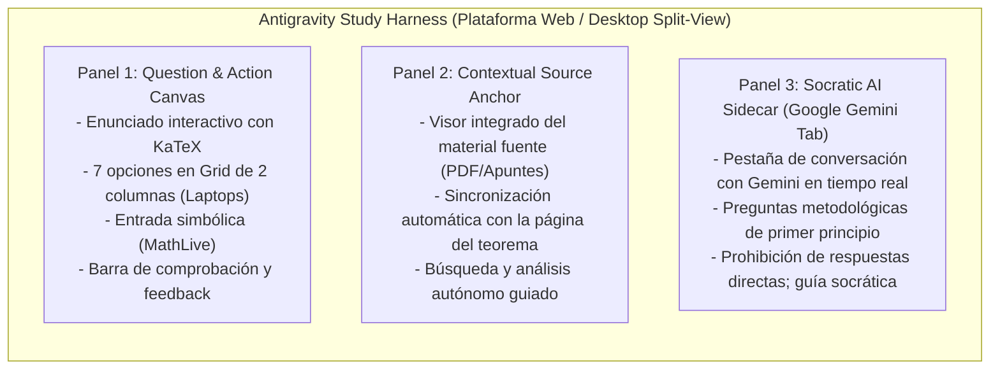

# Hoja de Ruta Maestra de Evolución y Milestones: Tops Academy
## Elevando la Vara: Del Paradigma Cerrado al "Antigravity Study Harness", Autenticidad Cognitiva y Ultra-Aprendizaje

> **Documento Estratégico, Psicométrico y de Arquitectura de Sistemas End-to-End**  
> **Fecha de Actualización:** Octubre 2026  
> **Áreas Auditadas:** Top's Academy Web Platform (`React 18 + Vite + TypeScript`), UI Multi-Panel (Split-View Harness), Pipeline Multi-Agente (`content-to-course` v3.3), Motor Determinista (`engine/`), Auditoría de Calidad (`course-qa-evaluator`) y Ciencia del Aprendizaje (*Learning Architect Framework*).  
> **Ubicación Principal y Archivos de Soporte:** [`docs/future_milestones/`](file:///d:/Augusto/personal_portfolio/Tops_academy/docs/future_milestones/) *(con espejo en la raíz [`FUTURE_MILESTONES.md`](file:///d:/Augusto/personal_portfolio/Tops_academy/FUTURE_MILESTONES.md))*.

---

## 1. El Diagnóstico Estratégico: Por Qué Necesitamos "Aumentar la Vara"

En las recientes auditorías automatizadas bajo estándares de Quality Matters (QM), OSCQR y Mastery Learning, el pipeline C2C alcanzó puntajes de excelencia consistente en cursos de alta complejidad técnica:
- **`solow_model_v15`**: **20.0 / 20.0 pts** (Quality Tier: EXCELENTE)
- **`practica_parcial_saul_standard_coarse`**: **19.0 / 20.0 pts** (Quality Tier: EXCELENTE)
- **`practica_parcial_saul` (Masivo)**: **18.7 / 20.0 pts** (Quality Tier: EXCELENTE)
- **`practica_parcial_saul_standard`**: **18.3 / 20.0 pts** (Quality Tier: EXCELENTE)

Sin embargo, estos puntajes revelan una **paradoja de falsa suficiencia**: estamos obteniendo calificaciones casi perfectas **dentro de los límites de un paradigma de evaluación cerrado**.

### 1.1. La Trampa de la "Ilusión de Fluidez" por Repetición de Plantillas
Al inspeccionar las sesiones prácticas por unidad en la plataforma, aparece un fallo pedagógico crítico: **dentro de una misma competencia existen a menudo solo 5 o 6 preguntas generadas a partir de una única estructura o plantilla idéntica**, donde solo varían los números o coeficientes numéricos.
- **El Problema:** El estudiante no adquiere fluidez en la competencia en general, sino que se **sobreajusta (*overfitting*) a la plantilla específica** generada por la plataforma.
- **La Ilusión:** El alumno cree dominar el tema porque responde rápido, pero en realidad solo ha memorizado la heurística superficial (*surface cues*) de ese formato exacto de pregunta. Si en un examen real le cambian la perspectiva o el punto de partida, el conocimiento no transfiere.
- **La Consigna Central:** **¿Cómo forzamos realmente al estudiante a aprender de forma profunda y rigurosa?** Toda la tecnología y la plataforma son medios al servicio de ese único fin: obligar al cerebro a procesar, inferir, deducir y sintetizar.

### 1.2. La Falsa Atomización de la "Unidad Plana" vs. la Jerarquía de Contenido Real (PPT $\to$ Glosario, Núcleo y Subtemas)
Actualmente, el sistema incurre en una **confusión de granularidad**: iguala cada competencia atómica individual con una "unidad de curso" completa:
- **El Esquema Plano Actual:** En la plataforma, cada competencia individual (`H-01`, `C-01`, `Hab-01`) se trata de forma aislada como si fuera una unidad independiente, asociándole mecánicamente su propia práctica, su propio quiz y su propio unit test idénticos.
- **El Defecto Pedagógico:** El estudiante no asimila el conocimiento en compartimentos estancos. En la realidad académica, el material de estudio proviene de artefactos integrados de contenido (por ejemplo, una **presentación PPT**, una clase magistral temática o un capítulo de apuntes). Tratar cada micro-competencia como una unidad aislada rompe la visión de conjunto (*gestalt*), desconecta los conceptos y genera una fatiga artificial donde los quizzes y los challenges pierden su jerarquía natural.
- **La Nueva Jerarquía Pedagógica de 3 Capas:**
  1. **Nivel Contenido / Módulo Temático (PPT / Presentación Padre):** Representa el artefacto fuente completo (ej. *"PPT 01: Dinámica Fundamental del Crecimiento de Solow"* o *"Clase 03: Ecuaciones Diferenciales Parciales Cuasilineales"*). Cada contenido incorpora a su vez:
     - **Glosario Unificado:** Diccionario técnico de términos clave, axiomas, convenciones de notación y definiciones formales de esa PPT.
     - **Núcleo (*Core / Nucleus*):** El corazón conceptual, teorema directriz o deducción maestra que vertebra toda la presentación y le da sentido a los subtemas.
  2. **Familia de Unidades / Subtemas:** Las unidades no son silos atómicos, sino una **familia de subtemas articulados** dentro de la PPT que agrupa las competencias específicas evaluadas en esa sección.
  3. **Evaluación Escalonada por Granularidad Cognitiva:**
     - **Quizzes por Subtema:** Evaluaciones formativas rápidas, focalizadas y diagnósticas acotadas estrictamente a los subtemas de la PPT.
     - **Challenges de Unidad / Contenido:** Retos acumulativos e integradores que abarcan **toda la PPT o todo el contenido en concreto**, evaluando la síntesis, la transferencia y el dominio conjunto del Núcleo y sus competencias asociadas.

```mermaid
graph TD
    subgraph CurrentParadigm ["Paradigma Actual (Riesgo de Ilusión de Fluidez y Fragmentación)"]
        P1["100% Opción Múltiple (MC7)\nRespuesta correcta siempre visible en pantalla"]
        P2["Plantillas Repetitivas por Competencia\nEl estudiante memoriza el molde sintáctico, no el concepto"]
        P3["Unidades Atómicas Aisladas (Unit = Competencia)\nQuiz y challenge redundantes por cada micro-destreza"]
        P4["Canal Verbal-Simbólico Exclusivo\nCero evaluación gráfica o espacial interactiva"]
        P5["Fricción en Laptops\n7 opciones verticales desbordan la pantalla; obliga a zoom out"]
        P6["Desconexión con la Fuente\nPreguntas huérfanas sin ancla al material original"]
    end

    subgraph FutureParadigm ["Nuevo Paradigma: Antigravity Study Harness & Deep Learning"]
        N1["Web Adaptativa Multi-Resolución\nGrid 2 cols sin zoom out en laptops + PWA móvil nativa"]
        N2["Variedad de Plantillas y Contraejemplos\nMínimo 3-4 estructuras disjuntas por competencia"]
        N3["Arquitectura Jerárquica de Contenido (PPT/Módulo)\nContenido -> [Glosario + Núcleo] + Familia de Subtemas"]
        N4["Evaluación Escalonada por Granularidad\nQuizzes por subtema de PPT + Challenge Integrador de toda la PPT"]
        N5["Entradas Simbólicas Libres (Open Symbolic)\nFuerza la Evocación Pura (Free Recall) con MathLive + SymPy"]
        N6["Antigravity Study Harness (Split-View Multi-Panel)\nCanvas de Preguntas + Visor de Fuente Original + Tab Gemini"]
        N7["Desacoplamiento Estricto KaTeX-Python\nPatrón PrairieLearn con tokens ortogonales @PARAM@"]
        N8["Arquitectura Streaming DAG en Pipeline\nValidación in-situ sin barreras síncronas bloqueantes"]
    end

    CurrentParadigm -->|Elevando la Vara| FutureParadigm
```



---

## 2. Anatomía de las Codebases: Cómo Funciona el Ecosistema End-to-End

Para comprender integralmente dónde radican los cuellos de botella y las oportunidades de evolución, es indispensable diseccionar cómo operan las distintas capas del repositorio y cómo interactúan entre sí:



### 2.1. Backend / Pipeline de Generación (`Python`)
- **Ubicación Principal:** [`.agents/skills/content-to-course/`](file:///d:/Augusto/personal_portfolio/Tops_academy/.agents/skills/content-to-course/), [`engine/`](file:///d:/Augusto/personal_portfolio/Tops_academy/.agents/skills/content-to-course/engine/), [`src/validator/`](file:///d:/Augusto/personal_portfolio/Tops_academy/src/validator/).
- **Misión:** Transformar materiales académicos no estructurados (`content/`) en cursos interactivos con garantías psicométricas formales mediante un orquestador multi-agente en Google Antigravity SDK.
- **Funcionamiento Interno:**
  1. **Ingesta (`ingest.py`):** Lee PDFs o imágenes y produce transcripciones estructuradas en Markdown y esquemas de páginas.
  2. **Análisis Cognitivo (`cta_analyzer.py`):** Extrae un árbol jerárquico de competencias (`Fact`, `Concept`, `Skill`), concepciones erróneas y especificaciones de distractores plausibles (`cta.json`).
  3. **Autoría en Shards (`plan_shards.py`, `prompt_shard_author.md`):** Divide las competencias entre múltiples subagentes paralelos que redactan funciones generadoras deterministas estocásticas (`def generate(rng)`), variantes de enunciados, distractores, pistas y soluciones.
  4. **Motor Determinista y Sandbox (`engine/sandbox.py`, `engine/instantiate.py`):** Ejecuta el código Python en entornos aislados con semillas pseudo-aleatorias deterministas, generando valores concretos y matrices matemáticas con SymPy.
  5. **Ensamblado e Invariantes (`engine/assemble.py`, `engine/invariants.py`, `src/validator/`):** Sustituye parámetros en plantillas, verifica que los delimitadores de KaTeX estén balanceados y asegura que las opciones cumplan con cuotas de diversidad y simetría de longitud.
  6. **Juez Ciego y Publicación (`judge.py`, `course_publisher.py`):** Evalúa heurísticamente que las preguntas no sean trivialmente adivinables (*giveaway*) y consolida el artefacto final `courses/<course_id>.json`.

### 2.2. Frontend / Plataforma Web (`TypeScript` / `React 18` / `Vite`)
- **Ubicación Principal:** [`platform/src/`](file:///d:/Augusto/personal_portfolio/Tops_academy/platform/src/), [`platform/server/courseServer.cjs`](file:///d:/Augusto/personal_portfolio/Tops_academy/platform/server/courseServer.cjs).
- **Misión:** Proporcionar una experiencia de aprendizaje interactiva de estilo Khan Academy / Mastery Learning, con retroalimentación inmediata, renderizado matemático KaTeX ultra-rápido y seguimiento de progreso.
- **Funcionamiento Interno:**
  1. **Servidor Intermedio (`courseServer.cjs`):** Un servidor Node.js que escanea `courses/`, valida que los archivos JSON no contengan caracteres de control ASCII (`[\x00-\x08\x0b\x0c\x0e-\x1f]`) ni sintaxis rota, y expone los cursos mediante endpoints REST.
  2. **Renderizado de Preguntas ([`QuestionCard.tsx`](file:///d:/Augusto/personal_portfolio/Tops_academy/platform/src/components/QuestionCard.tsx)):** Lee la estructura de la pregunta (`stem`, `options`, `type`, `graph`) y renderiza la interfaz correspondiente (`multiple_choice_7_options`, `multiple_select`, `fill_in_the_blank`).
  3. **Motor Matemático en Cliente ([`MathText.tsx`](file:///d:/Augusto/personal_portfolio/Tops_academy/platform/src/components/MathText.tsx)):** Divide el texto buscando delimitadores `$$` (bloque) y `$` (en línea) y compila las fórmulas en el navegador mediante `katex.renderToString()`.
  4. **Motor Gráfico SVG ([`CoordinatePlane.tsx`](file:///d:/Augusto/personal_portfolio/Tops_academy/platform/src/components/CoordinatePlane.tsx)):** Renderiza ejes cartesianos, grillas, curvas paramétricas y puntos discretos a partir de la especificación `GraphSpec` JSON generada en el pipeline.
  5. **Persistencia de Maestría ([`masteryStorage.ts`](file:///d:/Augusto/personal_portfolio/Tops_academy/platform/src/utils/masteryStorage.ts)):** Guarda en `localStorage` el estado cognitivo del estudiante por competencia (*Not started*, *Attempted*, *Familiar*, *Proficient*, *Mastered*).

### 2.3. El Puente Inter-Lenguajes (Python $\leftrightarrow$ TypeScript): El Contrato JSON y sus Puntos de Fricción
La frontera entre Python y TypeScript es el archivo `courses/<course_id>.json`, tipado en TypeScript en [`platform/src/types.ts`](file:///d:/Augusto/personal_portfolio/Tops_academy/platform/src/types.ts) y en Python en `schemas/course.schema.json`. En este puente emergen tensiones estructurales fundamentales:

1. **La Colisión de Escapado LaTeX:**
   - En Python, una barra invertida requiere tratamiento especial en strings (`r"\frac"` o `"\\frac"`). Al serializarse a JSON, una omisión accidental convierte secuencias como `\tau`, `\nabla` o `\beta` en caracteres de control (`\t` = tabulador, `\b` = backspace).
   - Cuando el servidor Node.js ([`courseServer.cjs`](file:///d:/Augusto/personal_portfolio/Tops_academy/platform/server/courseServer.cjs#L10-L16)) detecta estos caracteres, **rechaza el curso de inmediato**, impidiendo que la plataforma siquiera cargue el archivo.
2. **La Discrepancia del Motor de Evaluación (SymPy vs. RegExp en Cliente):**
   - En el backend de Python, la equivalencia de respuestas se verifica con el CAS completo de `SymPy` (`simplify(expr1 - expr2) == 0`).
   - En el frontend de TypeScript, [`mathEquivalence.ts`](file:///d:/Augusto/personal_portfolio/Tops_academy/platform/src/utils/mathEquivalence.ts) debe conformarse con normalizaciones heurísticas de cadenas y expresiones regulares simples, lo que vuelve casi imposible soportar reactivos abiertos avanzados sin un puente WebAssembly o un backend dinámico.
3. **El Coste de la Cardinalidad Psicométrica (MC7):**
   - El pipeline en Python exige 7 opciones para garantizar estándares psicométricos de Quality Matters (reduciendo la probabilidad de acierto por azar al $14.3\%$).
   - Pero en el frontend, apilar 7 botones verticales de opciones ([`QuestionCard.tsx`](file:///d:/Augusto/personal_portfolio/Tops_academy/platform/src/components/QuestionCard.tsx#L76-L138)) en una pantalla de laptop de 13"-14" satura la altura del viewport y destruye la ergonomía de estudio.
4. **El Desajuste de Granularidad Estructural (`Course` $\to$ `Competencies[]` plano):**
   - En el contrato JSON actual (`courses/<course_id>.json`), el curso contiene un arreglo plano `competencies: Competency[]` y `questions: Question[]`.
   - La plataforma interpreta ingenuamente cada índice de competencia como una "Unit" completa ([`App.tsx`](file:///d:/Augusto/personal_portfolio/Tops_academy/platform/src/App.tsx#L145-L159), [`MasteryGrid.tsx`](file:///d:/Augusto/personal_portfolio/Tops_academy/platform/src/components/MasteryGrid.tsx#L25-L57)).
   - Esto impide agrupar competencias por artefacto de origen (ej. una PPT), presentar un Glosario y Núcleo unificados por contenido, o limitar los quizzes a subtemas mientras se reserva el Challenge para la totalidad de la presentación.

### 2.4. La Brecha entre el Pipeline y la Experiencia en Plataforma (*Impedance Mismatch*)
Existe una brecha de expectativas entre lo que el pipeline optimiza y lo que el usuario final experimenta:
- **El pipeline optimiza para superar barreras estadísticas:** Que ninguna opción sea 30% más larga que otra, que no haya colisiones en 50 semillas, que los distractores tengan 12 metadatos formales.
- **El usuario de la plataforma necesita fluidez cognitiva:** Ver la pregunta sin scroll en su laptop, entender por qué falló con referencia al teorema original de su clase, no aburrirse resolviendo 5 preguntas idénticas con números cambiados, y poder interactuar con figuras o escribir pasos algebraicos intermedios.

---

## 3. Síntesis Forense de las 4 Investigaciones Externas

El análisis independiente realizado sobre las ejecuciones históricas del pipeline (`e8ab9fd6` y `c4802280`) aportó diagnósticos esenciales sobre la dinámica de trabajo de los agentes. Estos documentos se encuentran archivados y preservados en [`docs/future_milestones/investigaciones/external_analysis/`](file:///d:/Augusto/personal_portfolio/Tops_academy/docs/future_milestones/investigaciones/external_analysis/):

### 3.1. [Análisis 1: Diagnóstico Estructural y Explosión de Contratos de Salida](file:///d:/Augusto/personal_portfolio/Tops_academy/docs/future_milestones/investigaciones/external_analysis/01_structural_diagnostics_analysis_1.md)
- **Causa Raíz:** El contrato de autoría exige un volumen masivo de salida: $\ge 6$ plantillas por competencia (2 MC7, 2 FIB, 2 MS), cada una con 3–5 variantes de enunciado, código Python `generate_py`, función de verificación, pistas, solución y distractores. Para un curso estándar de 22 competencias, esto implica redactar al menos **132 plantillas y entre 396 y 660 variantes de enunciado**.
- **El LLM Asume Demasiados Roles:** El modelo actúa simultáneamente como diseñador pedagógico, programador Python, serializador JSON y depurador. Escribir scripts mediante herramientas no reduce el conteo de tokens generados; solo lo disfraza.
- **Defecto en los Ejemplos del Prompt:** Se descubrió un defecto reproducible en el ejemplo MC7 insertado en los shards (afirmaba siempre que una ecuación era elíptica cuando sus parámetros producían discriminantes positivos en 14 de 50 semillas evaluadas).
- **Propuesta Central:** Introducir una **representación de autoría compacta y declarativa** (parámetros, relación matemática, concepciones erróneas) y delegar el ensamblaje de IDs, JSON y f-strings a un compilador determinista en Python.

### 3.2. [Análisis 2: Auditoría de Telemetría Real y Reconstrucción del Camino Crítico](file:///d:/Augusto/personal_portfolio/Tops_academy/docs/future_milestones/investigaciones/external_analysis/02_runtime_telemetry_audit_analysis_2.md)
- **Falsedad de Métricas Históricas:** La afirmación de que el pipeline había bajado a 13.9 minutos fue desmentida: el registro del orquestador padre finalizó prematuramente mientras los agentes hijos continuaron ejecutándose durante 32.7 minutos adicionales en segundo plano (duración real observada: **46.6 a 61.9 minutos**).
- **Constantes Ocultas en Reportes:** Se detectó que cifras como "95.8% de tiempo en inferencia" o "ahorro de >55% por shards grandes" eran constantes de texto fijo insertadas por el generador de reportes.
- **Concentración del Wall-Time:** El **78.8% del tiempo de ejecución total** se concentró en dos etapas: CTA (20.8 min) y Autoría de Shards (28.0 min).
- **Propuesta Central:** Corregir la telemetría para medir hasta la publicación validada final, reemplazar "presupuestos sugeridos" por una máquina de estados con límites estrictos ejecutables, y particionar tareas según coste computacional real y no por conteo plano de competencias.

### 3.3. [Análisis 3: Colisiones de Escapado y Cuellos de Botella Cognitivos en Bucles Multi-Turno](file:///d:/Augusto/personal_portfolio/Tops_academy/docs/future_milestones/investigaciones/external_analysis/03_cognitive_and_syntactic_bottlenecks_analysis_3.md)
- **La Colisión de 4 Capas de Escapado:** `Python -> f-string -> plantilla {var} -> JSON -> KaTeX`. El uso de llaves dobles (`{{...}}`) para escapar llaves en f-strings de Python mientras se escriben comandos KaTeX (`\frac{a}{b}`) colapsa la atención autorregresiva del LLM, disparando violaciones de la regla `R-20`.
- **La Paradoja de Salida por Shard:** Asignar 7 u 8 competencias por shard para amortizar el prompt exige generar ~160 KB de código denso (~40,000–45,000 tokens de salida), superando el `max_output_tokens` del modelo y forzando al agente a trocear su salida en micro-scripts (`shard01_part1.py` ... `part4.py`), desbordando el presupuesto en bucles de hasta 146 turnos.
- **Restricciones Estocásticas Acopladas en 50 Semillas:** El LLM no puede calcular mentalmente que el 100% de 50 semillas cumpla simultáneamente la regla de longitud `R-15` ($[0.80 \times \min(D), 1.20 \times \max(D)]$) y la no-colisión de distractores `TPL-D4`.
- **Ceguera por Recorte de Errores:** `check_templates.py` truncaba su diagnóstico a los primeros 15 errores. Como una sola plantilla rota fallaba en las 50 semillas, esa única plantilla saturaba la consola, ocultando los errores de las demás y provocando un ciclo de reparaciones interminable ("juego del topo").

### 3.4. [Análisis 4: Barreras Síncronas y Ruta Crítica para Bajar de 20 Minutos](file:///d:/Augusto/personal_portfolio/Tops_academy/docs/future_milestones/investigaciones/external_analysis/04_critical_path_and_action_plan_analysis_4.md)
- **Cadena de 5 Barreras Síncronas:** Ingesta $\to$ CTA Map/Reduce $\to$ Shards $\to$ Sandbox/Invariantes $\to$ Juez Ciego/Repair Loop. Ninguna fase puede avanzar hasta que el subagente más lento (*straggler*) de la fase previa termine.
- **Arranque en Frío e Importación Ansiosa de `sympy`:** El archivo barrel `engine/__init__.py` y `engine/sandbox.py` importaban `sympy` de forma ansiosa en cada invocación de subproceso, consumiendo cientos de milisegundos en frío y disparando falsos `TimeoutError` que enviaban código perfectamente válido al costoso `repair_loop.py`.
- **Plan de Optimización Propuesto:**
  1. Lazy loading y pool persistente de workers en `engine/sandbox.py`.
  2. Pipelining asíncrono (DAG streaming) por competencia en `dispatch.py`.
  3. Autocheck in-situ con validación determinista antes de cerrar el shard.
  4. Particionado ponderado por tipo de competencia (máximo 1 `Skill` por shard).
  5. Pre-filtro heurístico antes de invocar al LLM Blind Judge.

---

### 3.5. Caveat Histórico Crítico: Estado Previo vs. Mejoras Implementadas en este Branch (`optimizaciones_test`)

> [!IMPORTANT]
> **Contexto de Vigencia:** Los 4 análisis externos fueron ejecutados sobre trazas históricas de las versiones **C2C v3.1 y v3.2 temprana** (`solow_growth_model` en los runs `e8ab9fd6` y `c4802280`).  
> Durante el desarrollo del branch actual [`optimizaciones_test`](file:///d:/Augusto/personal_portfolio/Tops_academy/) de cara a la sincronización con `main`, se implementaron reformas profundas en el pipeline (`v3.2`, `v3.21` y `v3.3`) que resolvieron varios de los síntomas descritos.

#### Cuadro Comparativo: Hallazgos de los Análisis vs. Estado Actual en el Branch

| Problema Identificado en los Análisis Externos | Estado en Runs Históricos (`e8ab9fd6`, `c4802280`) | Estado Actual en Branch `optimizaciones_test` (Commits Recientes) | Veredicto y Acción Futura |
| :--- | :--- | :--- | :--- |
| **Métricas falsas / textos fijos en reportes** | Texto hardcodeado de 95.8% y >55% de ahorro en `report.md`. | **Resuelto en Commit `3eac1fc`:** Eliminación total de prosas cualitativas y conclusiones hardcodeadas en reportes headless. Telemetría ahora lee datos dinámicos directos. | ✅ **Cerrado en código.** Monitorear rigor en `c2c-run-auditor`. |
| **Ceguera por truncamiento de errores (15 errores)** | La salida de `check_templates.py` se cortaba a 15 errores, saturados por 1 sola plantilla rota en 50 semillas. | **Resuelto en Commit `a63193f`:** Agregación atómica de errores deduplicados por `(template_id, rule_id)` con pre-healer y protección de variables cortas. | ✅ **Cerrado en código.** |
| **Presupuestos sugeridos sin límites reales** | El agente ignoraba los "25 turnos sugeridos" y llegaba a 146 turnos. | **Resuelto en Commit `62aaa94`:** Core hardening con `budget_guard` que aborta y escala activamente si se exceden los turnos o tokens de salida. | ✅ **Cerrado en código.** |
| **Corrupción de llaves KaTeX en ensamblado** | `assemble.py` fallaba al ensamblar matrices y fracciones. | **Resuelto en Commit `9999c7b`:** Guardas de auto-reparación de fracciones KaTeX y scripts por conteo estricto de llaves balanceadas. | ⚠️ **Mitigado.** Requiere erradicación total mediante el Milestone 4 (PrairieLearn). |
| **Colisión de 4 capas de sintaxis (`f-string` + KaTeX)** | El LLM debe escapar llaves y barras invertidas dentro de strings JSON. | **Persiste como deuda técnica.** El LLM sigue generando strings con código Python embebido. | 🎯 **Prioridad Alta en Milestone 4:** Desacoplamiento estricto KaTeX-Python. |
| **Sobrecarga de 7 opciones en Laptops (Zoom-Fix)** | El alumno debe hacer zoom out en pantallas de 13"-14" para ver las 7 opciones de `QuestionCard.tsx`. | **Persiste en Frontend.** `platform/src/components/QuestionCard.tsx` mantiene un layout vertical `space-y-2`. | 🚀 **Quick Win #1 en Milestone 1:** Grid responsivo de 2 columnas. |
| **Barreras síncronas secuenciales y falta de streaming** | Todo el pipeline se detiene hasta que el último autor termina antes de pasar a validación/juez. | **Persiste en Orquestación.** `dispatch.py` opera por fases globales bloqueantes. | 🛠️ **Integrado en Milestone 7:** Pipeline DAG asíncrono con pool lazy de subprocesos. |
| **Desconexión con el material fuente original** | La plataforma solo muestra hints estáticos precalculados; el alumno no puede consultar el apunte original. | **Persiste en Plataforma.** `Question` no incluye ancla contextual hacia `content/`. | 👑 **La Joya de la Corona en Milestone 6:** Antigravity Study Harness (Split-View). |

---

## 4. Matriz Maestra de Priorización de Ingeniería

Integrando los diagnósticos cognitivos, los hallazgos de las auditorías forenses externas y la realidad operativa de la plataforma web, se consolida la siguiente matriz ordenada por **ganancia neta frente a esfuerzo de implementación**:

| Prioridad / Hito | Área del Ecosistema | Ganancia Real (Cognitiva, Operativa y de Rendimiento) | Tiempo Estimado | Clasificación Estratégica |
| :--- | :--- | :--- | :---: | :--- |
| **Milestone 1: Web Ergonomía para Laptops (Zoom-Fix)** | Frontend / Layout | **Elimina la fricción física inmediata.** Evita el zoom out en laptops de 13"-14". Transforma el apilamiento vertical de 7 opciones en un Grid responsivo de 2 columnas con clamp elástico. | **2 a 4 horas** | 🚀 **Quick Win #1 (Inmediato)** |
| **Milestone 2: PWA Móvil para Estudio en Celular** | Frontend / PWA | **Habilita el estudio ubicuo en celular.** Experiencia de app nativa sin barra de navegador, offline cache de fuentes KaTeX y safe areas. | **1 a 2 horas** | 🚀 **Quick Win #2 (Inmediato)** |
| **Milestone 3: Anti-Overfitting y Variedad de Plantillas** | Pipeline / Rúbrica | **Destruye la ilusión de fluidez.** Exige mínimo 3 a 4 plantillas disjuntas por competencia con contraejemplos, evitando la memorización superficial de una sola estructura. | **1 a 2 días** | 🎯 **Core Pedagógico Alto** |
| **Milestone 4: Desacoplamiento KaTeX-Python (PrairieLearn & AST)** | Pipeline / Backend | **Erradica las 4 capas de colisión sintáctica al 100%.** Separa el cálculo en Python (`generate() -> dict`) de plantillas declarativas con `@PARAM@` y validación con `pykatex` (QuickJS). | **1 a 2 días** | 🛠️ **Estabilidad Sistémica** |
| **Milestone 5: Entradas Simbólicas Libres y Pasos Intermedios** | Full-Stack / Simbólico | **Fuerza la evocación libre (Free Recall).** Reemplaza la opción múltiple por cajas MathLive validadas con SymPy y validadores de derivaciones intermedias. | **2 a 3 días** | 🧠 **Impacto Cognitivo Máximo** |
| **Milestone 6: Antigravity Study Harness (Multi-Panel Split-View)** | Arquitectura de UI | **El salto cuántico en flow de estudio.** Canvas de preguntas + Visor de material original sincronizado (`source_anchor`) + Pestaña de Google Gemini socrático. | **3 a 5 días** | 👑 **La Joya de la Corona (Máxima Ambición)** |
| **Milestone 7: Pipeline Streaming DAG y Pool de Subprocesos** | Infraestructura Pipeline | **Quiebra la barrera de los 20 minutos (Target: 10–14 min).** Transforma barreras bloqueantes en un grafo asíncrono por competencia, con pool pre-calentado de `sympy` y autocheck in-situ. | **2 a 3 días** | ⚡ **Rendimiento de Pipeline** |
| **Milestone 8: QA Rubric v2.0 Completa (Certificación Deep Mastery)** | Auditoría QA | **Sello de certificación estricta.** Evalúa multimodalidad, penaliza monocultivo MC7 e integra los linters automáticos descubiertos. | **1 a 2 días** | 📋 **Garantía y Gobernanza** |
| **Milestone 9: Arquitectura Jerárquica de Contenido (PPT $\to$ Glosario, Núcleo, Quizzes por Subtema y Content Challenge)** | Full-Stack / Arquitectura Curricular | **Estructura el aprendizaje en torno a la fuente real (PPT).** Agrupa competencias bajo módulos de contenido con Glosario y Núcleo unificados. Desacopla los Quizzes por subtema (evaluación formativa) y reserva el Challenge para toda la PPT (síntesis integradora). | **2 a 3 días** | 🏛️ **Arquitectura Curricular y Pedagógica** |
| *Opcional A: Pipeline Performance Daemon en RAM / SSD* | Infraestructura | *Acelera subprocesos locales, complementando el pool lazy.* | *3 a 4 horas* | ⏳ **Opcional / Secundario** |
| *Opcional B: Empaquetado Nativo con Capacitor* | Distribución | *Generación de APK para tiendas de aplicaciones.* | *4 a 6 horas* | ⏳ **Opcional / Backlog** |

---

## 5. La Joya de la Corona: El "Antigravity Study Harness" (Milestone 6)

Inspirado en la interfaz de trabajo de **Google Antigravity** —donde conviven de forma sincronizada el panel de tarea/conversación, el panel de artefactos/código y el inspector de herramientas—, la plataforma de estudio evoluciona hacia una **Estación de Ultra-Aprendizaje en Flow**:



### 5.1. Panel 1: Canvas de Preguntas y Acción
- El área activa de interacción donde el estudiante lee el problema, reflexiona y formula su respuesta.
- **Resolución definitiva al problema de laptops:** En pantallas pequeñas (13"-14", resoluciones 1366x768, 1440x900 o con escalado de Windows al 125%/150%), las 7 opciones se reorganizan automáticamente en un **Grid responsivo de 2 columnas** (4 opciones en la columna izquierda y 3 en la derecha con altura homogénea), eliminando por completo la necesidad de hacer zoom out en el navegador.

### 5.2. Panel 2: Ancla Contextual al Material de Origen (*Contextual Source Anchor*)
- Cada competencia (`H-XX`, `C-XX`, `Hab-XX`) incorpora en el JSON un metadato generado durante la ingesta del pipeline:
  ```json
  "source_anchor": {
    "file": "MATH_IV_Problem_Set_I.pdf",
    "page": 14,
    "section": "Problema 3: EDP cuasilineal y curvas características"
  }
  ```
- Si el estudiante entra en duda o falla un reactivo, el visor lateral se despliega automáticamente en la página exacta del teorema o derivación original.
- **Principio Pedagógico:** La pregunta **jamás es un copy-paste** del texto; es una instancia de aplicación profunda. El estudiante consulta la fuente no para buscar una respuesta literal, sino para refrescar su modelo mental y razonar desde los primeros principios (*Search-Organize-Integrate*).

### 5.3. Panel 3: Asistente Socrático Integrado (Google Gemini Tab)
- Una pestaña lateral desplegable conectada a la API de Google Gemini con el contexto del reactivo y del fragmento fuente precargados.
- Si tras consultar el material el alumno continúa bloqueado, interactúa con Gemini bajo un system prompt socrático estricto:
  - *"¿Cuál es la intuición geométrica de esta condición de transversalidad?"*
  - *"¿Por qué la matriz jacobiana debe tener determinante negativo en el punto de equilibrio?"*
- Gemini **guía metodológicamente sin dar la solución numérica directa ni señalar la letra correcta**, forzando al estudiante a construir el razonamiento final por sí mismo.

### 5.4. El Bucle de Retroalimentación en Estado de Flow (*Active Mastery Flow Loop*)

```mermaid
sequenceDiagram
    autonumber
    actor Estudiante
    participant Canvas as Panel 1: Question Canvas
    participant Source as Panel 2: Material Original (PDF)
    participant Tutor as Panel 3: Gemini Socratic Tab

    Estudiante->>Canvas: Lee problema y reflexiona
    alt Acierto directo
        Estudiante->>Canvas: Envía respuesta correcta
        Canvas-->>Estudiante: Refuerzo positivo inmediato + Siguiente pregunta (Flow continuo)
    else Duda o Primer Fallo (Fricción Cognitiva)
        Canvas-->>Estudiante: Oculta opciones distractores; solicita recuerdo activo
        Note over Estudiante: "Trata de recordar: ¿dónde estaba este concepto en los apuntes?"
        Estudiante->>Canvas: Reintento autónomo
    else Segundo Fallo o Solicitud de Ayuda
        Canvas->>Source: Despliega Panel 2 posicionado en la página exacta del PDF
        Note over Estudiante,Source: El estudiante busca, analiza y razona desde el material original
        Estudiante->>Canvas: Reintento basado en el análisis de la fuente
    else Bloqueo Persistente
        Canvas->>Tutor: Habilita el Tab de Google Gemini
        Estudiante->>Tutor: "No entiendo cómo empezar este despeje"
        Tutor-->>Estudiante: Guía socrática de primer principio (sin regalar la respuesta)
        Estudiante->>Canvas: Resuelve y consolida el aprendizaje profundo
    end
```

---

## 6. Diagnóstico de los 8 Puntos Ciegos Cognitivos que Definen la Nueva Vara

A partir de las investigaciones independientes preservadas en [`docs/future_milestones/investigaciones/`](file:///d:/Augusto/personal_portfolio/Tops_academy/docs/future_milestones/investigaciones/):
- [`03_Limitaciones_de_la_plataforma_de_estudio.md`](file:///d:/Augusto/personal_portfolio/Tops_academy/docs/future_milestones/investigaciones/03_Limitaciones_de_la_plataforma_de_estudio.md)
- [`04_Limites_de_la_plataforma_y_estudio.md`](file:///d:/Augusto/personal_portfolio/Tops_academy/docs/future_milestones/investigaciones/04_Limites_de_la_plataforma_y_estudio.md)

Se establecen las 7 dimensiones que la plataforma debe incorporar para certificar auténtico dominio disciplinar:

1. **Evocación Libre (*Free Recall*) vs. Reconocimiento (*Recognition*):** Con 7 opciones múltiples, la respuesta correcta siempre está visible en pantalla. Se entrena descarte guiado, no evocación pura desde memoria a largo plazo frente a una hoja en blanco.
2. **Traducción y Construcción Gráfico-Visual (*Dual Channels & Drawing Effect*):** El motor opera 100% en texto/LaTeX. Se requiere evaluar la conversión visoespacial: diagramas de fase, campos de pendientes, isoclinas nulas y retratos de estabilidad.
3. **Encadenamiento de Demostraciones Largas (*Bundling & Step-by-Step Proofs*):** Se evalúa el resultado final o un eslabón aislado, sin auditar derivaciones de 10 pasos ni detectar la violación intermedia de un supuesto.
4. **Combate a la Ilusión de Maestría Explicativa (*Illusion of Explanatory Depth*):** Leer soluciones prefabricadas genera fluidez de lectura pasiva. Es necesario forzar la formulación escrita y el contraste de contraejemplos.
5. **Formulación de Modelos No Estructurados (*Adaptive Expertise*):** Introducir casos difusos (*fuzzy boundaries*) donde el modelo no está dado de antemano y el alumno debe seleccionar supuestos (*Learning as "less"*).
6. **Trabajo Computacional y Simulación Empírica (*Shop Time*):** Simulación numérica en Python/Julia de dinámicas complejas sin solución analítica cerrada (Runge-Kutta, perturbaciones estocásticas).
7. **Automonitoreo y Resiliencia con Andamiaje Diferido (*Delayed Scaffolding*):** Bloqueo inicial de pistas para entrenar la resistencia a la frustración y el automonitoreo metacognitivo.
8. **Fragmentación Atomizada vs. Síntesis Estructural (*Part-Whole Cognitive Integration*):** La memorización de habilidades aisladas en micro-unidades no conduce a la comprensión sistémica si no existe un ancla macro que unifique los términos técnicos (**Glosario**), los principios rectores (**Núcleo**) y la evaluación escalonada (**Quizzes formativos por subtema** para validar la micro-comprensión y **Challenges de contenido completo** para certificar la transferencia y la síntesis global sobre toda la PPT).

---

## 7. Especificación Detallada de los Milestones

### Milestone 1: Layouts Adaptativos Multi-Resolución (Laptops Pequeñas, Pantallas Medianas y Móvil)
* **Objetivo Crítico:** Resolver el problema de adaptabilidad donde las 7 opciones (MC7) se desbordan verticalmente en computadoras portátiles (13"-14", resoluciones 1366x768 o 1440x900) obligando al usuario a hacer zoom out continuo en el navegador.
* **Componentes Técnicos:**
  1. **Grid Inteligente de 2 Columnas para Opciones ([`QuestionCard.tsx`](file:///d:/Augusto/personal_portfolio/Tops_academy/platform/src/components/QuestionCard.tsx)):**
     - En pantallas de escritorio medianas o laptops con altura reducida (`max-height: 850px` y `min-width: 1024px`), las 7 alternativas se organizan automáticamente en 2 columnas equilibradas (4 en columna izquierda, 3 en columna derecha), garantizando que todo el reactivo quepa en una sola pantalla sin scroll.
  2. **Contenedor Elástico con `clamp()` y Scroll Suave:**
     - Espaciados y tipografías elásticas usando unidades dinámicas (`clamp(0.875rem, 1.5vh, 1.125rem)`) para padding de opciones y enunciados.
     - Scroll interno contenido en el bloque de opciones si el enunciado es excepcionalmente largo, manteniendo fijos el encabezado y el botón de comprobación.
  3. **Refactorización Mobile-First:**
     - Drawer desplegable para [`Sidebar.tsx`](file:///d:/Augusto/personal_portfolio/Tops_academy/platform/src/components/Sidebar.tsx) con botón hamburguesa.
     - [`FeedbackToast.tsx`](file:///d:/Augusto/personal_portfolio/Tops_academy/platform/src/components/FeedbackToast.tsx) transformado en Bottom Sheet deslizable con scroll propio.
     - SVG responsive en [`CoordinatePlane.tsx`](file:///d:/Augusto/personal_portfolio/Tops_academy/platform/src/components/CoordinatePlane.tsx) (`viewBox` + `max-w-[340px]`).
     - Viewports dinámicos (`100dvh`) para mitigar el teclado virtual en preguntas de texto.

---

### Milestone 2: Configuración PWA (Progressive Web App)
* **Objetivo:** Instalación en pantalla de inicio en Android e iOS con comportamiento nativo standalone.
* **Componentes:**
  - `vite-plugin-pwa` con service worker automático y precaching de assets/fuentes KaTeX.
  - `manifest.webmanifest` con iconos adaptativos (`192x192`, `512x512`).
  - Metatags de Safe Areas para iOS/Safari (`viewport-fit=cover`, utilidades `env(safe-area-inset-bottom)`).

---

### Milestone 3: Anti-Overfitting y Variedad de Plantillas por Competencia (QA v2.0 Early)
* **Objetivo:** Destruir la ilusión de fluidez erradicando el monocultivo de una única plantilla por competencia.
* **Componentes Técnicos:**
  1. **Requisito de Mínimo 3 a 4 Plantillas Disjuntas por Competencia:**
     - El pipeline C2C debe generar al menos 3 a 4 arquitecturas de plantilla cualitativamente distintas por competencia (ej. una analítica directa, una de perturbación de supuestos, una geométrica/cualitativa y una de caso límite o contraejemplo).
  2. **Auditoría de Diversidad Semántica:**
     - Algoritmo de similitud léxica/estructural en `standardized_audit_engine.py` que penalice cursos donde los reactivos de una misma competencia compartan el mismo esqueleto gramatical.

---

### Milestone 4: Desacoplamiento Arquitectónico KaTeX-Python & AST Validation Engine (PrairieLearn Pattern)
* **Objetivo:** Erradicar al 100% las 4 capas de colisión sintáctica (`Python -> f-string -> {var} -> JSON -> KaTeX`) identificadas en los análisis forenses externos 1 y 3.
* **Componentes Técnicos:**
  1. **Contrato de Autoría Tipado (Pydantic / Structured Outputs):**
     - Reescribir el contrato de `c2c_shard_author` dividiendo la salida en dos campos estrictos:
       ```python
       class ShardCompetenceContract(BaseModel):
           competence_id: str
           python_pure_logic: str = Field(description="Solo función generate() -> dict. Cero strings con LaTeX/HTML.")
           statement_markdown: str = Field(description="Markdown + KaTeX puro con tokens @PARAM@")
           solution_markdown: str = Field(description="Explicación paso a paso con tokens @PARAM@")
       ```
  2. **Erradicación de Llaves en la Interpolación:**
     - Sustituir las f-strings y `.format()` por el interpolador de tokens ortogonales `@PARAM_NAME@` o `<eval-var name="..."/>`.
  3. **Generación Simbólica Garantizada con `sympy.latex()`:**
     - Prohibir el ensamblado manual de matrices o polinomios en Python. Exigir la exportación canónica mediante SymPy.
  4. **Validador Estricto con `pykatex` (QuickJS Embebido):**
     - Integrar `pykatex` en `compile_shard.py` para compilar y validar árboles KaTeX del lado del servidor a 15,000 fórmulas/segundo.
  5. **Auto-Corrección con Diagnóstico de Compilador:**
     - Ante fallos, inyectar directamente la excepción técnica (`katex.ParseError` con número de columna) en el contexto de autorreparación del agente.

---

### Milestone 5: Entradas Simbólicas Abiertas, Demostraciones por Pasos y Módulos SVG
* **Objetivo:** Trascender la opción múltiple forzando el efecto de generación y la multimodalidad visoespacial.
* **Componentes Técnicos:**
  1. **Tipo de Reactivo de Entrada Simbólica Abierta (`open_symbolic`):**
     - Cajas de texto matemáticas (MathLive) evaluadas mediante `SymPy`: `simplify(user_expr - correct_expr) == 0`.
  2. **Validador de Demostraciones por Pasos Intermedios (*Step-by-Step Proof Grader*):**
     - Validación secuencial de 3 hitos intermedios en `engine/sandbox.py`.
  3. **Módulo Gráfico Interactivo Visoespacial (SVG / Canvas):**
     - Componentes interactivos para arrastrar vectores en campos de pendientes, marcar isoclinas nulas y seleccionar diagramas de fase.
  4. **Generador de Perturbaciones y Contraejemplos Teóricos (*Boundary Testing*):**
     - Distractores programados para capturar la violación deliberada de supuestos axiomáticos.
  5. **Andamiaje con Retardo y Escalera de Fricción (*Delayed Scaffolding*):**
     - Bloqueo temporal inicial de pistas (5 min) para forzar la búsqueda autónoma en el material original.

---

### Milestone 6: Arquitectura "Antigravity Study Harness" (Multi-Panel Split-View, Source Anchor & Gemini Sidecar)
* **Objetivo:** Transformar la plataforma en una estación de trabajo de ultra-aprendizaje en flow, conectando preguntas interactivas con el material de origen y tutoría socrática por IA.
* **Componentes Técnicos:**
  1. **Split-View Layout Adaptativo (`platform/src/components/HarnessLayout.tsx`):**
     - Disposición multi-panel con divisiones ajustables o colapsables (Splitter).
     - Panel A: Área de preguntas y respuestas (Canvas de práctica).
     - Panel B: Visor de PDF/Markdown con resaltado del fragmento fuente exacto.
     - Panel C: Panel lateral o pestaña emergente de Google Gemini.
  2. **Indexador y Ancla de Contenido Fuente (`c2c-ingest` / `cta.json`):**
     - El pipeline C2C estampa en cada competencia la referencia precisa de origen:
       `"source_anchor": {"file": "MATH_IV_Problem_Set_I.pdf", "page": 14, "section": "Problema 3: EDP cuasilineal"}`.
     - El visor de la plataforma se sincroniza automáticamente con el `source_anchor` de la competencia activa.
  3. **Sidecar Socrático de Google Gemini (`GeminiSocraticTutor.tsx`):**
     - Integración de API / webview de Gemini dentro de la plataforma con contexto precargado del problema y del material fuente.
     - Guardas de prompt socrático: prohibir entregar la solución directa; formular preguntas orientadoras ("¿Qué método de integración aprendiste para derivadas parciales respecto a $x$ mientras mantienes $y$ constante?").
  4. **Motor de Bucle de Flujo (Active Mastery Loop):**
     - Transición sin fricciones entre aciertos y reintentos guiados con escalera de asistencia gradual.

---

### Milestone 7: Pipeline Streaming DAG, Pool de Subprocesos y Autocheck In-Situ (Target: < 15 min)
* **Objetivo:** Resolver las causas raíz de rendimiento identificadas en los análisis externos 2 y 4, quebrando la barrera de los 20 minutos de ejecución del pipeline sin comprometer el rigor psicométrico.
* **Componentes Técnicos:**
  1. **Pipelining Asíncrono por Competencia (Streaming DAG en `dispatch.py`):**
     - Sustituir las barreras síncronas bloqueantes por un grafo de eventos dirigido: tan pronto como un shard finaliza `templates/C-01.json`, ese archivo entra inmediatamente al sandbox, validador y juez ciego, solapando el trabajo sin esperar al último shard autor (*straggler*).
  2. **Pool Persistente de Workers y Lazy Loading en `engine/sandbox.py`:**
     - Mantener un pool pre-calentado de subprocesos Python con `sympy` ya importado en memoria, reduciendo el tiempo de validación de instancias a $<50\text{ ms}$ y eliminando el 100% de los falsos `TimeoutError`.
  3. **Shard Autocheck In-Situ con Validación Determinista Pre-Entrega:**
     - Integrar `lexical_scanner.py`, `psychometric_checker.py` y `diversity.py` dentro del hook de `check_templates.py`. Devolver diagnóstico determinista instantáneo al autor activo antes de cerrar su sesión, eliminando las costosas idas y vueltas a `repair_loop.py`.
  4. **Particionado Ponderado por Complejidad Cognitiva en `plan_shards.py`:**
     - Balancear la asignación utilizando la suma de pesos (`calculate_competency_weight`): máximo 1 competencia `Skill` (`Hab-*`) por shard o 2–3 de `Concept`/`Fact`, ecualizando el volumen de tokens generados.
  5. **Pre-Filtro Heurístico para Blind Judge en `judge.py`:**
     - Utilizar `psychometric_checker.py` como filtro de coste cero y reservar las llamadas LLM de `judge.py` exclusivamente para una muestra estratificada de 1 instancia por plantilla.

---

### Milestone 8: Rúbrica de Auditoría QA de Próxima Generación (QA Rubric v2.0 - Deep Mastery)
* **Objetivo:** Actualizar el motor de auditoría (`course-qa-evaluator`) para calificar no solo la corrección formal, sino la profundidad cognitiva real de los cursos.
* **Componentes Técnicos:**
  1. **Penalización por Monocultivo Psicométrico:**
     - Descuento de hasta **-3.0 puntos** si un curso presenta 100% de preguntas en un único formato (ej. exclusivamente MC7).
  2. **Exigencia de Diversidad Multimodal (Mínimo 20%):**
     - Bonificación y certificación solo para cursos que incorporen reactivos abiertos simbólicos, pasos intermedios o interacción gráfica.
  3. **Formalización Permanente de las 6 Nuevas Reglas de Linteo:**
     - `uninterpolated_math_placeholder_linter` (tokens `{var}` en KaTeX).
     - `katex_delimiter_parity_shift_linter` (macros en texto plano por falta de `$`).
     - `katex_concatenated_macro_linter` (macros concatenadas sin espacio `\muu`).
     - `telltale_distractor_gerund_label_linter` (gerundios delatores en opciones).
     - `arithmetic_unnormalized_sign_linter` (operadores `+ -` y coeficientes `1x`).
     - `dag_orphan_prerequisites_linter` (habilidades sin prerrequisitos en grafo DAG).
  4. **Métricas de Resiliencia ante Overfitting:**
     - Auditoría de similitud léxica entre instancias de una misma competencia para garantizar variabilidad semántica profunda (*deep structure*) sobre pistas superficiales (*surface features*).

---

### Milestone 9: Arquitectura Jerárquica de Contenido y Evaluación Escalonada (Content Modules, Glosario, Núcleo, Quizzes por Subtema y Content Challenges)
* **Objetivo Crítico:**
  Erradicar la atomización artificial donde cada micro-competencia se modela como una "unidad" autosuficiente con su propia terna redundante (`practice + quiz + unit test`). Reorganizar la plataforma y el pipeline en una arquitectura pedagógica jerárquica de 3 niveles anclada a los artefactos de estudio reales (ej. **presentaciones PPT**, clases magistrales o capítulos temáticos):
  $$\text{Curso} \longrightarrow \text{Contenido / PPT (Módulo)} \longrightarrow \text{Familia de Unidades (Subtemas)} \longrightarrow \text{Competencias}$$
  Donde cada Contenido (PPT) contiene un **Glosario** unificado, un **Núcleo conceptual**, una **Familia de Subtemas**, y desacopla la evaluación: **Quizzes formativos por subtema** y **Challenges integradores de la PPT completa**.

* **Componentes Técnicos:**
  1. **Evolución del Contrato de Datos (Course Schema en Python y TypeScript):**
     - Refactorizar el esquema JSON canónico (`schemas/course.schema.json` y [`platform/src/types.ts`](file:///d:/Augusto/personal_portfolio/Tops_academy/platform/src/types.ts)) para incorporar la entidad superior `ContentModule` (o `ContentUnit`):
       ```typescript
       export interface ContentGlossaryTerm {
         term: string;
         definition: string;
         formula_latex?: string;
         related_competencies?: string[];
       }

       export interface ContentCore {
         title: string;
         summary: string;
         governing_theorems: string[];
         big_ideas: string[];
         conceptual_anchor_latex?: string;
       }

       export interface SubtopicUnit {
         id: string; // ej. "subtopic_01_steady_state"
         title: string;
         description: string;
         competency_ids: string[]; // Competencias afines a este subtema
         quiz_question_pool?: string[]; // IDs de preguntas para el Quiz del Subtema
       }

       export interface ContentModule {
         id: string; // ej. "module_ppt_01_solow_growth"
         title: string; // ej. "PPT 01: Dinámica Fundamental del Modelo de Solow"
         source_file: string; // ej. "solow_growth_model.pdf"
         slide_range?: [number, number]; // ej. [1, 38]
         glossary: ContentGlossaryTerm[];
         core: ContentCore;
         subtopics: SubtopicUnit[];
         content_challenge_pool: string[]; // Banco de preguntas integradoras de toda la PPT
       }
       ```
     - Cada curso alberga un array de módulos `content_modules: ContentModule[]`, manteniendo compatibilidad con `competencies` y `questions` mediante punteros canónicos de ID.

  2. **Glosario Operativo y Núcleo Conceptual del Contenido (PPT):**
     - **Glosario de Presentación:** Glosario formal de símbolos, notación, definiciones operativas y lemas de esa PPT, accesible en cualquier momento desde un Drawer lateral en el Study Harness o la cabecera del módulo.
     - **Núcleo del Contenido (*Core / Nucleus*):** Un bloque sintetizado que expone la tesis o modelo rector de la PPT (ej. la ecuación fundamental diferencial $\dot{k} = s f(k) - (n + g + \delta)k$ y su interpretación geométrica). Funciona como referencia maestra a la que se anclan las explicaciones y las pistas del asistente socrático.

  3. **Doble Nivel de Evaluación Psicométrica (Evaluación Escalonada):**
     - **Quizzes Formativos por Subtema:**
       - **Alcance:** Exclusivamente la familia de competencias de un subtema puntual de la PPT (2 a 4 competencias).
       - **Formato:** 3 a 5 preguntas enfocadas en fluidez mecánica, reconocimiento conceptual y cálculo básico.
       - **Propósito:** *Low-stakes checkpoint* que valida que el alumno entendió ese fragmento de la clase antes de continuar.
     - **Challenges de Unidad / Contenido Completo (PPT / Módulo Challenge):**
       - **Alcance:** **Toda la PPT o todo el contenido en concreto**.
       - **Formato:** 6 a 10 reactivos multidisciplinares que combinan múltiples subtemas de la presentación, evalúan perturbaciones de supuestos del Núcleo y exigen deducciones de transferencia (*Far Transfer*).
       - **Propósito:** *High-stakes mastery certification* de la presentación completa.

  4. **Ingesta y CTA Jerárquico en el Pipeline C2C (`ingest.py`, `cta_analyzer.py`):**
     - El analizador CTA detecta la estructura natural del documento (secciones de diapositivas en PPT o capítulos) y genera la agrupación por módulos.
     - Durante el Cognitive Task Analysis, el LLM sintetiza automáticamente:
       - Las entradas de glosario y términos basales para `glossary`.
       - El mapa de relaciones e ideas fuerza para `core`.
       - La asignación de competencias a subtemas (`subtopics`).
       - La formulación explícita de reactivos de síntesis transversal para el `content_challenge_pool`.

  5. **Rediseño de Experiencia de Usuario en la Plataforma Web ([`CourseOverview.tsx`](file:///d:/Augusto/personal_portfolio/Tops_academy/platform/src/components/CourseOverview.tsx) y [`MasteryGrid.tsx`](file:///d:/Augusto/personal_portfolio/Tops_academy/platform/src/components/MasteryGrid.tsx)):**
     - Sustituir la lista plana de 20 botones idénticos por tarjetas de **Módulo de Contenido (PPT)**:
       - **Cabecera del Módulo:** Título de la PPT, progreso global, botón de visualización de **Glosario** y botón de **Núcleo Conceptual**.
       - **Cuerpo de Subtemas:** Lista colapsable de subtemas, donde cada subtema contiene sus competencias, su botón de **Práctica** y su **Quiz de Subtema** focalizado.
       - **Cierre del Módulo:** Botón prominente de **Challenge de la PPT** (desbloqueable tras completar o practicar los subtemas del contenido).

  6. **Mecanismo de Retrocompatibilidad Gradual (*Graceful Degradation*):**
     - Para cursos existentes en `courses/` que carezcan de metadatos de módulo jerárquico, el cargador de la plataforma ([`courseServer.cjs`](file:///d:/Augusto/personal_portfolio/Tops_academy/platform/server/courseServer.cjs) y cliente) infiere automáticamente un módulo temático virtual unificando las competencias existentes, asegurando que ningún curso actual quede roto ni inaccesible.

---

### Módulos Opcionales y de Backlog Secundario

#### Opcional A: Pipeline Performance Daemon en RAM / SSD
* **Estado:** **Opcional / Secundario**.
* **Nota Técnica de Prioridad:** Con la implementación del pool persistente en `sandbox.py` (Milestone 7), la I/O de disco y subprocesos queda prácticamente resuelta. El cuello de botella principal de la generación de cursos en Antigravity SDK sigue siendo el **tiempo de inferencia del LLM**, que debe optimizarse mediante prompt engineering de precisión (órdenes lean, supresión de lecturas especulativas y contratos compactos declarativos) antes que micro-optimizaciones de disco.

#### Opcional B: Empaquetado Nativo con Capacitor
* **Estado:** **Opcional / Backlog**.
* **Nota:** La implementación de la PWA (Milestone 2) cubre el 95% de los casos de uso móvil sin añadir la sobrecarga de mantenimiento de binarios en Google Play y App Store.

---

## 8. Índice y Trazabilidad de Investigaciones y Archivos de Soporte

Todos los estudios de respaldo se encuentran preservados e indexados en el repositorio:

### 8.1. Investigaciones de Plataforma y Pedagogía Cognitiva
- 📄 [`01_Solucion_al_conflicto_KaTeX_y_Python_en_LLMs.md`](file:///d:/Augusto/personal_portfolio/Tops_academy/docs/future_milestones/investigaciones/01_Solucion_al_conflicto_KaTeX_y_Python_en_LLMs.md): Estudio fundacional del desacoplamiento PrairieLearn.
- 📄 [`02_Separacion_KaTeX_y_Python_LLM.md`](file:///d:/Augusto/personal_portfolio/Tops_academy/docs/future_milestones/investigaciones/02_Separacion_KaTeX_y_Python_LLM.md): Patrón de tokens ortogonales `@PARAM@` y validación con QuickJS.
- 📄 [`03_Limitaciones_de_la_plataforma_de_estudio.md`](file:///d:/Augusto/personal_portfolio/Tops_academy/docs/future_milestones/investigaciones/03_Limitaciones_de_la_plataforma_de_estudio.md): Análisis de los 7 puntos ciegos cognitivos del paradigma actual.
- 📄 [`04_Limites_de_la_plataforma_y_estudio.md`](file:///d:/Augusto/personal_portfolio/Tops_academy/docs/future_milestones/investigaciones/04_Limites_de_la_plataforma_y_estudio.md): Especificación psicométrica para elevar la vara hacia Deep Mastery.

### 8.2. Investigaciones Forenses Externas sobre la Codebase y el Pipeline
- 📄 [`01_structural_diagnostics_analysis_1.md`](file:///d:/Augusto/personal_portfolio/Tops_academy/docs/future_milestones/investigaciones/external_analysis/01_structural_diagnostics_analysis_1.md): Diagnóstico estructural de contratos de salida, balanceo de trabajo y telemetría.
- 📄 [`02_runtime_telemetry_audit_analysis_2.md`](file:///d:/Augusto/personal_portfolio/Tops_academy/docs/future_milestones/investigaciones/external_analysis/02_runtime_telemetry_audit_analysis_2.md): Auditoría de tiempos reales de ejecución, duración de etapas y falsos reportes de inferencia.
- 📄 [`03_cognitive_and_syntactic_bottlenecks_analysis_3.md`](file:///d:/Augusto/personal_portfolio/Tops_academy/docs/future_milestones/investigaciones/external_analysis/03_cognitive_and_syntactic_bottlenecks_analysis_3.md): Análisis forense cuantitativo de las 7 causas raíz en trazas `e8ab9fd6` y `c4802280`.
- 📄 [`04_critical_path_and_action_plan_analysis_4.md`](file:///d:/Augusto/personal_portfolio/Tops_academy/docs/future_milestones/investigaciones/external_analysis/04_critical_path_and_action_plan_analysis_4.md): Desglose de las 5 barreras síncronas y plan de optimización para romper la barrera de 20 minutos.

---
*Documento consolidado y actualizado para la evolución integral de Tops Academy.*
