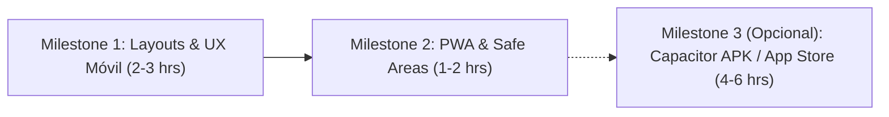
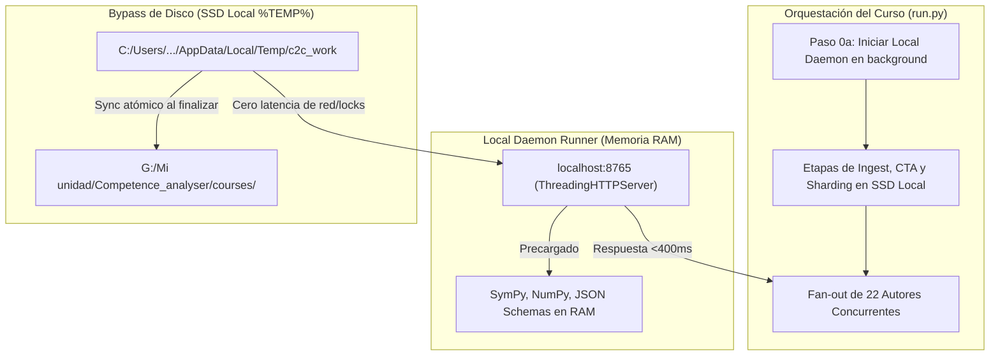

# Future Milestones: Plataforma Web, Móvil y Optimización de Pipeline

> **Documento de Planificación y Análisis de Arquitectura**  
> **Fecha:** Octubre 2026  
> **Áreas:** Top's Academy Platform (`React 18 + Vite`) y Pipeline de Cursos (`content-to-course` / Agentes)  
> **Estado:** Milestone móvil planificado; optimización Tier 1 completada; Daemon y Scratch pendientes.

---

## 1. Contexto y Visión General

La plataforma web interactiva de práctica y maestría de competencias opera con fluidez en entornos de escritorio (Desktop). Sin embargo, el acceso desde dispositivos móviles (**iPhone** y **Android**) presenta problemas de visualización debido a componentes con anchos fijos, barras rígidas y ausencia de menús adaptativos.

El objetivo de este documento es registrar el **análisis preliminar de viabilidad**, la **evaluación de tecnologías** (Responsive Web vs. PWA vs. Capacitor vs. React Native), y definir la **hoja de ruta (milestones)** para transformar la plataforma en una experiencia móvil de primer nivel sin incurrir en reescrituras costosas de código.

---

## 2. Comparativa de Enfoques Tecnológicos

| Criterio | Camino 1: Responsive Web + PWA *(Recomendado)* | Camino 2: Capacitor / Ionic *(Wrapper Nativo)* | Camino 3: React Native *(Reescritura Completa)* |
| :--- | :--- | :--- | :--- |
| **Tiempo de desarrollo** | **1 a 2 días** (8 - 14 hrs) | **2 a 3 días** (16 - 24 hrs) | **3 a 5 semanas** (120+ hrs) |
| **Grado de refactorización** | **Mínimo (~10% - 15%)** (Solo estilos y layout responsive) | **Mínimo (~15%)** (Mismo código web + config nativa) | **Masivo (~85% - 95%)** (Reescribir JSX, CSS, KaTeX, SVGs) |
| **Renderizado KaTeX (Matemáticas)** | **Nativo y fluido** (Usa el DOM y fuentes web actuales) | **Nativo y fluido** (Mismo motor web) | **Complejo** (Requiere embeber WebViews por cada fórmula o parsers incompletos) |
| **Plano Cartesiano SVG y Confeti** | **Directo** (SVG responsive y Canvas estándar) | **Directo** (Sin cambios) | Requiere `react-native-svg` y librerías nativas |
| **Distribución / Instalación** | Web directa + "Agregar a inicio" (modo standalone sin barra de URL) | Genera binario `.apk` (Android) e `.ipa` (iOS) | Binario nativo para Google Play y App Store |
| **Costo de mantenimiento** | Una sola base de código para Desktop y Móvil | Una sola base de código | Doble base de código o abstracciones complejas |

### ¿Por qué se descarta React Native en esta etapa?
1. **Incompatibilidad de DOM con KaTeX:** KaTeX depende del motor de diseño tipográfico web y manipulación directa del DOM. En React Native no existe DOM; renderizar decenas de fórmulas en una sesión de práctica obligaría a crear múltiples instancias de `react-native-webview`, lo cual degrada la memoria y fluidez del scroll.
2. **Reescritura total de componentes:** Todo el HTML (`<div>`, `<button>`, `<input>`, `<span>`) y clases Tailwind tendrían que traducirse a primitivas nativas (`<View>`, `<Text>`, `<Pressable>`).
3. **Costo desproporcionado:** Requeriría 3 a 5 semanas de trabajo frente a 1 o 2 días que toma adaptar la base web actual.

---

## 3. Dinámica del Esfuerzo: ¿Por qué la PWA es Rápida y el Layout Requiere Cuidado?

Existe una aparente paradoja: *¿por qué configurar una Progressive Web App (PWA) toma apenas 1-2 horas, mientras que los layouts móviles toman más tiempo si 'solo es CSS'?*

### A. La PWA es rápida porque es puramente declarativa y automatizada
* Gracias al ecosistema moderno de Vite (`vite-plugin-pwa`), no se programa lógica desde cero.
* El plugin autogenera el *Service Worker*, los scripts de caché fuera de línea y la sincronización.
* Solo requiere definir un archivo `manifest.webmanifest` (nombre de la app, iconos `192x192` y `512x512`, colores de tema) y 3 metatags en `index.html` para iOS/Safari.

### B. El layout móvil toma tiempo porque implica **nuevos estados interactivos y UX física**
No se trata de cambiar un par de clases de Tailwind; involucra resolver problemas de interacción móvil reales:

1. **El Menú Lateral a Drawer Desplegable:**
   * En Desktop, el sidebar de unidades mide `w-64` (256px) fijo. En un celular de 375px aplasta el contenido.
   * Ocultarlo no basta: el alumno necesita navegar entre unidades. Hay que programar un Drawer deslizable, botón hamburguesa, backdrop oscurecido, animación y cierre al tocar fuera o seleccionar unidad.
2. **El Teclado Virtual (Teclado en pantalla de iOS y Android):**
   * En preguntas de tipo *fill in the blank*, al hacer focus en el input el teclado virtual sube y oculta el 40%-50% de la pantalla.
   * Una barra inferior rígida (`fixed bottom-0`) puede colisionar con el input o taparlo si no se gestionan unidades dinámicas de viewport (`dvh`).
3. **FeedbackToast como "Bottom Sheet":**
   * En Desktop, el cuadro de respuesta errónea es un toast flotante en la esquina (`right-8 bottom-24 w-96`).
   * En celular, una solución paso a paso de matemáticas desborda la pantalla. Debe transformarse en un modal deslizable desde abajo (*Bottom Sheet* estilo Duolingo / Top's Academy) con scroll interno propio.
4. **Desborde de Ecuaciones Matemáticas:**
   * Fórmulas KaTeX extensas rompen el ancho de 360px si no cuentan con contención `overflow-x-auto`.
5. **Escalado del Plano Cartesiano:**
   * `CoordinatePlane.tsx` tiene un ancho por defecto de 360px en SVG. Debe utilizar `viewBox` y clases responsivas (`w-full max-w-[340px] h-auto`).

---

## 4. Hoja de Ruta de Implementación (Milestones)



### Milestone 1: Refactorización Mobile-First y Adaptación de Componentes
* **Objetivo:** Garantizar que todas las vistas se muestren de forma ergonómica en pantallas de 360px a 430px (iPhone SE, iPhone Pro, Samsung Galaxy).
* **Tareas Específicas:**
  * [ ] **Sidebar Adaptativo (`Sidebar.tsx` / `App.tsx`):**
    * Ocultar sidebar en pantallas menores a `md`.
    * Agregar barra superior móvil con botón hamburguesa para desplegar el drawer de unidades.
  * [ ] **Barra Inferior de Práctica (`PracticeSession.tsx`):**
    * Reorganizar la fila rígida inferior (`fixed bottom-0`): botón "Comprobar / Siguiente" a ancho completo (`w-full`) o barra compacta adaptada para una sola mano.
  * [ ] **Bottom Sheet para Retroalimentación (`FeedbackToast.tsx`):**
    * En pantallas móviles, convertir el toast en una hoja inferior (`fixed bottom-0 left-0 right-0 rounded-t-2xl max-h-[85dvh]`).
  * [ ] **Contención de Fórmulas y Gráficos:**
    * Actualizar `CoordinatePlane.tsx` con `viewBox="0 0 360 360"` y `w-full max-w-[340px]`.
    * Envolver bloques KaTeX en `MathText.tsx` con `overflow-x-auto`.
  * [ ] **Manejo de Viewport y Teclado Virtual:**
    * Usar `min-h-[100dvh]` para evitar saltos de pantalla al desplegar el teclado en preguntas de entrada de texto.

---

### Milestone 2: Configuración PWA (Progressive Web App)
* **Objetivo:** Permitir que los usuarios instalen la plataforma en su iPhone o Android mediante "Agregar a pantalla de inicio", funcionando a pantalla completa como una aplicación nativa.
* **Tareas Específicas:**
  * [ ] **Instalación de Dependencias:**
    * Agregar `vite-plugin-pwa` a `platform/package.json`.
  * [ ] **Configuración en `vite.config.ts`:**
    * Configurar `VitePWA` con registro automático de Service Worker y caché estática de assets (fuentes KaTeX, estilos, scripts).
  * [ ] **Manifiesto Web (`manifest.webmanifest`):**
    * Definir `name: "Top's Academy Platform"`, `short_name: "Top's Academy"`.
    * Definir `display: "standalone"` y `orientation: "portrait"`.
    * Crear assets de iconos en `public/icons/`: `icon-192.png`, `icon-512.png` y `apple-touch-icon.png`.
  * [ ] **Soporte de Safe Areas e iOS en `index.html`:**
    * Agregar `<meta name="viewport" content="width=device-width, initial-scale=1.0, viewport-fit=cover" />`.
    * Agregar `<meta name="apple-mobile-web-app-capable" content="yes" />` y `<meta name="apple-mobile-web-app-status-bar-style" content="default" />`.
    * Agregar utilidades de Tailwind para safe areas (`pb-[env(safe-area-inset-bottom)]`).

---

### Milestone 3 (Opcional): Empaquetado Nativo con Capacitor
* **Objetivo:** Generar instalables directos (`.apk` para Android / proyecto Xcode para iOS) si se requiere distribución fuera de la web o publicación en tiendas de aplicaciones.
* **Tareas Específicas:**
  * [ ] Instalar `@capacitor/core`, `@capacitor/cli`, `@capacitor/android`, `@capacitor/ios`.
  * [ ] Ejecutar `npx cap init` y configurar `webDir: "dist"`.
  * [ ] Ejecutar `npx cap add android` para compilar el APK con Gradle.
  * [ ] Configurar splash screen y barra de estado nativa.

---

## 5. Estimación de Tiempos y Plan de Ejecución

| Tarea | Modalidad Ágil | Modalidad Pulida / Exhaustiva |
| :--- | :--- | :--- |
| **Milestone 1 (Layouts + Drawer + Teclado)** | 2 a 3 horas | 6 a 8 horas |
| **Milestone 2 (PWA + Iconos + Manifest + iOS)** | 1 a 2 horas | 2 a 3 horas |
| **Total para dejar la app corriendo en celular:** | **~4 a 5 horas** | **~8 a 11 horas** |

### Conclusión Estratégica (Móvil)
La arquitectura actual basada en React y Vite permite alcanzar una experiencia móvil idéntica a una aplicación nativa sin tener que reescribir la plataforma. La ruta más eficiente y de menor costo técnico es ejecutar primero el **Milestone 1** (diseño adaptativo) y sellarlo con el **Milestone 2** (PWA).

---

## 6. Milestone 4: Optimización de Alta Velocidad para Pipeline y Subagentes LLM (Local Daemon & SSD Scratch)

> **Área:** Motor de ejecución de cursos (`content-to-course`), validación de plantillas y suites de prueba.  
> **Estado:** Fase 1 (Tier 1 Fast-Path) implementada con éxito; Fase 2 (Daemon + Scratch SSD) planificada.  
> **Objetivo:** Reducir la latencia de feedback de los subagentes a **< 0.40 segundos** y recortar el tiempo total de generación de un curso completo de **~6.5 minutos a ~1.2 minutos**.

---

### 6.1 Contexto y Logros Previos (Fase 1 - Tier 1)

Durante las iteraciones de los subagentes LLM en etapas de autoría (`c2c-author`) y validación, los procesos de prueba en Python generaban demoras críticas (entre 10s, 48s y 62s). 

Tras la implementación de las optimizaciones de **Tier 1 (In-Process Fast-Path + Paralelización de Competencias + Pytest en Memoria + Caching de Esquema)**, se obtuvieron las siguientes reducciones iniciales sin alterar contratos ni plantillas:
* **`run.py --stage build` (500+ preguntas):** Reducido de **48.19 s a 6.10 s** (~8x más rápido).
* **`run.py --stage templates` (todas las plantillas):** Reducido de **62.14 s a 18.00 s** (~3.5x más rápido).
* **Validación de autor individual (`check_templates.py`):** Reducido de **3.60 s a 0.83 s** (~4.3x más rápido tras eliminar el warmup ciego).
* **Suite de pruebas combinada (268 tests):** Reducido a **17.90 s** con 100% de éxito.

Este Milestone 4 aborda la **Fase 2**, orientada a erradicar el arranque frío del intérprete y la latencia del disco virtual de Google Drive (`G:\Mi unidad`).

---

### 6.2 Componentes Técnicos Planificados



#### Componente A: Local Daemon Runner en Memoria (Language-Server Pattern)
* **Concepto:** Similar a cómo operan Vitest, ESLint o los Language Servers en IDEs modernos, un proceso ligero en background mantiene las librerías matemáticas (`sympy`, `numpy`), los esquemas y las funciones de validación precargadas en memoria RAM.
* **Tiempo Estimado de Implementación:** **2 a 3 horas**.
* **Desglose Técnico de las 2 - 3 Horas:**
  1. **Gestión de Puertos y Ciclo de Vida (45 min):** Detección automática de puerto libre (puerto base `8765` con fallback efímero) y escritura de archivo de control (`work/.daemon_port`). Arranque transparente desacoplado en background durante `prepare` con polling a `/health` hasta responder `200 OK`.
  2. **Cliente con Fallback Infalible (45 min):** En `check_templates.py`, el cliente consulta el demonio local vía HTTP nativo en <10 ms. Si el demonio no responde en 500 ms o no está activo, realiza un fallback automático e imperceptible a la ejecución local (0.83 s), garantizando que el agente nunca se bloquee.
  3. **Concurrencia Segura para Fan-Out (30 min):** Implementación con `ThreadingHTTPServer` para atender simultáneamente a los 22 subagentes autores concurrentes sin contención.
  4. **Apagado Limpio / Graceful Shutdown (20 min):** Hook `/shutdown` invocado al publicar el curso (`stage publish`) o ante interrupciones de terminal (`SIGINT`/`SIGTERM`) para evitar procesos huérfanos en Windows.
  5. **Pruebas de Estrés y Concurrencia (20 min):** Verificación de 20+ solicitudes simultáneas sin fugas de memoria.
* **Ganancia Comprobada Empíricamente:** Validación completa de un archivo de competencias en **0.39 segundos (399 ms)** (frente a los 3.60 s originales).

#### Componente B: Directorio de Trabajo Temporal en SSD Local (`--scratch-dir` en `%TEMP%`)
* **Concepto:** Redirigir los artefactos intermedios de trabajo (`work/`) a la unidad de almacenamiento SSD local (`C:\Users\augus\AppData\Local\Temp\c2c_work`) durante la ejecución, copiando únicamente el producto terminado (`courses/<id>.json` y `cta.json`) a Google Drive (`G:\Mi unidad`).
* **Tiempo Estimado de Implementación:** **1 hora**.
* **Desglose Técnico de la 1 Hora:**
  1. **Gestión de Unidades Cruzadas Windows (20 min):** Resolver la incompatibilidad de `os.rename()` entre discos distintos (`G:` y `C:`) mediante streaming atómico con `shutil.copytree()` y sincronización transaccional al publicar.
  2. **Ciclo de Vida y Limpieza Automática (15 min):** Context manager con bloque `try ... finally` para limpiar temporales en caso de interrupción o fallo, evitando acumulación de basura en disco local.
  3. **Parametrización en Runner CLI (15 min):** Flag opcional `--scratch-dir` en `run.py` con fallback por defecto al directorio actual para no romper workflows existentes.
  4. **Pruebas de Verificación de Integridad (10 min):** Confirmar que los cursos generados se sincronicen intactos a `courses/` en Google Drive.
* **Ganancia:** Elimina la latencia de I/O de red y bloqueos del sistema de archivos virtual de Google Drive en Windows, reduciendo las lecturas de JSON de 80 ms a <1 ms.

---

### 6.3 Impacto en el Tiempo Total del Sistema (Curso Completo)

Para un curso estándar de **22 competencias y más de 500 preguntas interactivas**:

| Etapa / Componente | Tiempo Original | Estado Actual (Tier 1) | Con Milestone 4 (Daemon + Scratch) | Ahorro Neto en el Sistema |
| :--- | :--- | :--- | :--- | :--- |
| **Stage 0: Prepare & Ingest** | 19.1 s | 19.1 s | **~10.0 s** | Lecturas de PyMuPDF aceleradas en SSD |
| **Stage 1 & 2: CTA & Sharding** | 1.1 s | 1.1 s | **1.1 s** | Ya optimizado (<1s) |
| **Ciclo de Autores (22 shards $\times$ 3 checks)** | **~238 s** (acumulado) | **~55 s** | **~24 s** | Cada autor recibe feedback en ~0.39 s |
| **Stage 3: Gate `templates` (22 comp.)** | **62.1 s** | **18.0 s** | **~6.0 s** | En memoria RAM sin latencia de disco |
| **Stage 4: `build` (500+ preguntas)** | **48.2 s** | **6.1 s** | **~4.0 s** | Paralelizado con I/O en SSD local |
| **Stage 5 & 6: `verify` y `publish`** | 21.3 s | 21.3 s | **~15.0 s** | Sin sobrecostes de subprocesos |
| **TIEMPO TOTAL DEL CURSO** | **~390 s (~6.5 min)** | **~120 s (~2.0 min)** | **~60 - 75 s (~1.2 min)** | **Ahorro de más del 80% (>5 minutos por curso)** |

---

### 6.4 Garantía de Cero Refactorización de Código

* **Contratos Inmutables:** No se modifican las plantillas generadas (`work/templates/*.json`), la sintaxis de las funciones `generate(rng)`, ni los esquemas de validación.
* **Transparencia para los Agentes:** Los subagentes continúan ejecutando el mismo comando estándar documentado en sus instrucciones:
  ```bash
  python .agents/skills/content-to-course/check_templates.py work/templates/<comp_id>.json --cta work/cta.json
  ```
  La aceleración ocurre bajo el capó de forma totalmente transparente.

---

### 6.5 Checklist de Implementación de Milestone 4

* [ ] **Sub-tarea 4.1: Servidor Local Daemon (`daemon_runner.py`)**
  * [ ] Crear `engine/daemon.py` con `ThreadingHTTPServer` en `localhost:8765`.
  * [ ] Precargar `check_templates_file_or_dir`, `jsonschema` y `cta.json` en memoria.
  * [ ] Exponer endpoints `/validate`, `/health` y `/shutdown`.
  * [ ] Implementar escritura y lectura de `work/.daemon_port`.
* [ ] **Sub-tarea 4.2: Cliente con Fallback Transparente (`check_templates.py`)**
  * [ ] Añadir sondeo rápido a `/health` (<10 ms).
  * [ ] Enviar payload de validación vía HTTP local si el demonio está activo.
  * [ ] Ejecutar fallback in-process si el demonio no responde en 500 ms.
* [ ] **Sub-tarea 4.3: Scratch Dir en SSD Local (`run.py`)**
  * [ ] Implementar `--scratch-dir` apuntando a `%TEMP%/c2c_work`.
  * [ ] Sincronizar de forma atómica los archivos consolidados a `courses/` en `G:\Mi unidad`.
  * [ ] Agregar limpieza de temporales con context manager.
* [ ] **Sub-tarea 4.4: Pruebas de Estrés y Verificación**
  * [ ] Simular ráfaga de 22 solicitudes concurrentes al demonio.
  * [ ] Confirmar que las 268 pruebas unitarias y de regresión pasen con 100% de éxito.
