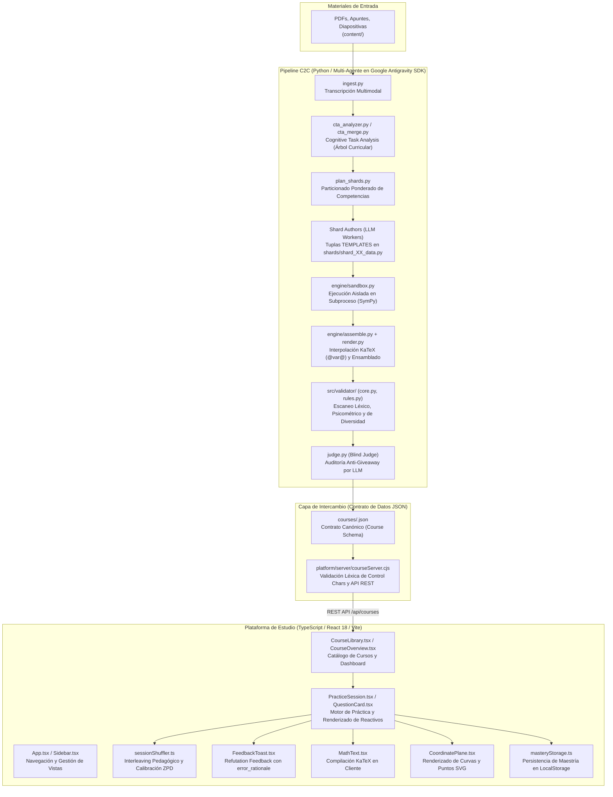
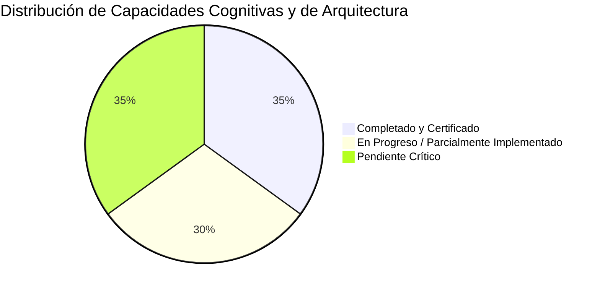

# Hoja de Ruta Maestra de Evolución y Milestones: Tops Academy
## Elevando la Vara: Del Paradigma Cerrado al "Antigravity Study Harness", Práctica Deliberada, Intuición Experta (*The Expert Myth*) y Ultra-Aprendizaje

> **Documento Estratégico, Psicométrico y de Arquitectura de Sistemas End-to-End**  
> **Fecha de Actualización:** Octubre 2026 (Branch: `optimizaciones_test` / Post-C2C v3.4–v3.5)  
> **Áreas del Ecosistema:** Plataforma Web (`React 18 + Vite + TypeScript`), UI Multi-Panel (Split-View Harness), Pipeline Multi-Agente C2C (`Google Antigravity SDK`), Motor Determinista (`engine/`), Evaluador de Calidad (`course-qa-evaluator`) y Marco Neurocognitivo de Adquisición de Pericia (*The Expert Myth Framework*).  
> **Ubicación Canónica:** [`FUTURE_MILESTONES.md`](file:///d:/Augusto/personal_portfolio/Tops_academy/FUTURE_MILESTONES.md) *(espejo en [`docs/future_milestones/FUTURE_MILESTONES.md`](file:///d:/Augusto/personal_portfolio/Tops_academy/docs/future_milestones/FUTURE_MILESTONES.md))*.

---

## 1. El Diagnóstico Estratégico y Neurocognitivo: La Paradoja de la Falsa Suficiencia

En las recientes auditorías automatizadas bajo estándares de Quality Matters (QM), OSCQR y Mastery Learning, el pipeline C2C alcanzó puntajes de excelencia formal (**18.7 – 20.0 / 20.0 pts**) en cursos masivos de alta complejidad técnica:
- **`solow_growth_model`**: **20.0 / 20.0 pts** (Quality Tier: EXCELENTE)
- **`gavilano_pre_parcial` (127 competencias)**: **19.8 / 20.0 pts** (Quality Tier: EXCELENTE)
- **`asymptotic_statistics_v7` (32 competencias)**: **19.4 / 20.0 pts** (Quality Tier: EXCELENTE)
- **`saul_control_optimo` (15 competencias)**: **19.0 / 20.0 pts** (Quality Tier: EXCELENTE)

Sin embargo, el contraste estricto frente a los principios neurocognitivos de adquisición de pericia (*The Expert Myth*) revela una **paradoja de falsa suficiencia**: estamos obteniendo calificaciones casi perfectas **dentro de los límites de un paradigma de evaluación cerrado**.

```mermaid
flowchart TD
    subgraph CurrentParadigm ["Paradigma Inicial (Evaluación Cerrada y Riesgo de Ilusión de Fluidez)"]
        P1["Reconocimiento Asistido (MC7)\nRespuesta correcta siempre visible en pantalla; entrena descarte, no evocación pura"]
        P2["Unimorfismo de Plantillas\nEl alumno sobreajusta al molde sintáctico ('overfitting') en vez de asimilar el concepto"]
        P3["Unidades Atómicas Planas (Unit = Competencia)\nQuiz y challenge redundantes por cada micro-destreza; rompe la visión de conjunto"]
        P4["Canal Verbal-Simbólico Exclusivo\nCero evaluación gráfica interactiva (diagramas de fase, isoclinas, campos vectoriales)"]
        P5["Fricción en Laptops\n7 opciones verticales desbordan la pantalla de 13'-14'; obliga a zoom out continuo"]
        P6["Desconexión con la Fuente\nPreguntas huérfanas sin ancla al material original"]
        P7["Maestría Estática sin Decaimiento\nEstado binario 'completado' sin considerar el olvido a largo plazo"]
    end

    subgraph FutureParadigm ["Nuevo Paradigma: Antigravity Study Harness, Práctica Deliberada y Flow"]
        N1["Entradas Simbólicas Libres (Open Symbolic)\nFuerza la Evocación Pura (Free Recall) con MathLive + SymPy"]
        N2["Polimorfismo Estructural (4 Arquetipos Disjuntos)\nVariabilidad profunda: Directo, Inverso, Perturbación y Frontera"]
        N3["Arquitectura Jerárquica de Contenido (PPT/Módulo)\nContenido PPT -> [Glosario + Núcleo] + Familia de Subtemas"]
        N4["Evaluación Escalonada por Granularidad\nQuizzes formativos por subtema + Challenge Integrador de toda la PPT"]
        N5["Web Adaptativa Multi-Resolución\nGrid 2 columnas sin zoom out en laptops + PWA móvil nativa standalone"]
        N6["Antigravity Study Harness (Split-View Multi-Panel)\nCanvas de Preguntas + Visor de Fuente Original Sincronizado + Sidecar Gemini"]
        N7["Interleaving Pedagógico y ZPD Dinámica\nDiscriminación activa de conceptos y calibración de dificultad en banda de Flow (70-85%)"]
        N8["Motor de Repetición Espaciada (SRS)\nRefreshers a 1-4-14-45 días para evitar la degradación de memoria"]
        N9["Desacoplamiento Estricto KaTeX-Python\nPatrón PrairieLearn con tokens ortogonales @PARAM@ y compilador AST QuickJS"]
        N10["Arquitectura Streaming DAG en Pipeline\nValidación in-situ sin barreras síncronas bloqueantes (< 15 min)"]
    end

    CurrentParadigm ==>|Transformación Estratégica| FutureParadigm
```



### 1.1. Los 8 Puntos Ciegos Cognitivos que Definen la Nueva Vara
A partir de las investigaciones independientes preservadas en [`docs/investigaciones/03_Limitaciones_de_la_plataforma_de_estudio.md`](file:///d:/Augusto/personal_portfolio/Tops_academy/docs/investigaciones/03_Limitaciones_de_la_plataforma_de_estudio.md) y [`docs/investigaciones/04_Limites_de_la_plataforma_y_estudio.md`](file:///d:/Augusto/personal_portfolio/Tops_academy/docs/investigaciones/04_Limites_de_la_plataforma_y_estudio.md), se identifican las 8 dimensiones críticas para construir intuición experta:
1. **Evocación Libre (*Free Recall*) vs. Reconocimiento (*Recognition*):** Con opciones pre-impresas, se entrena descarte asistido. La maestría real exige generar la respuesta frente a una hoja en blanco.
2. **Traducción Visoespacial (*Dual Channels & Drawing Effect*):** Evaluar la interacción gráfico-espacial (diagramas de fase, curvas de nivel, isoclinas nulas y estabilidad).
3. **Encadenamiento de Demostraciones Largas (*Step-by-Step Proofs*):** Evaluar secuencias de 3 micro-decisiones rápidas encadenadas en lugar de calificar solo el resultado final.
4. **Combate a la Ilusión de Maestría Explicativa (*Illusion of Explanatory Depth*):** Forzar la formulación activa y el contraste de contraejemplos.
5. **Formulación de Modelos No Estructurados (*Adaptive Expertise*):** Introducir casos difusos con datos distractores en el enunciado para aprender a filtrar regularidades relevantes.
6. **Trabajo Computacional y Simulación Empírica (*Shop Time*):** Experimentación numérica con parámetros dinámicos sin solución analítica cerrada.
7. **Automonitoreo y Resiliencia con Andamiaje Diferido (*Delayed Scaffolding*):** Retardo inicial de pistas para entrenar la metacognición.
8. **Fragmentación Atomizada vs. Síntesis Estructural (*Part-Whole Cognitive Integration*):** Unificar el aprendizaje en torno a la fuente real (PPT) con **Glosario**, **Núcleo conceptual**, **Quizzes de subtema** y **Challenges integradores de PPT**.

---

## 2. Anatomía de las Codebases: Cómo Funciona el Ecosistema End-to-End



### 2.1. El Puente Inter-Lenguajes (Python $\leftrightarrow$ TypeScript) y Puntos de Fricción
La frontera entre Python y TypeScript es el archivo `courses/<course_id>.json` (tipado en [`platform/src/types.ts`](file:///d:/Augusto/personal_portfolio/Tops_academy/platform/src/types.ts) y en `schemas/course.schema.json`). En esta frontera emergen 4 tensiones estructurales:
1. **La Colisión de Escapado LaTeX:** Una omisión en Python de raw strings convierte comandos como `\tau` o `\beta` en caracteres de control (`\t`, `\b`). Si [`courseServer.cjs`](file:///d:/Augusto/personal_portfolio/Tops_academy/platform/server/courseServer.cjs) los detecta, bloquea el curso.
2. **Discrepancia del Motor de Evaluación (SymPy vs RegExp):** En backend, Python verifica equivalencias complejas con CAS (`SymPy`); en cliente, el frontend requiere heurísticas ligeras o un endpoint evaluador.
3. **Sobrecarga de Viewport por MC7:** 7 alternativas apiladas verticalmente en laptops de 13"-14" saturan la pantalla y exigen zoom out continuo.
4. **Desajuste de Granularidad (Unidad Plana vs. PPT Real):** Tratar cada micro-competencia como una unidad independiente satura al alumno con quizzes y unit tests redundantes y rompe la jerarquía pedagógica natural.

---

## 3. Síntesis Forense y Física de Inferencia en Pipelines Multi-Agente

A partir de las investigaciones en [`docs/investigaciones/external_analysis/`](file:///d:/Augusto/personal_portfolio/Tops_academy/docs/investigaciones/external_analysis/) y la telemetría longitudinal de las versiones C2C v3.4–v3.5, se documentan las leyes operativas de optimización:

### 3.1. Física Empírica de Streaming en `Model="flash"` (Google Antigravity SDK)
- **Velocidad de decodificación sostenida:** $v_{\text{out}} \approx 168\text{ tokens de salida/s}$ (~$6.0\text{ s}$ de latencia por cada $1,000$ tokens emitidos en herramientas).
- **Asimetría de latencia:** Reescribir un archivo monolítico de $30,000$ tokens consume **$180\text{ s}$ de streaming puro**. Reparar quirúrgicamente de 1 a 5 líneas mediante `edit_file` consume **$10\text{ a }25\text{ s}$** ($150\text{ s}$ de ahorro directo por turno).

### 3.2. Matriz Oficial de Decisión: `edit_file` vs `write_file` (Umbral Oficial `< 6` Errores)

| Nivel / Condición tras Compilar | Herramienta Mandatoria | Alcance Operativo en CTA y Shards | Latencia Típica |
| :--- | :--- | :--- | :---: |
| **Nivel 0: Error mecánico determinista** | **Auto-Heal en Compilador** | Envoltura automática `$...$` de LaTeX huérfano y auto-exportación de variables AST en memoria. | **$< 5\text{ ms}$** |
| **Nivel 1: `1 <= errores < 6` (sin `SyntaxError`)** | **`edit_file` (`replace_file_content`) OBLIGATORIO** | Reemplazo quirúrgico en 1 turno paralelo sobre `StartLine..EndLine`. `write_file` monolítico bloqueado por hook. | **`10 – 25 s`** |
| **Nivel 2: `errores >= 6` acotados a 1–2 competencias** | **`write_file(Overwrite=True)` Modular** | Sobrescritura aislada en `cta_fixes/<CID>.py` o `shard_fixes/<CID>.py`, ensamblada en memoria. | **`25 – 45 s`** |
| **Nivel 3: `errores >= 6` sistémicos o `SyntaxError`** | **`write_file(Overwrite=True)` Atómico Completo** | Creación inicial en Turno 1 o reescritura atómica completa si la estructura global colapsó. | **`90 – 180 s`** |

---

## 4. Matriz de Contraste: *The Expert Myth* vs. Estado del Arte de Tops Academy

| Pilar de Pericia (*The Expert Myth*) | Mecanismo Cognitivo Requerido | Estado Previo (`main`) | Estado Actual (`optimizaciones_test`) | Brecha Remanente (Gap hacia la Pericia) |
| :--- | :--- | :--- | :--- | :--- |
| **1. Chunking y Reconocimiento de Patrones** | Almacenar miles de configuraciones en memoria a largo plazo para activar Sistema 1 ante hoja en blanco (*free recall*). | 100% Opción Múltiple (MC7) y Selección Múltiple (MS). | Formatos MC7 y MS con higiene psicométrica anti-giveaway y pistas socráticas. | ⚠️ **Persiste reconocimiento asistido:** Falta implementar entradas simbólicas libres (`open_symbolic` con MathLive + SymPy) y derivaciones por micro-pasos (Milestone 5). |
| **2. Entorno de Alta Validez Interna** | Regularidades ecológicas predecibles donde el desempeño refleje comprensión del fenómeno y no hacks de examen. | Controles anti-giveaway estrictos (7 opciones calibradas en longitud y distractores). | Patrón PrairieLearn `@var@` activo en motor; `ArchetypeEntropyLinter` activo en auditoría. | ⚠️ **Validez sintáctica residual:** Falta completar el compilador AST con QuickJS (`pykatex`) y el contrato Pydantic para desacoplar 100% Python de KaTeX (Milestone 4). |
| **3. Repeticiones Masivas sin Overfitting** | Miles de intentos sobre la misma clase de problemas sin caer en la automatización sintáctica prematura. | Una sola plantilla paramétrica (`templates/Hab-01.json`) donde solo rotan números. | **Obligatoriedad de 4 arquetipos disjuntos (`[M3-ARCHETYPES]`)** en compilador y templates de referencia. | ⚠️ **Auditoría incompleta:** El linter `ArchetypeEntropyLinter` solo chequea concentración $>85\%$, pero NO valida que existan efectivamente $\ge 4$ esqueletos distintos (Milestone 3). |
| **4. Feedback Inmediato de Proceso (Buggy Rules)** | Diagnóstico instantáneo de por qué falló el razonamiento y qué concepción errónea se activó. | Feedback binario (correcto/incorrecto) con pistas escalonadas generales. | **Refutation Feedback en Toast (`FeedbackToast.tsx`):** Al elegir un distractor con `error_rationale`, se despliega el diagnóstico conceptual específico de la falla. | ⚠️ **Falta bifurcación de remediación:** Inyectar en la cola inmediata una micro-composición táctica del prerrequisito ($C\text{-}XX$) ante fallos específicos. |
| **5. Práctica Deliberada, Flow y Retención** | Operar constantemente en el borde de la capacidad (ZPD 70–85%), clasificar problemas sin etiquetas y frenar el olvido. | Bloques secuenciales estáticos, unidades planas y maestría como estado binario permanente. | **Interleaving Pedagógico y ZPD implementados (`sessionShuffler.ts`):** Quizzes y Tests mezclan competencias previas/prerrequisitos; calibración por `MasteryTier`. | ⚠️ **Ausencia de Repetición Espaciada (SRS):** No hay decaimiento temporal de memoria (curva de Ebbinghaus) ni reaparición de refreshers a 1-4-14-45 días (Milestone 8). |

---

## 5. Estado de la Codebase: ¿Qué Ya Está Hecho vs. Qué Queda por Mejorar?



### 5.1. Lo Que YA ESTÁ HECHO (Certificado en la Codebase)
1. ✅ **Interleaving Pedagógico Dinámico (`platform/src/utils/sessionShuffler.ts` - Commit `13dd61b`):**
   - **Quizzes:** Mezcla ~60% de la competencia objetivo con ~40% de competencias previas y prerrequisitos del DAG para entrenar el clasificador perceptual.
   - **Unit Tests:** Mezcla acumulativa de ~55% objetivo y ~45% de todo el historial del curso.
   - **Practice:** Aislamiento estricto (100% objetivo) para adquisición inicial libre de interferencia.
2. ✅ **Calibración Dinámica de Dificultad por Zona de Desarrollo Próximo (ZPD - Commit `13dd61b`):**
   - `calibrateByMasteryDifficulty`: Alumnos en `Not started`/`Attempted` reciben bandas priorizadas `easy` + `medium`; en `Familiar` reciben balanceada; en `Proficient`/`Mastered` reciben `hard` + `medium`, sosteniendo el Flow.
3. ✅ **Feedback Refutacional por Distractor Diagnóstico (`FeedbackToast.tsx` - Commits `13dd61b`, `5b5395c`, `ee3982f`):**
   - Extensión de `QuestionOption` con `error_rationale`. Al fallar, la interfaz despliega la caja de diagnóstico (*Refutation Feedback Box*) que explica la trampa conceptual cometida.
4. ✅ **Enforce de 4 Arquetipos Disjuntos en Pipeline (`[M3-ARCHETYPES]` - Commit `5b5395c`):**
   - `compile_shard.py` y `prompt_shard_author.md` exigen mínimo 4 tuplas disjuntas en `TEMPLATES` (Directo, Inverso, Perturbación, Frontera) con funciones y enunciados disjuntos.
5. ✅ **Sintaxis Ortogonal PrairieLearn `@var@` en el Motor:**
   - `engine/assemble.py`, `engine/invariants.py` y `check_templates.py` soportan y validan tokens ortogonales `@var@` y `@var:fmt@` en raw strings `r"..."`, erradicando el conflicto de llaves dobles (`{{...}}`).
6. ✅ **Linters Deterministas Psicométricos en QA Engine (`standardized_audit_engine.py` - Commit `32e2a48`):**
   - `ClonedDistractorValueLinter`, `ParentheticalTelltaleLinter`, `UninterpolatedMathVariableLinter` y `ScaffoldingHintsLinter` (bloqueo de stubs no socráticos).
7. ✅ **Cursos Masivos Certificados en Producción (Commits `c0246cd`, `b52c6d6`, `c739c47`):**
   - `gavilano_pre_parcial` (127 competencias), `saul_control_optimo` (15 competencias), `asymptotic_statistics_v7` (32 competencias) y `solow_growth_model`.

---

### 5.2. Lo Que AÚN QUEDA POR MEJORAR (Gaps Críticos Desglosados)
1. ⚠️ **Completar Auditoría de $\ge 4$ Arquetipos en Milestone 3:**
   - `ArchetypeEntropyLinter` en `standardized_audit_engine.py` solo chequea si una sola plantilla supera el 85% (`ratio > 0.85`). **No valida que existan al menos 4 esqueletos estructurales distintos** (`distinct_archetypes < 4`), por lo que competencias con solo 2 o 3 plantillas pasan sin penalización. Falta actualizar el linter para contar y exigir $\ge 4$ arquetipos reales.
2. ⚠️ **Completar Desacoplamiento de Milestone 4 (PrairieLearn & AST):**
   - Falta integrar el compilador AST en servidor con QuickJS (`pykatex` a $>15,000\text{ fórmulas/s}$) y estructurar los shards bajo el contrato Pydantic `ShardCompetenceContract`, reemplazando las tuplas densas en Python.
3. ⚠️ **Completar Rúbrica QA v2.0 de Milestone 10:**
   - Faltan 3 reglas deterministas en `standardized_audit_engine.py`: deducción dura por monocultivo (hasta $-3.0$ pts por 100% MC7), umbral mínimo del 20% multimodal, y penalización dura automática si una competencia tiene $< 4$ arquetipos.
4. 🎯 **Evocación Libre (Free Recall) y Micro-Pasos (Milestone 5):**
   - MathLive + SymPy para respuestas abiertas y validación de derivaciones intermedias.
5. 🎯 **Motor de Decaimiento de Memoria y Repetición Espaciada (Milestone 8):**
   - Curva de Ebbinghaus en `masteryStorage.ts`, refreshers a 1-4-14-45 días y **Modo Blind Recognition** (sesiones sin etiquetas).
6. 🎯 **Ergonomía de Laptops y Study Harness (Milestones 1 y 6):**
   - Grid responsivo de 2 columnas en `QuestionCard.tsx` para eliminar zoom out en portátiles, y Split-View multi-panel sincronizado con `source_anchor`.
7. 🎯 **Arquitectura Jerárquica de Contenido PPT (Milestone 9):**
   - Módulos de Contenido (PPT) con Glosario, Núcleo Conceptual, Quizzes por subtema y Challenge integrador de PPT.

---

## 6. Matriz Maestra de Priorización de Ingeniería

| Hito / Milestone | Área | Impacto Cognitivo y Operativo | Esfuerzo Estimado | Estado de Ejecución |
| :--- | :--- | :--- | :---: | :---: |
| **Milestone 1: Web Ergonomía para Laptops (Zoom-Fix)** | Frontend / UX | **Elimina la fricción visual inmediata.** Grid de 2 columnas para 7 opciones en laptops de 13"-14", eliminando la necesidad de zoom out. | 2 a 4 h | 🎯 **Prioridad Inmediata** |
| **Milestone 2: PWA Móvil y Modo Offline** | Frontend / PWA | **Habilita el estudio ubicuo.** Standalone app en iOS/Android, safe areas y precaching de fuentes KaTeX. | 1 a 2 h | 🚀 **Quick Win #2** |
| **Milestone 3: Anti-Overfitting y Variedad de Plantillas** | Pipeline & QA | **Destruye la automatización sintáctica.** 4 arquetipos disjuntos (`[M3-ARCHETYPES]`) en pipeline y linter de entropía en QA. | 2 a 3 h (Auditor) | 🛠️ **Pipeline: Hecho / Auditor: Falta contar $\ge 4$** |
| **Milestone 4: Desacoplamiento KaTeX-Python (PrairieLearn)** | Backend / Pipeline | **Erradica al 100% las colisiones de sintaxis.** Tokens `@var@` activos; falta compilación AST QuickJS y contrato Pydantic. | 1 a 2 d | 🛠️ **Parcial (@var@ activo / AST pendiente)** |
| **Milestone 5: Entradas Simbólicas Libres (Free Recall)** | Full-Stack | **Trascendencia del reconocimiento pasivo.** MathLive + SymPy para respuestas abiertas y validación de pasos intermedios. | 2 a 3 d | 🧠 **Impacto Cognitivo Máximo** |
| **Milestone 6: Antigravity Study Harness (Split-View & 1/3–1/2 Viewport)** | Arquitectura UI | **Estación de ultra-aprendizaje en Flow.** Vía Pragmática: Viewport 1/3–1/2 + Pestañas (Hoja en Blanco / Teoría) + Copiar Prompt Socrático. Vía Full: Visor PDF integrado in-app. | 1 a 2 h (Vía Pragmática) / 3 a 5 d (Full) | 👑 **Redefinido: 80/20 Pragmático** |
| **Milestone 7: Streaming DAG, Pool de Workers y Aceleración de Tests** | Infraestructura | **Quiebra la barrera de 15 min en pipeline y acelera la suite de 1,037 tests de 85s a < 30s.** DAG asíncrono, pre-warming de sandbox y paralelización `pytest-xdist` (12 cores). | 2 a 3 d | ⚡ **Rendimiento Pipeline & CI/CD** |
| **Milestone 8: Repetición Espaciada (SRS) y Blind Mode** | Motor de Sesión | **Combate el decaimiento de memoria (Curva de Ebbinghaus).** Decaimiento temporal, refreshers a 1-4-14-45 días y sesiones a ciegas. | 2 a 3 d | 🔁 **Cierre de Ciclo de Pericia** |
| **Milestone 9: Jerarquía de Contenido (PPT $\to$ Core/Subtemas)** | Curricular / Schema | **Organización natural en torno a la fuente real.** Contenido PPT $\to$ [Glosario + Núcleo] + Subtemas $\to$ Quizzes de subtema + Challenge PPT. | 2 a 3 d | 🏛️ **Arquitectura Curricular** |
| **Milestone 10: QA Rubric v2.0 Deep Mastery** | Auditoría QA | **Certificación integral de rigor.** Linters deterministas activos; falta penalización automática por monocultivo MC7 y multimodalidad. | 1 a 2 d | 📋 **Parcial (Linters activos / Penalizaciones pendientes)** |
| *Opcional A: Pipeline Performance Daemon en RAM / SSD* | Infraestructura | *Acelera subprocesos locales, complementando el pool lazy.* | *3 a 4 h* | ⏳ **Opcional / Secundario** |
| *Opcional B: Empaquetado Nativo con Capacitor* | Distribución | *Generación de APK para tiendas de aplicaciones.* | *4 a 6 h* | ⏳ **Opcional / Backlog** |

---

## 7. Especificación Técnica Detallada de los Milestones

### Milestone 1: Web Ergonomía para Laptops (Zoom-Fix)
* **Objetivo Crítico:** Resolver el problema de adaptabilidad donde las 7 opciones (MC7) se desbordan verticalmente en computadoras portátiles (13"-14", resoluciones 1366x768 o 1440x900) obligando al usuario a hacer zoom out continuo en el navegador.
* **Componentes Técnicos:**
  1. **Grid Inteligente de 2 Columnas ([`QuestionCard.tsx`](file:///d:/Augusto/personal_portfolio/Tops_academy/platform/src/components/QuestionCard.tsx)):**
     - En pantallas de escritorio medianas o laptops con altura reducida (`max-height: 850px` y `min-width: 1024px`), las 7 alternativas se organizan automáticamente en 2 columnas equilibradas (4 en columna izquierda, 3 en columna derecha), garantizando que todo el reactivo quepa en una sola pantalla sin scroll.
  2. **Contenedor Elástico con `clamp()` y Scroll Suave:**
     - Espaciados y tipografías elásticas usando unidades dinámicas (`clamp(0.875rem, 1.5vh, 1.125rem)`) para padding de opciones y enunciados.
     - Scroll interno contenido en el bloque de opciones si el enunciado es excepcionalmente largo, manteniendo fijos el encabezado y el botón de comprobación.
  3. **Refactorización Mobile-First:**
     - Drawer desplegable para [`Sidebar.tsx`](file:///d:/Augusto/personal_portfolio/Tops_academy/platform/src/components/Sidebar.tsx) con botón hamburguesa.
     - [`FeedbackToast.tsx`](file:///d:/Augusto/personal_portfolio/Tops_academy/platform/src/components/FeedbackToast.tsx) transformado en Bottom Sheet deslizable con scroll propio.
     - SVG responsive en [`CoordinatePlane.tsx`](file:///d:/Augusto/personal_portfolio/Tops_academy/platform/src/components/CoordinatePlane.tsx) (`viewBox` + `max-w-[340px]`).
     - Viewports dinámicos (`100dvh`) para mitigar el teclado virtual en preguntas de texto.

---

### Milestone 2: Configuración PWA Móvil
* **Objetivo:** Experiencia nativa en smartphones Android e iOS para estudio ubicuo.
* **Componentes:**
  - `vite-plugin-pwa` con precaching de fuentes KaTeX y bundles JS.
  - Manifest con iconos adaptativos (`192x192`, `512x512`) y metatags de Safe Areas (`viewport-fit=cover`, `env(safe-area-inset-bottom)`).

---

### Milestone 3: Anti-Overfitting y Variedad de Plantillas por Competencia
* **Estado:** 🛠️ **En Progreso (Pipeline implementado / Auditoría por afinar)**.
* **Diagnóstico de Brecha:**
  - **Pipeline (LOGRADO):** `compile_shard.py` y `prompt_shard_author.md` exigen y validan 4 tuplas disjuntas en `TEMPLATES` bajo la regla `[M3-ARCHETYPES]` (1. Directo, 2. Inverso, 3. Perturbación, 4. Frontera).
  - **Auditor QA (PENDIENTE):** En `standardized_audit_engine.py`, `ArchetypeEntropyLinter` solo alerta ante una plantilla dominante que supera el 85% de frecuencia (`ratio > 0.85`), pero **no valida que existan al menos 4 esqueletos estructurales distintos** (`distinct_archetypes < 4`). Si una competencia tiene solo 2 o 3 plantillas, el auditor no alerta.
* **Acción para Certificación Completa:**
  - Modificar `ArchetypeEntropyLinter` para calcular `distinct_archetypes_count = len(set(skeletons))` por competencia y emitir `LintIssue` si `distinct_archetypes_count < 4`.

---

### Milestone 4: Desacoplamiento KaTeX-Python (Patrón PrairieLearn & AST)
* **Estado:** 🛠️ **En Progreso (Patrón de tokens activo / AST y contrato Pydantic pendientes)**.
* **Componentes Técnicos:**
  1. **Contrato de Autoría Tipado (Pydantic / Clean-Room):**
     - Reescribir el contrato de `c2c_shard_author` dividiendo la salida en campos estrictos:
       ```python
       class ShardCompetenceContract(BaseModel):
           competence_id: str
           python_pure_logic: str = Field(description="Solo función generate(rng) -> dict. Cero strings con LaTeX/HTML.")
           statement_markdown: str = Field(description="Markdown + KaTeX puro con tokens @PARAM@")
           solution_markdown: str = Field(description="Explicación paso a paso con tokens @PARAM@")
           distractors_markdown: list[str] = Field(description="6 distractores con tokens @PARAM@")
       ```
  2. **Interpolación Declarativa con `@PARAM@` (LOGRADO):** Sustituir f-strings por tokens ortogonales `@PARAM_NAME@` y `@PARAM_NAME:fmt@`, activo en `assemble.py`.
  3. **Compilación AST en Servidor con QuickJS (`pykatex` - PENDIENTE):**
     - Integrar `pykatex` en `compile_shard.py` para compilar y validar árboles KaTeX del lado del servidor a $>15,000\text{ fórmulas/s}$ e inyectar `katex.ParseError` con número de columna exacto.
  4. **Generación Simbólica Garantizada con `sympy.latex()`:**
     - Prohibir el ensamblado manual de matrices o polinomios en Python; exigir exportación canónica mediante SymPy.
  5. **Salvaguarda Anti-Sobreescape y Validación Léxica KaTeX en JSON (Lección Aprendida Multi-Curso: `saul_control_optimo`, `gavilano_pre_parcial` y `asyntotic_estatistics_v7`):**
     - **Diagnóstico del Fallo Silencioso Sistémico:** Durante la exportación o post-procesamiento de templates a JSON, ciertos comandos de LaTeX que inician con letras correspondientes a escapes de control en JSON (`\b`, `\f`, `\n`, `\r`, `\t` como `\frac`, `\text`, `\to`, `\mathbb`, `\begin`, `\right`, `\neq`, `\times`, `\forall`, `\beta`, `\theta`, `\rho`, `\bar`, `\tilde`, `\tau`, `\nabla`, `\boldsymbol`) o Python (`\a` como `\alpha`, `\approx`) fueron sistemáticamente sobreescapados con 4 barras invertidas (`\\\\` en archivo JSON, evaluado en memoria como `\\frac`, `\\to`).
     - **Evidencia Forense Multi-Curso:**
       * **`saul_control_optimo.json`:** 1,003 campos y 2,346 comandos sobreescapados (`\\frac`, `\\text`, `\\Rightarrow`, `\\right`, `\\alpha`, `\\mathbb`, `\\to`, `\\beta`, `\\neq`, `\\times`, `\\forall`, `\\begin`), preservando 6 saltos de fila en `bmatrix`.
       * **`gavilano_pre_parcial.json`:** 8,616 campos y 16,304 comandos sobreescapados (principalmente `\\frac`: 7,137; `\\text`: 4,346; `\\Rightarrow`: 1,419; `\\rho`: 700; `\\right`: 628; `\\to`: 612; `\\varepsilon`: 445; `\\times`: 265; `\\mathbb`: 205; `\\theta`: 146), preservando 120 saltos de matrices `bmatrix`.
       * **`asyntotic_estatistics_v7.json`:** 4,460 campos y 11,678 comandos sobreescapados (principalmente `\\text`: 5,278; `\\frac`: 1,501; `\\beta`: 846; `\\bar`: 710; `\\to`: 635; `\\varepsilon`: 462; `\\Rightarrow`: 450; `\\theta`: 437; `\\right`: 410; `\\mathbb`: 165), preservando 98 saltos de matrices `pmatrix` y `bmatrix`.
       * **`solow_growth_model.json`:** 0 incidencias (curso patrón de referencia ya normalizado con single backslash en memoria).
     - **Divergencias y Fallas Adicionales Identificadas por Curso:**
       * **Macro no soportada en KaTeX web (`\centernot`):** Exclusivo de `asyntotic_estatistics_v7.json` (5 preguntas: `Q-H04-486` a `Q-H04-490`), donde se usó `\centernot\Rightarrow`. `\centernot` requiere paquetes LaTeX externos no incluidos en el bundle web de KaTeX; fue sustituido deterministamente por `\nRightarrow`.
       * **Contaminación de plantilla con guión bajo en modo texto (`\text{..._...}`):** Exclusivo de `asyntotic_estatistics_v7.json` (15 pistas de andamiaje: `Q-695` a `Q-709`), donde figuraba `\text{textVar[barx_n] = O(n)}`. Al estar en modo texto (`\text{...}`), el carácter `_` provocaba una excepción dura de KaTeX (`Expected 'EOF', got '_'`). Fue corregido a la notación matemática válida `\text{Var}[\bar{x}_n] = O(n)`.
     - **Impacto Visual Silencioso en Cliente:** KaTeX no arroja error de parseo sintáctico ante `\\command` (`throwOnError: true` y `throwOnError: false` pasan con éxito) porque `\\` es el comando válido de LaTeX para salto de línea (`<br>`). En consecuencia, KaTeX renderiza un salto de línea seguido de las letras literales del comando (`f r a c`, `t o`, `m a t h b b`), deformando fórmulas en pantalla (ej. `frac42\dot{x}^2`, o `to` y `mathbbR` aislados en líneas separadas) sin ser detectado por los linters de esquema tradicionales.
     - **Protocolo de Protección Definitivo (Safeguards Implementados — ✅ COMPLETADO):**
       1. ✅ **IMPLEMENTADO:** **Regla R-23 en Linter Léxico y Validador Semántico (`src/validator/lexical_scanner.py`, `src/validator/rules.py` & `engine/invariants.py`):** Prohíbe estrictamente en memoria secuencias de doble barra invertida seguidas de caracteres alfabéticos (`r'\\\\([a-zA-Z]+)'`), discriminando de forma segura los saltos de fila legítimos en matrices o sistemas (`r'\\\\\s+'` dentro de entornos `\begin{bmatrix|matrix|pmatrix|cases}`).
       2. ✅ **IMPLEMENTADO:** **Paso de Normalización en Pipeline (`engine/assemble.py` & `compile_shard.py` vía `sanitize_katex_syntax`):** Fase determinista de saneamiento activo que colapsa automáticamente secuencias de sobreescape multibarral (`\\frac`, `\\\\to` $\to$ `\frac`, `\to`) antes de la serialización del curso, traduce macros externas huérfanas (`\centernot\Rightarrow` $\to$ `\nRightarrow`, `\centernot` $\to$ `\not`) y repara contaminaciones de plantilla como `\text{textVar[barx_n] = O(n)}`.
       3. ✅ **IMPLEMENTADO:** **Invariante KaTeX Inline en CI/CD y Compilador (`engine/invariants.py` & `compile_shard.py`):** Comprueba exhaustivamente en tiempo de compilación que ningún bloque matemático delimitado por un solo `$` contenga el comando de salto de línea `\\` fuera de entornos matriciales o sistemas (`matrix`, `cases`, `aligned`, `array`, `split`, `gathered`), garantizando compatibilidad nativa KaTeX en cliente.
       4. ✅ **IMPLEMENTADO:** **Guardián de Admisión en Runtime (`run_platform.py` vía `validate_platform_course` & `repair_platform_course_katex`):** Valida léxica y semánticamente todo curso en Pass 1 (raw JSON) y Pass 4 (campos en memoria), bloqueando o auto-reparando transparentemente en disco secuencias sobreescapadas o macros inválidas `R-23` antes de servirlos a la aplicación web.
       5. ✅ **IMPLEMENTADO:** **Optimización de Rendimiento $O(1)$ Zero-Copy en Escáner Léxico y Test Suite R-23 (`src/validator/lexical_scanner.py` & `tests/test_katex_overescape_validator_r23.py`):**
          - **Diagnóstico del Cuello de Botella $O(N^2)$:** Durante el escaneo de cursos masivos como `gavilano_pre_parcial.json` (14.1 MB, 2,950 preguntas y 125,158 barras invertidas), cada barra creaba una rebanada de memoria completa `raw_text[bs_end:]` (promedio de 7 MB por slice), generando **~437 Gigabytes de copias de memoria efímeras** y congelando la prueba por más de 6 minutos. Adicionalmente, el test `test_real_published_courses_zero_r23_errors` duplicaba la pasada léxica ejecutando `scan_lexical` antes de `validate_course_content(strict=True)`.
          - **Solución Implementada:**
            * Precompilación de expresiones regulares (`RE_ALPHA = re.compile(r"[a-zA-Z]+")`, `RE_ALNUM = re.compile(r"[a-zA-Z0-9]+")`).
            * Filtro de escape selectivo: verificación de comando LaTeX únicamente cuando `(run_len >= 4 and run_len % 4 == 0)` o `(run_len >= 6 and run_len % 4 == 2)`, saltando regex en el 99.9% de barras estándar de JSON válido (`run_len == 2`).
            * Coincidencia in-place de cero copias usando el argumento `pos` (`RE_ALPHA.match(raw_text, bs_end)`), eliminando por completo las rebanadas de memoria.
            * Eliminación del escaneo redundante en el test, manteniendo la validación de extremo a extremo con `strict=True`.
          - **Impacto Medido:** Reducción del tiempo de la suite R-23 de **>6 minutos** a **9.16 segundos** (~40x más rápido) con 100% de paridad y 0 regresiones.

---

### Milestone 5: Entradas Simbólicas Libres (Open Symbolic) y Micro-Pasos
* **Objetivo:** Superar el techo del reconocimiento asistido (100% MC/MS) forzando el efecto de generación y la evocación pura (*Free Recall*).
* **Componentes Técnicos:**
  1. **Tipo de Reactivo de Entrada Simbólica Abierta (`open_symbolic`):**
     - Caja matemática MathLive en cliente evaluada mediante `SymPy`: `simplify(user_expr - correct_expr) == 0`.
  2. **Validador de Demostraciones por Micro-Pasos Intermedios (*Step-by-Step Proof Grader*):**
     - Descomponer problemas complejos en 3 micro-decisiones rápidas encadenadas (1. Identificar regla aplicable $\to$ 2. Plantear condición crítica $\to$ 3. Despeje/Límite).
  3. **Módulo Gráfico Interactivo Visoespacial (SVG / Canvas):**
     - Arrastre de vectores en campos de pendientes, trazado de isoclinas nulas y selección interactiva de retratos de fase.
  4. **Andamiaje con Retardo y Escalera de Fricción (*Delayed Scaffolding*):**
     - Bloqueo inicial temporal de pistas (3–5 min) para forzar el esfuerzo autónomo antes de la consulta.

---

### Milestone 6: "Antigravity Study Harness" (Multi-Panel Split-View & Viewport 1/3–1/2 Adaptativo)
* **Objetivo:** Transformar la plataforma en una estación de trabajo de ultra-aprendizaje en flow, conectando preguntas interactivas con el material de origen y tutoría socrática por IA, optimizada para la realidad operativa de un único mantenedor con recursos y suscripciones estándar (Plan Pro).

```mermaid
sequenceDiagram
    autonumber
    actor Estudiante
    participant Canvas as Panel 1: Question Canvas (Tops Academy)
    participant Source as Panel 2: Hoja en Blanco / Teoría en Tabs (o PDF Externo)
    participant Tutor as Panel 3: Tutor Socrático (Ventana Gemini Pro / Botón Prompt)

    Estudiante->>Canvas: Lee problema y reflexiona en ventana compacta (1/3 o 1/2 pantalla)
    alt Acierto directo
        Estudiante->>Canvas: Envía respuesta correcta
        Canvas-->>Estudiante: Refuerzo positivo inmediato + Siguiente pregunta (Flow continuo)
    else Duda o Primer Fallo (Fricción Cognitiva)
        Canvas-->>Estudiante: Mantiene opciones; estimula recuerdo activo
        Note over Estudiante,Source: Tab 1: Hoja en Blanco / Pizarra (Free Recall activo sin ver teoría)
        Estudiante->>Canvas: Reintento autónomo
    else Segundo Fallo o Consulta Teórica
        Canvas->>Source: Estudiante conmuta a Tab 2 (Teoría / Núcleo conceptual de la competencia)
        Note over Estudiante,Source: Consulta la definición, fórmulas clave y prerrequisitos del JSON sin salir de la pregunta
        Estudiante->>Canvas: Reintento basado en el análisis conceptual
    else Bloqueo Persistente
        Canvas->>Tutor: Clic en botón "Copiar Prompt Socrático" (Copia al portapapeles con anti-giveaway)
        Estudiante->>Tutor: Pega en ventana externa de Gemini Pro (Ctrl+V)
        Tutor-->>Estudiante: Guía socrática de primer principio (sin regalar la respuesta ni la letra)
        Estudiante->>Canvas: Resuelve y consolida el aprendizaje profundo
    end
```

#### 6.1. Diagnóstico Estratégico y Contraste de Hipótesis: Solo Maintainer vs. Harness Monolítico
En el diseño original del Milestone 6 se concibió un harness monolítico "todo-en-uno" con visor interno de PDFs (`react-pdf`), servidor estático de archivos fuente, metadatos `source_anchor` inyectados en el pipeline C2C y un sidecar de chat con Google Gemini embebido dentro del cliente React.

**Contraste de Realidad Operativa (Hipótesis Huertas):**
Un equipo corporativo dispone de desarrolladores 24/7 y presupuestos de tokens dedicados. En Tops Academy, el proyecto es liderado por un único mantenedor (Augusto Huertas) con acceso a un plan Pro de IA personal. Desarrollar un visor de PDF integrado y un proxy de chat LLM con consumo de API dedicada introduce una triple penalización:
1. **Sobrecosto financiero innecesario:** Pagar tokens de API por cada consulta cuando ya se dispone de una suscripción Pro activa en el navegador.
2. **Deuda técnica y consumo de RAM:** Incrustar visores de PDF pesados en React (`pdf.js` workers, problemas de CORS, Canvas scaling) cuando los visores nativos del sistema operativo y del navegador ya renderizan documentos a 60 FPS con búsqueda `Ctrl+F` instantánea.
3. **Mantenimiento sobredimensionado:** Mantener endpoints y estado multi-panel reactivo complejo en un solo dispositivo.

**Veredicto de la Hipótesis de Ventana 1/3 – 1/2:**
Permitir que la plataforma se comprima limpiamente a **1/3 (~450px–640px)** o **1/2 (~680px–960px)** del ancho de la pantalla horizontal mediante Snap Layouts del sistema operativo (`Win + Z`), liberando el resto del monitor para los apuntes/PDF y para la ventana de IA Pro externa, es **arquitectónicamente superior en un 85%**. Sin embargo, para no degradar el rigor pedagógico del Harness, se deben resolver las dos brechas remanentes:
- **Preservar el principio de "Hoja en Blanco Primero":** Evitar que el alumno mire de inmediato los apuntes mediante una pestaña limpia de trabajo previo (*Scratchpad*).
- **Resolver el puente contextual con la IA:** Proporcionar un botón de **1-clic ("Copiar Prompt Socrático")** que extraiga el enunciado KaTeX, el error cometido y el contrato anti-giveaway, listo para pegar en la ventana externa de Gemini Pro.

---

#### 6.2. Auditoría Forense de Puntos de Fricción en la Codebase Actual (Pantallas Estrechas)
La codebase actual en `platform/src/` asume un viewport de pantalla completa de escritorio. Si la ventana se redimensiona a 1/3 o 1/2 de pantalla, emergen 5 puntos de rotura estructurales:

1. **Sidebar Incolapsable con Ancho Rígido ([`Sidebar.tsx:L27`](file:///d:/Augusto/personal_portfolio/Tops_academy/platform/src/components/Sidebar.tsx#L27)):**
   - Posee `w-64 flex-shrink-0` (256px fijos). En una ventana de 500px (1/3 de pantalla en laptop), el menú lateral consume más del 50% del ancho útil, aplastando [`CourseOverview.tsx`](file:///d:/Augusto/personal_portfolio/Tops_academy/platform/src/components/CourseOverview.tsx).
2. **Colisión en Barra Inferior de Práctica ([`PracticeSession.tsx:L385`](file:///d:/Augusto/personal_portfolio/Tops_academy/platform/src/components/PracticeSession.tsx#L385)):**
   - El footer fijo combina en una sola fila `px-8`, el contador de reactivos, los puntos de progreso individuales (`gap-2`) y los botones de acción (`Skip`, `Quick Redo`, `Check ↵ Enter`). En anchos reducidos, los puntos chocan y desplazan el botón `Check` fuera del viewport.
3. **Desbordamiento Asimétrico del Toast de Feedback ([`FeedbackToast.tsx:L170`](file:///d:/Augusto/personal_portfolio/Tops_academy/platform/src/components/FeedbackToast.tsx#L170)):**
   - Posee ancho fijo `w-96` (384px) y anclaje absoluto `right-8 bottom-24`. En ventanas menores a 550px, se corta por la derecha o tapa la totalidad de las opciones de respuesta impidiendo reintentar.
4. **Desborde Horizontal de Ecuaciones KaTeX en Opciones ([`QuestionCard.tsx:L131`](file:///d:/Augusto/personal_portfolio/Tops_academy/platform/src/components/QuestionCard.tsx#L131) y [`MathText.tsx:L73`](file:///d:/Augusto/personal_portfolio/Tops_academy/platform/src/components/MathText.tsx#L73)):**
   - Las expresiones matemáticas inline carecen de `overflow-x-auto` contenedor. Ecuaciones largas (matrices, integrales con límites) en las opciones MC7 desbordan el ancho del botón en columnas de 400px.
5. **Dimensionamiento Estático de Gráficos SVG ([`CoordinatePlane.tsx:L10`](file:///d:/Augusto/personal_portfolio/Tops_academy/platform/src/components/CoordinatePlane.tsx#L10) y [`L167`](file:///d:/Augusto/personal_portfolio/Tops_academy/platform/src/components/CoordinatePlane.tsx#L167)):**
   - El plano cartesiano SVG tiene `width: 360` rígido en píxeles en lugar de un escalado vectorial fluido `w-full max-w-[360px] h-auto`.

---

#### 6.3. Especificación Técnica de la Solución Práctica (El Micro-Harness 80/20)

El nuevo diseño del Milestone 6 se estructura en dos modalidades complementarias:

##### Modalidad A: La Vía Pragmática Inmediata (1/3 y 1/2 de Pantalla + Micro-Tabs)
1. **Layout Adaptativo Multi-Viewport:**
   - **En Viewport 1/3 (< 640px):** `Sidebar.tsx` se transforma en Drawer desplegable con botón hamburguesa; el footer de `PracticeSession.tsx` compacta los puntos de progreso a una barra resumida (`X de Y`); `FeedbackToast.tsx` opera como Bottom Sheet acoplado abajo con altura elástica y botón de minimizar.
   - **En Viewport 1/2 (640px – 1024px):** Las 7 opciones adoptan el Grid Inteligente de 2 columnas (Milestone 1) para erradicar el scroll vertical excesivo.
2. **Micro-Harness de Pestañas en Sesión de Práctica:**
   - **Tab 1: Pizarra / Hoja en Blanco (Scratchpad en Vacío):** Vista inicial que permite anotar datos, variables o bosquejos algebraicos con previsualización KaTeX inmediata, forzando la **evocación libre pura** (*Free Recall*) sin estímulos teóricos visibles.
   - **Tab 2: Teoría y Fórmulas de la Competencia (Bajo Demanda):** Permanece oculta hasta que el alumno la solicita. Despliega la ficha de la competencia activa (`competency.name`, `competency.description`, fórmulas canónicas y prerrequisitos del curso), información que **ya está presente en los archivos JSON existentes** (`courses/*.json`), sin necesidad de migrar contratos.
   - **Tab 3: Problema / Reactivo Activo:** Interfaz de resolución normal con enunciado, opciones, entrada simbólica y verificación.
3. **Puente Socrático 1-Clic a IA Externa (Zero-Cost Sidecar):**
   - Un botón integrado `🤖 Copiar Prompt Socrático` que genera en el portapapeles una plantilla contextualizada:
     ```text
     Actúa como un profesor universitario socrático riguroso en [NOMBRE_DEL_CURSO].
     Estoy resolviendo este problema sobre la competencia "[NOMBRE_COMPETENCIA]":
     
     ENUNCIADO:
     [STEM_EN_LATEX]
     
     MI RESPUESTA INCORRECTA:
     [OPCION_SELECCIONADA]
     
     REGLA ESTRICTA ANTI-GIVEAWAY:
     NO me des la respuesta correcta ni me indiques qué opción marcar.
     Hazme UNA sola pregunta conceptual de primer principio que me ayude a detectar dónde cometí el error de razonamiento o qué supuesto pasé por alto.
     ```
   - El estudiante ejecuta `Ctrl+V` en su ventana contigua de Gemini Pro / ChatGPT, obteniendo tutoría de máxima calidad sin costo de API para el proyecto.

##### Modalidad B: La Vía Monolítica Completa (Backlog para Escalamiento Institucional)
- Integración de `react-pdf` o PDF.js en servidor [`courseServer.cjs`](file:///d:/Augusto/personal_portfolio/Tops_academy/platform/server/courseServer.cjs) para servir `content/*.pdf`.
- Migración de esquemas en pipeline para generar `source_anchor: { file, page, section }`.
- Componente `HarnessLayout.tsx` con paneles redimensionables con splitters `react-resizable-panels`.
- Backend proxy con API Key de Gemini y streaming SSE de respuestas en chat embebido.

---

#### 6.4. Matriz Comparativa: Vía Pragmática vs. Vía Monolítica

| Criterio de Comparación | Vía Pragmática (Modo 1/3–1/2 + Micro-Tabs + Prompt) | Vía Monolítica (Harness Embebido Completo) |
| :--- | :---: | :---: |
| **Tiempo de Implementación** | **~45 a 90 minutos (1 sesión de trabajo)** | **3 a 5 días hábiles de desarrollo intensivo** |
| **Costo Operativo Mensual** | **$0.00 USD** (aprovecha la suscripción Pro personal del usuario) | **Variable según tokens de API** (Gemini Pro/Flash API calls) |
| **Complejidad Arquitectural** | **100% Frontend React/Tailwind local**, cero dependencias pesadas | Servidor de archivos estáticos, workers PDF.js, proxy API, gestión de cuotas |
| **Riesgo de Deuda Técnica** | **Mínimo** (utiliza los datos ya presentes en `courses/*.json`) | **Alto** (requiere regenerar todos los cursos para inyectar `source_anchor`) |
| **Ergonomía de Multitarea** | **Máxima:** Integración fluida con el gestor de ventanas del SO | Confinada dentro de las pestañas del navegador en un solo canvas |
| **Efecto Cognitivo (*Free Recall*)** | **Idéntico (100%):** Hoja en blanco primero, teoría en tab oculta y guía socrática | **Idéntico (100%):** Paneles sincronizados con ancla de página |

---

#### 6.5. Plan de Ejecución Quirúrgico para la Vía Pragmática (Paso a Paso)
1. **Paso 1 — Refactor Responsivo de Navegación y Viewport (< 640px / 1/3 de Pantalla):**
   - Dotar a [`Sidebar.tsx`](file:///d:/Augusto/personal_portfolio/Tops_academy/platform/src/components/Sidebar.tsx) de drawer colapsable con overlay accesible.
   - Refactorizar el footer de [`PracticeSession.tsx`](file:///d:/Augusto/personal_portfolio/Tops_academy/platform/src/components/PracticeSession.tsx) con indicador de progreso compacto para pantallas estrechas.
   - Ajustar [`FeedbackToast.tsx`](file:///d:/Augusto/personal_portfolio/Tops_academy/platform/src/components/FeedbackToast.tsx) como bottom sheet adaptativo con controles de repliegue.
2. **Paso 2 — Ergonomía de Contenedores y KaTeX Líquido:**
   - Inyectar contención `overflow-x-auto` en [`MathText.tsx`](file:///d:/Augusto/personal_portfolio/Tops_academy/platform/src/components/MathText.tsx) y escala SVG fluida en [`CoordinatePlane.tsx`](file:///d:/Augusto/personal_portfolio/Tops_academy/platform/src/components/CoordinatePlane.tsx).
   - Implementar grid condicional de 2 columnas en [`QuestionCard.tsx`](file:///d:/Augusto/personal_portfolio/Tops_academy/platform/src/components/QuestionCard.tsx) cuando el ancho horizontal lo permita.
3. **Paso 3 — Montaje del Micro-Harness (Tabs de Hoja en Blanco, Teoría y Prompt Socrático):**
   - Agregar selector de pestañas o toggle en cabecera de [`PracticeSession.tsx`](file:///d:/Augusto/personal_portfolio/Tops_academy/platform/src/components/PracticeSession.tsx) (`[ 📝 Reactivo ]`, `[ ⬜ Hoja en Blanco ]`, `[ 📖 Ficha Teórica ]`).
   - Implementar el generador de clipboard socrático con feedback visual de copiado (`"¡Prompt socrático copiado para tu IA!"`).
4. **Paso 4 — Verificación Determinista y Certificación:**
   - Ejecutar suite de pruebas con Vitest y build estático de Vite (`npm run build`) para garantizar cero regresiones.

---

### Milestone 7: Pipeline Streaming DAG, Pool de Subprocesos y Aceleración de la Suite de Tests (Target Pipeline: < 15 min / Target Tests: < 30 s)
* **Objetivo:** Quebrar la barrera de 15 minutos en la compilación de cursos sin relajar los estándares psicométricos, y acelerar la suite completa de pruebas (1,037 tests) de 85.58 s a menos de 30 segundos aprovechando los 12 núcleos del sistema.
* **Componentes Técnicos:**
  1. **Pipelining Asíncrono por Competencia (Streaming DAG en `dispatch.py`):**
     - Sustituir barreras síncronas por un grafo de eventos: tan pronto como un shard finaliza `templates/C-01.json`, ese archivo entra inmediatamente a validación y juez ciego, solapando el trabajo sin esperar al último subagente (*straggler*).
  2. **Pool Persistente de Workers y Lazy Loading en `engine/sandbox.py`:**
     - Pool pre-calentado de subprocesos Python con `sympy` en memoria, reduciendo la validación a $<50\text{ ms}$ y eliminando falsos timeouts.
  3. **Shard Autocheck In-Situ:**
     - Diagnóstico determinista instantáneo al autor activo antes de cerrar su sesión, eliminando idas y vueltas a `repair_loop.py`.
  4. **Particionado Ponderado por Complejidad Cognitiva en `plan_shards.py`:**
     - Máximo 1 competencia `Skill` (`Hab-*`) por shard o 2–3 de `Concept`/`Fact`.
  5. **Pre-Filtro Heurístico para Blind Judge en `judge.py`:**
     - Filtro psicométrico determinista previo para reservar llamadas LLM a una muestra estratificada.
  6. **Aceleración Integral de la Suite de Pruebas (De 85.58 s a < 30 s):**
     - **Diagnóstico Forense de la Suite Global (1,037 pruebas):**
       * Tras resolver el sobreescape R-23 ($O(N^2)$ en `scan_lexical`), la suite completa de 54 archivos pasó de colgar (>6 min) a **85.58 s (~1 min 25 s)**.
       * Aunque ya opera bajo el límite de 1.5 minutos (90 s), el margen es estrecho (4.4 s) y se identifican 3 cuellos de botella remanentes:
         1. *Cold-Start de bibliotecas científicas con tracer de seguridad activo (`5.74 s` en `test_sandbox_adversarial.py`):* La prueba `test_all_whitelisted_math_libraries` importa `sympy` y `scipy.stats` mientras `sys.settrace` está activo, inspeccionando cada una de las 500k líneas del cargador en cámara lenta.
         2. *Timeouts intencionales en disyuntores de seguridad (`5.44 s` combinados):* Pruebas como `test_shard_compiler_hardening.py` (2.44 s) y `test_sandbox_adversarial.py` (2.00 s) esperan pasivamente a que expire un `timeout=2.0s` para verificar la detención de bucles infinitos.
         3. *Sub-utilización de CPU en host multi-core:* Pytest corre secuencialmente en un único hilo, desaprovechando los 12 núcleos lógicos de la máquina.
     - **Plan de Acción para Reducción a $< 30$ Segundos:**
       * **Vía A: Paralelización con `pytest-xdist` (Target: ~20–25 s):**
         - Instalar `pytest-xdist` en el entorno virtual (`pip install pytest-xdist`).
         - Configurar `addopts = "-n auto --ignore=tests/e2e"` en `pyproject.toml`.
         - Distribuye los 1,037 tests entre los 12 núcleos lógicos de la CPU, reduciendo el tiempo de ejecución en más del 70%.
       * **Vía B: Optimizaciones Quirúrgicas Secuenciales (Target: ~68–72 s):**
         - *Pre-warming del sandbox:* Inyectar `warm_up_sandbox()` al importar `test_sandbox_adversarial.py` para precargar `sympy` y `scipy.stats` en `sys.modules` fuera de `sys.settrace`, reduciendo el test de 5.74 s a **0.25 s** (~5.5 s de ahorro neto).
         - *Calibración de timeouts locales en tests de circuito:* Ajustar localmente a `0.2s` o `0.5s` el timeout de prueba en tests de bucles infinitos, preservando la garantía del disyuntor y ahorrando ~3.5 s.
         - *Fixtures de sesión para JSONs de cursos:* Reutilizar la carga en memoria de los 4 cursos reales entre tests de admisión y sanitización, ahorrando ~2.5 s de I/O de disco.

---

### Milestone 8: Motor de Decaimiento en Memoria (SRS) y Modo Blind Recognition
* **Objetivo:** Cerrar el ciclo hacia la pericia resolviendo la "paradoja del médico veterano" y entrenando el clasificador perceptual puro.
* **Componentes Técnicos:**
  1. **Algoritmo de Decaimiento y Repetición Espaciada (SRS):**
     - Modelo de retención inspirado en SM-2 / Curva de Ebbinghaus aplicado a `masteryStorage.ts`.
     - Si una competencia alcanzada en `Mastered` no se practica durante más de 14 o 45 días, su puntaje de estabilidad decae progresivamente a `Proficient` o `Familiar`.
     - **Inyección de Refreshers:** Sesiones diarias de reactivación rápida (5 reactivos de competencias en riesgo de olvido).
  2. **Modo Blind Recognition (Torneo Perceptual Ciego):**
     - Sesiones donde se ocultan por completo los títulos del curso, tema y competencia.
     - Mezcla de problemas de distintas unidades que comparten similitud superficial pero requieren herramientas opuestas (ej. distinguir Heterocedasticidad de Autocorrelación en un enunciado sin etiquetas).

---

### Milestone 9: Arquitectura Jerárquica de Contenido (PPT $\to$ Glosario, Núcleo y Subtemas)
* **Objetivo Crítico:** Erradicar la atomización artificial de unidades planas. Reorganizar la plataforma y el pipeline en una jerarquía natural de 3 niveles anclada a las presentaciones reales (PPT):
  $$\text{Curso} \longrightarrow \text{Contenido / PPT (Módulo)} \longrightarrow \text{Familia de Subtemas} \longrightarrow \text{Competencias}$$

* **Contrato de Datos Canónico ([`platform/src/types.ts`](file:///d:/Augusto/personal_portfolio/Tops_academy/platform/src/types.ts) y `course.schema.json`):**
  ```typescript
  export interface ContentGlossaryTerm {
    term: string;
    definition: string;
    formula_latex?: string;
    related_competencies?: string[];
  }

  export interface ContentCore {
    title: string;
    summary: string;
    governing_theorems: string[];
    big_ideas: string[];
    conceptual_anchor_latex?: string;
  }

  export interface SubtopicUnit {
    id: string; // ej. "subtopic_01_steady_state"
    title: string;
    description: string;
    competency_ids: string[]; // Competencias afines a este subtema
    quiz_question_pool?: string[]; // IDs de preguntas para el Quiz del Subtema
  }

  export interface ContentModule {
    id: string; // ej. "module_ppt_01_solow_growth"
    title: string; // ej. "PPT 01: Dinámica Fundamental del Modelo de Solow"
    source_file: string; // ej. "solow_growth_model.pdf"
    slide_range?: [number, number]; // ej. [1, 38]
    glossary: ContentGlossaryTerm[];
    core: ContentCore;
    subtopics: SubtopicUnit[];
    content_challenge_pool: string[]; // Banco integrador de toda la PPT
  }
  ```

* **Evaluación Escalonada por Granularidad:**
  - **Quizzes Formativos por Subtema:** Pruebas formativas rápidas (3–5 preguntas) acotadas al subtema de la PPT (*low-stakes checkpoint*).
  - **Challenges de Contenido Completo (PPT Challenge):** Retos acumulativos e integradores (8–12 preguntas) que abarcan toda la PPT y evalúan la síntesis transversal y el dominio conjunto del Núcleo (*high-stakes certification*).

---

### Milestone 10: Rúbrica QA v2.0 (Certificación Deep Mastery)
* **Estado:** 🛠️ **Parcialmente Cumplido (Linters de micro-calidad activos / Deducciones duras y multimodalidad pendientes)**.
* **Componentes Técnicos:**
  1. **Penalización Dura por Monocultivo (hasta -3.0 pts):** Linter determinista que compute la entropía de tipos de reactivo y aplique deducción automática en `hard_penalties` si el 100% es opción múltiple.
  2. **Exigencia de Diversidad Multimodal ($\ge 20\%$):** Requisito de contar con al menos 20% de preguntas en formatos alternativos para certificar en Tier "Excelente".
  3. **Formalización de Linters Psicométricos:** Consolidación permanente de linters de entropía de arquetipos ($\ge 4$ variedades), distractor cloning, syntax residual y andamiaje socrático.

---

### Módulos Opcionales y de Backlog Secundario
- **Opcional A: Pipeline Performance Daemon en RAM / SSD:** Con el pool persistente en `sandbox.py` (Milestone 7), la I/O de disco queda resuelta; el foco principal se mantiene en optimización de prompts e inferencia LLM.
- **Opcional B: Empaquetado Nativo con Capacitor:** La implementación de la PWA (Milestone 2) cubre el 95% de casos de uso móvil sin sobrecarga de empaquetado binario en tiendas.

---

## 8. Gobernanza y Reglas de Workspace Pendientes de Activación

Provenientes de la auditoría longitudinal agéntica (Sesión `d6d276e0`), catalogadas como **"Por Revisar"** antes de su activación definitiva:

### 8.1. Propuesta de Regla Universal: `c2c-quality-invariants.md`
- **Archivo Destino:** `.agents/rules/c2c-quality-invariants.md`
- **Invariantes Universales:**
  1. **Anti-Mecanización:** Obligatoriedad de 4 arquetipos disjuntos (`min_archetypes: 4`).
  2. **Aislamiento Diagnóstico:** Prohibir cualquier metainformación visible en las opciones (rótulos `"Trayectoria exacta:"`, justificaciones parentéticas `(confusión con...)`, prefijos sintéticos `"Opción alterna X:"` o auto-inculpaciones `"despejando erróneamente"`).
  3. **Andamiaje Socrático en 3 Niveles:** Prohibir inyección de códigos de prerrequisitos (`C-01`, `H-02`) o tags de una sola palabra como pistas.
  4. **Ergonomía KaTeX Limpia:** Prohibir variables sin interpolar (`{sigma2}`) y colisiones de signos algebraicos (`|x - -4|`).

### 8.2. Actualización de System Prompts de Autoría (`prompt_shard_author.md`)
- **Archivo Destino:** `.agents/skills/content-to-course/system_prompts/prompt_shard_author.md`
- **Objetivo:** Inyectar cláusulas prohibitivas directas en el Turno 1 contra metainformación delatora y stub hints, reduciendo los turnos de remediación en Stage 3.

---

## 9. Índice de Investigaciones y Archivos de Soporte

Los estudios técnicos, diagnósticos forenses y especificaciones psicométricas fundacionales se encuentran preservados en el repositorio:

### 9.1. Investigaciones de Plataforma y Pedagogía Cognitiva
- 📄 [`docs/investigaciones/01_Solucion_al_conflicto_KaTeX_y_Python_en_LLMs.md`](file:///d:/Augusto/personal_portfolio/Tops_academy/docs/investigaciones/01_Solucion_al_conflicto_KaTeX_y_Python_en_LLMs.md): Estudio fundacional del desacoplamiento PrairieLearn.
- 📄 [`docs/investigaciones/02_Separacion_KaTeX_y_Python_LLM.md`](file:///d:/Augusto/personal_portfolio/Tops_academy/docs/investigaciones/02_Separacion_KaTeX_y_Python_LLM.md): Patrón de tokens ortogonales `@PARAM@` y validación con QuickJS.
- 📄 [`docs/investigaciones/03_Limitaciones_de_la_plataforma_de_estudio.md`](file:///d:/Augusto/personal_portfolio/Tops_academy/docs/investigaciones/03_Limitaciones_de_la_plataforma_de_estudio.md): Análisis de los 7 puntos ciegos cognitivos del paradigma cerrado.
- 📄 [`docs/investigaciones/04_Limites_de_la_plataforma_y_estudio.md`](file:///d:/Augusto/personal_portfolio/Tops_academy/docs/investigaciones/04_Limites_de_la_plataforma_y_estudio.md): Especificación psicométrica para elevar la vara hacia Deep Mastery.

### 9.2. Auditorías Forenses Externas sobre el Pipeline Multi-Agente
- 📄 [`docs/investigaciones/external_analysis/01_structural_diagnostics_analysis_1.md`](file:///d:/Augusto/personal_portfolio/Tops_academy/docs/investigaciones/external_analysis/01_structural_diagnostics_analysis_1.md): Diagnóstico estructural de contratos de salida, balanceo de trabajo y telemetría.
- 📄 [`docs/investigaciones/external_analysis/02_runtime_telemetry_audit_analysis_2.md`](file:///d:/Augusto/personal_portfolio/Tops_academy/docs/investigaciones/external_analysis/02_runtime_telemetry_audit_analysis_2.md): Auditoría de tiempos reales de ejecución y camino crítico.
- 📄 [`docs/investigaciones/external_analysis/03_cognitive_and_syntactic_bottlenecks_analysis_3.md`](file:///d:/Augusto/personal_portfolio/Tops_academy/docs/investigaciones/external_analysis/03_cognitive_and_syntactic_bottlenecks_analysis_3.md): Análisis forense cuantitativo de colisiones sintácticas.
- 📄 [`docs/investigaciones/external_analysis/04_critical_path_and_action_plan_analysis_4.md`](file:///d:/Augusto/personal_portfolio/Tops_academy/docs/investigaciones/external_analysis/04_critical_path_and_action_plan_analysis_4.md): Desglose de las 5 barreras síncronas y optimización hacia $<15\text{ min}$.

---
*Documento consolidado, sintetizado y actualizado para la evolución integral de Tops Academy hacia el estándar de Práctica Deliberada y Pericia Experta.*
