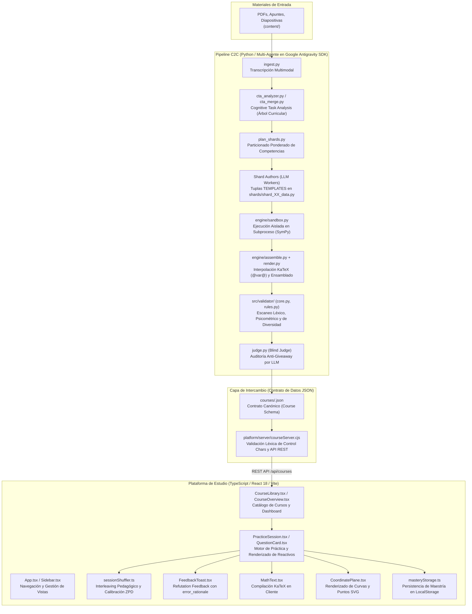
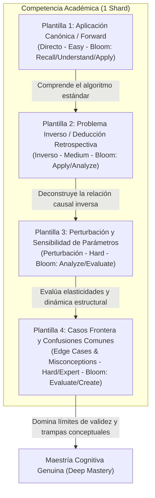
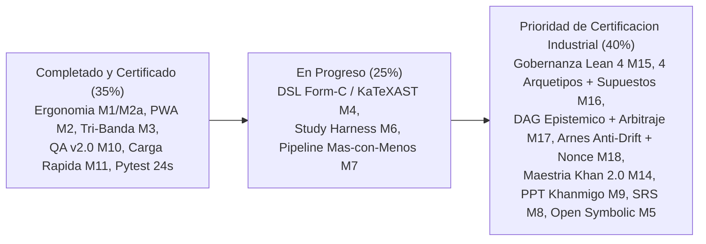
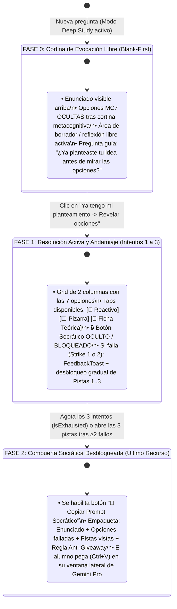
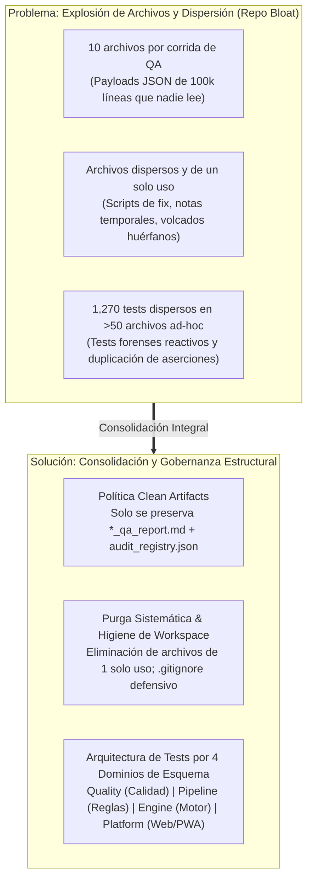
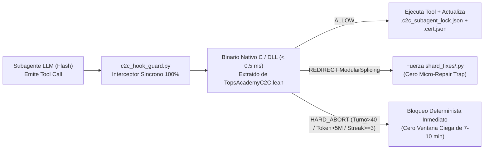

# Hoja de Ruta Maestra de Evolución y Milestones: Tops Academy
## Elevando la Vara: Certificación Formal Multi-Agente Neuro-Simbólica (Lean 4), Pipeline "Más con Menos", Supuestos Explícitos, Maestría Estilo Khan Academy y "Antigravity Study Harness"

> **Documento Estratégico, Psicométrico, de Verificación Formal y Arquitectura de Sistemas End-to-End**  
> **Fecha de Actualización:** 2026-11-07 (Branch: `main` / Evolución hacia C2C v4.0 Neuro-Simbólico Certificado con Lean 4, Arquitectura `Form-C` "Más con Menos" `-65%` Tokens / `< 12 min`, Estándar de 4 Arquetipos + Supuestos Explícitos, Milestones 15–18 y Motor Integral Khan Academy / Khanmigo)  
> **Áreas del Ecosistema:** Pipeline Multi-Agente C2C (`.agents/skills/content-to-course/` + Kernel Formal `Lean 4`), Motor Determinista y Simbólico (`engine/` + `SymPy`/`Z3`/`Lean 4`), Evaluador de Calidad (`course-qa-evaluator`), Plataforma Web (`React 18 + Vite + TypeScript + PWA`), UI Multi-Panel (*Split-View Study Harness*) y Marco Neurocognitivo de Adquisición de Pericia (*The Expert Myth* + *Khan Academy Mastery*).  
> **Ubicación Canónica:** [`FUTURE_MILESTONES.md`](file:///d:/Augusto/personal_portfolio/Tops_academy/FUTURE_MILESTONES.md) *(espejo byte a byte en [`docs/future_milestones/FUTURE_MILESTONES.md`](file:///d:/Augusto/personal_portfolio/Tops_academy/docs/future_milestones/FUTURE_MILESTONES.md))*.
> **Milestones Cerrados:** [`MILESTONES_COMPLETED.md`](file:///d:/Augusto/personal_portfolio/Tops_academy/MILESTONES_COMPLETED.md) *(espejo en `docs/future_milestones/MILESTONES_COMPLETED.md`)*. Este archivo conserva lo **pendiente o en curso**, la auditoría forense del código actual y la hoja de ruta certificada.

---

## 1. El Diagnóstico Estratégico y Neurocognitivo: La Paradoja de la Falsa Suficiencia

En las recientes auditorías automatizadas bajo estándares de Quality Matters (QM), OSCQR y Mastery Learning, el pipeline C2C alcanzó puntajes de excelencia formal (**18.7 – 20.0 / 20.0 pts**) en cursos masivos de alta complejidad técnica:
- **`solow_growth_model`**: **20.0 / 20.0 pts** (Quality Tier: EXCELENTE)
- **`gavilano_pre_parcial` (127 competencias)**: **19.8 / 20.0 pts** (Quality Tier: EXCELENTE)
- **`asymptotic_statistics_v7` (32 competencias)**: **19.4 / 20.0 pts** (Quality Tier: EXCELENTE)
- **`saul_control_optimo` (15 competencias)**: **19.0 / 20.0 pts** (Quality Tier: EXCELENTE)

Sin embargo, el contraste estricto frente a los principios neurocognitivos de adquisición de pericia (*The Expert Myth*) revela una **paradoja de falsa suficiencia**: estamos obteniendo calificaciones casi perfectas **dentro de los límites de un paradigma de evaluación cerrado**.

```mermaid
flowchart TD
    subgraph CurrentParadigm ["Paradigma Inicial (Evaluación Cerrada y Riesgo de Ilusión de Fluidez)"]
        P1["Reconocimiento Asistido (MC7)\nRespuesta correcta siempre visible en pantalla; entrena descarte, no evocación pura"]
        P2["Unimorfismo de Plantillas\nEl alumno sobreajusta al molde sintáctico ('overfitting') en vez de asimilar el concepto"]
        P3["Unidades Atómicas Planas (Unit = Competencia)\nQuiz y challenge redundantes por cada micro-destreza; rompe la visión de conjunto"]
        P4["Canal Verbal-Simbólico Exclusivo\nCero evaluación gráfica interactiva (diagramas de fase, isoclinas, campos vectoriales)"]
        P5["Fricción en Laptops\n7 opciones verticales desbordan la pantalla de 13'-14'; obliga a zoom out continuo"]
        P6["Desconexión con la Fuente\nPreguntas huérfanas sin ancla al material original"]
        P7["Maestría Estática sin Decaimiento\nEstado binario 'completado' sin considerar el olvido a largo plazo"]
    end

    subgraph FutureParadigm ["Nuevo Paradigma: Antigravity Study Harness, Práctica Deliberada y Flow"]
        N1["Entradas Simbólicas Libres (Open Symbolic)\nFuerza la Evocación Pura (Free Recall) con MathLive + SymPy"]
        N2["Polimorfismo Estructural (4 Arquetipos Disjuntos)\nVariabilidad profunda: Directo, Inverso, Perturbación y Frontera"]
        N3["Arquitectura Jerárquica de Contenido (PPT/Módulo)\nContenido PPT -> [Glosario + Núcleo] + Familia de Subtemas"]
        N4["Evaluación Escalonada por Granularidad\nQuizzes formativos por subtema + Challenge Integrador de toda la PPT"]
        N5["Web Adaptativa Multi-Resolución\nGrid 2 columnas sin zoom out en laptops + PWA móvil nativa standalone"]
        N6["Antigravity Study Harness (Split-View Multi-Panel)\nCanvas de Preguntas + Visor de Fuente Original Sincronizado + Sidecar Gemini"]
        N7["Interleaving Pedagógico y ZPD Dinámica\nDiscriminación activa de conceptos y calibración de dificultad en banda de Flow (70-85%)"]
        N8["Motor de Repetición Espaciada (SRS) y Re-calibración\nRefreshers a 1-4-14-45 días y degradación dinámica por fallo en Course Challenge"]
        N9["Desacoplamiento Estricto KaTeX-Python\nPatrón PrairieLearn con tokens ortogonales @PARAM@, pykatex y KaTeXAST"]
        N10["Pipeline 'Más con Menos' (< 12 min y -50% Tokens)\nRecibos SHA-256 sin re-cómputo, Competence Slicing < 2 KB y Streaming DAG"]
        N11["Certificación Formal Neuro-Simbólica (Lean 4 + FFI)\nGuardrails síncronos < 0.5 ms en hook, FSM certificada y 0 Late-Catches"]
        N12["Supuestos Explícitos y Doble Contrato ver_*\n4 arquetipos obligatorios (Ruptura de Supuestos) y refutación de distractores"]
    end

    CurrentParadigm ==>|Transformación Estratégica| FutureParadigm
```



### 1.1. Los 8 Puntos Ciegos Cognitivos que Definen la Nueva Vara
A partir de las investigaciones independientes preservadas en [`docs/investigaciones/03_Limitaciones_de_la_plataforma_de_estudio.md`](file:///d:/Augusto/personal_portfolio/Tops_academy/docs/investigaciones/03_Limitaciones_de_la_plataforma_de_estudio.md) y [`docs/investigaciones/04_Limites_de_la_plataforma_y_estudio.md`](file:///d:/Augusto/personal_portfolio/Tops_academy/docs/investigaciones/04_Limites_de_la_plataforma_y_estudio.md), se identifican las 8 dimensiones críticas para construir intuición experta:
1. **Evocación Libre (*Free Recall*) vs. Reconocimiento (*Recognition*):** Con opciones pre-impresas, se entrena descarte asistido. La maestría real exige generar la respuesta frente a una hoja en blanco.
2. **Traducción Visoespacial (*Dual Channels & Drawing Effect*):** Evaluar la interacción gráfico-espacial (diagramas de fase, curvas de nivel, isoclinas nulas y estabilidad).
3. **Encadenamiento de Demostraciones Largas (*Step-by-Step Proofs*):** Evaluar secuencias de 3 micro-decisiones rápidas encadenadas en lugar de calificar solo el resultado final.
4. **Combate a la Ilusión de Maestría Explicativa (*Illusion of Explanatory Depth*):** Forzar la formulación activa y el contraste de contraejemplos.
5. **Formulación de Modelos No Estructurados (*Adaptive Expertise*):** Introducir casos difusos con datos distractores en el enunciado para aprender a filtrar regularidades relevantes.
6. **Trabajo Computacional y Simulación Empírica (*Shop Time*):** Experimentación numérica con parámetros dinámicos sin solución analítica cerrada.
7. **Automonitoreo y Resiliencia con Andamiaje Diferido (*Delayed Scaffolding*):** Retardo inicial de pistas para entrenar la metacognición.
8. **Fragmentación Atomizada vs. Síntesis Estructural (*Part-Whole Cognitive Integration*):** Unificar el aprendizaje en torno a la fuente real (PPT) con **Glosario**, **Núcleo conceptual**, **Quizzes de subtema** y **Challenges integradores de PPT**.

---

## 2. Anatomía de las Codebases: Cómo Funciona el Ecosistema End-to-End



### 2.1. El Puente Inter-Lenguajes (Python $\leftrightarrow$ TypeScript) y Puntos de Fricción
La frontera entre Python y TypeScript es el archivo `courses/<course_id>.json` (tipado en [`platform/src/types.ts`](file:///d:/Augusto/personal_portfolio/Tops_academy/platform/src/types.ts) y en `schemas/course.schema.json`). En esta frontera emergen 4 tensiones estructurales:
1. **La Colisión de Escapado LaTeX:** Una omisión en Python de raw strings convierte comandos como `\tau` o `\beta` en caracteres de control (`\t`, `\b`). Si [`courseServer.cjs`](file:///d:/Augusto/personal_portfolio/Tops_academy/platform/server/courseServer.cjs) los detecta, bloquea el curso.
2. **Discrepancia del Motor de Evaluación (SymPy vs RegExp):** En backend, Python verifica equivalencias complejas con CAS (`SymPy`); en cliente, el frontend requiere heurísticas ligeras o un endpoint evaluador.
3. **Sobrecarga de Viewport por MC7:** 7 alternativas apiladas verticalmente en laptops de 13"-14" saturan la pantalla y exigen zoom out continuo. ✅ **Resuelto por el Milestone 1** (ver `MILESTONES_COMPLETED.md`).
4. **Desajuste de Granularidad (Unidad Plana vs. PPT Real):** Tratar cada micro-competencia como una unidad independiente satura al alumno con quizzes y unit tests redundantes y rompe la jerarquía pedagógica natural.

### 2.2. Conocimiento Tribal de la Plataforma: Carga de Cursos, Caché y Ergonomía

> Registrado el 2026-10-26, tras cerrar los Milestones 1 y 11 (núcleo). Cada dato está marcado como **medido** (con cifra) o **hipótesis** (sin medir en navegador).

**a) ¿Cuándo empieza a cargarse un curso: al pulsar o antes?** Antes. Al abrir la plataforma, la biblioteca se pinta con el manifest inline (≈ 2.5 KB, sin red) y `prefetchCourses` encola todos los cursos válidos para descargarlos **en segundo plano**, uno a uno, con `requestIdleCallback`. Pasar el cursor, enfocar o tocar una tarjeta (`pointerenter` / `focus` / `touchstart`) le da prioridad inmediata a ese curso. Cada curso queda en una caché en memoria y en IndexedDB (`tops_academy_cache`, almacén `courses`, validada por `ETag`). Si el usuario pulsa antes de que la cola llegue a ese curso, la carga ocurre en el momento del clic.

**b) ¿Al pulsar se carga todo el sistema o solo ese curso?** Solo ese curso. La petición es `GET /api/courses/<id>.json`; los demás no se tocan. Antes del Frente B (Milestone 11) sí se descargaba un monolito de ≈ 60 MB con todos los cursos.

**c) Qué cuesta abrir un curso grande (medido en la PC de desarrollo, ASUS TUF F15):**

| Curso | Preguntas | Archivo | Servidor (gzip) | `JSON.parse` + `normalizeQuestion` (Node) |
| :--- | :---: | :---: | :---: | :---: |
| `saul_control_optimo` | 350 | ≈ 1.7 MB | 109 KB en ≈ 10 ms | ≈ 5 ms |
| `estadistica_3_pre_parcial_v2` | 2,770 | ≈ 13.9 MB | — | ≈ 33 ms |
| `gavilano_pre_parcial` | 2,950 | ≈ 14.1 MB | 912 KB en ≈ 66 ms | ≈ 36 ms |

**d) Corrección de una estimación previa.** Se había estimado que abrir Gavilano o Estadística v2 costaba 1.5–2.5 s de parseo y normalización local. **La medición lo refuta:** parsear y normalizar ≈ 3,000 preguntas toma ≈ 35 ms, y el servidor entrega el curso en ≈ 66 ms. Como extrapolación (no medida), incluso una laptop 5–10× más lenta tardaría ≈ 0.2–0.4 s. Por tanto, la lentitud que el usuario percibe al abrir un curso pesado **no se explica por el parseo ni por el servidor**, y la idea de «normalización diferida por unidad» ahorraría ≈ 3–7 ms: no justifica su complejidad hasta que una medición diga lo contrario.

**e) Sospechosos reales (hipótesis ordenadas; ninguna medida aún en navegador):**
1. `loadCourse` hace `await saveToIndexedDB(...)` **antes** de devolver el curso en la ruta de red (`courseLoader.ts`): abrir espera el *structured clone* y la escritura de ≈ 14 MB en IndexedDB. Arreglo barato: no esperar la escritura (fire-and-forget).
2. El prefetch en segundo plano también clona y escribe cursos de 14 MB en el hilo principal mientras el usuario interactúa (jank justo al pulsar).
3. Render de la vista tras abrir (Overview con ≈ 127 competencias, `loadCourseMastery`, `MasteryGrid`) en el hilo principal.
4. En `npm run dev` las peticiones pasan por el middleware de Vite y no por `courseServer.cjs` (confirmar con qué comando se levanta en la laptop lenta).
5. Equipo más lento (14" a 150%), no comparable con la PC de desarrollo.

**f) Cómo comprobar que la caché funciona.** Abrir un curso, volver a la biblioteca y reabrirlo: debe ser casi instantáneo y el panel *Network* no debe mostrar ninguna petición a `/api/courses/<id>`. El contenido persistido se ve en DevTools → *Application* → *IndexedDB* → `tops_academy_cache` → `courses`. Para medir de verdad: marcar con `performance.mark` el clic, la descarga, el parseo y el primer pintado (propuesto en el Milestone 11b).

**g) Lecciones de ergonomía que no se deben olvidar (Milestone 1):**
- **No forzar `white-space: normal` sobre KaTeX:** rompe subíndices, superíndices y relaciones. Para que una frase larga envuelva, sacarla de `\text{}` hacia texto normal (`splitMathAndProse` en `MathText.tsx`).
- **Headless Chromium oculta las scrollbars** (`--hide-scrollbars`): en las pruebas usar `ignoreDefaultArgs: ['--hide-scrollbars']`, o el ancho útil real queda enmascarado.
- **Aritmética de anchos a 150% en laptop de 14":** split 50% ≈ 640 px CSS − 15 px de scrollbar − 32 px de padding ≈ 586–593 px útiles (de ahí el umbral de 2 columnas en 480 px). La biblioteca ve `innerWidth` ≈ 1265 px, no 1280 (de ahí el breakpoint de 3 columnas en 1000 px).
- **Referencia que no debe regresar:** ASUS TUF F15 de 15.6" a 125% (1536 × 740).

### 2.3. Conocimiento Tribal del Pipeline C2C: Medición de la Excelencia Académica, Taxonomía de Bloom y los 4 Arquetipos de Plantillas

> Registrado como convención canónica del pipeline multi-agente C2C y el evaluador de calidad (`course-qa-evaluator`). Define la vara epistemológica innegociable de Tops Academy.

#### a) Cómo Medimos la Excelencia Académica (Más Allá de la Compilación Mecánica)
En Tops Academy, un curso **no se considera excelente simplemente porque sus archivos `.py` compilen sin errores de sintaxis** o porque el motor genere 1,000 reactivos con tests pasando. La verdadera excelencia académica se evalúa bajo un estándar de maestría profunda (*Deep Mastery*) estructurado en tres dimensiones complementarias:

1. **Equilibrio Cognitivo en la Taxonomía de Bloom:**
   - Queda estrictamente vetado el reduccionismo pedagógico a reactivos de mera memorización o reconocimiento pasivo.
   - Cada competencia debe exhibir una distribución intencional entre los niveles de la Taxonomía de Bloom revisada:
     - **Niveles Fundacionales (*Recall* y *Understand*):** Evocación de definiciones canónicas, comprensión de propiedades y significado conceptual intuitivo de los modelos.
     - **Niveles Intermedios (*Apply*):** Aplicación de algoritmos de cálculo, operaciones matriciales, derivaciones estándar y resolución numérica con parámetros instanciados.
     - **Niveles Superiores (*Analyze*, *Evaluate* y *Create*):** Diagnóstico de violaciones de supuestos, descomposición de demostraciones, selección crítica entre estimadores alternativos, análisis de sensibilidad ante choques estructurales y formulación de contraejemplos.
   - **Regla Tribal Inviolable:** Toda competencia debe involucrar **mínimo $\ge 2$ niveles distintos de Bloom**, con presencia obligatoria de niveles de aplicación o análisis (`Apply+`), garantizando que el estudiante trascienda la repetición mecánica de fórmulas.

2. **Higiene Psicométrica y Prevención de Trampas (*Anti-Gaming*):**
   - **Longitud Calibrada:** Opciones de respuesta homogéneas en extensión para evitar que la opción correcta destaque visualmente por ser más larga o descriptiva (`AntiGamingPsychometricLinter`).
   - **Distractores con Diagnóstico Refutacional:** Cada distractor debe reflejar una concepción errónea verosímil y documentada (*misconception*), portando su respectivo `error_rationale` para que el error active aprendizaje correctivo inmediato en el toast.
   - **Erradicación de Multiplicadores Mágicos:** Bloqueo absoluto de distractores construidos artificialmente como múltiplos fijos de la respuesta correcta (`[DIAG-MAGIC-MULT]`).

3. **Polimorfismo Estructural Anti-Overfitting (El Sistema de los 4 Arquetipos):**
   - El estudiante no debe memorizar el molde sintáctico de la pregunta; debe dominar el principio subyacente independientemente de cómo se le plantee el problema.

#### b) Los 4 Arquetipos Canónicos de Plantillas por Competencia
Para que una competencia sea verdaderamente formativa y robusta ante el sobreajuste (*anti-overfitting*), su diseño pedagógico debe articularse en torno a **4 plantillas ortogonales y disjuntas**:



1. **Plantilla 1: Aplicación Canónica / Forward (`archetype: "direct"`, Banda ZPD: `easy`, Bloom: *Recall / Understand / Apply*):**
   - **Qué evalúa:** La ejecución directa del algoritmo estándar o la definición base en condiciones normales.
   - **Contrato Relacional Formal sobre $R(x, \theta, y) : \text{Prop}$:** $\forall x\,\theta,\; H_{\text{std}}(x, \theta) \implies \exists! y,\; R(x, \theta, y)$.
   - **Mecánica:** A partir de los parámetros base y supuestos fundamentales conocidos $H_{\text{std}}$, el estudiante debe calcular o derivar directamente la solución estándar $y$ (ej. calcular el estimador MCO dados $X$ e $y$, o hallar el nivel de capital de estado estacionario $k^*$ dados $s, n, g, \delta$).

2. **Plantilla 2: Problema Inverso / Deducción Retrospectiva (`archetype: "inverse"`, Banda ZPD: `medium`, Bloom: *Apply / Analyze*):**
   - **Qué evalúa:** La capacidad de desarmar la ecuación en sentido inverso, evitando la mecanización unidireccional.
   - **Contrato Relacional Formal sobre $R(x, \theta, y) : \text{Prop}$:** $\forall x\,y^*,\; H_{\text{inv}}(x, y^*) \implies \exists! \theta^*,\; R(x, \theta^*, y^*)$ (con fórmula objetivo algebraicamente no equivalente en AST a la de `direct`).
   - **Mecánica:** Se proporciona el resultado final observado $y^*$ o la meta deseada del sistema (ej. el margen de error máximo uniforme tolerable, el valor crítico fijado, o la tasa de crecimiento objetivo) y se solicita despejar o deducir el valor inicial requerido, el tamaño muestral necesario $n$, o el parámetro exógeno latente $\theta^*$.

3. **Plantilla 3: Perturbación y Sensibilidad de Parámetros (`archetype: "perturbation"`, Banda ZPD: `hard`, Bloom: *Analyze / Evaluate*):**
   - **Qué evalúa:** La comprensión profunda de las relaciones de elasticidad, estática comparativa, derivadas analíticas y el comportamiento asintótico del modelo.
   - **Contrato Relacional Formal sobre $R(x, \theta, y) : \text{Prop}$:** $\forall x\,\theta\,y\,\theta',\; H_{\text{std}}(x,\theta) \land R(x,\theta,y) \land \theta' = g(\theta) \implies \exists! y',\; R(x,\theta',y') \land y' = h(y)$ (ley de escalamiento o razón invariante sin re-computar estados base primitivos).
   - **Mecánica:** Se introduce un choque exógeno o una alteración cuantitativa (ej. cuadruplicar el tamaño de muestra $n \to 4n$, duplicar la tasa de depreciación $\delta$, o variar el nivel de significancia $\alpha$), exigiendo determinar analíticamente cómo reacciona el estimador, el error estándar o la velocidad de convergencia sin re-calcular todo desde cero.

4. **Plantilla 4: Ruptura de Supuestos, Casos Frontera y Confusiones Comunes (`archetype: "boundary_or_edge_case"`, Banda ZPD: `hard / expert`, Bloom: *Evaluate / Create*):**
   - **Qué evalúa:** El discernimiento de las **hipótesis explícitas del teorema (`assumptions`)**, las consecuencias formales de su violación (`violation_consequence`) y la superación de las concepciones erróneas más arraigadas (*misconceptions*).
   - **Contrato Relacional Formal sobre $R(x, \theta, y) : \text{Prop}$:** $\exists x\,\theta_{\text{edge}},\; \neg H_{\text{std}}(x, \theta_{\text{edge}}) \land \neg \text{PropiedadEstandar}(x, \theta_{\text{edge}})$, vinculado obligatoriamente a un `assumption_tested_id` explícito del `cta.json`.
   - **Mecánica:** Fuerza una instancia paramétrica donde se niega una hipótesis estructural $\neg H_{\text{std}}(x, \theta_{\text{edge}})$ y la fórmula general falla, colapsa o pierde propiedades (ej. método Delta con $g'(\theta)=0$ que exige expansión de segundo orden $\chi^2_1$; colinealidad perfecta $\det(X^\top X)=0$; violación de exogeneidad estricta $\mathbb{E}[u\mid X]\neq 0$ que vuelve inconsistente a MCO; raíces unitarias $|\rho|=1$; o proporciones en frontera $p\in\{0,1\}$). Diagnostica si el estudiante comprende los supuestos de validez o aplica ciegamente "recetas de cocina".
   - **Invariante Anti-Clonación AST (`4/4` Fórmulas Disjuntas):** En competencias `Skill` (`Hab-*`), el compilador verifica mediante normalización simbólica (`SymPy` / `compile_shard.py`) que las 4 funciones generadoras produzcan **4 expresiones algebraicas objetivo genuinamente distintas** (cerrando la brecha actual de `compile_shard.py:L2249` donde `len(set(valid_100)) >= 2` permitía clonar la misma fórmula 3 veces).

---

## 3. Síntesis Forense, Física de Inferencia y Diagnóstico del Código Actual del Pipeline C2C

A partir de las investigaciones en [`docs/investigaciones/external_analysis/`](file:///d:/Augusto/personal_portfolio/Tops_academy/docs/investigaciones/external_analysis/), el historial de 43 corridas en [`historical_benchmark.md`](file:///d:/Augusto/personal_portfolio/Tops_academy/reports/c2c_audits/historical_benchmark.md), [`reporte_problemas_reparacion_c2c.md`](file:///d:/Augusto/personal_portfolio/Tops_academy/reports/c2c_audits/reporte_problemas_reparacion_c2c.md) y la auditoría directa del código actual en [`.agents/skills/content-to-course/`](file:///d:/Augusto/personal_portfolio/Tops_academy/.agents/skills/content-to-course/), se documentan las leyes físicas de inferencia y las **6 patologías estructurales exactas** que explican por qué el pipeline históricamente ha sufrido regresiones, falta de uniformidad y sobrecosto de recursos.

### 3.1. Física Empírica de Streaming en `Model="flash"` (Google Antigravity SDK)
- **Velocidad de decodificación sostenida:** $v_{\text{out}} \approx 168\text{ tokens de salida/s}$ (~$6.0\text{ s}$ de latencia por cada $1,000$ tokens emitidos en herramientas).
- **Asimetría de latencia:** Reescribir un archivo monolítico de $30,000$ tokens consume **$180\text{ s}$ de streaming puro**. Reparar quirúrgicamente de 1 a 5 líneas mediante `edit_file` consume **$10\text{ a }25\text{ s}$** ($150\text{ s}$ de ahorro directo por turno), **siempre y cuando** el número de líneas infractoras sea $\le 5$. Cuando un mismo código de regla falla en 25 líneas distintas, forzar `edit_file` degenera en 25 turnos secuenciales (~16 min).

### 3.2. Matriz Oficial Certificada 2D (`decidirEstrategiaEdicion`): Errores Consolidados $\times$ Líneas Infractoras

> [!IMPORTANT]
> **Corrección Estructural sobre la Regla Anterior (`< 6` errores unidimensional):** Evaluar únicamente `erroresConsolidados < 6` sin acotar `lineasInfractoras <= 5` causó la **Trampa de Micro-Reparación Lineal** (`cta_02`: 16.5 min, 26 turnos por una sola regla `[CTA-KATEX]` dispersa en 25 líneas). La política certificada en `TopsAcademyC2C.lean` exige evaluar **ambas dimensiones** de manera conjunta:

| Nivel / Condición Formal tras Compilar | Herramienta Mandatoria (Enforced por Hook) | Alcance Operativo en CTA y Shards | Latencia Típica |
| :--- | :--- | :--- | :---: |
| **Nivel 0: Error mecánico determinista** | **Auto-Heal AST/Tokenize en Compilador** | Envoltura automática `$...$` de LaTeX huérfano, colapso R-23 y auto-exportación de `vars` en memoria. | **$< 5\text{ ms}$** |
| **Nivel 1: `1 <= errores < 6` Y `lineasInfractoras <= 5` (sin `SyntaxError`)** | **`edit_file` (`replace_file_content`) OBLIGATORIO** | Reemplazo quirúrgico en 1 turno paralelo sobre `StartLine..EndLine`. `write_file` monolítico bloqueado por hook. | **`10 – 25 s`** |
| **Nivel 2: (`errores >= 6` O `lineasInfractoras > 5`) acotados a 1–2 competencias** | **`ModularSplicing` OBLIGATORIO (`cta_fixes/<CID>.py` o `shard_fixes/<shard>/<CID>.py`)** | Sobrescritura atómica aislada del módulo `<CID>.py` (~60 líneas), ensamblada en memoria por el compilador. Bloquea edición in-place sobre el monolito. | **`20 – 40 s`** |
| **Nivel 3: `SyntaxError` global o Creación Inicial en Turno 0** | **`write_file(Overwrite=True)` Atómico Completo** | Creación inicial en Turno 0 o reescritura atómica completa únicamente si el AST global del archivo colapsó. | **`60 – 120 s`** |

### 3.3. Auditoría Forense Línea por Línea del Código Actual (`.agents/skills/content-to-course/`, `HEAD = 87ebc2d`): Las 11 Patologías Estructurales y Bugs Silenciosos

1. **Patología 1 — Trampa de Micro-Reparación Unidimensional y Ausencia de `cta_fixes/` (`c2c_hook_guard.py:L850-L881`, `compile_cta.py:L1691`, `compile_shard.py:L2609`):**
   - El hook bloquea `write_file` siempre que `1 <= error_count < 6` y `existing_lines >= 40`, pero ni `compile_shard.py` ni `compile_cta.py` persisten `affected_line_count` (`lineasInfractoras`) en `.check_attempts/compile_<id>.json`. Como los diagnósticos colapsan por etiqueta de regla, 1 error en 25 líneas reporta `error_count == 1`, atrapando al subagente en 25 turnos `edit_file` secuenciales (~16m 08s). Además, `compile_cta.py` aún carece del mecanismo `cta_fixes/<CID>.py`.
2. **Patología 2 — Ventana Ciega de Presupuesto + Bug de Exención Post-PASS y "Bomba de Depuración" (`budget_guard.py:L29-L30`, `run.py:L1189,L1958`, `course_publisher.py:L734,L739`, `c2c_hook_guard.py:L677-L680`):**
   - `budget_guard.py` opera como auditor pasivo cada 7–10 minutos y `.c2c_subagent_lock.json` (`run.py:L1958-L1965`) no guarda estado FSM, turnos ni tokens, permitiendo *stragglers* de **80–136 turnos y 16–18M tokens**.
   - **Bug crítico de Regla B:** `c2c_hook_guard.py:L677-L680` exige `status in ("REJECTED","FAIL","FAILED")` (mayúsculas) y lee `"affected_shards"`, mientras que `course_publisher.py:L734,L739` escribe `"status": "rejected"` (minúsculas) y `"failing_shards"`, y `run.py:L1189,L1192` escribe `"failing_shards"`. En consecuencia, **`c2c_repair` queda bloqueado siempre que exista `pass_shard_XX.json`**. Peor aún: en `transcripts_shard_28_and_repair_h05.md` (Steps 76–83), `Repair Engineer H-05` inyectó `raise RuntimeError("CAUGHT_5570")` para cazar una semilla fuera de `100..149`, obtuvo `[+] PASS` en las semillas `100..149`, ¡y Regla B le bloqueó inmediatamente retirar la bomba `raise RuntimeError`!
3. **Patología 3 — Bug Silencioso `np.bool_(False) is False` en Sandbox + Verificadores Tautológicos (`engine/sandbox.py:L542,L671`, `check_templates.py:L2322-L2352`, `compile_shard.py:L163-L224`):**
   - **Fallo silencioso grave:** `engine/sandbox.py:L542` y `L671` evalúan `if cc_res is False:` usando identidad de singleton. Si `ver_*` devuelve `None`, `0` o **`np.bool_(False)`** (estándar cuando `np.isclose` o `np.allclose` detectan matemática errónea), `np.bool_(False) is False` evalúa a `False` en Python, **aprobando silenciosamente respuestas incorrectas en las 50 semillas**.
   - Sumado a ello, `_is_trivial_cross_check` (`check_templates.py:L2322-L2352`) es 100% código muerto nunca invocado, e `is_trivial_verifier` (`compile_shard.py:L163-L224`) acepta `v = res["vars"]; return True`, bloques `try/except: return True` (hallados en `saul_pre_parcial/work/shards/shard_02_data.py:L51-L60`), tautologías de dominio (`v['a'] > 0` en `examples/edp/templates/Hab-01.json:L68`) y jamás evalúa **Refutación Estricta de Distractores** (`ver_fn(distractor_i) == False`).
4. **Patología 4 — Las 16 Brechas Activas Shift-Left Stage 3 `PASS` $\longrightarrow$ Stage 4/5/6 `FAIL` (`stage_contract.py:L15`, `check_templates.py:L2254,L3065`, `run.py:L1032,L1076`, `compile_shard.py:L2451`):**
   - `stage_contract.py:L15` exige solo `MIN_ARCHETYPES = 3` (dejando huérfano el Arquetipo 4); `check_templates.py:L3065` aprueba `passes_calibrated` con `div_ratio >= 0.25` y luego `run.py:L1076` rechaza `< 0.50` en Stage 4; `check_templates.py:L3055` detecta `Skill` con `cid.startswith("Hab-")` mientras `run.py:L1032` usa `category == "Skill"`; `check_templates.py:L2254` salta `R-16` (`ERR_GIVEAWAY_COURSE`); `[DIAG-MAGIC-MULT]` (`compile_shard.py:L2451`) exige `ast.Mult` dejando pasar divisiones `ans / 3` (`ast.Div`) hasta Stage 6 mientras genera falsos positivos en números intermedios de LaTeX; y `compile_shard.py` omite cuantificadores vacuos (`\forall \varepsilon = 0.05`), $\le 4$ claves únicas en `Concept`/`MS`, fuga de respuesta en Pistas 1–2 (`>= 15` chars), paréntesis delatores `(sesgo...)`, `+ -5` / `\dot{5}` / `$theta_hat$` y enmascaramiento `$MATH$` de `ArchetypeEntropyLinter`.
5. **Patología 5 — Bola de Nieve de Caché (81.2% Tokens), Duplicación 2x–3x en `dispatch.py` y JSONs Inflados (`dispatch.py:L689,L831,L984,L1359,L1643,L2267,L2373`, `compile_shard.py`, `check_templates.py:L3883`):**
   - En corridas auditadas (`35.57M` tokens), **81.2% (`28.89M`) son re-lecturas multi-turno**: un shard de 1 competencia con 0 errores consume `216k` tokens (5 turnos), pero 2 competencias con 2–4 errores escalan a `1.0M–1.32M` tokens (14–19 turnos, **5x–6x**).
   - Además, `dispatch.py` envía el prompt completo **duplicado** en `"Prompt"` **y** en `"work_order"` en las 6 funciones de despacho (**~2.0M tokens de entrada desperdiciados por corrida**, y **3x** en `judge` al triplicar `"items"`), `compile_shard.py` incrusta el archivo `shard_XX_data.py` entero dos veces por plantilla (`H-05.json` = **177,280 B** para 3 plantillas), `check_templates.py:L3883` vuelca reportes sin deduplicar semillas (`report_hab08.json` = 82 KB por 2 llaves `{w}`), y `dispatch_repair` (`L2267`) expone `work/cta.json` (`>300 KB`).
6. **Patología 6 — System Prompts Auto-Saboteadores (`system_prompts/lean/prompt_shard_author.md:L23-L53` y `prompt_shard_author.md:L72-L196`):**
   - Activar `--lean` hoy **sin corregir antes `lean/prompt_shard_author.md`** provoca fallos garantizados en Turno 1: su ejemplo canónico `H-01` usa 3 `multiple_choice` (`0` FIB/MS $\to$ falla `[M3-ARCHETYPES]`), solo 3 stems por plantilla (`9 < 10` $\to$ falla `[STEM-DIVERSITY-GATE]`), `error_rationale` de 15–18 caracteres y 3 pseudo-arquetipos que calculan exactamente la misma fórmula `1 - tc/th`, mientras `prompt_shard_author.md` aún enseña `Form-A` obsoleta.
7. **Patología 7 — Semillas No Verificadas en `judge.py` y Parches `_clean_ds` que Falsifican Diagnósticos (`judge.py:L300,L396-L409`):**
   - `judge.py` instancia semillas en `range(100, 100000)` **sin ejecutar `ver_*` ni `check_instance_invariants`**, enviando colisiones `TPL-D4` fuera de `100..149` a los jueces LLM; mientras tanto, los autores escriben bucles `_clean_ds` (`cand += 0.35`) que rompen la correspondencia matemática entre el distractor mutado y su `error_rationale`.
8. **Patología 8 — Ausencia de Supuestos Explícitos (`assumptions`) y Violaciones de Dominio (`compile_cta.py` y `examples/edp/templates/Hab-01.json:L10-L31`):**
   - `cta_data.py` no exige declarar formalmente `assumptions: [{id, statement_latex, violation_consequence}]`, generando enunciados epistémicamente incompletos (`Hab-19`, `C-01`) o colisiones de dominio no acotadas (en `Hab-01.json`, omitir $x>0, y>0$ y permitir $a=1$ hace que el distractor $y/x^b = C_1$ sea algebraicamente equivalente a la clave $x^b/y = C_1$).
9. **Patología 9 — Puntos Ciegos Críticos en `run.py --stage gates` (`L1755-L1771`) y `--stage repair-matrix` (`L1693`):**
   - El nuevo comando unificado `--stage gates` solo ejecuta `build` + `repair-matrix`, **omitiendo por completo `verify` y `standardized_audit_engine.run_full_audit`** (reporta `PASS` en cursos que `publish` rechaza). A la vez, `repair-matrix` busca `spec.get("groups")` cuando `course_publisher.py:L744-L745` escribe `"grouped_by_rule"` y `"diagnostics_by_competency"`, devolviendo silenciosamente `0` grupos por reparar.
10. **Patología 10 — Caché `.validation_cache` Siempre Fría (`check_templates.py:L3361`) y Bug `scope_check` (`dispatch.py:L1707,L2496`):**
    - `check_templates.py:L3361` condiciona escribir `.validation_cache/<cid>.ok.pkl` a `if cta_p is not None and shard_py is None:`; como `compile_shard.py:L2013` pasa `shard_py=input_path`, el caché **jamás se puebla en Stage 3** (0% cache hit $\to$ 41.8 s re-ejecutando 7,650 llamadas sandbox en `--stage templates`). Además, `dispatch_authors` (`dispatch.py:L1707`) retorna antes de guardar `{role}_snapshot.json` en `L2409` y `_is_allowed_path` (`L2496`) ignora `/__pycache__/` anidados, disparando `237 non-standard files found`.
11. **Patología 11 — Saturación de Buffer `stderr` del SO en C++ (`pykatex` en `strict="warn"`) y Deadlock Multihilo en `gates` (`engine/invariants.py:L25-L66`):**
    - En cursos masivos con decenas de competencias y >1,000 preguntas (`estadistica_3_s9_vmapreduce16`), validar fórmulas con palabras en español acentuadas (`ó, á, í, ú, é` en `\text{...}`) provocó que la extensión nativa C++ `pykatex` volcara >3,100 advertencias (`Accented Unicode text character used in math mode`) hacia el descriptor `stderr` (FD 2). Al ejecutarse bajo PowerShell/Windows sin consumidor activo en tiempo real, el buffer anónimo de la tubería del SO se llenó, bloqueando la llamada C++ a nivel de kernel (`WriteFile`) mientras retenía el GIL de Python y provocando un cuelgue indefinido de `run.py --stage gates` (>8 min).
    - **Solución trivial incorporada:** Sincronización thread-safe con `threading.Lock()`, normalización de esqueleto numérico antes de LRU cache (`_normalize_katex_numeric_skeleton`), y paso mandatorio de `strict=getattr(pykatex, "STRICT_IGNORE", "ignore")`, suprimiendo la emisión a `stderr` en C++ sin perder la captura de errores reales de sintaxis (`ParseError`), reduciendo el tiempo de compuertas a 12.8 s.

---

## 4. Matriz de Contraste: *The Expert Myth* vs. Estado del Arte de Tops Academy

| Pilar de Pericia (*The Expert Myth*) | Mecanismo Cognitivo Requerido | Estado Previo (`main`) | Estado Actual (`optimizaciones_test`) | Brecha Remanente (Gap hacia la Pericia) |
| :--- | :--- | :--- | :--- | :--- |
| **1. Chunking y Reconocimiento de Patrones** | Almacenar miles de configuraciones en memoria a largo plazo para activar Sistema 1 ante hoja en blanco (*free recall*). | 100% Opción Múltiple (MC7) y Selección Múltiple (MS). | Formatos MC7 y MS con higiene psicométrica anti-giveaway y pistas socráticas. | ⚠️ **Persiste reconocimiento asistido:** Falta implementar entradas simbólicas libres (`open_symbolic` con MathLive + SymPy) y derivaciones por micro-pasos (Milestone 5). |
| **2. Entorno de Alta Validez Interna** | Regularidades ecológicas predecibles donde el desempeño refleje comprensión del fenómeno y no hacks de examen. | Controles anti-giveaway estrictos (7 opciones calibradas en longitud y distractores). | Patrón PrairieLearn `@var@` activo en motor; `ArchetypeEntropyLinter` activo en auditoría. | ⚠️ **Validez sintáctica residual:** Falta completar el compilador AST con QuickJS (`pykatex`) y el contrato Pydantic para desacoplar 100% Python de KaTeX (Milestone 4). |
| **3. Repeticiones Masivas sin Overfitting** | Miles de intentos sobre la misma clase de problemas sin caer en la automatización sintáctica prematura. | Una sola plantilla paramétrica (`templates/Hab-01.json`) donde solo rotan números. | **Contrato v3.8 Tri-Banda (`[M3-ARCHETYPES]`, `--min-archetypes 3`, `[STEM-DIVERSITY-GATE]`) + `ArchetypeEntropyLinter` (`MIN_ARCHETYPES = 3`)** activos en pipeline y QA. | ✅ **Cerrado por Milestone 3** (ver `MILESTONES_COMPLETED.md`). Siguiente escalón cognitivo: modelos no estructurados con datos distractores en enunciado y `open_symbolic` (Milestone 5). |
| **4. Feedback Inmediato de Proceso (Buggy Rules)** | Diagnóstico instantáneo de por qué falló el razonamiento y qué concepción errónea se activó. | Feedback binario (correcto/incorrecto) con pistas escalonadas generales. | **Refutation Feedback en Toast (`FeedbackToast.tsx`):** Al elegir un distractor con `error_rationale`, se despliega el diagnóstico conceptual específico de la falla. | ⚠️ **Falta bifurcación de remediación:** Inyectar en la cola inmediata una micro-composición táctica del prerrequisito ($C\text{-}XX$) ante fallos específicos. |
| **5. Práctica Deliberada, Flow y Retención** | Operar constantemente en el borde de la capacidad (ZPD 70–85%), clasificar problemas sin etiquetas y frenar el olvido. | Bloques secuenciales estáticos, unidades planas y maestría como estado binario permanente. | **Interleaving Pedagógico y ZPD implementados (`sessionShuffler.ts`):** Quizzes y Tests mezclan competencias previas/prerrequisitos; calibración por `MasteryTier`. | ⚠️ **Ausencia de SRS y Re-calibración Dinámica:** No hay decaimiento temporal de memoria (Milestone 8) ni reajuste bidireccional que degrade competencias ante fallos en Course Challenge (Milestone 14). |

---

## 5. Estado de la Codebase: ¿Qué Ya Está Hecho vs. Qué Queda por Mejorar?



### 5.1. Lo Que YA ESTÁ HECHO (Certificado en la Codebase)
1. ✅ **Interleaving Pedagógico Dinámico (`platform/src/utils/sessionShuffler.ts` - Commit `13dd61b`):**
   - **Quizzes:** Mezcla ~60% de la competencia objetivo con ~40% de competencias previas y prerrequisitos del DAG para entrenar el clasificador perceptual.
   - **Unit Tests:** Mezcla acumulativa de ~55% objetivo y ~45% de todo el historial del curso.
   - **Practice:** Aislamiento estricto (100% objetivo) para adquisición inicial libre de interferencia.
2. ✅ **Calibración Dinámica de Dificultad por Zona de Desarrollo Próximo (ZPD - Commit `13dd61b`):**
   - `calibrateByMasteryDifficulty`: Alumnos en `Not started`/`Attempted` reciben bandas priorizadas `easy` + `medium`; en `Familiar` reciben balanceada; en `Proficient`/`Mastered` reciben `hard` + `medium`, sosteniendo el Flow.
3. ✅ **Feedback Refutacional por Distractor Diagnóstico (`FeedbackToast.tsx` - Commits `13dd61b`, `5b5395c`, `ee3982f`):**
   - Extensión de `QuestionOption` con `error_rationale`. Al fallar, la interfaz despliega la caja de diagnóstico (*Refutation Feedback Box*) que explica la trampa conceptual cometida.
4. ✅ **Anti-Overfitting y Variedad de Plantillas v3.8 Tri-Banda (Milestone 3 — cerrado 2026-10-31):**
   - `compile_shard.py` impone `[M3-ARCHETYPES]` (`--min-archetypes 3`, 3 bandas ZPD `easy`/`medium`/`hard`, $\ge 2$ niveles Bloom, cuota activa `FIB`/`MS`, `[STEM-DIVERSITY-GATE]` $\ge 10\text{–}15$ stems únicos y `[DIAG-MAGIC-MULT]`) y `ArchetypeEntropyLinter` valida $\ge 3$ esqueletos estructurales y concentración $\le 85\%$ en `standardized_audit_engine.py`. Detalle en [`MILESTONES_COMPLETED.md`](file:///d:/Augusto/personal_portfolio/Tops_academy/MILESTONES_COMPLETED.md). *(Nota: el salto al estándar definitivo de **4 arquetipos obligatorios con Ruptura de Supuestos** se certifica en el **Milestone 16**).*
5. ✅ **Sintaxis Ortogonal PrairieLearn `@var@` en el Motor:**
   - `engine/assemble.py`, `engine/invariants.py` y `check_templates.py` soportan y validan tokens ortogonales `@var@` y `@var:fmt@` en raw strings `r"..."`, erradicando el conflicto de llaves dobles (`{{...}}`).
6. ✅ **Linters Deterministas Psicométricos en QA Engine (`standardized_audit_engine.py` - Commit `32e2a48`):**
   - `ClonedDistractorValueLinter`, `ParentheticalTelltaleLinter`, `UninterpolatedMathVariableLinter` y `ScaffoldingHintsLinter` (bloqueo de stubs no socráticos).
7. ✅ **Cursos Masivos Certificados en Producción (Commits `c0246cd`, `b52c6d6`, `c739c47`):**
   - `gavilano_pre_parcial` (127 competencias), `saul_control_optimo` (15 competencias), `asymptotic_statistics_v7` (32 competencias) y `solow_growth_model`.
8. ✅ **Ergonomía Web en Laptops, Tablets y Móvil (Milestones 1 y 2a — certificado por el usuario 2026-10-26):**
   - Container queries (2 columnas desde 480 px), footer en flujo, scroll reseteado por pregunta, biblioteca de 3 columnas (≥ 1000 px), KaTeX inline sin scrollbars y prosa de `\text{}` fuera de KaTeX. Detalle en [`MILESTONES_COMPLETED.md`](file:///d:/Augusto/personal_portfolio/Tops_academy/MILESTONES_COMPLETED.md).
9. ✅ **Núcleo de Carga Rápida de Cursos (Milestone 11 — commits `41435c5`, `b73a5ee`, `2051b8b`):**
   - Manifest de 2.5 KB (antes ≈ 60 MB), índice con caché `mtime + size`, `ETag`/`304`/gzip, manifest inline, IndexedDB y prefetch idle/hover. Conocimiento asociado en §2.2.

---

### 5.2. Lo Que AÚN QUEDA POR MEJORAR (Gaps Críticos Desglosados)
1. 🛡️ **Certificación Formal de Gobernanza y Máquina de Estados Multi-Agente con Lean 4 (NUEVO Milestone 15 — Prioridad #1 de Confiabilidad):**
   - Cerrar la ventana ciega de `budget_guard.py`, reparar la exención post-PASS (`rejected`/`failing_shards` + bloqueo AST de bombas de depuración), erradicar la trampa de micro-reparación con `decidirEstrategiaEdicion` 2D, compilar `TopsAcademyC2C.lean` (6 teoremas constructivos) a binario C nativo (`< 0.5 ms`) invocado síncronamente en `c2c_hook_guard.py`, emitir *Proof-Carrying Artifacts* (`*.cert.json`) y validar equivalencia Python $\leftrightarrow$ Lean con *Differential Random Testing* (DRT).
2. 📐 **Certificación Matemática Shift-Left Total, Fix `np.bool_`, Doble Contrato `ver_*` y 4 Arquetipos + Supuestos Explícitos (NUEVO Milestone 16 — Prioridad #1 de Calidad Académica):**
   - Corregir el bug silencioso `cc_res is False` (`np.bool_(False)`) en `sandbox.py:L542,L671`, subir `MIN_ARCHETYPES` de `3` a **`4`** (`Direct`, `Inverse`, `Perturbation`, `BoundaryOrEdgeCase` con `4/4` fórmulas AST no clonadas), exigir `assumptions` + `violation_consequence` en `cta.json`, imponer Refutación Estricta de Distractores (`ver_fn(dist_i) == False`) + *Rejection Sampling* determinista (vetando `_clean_ds`), y cerrar las **16 brechas Shift-Left** con verificación simbólica (`SymPy`/`Z3`/Lean 4 `omega`/`ring`/`grind`) en Stage 3 (**0 Late-Catches en Stage 6**).
3. 🧠 **Certificación Formal del DAG Curricular, Clausura Epistémica y Arbitraje con Dominancia Bayesiana $\alpha_{\text{Kernel}} = 0$ (NUEVO Milestone 17 — Prioridad P0/P1):**
   - Certificar aciclicidad, integridad referencial y monotonicidad epistémica ($K_t \subseteq K_{t+1}$) en `cta_merge.py` y corridas `--append`; auditar clausura epistémica de símbolos libres entre enunciado y solución (`ReglasStage1`/`ReglasStage3`); muestrear únicamente semillas pre-verificadas en `judge.py`; y garantizar por teorema que ningún voto estocástico de un Juez LLM pueda revocar una prueba constructiva del kernel formal.
4. 🔒 **Arnés de Certificación Continua, Anti-Drift de Contratos Inter-Etapa, Auditoría `#print axioms` con Nonce y SLA "Golden Runs" (NUEVO Milestone 18 — Prioridad P0):**
   - Bloquear para siempre desincronizaciones de nombres de claves entre etapas (`groups` vs `grouped_by_rule`, `affected_shards` vs `failing_shards`), auditar todas las pruebas Lean 4 con `#print axioms` + nonce criptográfico (`yamafaktory/formal`, cero `sorryAx`/`unsafe`/`native_decide`), exigir que todo ejemplo de código en `system_prompts/` compile en CI, e imponer el SLA uniforme **`< 12 min` / `< 12M tokens` / `0` rechazos Stage 6**.
5. ⚡ **Pipeline "Más con Menos": `-65%` Tokens (`< 12M`/run) y `< 12 min` Wall-Time (Milestone 7 Ampliado):**
   - Deduplicar el doble/triple envío `"Prompt"` + `"work_order"` + `"items"` en `dispatch.py` (**`-2.0M` tokens/run**), podar `<CID>.json` (`177 KB` $\to$ `10 KB`), reparar `.validation_cache` (`check_templates.py:L3361`), `run.py --stage gates` (`verify` + `run_full_audit`) y `repair-matrix`, saltar re-ejecuciones por recibos SHA-256 (`< 5 ms`), corregir `author_snapshot.json`, aplicar *Competence Slicing* (`< 2 KB`) en `c2c_repair`, reescribir `lean/prompt_shard_author.md` en `Form-C` antes de activar `--lean` por defecto, y reducir ~65% Stage 5 con Juez Epistémico 1-Seed.
6. ⚠️ **DSL Composicional `Form-C` (`-65%` Tokens de Salida), Desacoplamiento KaTeX-Python y Gramática `KaTeXAST` (Milestone 4 Ampliado — ~4 a 5.5 h):**
   - Introducir el DSL compacto `Form-C` (`55–70` líneas para 4 arquetipos, simetría `R-15`/`R-16` por construcción con `fmt`, catálogo único `RATS`, stems composicionales $2\times 2 \times 4 = 16$), canonicalizador algebraico KaTeX, validador `pykatex` + `KaTeXAST` y contrato Pydantic `ShardCompetenceContract`.
7. 🎯 **Motor de Maestría Integral 2.0 Estilo Khan Academy (Milestone 14 Ampliado — ~1.5 a 2 d).**
8. 🎯 **Study Harness 2.0 + Transferencia Khanmigo (Milestone 6 Ampliado — ~2.5 a 4 h).**
9. 🎯 **Jerarquía PPT + `ContentCore` en 5 Bloques Khanmigo + Unidad 0 `PRE-XX` (Milestone 9 Ampliado — ~5 a 7 h).**
10. 🎯 **Motor SRS, *Mastery Challenge* cada 12h, *Misconception Ledger* y Bitácora de Fluidez (Milestone 8 Ampliado — ~2 a 3 d).**
11. 🎯 **Modalidades Interactivas, `Open Symbolic` y Demostraciones Híbridas CAS + Kernel Lean 4 (Milestone 5 Ampliado — ~2.5 a 4 d).**
12. 🎯 **Higiene del Repositorio (Milestone 13), Apertura Instantánea en Navegador (Milestone 11b), Matriz E2E (Milestone 1-T) y Resiliencia `sessionStorage` (Milestone 12).**

---

## 6. Matriz Maestra de Priorización de Ingeniería

> Los milestones **completados y certificados** (1, 2, 2a, 3, 10 y núcleo del 11) viven en [`MILESTONES_COMPLETED.md`](file:///d:/Augusto/personal_portfolio/Tops_academy/MILESTONES_COMPLETED.md). Esta matriz lista lo abierto, ampliado o de nueva creación para certificar el ecosistema.

| Hito / Milestone | Área | Impacto Cognitivo, Formal y de Eficiencia ("Más con Menos") | Esfuerzo Estimado | Estado / Prioridad |
| :--- | :--- | :--- | :---: | :---: |
| **Milestone 15 (NUEVO): Gobernanza Formal y Certificación FSM del Pipeline C2C con Lean 4** | Pipeline / Formal Kernel | **Uniformidad garantizada por construcción y `< 0.5 ms` overhead.** Compila `TopsAcademyC2C.lean` (6 teoremas constructivos + `decidirEstrategiaEdicion` 2D) vía Perceus C a binario nativo invocado síncronamente en `c2c_hook_guard.py`: repara Regla B post-PASS + bloqueo de bombas de debug, tope duro síncrono (40 turnos / 5M tokens), `ModularSplicing` automático si `lineasInfractoras > 5`, *Proof-Carrying Artifacts* (`*.cert.json`) y DRT estilo AWS Cedar. | **1.5 a 2.5 d** (Fase 1 Python isomórfico: **3 h**) | 🛡️ **P0 — Piedra Angular de Confiabilidad** |
| **Milestone 16 (NUEVO): Verificación Simbólica Shift-Left Total, Fix `np.bool_`, Doble Contrato `ver_*` y 4 Arquetipos + Supuestos Explícitos** | Motor / Psicometría Formal | **Más calidad matemática con 0 Late-Catches en Stage 6.** Corrige `cc_res is False` (`np.bool_(False)`) en `sandbox.py`, sube `MIN_ARCHETYPES` $3 \to 4$ (`4/4` fórmulas AST distintas), exige `assumptions` + `violation_consequence`, impone Refutación Estricta de Distractores + *Rejection Sampling* (vetando `_clean_ds`), cierra las 16 brechas Shift-Left y prueba simbólicamente `TPL_D4_Universal` y `Zero_Magic_Mult_Universal`. | **2 a 3 d** (Fase 1 contratos en Python: **4 h**) | 📐 **P0 — Piedra Angular de Calidad** |
| **Milestone 17 (NUEVO): Certificación Formal del DAG Curricular, Clausura Epistémica y Arbitraje con Dominancia Bayesiana ($\alpha_{\text{Kernel}} = 0$)** | Curricular / Arbitraje Neuro-Simbólico | **Cero ciclos/huérfanos en Map-Reduce/`--append`, cero enunciados incompletos y cero falsos rechazos LLM.** Certifica monotonicidad $K_t \subseteq K_{t+1}$ en `cta_merge.py` y `--append`, verifica clausura de símbolos libres (`Hab-19`/`C-01`), filtra semillas con `ver_*` antes de `judge.py` y garantiza veto formal del kernel sobre alucinaciones de jueces LLM. | **1 a 1.5 d** | 🧠 **P0 — Integridad Epistémica y Arbitraje** |
| **Milestone 18 (NUEVO): Arnés de Certificación Continua, Anti-Drift de Contratos, Auditoría `#print axioms` con Nonce y SLA "Golden Runs"** | Certificación CI / Anti-Regresión | **Inmunidad permanente ante regresiones silenciosas entre etapas.** Schemas compartidos Stage 1–6 (cero drift `groups` vs `grouped_by_rule`), auditoría anti-trampas `#print axioms` con nonce criptográfico (`yamafaktory/formal`), compilación obligatoria en CI de ejemplos en `system_prompts/` y benchmark certificado `< 12 min` / `< 12M tokens` / $\sigma_t < 90\text{ s}$. | **1 a 1.5 d** | 🔒 **P0 — Sello Profesional Certificado** |
| **Milestone 7 (AMPLIADO): Pipeline "Más con Menos" — Deduplicación `dispatch.py`, Recibos SHA-256, Context Slicing, Prompts `Form-C` y Streaming DAG** | Infraestructura / Tokens | **Target `< 12 min` Wall-Time y `-65%` Tokens (`< 12M`/run).** Elimina duplicación 2x–3x `"Prompt"`/`"work_order"` (`-2M` tokens), poda `<CID>.json` (`177 KB -> 10 KB`), repara `.validation_cache`, `gates` y `repair-matrix`, salta re-cómputo con `shard_XX.cert.json` (`< 5 ms`), recorta `c2c_repair` a `< 2 KB`, reescribe `lean/prompt_shard_author.md` y reduce ~65% Stage 5 con Juez Epistémico 1-Seed. | **1 a 1.5 d** (Tests `< 30s` en `24.10s` ya logrados) | ⚡ **P0 — Eficiencia "Más con Menos"** |
| **Milestone 4 (AMPLIADO): DSL Composicional `Form-C` (`-65%` Out Tokens), Desacoplamiento KaTeX-Python, Pydantic y `KaTeXAST`** | Backend / Compilador | **4 arquetipos en `55–70` líneas (`-65%` tokens de salida) y 0 colisiones LaTeX.** `Form-C` garantiza simetría `R-15`/`R-16` por construcción con `fmt`, `RATS` único, stems composicionales $2\times 2 \times 4 = 16$, canonicalizador algebraico KaTeX, validador `pykatex` + `KaTeXAST` y `ShardCompetenceContract`. | **4 a 5.5 h** | 🛠️ **P0/P1 — 75% Base + `Form-C`** |
| **Milestone 14 (AMPLIADO): Motor de Maestría Integral 2.0 Estilo Khan Academy** | Motor de Maestría / Frontend | **Calibración bidireccional real en toda evaluación intercalada.** Extiende la promoción/degradación por `competency_id` a `Course Challenge`, `Unit Test` y `Quiz`; corrige barra de progreso a híbrido 80/20; diferencia Maestría Autónoma vs. Asistida por Pistas (tope `Familiar`); agrega *Red Dot* por `< 50%`, recomendador DAG *"Up Next"* y Simulador Adaptativo de Parcial en 2 Módulos. | **1.5 a 2 d** | 🎯 **P1 — Prioridad Psicométrica** |
| **Milestone 9 (AMPLIADO): Jerarquía PPT + `ContentCore` en 5 Bloques Khanmigo + Unidad 0 `PRE-XX`** | Curricular / Schema | **Alineación total con el material real y detección temprana de vacíos base.** Contenido PPT $\to$ Glosario + `ContentCore` de 5 bloques obligatorios (incluyendo supuestos y ejemplos resueltos) + Subtemas + Unidad 0 *Get Ready* (`PRE-XX`). | **5 a 7 h** | 🏛️ **P1 — Arquitectura Curricular** |
| **Milestone 6 (AMPLIADO): Antigravity Study Harness 2.0 + Transferencia Khanmigo (\$0 API)** | Arquitectura UI | **Estación de ultra-aprendizaje sin costo de API.** Cortina Blank-First con *Audit Trail* cognitivo, Suite de 4 Prompts Khanmigo \$0 (Socrático, Analogías, Debate de Supuestos, Snapshot), Pizarra Canvas sobre `<CoordinatePlane />` y *Worked Examples* en `PreExerciseModal.tsx`. | **2.5 a 4 h** | 🧠 **P1 — Estudio Activo** |
| **Milestone 8 (AMPLIADO): SRS, *Mastery Challenge* (12h), *Misconception Ledger* y Fluidez** | Motor de Sesión | **Retención duradera y metacognición del error.** Decaimiento temporal Ebbinghaus, tarjeta *Mastery Challenge* de 6 preguntas cada 12h, Cuaderno Personal de Trampas (`error_rationale`) y Bitácora de Tiempo/Fluidez (`ProgressLogView.tsx`). | **2 a 3 d** | 🔁 **P2 — Cierre de Ciclo de Pericia** |
| **Milestone 5 (AMPLIADO): Modalidades Interactivas, `Open Symbolic` y Pruebas Paso a Paso Neuro-Simbólicas** | Full-Stack / Lean 4 Server | **Trascendencia del reconocimiento pasivo y $\alpha_{\text{Kernel}} = 0$ en demostraciones.** Drag & Drop / Parsons, Matching, Manipuladores SVG, `Open Symbolic` (`MathLive + SymPy`) y verificador de derivaciones axiomáticas vía `lean --server` JSON-RPC + Traductor Socrático Inverso. | **2.5 a 4 d** | 🚀 **P2 — Impacto Cognitivo Máximo** |
| **Milestone 13: Consolidación del Repositorio, Higiene y Tests por 4 Dominios** | Arquitectura / DevOps | **Erradicación del bloat y claridad estructural.** Política *Clean Artifacts* (`*_qa_report.md` + `audit_registry.json`), purga de payloads efímeros y consolidación de 1,271 tests en `quality/`, `pipeline/`, `engine/`, `platform/`. | **1.5 a 2 d** | 🧹 **P2 — Higiene y De-Bloating** |
| **Milestone 11b: Apertura Instantánea de Cursos Pesados** | Frontend | **Elimina micro-bloqueos percibidos en cursos de 14 MB.** Quitar `await saveToIndexedDB` del camino crítico, marcas `performance.mark`, pausa de prefetch en práctica y `React.lazy`. | **0.5 a 1 d** | ⏳ **P3 — Optimización UX** |
| **Milestone 1-T: Deuda de Pruebas de Ergonomía E2E** | QA / E2E | **Regresión automática de viewports reales.** Matriz 125%/150%, tablets y AC-CORE medido por código en modo estándar y modo Blank-First. | **2 a 4 h** | ⏳ **P3 — Regresión UI** |
| **Milestone 12: Resiliencia ante Suspensión (`sessionStorage`)** | Frontend / Servidor | **Restaura pregunta exacta tras purga de pestaña en sleep.** `sessionStore.ts` + endpoint `/healthz` + `npm run study`. | **1 d** | ⏳ **P3 — Post-PWA** |
| *Opcionales A y B: Daemon RAM/SSD y Capacitor APK* | Infra / Distribución | *Complementarios al pool de sandbox y a la PWA standalone.* | *3–6 h* | ⏳ **Backlog** |

---

## 7. Especificación Técnica Detallada de los Milestones

### Milestone 1-T: Deuda de Pruebas de Ergonomía (Matriz 125%/150%, Tablets y AC-CORE por Código)
* **Estado:** ⏳ **Pendiente.** El Milestone 1 está certificado por el usuario de forma manual; las pruebas automáticas aún no reproducen sus escenarios reales.
* **Brecha verificada (2026-10-26):** `tests/e2e_m1_viewport_matrix.mjs` conserva los 7 viewports originales (683 × 768 … 390 × 844, `deviceScaleFactor: 1`); no incluye 1280 × 590, 610 × 590, 1536 × 740, 1265 × 590 ni tablets, y no mide AC-CORE por código. Los 97 contratos de `tests/test_m1_zoomfix_contract.py` son estáticos (inspeccionan texto de CSS/TSX).
* **Entregables:**
  1. Ampliar la matriz con: 1280 × 590 y 610 × 590 (laptop 14" a 150%), 1536 × 740 (TUF a 125%, línea base), 1265 × 590 (biblioteca) y tablets 834 × 1194, 1194 × 834, 1024 × 1366, 1366 × 1024.
  2. **AC-CORE medido por código** en `scrollTop = 0`: el `bottom` del enunciado, de las 7 opciones y de `[data-testid="hints-toggle"]` debe ser ≤ `top` del footer y ≤ `innerHeight`; `document.scrollingElement.scrollHeight <= innerHeight`.
  3. Cero scrollers horizontales dentro de enunciado y opciones, y `scrollWidth <= clientWidth` en cada opción, con las fuentes KaTeX cargando y ya cargadas.
  4. Biblioteca: 3 columnas con ≥ 1000 px (incluye 1265) y 2 entre 560 y 999 px.
  5. Casos reales de prosa dentro de `\text{}` (por ejemplo `$P = 169 \text{ porque los compradores no toleran postergar su compra}$`) y una prueba de regresión que impida volver a forzar `white-space: normal` sobre KaTeX.
  6. Chromium con `ignoreDefaultArgs: ['--hide-scrollbars']` y reutilización de `.agents/teamwork/m1_zoomfix_split50/generate_audit_screenshots.mjs` (200 capturas, 50 por curso) como auditoría visual.

---

### Milestone 4: DSL Composicional Ultra-Compacto `Form-C` (`-65%` Tokens de Salida), Desacoplamiento KaTeX-Python, Pydantic y Gramática `KaTeXAST` (Patrón PrairieLearn)
* **Estado:** 🛠️ **En Progreso (Patrón `@var@` y salvaguarda R-23 activos / DSL `Form-C`, `pykatex`, `KaTeXAST` y contrato Pydantic pendientes)**.
* **Componentes Técnicos:**
  1. **Contrato de Autoría Tipado (Pydantic + 4 Arquetipos + Supuesto Evaluado):**
     - Evolucionar las 9-tuplas posicionales hacia `ShardCompetenceContract` con retrocompatibilidad dual en `compile_shard.py`:
       ```python
       class ArchetypeKind(str, Enum):
           DIRECT = "direct"
           INVERSE = "inverse"
           PERTURBATION = "perturbation"
           BOUNDARY_OR_EDGE_CASE = "boundary_or_edge_case"

       class ShardCompetenceContract(BaseModel):
           competence_id: str
           archetype: ArchetypeKind
           assumption_tested_id: str | None = Field(default=None, description="Obligatorio en BOUNDARY_OR_EDGE_CASE")
           python_pure_logic: str = Field(description="Solo generate(rng) -> dict y ver(cand, v) -> bool. Cero strings LaTeX.")
           statement_variants_markdown: list[str] = Field(description=">= 4 stems con tokens @PARAM@")
           hints_markdown: list[str] = Field(description="3 a 5 pistas socráticas progresivas")
           solution_markdown: str = Field(description="Explicación paso a paso con tokens @PARAM@")
           distractors_markdown: list[tuple[str, str, str]] = Field(description="6 3-tuplas (did, val, rationale_con_@PARAM@)")
       ```
  2. **Interpolación Declarativa con `@PARAM@` (LOGRADO):** Sustituir f-strings por tokens ortogonales `@PARAM_NAME@` y `@PARAM_NAME:fmt@`, activo en `assemble.py`.
  3. **Compilación AST en Servidor con QuickJS (`pykatex`) e Invariantes Inductivos `KaTeXAST` (PENDIENTE):**
     - Integrar `pykatex` en `compile_shard.py` para validar árboles KaTeX a $>15,000\text{ fórmulas/s}$ con columna exacta, complementado con el chequeo inductivo `KaTeXAST.isValid` (especificado en `TopsAcademyC2C.lean` §7.2): prohibición por construcción de prosa $> 45$ caracteres o `_` crudo dentro de `\text{...}`, saltos `\\` fuera de entornos matriciales y llaves dobles `{{...}}`.
  4. **Generación Simbólica Garantizada con `sympy.latex()` y Canonicalizador Algebraico KaTeX (PENDIENTE):**
     - Prohibir el ensamblado manual de matrices o polinomios en Python; incorporar un normalizador algebraico determinista que colapse coeficientes unitarios y dobles signos (`$1 x$` $\to$ `$x$`, `$+ -5$` $\to$ `$- 5$`), y vetar cuantificadores vacuos (`\forall \varepsilon = 0.05`) y notación newtoniana numérica inválida (`\dot{5}`).
  5. **DSL Composicional Ultra-Compacto `Form-C` ("4 Arquetipos en `55–70` Líneas / `-65%` Tokens de Salida", PENDIENTE):**
     - Extrapolar `Form-B` actual de 3 a 4 arquetipos inflaría cada competencia de `~150` líneas (`~2,500` tokens) a `~195` líneas (`~3,300` tokens). `Form-C` resuelve el dilema logrando **más cobertura con menos código**:
       * **Molde Compartido de Opción (`fmt = r"$k^* = @X@$"`):** La función `fn_*` emite escalares/fórmulas desnudas para `ans` y `ds`, y `compile_shard.py` las envuelve con `fmt`, **garantizando simetría de longitud (`R-15`) y cero giveaways estructurales (`R-16`) por construcción**.
       * **Catálogo Único de Diagnósticos (`RATS = {"D-01": "...", ...}`):** Se declara una sola vez por competencia (no repetido 4 veces en las 4 plantillas).
       * **Stems Composicionales `(contextos_2, preguntas_2)`:** El producto cartesiano de 2 marcos empíricos $\times$ 2 preguntas nucleares genera $4\text{ stems/arquetipo} \times 4 = \mathbf{16 \ge 15}$ stems con esqueletos de prosa genuinamente distintos para `ArchetypeEntropyLinter`, escribiendo la mitad de texto.
       * **Auto-Exportación AST de `vars` y Verificador Relacional de 1 Línea `ver(cand, v) -> bool`:** Elimina el boilerplate repetitivo de `return {"correct": ..., "distractors": ..., "vars": {...}}`, elevando el `PASS` en Turno 1 por encima del `85%`.
  6. **Salvaguarda Anti-Sobreescape y Validación Léxica KaTeX en JSON (Lección Aprendida Multi-Curso: `saul_control_optimo`, `gavilano_pre_parcial` y `asyntotic_estatistics_v7`):**
     - **Diagnóstico del Fallo Silencioso Sistémico:** Durante la exportación o post-procesamiento de templates a JSON, ciertos comandos de LaTeX que inician con letras correspondientes a escapes de control en JSON (`\b`, `\f`, `\n`, `\r`, `\t` como `\frac`, `\text`, `\to`, `\mathbb`, `\begin`, `\right`, `\neq`, `\times`, `\forall`, `\beta`, `\theta`, `\rho`, `\bar`, `\tilde`, `\tau`, `\nabla`, `\boldsymbol`) o Python (`\a` como `\alpha`, `\approx`) fueron sistemáticamente sobreescapados con 4 barras invertidas (`\\\\` en archivo JSON, evaluado en memoria como `\\frac`, `\\to`).
     - **Evidencia Forense Multi-Curso:**
       * **`saul_control_optimo.json`:** 1,003 campos y 2,346 comandos sobreescapados (`\\frac`, `\\text`, `\\Rightarrow`, `\\right`, `\\alpha`, `\\mathbb`, `\\to`, `\\beta`, `\\neq`, `\\times`, `\\forall`, `\\begin`), preservando 6 saltos de fila en `bmatrix`.
       * **`gavilano_pre_parcial.json`:** 8,616 campos y 16,304 comandos sobreescapados (principalmente `\\frac`: 7,137; `\\text`: 4,346; `\\Rightarrow`: 1,419; `\\rho`: 700; `\\right`: 628; `\\to`: 612; `\\varepsilon`: 445; `\\times`: 265; `\\mathbb`: 205; `\\theta`: 146), preservando 120 saltos de matrices `bmatrix`.
       * **`asyntotic_estatistics_v7.json`:** 4,460 campos y 11,678 comandos sobreescapados (principalmente `\\text`: 5,278; `\\frac`: 1,501; `\\beta`: 846; `\\bar`: 710; `\\to`: 635; `\\varepsilon`: 462; `\\Rightarrow`: 450; `\\theta`: 437; `\\right`: 410; `\\mathbb`: 165), preservando 98 saltos de matrices `pmatrix` y `bmatrix`.
       * **`solow_growth_model.json`:** 0 incidencias (curso patrón de referencia ya normalizado con single backslash en memoria).
     - **Divergencias y Fallas Adicionales Identificadas por Curso:**
       * **Macro no soportada en KaTeX web (`\centernot`):** Exclusivo de `asyntotic_estatistics_v7.json` (5 preguntas: `Q-H04-486` a `Q-H04-490`), donde se usó `\centernot\Rightarrow`. `\centernot` requiere paquetes LaTeX externos no incluidos en el bundle web de KaTeX; fue sustituido deterministamente por `\nRightarrow`.
       * **Contaminación de plantilla con guión bajo en modo texto (`\text{..._...}`):** Exclusivo de `asyntotic_estatistics_v7.json` (15 pistas de andamiaje: `Q-695` a `Q-709`), donde figuraba `\text{textVar[barx_n] = O(n)}`. Al estar en modo texto (`\text{...}`), el carácter `_` provocaba una excepción dura de KaTeX (`Expected 'EOF', got '_'`). Fue corregido a la notación matemática válida `\text{Var}[\bar{x}_n] = O(n)`.
     - **Impacto Visual Silencioso en Cliente:** KaTeX no arroja error de parseo sintáctico ante `\\command` (`throwOnError: true` y `throwOnError: false` pasan con éxito) porque `\\` es el comando válido de LaTeX para salto de línea (`<br>`). En consecuencia, KaTeX renderiza un salto de línea seguido de las letras literales del comando (`f r a c`, `t o`, `m a t h b b`), deformando fórmulas en pantalla (ej. `frac42\dot{x}^2`, o `to` y `mathbbR` aislados en líneas separadas) sin ser detectado por los linters de esquema tradicionales.
     - **Protocolo de Protección Definitivo (Safeguards Implementados — ✅ COMPLETADO):**
       1. ✅ **IMPLEMENTADO:** **Regla R-23 en Linter Léxico y Validador Semántico (`src/validator/lexical_scanner.py`, `src/validator/rules.py` & `engine/invariants.py`):** Prohíbe estrictamente en memoria secuencias de doble barra invertida seguidas de caracteres alfabéticos (`r'\\\\([a-zA-Z]+)'`), discriminando de forma segura los saltos de fila legítimos en matrices o sistemas (`r'\\\\\s+'` dentro de entornos `\begin{bmatrix|matrix|pmatrix|cases}`).
       2. ✅ **IMPLEMENTADO:** **Paso de Normalización en Pipeline (`engine/assemble.py` & `compile_shard.py` vía `sanitize_katex_syntax`):** Fase determinista de saneamiento activo que colapsa automáticamente secuencias de sobreescape multibarral (`\\frac`, `\\\\to` $\to$ `\frac`, `\to`) antes de la serialización del curso, traduce macros externas huérfanas (`\centernot\Rightarrow` $\to$ `\nRightarrow`, `\centernot` $\to$ `\not`) y repara contaminaciones de plantilla como `\text{textVar[barx_n] = O(n)}`.
       3. ✅ **IMPLEMENTADO:** **Invariante KaTeX Inline en CI/CD y Compilador (`engine/invariants.py` & `compile_shard.py`):** Comprueba exhaustivamente en tiempo de compilación que ningún bloque matemático delimitado por un solo `$` contenga el comando de salto de línea `\\` fuera de entornos matriciales o sistemas (`matrix`, `cases`, `aligned`, `array`, `split`, `gathered`), garantizando compatibilidad nativa KaTeX en cliente.
       4. ✅ **IMPLEMENTADO:** **Guardián de Admisión en Runtime (`run_platform.py` vía `validate_platform_course` & `repair_platform_course_katex`):** Valida léxica y semánticamente todo curso en Pass 1 (raw JSON) y Pass 4 (campos en memoria), bloqueando o auto-reparando transparentemente en disco secuencias sobreescapadas o macros inválidas `R-23` antes de servirlos a la aplicación web.
       5. ✅ **IMPLEMENTADO:** **Optimización de Rendimiento $O(1)$ Zero-Copy en Escáner Léxico y Test Suite R-23 (`src/validator/lexical_scanner.py` & `tests/test_katex_overescape_validator_r23.py`):**
          - **Diagnóstico del Cuello de Botella $O(N^2)$:** Durante el escaneo de cursos masivos como `gavilano_pre_parcial.json` (14.1 MB, 2,950 preguntas y 125,158 barras invertidas), cada barra creaba una rebanada de memoria completa `raw_text[bs_end:]` (promedio de 7 MB por slice), generando **~437 Gigabytes de copias de memoria efímeras** y congelando la prueba por más de 6 minutos. Adicionalmente, el test `test_real_published_courses_zero_r23_errors` duplicaba la pasada léxica ejecutando `scan_lexical` antes de `validate_course_content(strict=True)`.
          - **Solución Implementada:**
            * Precompilación de expresiones regulares (`RE_ALPHA = re.compile(r"[a-zA-Z]+")`, `RE_ALNUM = re.compile(r"[a-zA-Z0-9]+")`).
            * Filtro de escape selectivo: verificación de comando LaTeX únicamente cuando `(run_len >= 4 and run_len % 4 == 0)` o `(run_len >= 6 and run_len % 4 == 2)`, saltando regex en el 99.9% de barras estándar de JSON válido (`run_len == 2`).
            * Coincidencia in-place de cero copias usando el argumento `pos` (`RE_ALPHA.match(raw_text, bs_end)`), eliminando por completo las rebanadas de memoria.
            * Eliminación del escaneo redundante en el test, manteniendo la validación de extremo a extremo con `strict=True`.
          - **Impacto Medido:** Reducción del tiempo de la suite R-23 de **>6 minutos** a **9.16 segundos** (~40x más rápido) con 100% de paridad y 0 regresiones.

---

### Milestone 5: Modalidades Interactivas Avanzadas (Estilo Khan Academy & PrairieLearn), Entradas Simbólicas Libres (Open Symbolic) y Reordenamiento de Pasos (Drag & Drop Secuencial)
* **Objetivo:** Superar el techo del reconocimiento asistido (100% MC7/MS/FIB) forzando el efecto de generación, la manipulación activa de objetos de aprendizaje y la evocación pura (*Free Recall*), incorporando las modalidades interactivas dinámicas presentes en plataformas como Khan Academy y PrairieLearn.
* **Componentes Técnicos y Nuevas Modalidades Interactivas:**
  1. **Reordenamiento Secuencial de Pasos / Parsons Problems (`sequence_ordering` con Drag-and-Drop):**
     - Permite al estudiante agarrar y mover bloques u objetos de un lado a otro (mediante arrastre táctil en móviles o ratón en PC) para establecer el orden lógico correcto en la resolución de problemas.
     - **Casos de Uso Pedagógicos:** Ordenar los pasos deductivos de una demostración analítica, secuenciar las fases del test de Breusch-Pagan / White, organizar la jerarquía de un algoritmo de optimización numérica (Lagrangiano $\to$ CPO $\to$ Matriz Hessiana Orlada), o estructurar el procedimiento de derivación de un estimador asintótico.
     - **Motor de Calificación:** Verificación determinista que admite tanto cadenas estrictamente lineales como grafos de precedencia dirigida (DAGs de pasos donde dos operaciones intermedias conmutan válidamente).
  2. **Emparejamiento Interactivo Término-Propiedad (`concept_matching`):**
     - Mecánica de unión interactiva o arrastre de pares entre dos columnas: relacionar Supuestos econométricos $\leftrightarrow$ Consecuencia de su violación, Gráficos de dispersión $\leftrightarrow$ Tipo de perturbación o heterocedasticidad, o Modelos $\leftrightarrow$ Condiciones de estabilidad dinámica.
  3. **Manipuladores Gráficos y Visuales Dinámicos (`graph_manipulator`):**
     - Interacción directa sobre gráficos vectoriales SVG / Canvas: arrastre de puntos de equilibrio, rotación de isoclinas, desplazamiento de asíntotas y sliders de parámetros continuos (ej. mover interactivamente la curva $sf(k)$ o la recta $(n+g+\delta)k$ en el Modelo de Solow para calibrar la transición hacia el nuevo estado estacionario, o desplazar el valor crítico $z_{\alpha/2}$ en una distribución para observar el cambio en la potencia de la prueba).
  4. **Clasificación en Contenedores / Sorting Buckets (`sorting_buckets`):**
     - Arrastrar tarjetas o expresiones hacia contenedores o categorías disjuntas (ej. clasificar variables en Exógenas vs Endógenas vs Instrumentos válidos; o clasificar modos de convergencia en Probabilidad vs Casi Segura vs Media Cuadrática vs Distribución).
  5. **Tipo de Reactivo de Entrada Simbólica Abierta (`open_symbolic`):**
     - Caja matemática MathLive en cliente evaluada en backend/subproceso mediante `SymPy`: `simplify(user_expr - correct_expr) == 0`, exigiendo la generación libre de fórmulas frente a una "hoja en blanco" sin pistas visuales.
  6. **Validador Híbrido Neuro-Simbólico de Demostraciones Paso a Paso (*Step-by-Step Proof Grader* con Matriz de Idoneidad CAS vs. Lean 4):**
     - Descomponer derivaciones complejas en micro-pasos encadenados aplicando una **arquitectura bicameral por tipo de problema** (evitando sobre-ingeniería donde un CAS basta):
       * **Vía Rápida CAS / JS (`< 20 ms`):** Para despejes algebraicos escalares, cálculo numérico y manipuladores SVG, evalúa equivalencia simbólica en `SymPy` o grafos DAG de precedencia.
       * **Vía Formal Neuro-Simbólica con `lean --server` JSON-RPC ($\alpha_{\text{Kernel}} = 0$, Cero Falsos Positivos):** Reservada exclusivamente para **demostraciones axiomáticas, estadística matemática, análisis real y optimización dinámica**. Un *Runtime Autoformalizer* ligero traduce el paso del alumno en MathLive/LaTeX a una táctica de Lean 4 enviada por JSON-RPC a un proceso persistente `lean --server` (con instantáneas incrementales *Environment Snapshots*). Si el kernel rechaza el paso (ej. dividir entre una expresión que puede anularse o conmutar límite e integral sin dominación), un **Traductor Socrático Inverso** convierte el estado de prueba `⊢ Goal` fallido en una pregunta socrática natural sin revelar la solución.
  7. **Andamiaje con Retardo y Escalera de Fricción (*Delayed Scaffolding*):**
     - Bloqueo inicial temporal de pistas (3–5 min) para forzar el esfuerzo cognitivo autónomo antes de habilitar la ayuda.
  8. **Arquitectura e Integración en el Stack:**
     - **Frontend (`platform/src/components/`):** Creación de subcomponentes interactivos modulares (`interactions/SequenceOrderingCard.tsx`, `interactions/ConceptMatchingCard.tsx`, `interactions/SortingBucketsCard.tsx`) utilizando `PointerEvents` y la `HTML5 Drag and Drop API` nativa (cero sobrecarga de dependencias pesadas, responsive con soporte táctil garantizado).
     - **Contrato Canónico (`schemas/course.schema.json` y `platform/src/types.ts`):** Ampliación del enum `interaction_type` para incluir `sequence_ordering`, `concept_matching`, `graph_manipulator`, `sorting_buckets` y `open_symbolic`.
     - **Pipeline C2C:** Incorporación de generadores paramétricos de estas modalidades en `compile_shard.py` y `engine/assemble.py`, asegurando que el linteo psicométrico y la verificación de invariantes cubran cada nueva modalidad sin relajar el rigor.

---

### Milestone 6: "Antigravity Study Harness" (Multi-Panel Split-View & Viewport 1/3–1/2 Adaptativo)
* **Estado:** 🛠️ **En progreso (Fase 1 de layout adaptativo y Split-View 100% completada y certificada en M1/M2a; Fase 2 de Micro-Harness cognitivo pendiente).**
* **Objetivo:** Transformar la plataforma en una estación de trabajo de ultra-aprendizaje en flow, conectando preguntas interactivas con el material de origen y tutoría socrática por IA, optimizada para la realidad operativa de un único mantenedor con recursos y suscripciones estándar (Plan Pro).

```mermaid
sequenceDiagram
    autonumber
    actor Estudiante
    participant Canvas as Panel 1: Question Canvas (Tops Academy)
    participant Source as Panel 2: Hoja en Blanco / Teoría en Tabs (o PDF Externo)
    participant Tutor as Panel 3: Tutor Socrático (Ventana Gemini Pro / Botón Prompt)

    Estudiante->>Canvas: Lee problema y reflexiona en ventana compacta (1/3 o 1/2 pantalla)
    alt Acierto directo
        Estudiante->>Canvas: Envía respuesta correcta
        Canvas-->>Estudiante: Refuerzo positivo inmediato + Siguiente pregunta (Flow continuo)
    else Duda o Primer Fallo (Fricción Cognitiva)
        Canvas-->>Estudiante: Mantiene opciones; estimula recuerdo activo
        Note over Estudiante,Source: Tab 1: Hoja en Blanco / Pizarra (Free Recall activo sin ver teoría)
        Estudiante->>Canvas: Reintento autónomo
    else Segundo Fallo o Consulta Teórica
        Canvas->>Source: Estudiante conmuta a Tab 2 (Teoría / Núcleo conceptual de la competencia)
        Note over Estudiante,Source: Consulta la definición, fórmulas clave y prerrequisitos del JSON sin salir de la pregunta
        Estudiante->>Canvas: Reintento basado en el análisis conceptual
    else Bloqueo Persistente
        Canvas->>Tutor: Clic en botón "Copiar Prompt Socrático" (Copia al portapapeles con anti-giveaway)
        Estudiante->>Tutor: Pega en ventana externa de Gemini Pro (Ctrl+V)
        Tutor-->>Estudiante: Guía socrática de primer principio (sin regalar la respuesta ni la letra)
        Estudiante->>Canvas: Resuelve y consolida el aprendizaje profundo
    end
```

#### 6.1. Diagnóstico Estratégico y Contraste de Hipótesis: Solo Maintainer vs. Harness Monolítico
En el diseño original del Milestone 6 se concibió un harness monolítico "todo-en-uno" con visor interno de PDFs (`react-pdf`), servidor estático de archivos fuente, metadatos `source_anchor` inyectados en el pipeline C2C y un sidecar de chat con Google Gemini embebido dentro del cliente React.

**Contraste de Realidad Operativa (Hipótesis Huerta):**
Un equipo corporativo dispone de desarrolladores 24/7 y presupuestos de tokens dedicados. En Tops Academy, el proyecto es liderado por un único mantenedor (Augusto Huerta) con acceso a un plan Pro de IA personal. Desarrollar un visor de PDF integrado y un proxy de chat LLM con consumo de API dedicada introduce una triple penalización:
1. **Sobrecosto financiero innecesario:** Pagar tokens de API por cada consulta cuando ya se dispone de una suscripción Pro activa en el navegador.
2. **Deuda técnica y consumo de RAM:** Incrustar visores de PDF pesados en React (`pdf.js` workers, problemas de CORS, Canvas scaling) cuando los visores nativos del sistema operativo y del navegador ya renderizan documentos a 60 FPS con búsqueda `Ctrl+F` instantánea.
3. **Mantenimiento sobredimensionado:** Mantener endpoints y estado multi-panel reactivo complejo en un solo dispositivo.

**Veredicto de la Hipótesis de Ventana 1/3 – 1/2:**
Permitir que la plataforma se comprima limpiamente a **1/3 (~450px–640px)** o **1/2 (~680px–960px)** del ancho de la pantalla horizontal mediante Snap Layouts del sistema operativo (`Win + Z`), liberando el resto del monitor para los apuntes/PDF y para la ventana de IA Pro externa, es **arquitectónicamente superior en un 85%**. Sin embargo, para no degradar el rigor pedagógico del Harness, se deben resolver las dos brechas remanentes:
- **Preservar el principio de "Hoja en Blanco Primero":** Evitar que el alumno mire de inmediato los apuntes mediante una pestaña limpia de trabajo previo (*Scratchpad*).
- **Resolver el puente contextual con la IA:** Proporcionar un botón de **1-clic ("Copiar Prompt Socrático")** que extraiga el enunciado KaTeX, el error cometido y el contrato anti-giveaway, listo para pegar en la ventana externa de Gemini Pro.

---

#### 6.2. Auditoría Forense de Puntos de Fricción en Pantallas Estrechas

> [!NOTE]
> **Estado de Verificación y Cierre en Producción:** Los 5 puntos de rotura estructurales identificados originalmente en esta auditoría previa fueron **100% resueltos y certificados** en los Milestones 1 y 2a (ver [`MILESTONES_COMPLETED.md`](file:///d:/Augusto/personal_portfolio/Tops_academy/MILESTONES_COMPLETED.md)).
> - **1. Sidebar Incolapsable:** Resuelto con Sidebar Drawer Off-Canvas (`< 1024px`) y botón toggle flotante.
> - **2. Footer de Práctica:** Resuelto con footer en flujo, compactación de dots a `n of N` y botones alineados.
> - **3. Toast de Feedback:** Resuelto como Bottom Sheet elástico (`max-h-[45dvh]`) anclado a `bottom: 4.5rem`.
> - **4. KaTeX en Opciones:** Resuelto con extracción de prosa y flow inline sin scrollbars parásitas.
> - **5. Gráficos SVG:** Resuelto con escalado vectorial fluido y contención `max-h-[30dvh]`.
> La adaptabilidad del layout a 1/3 y 1/2 de pantalla es hoy un hecho certificado en producción.

---

#### 6.3. Especificación Técnica de la Solución Práctica (El Micro-Harness 80/20)

El nuevo diseño del Milestone 6 se estructura en dos modalidades complementarias:

##### Modalidad A: La Vía Pragmática Inmediata (1/3 y 1/2 de Pantalla + Micro-Tabs)
1. **Layout Adaptativo Multi-Viewport:** ✅ **100% Implementado y Certificado** (entregado en Milestones 1 y 2a).
2. **Micro-Harness de Pestañas en Sesión de Práctica (Pendiente):**
   - **Tab 1: Pizarra / Hoja en Blanco (Scratchpad en Vacío):** Vista inicial que permite anotar datos, variables o bosquejos algebraicos con previsualización KaTeX inmediata, forzando la **evocación libre pura** (*Free Recall*) sin estímulos teóricos visibles.
   - **Tab 2: Teoría y Fórmulas de la Competencia (Bajo Demanda):** Permanece oculta hasta que el alumno la solicita. Despliega la ficha de la competencia activa (`competency.name`, `competency.description`, fórmulas canónicas y prerrequisitos del curso), información que **ya está presente en los archivos JSON existentes** (`courses/*.json`), sin necesidad de migrar contratos.
   - **Tab 3: Problema / Reactivo Activo:** Interfaz de resolución normal con enunciado, opciones, entrada simbólica y verificación.
3. **Puente Socrático 1-Clic a IA Externa (Zero-Cost Sidecar):**
   - Un botón integrado `🤖 Copiar Prompt Socrático` que genera en el portapapeles una plantilla contextualizada:
     ```text
     Actúa como un profesor universitario socrático riguroso en [NOMBRE_DEL_CURSO].
     Estoy resolviendo este problema sobre la competencia "[NOMBRE_COMPETENCIA]":
     
     ENUNCIADO:
     [STEM_EN_LATEX]
     
     MI RESPUESTA INCORRECTA:
     [OPCION_SELECCIONADA]
     
     REGLA ESTRICTA ANTI-GIVEAWAY:
     NO me des la respuesta correcta ni me indiques qué opción marcar.
     Hazme UNA sola pregunta conceptual de primer principio que me ayude a detectar dónde cometí el error de razonamiento o qué supuesto pasé por alto.
     ```
   - El estudiante ejecuta `Ctrl+V` en su ventana contigua de Gemini Pro / ChatGPT, obteniendo tutoría de máxima calidad sin costo de API para el proyecto.

##### Modalidad B: La Vía Monolítica Completa (Backlog para Escalamiento Institucional)
- Integración de `react-pdf` o PDF.js en servidor [`courseServer.cjs`](file:///d:/Augusto/personal_portfolio/Tops_academy/platform/server/courseServer.cjs) para servir `content/*.pdf`.
- Migración de esquemas en pipeline para generar `source_anchor: { file, page, section }`.
- Componente `HarnessLayout.tsx` con paneles redimensionables con splitters `react-resizable-panels`.
- Backend proxy con API Key de Gemini y streaming SSE de respuestas en chat embebido.

---

#### 6.4. Matriz Comparativa: Vía Pragmática vs. Vía Monolítica

| Criterio de Comparación | Vía Pragmática (Modo 1/3–1/2 + Micro-Tabs + Prompt) | Vía Monolítica (Harness Embebido Completo) |
| :--- | :---: | :---: |
| **Tiempo de Implementación** | **~45 a 90 minutos (1 sesión de trabajo)** | **3 a 5 días hábiles de desarrollo intensivo** |
| **Costo Operativo Mensual** | **\$0.00 USD** (aprovecha la suscripción Pro personal del usuario) | **Variable según tokens de API** (Gemini Pro/Flash API calls) |
| **Complejidad Arquitectural** | **100% Frontend React/Tailwind local**, cero dependencias pesadas | Servidor de archivos estáticos, workers PDF.js, proxy API, gestión de cuotas |
| **Riesgo de Deuda Técnica** | **Mínimo** (utiliza los datos ya presentes en `courses/*.json`) | **Alto** (requiere regenerar todos los cursos para inyectar `source_anchor`) |
| **Ergonomía de Multitarea** | **Máxima:** Integración fluida con el gestor de ventanas del SO | Confinada dentro de las pestañas del navegador en un solo canvas |
| **Efecto Cognitivo (*Free Recall*)** | **Idéntico (100%):** Hoja en blanco primero, teoría en tab oculta y guía socrática | **Idéntico (100%):** Paneles sincronizados con ancla de página |

---

#### 6.5. Plan de Ejecución Quirúrgico para la Vía Pragmática (Paso a Paso)
1. **Paso 1 — Refactor Responsivo de Navegación y Viewport (< 640px / 1/3 de Pantalla):**
   - Dotar a [`Sidebar.tsx`](file:///d:/Augusto/personal_portfolio/Tops_academy/platform/src/components/Sidebar.tsx) de drawer colapsable con overlay accesible.
   - Refactorizar el footer de [`PracticeSession.tsx`](file:///d:/Augusto/personal_portfolio/Tops_academy/platform/src/components/PracticeSession.tsx) con indicador de progreso compacto para pantallas estrechas.
   - Ajustar [`FeedbackToast.tsx`](file:///d:/Augusto/personal_portfolio/Tops_academy/platform/src/components/FeedbackToast.tsx) como bottom sheet adaptativo con controles de repliegue.
2. **Paso 2 — Ergonomía de Contenedores y KaTeX Líquido:**
   - Inyectar contención `overflow-x-auto` en [`MathText.tsx`](file:///d:/Augusto/personal_portfolio/Tops_academy/platform/src/components/MathText.tsx) y escala SVG fluida en [`CoordinatePlane.tsx`](file:///d:/Augusto/personal_portfolio/Tops_academy/platform/src/components/CoordinatePlane.tsx).
   - Implementar grid condicional de 2 columnas en [`QuestionCard.tsx`](file:///d:/Augusto/personal_portfolio/Tops_academy/platform/src/components/QuestionCard.tsx) cuando el ancho horizontal lo permita.
3. **Paso 3 — Montaje del Micro-Harness (Tabs de Hoja en Blanco, Teoría y Prompt Socrático):**
   - Agregar selector de pestañas o toggle en cabecera de [`PracticeSession.tsx`](file:///d:/Augusto/personal_portfolio/Tops_academy/platform/src/components/PracticeSession.tsx) (`[ 📝 Reactivo ]`, `[ ⬜ Hoja en Blanco ]`, `[ 📖 Ficha Teórica ]`).
   - Implementar el generador de clipboard socrático con feedback visual de copiado (`"¡Prompt socrático copiado para tu IA!"`).
4. **Paso 4 — Verificación Determinista y Certificación:**
   - Ejecutar suite de pruebas con Vitest y build estático de Vite (`npm run build`) para garantizar cero regresiones.

#### 6.6. Estado Real y Requisitos Nuevos para la Certificación Oficial (2026-10-26)

**Avance de la Vía Pragmática (verificado en el código):**

| Paso | Estado | Evidencia |
| :--- | :---: | :--- |
| 1. Refactor responsivo (drawer, footer compacto, toast como bottom sheet) | ✅ | Entregado con el Milestone 1 (ver `MILESTONES_COMPLETED.md`) |
| 2. Contenedores y KaTeX líquido, grid de 2 columnas | ✅ | Container query a 480 px; el KaTeX inline fluye (el enfoque `overflow-x-auto` de este paso fue sustituido por envoltura natural) |
| 3. Micro-Harness (Hoja en Blanco, Ficha Teórica, Prompt Socrático) | ❌ | `platform/src` no contiene pestañas, scratchpad ni generador de prompt (búsqueda del 2026-10-26) |
| 4. Verificación y certificación | 🟡 | Build, contratos y E2E de layout; falta la certificación oficial del usuario |

**Requisitos nuevos definidos por el usuario (2026-10-26), bloqueantes para certificar:**
1. **Botón socrático con compuerta estricta.** «Copiar Prompt Socrático» no se muestra de entrada: solo aparece cuando el estudiante *ya literalmente ha intentado todo*. Gancho disponible: `PracticeSession.tsx` ya mantiene `wrongAttemptsCount` e `isExhausted`. **[D]** Falta definir la condición exacta (por ejemplo, intentos agotados más pistas consultadas).
2. **Pantalla previa en blanco («Blank-First»).** En lugar de mostrar de frente las opciones, se presenta una pantalla en blanco que pregunta «¿Ya lo has intentado? ¿Entiendes más o menos de qué va tu idea?», para que el propio estudiante tome conciencia de su ignorancia y de hasta dónde llega frente a una pregunta **sin respuestas múltiples a la vista**; solo después se revelan las opciones. **[D]** Falta definir si el enunciado permanece visible y si se registra la autoevaluación.
3. **Choque deliberado con AC-CORE.** AC-CORE (Milestone 1) exige las opciones visibles en el primer frame; la pantalla en blanco lo cambia a propósito. Debe ser un **modo explícito** y la matriz E2E (Milestone 1-T) debe cubrir ambos modos: las pruebas actuales asumen opciones visibles.
4. **Relación con otros hitos.** Es la versión sin MathLive de los puntos 1 (evocación libre) y 7 (andamiaje diferido) de §1.1; no sustituye al Milestone 5.

#### 6.6.1. Arquitectura Visual de los 3 Estados: «Hoja en Blanco Previa» + Gating Socrático



**Wireframes Visuales de Interfaz (Layout 1/2 Pantalla):**

```text
┌──────────────────────────────────────────────────────────────────────┐
│ [ 📝 Reactivo ]  [ ⬜ Pizarra Libre ]  [ 📖 Ficha Teórica ]   [🧠 ON] │
├──────────────────────────────────────────────────────────────────────┤
│ ENUNCIADO (Competencia Hab-02 · Dificultad: Hard):                   │
│ Sea X_n una sucesión tal que √n(X_n - θ) -> N(0, σ²). Determine la  │
│ distribución asintótica de g(X_n) = X_n² mediante el Método Delta.   │
├──────────────────────────────────────────────────────────────────────┤
│                                                                      │
│   ╔══════════════════════════════════════════════════════════════╗   │
│   ║  🧠 FASE 1: EVOCACIÓN EN HOJA EN BLANCO (Opciones Ocultas)   ║   │
│   ║                                                              ║   │
│   ║  ¿Ya lo has intentado en papel o en tu cabeza?               ║   │
│   ║  ¿Tienes claro qué teorema aplicar y a qué forma llegar?     ║   │
│   ║                                                              ║   │
│   ║  ┌────────────────────────────────────────────────────────┐  ║   │
│   ║  │ (Opcional) Anota aquí tu derivada g'(θ) o tu idea...   │  ║   │
│   ║  └────────────────────────────────────────────────────────┘  ║   │
│   ║                                                              ║   │
│   ║   [ 💡 Ya tengo mi idea -> Revelar Opciones ]  [ No sé aún ] ║   │
│   ╚══════════════════════════════════════════════════════════════╝   │
│                                                                      │
│ 🔒 Tutor Socrático IA: bloqueado hasta agotar tus intentos y pistas  │
└──────────────────────────────────────────────────────────────────────┘
                                   │
                    (Al pulsar "Revelar Opciones")
                                   ▼
┌──────────────────────────────────────────────────────────────────────┐
│ [ 📝 Reactivo ]  [ ⬜ Pizarra Libre ]  [ 📖 Ficha Teórica ]   [🧠 ON] │
├──────────────────────────────────────────────────────────────────────┤
│ (Enunciado visible arriba...)                                        │
│ ┌────────────────────────────────┐ ┌───────────────────────────────┐ │
│ │ (A) √n(X_n² - θ²) -> N(0,4θ²σ²)│ │ (B) √n(X_n² - θ²) -> N(0,2θσ²)│ │
│ └────────────────────────────────┘ └───────────────────────────────┘ │
│ ┌────────────────────────────────┐ ┌───────────────────────────────┐ │
│ │ (C) n(X_n² - θ²) -> N(0,4θ²σ²) │ │ (D) ... (7 opciones en grid)  │ │
│ └────────────────────────────────┘ └───────────────────────────────┘ │
├──────────────────────────────────────────────────────────────────────┤
│ ▼ Pistas Progresivas (3/3 consultadas) · Intentos: ❌ ❌ ❌ (Agotados)│
│ ┌──────────────────────────────────────────────────────────────────┐ │
│ │ 🔓 Has agotado tus intentos autónomos. ¿Sigues con duda?         │ │
│ │ [ 🤖 Copiar Prompt Socrático para Gemini Pro (Anti-Giveaway) ]   │ │
│ └──────────────────────────────────────────────────────────────────┘ │
└──────────────────────────────────────────────────────────────────────┘
```

#### 6.7. Extensión Khanmigo & Khan Academy: *Audit Trail* Cognitivo, Suite de 4 Prompts \$0, Pizarra Canvas y *Worked Examples*
Para maximizar la transferencia pedagógica de Khan Academy y Khanmigo manteniendo **\$0.00 en consumo de API**, el Micro-Harness incorpora cuatro mecanismos de alta palanca:
1. **Rastro de Auditoría Cognitiva (*Audit Trail*) en la Cortina *Blank-First*:**
   - El campo de planteamiento inicial en la Fase 0 deja de ser efímero: persiste en `sessionStorage` asociado al `question_id` y se inyecta automáticamente dentro del bloque `MI PLANTEAMIENTO INICIAL EN HOJA EN BLANCO` al copiar cualquier prompt socrático, permitiendo que la IA diagnostique la divergencia exacta entre la intuición inicial del alumno y las opciones falladas.
2. **Suite de 4 Prompts Especializados Estilo Khanmigo (Zero-Cost Clipboard):**
   - **Prompt 1 — Tutor Socrático de Reactivo (*Anti-Giveaway*):** Se desbloquea únicamente tras agotar intentos/pistas; incluye enunciado, planteamiento inicial, distractores marcados y sus `error_rationale`.
   - **Prompt 2 — Puente de Analogías (*"Explain Like I'm Intuiting It"*):** Disponible en `PreExerciseModal.tsx` y en la pestaña *Ficha Teórica*; solicita conectar el formalismo matemático con un fenómeno físico/económico cotidiano sin perder rigor.
   - **Prompt 3 — Debate de Ruptura de Supuestos (*"Challenge My Assumptions"*):** Toma el arreglo estructurado `assumptions` de la competencia y pide a la IA plantear un contraejemplo socrático donde uno de los supuestos se viola (entrenamiento directo para el Arquetipo 4).
   - **Prompt 4 — *Snapshot* Diagnóstico de Sesión (`CompletionScreen.tsx`):** Empaqueta el resumen de competencias promovidas, degradadas y `error_rationale` activados en la sesión para pedir un micro-plan de estudio de 15 minutos.
3. **Pizarra Libre Táctil/Ratón (*Canvas Scratchpad*) Superpuesta a `<CoordinatePlane />`:**
   - Capa `<canvas>` ligera con `PointerEvents` (trazo, borrador, deshacer y superposición transparente sobre gráficos SVG de `CoordinatePlane.tsx`) para bocetar isoclinas, desplazamientos de curvas o álgebra rápida sin salir del viewport 1/2.
4. **Acordeón de Ejemplo Resuelto Paso a Paso (*Worked Example*) en `PreExerciseModal.tsx`:**
   - Antes de iniciar la práctica de una competencia en `Not started` o degradada, el modal pre-ejercicio ofrece un acordeón colapsable con un `worked_example` canónico (extraído del `ContentCore` del Milestone 9) que modela explícitamente qué supuesto habilita cada paso deductivo.

---

### Milestone 7: Pipeline "Más con Menos" — Deduplicación de Payloads, Recibos SHA-256, *Competence Slicing*, Prompts `Form-C`, Streaming DAG y Suite `< 30 s` (Target Pipeline: `< 12 min` y `-65%` Tokens / `< 12M` por corrida)
* **Objetivo:** Lograr **más calidad y cobertura (4 arquetipos + supuestos explícitos) con menos tokens (`-65%` en total, bajando de `35.6M` a `< 10M–12M`) y menos tiempo de reloj (`< 12 min` con $\sigma_t < 90\text{ s}$)**, eliminando el doble/triple envío de prompts, la bola de nieve de caché multi-turno, las ejecuciones redundantes de Python, las lecturas parasitarias de contexto y el sobrecosto de arbitraje LLM, manteniendo la suite completa de pruebas en `24.10 s`.
* **Componentes Técnicos:**
  1. **Pipelining Asíncrono por Competencia (Streaming DAG en `dispatch.py`):**
     - Sustituir barreras síncronas por un grafo de eventos: tan pronto como un shard finaliza `templates/C-01.json`, ese archivo entra inmediatamente a validación y juez ciego, solapando el trabajo sin esperar al último subagente (*straggler*).
  2. **Pool Persistente de Workers y Lazy Loading en `engine/sandbox.py`:**
     - Pool pre-calentado de subprocesos Python con `sympy` en memoria, reduciendo la validación a $<50\text{ ms}$ y eliminando falsos timeouts.
  3. **Shard Autocheck In-Situ:**
     - Diagnóstico determinista instantáneo al autor activo antes de cerrar su sesión, eliminando idas y vueltas a `repair_loop.py`.
  4. **Particionado Ponderado por Complejidad Cognitiva en `plan_shards.py`:**
     - Máximo 1 competencia `Skill` (`Hab-*`) por shard o 2–3 de `Concept`/`Fact`.
  5. **Pre-Filtro Heurístico para Blind Judge en `judge.py`:**
     - Filtro psicométrico determinista previo para reservar llamadas LLM a una muestra estratificada.
  6. ✅ **Aceleración Integral de la Suite de Pruebas (De 85.58 s a < 30 s) [COMPLETADA]:**
     - **Diagnóstico Forense de la Suite Global (1,037 pruebas):**
       * Tras resolver el sobreescape R-23 ($O(N^2)$ en `scan_lexical`), la suite completa de 54 archivos pasó de colgar (>6 min) a **85.58 s (~1 min 25 s)**.
       * Aunque ya opera bajo el límite de 1.5 minutos (90 s), el margen es estrecho (4.4 s) y se identifican 3 cuellos de botella remanentes:
         1. *Cold-Start de bibliotecas científicas con tracer de seguridad activo (`5.74 s` en `test_sandbox_adversarial.py`):* La prueba `test_all_whitelisted_math_libraries` importa `sympy` y `scipy.stats` mientras `sys.settrace` está activo, inspeccionando cada una de las 500k líneas del cargador en cámara lenta.
         2. *Timeouts intencionales en disyuntores de seguridad (`5.44 s` combinados):* Pruebas como `test_shard_compiler_hardening.py` (2.44 s) y `test_sandbox_adversarial.py` (2.00 s) esperan pasivamente a que expire un `timeout=2.0s` para verificar la detención de bucles infinitos.
         3. *Sub-utilización de CPU en host multi-core:* Pytest corre secuencialmente en un único hilo, desaprovechando los 12 núcleos lógicos de la máquina.
     - **Plan de Acción para Reducción a $< 30$ Segundos:**
       * **Vía A: Paralelización con `pytest-xdist` (Target: ~20–25 s):**
         - Instalar `pytest-xdist` en el entorno virtual (`pip install pytest-xdist`).
         - Configurar `addopts = "-n auto --ignore=tests/e2e"` en `pyproject.toml`.
         - Distribuye los 1,037 tests entre los 12 núcleos lógicos de la CPU, reduciendo el tiempo de ejecución en más del 70%.
       * **Vía B: Optimizaciones Quirúrgicas Secuenciales (Target: ~68–72 s):**
         - *Pre-warming del sandbox:* Inyectar `warm_up_sandbox()` al importar `test_sandbox_adversarial.py` para precargar `sympy` y `scipy.stats` en `sys.modules` fuera de `sys.settrace`, reduciendo el test de 5.74 s a **0.25 s** (~5.5 s de ahorro neto).
         - *Calibración de timeouts locales en tests de circuito:* Ajustar localmente a `0.2s` o `0.5s` el timeout de prueba en tests de bucles infinitos, preservando la garantía del disyuntor y ahorrando ~3.5 s.
         - *Fixtures de sesión para JSONs de cursos:* Reutilizar la carga en memoria de los 4 cursos reales entre tests de admisión y sanitización, ahorrando ~2.5 s de I/O de disco.
     - **Estado de Ejecución (2026-10-31): Vía A y Vía B implementadas al 100% — Objetivo `< 30 s` alcanzado (`24.10 s`).**
       * **Vía A (Paralelización con `pytest-xdist`):**
         - Se instalaron `pytest-xdist`, `sympy` y `scipy` en el entorno de Python.
         - Se configuró `addopts = "-n auto --dist worksteal --ignore=tests/e2e"` en `pyproject.toml`, habilitando robo de trabajo dinámico entre los 12 workers.
       * **Vía B (Optimizaciones Quirúrgicas y Fixtures de Sesión):**
         - *Pre-warming real fuera de `sys.settrace`:* En `.agents/skills/content-to-course/engine/sandbox.py`, `warm_up_sandbox()` ahora suspende temporalmente `sys.settrace` e importa `sympy`, `numpy` y `scipy.stats` directamente en `sys.modules` (antes los importaba dentro de `execute_sandbox_batch` con el tracer activo, tardando ~5.35 s; ahora `test_sandbox_adversarial.py` completo corre en 2.55 s).
         - *Calibración de timeouts locales:* En `tests/test_sandbox_adversarial.py`, el timeout de prueba de bucle infinito se redujo de `2.0 s` a `0.5 s` (rango de aserción `0.4–2.0 s`).
         - *Fixtures de sesión y caché en memoria:* Se creó `tests/conftest.py` con las fixtures `real_courses_raw` y `real_courses_parsed` (`scope="session"`, ignorando archivos efímeros `unit_test_dummy*`), reutilizadas en `test_assemble_sanitize_katex_r23.py`, `test_platform_katex_admission_guard.py`, `test_katex_overescape_validator_r23.py` y `test_invariants_and_shard_overescape_r23.py`. Además, `run_platform.scan_courses()` ahora cachea por `(path, mtime_ns, size)` e ignora `FileNotFoundError` de cursos efímeros en paralelo.
         - *Deduplicación y parametrización de pruebas pesadas:* En `test_assemble_sanitize_katex_r23.py` se deduplican las cadenas idénticas al verificar `sanitize_katex_syntax` (manteniendo el conteo íntegro de campos y matrices, bajando de 22.10 s a 8.00 s), y en `test_platform_katex_admission_guard.py` se parametrizó `test_real_courses_repair_idempotence` por curso para repartir los 9 cursos entre workers.
         - *Estabilidad bajo carga paralela (12 workers):* Se calibraron umbrales de reloj de pared sensibles a contención de CPU/proceso (`test_shard_compiler_hardening.py`, `test_c2c_solow2_architectural_improvements.py`, `test_watchdog_and_hooks.py`, `test_hook_post_pass_and_write_isolation.py` y `test_course_api_manifest.py`) y se aisló `dummy_course_setup` en `tmp_path` (`test_delete_course.py`).
       * **Resultados Observados:**
         - **Línea base secuencial previa:** `85.58 s`.
         - **Solo Vía A (con `sympy`/`scipy` instalados):** `44.08 s` (1,263 passed, 1 skipped).
         - **Vía A (`--dist worksteal`) + Vía B completa:** **`24.10 s` (1,271 passed, 1 skipped, 0 fallos)** — reducción total del **71.8%** y cumplimiento estricto de la meta `< 30 s`.
         - `FUTURE_MILESTONES.md` y su espejo `docs/future_milestones/FUTURE_MILESTONES.md` se mantienen sincronizados byte a byte.
  7. 🚨 **[CRÍTICO] Sincronización Estricta de Contratos Stage 2 $\longleftrightarrow$ Stage 4 y Ola Única de Reparación (Shift-Left Wall Time):**
     - **Paridad Contractual Stage 2 y Stage 4:** Garantizar que el 100% de las validaciones, cuotas por arquetipo, invariantes analíticos y reglas psicométricas evaluadas en Stage 4 (`build` / `templates`) estén estricta y bidireccionalmente sincronizadas con las especificaciones generadas en Stage 2 (`run.py --stage shard` $\to$ `pre_shard_manifest.json`). Se erradica el anti-patrón de esperar a que un shard falle en Stage 4 para que recién el autor sepa qué hizo mal.
     - **Compuertas de Stage 4 Concurrentes con Jueces y Ola Única de Reparación:** En lugar de múltiples olas reactivas tardías o inventar escáneres adicionales, ejecutar directamente las compuertas y escáneres de Stage 4 (`[DIAG-MAGIC-MULT]`, sweeps y linters) al mismo tiempo que los Plan Judges. Consolidar los hallazgos en una única orden de trabajo holística atendida por una sola ola de subagentes `c2c_repair`, ejecutando re-arbitraje selectivo solo en el juez específico afectado.
     - **Re-intento Obligatorio de Publicación por el Orquestador:** No se asume jamás el éxito ciego ni se salta la compuerta solo porque un subagente declare haber corregido el archivo. El orquestador C2C debe SIEMPRE volver a ejecutar formalmente la etapa de publicación (`run.py --stage publish`) y analizar deterministamente el resultado para verificar si el curso puede publicarse o si aún requiere ajustes adicionales (detallado en [`reporte_problemas_reparacion_c2c.md`](file:///d:/Augusto/personal_portfolio/Tops_academy/reports/c2c_audits/reporte_problemas_reparacion_c2c.md)).
  8. ⚡ **[MÁS CON MENOS] Eliminación de Re-Ejecución Doble/Triple por Recibos Criptográficos (`shard_XX.cert.json` en `compile_shard.py` y `run.py:L755,L1896`) + Fix de `scope_check` (`dispatch.py:L1386,L2548`):**
     - **Diagnóstico de Código:** `compile_shard.py` ya valida 50 semillas en el proceso del autor, pero luego `run.py --stage templates` (`L755`) vuelve a ejecutar `check_templates_file_or_dir(templates_dir)` en serie sobre todas las competencias, y `--stage certify` (`L1896`) re-ejecuta toda la cadena por tercera vez. Adicionalmente, `dispatch_authors` (`dispatch.py:L1386`) no persiste `dispatch/author_snapshot.json`, causando que `scope_check` (`L2548`) compare contra `snapshot = {}` y emita el falso positivo `WARNING: Advisory scope-check for 'author': 237 non-standard files found`.
     - **Solución:** Emitir `work/shards/shard_XX.cert.json` con `{ source_sha256, contract_version, template_shas, passed_50_seeds: true }` al aprobar `compile_shard.py`. En `run.py --stage templates`, verificar criptográficamente en **`< 5 ms`** que los hashes SHA-256 coincidan, saltando por completo el re-cómputo del sandbox (solo re-ejecutando shards cuyo `.py` haya cambiado sin certificado), y guardar `author_snapshot.json` en `dispatch_authors` para eliminar las falsas alertas de alcance.
  9. ✂️ **[MÁS CON MENOS] *Competence Slicing* Estricto (`< 2 KB`) en `dispatch-repair` y Bloqueo Duro de `work/cta.json` (`dispatch.py:L2267` y `c2c_hook_guard.py`):**
     - **Diagnóstico de Código:** `dispatch_repair` (`dispatch.py:L2267`) incluye explícitamente `cta_rel` (`work/cta.json`, $>300\text{ KB}$) en `read_paths`, disparando el *scope-creep* documentado en `reporte_problemas_reparacion_c2c.md` (5–7 min de lectura inútil por subagente).
     - **Solución:** Extraer e inyectar únicamente el *Competence Slice* (`< 2 KB`: definición, `assumptions`, 6 distractores y bloque exacto `Fn + Tupla` de `shard_XX_data.py`) dentro de la orden de reparación, remover `cta_rel` de `ROLE_SPECS["repair"]["read"]` y bloquear con `[REPAIR-NO-FULL-CTA]` en `c2c_hook_guard.py` cualquier lectura de `cta.json` o `pre_shard_manifest.json`.
  10. 🪶 **[MÁS CON MENOS] Reescritura Canónica `Form-C` de `lean/prompt_shard_author.md` + `--lean` por Defecto (`system_prompts/lean/prompt_shard_author.md:L23-L53` y `dispatch.py:L2604`):**
      - **Pre-requisito crítico:** Antes de cambiar `--lean` a `True` por defecto en `dispatch.py:L2604`, reescribir el ejemplo `H-01` de `lean/prompt_shard_author.md:L23-L53` (que hoy falla en Turno 1 por tener `0` FIB/MS, `9 < 10` stems y 3 fórmulas clonadas) usando `Form-C` con **4 arquetipos reales (`1 MC7 + 2 FIB + 1 MS`)**, 16 stems composicionales, `assumptions` y verificador relacional `ver(cand, v)`, y actualizar `prompt_shard_author.md:L72-L196` retirando `Form-A`.
  11. 🎯 **[MÁS CON MENOS] Arbitraje Epistémico 1-Seed en `judge.py` (`-65%` Tokens en Stage 5):**
      - Con la unicidad algebraica, no-colisión y refutación de distractores certificadas determinista/simbólicamente en Stage 3 (Milestone 16), `judge.py` deja de enviar 3 semillas numéricas redundantes por plantilla y envía **1 única semilla canónica pre-verificada por plantilla** enfocada exclusivamente en evaluar **Suficiencia Epistémica del Enunciado** (ausencia de variables/funciones faltantes como `Hab-19` y ausencia de ambigüedad definicional como `C-01`), reduciendo los lotes de 10 jueces a 3–4 jueces rápidos en 1 turno.
  12. 🗜️ **[MÁS CON MENOS] Deduplicación 2x–3x del Payload en `dispatch.py` (`-2.0M` Tokens/Run), Poda AST de `<CID>.json` (`177 KB` $\to$ `10 KB`) y Agregación de Errores (`check_templates.py:L3883`):**
      - **Diagnóstico de Código:** Las 6 funciones de despacho en `dispatch.py` (`L689, 831, 984, 1359, 1643, 2373`) serializan el prompt completo dos veces (`"Prompt"` y `"work_order"`, y **3x** en `judge` al duplicar `"items"`), desperdiciando **~2.0M tokens de entrada por corrida**. A la vez, `compile_shard.py` incrusta el archivo `shard_XX_data.py` entero dos veces (`generator_code` y `verifier_code`) en cada `<CID>.json` (`H-05.json` = `177,280 B`), y `check_templates.py:L3883-L3888` vuelca reportes sin agrupar semillas (`82 KB` por 2 llaves sin escapar).
      - **Solución:** Persistir únicamente punteros y metadatos compactos en `work_order`, extraer por AST solo las definiciones `fn_*`/`ver_*`/helpers referenciados por `<CID>` (`-94%` peso JSON), y agrupar diagnósticos por `(rule_id, template_id, message_pattern)` mostrando `seed_count` + primera semilla ejemplar (`82 KB` $\to$ `< 1.5 KB`).
  13. 🔧 **[CRÍTICO] Reparación de `.validation_cache` (`check_templates.py:L3361`), `run.py --stage gates` (`L1755`) y `--stage repair-matrix` (`L1693`):**
      - Eliminar la guarda `and shard_py is None` en `check_templates.py:L3361` para que `compile_shard.py` pueble `.validation_cache/<cid>.ok.pkl` en caliente (100% cache hit); integrar `verify` + `standardized_audit_engine.run_full_audit` dentro de `run.py --stage gates` (`L1755-L1771`) para que ningún curso rechazable por `publish` pase `gates`; alinear `repair-matrix` (`L1693`) con `"grouped_by_rule"` / `"diagnostics_by_competency"` de `course_publisher.py:L744-L745`; y cubrir `/__pycache__/` anidados en `_is_allowed_path` (`dispatch.py:L2496`).

---

### Milestone 8: Motor de Decaimiento en Memoria (SRS), *Mastery Challenge* (12h), *Misconception Ledger* y Bitácora de Fluidez
* **Objetivo:** Cerrar el ciclo hacia la pericia resolviendo la "paradoja del médico veterano", entrenando el clasificador perceptual puro y transfiriendo los mecanismos de retención longitudinal de Khan Academy.
* **Componentes Técnicos:**
  1. **Algoritmo de Decaimiento y Repetición Espaciada (SRS):**
     - Modelo de retención inspirado en SM-2 / Curva de Ebbinghaus aplicado a `masteryStorage.ts` (decaimiento progresivo a los 14 y 45 días sin práctica activa).
  2. **Tarjeta *Mastery Challenge* de 6 Preguntas con Cooldown de 12 Horas (Estilo Khan Academy):**
     - En `CourseOverview.tsx`, desplegar un banner prioritario (*"Strengthen skills you've already practiced"*) disponible cada 12 horas con exactamente **6 reactivos intercalados** seleccionados por urgencia de decaimiento SRS y cercanía al umbral `Mastered`, permitiendo ascender de `Proficient` (80 pts) a `Mastered` (100 pts) únicamente tras demostrar retención diferida.
  3. **Cuaderno Personal de Trampas Conceptuales (*Misconception Ledger*):**
     - Persistir en `masteryStorage.ts` un contador histórico por `distractor_id` / `error_rationale` activado por el alumno. Habilita la sesión especial **"Practicar mis Trampas Frecuentes"**, que selecciona plantillas donde aparecen sus errores recurrentes (ej. omitir el Jacobiano o confundir insesgadez con consistencia).
  4. **Bitácora de Tiempo Efectivo y Fluidez (`ProgressLogView.tsx`):**
     - Registrar `responseTimeMs`, modalidad, uso de pistas y resultado por intento para graficar la curva de **compresión de latencia** (paso de Sistema 2 lento a Sistema 1 fluido sin sacrificar precisión).
  5. **Modo Blind Recognition (Torneo Perceptual Ciego):**
     - Sesiones sin etiquetas de curso, unidad ni competencia que mezclan problemas superficialmente parecidos pero estructuralmente opuestos.

---

### Milestone 9: Arquitectura Jerárquica de Contenido (PPT $\to$ Glosario, `ContentCore` Khanmigo en 5 Bloques, Supuestos Explícitos y Unidad 0 `PRE-XX`)
* **Objetivo Crítico:** Erradicar la atomización artificial de unidades planas y los resúmenes teóricos genéricos. Reorganizar la plataforma y el pipeline en una jerarquía de 3 niveles anclada a las PPT reales, precedida por una **Unidad 0 (*Get Ready*)** de prerrequisitos fundacionales y enriquecida con **Supuestos Explícitos**:
  $$\text{Unidad 0 (PRE-XX)} \longrightarrow \text{Contenido / PPT (Módulo)} \longrightarrow \text{Familia de Subtemas} \longrightarrow \text{Competencias (4 Arquetipos)}$$

* **Contrato de Datos Canónico ([`platform/src/types.ts`](file:///d:/Augusto/personal_portfolio/Tops_academy/platform/src/types.ts), `cta.schema.json` y `course.schema.json`):**
  ```typescript
  export interface ExplicitAssumption {
    id: string; // ej. "A-MCO-01"
    name: string; // ej. "Exogeneidad Estricta"
    statement_latex: string; // ej. "\\mathbb{E}[u \\mid X] = 0"
    role_in_proof: string; // Qué paso de la derivación habilita
    violation_consequence: string; // Qué propiedad se rompe si falla (insesgadez, consistencia, etc.)
  }

  export interface ContentGlossaryTerm {
    term: string;
    definition: string;
    formula_latex?: string;
    related_competencies?: string[];
  }

  /** Estructura obligatoria en 5 bloques pedagógicos (Transferencia Khanmigo / Sal Khan) */
  export interface ContentCore {
    title: string;
    prerequisite_recall: string; // 1. Qué herramienta previa necesita activar el alumno hoy
    intuitive_analogy: string; // 2. Intuición física/económica antes del formalismo
    governing_theorems_and_assumptions: {
      theorems_latex: string[];
      assumptions: ExplicitAssumption[]; // 3. Supuestos explícitos y qué pasa al violarlos
    };
    worked_example: {
      problem_latex: string;
      step_by_step_latex: string[]; // 4. Ejemplo resuelto citando el supuesto usado en cada paso
    };
    common_exam_pitfalls: string[]; // 5. Trampas clásicas de parciales universitarios
  }

  export interface SubtopicUnit {
    id: string; // ej. "subtopic_01_steady_state"
    title: string;
    description: string;
    competency_ids: string[];
    quiz_question_pool?: string[];
  }

  export interface ContentModule {
    id: string; // ej. "module_00_get_ready" o "module_ppt_01_solow_growth"
    is_prerequisite_module?: boolean; // true para Unidad 0 "Get Ready" (PRE-XX)
    title: string;
    source_file: string;
    slide_range?: [number, number];
    glossary: ContentGlossaryTerm[];
    core: ContentCore;
    subtopics: SubtopicUnit[];
    content_challenge_pool: string[];
  }
  ```

* **Unidad 0 (*Get Ready* / Prerrequisitos Fundacionales `PRE-XX`) y Evaluación Escalonada:**
  - **Extracción Automática de `PRE-XX` en Stage 1 (`compile_cta.py`):** Identifica el álgebra matricial, cálculo multivariable o probabilidad base asumida implícitamente por las diapositivas y genera un módulo diagnóstico inicial corto para evitar que el alumno fracase en competencias avanzadas por lagunas de base.
  - **Quizzes Formativos por Subtema (3–5 preguntas)** y **Challenges Integradores de PPT (8–12 preguntas)** con calibración transversal por habilidad.

---

### Milestone 11b: Apertura Instantánea de Cursos Pesados (Diagnóstico en Navegador y Ajustes de Carga)
* **Estado:** ⏳ **Pendiente de revisión (post-migración a PWA).** Nace del Milestone 11 (núcleo cerrado en `MILESTONES_COMPLETED.md`). Al haberse completado la migración de la plataforma a PWA (Milestone 2), con Service Worker, IndexedDB (`tops_academy_cache`), `StaleWhileRevalidate` y carga desacoplada, se debe re-evaluar en primer lugar la velocidad de apertura percibida de cursos pesados (ej. Gavilano de 14 MB o Estadística v2) en entornos reales antes de aplicar optimizaciones complejas.
* **Entregables, por orden de costo/beneficio:**
  1. **Instrumentación:** `performance.mark` en el clic, fin de descarga, fin de parseo y primer pintado de la vista del curso; resultados legibles desde la consola de la laptop de 14".
  2. **Quitar el `await saveToIndexedDB(...)` del camino de apertura** en `courseLoader.ts` (escribir en segundo plano) y hacer que el prefetch escriba en IndexedDB solo en tiempo ocioso.
  3. **Política de prefetch:** pausar la cola mientras el usuario abre un curso o está practicando; no competir por el hilo principal con clones de 14 MB.
  4. **Indicador de progreso por tarjeta** (la prop `loadingCourseId` ya existe; falta mostrar el avance real de la descarga).
  5. **Web Worker de parseo** (`courseParse.worker.ts`) **solo si** la instrumentación demuestra un bloqueo del hilo principal > 50 ms.
  6. **Code-splitting** con `React.lazy` para `PracticeSession`, `CompletionScreen` y `CourseChallenge` (bundle actual ≈ 1,177 KB).
  7. **E2E de rendimiento** `tests/e2e_course_loading_perf.mjs` con `Emulation.setCPUThrottlingRate(4)`, que además mide AC-20 y AC-23, hoy sin medición automatizada.
* **Descartado por la evidencia:** la normalización diferida por unidad (ahorra ≈ 3–7 ms medidos).
* **Criterios de aceptación pendientes (heredados del Milestone 11):**
  - **AC-20:** biblioteca pintada en ≤ 100 ms desde que llega el HTML (≤ 300 ms con CPU 4× más lenta).
  - **AC-21:** curso con prefetch abre en ≤ 300 ms con 0 peticiones; en frío ≤ 1.2 s con esqueleto.
  - **AC-23:** volver a la biblioteca no repite la petición de la lista.
  - **AC-24 (resto):** eliminar la segunda copia por curso del build estático si ninguna ruta del frontend la usa.

---

### Milestone 12: Resiliencia ante Suspensión de la Laptop (Restauración de Sesión)
* **Estado:** ⏳ **Pendiente de revisión técnica (post-migración a PWA).**

> [!NOTE]
> **Evaluación tras migración a PWA:** El traslado exitoso a PWA (Milestone 2) resolvió la desconexión del servidor y las recargas destructivas por reconexión HMR de Vite (`location.reload()`), ya que la PWA en modo standalone corre sobre Service Worker e IndexedDB sin depender de sockets de desarrollo. Sin embargo, **se mantiene pendiente de desarrollo y revisión** la persistencia reactiva en caliente en `sessionStorage` (`sessionStore.ts`) para restaurar la pregunta y respuestas en curso si el sistema operativo purga la pestaña/proceso de la app en segundo plano mientras la laptop está suspendida (AC-28).

* **Diagnóstico Medido (Causa Raíz de Desconexión y Pérdida de Estado):**
  - **Comportamiento HMR de Vite ante Suspensión:** No existe código custom en Tops Academy que reinicie el servidor Node. Al suspender la laptop en modo `npm run dev`, la conexión WebSocket de HMR de Vite se interrumpe. Al despertar el sistema, el cliente Vite detecta la reconexión y fuerza un `location.reload()` completo de la ventana del navegador.
  - **Fragilidad del Estado en Memoria:** El estado de la práctica (curso activo, unidad, tipo de sesión, preguntas barajadas, índice actual, respuestas marcadas e historial de aciertos) reside únicamente en la memoria volátil de React. Solo los niveles de maestría se persisten en `localStorage` (`masteryStorage.ts`). En consecuencia, la recarga forzada tras suspensión devuelve al usuario a la biblioteca perdiendo el progreso del quiz.
  - **Agravamiento por Carga Pesada:** Al reiniciar la página tras la suspensión, la aplicación re-solicita la lista completa de cursos (43 MB, 17 s), dando la falsa impresión de que el servidor "se cayó o tarda en responder". *(Mitigado desde el Milestone 11: el manifest pesa 2.5 KB y la reapertura de cursos usa la caché de IndexedDB.)*
  - **Acción Diagnóstica con el Usuario:** Confirmar si el comando ejecutado habitualmente es `npm run dev`, `npm run server` o `vite preview`, y si en la consola de herramientas de desarrollo (F12) se observa el mensaje `[vite] server connection lost`.
* **Cambios Técnicos de Arquitectura:**
  1. **Persistencia y Restauración de Sesión en `sessionStorage` (`sessionStore.ts`):**
     - Almacenamiento continuo del estado de la práctica en `sessionStorage` bajo un esquema con versión (`v1`): `{ schema_version, current_view, course_id, unit_index, session_type, question_ids, current_index, results, answers, course_etag }`.
     - Al cargar la página, si existe una sesión válida no expirada, la aplicación restaura inmediatamente la vista de práctica en la pregunta exacta donde se encontraba el estudiante (sin pantalla intermedia de biblioteca ni parpadeos).
     - La sesión se invalida de forma limpia únicamente al finalizar el ejercicio, al pulsar "Quit", o si el curso cambió de versión (`ETag` diferente).
  2. **Reconciliación Silenciosa sin Re-descarga:**
     - Detección de eventos de ciclo de vida (`visibilitychange`, `pageshow`, evento `online`).
     - Al despertar tras suspensión, el frontend no vuelve a descargar el curso activo si el `ETag` coincide; únicamente reconcilia el manifiesto liviano.
  3. **Reconexión con Backoff Exponencial y Banner no Intrusivo:**
     - Si el proceso del servidor aún está reanudando interfaces de red, el frontend ejecuta reintentos con backoff exponencial y muestra un banner flotante discreto ("Reconectando…") sin pantalla blanca ni recargas destructivas.
  4. **Endurecimiento del Servidor y Endpoint `/healthz` (`courseServer.cjs`):**
     - Registro explícito de errores `EADDRINUSE` y manejo defensivo de `uncaughtException` / `unhandledRejection` para evitar caídas del proceso ante peticiones malformadas.
     - Endpoint ligero `GET /healthz` que reporte uptime, timestamp de inicio, PID y versión del índice, facilitando auditoría en caliente.
  5. **Modo Estudio Dedicado (`npm run study`):**
     - Script en `package.json`: `"study": "vite build && node server/courseServer.cjs"` que arranca la aplicación en producción local sin WebSocket de HMR ni recargas automáticas por suspensión de laptop. Sin agregar nuevas dependencias npm.
* **Criterios de Aceptación (AC-28 a AC-31):**
  - **AC-28:** Tras `page.reload()` a mitad de sesión (p. ej. pregunta 3 de 4 con 2 respuestas), la aplicación restaura la misma pregunta, los resultados previos y la vista de práctica sin pasar por la biblioteca.
  - **AC-29:** Tras un reload, la biblioteca y el curso activo se restauran sin volver a descargar archivos de curso con el mismo `ETag` (0 descargas de curso; únicamente el manifest).
  - **AC-30:** Si el servidor se detiene unos segundos y reanuda, el frontend reintenta con backoff, muestra banner "Reconectando…" y se recupera sin recargar manualmente ni perder la sesión.
  - **AC-31:** Endpoint `/healthz` responde con uptime y versión; excepciones no controladas en peticiones no tumban el servidor; script `npm run study` opera sin HMR.

---

### Milestone 13: Consolidación del Repositorio, Higiene de Artefactos y Reestructuración de Tests por Esquema
* **Estado:** ⏳ **Pendiente / Prioritario para De-Bloating y Mantenibilidad.**
* **Objetivo:** Erradicar la proliferación descontrolada de archivos efímeros (*bloat*), limpiar artefactos huérfanos o de un solo uso que saturan la vista del repositorio, establecer una política de retención estricta en las auditorías de QA (preservando únicamente el reporte Markdown de alto valor), y consolidar la suite de más de 1,270 tests dispersos en una arquitectura limpia, estructurada por dominios y gobernada por esquemas de contrato.



* **Frentes de Consolidación y Acciones Clave:**
  1. **Política de Higiene y Poda de Artefactos de QA (`reports/qa_audits/` y `reports/c2c_audits/`):**
     - **Diagnóstico del Bloat:** Cada auditoría QA genera hasta 10 archivos derivados por curso (payloads JSON gigantes de más de 100,000 líneas y decenas de MB como `*_payload.json`, copias intermedias de evaluación v1 vs v2, snapshots transitorios). En la realidad operativa, **el único artefacto que el usuario y el equipo leen y analizan es el reporte en Markdown** (`*_qa_report.md` o el reporte consolidado). Los archivos JSON crudos saturan el explorador, ralentizan operaciones de git y distorsionan búsquedas de texto.
     - **Regla Inviolable de Generación:** Los pipelines de auditoría (`course-qa-evaluator`, `c2c-unified-auditor`) deben generar y versionar exclusivamente el archivo `.md` legible y registrar métricas cuantitativas clave en el registro unificado `reports/c2c_audits/audit_registry.json`.
     - **Tratamiento de Payloads Masivos:** Los archivos `*_payload.json` se tratarán como artefactos efímeros de compilación: se confinarán a directorios temporales de trabajo (`work/tmp_qa/`) o se excluirán de git mediante `.gitignore`.
     - **Purga de Bloat Histórico:** Purgar los volcados y payloads JSON acumulados que ya fueron auditados y no tienen función activa en el servidor ni en el runtime.
  2. **Erradicación de Archivos Huérfanos y de Un Solo Uso (*Single-Use / Scatter Files*):**
     - Identificar y limpiar scripts efímeros de corrección puntual, volcados de diagnóstico exploratorio y notas provisionales regadas en la raíz o en carpetas de scripts.
     - Si un script de utilidad retiene valor operativo recurrente, se reubica ordenadamente en `tools/` con documentación concisa de uso; de lo contrario, se elimina para desaturar el árbol de trabajo.
     - Reforzar `.gitignore` para bloquear la creación inadvertida de volcados locales fuera de las carpetas canónicas de artefactos.
  3. **Reestructuración y Consolidación de la Suite de Pruebas por Dominios y Esquemas:**
     - **Diagnóstico de Dispersión:** Actualmente el repositorio alberga más de 1,270 pruebas repartidas en más de 50 archivos en `tests/` (`test_c2c_v321_comp1_cta.py`, `test_c2c_v321_comp2_shard.py`, `test_shard06_and_dry_archetypes.py`, `test_forensic_replay_...`, etc.). Muchos surgieron de forma reactiva para depurar un incidente puntual en versiones antiguas de C2C, generando superposición de aserciones y dificultad para discernir qué prueba qué.
     - **Consolidación en 4 Dominios de Esquema Claros:**
       - **Dominio 1: Calidad Pedagógica y Psicométrica del Curso (`tests/quality/`):**
         * Valida el cumplimiento del esquema canónico (`schemas/course.schema.json`).
         * Valida los linters de excelencia académica: distribución de Bloom ($\ge 2$ niveles, presencia obligatoria `Apply+`), ZPD tri-banda, cuota multimodal ($\ge 25\%$ FIB/MS), higiene de distractores (`error_rationale`), erradicación de multiplicadores sintéticos `[DIAG-MAGIC-MULT]`, y diversidad léxica de stems (`[STEM-DIVERSITY-GATE]`).
       - **Dominio 2: Eficiencia, Orquestación y Reglas del Pipeline C2C (`tests/pipeline/`):**
         * Valida compuertas de compilación (`compile_shard.py`, `compile_cta.py`), watchdogs de presupuesto (`budget_guard.py`) y hooks de aislamiento (`c2c_hook_guard.py`).
         * Valida la paridad contractual estricta entre Stage 2 (`pre_shard_manifest.json`) y Stage 4 (`build` / sweeps engine), evitando desincronizaciones reactivas.
         * Valida reglas de deduplicación de hashes y tiempos de ejecución del orquestador.
       - **Dominio 3: Integridad de Motor y Evaluación Determinista (`tests/engine/`):**
         * Valida el sandbox de ejecución segura (`engine/sandbox.py`) y la evaluación matemática en CAS con SymPy.
         * Valida la sintaxis PrairieLearn `@var@`, reglas de sanitización KaTeX (R-23 zero-copy) y evaluación determinista de invariantes analíticos.
       - **Dominio 4: Plataforma Web, PWA y API REST (`tests/platform/`):**
         * Valida el endpoint del manifest slim (`/api/courses.json`), el índice con caché `mtime + size`, compresión gzip y respuestas HTTP 304.
         * Valida la PWA offline, Service Worker, caché en IndexedDB (`tops_academy_cache`), navegación nativa con popstate (`navigationHistory.ts`) y ergonomía de layouts.
     - **Poda de Pruebas Redundantes:** Fusionar tests forenses históricos superados en suites parametrizadas limpias, garantizando que cada prueba tenga un propósito de validación de contrato claro y evitando inflar el conteo de tests con casos duplicados.

---

### Milestone 14: Motor de Maestría Integral 2.0 Estilo Khan Academy (Calibración Bidireccional en Course Challenge, Unit Test y Quiz, Híbrido 80/20, Maestría Asistida vs. Autónoma y Simulador Adaptativo)
* **Estado:** 🎯 **Pendiente / Prioridad Psicométrica y Pedagógica.**
* **Objetivo:** Elevar el motor de maestría de [`masteryStorage.ts`](file:///d:/Augusto/personal_portfolio/Tops_academy/platform/src/utils/masteryStorage.ts) al estándar psicométrico completo de Khan Academy y Bluebook: (1) transformar el `Course Challenge`, los `Unit Tests` y los `Quizzes` intercalados en **instrumentos de calibración bidireccional por `competency_id`**; (2) **degradar de nivel cualquier habilidad fallada ("en caso de tener una mala")** y marcar con *Red Dot* las caídas $< 50\%$; (3) corregir el cálculo global de progreso (80% puntos continuos + 20% hitos `Proficient+`); (4) diferenciar resolución autónoma de resolución asistida por pistas; (5) guiar al alumno con un recomendador DAG *"Up Next"*; e (6) incorporar un **Simulador Cronometrado Adaptativo de Parcial en 2 Módulos**.

```mermaid
flowchart TD
    subgraph ChallengeSession ["Sesión de Course Challenge (~30 Reactivos Seleccionados)"]
        CC1["Reactivo de Competencia A\n(Acierto ✅)"]
        CC2["Reactivo de Competencia B\n(Fallo ❌ - 'Tener una mala')"]
        CC3["Reactivo de Competencia C\n(Acierto ✅)"]
    end

    subgraph StateBefore ["Nivel de Maestría Previo"]
        SA["Comp A: Familiar (50 pts)"]
        SB["Comp B: Mastered (100 pts)\n(Creencia de maestría total)"]
        SC["Comp C: Not started (0 pts)"]
    end

    subgraph StateAfter ["Re-calibración Dinámica Bidireccional (Post-Challenge)"]
        RA["Comp A: Proficient (80 pts) ⬆️\n(Promoción por acierto demostrable)"]
        RB["Comp B: Proficient (80 pts) ⬇️\n(DEGRADACIÓN OBLIGATORIA POR FALLO)\nFragilidad detectada: pierde estatus Mastered"]
        RC["Comp C: Familiar (50 pts) ⬆️\n(Aceleración diagnóstica sin pasar por 100%)"]
    end

    subgraph UIReport ["CompletionScreen.tsx & Overview"]
        UI1["Desglose Granular: Leveled Up vs Leveled Down"]
        UI2["Botón Directo: 'Practicar Comp B para recuperar Mastered'"]
        UI3["Recálculo Global de Maestría del Curso (% de Skills Proficient/Mastered)"]
    end

    CC1 -->|Acierto| SA --> RA
    CC2 -->|Fallo| SB --> RB
    CC3 -->|Acierto| SC --> RC
    RA --> UI1
    RB --> UI1
    RC --> UI1
    UI1 --> UI2
    UI1 --> UI3
```



#### 14.1. Fundamentos Psicométricos y Pedagógicos (Estándar Oficial de Khan Academy)
Basado en el diseño de maestría y evaluación diagnóstica de Khan Academy:
1. **Evaluación Transversal, No Maestría Automática (*Assessment, Not Full Mastery*):**
   - El Course Challenge consta de ~30 preguntas estratificadas a lo largo de todo el árbol curricular del curso.
   - Rendir o aprobar el Course Challenge ajusta los niveles de cada destreza individualmente, pero **no infla ciegamente todas las competencias al 100%**. Sirve como calibración muestral rigurosa.
2. **Impacto en Niveles de Habilidad (Ajuste Bidireccional):**
   - Concluir un Course Challenge recalibra los niveles de maestría individuales (*Not started* $\longleftrightarrow$ *Attempted* $\longleftrightarrow$ *Familiar* $\longleftrightarrow$ *Proficient* $\longleftrightarrow$ *Mastered*) según el desempeño específico en las preguntas de cada competencia.
3. **Penalización y Degradación Estricta por Fallo Individual (*"En Caso de Tener una Mala"*):**
   - **El Principio Anti-Falsa Suficiencia:** Si un alumno ostentaba una competencia en nivel `Mastered` (100 pts) o `Proficient` (80 pts) y durante el Course Challenge falla la pregunta de esa competencia, **la plataforma degrada inmediatamente su nivel** (`Mastered` $\to$ `Proficient`, o `Proficient` $\to$ `Familiar`).
   - Esto erradica el anti-patrón de "maestría como trofeo estático inmutable": la maestría debe ser sostenible en el tiempo ante evaluaciones integradas e interleaved. Un error en un examen acumulativo demuestra fragilidad en la recuperación (*retrieval failure*) o interferencia proactiva/retroactiva que requiere práctica correctiva deliberada.
4. **Cálculo Coherente de la Maestría Global del Curso (*Course Mastery Percentage*):**
   - En el modelo estándar de referencia, la maestría general del curso se calcula en función directa del porcentaje total de competencias que han alcanzado y retenido el nivel `Proficient` o `Mastered` (o la suma ponderada de puntos de maestría dividida entre el total teórico), reflejando con exactitud los ascensos y descensos producidos en el desafío.
5. **Múltiples Rondas y Práctica Focalizada (*Multiple Rounds Needed*):**
   - Dependiendo del nivel de partida del estudiante, alcanzar el 100% del curso exige múltiples rondas de evaluación, complementadas con la práctica deliberada de ejercicios individuales, unit tests y retos de maestría para recuperar las habilidades que sufrieron degradación.

#### 14.2. Diagnóstico del Estado Actual en la Codebase (`platform/`)
1. **Tratamiento Monolítico en [`masteryStorage.ts`](file:///d:/Augusto/personal_portfolio/Tops_academy/platform/src/utils/masteryStorage.ts):**
   - `updateCourseChallengeCompleted(course, score, total)` (líneas 181–208) solo almacena:
     ```typescript
     record.course_challenge = {
       completed: isCompleted,
       last_score: score,
       total_questions: total,
       percentage,
       completed_at: new Date().toISOString(),
     };
     ```
   - No inspecciona qué preguntas correspondían a qué competencias. `record.competencies` permanece 100% inalterado tras el reto.
   - En `updateCompetencyScore`, el parámetro `sessionType` solo contempla `'test'`, `'practice'` y `'quiz'`, dejando huérfana la modalidad `'challenge'`.
2. **Descarte de Trazabilidad en [`App.tsx`](file:///d:/Augusto/personal_portfolio/Tops_academy/platform/src/App.tsx):**
   - En `handleCompleteSession` (líneas 370–372), al detectar `sessionType === 'challenge'`, solo se pasan los totales escalares `(score, total)`. Las respuestas individuales asociadas a cada `Question.competency_id` no se trasladan al almacén de maestría.
3. **Ceguera y Falsa Celebración en [`CompletionScreen.tsx`](file:///d:/Augusto/personal_portfolio/Tops_academy/platform/src/components/CompletionScreen.tsx):**
   - La pantalla de resultados muestra siempre el banner *"Mastery Points Leveled Up!"* de manera genérica (línea 162), sin capacidad de comunicar al estudiante qué competencias avanzaron, cuáles ratificaron su estatus y cuáles sufrieron degradación por errores puntuales cometidos.

#### 14.3. Especificación Técnica de la Re-calibración Dinámica de Maestría

##### a) Matriz Canónica de Transición de Niveles en Course Challenge
Cada pregunta contestada en el Course Challenge se mapea a su `competency_id`. Para cada competencia evaluada en la sesión, se aplica la siguiente regla psicométrica:

| Nivel Previo de la Skill | Desempeño en Pregunta(s) del Challenge | Nuevo Nivel de la Skill | $\Delta$ Puntos | Efecto Pedagógico / Psicométrico |
| :--- | :---: | :---: | :---: | :--- |
| **`Mastered` (100 pts)** | ❌ **Incorrecta (Fallo)** | **`Proficient`** | **$-20$ pts** | **Degradación:** Pierde la maestría total ante evidencia de fallo. Obliga a re-evaluar la destreza. |
| **`Mastered` (100 pts)** | ✅ **Correcta (Acierto)** | **`Mastered`** | **$0$ pts** | **Ratificación:** Confirma retención a largo plazo y estabilidad en memoria activa. |
| **`Proficient` (80 pts)** | ❌ **Incorrecta (Fallo)** | **`Familiar`** | **$-30$ pts** | **Degradación:** Pierde la categoría intermedia por error conceptual; se sugiere práctica deliberada. |
| **`Proficient` (80 pts)** | ✅ **Correcta (Acierto)** | **`Proficient`** *(o `Mastered` si acumula Unit Test previo $\ge 80\%$ y 0 fallos históricos)* | **$0$ a $+20$ pts** | **Consolidación:** Mantiene solidez; puede alcanzar `Mastered` si cumple condición de prueba acumulada. |
| **`Familiar` (50 pts)** | ❌ **Incorrecta (Fallo)** | **`Attempted`** | **$-25$ pts** | **Degradación:** Retrocede a nivel elemental de intento. |
| **`Familiar` (50 pts)** | ✅ **Correcta (Acierto)** | **`Proficient`** | **$+30$ pts** | **Promoción:** Valida suficiencia operativa y eleva a nivel intermedio. |
| **`Attempted` (25 pts)** | ❌ **Incorrecta (Fallo)** | **`Attempted`** | **$0$ pts** | **Contención:** Registra el intento fallido sin cambios de nivel negativo. |
| **`Attempted` (25 pts)** | ✅ **Correcta (Acierto)** | **`Familiar`** | **$+25$ pts** | **Promoción:** Supera el umbral introductorio demostrando resolución correcta. |
| **`Not started` (0 pts)** | ❌ **Incorrecta (Fallo)** | **`Attempted`** | **$+25$ pts** | **Iniciación:** Marca la competencia como abordada por primera vez. |
| **`Not started` (0 pts)** | ✅ **Correcta (Acierto)** | **`Familiar`** | **$+50$ pts** | **Aceleración Diagnóstica:** Valida conocimiento previo significativo saltando al nivel *Familiar*. |

> [!IMPORTANT]
> **Regla de Multi-Reactivo por Competencia:** Si el Course Challenge selecciona más de una pregunta de la misma competencia (habitual en cursos con $< 30$ competencias):
> - **Acierto $\ge 80\%$:** Se considera superada $\to$ Promoción o ratificación de nivel.
> - **Acierto entre $50\%$ y $79\%$:** Retiene nivel actual (excepto si estaba en `Mastered`, en cuyo caso cualquier error degrada a `Proficient`).
> - **Acierto $< 50\%$:** **Degradación estricta de 1 nivel hacia abajo**.

##### b) Extensión de Contratos y Métodos en `masteryStorage.ts`
```typescript
export interface ChallengeSkillResult {
  competency_id: string;
  competency_name: string;
  total_questions: number;
  correct_questions: number;
  previous_tier: MasteryTier;
  new_tier: MasteryTier;
  direction: 'up' | 'down' | 'maintained';
}

export interface ChallengeExecutionSummary {
  record: CourseMasteryRecord;
  overall_score: number;
  overall_total: number;
  overall_percentage: number;
  skills_leveled_up: ChallengeSkillResult[];
  skills_leveled_down: ChallengeSkillResult[];
  skills_maintained: ChallengeSkillResult[];
}

export function updateCourseChallengeWithSkillCalibration(
  course: Course,
  questionResults: Array<{ question: Question; isCorrect: boolean }>
): ChallengeExecutionSummary;
```

##### c) Experiencia de Usuario y Feedback en `CompletionScreen.tsx`
1. **Reemplazo de Encabezado Genérico:** En lugar de mostrar un estático "Mastery Points Leveled Up!", el encabezado se adapta dinámicamente:
   - Si hubo degradaciones: *"Challenge complete! Review skills that need work"*.
   - Si solo hubo ascensos: *"Course challenge complete! Skills leveled up!"*.
   - Si fue 100% perfecto: *"Outstanding! Full mastery ratified across all skills!"*.
2. **Panel de Ajuste de Habilidades (*Skill Level Summary Card*):**
   - **Bloque Rojo / Ámbar (`⬇️ Leveled Down`):** Lista con cada competencia degradada (ej. `[C-04] Método Delta: Mastered ➔ Proficient`), indicando el distractor o concepto fallado y un botón `[ 🎯 Práctica de Recuperación ]` que lanza de inmediato una sesión focalizada en esa micro-destreza.
   - **Bloque Verde (`⬆️ Leveled Up`):** Lista de competencias promovidas (ej. `[C-01] Estimador MCO: Familiar ➔ Proficient`).
   - **Bloque Gris / Neutro (`➡️ Retained / Maintained`):** Lista colapsable con habilidades ratificadas.
3. **Reflejo Inmediato en `CourseOverview.tsx` y `MasteryGrid.tsx`:**
   - Al regresar al Overview, las tarjetas de competencias actualizan instantáneamente su color y puntaje, permitiendo al estudiante visualizar el impacto directo del Challenge en el mapa de calor del curso.

#### 14.4. Criterios de Aceptación (AC-32 a AC-36)
- **AC-32 (Calibración Granular por Skill):** Al concluir una sesión de Course Challenge, el sistema computa el resultado por `competency_id` y actualiza atómicamente `record.competencies[comp_id]` en `localStorage`.
- **AC-33 (Degradación Obligatoria ante Fallo):** Todo error en una pregunta de una competencia que se encontraba en `Mastered` degrada obligatoriamente dicha competencia a `Proficient` (puntos: $100 \to 80$); si se encontraba en `Proficient`, degrada a `Familiar` ($80 \to 50$); si se encontraba en `Familiar`, degrada a `Attempted` ($50 \to 25$).
- **AC-34 (Promoción Progresiva ante Acierto):** Todo acierto en una competencia en `Not started` o `Attempted` la promueve a `Familiar` ($0/25 \to 50$); si se encontraba en `Familiar`, la promueve a `Proficient` ($50 \to 80$). Ningún Course Challenge individual eleva directamente una competencia de `Not started` a `Mastered` (se preserva la regla *Assessment, Not Full Mastery*).
- **AC-35 (Desglose Visual Bidireccional en UI):** `CompletionScreen.tsx` despliega el listado diferenciado de habilidades promovidas (`Leveled Up`) y habilidades degradadas (`Leveled Down`), proporcionando para cada competencia degradada un acceso directo para iniciar su sesión de práctica deliberada de remediación.
- **AC-36 (Trazabilidad y Pruebas Unitarias Automatizadas):** El historial `history` de cada competencia evaluada registra el evento `{ date, score, total, type: 'challenge', previous_tier, new_tier }`. La suite de pruebas en `platform` verifica la matriz completa de transiciones de estado, garantizando que el Course Challenge ajuste rigurosamente los niveles de maestría ante aciertos y errores.

#### 14.5. Extensiones Estructurales del Motor Khan Academy 2.0 (`masteryStorage.ts`, `PracticeSession.tsx`, `CourseOverview.tsx`)
1. **Calibración Cross-Skill en `Quiz` y `Unit Test` Intercalados:**
   - Dado que `sessionShuffler.ts` inyecta ~40–45% de preguntas de prerrequisitos y unidades previas en `Quiz` y `Unit Test`, actualizar `handleCompleteSession` para aplicar actualización por `question.competency_id` en toda sesión intercalada (no solo en la competencia titular de la unidad).
2. **Fórmula Híbrida 80/20 en `calculateCourseProgress`:**
   - Corregir la barra de progreso global para combinar **80% suma continua de `comp.points / (N * 100)`** + **20% proporción de competencias en `Proficient`/`Mastered`**, evitando que un estudiante con múltiples habilidades en `Familiar` (50 pts) vea la barra congelada en `0%`.
3. **Maestría Autónoma vs. Asistida por Pistas (*Hint-Assisted Cap*):**
   - Consultar la Pista 1 (recordatorio conceptual suave) no penaliza; abrir las Pistas 2 a 5 marca el reactivo como `assisted = true`, topando el ascenso máximo de esa sesión en `Familiar` (50 pts) hasta demostrar evocación sin muletas.
4. **Degradación en Práctica/Quiz + Indicador *Red Dot* (`needs_review`):**
   - Obtener $< 50\%$ en una práctica o quiz degrada 1 escalón la competencia y enciende un indicador visual ámbar/rojo (*"Needs Review"*) en `MasteryGrid.tsx`.
5. **Recomendador Inteligente *"Up Next for You"* Basado en el DAG:**
   - Selecciona automáticamente la siguiente micro-destreza óptima priorizando: (a) prerrequisitos degradados de una habilidad fallada, (b) competencias con *Red Dot*, y (c) frontera ZPD desbloqueada en el DAG.
6. **Simulador Cronometrado Adaptativo de Examen Parcial en 2 Módulos (Estilo SAT Bluebook / Khan Academy):**
   - Módulo 1 diagnóstico balanceado (12–15 reactivos con reloj visible/ocultable) cuyo desempeño enruta dinámicamente a un Módulo 2 Estándar (refuerzo `easy`/`medium`) o Módulo 2 Avanzado (`hard` + Arquetipo 4 de Ruptura de Supuestos), entrenando gestión de tiempo real bajo presión universitaria.

---

### Milestone 15 (NUEVO): Gobernanza Formal y Certificación de Máquina de Estados del Pipeline C2C con Lean 4 (`TopsAcademyC2C.lean` + Kernel Nativo `< 0.5 ms` + *Proof-Carrying Artifacts* + DRT)
* **Estado:** 🛡️ **NUEVO — Prioridad P0 (Piedra Angular de Confiabilidad y Uniformidad Multi-Agente).**
* **Objetivo:** Erradicar de raíz el fenómeno histórico donde *"siempre pasa algo que daña la corrida o dispara un straggler"*, sustituyendo los chequeos reactivos y dispersos en Python por un **Kernel Formal de Gobernanza** especificado y demostrado en **Lean 4 (`v4.15+`)**, compilado a binario nativo C (vía *Perceus Reference Counting* / FBIP) e invocado síncronamente en **`< 0.5 ms`** dentro de [`c2c_hook_guard.py`](file:///d:/Augusto/personal_portfolio/Tops_academy/.agents/skills/content-to-course/c2c_hook_guard.py) en el 100% de las llamadas a herramientas.



* **Componentes Técnicos y los 6 Teoremas Constructivos de `formal/TopsAcademyC2C.lean`:**
  1. **Especificación Formal `formal/TopsAcademyC2C.lean` (6 Teoremas Constructivos sin `sorry`, auditados con `#print axioms`):**
     - **`transicionC2C` y Contratos Dependientes `ReglasStage0..ReglasStage6`:** Modela la máquina de estados `Stage0_Ingest` $\to \dots \to$ `Stage6_Publish` + estado absorbente `Failed` y el tipo `CursoCertificadoTopsAcademy` (inhabitable únicamente si `ReglasStage1..6` se satisfacen).
     - **Teorema 1 (`competencias_certificadas_monotonas`):** $K_t \subseteq K_{t+1}$ — ninguna transición válida ni ola de reparación destruye competencias ya certificadas fuera del conjunto explícito invalidado.
     - **Teorema 2 (`exclusividad_publicacion_stage6`):** Es matemáticamente imposible alcanzar `Published` sin certificados válidos de todas las etapas previas y `passed_50_seeds = true`.
     - **Teorema 3 (`seguridad_presupuestaria_tokens`):** Ningún paso o secuencia de pasos puede violar `tokensConsumidos <= presupuestoTokens` (`5M`/agente, tope global de corrida) ni `turn_count <= 40`. Cierra al 100% la ventana ciega de [`budget_guard.py`](file:///d:/Augusto/personal_portfolio/Tops_academy/.agents/skills/content-to-course/budget_guard.py) persistiendo `{ fsm_state, turn_count, est_tokens, error_sha256_streak }` directamente en `.c2c_subagent_lock.json`.
     - **Teorema 4 (`progreso_estricto_sin_ciclos_infinitos`):** Toda transición válida reduce estrictamente una medida de energía bien fundada $\mathcal{E}(s) \in \mathbb{N}$ (`etapasRestantes * M + presupuestoRestante`) o transita a `Failed` al alcanzar `maxSameErrorStreak = 3`, garantizando terminación finita (*Liveness*).
     - **Teorema 5 (`erradicacion_trampa_micro_reparaciones` — Función 2D `decidirEstrategiaEdicion`):** Recibe `(erroresConsolidados, lineasInfractoras, tieneSyntaxError)` persistidos por [`compile_shard.py`](file:///d:/Augusto/personal_portfolio/Tops_academy/.agents/skills/content-to-course/compile_shard.py) y [`compile_cta.py`](file:///d:/Augusto/personal_portfolio/Tops_academy/.agents/skills/content-to-course/compile_cta.py) (habilitando también `cta_fixes/<CID>.py`). Si `1 <= errores < 6` **y** `lineasInfractoras <= 5`, exige `edit_file`; si `errores >= 6` **o** `lineasInfractoras > 5`, bloquea `edit_file` repetitivo y `write_file` monolítico, redirigiendo obligatoriamente a `ModularSplicing`.
     - **Teorema 6 (`dominancia_arbitraje_kernel_lean4`):** Formaliza $\alpha_{\text{Kernel}} = 0$ — cuando el verificador formal refuta una instancia o aprueba una identidad algebraica, su veredicto domina estrictamente cualquier consenso estocástico de jueces LLM.
  2. **Reparación de la Exención Post-PASS y Bloqueo AST de Bombas de Depuración (`c2c_hook_guard.py:L677-L680` y `compile_shard.py`):**
     - Normalizar en `c2c_hook_guard.py:L677-L680` la lectura de `publish_rejection_spec.json` y `template_failures.json` (`str(status).upper() in ("REJECTED","FAIL","FAILED")` y unión de `"failing_shards"` $\cup$ `"affected_shards"`), permitiendo a `c2c_repair` editar únicamente shards rechazados aguas abajo, e incorporar en `compile_shard.py` la compuerta AST `[TPL-DEBUG-ARTIFACT]` que bloquea emitir `pass_shard_XX.json` si existen `raise RuntimeError`, `breakpoint()`, `pdb` o `print()` residuales (erradicando la trampa sufrida por `Repair Engineer H-05`).
  3. **Arquitectura *Proof-Carrying Artifacts* (`*.cert.json`):**
     - Cada etapa emite un recibo criptográfico inmutable (`cta.cert.json`, `shard_XX.cert.json`, `judge.cert.json`, `publish.cert.json`) encadenando el `sha256` de sus entradas y del compilador, junto con aislamiento disjunto $W_i \cap W_j = \emptyset$ entre workers.
  4. **Compilación Nativa C/FFI (`< 0.5 ms`) y *Differential Random Testing* (DRT Estilo AWS Cedar):**
     - Toolchain `elan` + `lake build` compila el verificador decidible (`@[export c2c_verify_transition_c]`) vía *Perceus* a binario C/DLL nativo sin GC (`< 0.5 ms`), validado contra el espejo en Python mediante `Hypothesis` sobre 10,000 trazas aleatorias.

---

### Milestone 16 (NUEVO): Certificación Matemática Shift-Left Total, Fix `np.bool_`, Doble Contrato Anti-Trampas (`ver_*`) y Estándar de 4 Arquetipos + Supuestos Explícitos
* **Estado:** 📐 **NUEVO — Prioridad P0 (Piedra Angular de Rigor Matemático y Cero *Late-Catches*).**
* **Objetivo:** Elevar la calidad intrínseca de las plantillas paramétricas (4 arquetipos genuinos no clonados, evaluación rigurosa de supuestos y erradicación total de verificadores silenciosos o perezosos) mientras se **eliminan al 100% los rechazos tardíos en Stage 4/5/6 (`PublishQualityGateError`)**, cerrando las **16 brechas Shift-Left** directamente en Stage 3 (`compile_shard.py`).

* **Componentes Técnicos:**
  1. **Corrección Inmediata del Bug Silencioso `np.bool_(False) is False` en Sandbox (`engine/sandbox.py:L542,L671`):**
     - Reemplazar `if cc_res is False:` por conversión estricta `if isinstance(cc_res, np.generic): cc_res = cc_res.item()` seguida de **`if cc_res is not True:`**, rechazando cualquier retorno `False`, `np.bool_(False)`, `0` o `None`, y eliminar el código muerto `_is_trivial_cross_check` en `check_templates.py:L2322-L2352` unificándolo con el contrato duro de `compile_shard.py`.
  2. **Elevación Oficial `MIN_ARCHETYPES = 3` $\longrightarrow$ `MIN_ARCHETYPES = 4` + No-Clonación Algebraica AST:**
     - Actualizar [`engine/stage_contract.py`](file:///d:/Augusto/personal_portfolio/Tops_academy/.agents/skills/content-to-course/engine/stage_contract.py) (`L15`), [`plan_shards.py`](file:///d:/Augusto/personal_portfolio/Tops_academy/.agents/skills/content-to-course/plan_shards.py) (`L66`), [`dispatch.py`](file:///d:/Augusto/personal_portfolio/Tops_academy/.agents/skills/content-to-course/dispatch.py) (`L1306,L1331`), [`compile_shard.py`](file:///d:/Augusto/personal_portfolio/Tops_academy/.agents/skills/content-to-course/compile_shard.py) y `ArchetypeEntropyLinter` para exigir los **4 arquetipos ortogonales** (`direct`, `inverse`, `perturbation`, `boundary_or_edge_case` atado a `assumption_id`), distribución recomendada **`1 MC7 + 2 FIB + 1 MS`** en `Hab-*`, **4 de 4 fórmulas objetivo algebraicamente distintas en AST** (`SymPy`), y particionado `1 Hab-*` (o máximo `2 C-*/H-*`) por shard usando `Form-C`.
  3. **Contrato Curricular de Supuestos Explícitos y Dominios en Stage 1 (`compile_cta.py` y `cta.schema.json`):**
     - Toda competencia de modelo, estimador o teorema debe declarar `1..3` objetos `assumptions: [{ id, statement_latex, role_in_proof, violation_consequence }]` y restricciones explícitas de dominio paramétrico (impidiendo ambigüedades como $a=1$ o $x \le 0$ en `examples/edp/templates/Hab-01.json:L10-L31`). Si falta, `compile_cta.py` emite `[CTA-ASSUMPTIONS-MISSING]`.
  4. **Triple Contrato Anti-Trampas para Verificadores (`ver_*` en `compile_shard.py:L163`):**
     - **a) Soundness Positiva:** `ver_fn(result_with_correct) is True` en las 50 semillas.
     - **b) Refutación Estricta de Distractores (*Strict Distractor Refutation*):** Para cada uno de los 6 distractores $d_i$ (MC7) o alternativas falsas (MS), `ver_fn({**result, 'correct': d_i}) is False` (`[VERIFIER-TAUTOLOGY-DETECTED]` en `< 2 ms` ante `return v['a'] > 0` o `try/except: return True`).
     - **c) Independencia Sintáctica AST:** Prohibir bloques `try/except: return True`, lecturas de `vars['ans']` pre-computado o `in result['correct']` literal; exigir verificación de la relación matemática $R(x, \theta, \hat{y})$ con `SymPy`/`math`.
  5. ***Rejection Sampling* Determinista Unificado + Prohibición AST de `_clean_ds` + Verificación Simbólica Universal:**
     - Unificar en `sandbox.py`, `instantiate.py` y `judge.py` un bucle determinista de *Rejection Sampling* por sub-semilla (`seed * 1009 + attempt`) que descarta semillas donde dos fórmulas de concepción errónea coincidan incidentalmente, **prohibiendo en AST (`[TPL-AD-HOC-PERTURBATION]`) bucles `_clean_ds` (`cand += 0.35`)** que falsifican `error_rationale`.
     - Traducir expresiones algebraicas sobre rangos `rng.randint(a, b)` hacia `SymPy`/`Z3`/Lean 4 (`omega`/`ring`/`grind`) para demostrar universalmente `TPL_D4_Universal` y `Zero_Magic_Mult_Universal` (incluyendo `ast.Div` como `ans / 3`, sin falsos positivos en LaTeX intermedio).
  6. **Cierre Total de las 16 Brechas Shift-Left Stage 3 $\equiv$ Stage 4/5/6:**
     - Sincronizar umbrales exactos en `compile_shard.py` y `check_templates.py`: `div_ratio >= 0.50` (eliminando el bypass `0.25` de `passes_calibrated` en `L3065`), detección `category == "Skill"` (no solo prefijo `Hab-`), `R-16` activo, $\ge 5$ claves únicas en `Concept`/`MS`, bloqueo de cuantificadores vacuos (`\forall \varepsilon = 0.05`), fuga en Pistas 1–2 (`>= 15` chars), paréntesis delatores `(sesgo...)`, frases sintéticas de relleno y enmascaramiento `$MATH$` de `ArchetypeEntropyLinter`.

---

### Milestone 17 (NUEVO): Certificación Formal del DAG Curricular (`cta_merge.py` / `--append`), Clausura Epistémica y Arbitraje Neuro-Simbólico con Dominancia Bayesiana ($\alpha_{\text{Kernel}} = 0$)
* **Estado:** 🧠 **NUEVO — Prioridad P0/P1 (Integridad Curricular Map-Reduce, Suficiencia Epistémica y Arbitraje Ciego).**
* **Objetivo:** Garantizar matemáticamente que el árbol curricular ensamblado por múltiples arquitectos paralelos (`cta_merge.py`) o ampliado incrementalmente (`--append`) sea un **DAG acíclico, conexo, epistémicamente cerrado y monótono ($K_t \subseteq K_{t+1}$)**, y que el arbitraje en Stage 5 combine pruebas formales deterministas ($\alpha_{\text{Kernel}} = 0$) con jueces LLM reservados exclusivamente para suficiencia semántica sobre semillas pre-certificadas.

* **Componentes Técnicos:**
  1. **Certificación Formal `ReglasStage1` en `compile_cta.py`, `cta_merge.py` y Modo `--append`:**
     - Verificar constructivamente en Stage 1 (antes de despachar un solo autor en Stage 3): (a) ausencia total de ciclos dirigidos en `prerequisites` (ordenamiento topológico certificado), (b) integridad referencial 100% (cero IDs huérfanos entre shards Map-Reduce), (c) **Monotonicidad Epistémica $K_t \subseteq K_{t+1}$** en corridas `--append` (ninguna competencia previa certificada pierde definiciones, `assumptions` ni invariantes), y (d) validación KaTeX no destructiva en `compile_cta.py` (reemplazando el auto-healer regex que corrompió delimitadores en `P(Y \ge $\delta) ...$`).
  2. **Auditor de Clausura Epistémica de Símbolos Libres (`ReglasStage1` $\leftrightarrow$ `ReglasStage3`):**
     - Linter simbólico-léxico que extrae el conjunto de símbolos matemáticos y funciones no estándar utilizados en `solution` y `correct` ($S_{\text{sol}}$) y verifica que $S_{\text{sol}} \subseteq S_{\text{stem}} \cup S_{\text{std}}$, bloqueando en Stage 3 reactivos irresolubles por omisión de datos en el enunciado (como `Hab-19` sin función de utilidad) o definiciones duales ambiguas (`C-01`).
  3. **Arbitraje Neuro-Simbólico Bicameral con Dominancia Bayesiana ($\alpha_{\text{Kernel}} = 0$ en `judge.py`):**
     - **Filtro duro pre-juez (`judge.py:L300,L396-L409`):** Prohibido muestrear semillas crudas en `range(100, 100000)` sin pasar por el *Rejection Sampler* determinista, `ver_*` y `check_instance_invariants`.
     - **Protocolo de Dominancia Bayesiana (PDF 1 §2.4 y PDF 2 Teorema 6):** Separar el arbitraje en dos cámaras ortogonales: (1) **Cámara Formal (`SymPy`/`Z3`/Lean 4, $\alpha_{\text{Kernel}} = 0$)** que certifica verdad matemática, unicidad de clave y refutación de distractores con poder de veto absoluto (ningún consenso de LLMs puede anular una prueba constructiva ni aprobar un contraejemplo refutado por el kernel); y (2) **Cámara Epistémica LLM (1 semilla canónica/plantilla)** acotada exclusivamente a auditar claridad pedagógica, ausencia de ambigüedad verbal y no-giveaway semántico.

---

### Milestone 18 (NUEVO): Arnés de Certificación Continua, Anti-Drift de Contratos Inter-Etapa, Auditoría `#print axioms` con Nonce Criptográfico y SLA "Golden Runs"
* **Estado:** 🔒 **NUEVO — Prioridad P0 (Inmunidad Permanente contra Regresiones y Sello de Calidad Industrial).**
* **Objetivo:** Impedir estructuralmente que futuras ediciones al pipeline vuelvan a introducir desincronizaciones silenciosas entre etapas, prompts desactualizados o pruebas formales vacuas, instituyendo un **Arnés de Certificación Continua** que audita axiomas Lean 4, contratos JSON inter-etapa, auto-compilación de prompts y métricas SLA de recursos.

* **Componentes Técnicos:**
  1. **Contrato Único Tipado Inter-Etapa (*Zero Schema-Drift Gate*):**
     - Centralizar en un único módulo tipado (`engine/interstage_schemas.py` + `formal/TopsAcademyC2C.lean`) los esquemas exactos de `compile_<id>.json`, `pass_<id>.json`, `template_failures.json`, `publish_rejection_spec.json` y `*.cert.json`. Una prueba de contrato en CI falla instantáneamente si productor y consumidor difieren en el nombre o casing de cualquier clave (erradicando para siempre bugs como `"groups"` vs `"grouped_by_rule"` en `run.py:L1693` o `"rejected"`/`"failing_shards"` vs `"REJECTED"`/`"affected_shards"` en `c2c_hook_guard.py:L677`).
  2. **Auditoría Anti-Trampas `#print axioms` con Nonce Criptográfico (Patrón `Don Syme Lean Squad` / `yamafaktory/formal`):**
     - Todo teorema compilado en `formal/` o generado para certificar plantillas se somete a un verificador independiente fuera del alcance de escritura de los agentes que inyecta un bloque `#print axioms <teorema>` sellado con un **nonce criptográfico por corrida** y verifica que los axiomas dependan únicamente de `{propext, Classical.choice, Quot.sound}`, rechazando con bloqueo duro cualquier uso de `sorry`, `sorryAx`, `axiom` de usuario, `unsafe`, `@[implemented_by]` o `native_decide`.
  3. **Compuerta CI de Auto-Compilación de Ejemplos en `system_prompts/` (*Prompt-Compiler Parity Gate*):**
     - Test automatizado (`tests/pipeline/test_system_prompts_compile_clean.py`) que extrae todos los bloques canónicos ```python de `system_prompts/*.md` y `system_prompts/lean/*.md` y los compila en frío contra `compile_cta.py` y `compile_shard.py` con las compuertas de Stage 6 activas. Ningún cambio a una regla del compilador puede fusionarse si deja obsoleto el ejemplo que leen los subagentes.
  4. **Benchmark Certificado "Golden Runs" y Gobernanza SLA (`c2c-run-auditor`):**
     - Suite de regresión sobre 3 micro-cursos patrón representativos (1 determinista algebraico, 1 estadístico asintótico con supuestos, 1 multimodal con gráficos/manuscritos) que certifica el cumplimiento simultáneo del **SLA Profesional C2C v4.0**:
       * **Tiempo de reloj extremo a extremo (curso de ~15–20 competencias):** **`< 12.0 min`** con desviación estándar entre corridas **$\sigma_t < 90\text{ s}$**.
       * **Presupuesto total de tokens (input + cache + output + thinking):** **`< 12.0M tokens`** (`-65%` frente a los `35.57M` de `vmapreduce13`).
       * **Tasa de `PASS` en Turno 1 de `shard_author`:** **`>= 85%`** (cero *stragglers* $> 25$ turnos).
       * **Rechazos tardíos en Stage 6 (`PublishQualityGateError`):** **`0`**; **Puntaje QA:** **`>= 19.5 / 20.0`** con **4/4 arquetipos** y **100% `assumptions` explícitos**.

---

### Milestone 19 (No Urgente / Backlog de Expansión): Escalamiento Proporcional 2x–3x del Banco de Preguntas (`20/30` $\longrightarrow$ `40/60` y hasta `100`) sin Degradar Calidad `Form-C`
* **Estado:** 📦 **Backlog / No Urgente (Prioridad P3 — Expansión de Volumen de Práctica Deliberada sin Pérdida de Polimorfismo).**
* **Objetivo:** Permitir elevar al menos al **doble** el número de preguntas por competencia (`QUOTA_OTHER: 20 -> 40` en `Fact`/`Concept` y `QUOTA_SKILL: 30 -> 60` en `Skill`, o incluso hasta `80–100` en habilidades algorítmicas intensivas) conservando intacta la calidad intrínseca de los **4 arquetipos `Form-C`**, sin inflar artificialmente la prosa de los shards, sin disparar reparaciones tardías y sin penalizar la ergonomía de carga en la plataforma.
* **Diagnóstico Empírico del Bloqueo Actual (Simulación en Memoria sobre `estadistica_3_s9_vmapreduce16`, 50 Competencias):**
  - Forzar `quota = 50` directamente sobre plantillas `Form-C` certificadas bajo el contrato actual (`20/30`) no es "gratis" y rompe el pipeline en cuatro puntos medidos:
    1. **Crash duro de instanciación en `4 / 50` competencias (`8%`: `C-10`, `C-11`, `C-16`, `C-17`):** `ValueError: Template T-C-10-04 could only generate 9/12 unique invariant instances after 300 attempts`, causado por el techo de deduplicación de enunciados en `Multiple Select` conceptuales.
    2. **Rechazo masivo en `[STEM-DIVERSITY-GATE]` en `31 / 46` competencias restantes (`35 / 50 = 70%` del curso total):** Las matrices canónicas de `16` a `24` esqueletos caen a ratios `16/50 = 0.32` y `24/50 = 0.48 < 0.50`.
    3. **Colisiones aritméticas de cola larga (`0` $\longrightarrow$ `11` reactivos críticos en `DiagnosticRationaleAlignmentLinter`):** Al muestrear `12–13` semillas por arquetipo en lugar de `5–8`, fórmulas algebraicas legítimas caen por azar numérico en cocientes cercanos a `MAGIC_MULTIPLIERS` (`0.667`, `1.333`, `0.45`, `0.15`).
    4. **Inflación del payload estático JSON:** El curso sube de `2.86 MB` (`1,160` ítems) a `~4.9–5.7 MB` (`2,320–2,500` ítems) para `2x`, y alcanzaría `~11–13 MB` (`5,000` ítems) en `quota = 100`.

* **Los 6 Cambios Técnicos y Psicométricos Requeridos para Habilitar `40/60` (`2x`) y hasta `100`:**
  1. **Matrices Composicionales Tri-Axiales en `Form-C` + Techo Asintótico en `[STEM-DIVERSITY-GATE]` ([`engine/stage_contract.py`](file:///d:/Augusto/personal_portfolio/Tops_academy/.agents/skills/content-to-course/engine/stage_contract.py), [`compile_shard.py`](file:///d:/Augusto/personal_portfolio/Tops_academy/.agents/skills/content-to-course/compile_shard.py)):**
     - **Para `2x` (`40/60`):** Evolucionar el ejemplo canónico de `c2c_shard_author` de producto `2 × 2` (`16` stems) a **composición tri-axial `CTX × VERBO × CLÁUSULA` (`3 × 2 × 2 = 12` esqueletos por arquetipo = `48` por competencia)**. Solo añade 2–3 líneas de Python en `shard_XX_data.py` (respetando el tope Lean de `<= 80–110` líneas/competencia), cubre holgadamente `48/60 = 0.80 >= 0.50` y evita que el LLM redacte 36 oraciones manuales con relleno burocrático que dispara `AntiGamingPsychometricLinter`.
     - **Para `> 60` hasta `100`:** Sustituir en `required_unique_stems(quota)` (`stage_contract.py:L28-L30`) la regla lineal `ceil(0.50 * quota)` por una **función sublineal con saturación sintáctica** $\min(\lceil 0.50 \cdot Q \rceil,\, 8 \cdot \text{MIN\_ARCHETYPES}) = 32$, reconociendo que exigir 50 sinónimos de un mismo operador matemático fuerza ruido léxico en lugar de variedad cognitiva.
  2. **Deduplicación Compuesta `(norm_stem, options_signature)` y Pools Combinatorios en `Multiple Select` ([`engine/instantiate.py`](file:///d:/Augusto/personal_portfolio/Tops_academy/.agents/skills/content-to-course/engine/instantiate.py#L209-L218)):**
     - En `instantiate_template` (`L209-L218`), `seen_stems` bloquea hoy cualquier pregunta cuyo enunciado coincida aunque sus 4 opciones proposicionales sean distintas. Para reactivos `multiple_select` y conceptuales (`H-*`, `C-*`), cambiar la llave de deduplicación a **`(norm_stem, tuple(sorted_rendered_options))`** (conservando `seen_param_tuples`). Esto destraba de inmediato el techo `9/12` sin obligar a inyectar números decorativos espurios (*window-dressing*) en enunciados teóricos puros.
     - En paralelo, para cuotas `>= 40`, exigir que el Arquetipo 4 (`MS`) muestree subconjuntos de un **pool de `>= 6–8` proposiciones parametrizadas** (ej. elegir `2` verdaderas de `4` y `2` falsas de `4` $\implies \binom{4}{2}\binom{4}{2} = 36$ combinaciones estructurales reales de opciones).
  3. **Reparto Ponderado por Arquetipo para Prevenir *Overfitting* Declarativo ([`engine/instantiate.py`](file:///d:/Augusto/personal_portfolio/Tops_academy/.agents/skills/content-to-course/engine/instantiate.py#L340-L365)):**
     - Con 4 arquetipos fijos, un reparto uniforme `quota // 4` en `60` o `100` repite `15` a `25` veces la misma evaluación conceptual de frontera (`MS`), diluyendo la densidad estructural (`0.20` $\to$ `0.067` arquetipos/ítem). Reemplazar el reparto plano en cuotas altas por una **ponderación asimétrica orientada a fluidez procedimental** (ej. `35% Direct + 30% Inverse + 25% Perturbation + 10% Boundary/MS`, dando `[21, 18, 15, 6] = 60`), o exigir un **5.º arquetipo** (síntesis multi-paso) cuando `quota > 60`.
  4. **Dry-Run Shift-Left Escalado y Rechazo Determinista de Semillas con Cociente Prohibido (`compile_shard.py`, `engine/instantiate.py`):**
     - Escalar el lote de semillas del dry-run en Stage 3 proporcionalmente a la cuota (`>= 2 * target_per_template`, ej. `80–120` semillas en batch `< 150 ms`), verificando cardinalidad efectiva `len(unique_correct) >= 25` en `Skill`, e integrar dentro del *Rejection Sampler* de `instantiate.py` el filtro numérico de `MAGIC_MULTIPLIERS` para saltar automáticamente semillas fortuitas de cola larga sin generar olas de `c2c_repair`.
  5. **Escritura No Bloqueante en IndexedDB y Prefetch Selectivo (`platform/src/utils/courseLoader.ts`):**
     - Al escalar bancos estáticos a `5–13 MB`, aplicar el arreglo identificado en §2.2.e: desacoplar `saveToIndexedDB` como *fire-and-forget* (no esperar el *structured clone* antes de resolver `loadCourse`) y restringir `prefetchCourses` en segundo plano cuando el JSON supere `4 MB` para evitar *jank* en laptops de 14".
  6. **Alternativa Arquitectónica "Costo Cero" para `100+` Preguntas (*Hybrid Seeded Runtime*):**
     - En vez de serializar `5,000` instancias estáticas en `courses/<id>.json`, mantener un banco estático certificado compacto (`20/30` o `40/60` ítems listos para carga instantánea offline) acompañado de un artefacto ligero `courses/<id>.generators.json` (`~120 KB` con las funciones `Form-C` ya auditadas por jueces ciegos y `ver_*`), instanciando semillas nuevas bajo demanda en servidor/cliente únicamente cuando un estudiante agote el pool base en sesiones intensivas o *Spaced Repetition* (SRS).

---

### Módulos Opcionales y de Backlog Secundario
- **Opcional A: Pipeline Performance Daemon en RAM / SSD:** Con el pool persistente en `sandbox.py` y los recibos SHA-256 (Milestones 7 y 15), la I/O de disco queda resuelta; el foco principal se mantiene en el kernel nativo y el ahorro de inferencia LLM.
- **Opcional B: Empaquetado Nativo con Capacitor:** La implementación de la PWA (Milestone 2) cubre el 95% de casos de uso móvil sin sobrecarga de empaquetado binario en tiendas.

---

## 8. Gobernanza y Reglas de Workspace Pendientes de Activación

Provenientes de la auditoría longitudinal agéntica y actualizadas bajo la arquitectura formal de los **Milestones 15, 16, 17 y 18**:

### 8.1. Regla Universal Sincronizada: `c2c-quality-invariants.md`
- **Archivo Destino:** `.agents/rules/c2c-quality-invariants.md`
- **Invariantes Universales (Enforced en `compile_shard.py` + `c2c_hook_guard`):**
  1. **Anti-Mecanización, No-Clonación AST y Supuestos Explícitos:** Obligatoriedad de **4 arquetipos disjuntos (`min_archetypes: 4`, `4/4` fórmulas AST distintas)** en formato compacto `Form-C`, donde el 4.º arquetipo evalúa explícitamente la ruptura de un supuesto `assumption_id` del teorema.
  2. **Triple Contrato de Verificadores y `cc_res is True`:** Todo `ver_*` debe devolver `True` booleano estricto en `correct`, `False` estricto en los 6 distractores (`ver_fn(distractor_i) is False`) y carecer de `try/except: return True` o bombas de debug (`raise RuntimeError`).
  3. **Aislamiento Diagnóstico y Cero `_clean_ds`:** Prohibir bucles de perturbación ad-hoc `_clean_ds` (usar *Rejection Sampling* determinista del motor) y cualquier metainformación visible en las opciones (rótulos `"Trayectoria exacta:"`, paréntesis `(confusión con...)`, prefijos `"Opción alterna X:"`).
  4. **Andamiaje Socrático en 3–5 Niveles, Clausura Epistémica y KaTeX Limpio:** Prohibir códigos `C-01`/`H-02` o fugas de la clave en pistas 1–2, cuantificadores vacuos (`\forall \varepsilon = 0.05`), variables sin interpolar (`{sigma2}`) y prosa $>45$ caracteres en `\text{...}`.

### 8.2. Consolidación de System Prompts `lean` en `Form-C` (`system_prompts/lean/*.md`)
- **Archivos Destino:** `.agents/skills/content-to-course/system_prompts/lean/prompt_shard_author.md`, `prompt_cta_architect.md` y `prompt_repair.md`.
- **Objetivo:** Reescribir primero los ejemplos canónicos en `Form-C` (verificados en CI por el *Prompt-Compiler Parity Gate* del Milestone 18) y luego activar `--lean` (`<= 5 KB`) por defecto en `dispatch.py`, inyectando los 4 arquetipos, `assumptions` y refutación estricta `ver_*` en Turno 0 con `-65%` tokens de salida.

---

## 9. Índice de Investigaciones y Archivos de Soporte

Los estudios técnicos, diagnósticos forenses, pruebas formales y análisis comparativos que fundamentan esta hoja de ruta:

### 9.1. Investigaciones de Plataforma, Pedagogía Cognitiva y Transferencia Khan Academy
- 📄 [`docs/investigaciones/01_Solucion_al_conflicto_KaTeX_y_Python_en_LLMs.md`](file:///d:/Augusto/personal_portfolio/Tops_academy/docs/investigaciones/01_Solucion_al_conflicto_KaTeX_y_Python_en_LLMs.md): Estudio fundacional del desacoplamiento PrairieLearn.
- 📄 [`docs/investigaciones/02_Separacion_KaTeX_y_Python_LLM.md`](file:///d:/Augusto/personal_portfolio/Tops_academy/docs/investigaciones/02_Separacion_KaTeX_y_Python_LLM.md): Patrón de tokens ortogonales `@PARAM@` y validación con QuickJS.
- 📄 [`docs/investigaciones/03_Limitaciones_de_la_plataforma_de_estudio.md`](file:///d:/Augusto/personal_portfolio/Tops_academy/docs/investigaciones/03_Limitaciones_de_la_plataforma_y_estudio.md): Análisis de los puntos ciegos cognitivos del paradigma cerrado.
- 📄 [`docs/investigaciones/04_Limites_de_la_plataforma_y_estudio.md`](file:///d:/Augusto/personal_portfolio/Tops_academy/docs/investigaciones/04_Limites_de_la_plataforma_y_estudio.md): Especificación psicométrica hacia *Deep Mastery*.
- 📄 *Análisis Comparativo y Transferencia de Conocimiento: Tops Academy vs. Filosofía de Khan Academy & Khanmigo* (2026-11-06): Motor de maestría bidireccional, *ContentCore* en 5 bloques, supuestos explícitos, *Audit Trail* y Suite de 4 Prompts \$0.

### 9.2. Certificación Formal Neuro-Simbólica (Lean 4) y Auditorías Forenses del Pipeline C2C
- 📄 *Certificación Formal y Optimización Neuro-Simbólica del Pipeline Content-to-Course (C2C) con Lean 4* (2026-11-06): Especificación `TopsAcademyC2C.lean`, 6 teoremas constructivos, `decidirEstrategiaEdicion` 2D, doble contrato `ver_*` y *Proof-Carrying Artifacts*.
- 📄 *Certificación Formal de Sistemas Multiagente y Máquinas de Estados en Lean 4 con Asistencia de LLMs*: Guardrails síncronos, dominancia bayesiana $\alpha_{\text{Kernel}} = 0$, auditoría `#print axioms` con nonce (`yamafaktory/formal`), separación decidible (`Bool` vs `Prop`) y verificación de protocolos.
- 📄 *Lean 4: De la Lógica Matemática al Silicio y la Certificación de Sistemas Multiagente*: Conteo de referencias *Perceus* (FBIP), compilación C/LLVM de baja latencia, *Differential Random Testing* (AWS Cedar) y matriz de idoneidad CAS vs. Kernel Formal.
- 📄 [`reports/c2c_audits/reporte_problemas_reparacion_c2c.md`](file:///d:/Augusto/personal_portfolio/Tops_academy/reports/c2c_audits/reporte_problemas_reparacion_c2c.md) y [`reports/c2c_audits/historical_benchmark.md`](file:///d:/Augusto/personal_portfolio/Tops_academy/reports/c2c_audits/historical_benchmark.md): Evidencia empírica de 43 corridas históricas, tiempos, tokens y causas de *stragglers*.
- 📄 [`docs/investigaciones/external_analysis/`](file:///d:/Augusto/personal_portfolio/Tops_academy/docs/investigaciones/external_analysis/): Serie de 4 diagnósticos forenses sobre cuellos de botella sintácticos y camino crítico.

---

## 10. Diagnóstico y Cierre Programado de la Deuda en `--stage templates`

- **Problema Observado:** La ejecución de `.agents/skills/content-to-course/run.py --stage templates` tardaba excesivamente (`41.8 s` re-ejecutando 7,650 llamadas sandbox) y emitía avisos como `WARNING: Advisory scope-check for 'author': 237 non-standard files found` (ej. `saul_pc_sistemas_de_ecuaciones_vmapreduce1`).
- **Causa Raíz Triple Verificada en Código (2026-11-07):**
  1. `check_templates.py:L3361` condiciona escribir `.validation_cache/<cid>.ok.pkl` a `if cta_p is not None and shard_py is None:`; como `compile_shard.py:L2013` invoca el validador pasando `shard_py=input_path`, el caché queda **100% vacío en Stage 3** (0% cache hit).
  2. `run.py --stage templates` (`run.py:L755-L890`) vuelve a ejecutar `check_templates_file_or_dir` (50 semillas en sandbox) de forma secuencial sobre todas las plantillas ya validadas en `compile_shard.py`, y `--stage certify` (`run.py:L1896`) lo ejecuta una tercera vez.
  3. `dispatch_authors` (`dispatch.py:L1707`) retorna anticipadamente antes de ejecutar la persistencia de `{role}_snapshot.json` en `L2409` (y `_is_allowed_path` en `L2496` omite `/__pycache__/` anidados), haciendo que `scope_check` (`L2548-L2569`) compare `work/` contra `snapshot = {}`.
- **Resolución Estructural:** Cubierta directamente en el **Milestone 7 (Componentes 8 y 13)** y **Milestone 15 (Proof-Carrying Artifacts)**: poblado en caliente de `.validation_cache`, verificación instantánea `< 5 ms` de `shard_XX.cert.json` por hash SHA-256 sin re-ejecutar el sandbox, y persistencia obligatoria de `author_snapshot.json` + filtro `/__pycache__/`.

---

## 11. Plan de Acción de Ingeniería en 4 Fases: Elevación a Estándar Profesional Certificado ("Más con Menos")

Para erradicar de raíz las fallas históricas de uniformidad y elevar el pipeline C2C y la plataforma a un estándar profesional formalmente certificado, la ejecución se ordena en **4 fases incrementales verificables**:

| Fase | Horizonte | Entregables Clave ("Más Calidad con Menos Tokens y Menos Tiempo") | Impacto Medible Esperado |
| :--- | :---: | :--- | :--- |
| **Fase 1: Corrección de Bugs Silenciosos, Endurecimiento Isomórfico y Recorte Inmediato de Tokens/Tiempo** *(Milestones 7, 15-P1, 16-P1, 18-P1)* | **Día 1 – 2** | 1) Fix `cc_res is True` (`np.bool_`) en `sandbox.py:L542,L671` + Refutación Estricta de Distractores (`ver_fn(dist_i) is False`) + bloqueo AST de `try/except: return True` y bombas `raise RuntimeError`.<br>2) Fix Regla B post-PASS (`status.upper()` + `failing_shards` en `c2c_hook_guard.py:L677`), `gates` (`verify` + `run_full_audit` en `run.py:L1755`) y `repair-matrix` (`grouped_by_rule` en `L1693`).<br>3) Regla 2D `(errores, lineasInfractoras)` + `cta_fixes/<CID>.py` + contadores síncronos en `.c2c_subagent_lock.json`.<br>4) Deduplicar `"Prompt"`/`"work_order"` en `dispatch.py` (`-2M` tokens), podar `<CID>.json` (`177 KB -> 10 KB`), reparar `.validation_cache` (`L3361`), recibos `shard_XX.cert.json` (`< 5 ms`), fix `author_snapshot.json` y *Competence Slicing* (`< 2 KB`). | **Wall-time:** `20–36 min` $\to$ **`10–13 min`**.<br>**Tokens/run:** `35.6M` $\to$ **`~16–18M`**.<br>**Bugs silenciosos (`np.bool_`, Regla B, `gates`):** **0**.<br>**Stragglers >40 turnos:** **0**. |
| **Fase 2: DSL `Form-C`, Estándar de 4 Arquetipos + Supuestos Explícitos y Shift-Left Simbólico Total** *(Milestones 4, 16 y 17)* | **Día 3 – 4** | 1) Implementar `Form-C` (`fmt`, `RATS`, stems composicionales $2\times 2\times 4 = 16$, auto-`vars`), reescribir `lean/prompt_shard_author.md` (con test CI de auto-compilación) y activar `--lean` por defecto.<br>2) Exigir `assumptions` + `violation_consequence` y DAG certificado (`cta_merge.py`/`--append` monótono) en Stage 1; subir `MIN_ARCHETYPES = 4` (`4/4` fórmulas AST distintas).<br>3) *Rejection Sampling* determinista unificado (veto AST a `_clean_ds`), `TPL_D4_Universal` + `Zero_Magic_Mult_Universal` (`SymPy`/`Z3`), cierre de las 16 brechas Shift-Left, `pykatex`/`KaTeXAST` y Juez Epistémico 1-Seed ($\alpha_{\text{Kernel}} = 0$). | **Tokens/run:** **`< 10M–12M` (`-65%`)**.<br>**Wall-time:** **`9–12 min`** ($\sigma_t < 90\text{ s}$).<br>**PASS en Turno 1:** **`>= 85%`**.<br>**Late-Catches en Stage 6:** **0**.<br>**Arquetipos/Supuestos:** **4/4 y 100%**. |
| **Fase 3: Toolchain Formal Lean 4, Binario Nativo C (`< 0.5 ms`), Auditoría `#print axioms` con Nonce y DRT** *(Milestones 15, 17 y 18 Completos)* | **Día 5 – 7** | 1) Instalar `elan` + compilar `formal/TopsAcademyC2C.lean` con los **6 teoremas constructivos** sin `sorry`, auditados con `#print axioms` + nonce criptográfico.<br>2) Extraer vía Perceus el binario C/DLL nativo (`@[export c2c_verify_transition_c]`) invocado síncronamente en `< 0.5 ms` por `c2c_hook_guard.py`.<br>3) Suite DRT (`Hypothesis`, 10,000 trazas) Python $\leftrightarrow$ Lean 4, transpiler AST $\to$ Lean (`omega`/`ring`/`grind`) y benchmark SLA *Golden Runs*. | **Certificación matemática formal de grado industrial** de la máquina de estados, contratos inter-etapa y plantillas paramétricas. |
| **Fase 4: Plataforma Khan Academy 2.0, `ContentCore` Khanmigo y Runtime Neuro-Simbólico** *(Milestones 14, 9, 6, 8, 5, 13)* | **Semana 2** | 1) Motor de Maestría 2.0 (calibración bidireccional en Challenge/Test/Quiz, híbrido 80/20, *Red Dot*, *Hint Cap*, Simulador Adaptativo en 2 Módulos).<br>2) Jerarquía PPT + `ContentCore` en 5 bloques + Unidad 0 `PRE-XX` + Micro-Harness con *Audit Trail*, 4 Prompts \$0 y Pizarra Canvas.<br>3) SRS + *Mastery Challenge* 12h + *Misconception Ledger* + `Open Symbolic` y servidor `lean --server` con Traductor Socrático Inverso. | **Experiencia de aprendizaje de clase mundial** unificando el rigor universitario certificado de Tops Academy con la retención adaptativa de Khan Academy. |

---
*Documento consolidado, auditado contra código fuente y certificado arquitectónicamente para la evolución integral de Tops Academy hacia el estándar Neuro-Simbólico Multi-Agente "Más con Menos", Práctica Deliberada y Pericia Experta.*
