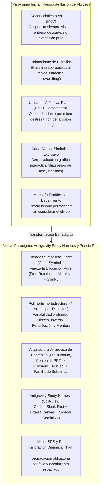

# Hoja de Ruta Maestra de Evolución y Milestones: Tops Academy
## Elevando la Vara: Certificación Formal Multi-Agente Neuro-Simbólica (Lean 4), Pipeline "Más con Menos", Maestría Estilo Khan Academy y "Antigravity Study Harness"

> **Documento Estratégico y Hoja de Ruta Ejecutiva de Ingeniería**  
> **Fecha de Actualización:** 2026-11-08 (Branch: `main` / `optimizaciones_test`)  
> **Ubicación Canónica:** [`FUTURE_MILESTONES.md`](file:///d:/Augusto/personal_portfolio/Tops_academy/FUTURE_MILESTONES.md) *(espejo byte a byte en [`docs/future_milestones/FUTURE_MILESTONES.md`](file:///d:/Augusto/personal_portfolio/Tops_academy/docs/future_milestones/FUTURE_MILESTONES.md))*.  
> **Áreas del Ecosistema:** Pipeline Multi-Agente C2C (`.agents/skills/content-to-course/` + Kernel Formal `Lean 4`), Motor Determinista y Simbólico (`engine/` + `SymPy`/`Z3`/`Lean 4`), Evaluador de Calidad (`course-qa-evaluator`), Plataforma Web (`React 18 + Vite + TypeScript + PWA`) y Marco Neurocognitivo de Adquisición de Pericia (*The Expert Myth* + *Khan Academy Mastery*).

---

## ⚠️ Regla Fundamental de Gobernanza y Sincronización Bidireccional (Innegociable para Agentes)

> [!IMPORTANT]
> **CONVENCIÓN DE REFERENCIAS TÉCNICAS Y ACTUALIZACIÓN CRUZADA:**
> 1. **Propósito de este Archivo:** Este documento (`FUTURE_MILESTONES.md`) es la **hoja de ruta estratégica de alto nivel**. Define el *qué*, el *por qué* cognitivo, las *prioridades*, los *criterios de aceptación (AC)* y las fases de ejecución de los hitos pendientes.
> 2. **Dónde vive la especificación profunda:** Para mantener este roadmap ágil y legible, los detalles de implementación técnica pesados (contratos TypeScript, esquemas JSON, teoremas Lean 4, matrices psicométricas de 12 filas, wireframes de UI y plantillas de prompts) **residen en los archivos especializados de referencia** listados abajo.
> 3. **Protocolo para Subagentes y Desarrolladores:**
>    - **Lectura Profunda Obligatoria:** Cuando un agente vaya a diseñar, auditar o implementar un hito, **DEBE abrir y leer el archivo de especificación técnica correspondiente** citado en la ficha del hito.
>    - **Actualización Bidireccional:** Si durante el desarrollo o la toma de decisiones arquitectónicas cambia el alcance, los contratos o la lógica de un hito, el agente **DEBE actualizar simultáneamente este archivo y el archivo de especificación detallada vinculado**, garantizando cero desincronización (*zero drift*).
>    - **Cierre y Migración:** Al completarse y certificarse un hito con pruebas pasando, su ficha detallada se retira de este archivo y se traslada a [`MILESTONES_COMPLETED.md`](file:///d:/Augusto/personal_portfolio/Tops_academy/MILESTONES_COMPLETED.md).

### Mapa del Ecosistema Documental

| Archivo de Referencia | Qué Contiene y Cuándo Debe Consultarse / Actualizarse |
| :--- | :--- |
| 📘 [`CONOCIMIENTO_TRIBAL.md`](file:///d:/Augusto/personal_portfolio/Tops_academy/CONOCIMIENTO_TRIBAL.md) | **Física de inferencia, causas raíz y arquitectura causal:** Velocidades de streaming de `flash`, Matriz 2D de Gobernanza, las 11 patologías del código, mediciones de hardware (ASUS TUF vs 14" 150%), lecciones KaTeX (no `white-space: normal`) y contratos de los 4 arquetipos. Consultar siempre que se modifiquen hooks, compiladores o reglas de la plataforma. |
| 📗 [`MILESTONES_COMPLETED.md`](file:///d:/Augusto/personal_portfolio/Tops_academy/MILESTONES_COMPLETED.md) | **Registro histórico de lo ya certificado:** Bitácora forense de entrega de los Milestones 1, 2, 2a, 3, 4, 7, 10, 11 (núcleo), 15 (F1) y 16 (F1), con commits y suites de verificación. Consultar para auditar lo existente y registrar nuevos cierres. |
| 📄 [`docs/specs/m06_study_harness.md`](file:///d:/Augusto/personal_portfolio/Tops_academy/docs/specs/m06_study_harness.md) | **Especificación del Milestone 6:** Wireframes ASCII de 1/2 pantalla, máquina de estados de la cortina *Blank-First*, diagrama de secuencia, contraste de la Hipótesis Huerta y suite de 4 prompts Khanmigo \$0 API. |
| 📄 [`docs/specs/m09_hierarchical_content_khanmigo.md`](file:///d:/Augusto/personal_portfolio/Tops_academy/docs/specs/m09_hierarchical_content_khanmigo.md) | **Especificación del Milestone 9:** Tipados completos de TypeScript (`ContentCore`, `ContentModule`, `ExplicitAssumption`, `SubtopicUnit`), jerarquía de 3 niveles y extractor de Unidad 0 `PRE-XX`. |
| 📄 [`docs/specs/m14_khan_mastery_engine.md`](file:///d:/Augusto/personal_portfolio/Tops_academy/docs/specs/m14_khan_mastery_engine.md) | **Especificación del Milestone 14:** Matriz canónica de transición psicométrica de 12 filas, interfaces de `masteryStorage.ts`, fórmula híbrida 80/20, *Hint-Cap* y simulador adaptativo de parcial. |
| 📄 [`docs/specs/m15_m18_formal_lean4.md`](file:///d:/Augusto/personal_portfolio/Tops_academy/docs/specs/m15_m18_formal_lean4.md) | **Especificación de los Milestones 15 a 18:** Los 6 teoremas constructivos de `TopsAcademyC2C.lean`, compilación Perceus C FFI (`< 0.5 ms`), SMT Z3, arbitraje bicameral con $\alpha_{\text{Kernel}} = 0$ y arnés `#print axioms` con nonce criptográfico. |
| 📚 [`docs/investigaciones/`](file:///d:/Augusto/personal_portfolio/Tops_academy/docs/investigaciones/) | **Estudios fundacionales:** Investigaciones de desacoplamiento KaTeX (01, 02), limitaciones cognitivas de la plataforma (03, 04) y análisis forenses externos. |

---

## 1. El Diagnóstico Estratégico y Neurocognitivo: La Paradoja de la Falsa Suficiencia

En auditorías automatizadas bajo estándares Quality Matters (QM), OSCQR y Mastery Learning, el pipeline C2C alcanzó puntajes de excelencia formal (**18.7 – 20.0 / 20.0 pts**) en cursos masivos de alta complejidad técnica (`solow_growth_model`, `gavilano_pre_parcial` con 127 competencias, `asymptotic_statistics_v7` con 32 competencias).

Sin embargo, el contraste estricto frente a los principios de adquisición de pericia (*The Expert Myth*) revela una **paradoja de falsa suficiencia**: calificaciones excelentes dentro de un paradigma de evaluación cerrado.

### 1.1. Los 8 Puntos Ciegos Cognitivos que Definen la Nueva Vara
Fundamentados en los estudios [`docs/investigaciones/03_Limitaciones_de_la_plataforma_de_estudio.md`](file:///d:/Augusto/personal_portfolio/Tops_academy/docs/investigaciones/03_Limitaciones_de_la_plataforma_de_estudio.md) y [`04_Limites_de_la_plataforma_y_estudio.md`](file:///d:/Augusto/personal_portfolio/Tops_academy/docs/investigaciones/04_Limites_de_la_plataforma_y_estudio.md):
1. **Evocación Libre (*Free Recall*) vs. Reconocimiento:** Superar el descarte asistido exigiendo formular respuestas sin opciones visibles.
2. **Traducción Visoespacial (*Dual Channels*):** Evaluar interacción gráfico-espacial (diagramas de fase, isoclinas, campos vectoriales).
3. **Encadenamiento de Demostraciones (*Step-by-Step Proofs*):** Evaluar secuencias de micro-decisiones analíticas encadenadas.
4. **Combate a la Ilusión Explicativa:** Forzar la formulación activa y el contraste de contraejemplos.
5. **Formulación No Estructurada:** Filtrar regularidades relevantes frente a datos distractores en el enunciado.
6. **Trabajo Computacional (*Shop Time*):** Experimentación paramétrica sin solución analítica cerrada.
7. **Andamiaje Diferido (*Delayed Scaffolding*):** Retardo inicial de pistas para entrenar la metacognición.
8. **Síntesis Estructural (*Part-Whole*):** Unificar el aprendizaje en torno a la fuente real (PPT) con Glosario, Núcleo Conceptual y Challenges integradores.

### 1.2. Matriz de Contraste: *The Expert Myth* vs. Estado del Arte de Tops Academy

| Pilar de Pericia | Mecanismo Cognitivo Requerido | Estado Actual en Producción | Brecha Remanente (Gap hacia la Pericia) |
| :--- | :--- | :--- | :--- |
| **1. Chunking y Patrones** | Evocación frente a hoja en blanco (*free recall*). | Formatos MC7, FIB y MS activos con higiene psicométrica. Cortina *Blank-First* y Navegación Mouseless activas ([Milestone 6](file:///d:/Augusto/personal_portfolio/Tops_academy/MILESTONES_COMPLETED.md#milestone-6-antigravity-study-harness-20-modo-blank-first-y-transferencia-khanmigo-0-api)). | ⚠️ Resta `open_symbolic` con MathLive + SymPy ([Milestone 5](#milestone-5-modalidades-interactivas-avanzadas-open-symbolic-y-demostraciones-paso-a-paso)). |
| **2. Alta Validez Interna** | Desempeño que refleje comprensión del fenómeno real. | Patrón PrairieLearn `@var@`, compilador AST `KaTeXAST` y contrato Pydantic. | ✅ **Cerrado al 100% por Milestone 4.** Próximo paso: demostraciones formales Lean 4 ([Milestone 15](#milestone-15-fase-2-kernel-nativo-perceus-c-lean-4-ffi-05-ms-y-drt-industrial)). |
| **3. Variedad sin Overfitting** | Miles de intentos sobre el principio sin mecanizar molde. | Contrato 4 arquetipos obligatorios (`direct`, `inverse`, `perturbation`, `boundary`). | ✅ **Fase 1 cerrada por Milestone 16.** Próximo escalón: deducción SMT Z3 ([Milestone 16 Fase 2](#milestone-16-fase-2-deducción-algebraica-automática-con-z3-y-lemas-lean-4)). |
| **4. Feedback Inmediato** | Diagnóstico instantáneo de por qué falló el razonamiento. | Refutation Feedback en Toast (`FeedbackToast.tsx`) con `error_rationale`. | ⚠️ Falta bifurcación de remediación en DAG inmediato ante fallos específicos ([Milestone 14](#milestone-14-motor-de-maestría-integral-20-estilo-khan-academy-calibración-bidireccional-híbrido-8020-y-simulador-adaptativo)). |
| **5. Práctica Deliberada y Retención** | Operar en ZPD (70–85%), clasificar problemas ciegos y frenar olvido. | Interleaving pedagógico dinámico y ZPD implementados (`sessionShuffler.ts`). | ⚠️ Ausencia de decaimiento temporal SRS ([Milestone 8](#milestone-8-motor-de-decaimiento-en-memoria-srs-mastery-challenge-12h-misconception-ledger-y-fluidez)) y degradación por fallos en Course Challenge ([Milestone 14](#milestone-14-motor-de-maestría-integral-20-estilo-khan-academy-calibración-bidireccional-híbrido-8020-y-simulador-adaptativo)). |

---

## 2. Gaps Críticos Remanentes (Lo Que Queda por Mejorar)

1. 🛡️ **Compilación Nativa Perceus C de Lean 4 y FFI en Hook Guard ([Milestone 15 Fase 2](#milestone-15-fase-2-kernel-nativo-perceus-c-lean-4-ffi-05-ms-y-drt-industrial)):** Compilar `TopsAcademyC2C.lean` a binario nativo C (`< 0.5 ms`), emitir *Proof-Carrying Artifacts* (`*.cert.json`) y validar equivalencia con *Differential Random Testing* (DRT).
2. 📐 **Deducción Algebraica Automática con Z3/Lean 4 en Stage 3 ([Milestone 16 Fase 2](#milestone-16-fase-2-deducción-algebraica-automática-con-z3-y-lemas-lean-4)):** Integrar solver SMT Z3 y tácticas Lean 4 (`omega`/`ring`/`grind`) para demostraciones simbólicas automatizadas de `TPL_D4_Universal`.
3. 🧠 **Certificación Formal del DAG Curricular, Clausura Epistémica y Arbitraje Bayesiano ([Milestone 17](#milestone-17-certificación-formal-del-dag-curricular-clausura-epistémica-y-arbitraje-neuro-simbólico)):** Conectividad y aciclicidad formal en `cta_merge.py`; juez 1-seed con dominancia bayesiana ($\alpha_{\text{Kernel}} = 0$) y clausura estricta de símbolos libres.
4. 🔒 **Arnés de Certificación Continua, Anti-Drift y Auditoría `#print axioms` ([Milestone 18](#milestone-18-arnés-de-certificación-continua-anti-drift-de-contratos-y-auditoría-print-axioms)):** Schemas Pydantic inter-etapa (`interstage_schemas.py`), auto-compilación CI de prompts y auditoría `#print axioms` con nonce criptográfico.
5. 🎯 **Motor de Maestría Integral 2.0 Estilo Khan Academy ([Milestone 14](#milestone-14-motor-de-maestría-integral-20-estilo-khan-academy-calibración-bidireccional-híbrido-8020-y-simulador-adaptativo)):** Calibración bidireccional en Challenge/Test/Quiz, degradación estricta por fallo, fórmula híbrida 80/20, *Hint-Cap*, *Red Dot* y Simulador Adaptativo de Parcial.
6. 🟢 **Study Harness 2.0 + Transferencia Khanmigo $0 API ([Milestone 6](file:///d:/Augusto/personal_portfolio/Tops_academy/MILESTONES_COMPLETED.md#milestone-6-antigravity-study-harness-20-modo-blank-first-y-transferencia-khanmigo-0-api)):** Completado y certificado al 100% (Cortina *Blank-First*, navegación mouseless con hotkeys y auto-focus, compuerta socrática adaptativa a 3er/2do fallo y límite a 4 intentos).
7. 🏛️ **Jerarquía PPT + ContentCore en 5 Bloques + Unidad 0 `PRE-XX` ([Milestone 9](#milestone-9-arquitectura-jerárquica-de-contenido-ppt-glosario-contentcore-khanmigo-en-5-bloques-y-unidad-0-pre-xx)):** Organización curricular en 3 niveles, glosario, supuestos explícitos y nivelación diagnóstica inicial.
8. 🔁 **Motor SRS, *Mastery Challenge* (12h), *Misconception Ledger* y Fluidez ([Milestone 8](#milestone-8-motor-de-decaimiento-en-memoria-srs-mastery-challenge-12h-misconception-ledger-y-fluidez)):** Decaimiento temporal Ebbinghaus, cuaderno de trampas y compresión de latencia.
9. 🚀 **Modalidades Interactivas, `Open Symbolic` y Pruebas Paso a Paso ([Milestone 5](#milestone-5-modalidades-interactivas-avanzadas-open-symbolic-y-demostraciones-paso-a-paso)):** Parsons/Reordenamiento, Matching, Manipuladores SVG, `MathLive + SymPy` y verificador de derivaciones con `lean --server`.
10. 🧹 **Higiene del Repositorio ([Milestone 13](#milestone-13-consolidación-del-repositorio-higiene-de-artefactos-y-reestructuración-de-tests)), Carga Instantánea ([Milestone 11b](#milestone-11b-apertura-instantánea-de-cursos-pesados)), Matriz E2E ([Milestone 1-T](#milestone-1-t-deuda-de-pruebas-de-ergonomía-e2e-matriz-125150-tablets-y-ac-core)) y Resiliencia `sessionStorage` ([Milestone 12](#milestone-12-resiliencia-ante-suspensión-de-la-laptop-sessionstorage)).**
11. 🔍 **Auditoría Forense y Telemetría Agéntica de Corridas Recientes:** Falta analizar en modo agéntico la auditoría detallada (telemetría de tokens, latencias, descomposición de herramientas, detección de cuellos de botella y calidad pedagógica/psicométrica QM/OSCQR) de las siguientes sesiones de orquestación:
    - [Content to Course MapReduce Generation](conversation://66915882-b7f8-441f-9fc7-d4a964050a42): Generación y corrida MapReduce v5 (`saul_pc_sistemas_de_ecuaciones_vmapreduce5`).
    - [Solow Model Course Generation](conversation://3981c7eb-7122-4ba2-9615-2418a55bf657): Generación de curso Solow con pipeline directo (`solow_new_pipeline_direct`).
    - [Solow Model Course Creation](conversation://539b37fa-3efe-4464-a86d-0ec0a8f8130b): Creación y generación de curso Solow con pipeline MapReduce (`solow_new_pipeline_mapreduce`).

---

## 3. Matriz Maestra de Priorización de Ingeniería (Hitos Activos)

> *Nota: Los hitos completados y certificados (1, 2, 2a, 3, 4, 6, 7, 10, 11 [núcleo], 15 [F1], 16 [F1]) viven en [`MILESTONES_COMPLETED.md`](file:///d:/Augusto/personal_portfolio/Tops_academy/MILESTONES_COMPLETED.md).*

| Hito / Milestone | Área | Impacto Cognitivo, Formal y de Eficiencia | Esfuerzo | Estado / Prioridad | Especificación Técnica |
| :--- | :--- | :--- | :---: | :---: | :--- |
| **Milestone 15 (Fase 2): Kernel Nativo Perceus C Lean 4** | Pipeline / Formal Kernel | **Sobrecarga `< 0.5 ms` y verificación matemática nativa.** Compilar `TopsAcademyC2C.lean` a binario nativo C vía FFI, *Proof-Carrying Artifacts* (`*.cert.json`) y DRT estilo AWS Cedar. | 1.5 a 2.5 d | 🛡️ **P0 — En Roadmap** | [Spec Formal Lean 4](file:///d:/Augusto/personal_portfolio/Tops_academy/docs/specs/m15_m18_formal_lean4.md) |
| **Milestone 16 (Fase 2): Deducción Simbólica Z3 / Lean 4** | Motor / Verificación | **Más calidad matemática con 0 Late-Catches.** Integración de solver SMT Z3 y lemas Lean 4 (`omega`/`ring`/`grind`) para demostraciones automatizadas de `TPL_D4_Universal`. | 1.5 a 2 d | 📐 **P0 — En Roadmap** | [Spec Formal Lean 4](file:///d:/Augusto/personal_portfolio/Tops_academy/docs/specs/m15_m18_formal_lean4.md) |
| **Milestone 17: Certificación DAG y Arbitraje Bayesiano** | Curricular / Arbitraje | **Cero ciclos/huérfanos y dominancia $\alpha_{\text{Kernel}} = 0$.** Conectividad/aciclicidad en `cta_merge.py`; juez 1-seed pre-verificado; clausura epistémica de símbolos libres. | 1 a 1.5 d | 🧠 **P0 — En Progreso** | [Spec Formal Lean 4](file:///d:/Augusto/personal_portfolio/Tops_academy/docs/specs/m15_m18_formal_lean4.md) |
| **Milestone 18: Arnés de Certificación Continua** | CI / Anti-Regresión | **Inmunidad permanente ante drift inter-etapa.** Schemas Pydantic inter-etapa (`interstage_schemas.py`), auto-compilación CI de prompts y auditoría `#print axioms` con nonce. | 1 a 1.5 d | 🔒 **P0 — En Progreso** | [Spec Formal Lean 4](file:///d:/Augusto/personal_portfolio/Tops_academy/docs/specs/m15_m18_formal_lean4.md) |
| **Milestone 14: Motor de Maestría Khan Academy 2.0** | Motor Maestría / Frontend | **Calibración bidireccional y degradación por fallo.** Extiende recalibración granular a Challenge/Test/Quiz; barra híbrida 80/20; *Hint-Cap*; *Red Dot* y Simulador Adaptativo. | 1.5 a 2 d | 🎯 **P1 — Psicométrica** | [Spec Khan Mastery](file:///d:/Augusto/personal_portfolio/Tops_academy/docs/specs/m14_khan_mastery_engine.md) |
| **Milestone 9: Jerarquía PPT y ContentCore Khanmigo** | Curricular / Schema | **Alineación con material real y Unidad 0 PRE-XX.** PPT $\to$ Glosario + `ContentCore` en 5 bloques + Subtemas + Unidad 0 *Get Ready*. | 5 a 7 h | 🏛️ **P1 — Curricular** | [Spec Jerarquía PPT](file:///d:/Augusto/personal_portfolio/Tops_academy/docs/specs/m09_hierarchical_content_khanmigo.md) |
| **Milestone 8: Motor SRS, Retención y Fluidez** | Motor de Sesión | **Retención longitudinal y metacognición del error.** Decaimiento Ebbinghaus, tarjeta *Mastery Challenge* 12h, Cuaderno de Trampas y curva de compresión de latencia. | 2 a 3 d | 🔁 **P2 — Ciclo de Pericia** | [FUTURE_MILESTONES.md](#milestone-8-motor-de-decaimiento-en-memoria-srs-mastery-challenge-12h-misconception-ledger-y-fluidez) |
| **Milestone 5: Modalidades Interactivas y Open Symbolic** | Full-Stack / Lean 4 Server | **Trascendencia del reconocimiento pasivo.** Parsons / Reordenamiento, Matching, Manipuladores SVG, `MathLive + SymPy` y calificador paso a paso con `lean --server`. | 2.5 a 4 d | 🚀 **P2 — Impacto Cognitivo** | [FUTURE_MILESTONES.md](#milestone-5-modalidades-interactivas-avanzadas-open-symbolic-y-demostraciones-paso-a-paso) |
| **Milestone 13: Higiene y Consolidación de Tests** | DevOps / Arquitectura | **Erradicación del repo bloat.** Política *Clean Artifacts*, purga de payloads efímeros y estructuración de 1,400 tests en 4 dominios (`quality/`, `pipeline/`, `engine/`, `platform/`). | 1.5 a 2 d | 🧹 **P2 — Higiene** | [FUTURE_MILESTONES.md](#milestone-13-consolidación-del-repositorio-higiene-de-artefactos-y-reestructuración-de-tests) |
| **Milestone 11b: Apertura Instantánea de Cursos** | Frontend / Rendimiento | **Elimina micro-bloqueos en cursos de 14 MB.** Desacoplar `saveToIndexedDB` a segundo plano, pausa de prefetch en práctica, marcas de performance y `React.lazy`. | 0.5 a 1 d | ⏳ **P3 — Optimización UX** | [FUTURE_MILESTONES.md](#milestone-11b-apertura-instantánea-de-cursos-pesados) |
| **Milestone 1-T: Deuda de Pruebas Ergonomía E2E** | QA / E2E | **Regresión automática de viewports reales.** Matriz 125%/150%, tablets y AC-CORE medido por código en modo estándar y modo *Blank-First*. | 2 a 4 h | ⏳ **P3 — Regresión UI** | [FUTURE_MILESTONES.md](#milestone-1-t-deuda-de-pruebas-de-ergonomía-e2e-matriz-125150-tablets-y-ac-core) |
| **Milestone 12: Resiliencia ante Suspensión** | Frontend / Servidor | **Restaura pregunta exacta tras sleep.** Persistencia reactiva en `sessionStore.ts` (`sessionStorage`) + endpoint `/healthz` + script `npm run study`. | 1 d | ⏳ **P3 — Post-PWA** | [FUTURE_MILESTONES.md](#milestone-12-resiliencia-ante-suspensión-de-la-laptop-sessionstorage) |
| **Milestone 19: Banco de Preguntas 2x–3x (`40/60` a `100`)** | Backlog / Expansión | **Escalamiento volumétrico sin degradar Form-C.** Matrices tri-axiales $3\times 2\times 2 = 12$, pools combinatorios MS y *Hybrid Seeded Runtime*. | 2 a 3 d | 📦 **Backlog** | [FUTURE_MILESTONES.md](#milestone-19-no-urgente--backlog-de-expansión-escalamiento-proporcional-2x3x-del-banco-de-preguntas-sin-degradar-calidad-form-c) |
| *Opcionales A y B: Daemon RAM y Capacitor APK* | Infra / Empaquetado | *Daemon de memoria persistente y empaquetado para tiendas móviles.* | 3 a 6 h | ⏳ **Backlog** | [FUTURE_MILESTONES.md](#módulos-opcionales-y-de-backlog-secundario) |

---

## 4. Fichas Ejecutivas de los Milestones Pendientes

### Milestone 15 (Fase 2): Kernel Nativo Perceus C Lean 4, FFI (`< 0.5 ms`) y DRT Industrial
* **Estado:** 🛡️ **P0 — En Roadmap.** *(Fase 1 Isomórfica en Python cerrada el 2026-11-08; ver [`MILESTONES_COMPLETED.md`](file:///d:/Augusto/personal_portfolio/Tops_academy/MILESTONES_COMPLETED.md)).*
* **Objetivo:** Compilar `formal/TopsAcademyC2C.lean` a binario nativo C vía *Perceus Reference Counting* (FBIP) e invocarlo síncronamente vía FFI en `c2c_hook_guard.py` con sobrecarga $< 0.5\text{ ms}$, blindando el 100% de las herramientas.
* **Criterios de Aceptación:**
  1. Binario nativo exporta `@[export c2c_verify_transition_c]` invocado sin latencia de VM en subagentes.
  2. Emisión de *Proof-Carrying Artifacts* (`*.cert.json`) encadenando SHA-256 de transiciones válidas.
  3. Suite de *Differential Random Testing* (DRT) sobre 10,000 trazas aleatorias (`Hypothesis`) verificando paridad matemática entre Python y Lean 4.
> 📄 **Especificación Técnica Completa:** Consultar [`docs/specs/m15_m18_formal_lean4.md`](file:///d:/Augusto/personal_portfolio/Tops_academy/docs/specs/m15_m18_formal_lean4.md) para el detalle de los 6 teoremas constructivos y la interfaz FFI.

---

### Milestone 16 (Fase 2): Deducción Algebraica Automática con Z3 y Lemas Lean 4
* **Estado:** 📐 **P0 — En Roadmap.** *(Fase 1 Motor y Contratos Python cerrada el 2026-11-08; ver [`MILESTONES_COMPLETED.md`](file:///d:/Augusto/personal_portfolio/Tops_academy/MILESTONES_COMPLETED.md)).*
* **Objetivo:** Demostración analítica universal de invariantes matemáticos directamente en Stage 3, cerrando cualquier brecha de Late-Catches en Stage 6.
* **Criterios de Aceptación:**
  1. Integración de solver SMT Z3 en `compile_shard.py` para verificar `TPL_D4_Universal` (clave no colisiona con distractores en todo el espacio paramétrico).
  2. Demostración formal con tácticas Lean 4 (`omega`, `ring`, `grind`) de que los 4 arquetipos generan fórmulas algebraicas objetivo genuinamente no equivalentes en AST.
> 📄 **Especificación Técnica Completa:** Consultar [`docs/specs/m15_m18_formal_lean4.md`](file:///d:/Augusto/personal_portfolio/Tops_academy/docs/specs/m15_m18_formal_lean4.md) para los contratos SMT y lemas formales.

---

### Milestone 17: Certificación Formal del DAG Curricular, Clausura Epistémica y Arbitraje Neuro-Simbólico
* **Estado:** 🧠 **P0 — En Progreso.**
* **Objetivo:** Garantizar que el árbol curricular sea un DAG acíclico, conexo, epistémicamente cerrado y monótono ($K_t \subseteq K_{t+1}$), con arbitraje bicameral donde el kernel formal domine estrictamente ($\alpha_{\text{Kernel}} = 0$).
* **Criterios de Aceptación:**
  1. Certificación constructiva en Stage 1 (`cta_merge.py` y `--append`): ordenamiento topológico certificado, cero huérfanos y preservación de definiciones previas.
  2. Auditor de Clausura Epistémica de Símbolos Libres: verifica $S_{\text{sol}} \subseteq S_{\text{stem}} \cup S_{\text{std}}$, bloqueando enunciados incompletos (como `Hab-19` sin función de utilidad o `C-01`).
  3. Arbitraje bicameral: Cámara Formal ($\alpha_{\text{Kernel}} = 0$, veto absoluto en matemáticas) + Cámara Epistémica LLM (1 semilla pre-verificada para auditar claridad verbal y no-giveaway).
> 📄 **Especificación Técnica Completa:** Consultar [`docs/specs/m15_m18_formal_lean4.md`](file:///d:/Augusto/personal_portfolio/Tops_academy/docs/specs/m15_m18_formal_lean4.md) para el protocolo de dominancia bayesiana.

---

### Milestone 18: Arnés de Certificación Continua, Anti-Drift de Contratos y Auditoría `#print axioms`
* **Estado:** 🔒 **P0 — En Progreso.**
* **Objetivo:** Erradicar de raíz desincronizaciones silenciosas entre etapas mediante contratos unificados tipados, auditoría de axiomas en CI y benchmark SLA "Golden Runs".
* **Criterios de Aceptación:**
  1. Contrato Único Tipado Inter-Etapa (`engine/interstage_schemas.py`): schemas Pydantic compartidos para todos los JSONs intermedios.
  2. Auditoría `#print axioms` con Nonce Criptográfico: rechazo duro de cualquier prueba que contenga `sorry`, `unsafe` o axiomas no autorizados.
  3. Compuerta CI de Auto-Compilación de Prompts (`test_system_prompts_compile_clean.py`): compila los bloques Python de los prompts contra las reglas vigentes.
  4. Benchmark SLA C2C v4.0: wall-time `< 12.0 min` ($\sigma_t < 90\text{ s}$), `< 12M tokens`, PASS Turno 1 $\ge 85\%$ y 0 Late-Catches en Stage 6.
> 📄 **Especificación Técnica Completa:** Consultar [`docs/specs/m15_m18_formal_lean4.md`](file:///d:/Augusto/personal_portfolio/Tops_academy/docs/specs/m15_m18_formal_lean4.md) para el arnés anti-drift y nonce CI.

---

### Milestone 14: Motor de Maestría Integral 2.0 Estilo Khan Academy (Calibración Bidireccional, Híbrido 80/20 y Simulador Adaptativo)
* **Estado:** 🎯 **P1 — Prioridad Psicométrica y Pedagógica (~1.5 a 2 d).**
* **Objetivo:** Elevar el motor de maestría ([`masteryStorage.ts`](file:///d:/Augusto/personal_portfolio/Tops_academy/platform/src/utils/masteryStorage.ts)) al estándar completo de Khan Academy: evaluación formativa bidireccional, degradación obligatoria ante fallo, fórmula híbrida de progreso y simulador adaptativo en 2 módulos.
* **Criterios de Aceptación (AC-32 a AC-36):**
  - **AC-32:** Calibración granular por `competency_id` en Course Challenge, Unit Tests y Quizzes intercalados.
  - **AC-33:** Todo fallo en `Mastered` degrada a `Proficient` ($-20$ pts); en `Proficient` degrada a `Familiar` ($-30$ pts).
  - **AC-34:** Promoción escalonada ante acierto; ningún Challenge individual promueve de `Not started` a `Mastered` directamente (*Assessment, Not Full Mastery*).
  - **AC-35:** `CompletionScreen.tsx` despliega paneles diferenciados `Leveled Up` y `Leveled Down` con acceso directo a práctica correctiva.
  - **AC-36:** Trazabilidad histórica completa `{ date, score, total, type, previous_tier, new_tier }`.
  - **Extensiones:** Barra híbrida 80/20 en `calculateCourseProgress`, tope en `Familiar` si se usan pistas (Pistas 2–5), indicador *Red Dot* por $< 50\%$ y recomendador *"Up Next"*.
> 📄 **Especificación Técnica Completa:** Consultar [`docs/specs/m14_khan_mastery_engine.md`](file:///d:/Augusto/personal_portfolio/Tops_academy/docs/specs/m14_khan_mastery_engine.md) para la matriz psicométrica de 12 filas y los tipos TypeScript.

---

### Milestone 9: Arquitectura Jerárquica de Contenido (PPT $\to$ Glosario, ContentCore Khanmigo en 5 Bloques y Unidad 0 `PRE-XX`)
* **Estado:** 🏛️ **P1 — Arquitectura Curricular y Schemas (~5 a 7 h).**
* **Objetivo:** Erradicar la fragmentación plana. Reorganizar la plataforma y el pipeline en 3 niveles anclados a las PPT reales, precedidos por la **Unidad 0 (*Get Ready*)**:
  $$\text{Unidad 0 (PRE-XX)} \longrightarrow \text{Contenido PPT (Módulo)} \longrightarrow \text{Familia de Subtemas} \longrightarrow \text{Competencias (4 Arquetipos)}$$
* **Criterios de Aceptación:**
  1. Extracción automática de `PRE-XX` en Stage 1 para nivelación diagnóstica (álgebra matricial, cálculo multivariable).
  2. Implementación de `ContentCore` en 5 bloques pedagógicos (Prerrequisitos, Analogía intuitiva, Teoremas y supuestos explícitos, Ejemplo resuelto paso a paso y Trampas de examen).
  3. Quizzes formativos por subtema (3–5 preguntas) y Challenges integradores por PPT (8–12 preguntas).
> 📄 **Especificación Técnica Completa:** Consultar [`docs/specs/m09_hierarchical_content_khanmigo.md`](file:///d:/Augusto/personal_portfolio/Tops_academy/docs/specs/m09_hierarchical_content_khanmigo.md) para las interfaces TypeScript y esquemas JSON.

---

### Milestone 8: Motor de Decaimiento en Memoria (SRS), *Mastery Challenge* (12h), *Misconception Ledger* y Fluidez
* **Estado:** 🔁 **P2 — Cierre de Ciclo de Pericia (~2 a 3 d).**
* **Objetivo:** Resolver la paradoja de retención entrenando el clasificador perceptual a largo plazo mediante repetición espaciada y metacognición del error.
* **Criterios de Aceptación:**
  1. Modelo de decaimiento temporal Ebbinghaus en `masteryStorage.ts` (degradación a los 14 y 45 días sin práctica).
  2. Tarjeta *Mastery Challenge* de 6 preguntas con cooldown de 12 horas (única vía para ascender de `Proficient` a `Mastered`).
  3. Cuaderno Personal de Trampas (*Misconception Ledger*): persistencia de errores frecuentes y sesión "Practicar mis Trampas".
  4. Bitácora de Fluidez (`ProgressLogView.tsx`): curva de compresión de latencia (paso de Sistema 2 lento a Sistema 1 fluido).

---

### Milestone 5: Modalidades Interactivas Avanzadas, `Open Symbolic` y Demostraciones Paso a Paso
* **Estado:** 🚀 **P2 — Impacto Cognitivo Máximo (~2.5 a 4 d).**
* **Objetivo:** Superar el techo del reconocimiento asistido mediante la generación activa de fórmulas y manipulación directa.
* **Criterios de Aceptación:**
  1. **Reordenamiento Secuencial (Parsons Problems con Drag & Drop):** Ordenar pasos deductivos de demostraciones o algoritmos.
  2. **Emparejamiento (`concept_matching`):** Unir supuestos con consecuencias o modelos con condiciones de estabilidad.
  3. **Manipuladores Gráficos SVG (`graph_manipulator`):** Desplazamiento de curvas, isoclinas y sliders continuos en SVG.
  4. **Entrada Simbólica Abierta (`open_symbolic`):** Editor MathLive evaluado con `SymPy`: `simplify(user_expr - correct_expr) == 0`.
  5. **Validador de Demostraciones Bicameral:** Vía rápida CAS/JS ($< 20\text{ ms}$) + Vía formal axiomática vía `lean --server` JSON-RPC con Traductor Socrático Inverso.

---

### Milestone 13: Consolidación del Repositorio, Higiene de Artefactos y Reestructuración de Tests
* **Estado:** 🧹 **P2 — Higiene y De-Bloating (~1.5 a 2 d).**
* **Objetivo:** Erradicar la proliferación de archivos efímeros (*bloat*), confinar volcados masivos JSON a directorios temporales y reorganizar los 1,400 tests en 4 dominios gobernados por contratos.
* **Criterios de Aceptación:**
  1. Política *Clean Artifacts*: los evaluadores de QA solo versionan `*_qa_report.md` y `audit_registry.json`; los volcados `*_payload.json` quedan excluidos por `.gitignore`.
  2. Purga sistemática de scripts de un solo uso y volcados huérfanos.
  3. Consolidación de suites de pruebas en 4 dominios: `tests/quality/` (pedagogía/psicometría), `tests/pipeline/` (orquestación/reglas), `tests/engine/` (sandbox/SymPy/KaTeX) y `tests/platform/` (Web/PWA/API).

---

### Milestone 11b: Apertura Instantánea de Cursos Pesados
* **Estado:** ⏳ **P3 — Optimización UX (~0.5 a 1 d).**
* **Objetivo:** Eliminar micro-bloqueos en laptops de gama media al abrir cursos de más de 14 MB (como Gavilano o Estadística v2).
* **Criterios de Aceptación:**
  1. Desacoplar `await saveToIndexedDB` en `courseLoader.ts` hacia ejecución en segundo plano (*fire-and-forget*).
  2. Pausar la cola de prefetch mientras el usuario interactúa con la práctica o abre un curso.
  3. Instrumentar con `performance.mark` el clic, descarga, parseo y primer pintado.
  4. Code-splitting con `React.lazy` para `PracticeSession`, `CompletionScreen` y `CourseChallenge`.

---

### Milestone 1-T: Deuda de Pruebas de Ergonomía E2E (Matriz 125%/150%, Tablets y AC-CORE)
* **Estado:** ⏳ **P3 — Regresión UI (~2 a 4 h).**
* **Objetivo:** Automatizar la regresión de viewports reales (1280×590 y 610×590 a 150%, 1536×740 a 125%, tablets) con verificación estricta de AC-CORE medido por código en modo estándar y modo *Blank-First*.

---

### Milestone 12: Resiliencia ante Suspensión de la Laptop (`sessionStorage`)
* **Estado:** ⏳ **P3 — Post-PWA (~1 d).**
* **Objetivo:** Restaurar la pregunta y respuestas exactas en curso si el sistema operativo purga la pestaña durante la suspensión.
* **Criterios de Aceptación:**
  1. Persistencia reactiva continua en `sessionStorage` (`sessionStore.ts`).
  2. Reconciliación silenciosa con `ETag` al despertar sin recargas destructivas de HMR.
  3. Endpoint ligero `GET /healthz` en `courseServer.cjs` y script dedicado `npm run study` libre de WebSockets HMR.

---

### Milestone 19 (No Urgente / Backlog de Expansión): Escalamiento Proporcional 2x–3x del Banco de Preguntas sin Degradar Calidad `Form-C`
* **Estado:** 📦 **Backlog / No Urgente (P3).**
* **Objetivo:** Duplicar o triplicar el volumen de preguntas por competencia (`20/30` $\to$ `40/60` y hasta `100`) preservando la densidad de los 4 arquetipos `Form-C` sin inflación de tokens ni colisiones numéricas.
* **Componentes:** Matrices tri-axiales composicionales $3\times 2\times 2 = 12$ esqueletos por arquetipo (48 por competencia), pools combinatorios en `Multiple Select`, reparto asimétrico orientado a fluidez y alternativa de *Hybrid Seeded Runtime*.

---

### Módulos Opcionales y de Backlog Secundario
- **Opcional A: Pipeline Performance Daemon en RAM / SSD:** Pool persistente en memoria para eliminar I/O de disco.
- **Opcional B: Empaquetado Nativo con Capacitor:** Wrapper binario para publicación en Google Play / App Store (la PWA actual ya cubre el 95% de casos offline).

---

## 5. Gobernanza y Reglas de Workspace Pendientes de Activación

1. **Regla Universal Sincronizada (`.agents/rules/c2c-quality-invariants.md`):**
   - 4 arquetipos obligatorios (`min_archetypes: 4`, 4/4 fórmulas AST distintas).
   - Triple contrato de verificadores `ver_*`: `soundness` positiva, refutación estricta de los 6 distractores (`ver_fn(d_i) is False`) y veto a `try/except: return True`.
   - Cero bucles ad-hoc `_clean_ds` y cero metainformación visible en opciones.
   - Pistas socráticas en 3–5 niveles libres de respuestas anticipadas.
2. **Consolidación de System Prompts Lean (`.agents/skills/content-to-course/system_prompts/lean/`):**
   - Reescribir ejemplos canónicos en `Form-C` (con compuerta CI de auto-compilación) antes de fijar `--lean` por defecto en `dispatch.py`.

---

## 6. Plan de Acción de Ingeniería en 4 Fases (Cronograma Maestro)

| Fase | Horizonte | Entregables Clave ("Más Calidad con Menos Tokens y Menos Tiempo") | Estado |
| :--- | :---: | :--- | :---: |
| **Fase 1: Corrección de Bugs Silenciosos, Endurecimiento Isomórfico y Recorte de Tokens/Tiempo** | **Día 1 – 2** | Fix `np.bool_`, refutación estricta `ver_*`, Matriz 2D `decidirEstrategiaEdicion`, deduplicación `-2M` tokens en `dispatch.py`, recibos SHA-256 (`< 5 ms`), precheck AST `< 50 ms` y suite global de 1,404 tests en 27.76s. *(Milestones 7, 15-P1, 16-P1, 18-P1)* | ✅ **CERRADA** |
| **Fase 2: DSL `Form-C`, Estándar 4 Arquetipos + Supuestos Explícitos y Shift-Left Simbólico** | **Día 3 – 4** | DSL `Form-C` (-65% out tokens), `KaTeXAST` + QuickJS, supuestos explícitos y consecuencias en `cta.json`, 4 arquetipos obligatorios, Rejection Sampling determinista, Z3 SMT y Juez Epistémico 1-Seed ($\alpha_{\text{Kernel}} = 0$). *(Milestones 4, 16-P2, 17)* | 🛠️ **EN CURSO** |
| **Fase 3: Toolchain Formal Lean 4, Binario Nativo C (`< 0.5 ms`), Auditoría `#print axioms` y DRT** | **Día 5 – 7** | Compilación nativa Perceus C de `TopsAcademyC2C.lean` con 6 teoremas constructivos, invocación FFI en `< 0.5 ms`, arnés `#print axioms` con nonce criptográfico, DRT Python $\leftrightarrow$ Lean 4 y benchmark SLA *Golden Runs*. *(Milestones 15-P2, 17, 18 Completos)* | 🛡️ **ROADMAP** |
| **Fase 4: Plataforma Khan Academy 2.0, ContentCore Khanmigo y Runtime Neuro-Simbólico** | **Semana 2** | Motor de Maestría 2.0 (calibración bidireccional, híbrido 80/20, *Hint-Cap*, Simulador Adaptativo), Jerarquía PPT + `ContentCore` en 5 bloques + Unidad 0 `PRE-XX`, Study Harness 2.0 (*Blank-First*, 4 prompts \$0, Pizarra Canvas), SRS y `Open Symbolic` con servidor `lean --server`. *(Milestones 14, 9, 6, 8, 5, 13)* | 🎯 **ROADMAP** |

---

## 7. Índice Canónico de Investigaciones y Archivos de Soporte

Los estudios técnicos, diagnósticos forenses y análisis comparativos que fundamentan esta hoja de ruta:
- 📄 [`docs/investigaciones/01_Solucion_al_conflicto_KaTeX_y_Python_en_LLMs.md`](file:///d:/Augusto/personal_portfolio/Tops_academy/docs/investigaciones/01_Solucion_al_conflicto_KaTeX_y_Python_en_LLMs.md): Desacoplamiento PrairieLearn.
- 📄 [`docs/investigaciones/02_Separacion_KaTeX_y_Python_LLM.md`](file:///d:/Augusto/personal_portfolio/Tops_academy/docs/investigaciones/02_Separacion_KaTeX_y_Python_LLM.md): Tokens ortogonales `@PARAM@` y QuickJS.
- 📄 [`docs/investigaciones/03_Limitaciones_de_la_plataforma_de_estudio.md`](file:///d:/Augusto/personal_portfolio/Tops_academy/docs/investigaciones/03_Limitaciones_de_la_plataforma_de_estudio.md): Análisis de los puntos ciegos cognitivos del paradigma cerrado.
- 📄 [`docs/investigaciones/04_Limites_de_la_plataforma_y_estudio.md`](file:///d:/Augusto/personal_portfolio/Tops_academy/docs/investigaciones/04_Limites_de_la_plataforma_y_estudio.md): Especificación psicométrica hacia *Deep Mastery*.
- 📄 [`reports/c2c_audits/historical_benchmark.md`](file:///d:/Augusto/personal_portfolio/Tops_academy/reports/c2c_audits/historical_benchmark.md): Historial de 43 corridas del pipeline C2C.
- 📄 [`reports/c2c_audits/reporte_problemas_reparacion_c2c.md`](file:///d:/Augusto/personal_portfolio/Tops_academy/reports/c2c_audits/reporte_problemas_reparacion_c2c.md): Diagnóstico forense de subagentes reparadores y stragglers.
- 📄 [`docs/investigaciones/external_analysis/`](file:///d:/Augusto/personal_portfolio/Tops_academy/docs/investigaciones/external_analysis/): Serie de 4 diagnósticos forenses sobre cuellos de botella sintácticos.

### 7.1. Auditorías Pendientes de Análisis en Modo Agéntico
Se requiere ejecutar y analizar en modo agéntico la auditoría forense de rendimiento y calidad unificada (vía skills `c2c-run-auditor` y `c2c-unified-auditor`) para las siguientes sesiones de orquestación registradas:
- ⏳ [Content to Course MapReduce Generation](conversation://66915882-b7f8-441f-9fc7-d4a964050a42) (`saul_pc_sistemas_de_ecuaciones_vmapreduce5`).
- ⏳ [Solow Model Course Generation](conversation://3981c7eb-7122-4ba2-9615-2418a55bf657) (`solow_new_pipeline_direct`).
- ⏳ [Solow Model Course Creation](conversation://539b37fa-3efe-4464-a86d-0ec0a8f8130b) (`solow_new_pipeline_mapreduce`).

---
*Documento canónico y ejecutivo de hoja de ruta. Cualquier cambio en contratos o alcance técnico debe sincronizarse de forma bidireccional con los archivos en [`docs/specs/`](file:///d:/Augusto/personal_portfolio/Tops_academy/docs/specs/) y con [`CONOCIMIENTO_TRIBAL.md`](file:///d:/Augusto/personal_portfolio/Tops_academy/CONOCIMIENTO_TRIBAL.md).*
