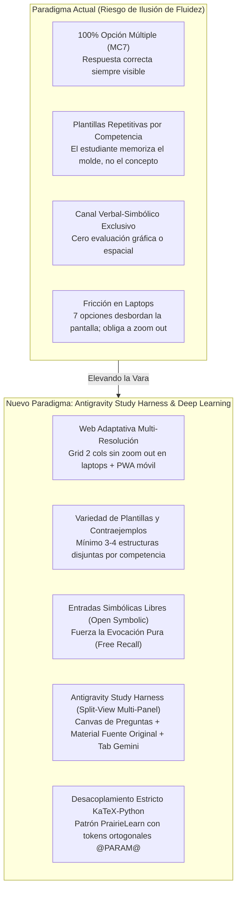
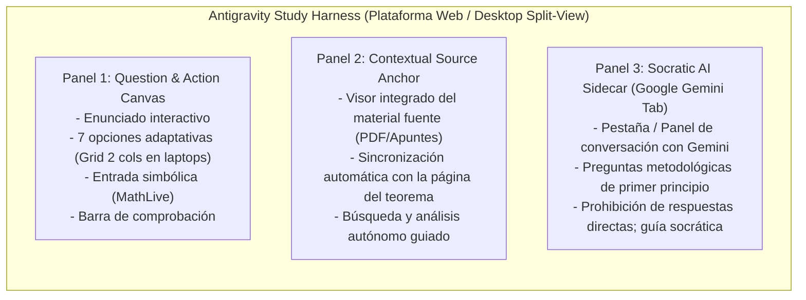

# Hoja de Ruta Maestra de Evolución y Milestones: Tops Academy
## Elevando la Vara: Del Paradigma Cerrado al "Antigravity Study Harness", Autenticidad Cognitiva y Ultra-Aprendizaje

> **Documento Estratégico, Psicométrico y de Arquitectura de Sistemas**  
> **Fecha de Actualización:** Octubre 2026  
> **Áreas:** Top's Academy Web Platform (`React 18 + Vite`), UI Multi-Panel (Split-View Harness), Pipeline Multi-Agente (`content-to-course`), Auditoría de Calidad (`course-qa-evaluator`) y Ciencia del Aprendizaje (*Learning Architect Framework*).  
> **Ubicación Principal y Archivos de Soporte:** [`docs/future_milestones/`](file:///d:/Augusto/personal_portfolio/Tops_academy/docs/future_milestones/) *(con espejo en la raíz)*.

---

## 1. El Diagnóstico Estratégico: Por Qué Necesitamos "Aumentar la Vara"

En las recientes auditorías automatizadas bajo estándares de Quality Matters (QM), OSCQR y Mastery Learning, el pipeline C2C alcanzó puntajes de excelencia consistente:
- **`solow_model_v15`**: **20.0 / 20.0 pts** (Quality Tier: EXCELENTE)
- **`practica_parcial_saul_standard_coarse`**: **19.0 / 20.0 pts** (Quality Tier: EXCELENTE)
- **`practica_parcial_saul` (Masivo)**: **18.7 / 20.0 pts** (Quality Tier: EXCELENTE)
- **`practica_parcial_saul_standard`**: **18.3 / 20.0 pts** (Quality Tier: EXCELENTE)

Sin embargo, estos puntajes revelan una **paradoja de falsa suficiencia**: estamos obteniendo calificaciones perfectas **dentro de los límites de un paradigma de evaluación cerrado**.

### 1.1. La Trampa de la "Ilusión de Fluidez" por Repetición de Plantillas
Al inspeccionar las sesiones prácticas por unidad, aparece un fallo pedagógico crítico: **dentro de una misma competencia existen solo 5 o 6 preguntas generadas a partir de una única estructura o plantilla idéntica**, donde solo varían los números o coeficientes.
- **El Problema:** El estudiante no adquiere fluidez en la competencia en general, sino que se **sobreajusta (*overfitting*) a la plantilla específica** generada por la plataforma.
- **La Ilusión:** El alumno cree dominar el tema porque responde rápido, pero en realidad solo ha memorizado la heurística superficial (*surface cues*) de ese formato exacto de pregunta. Si en un examen real le cambian la perspectiva o el punto de partida, el conocimiento no transfiere.
- **La Consigna Central:** **¿Cómo forzamos realmente al estudiante a aprender de forma profunda y rigurosa?** Toda la tecnología y la plataforma son medios al servicio de ese único fin: obligar al cerebro a procesar, inferir, deducir y sintetizar.



---

## 2. Matriz de Priorización de Ingeniería: Ganancia Cognitiva vs. Tiempo de Implementación

Para ordenar la ejecución de manera quirúrgica, los hitos se estructuran en función de su **ganancia neta** (ganancia en aprendizaje profundo, calidad del curso, velocidad de uso y eliminación de fricción) frente al **tiempo de desarrollo**:

| Prioridad / Hito | Área | Ganancia Real (Cognitiva y de Ingeniería) | Tiempo Estimado | Clasificación Estratégica |
| :--- | :--- | :--- | :---: | :--- |
| **Milestone 1: Web Ergonomía para Laptops (Zoom-Fix)** | Frontend / Layout | **Elimina la fricción física inmediata.** Evita que el usuario tenga que hacer zoom out en laptops de 13"-14" para ver las 7 opciones. Grid de 2 columnas + clamp elástico. | **2 a 4 horas** | 🚀 **Quick Win #1 (Inmediato)** |
| **Milestone 2: PWA Móvil para Estudio en Celular** | Frontend / PWA | **Habilita el estudio ubicuo en celular.** Experiencia de app nativa sin barra de navegador, offline cache de fuentes KaTeX y safe areas. | **1 a 2 horas** | 🚀 **Quick Win #2 (Inmediato)** |
| **Milestone 3: Anti-Overfitting y Variedad de Plantillas (QA v2.0 Early)** | Pipeline / Rúbrica | **Destruye la ilusión de fluidez.** Exige mínimo 3 a 4 plantillas disjuntas por competencia con contraejemplos, evitando el aprendizaje de memoria. | **1 a 2 días** | 🎯 **Core Pedagógico Alto** |
| **Milestone 4: Desacoplamiento KaTeX-Python (PrairieLearn & pykatex)** | Pipeline / Backend | **Erradica los fallos de sintaxis al 100%.** Separa el cálculo en Python (`generate() -> dict`) de plantillas declarativas con `@PARAM@` y validación con `pykatex` (QuickJS). | **1 a 2 días** | 🛠️ **Estabilidad Sistémica** |
| **Milestone 5: Entradas Simbólicas Libres y Demostraciones por Pasos** | Backend / Frontend | **Fuerza la evocación libre (Free Recall).** Reemplaza la opción múltiple por cajas MathLive validadas con SymPy y validadores de derivaciones intermedias. | **2 a 3 días** | 🧠 **Impacto Cognitivo Máximo** |
| **Milestone 6: Antigravity Study Harness (Multi-Panel Split-View)** | Arquitectura de UI | **El salto cuántico en flow de estudio.** Canvas de preguntas + Visor de material original sincronizado + Pestaña de Google Gemini socrático. | **3 a 5 días** | 👑 **La Joya de la Corona (Máxima Ambición)** |
| **Milestone 7: QA Rubric v2.0 Completa (Certificación Deep Mastery)** | Auditoría QA | **Sello de certificación estricta.** Evalúa multimodalidad, penaliza monocultivo MC7 e integra los 6 linters automáticos descubiertos. | **1 a 2 días** | 📋 **Garantía y Gobernanza** |
| *Opcional A: Pipeline Performance Daemon en RAM / SSD* | Infraestructura | *Acelera subprocesos locales, pero el cuello de botella real es la inferencia LLM (optimizable con prompt engineering).* | *3 a 4 horas* | ⏳ **Opcional / Secundario** |
| *Opcional B: Empaquetado Nativo con Capacitor* | Distribución | *Generación de APK para tiendas de aplicaciones.* | *4 a 6 horas* | ⏳ **Opcional / Backlog** |

---

## 3. La Joya de la Corona: El "Antigravity Study Harness" (Milestone 6)

Inspirado en la interfaz de trabajo de **Google Antigravity** —donde conviven de forma sincronizada el panel de tarea/conversación, el panel de artefactos/código y el inspector de herramientas—, la plataforma de estudio evoluciona hacia una **Estación de Ultra-Aprendizaje en Flow**:



### 3.1. Panel 1: Canvas de Preguntas y Acción
- El área activa de interacción donde el estudiante lee el problema, reflexiona y formula su respuesta.
- **Resolución al problema de laptops:** En pantallas pequeñas (13"-14", resoluciones 1366x768, 1440x900 o con escalado de Windows al 125%/150%), las 7 opciones se reorganizan automáticamente en un **Grid responsivo de 2 columnas** o en un contenedor elástico con scroll suave, eliminando por completo la necesidad de hacer zoom out en el navegador.

### 3.2. Panel 2: Ancla Contextual al Material de Origen (*Contextual Source Anchor*)
- Cada competencia (`H-XX`, `C-XX`, `Hab-XX`) está vinculada metadatamente al archivo fuente en `content/` (`MATH_IV_Problem_Set_I.pdf`, `TEMA 1 (EDP SAUL).pdf`, `solow1956.pdf`) con su rango exacto de páginas o diapositivas.
- Si el estudiante entra en duda o falla, el panel secundario se despliega automáticamente abriendo el visor del documento fuente exactamente en el teorema, demostración o gráfico del que se extrajo la competencia.
- **Principio Pedagógico:** La pregunta **jamás es un copy-paste** del texto; es una instancia de aplicación profunda que obliga a inferir. El estudiante revisa la fuente no para copiar una respuesta, sino para refrescar el modelo mental y razonar desde los primeros principios (*Search-Organize-Integrate*).

### 3.3. Panel 3: Asistente Socrático Integrado (Google Gemini Tab)
- Una pestaña o panel lateral desplegable dentro de la propia plataforma conectado a Google Gemini.
- Si tras consultar el material de origen el estudiante continúa bloqueado, puede interactuar con Gemini como un tutor socrático en tiempo real:
  - *"¿Cuál es la intuición física de esta condición de frontera?"*
  - *"¿Cómo debo plantear el polinomio característico cuando las raíces son imaginarias puras?"*
- Gemini opera bajo un system prompt socrático: **guía metodológicamente, explica la intuición y propone el punto de partida sin revelar la opción correcta ni dar la solución numérica directa**, convirtiendo a la plataforma en un simulador de ultra-aprendizaje de alta exigencia.

### 3.4. El Bucle de Retroalimentación en Estado de Flow (*Active Mastery Flow Loop*)

```mermaid
sequenceDiagram
    autonumber
    actor Estudiante
    participant Canvas as Panel 1: Question Canvas
    participant Source as Panel 2: Material Original (PDF)
    participant Tutor as Panel 3: Gemini Socratic Tab

    Estudiante->>Canvas: Lee problema y reflexiona
    alt Acierto directo
        Estudiante->>Canvas: Envía respuesta correcta
        Canvas-->>Estudiante: Refuerzo positivo inmediato + Siguiente pregunta (Flow continuo)
    else Duda o Primer Fallo (Fricción Cognitiva)
        Canvas-->>Estudiante: Oculta opciones distractores; solicita recuerdo activo
        Note over Estudiante: "Trata de recordar: ¿dónde estaba este concepto en los apuntes?"
        Estudiante->>Canvas: Reintento autónomo
    else Segundo Fallo o Solicitud de Ayuda
        Canvas->>Source: Despliega Panel 2 posicionado en la página exacta del PDF
        Note over Estudiante,Source: El estudiante busca, analiza y razona desde el material original
        Estudiante->>Canvas: Reintento basado en el análisis de la fuente
    else Bloqueo Persistente
        Canvas->>Tutor: Habilita el Tab de Google Gemini
        Estudiante->>Tutor: "No entiendo cómo empezar este despeje"
        Tutor-->>Estudiante: Guía socrática de primer principio (sin regalar la respuesta)
        Estudiante->>Canvas: Resuelve y consolida el aprendizaje profundo
    end
```

---

## 4. Diagnóstico de los 7 Puntos Ciegos Cognitivos que Definen la Nueva Vara

A partir de las investigaciones independientes preservadas en [`docs/future_milestones/investigaciones/`](file:///d:/Augusto/personal_portfolio/Tops_academy/docs/future_milestones/investigaciones/):
- [`03_Limitaciones_de_la_plataforma_de_estudio.md`](file:///d:/Augusto/personal_portfolio/Tops_academy/docs/future_milestones/investigaciones/03_Limitaciones_de_la_plataforma_de_estudio.md)
- [`04_Limites_de_la_plataforma_y_estudio.md`](file:///d:/Augusto/personal_portfolio/Tops_academy/docs/future_milestones/investigaciones/04_Limites_de_la_plataforma_y_estudio.md)

Se establecen las 7 dimensiones que la plataforma debe incorporar para certificar auténtico dominio disciplinar:

1. **Evocación Libre (*Free Recall*) vs. Reconocimiento (*Recognition*):** Con 7 opciones múltiples, la respuesta correcta siempre está visible en pantalla. Se entrena descarte guiado, no evocación pura desde memoria a largo plazo frente a una hoja en blanco.
2. **Traducción y Construcción Gráfico-Visual (*Dual Channels & Drawing Effect*):** El motor opera 100% en texto/LaTeX. Se requiere evaluar la conversión visoespacial: diagramas de fase, campos de pendientes, isoclinas nulas y retratos de estabilidad.
3. **Encadenamiento de Demostraciones Largas (*Bundling & Step-by-Step Proofs*):** Se evalúa el resultado final o un eslabón aislado, sin auditar derivaciones de 10 pasos ni detectar la violación intermedia de un supuesto.
4. **Combate a la Ilusión de Maestría Explicativa (*Illusion of Explanatory Depth*):** Leer soluciones prefabricadas genera fluidez de lectura pasiva. Es necesario forzar la formulación escrita y el contraste de contraejemplos.
5. **Formulación de Modelos No Estructurados (*Adaptive Expertise*):** Introducir casos difusos (*fuzzy boundaries*) donde el modelo no está dado de antemano y el alumno debe seleccionar supuestos (*Learning as "less"*).
6. **Trabajo Computacional y Simulación Empírica (*Shop Time*):** Simulación numérica en Python/Julia de dinámicas complejas sin solución analítica cerrada (Runge-Kutta, perturbaciones estocásticas).
7. **Automonitoreo y Resiliencia con Andamiaje Diferido (*Delayed Scaffolding*):** Bloqueo inicial de pistas para entrenar la resistencia a la frustración y el automonitoreo metacognitivo.

---

## 5. Investigaciones de Ingeniería: Desacoplamiento KaTeX y Python (Milestone 4)

Preservadas en:
- [`01_Solucion_al_conflicto_KaTeX_y_Python_en_LLMs.md`](file:///d:/Augusto/personal_portfolio/Tops_academy/docs/future_milestones/investigaciones/01_Solucion_al_conflicto_KaTeX_y_Python_en_LLMs.md)
- [`02_Separacion_KaTeX_y_Python_LLM.md`](file:///d:/Augusto/personal_portfolio/Tops_academy/docs/future_milestones/investigaciones/02_Separacion_KaTeX_y_Python_LLM.md)

### 5.1. Causa Raíz de la Colisión Léxica
El uso de llaves dobles (`{{...}}`) para escapar caracteres en f-strings de Python mientras se escriben comandos de KaTeX (`\frac{a}{b}`) colapsa la atención autorregresiva de los LLMs. El modelo sobrecompensa duplicando llaves innecesarias o produce escapes malformados que disparan *Circuit Breakers* y fuerzan intervenciones manuales del supervisor.

### 5.2. Solución Arquitectónica (Patrón PrairieLearn y Tokens Ortogonales)
1. **Desacoplamiento Estricto por Contrato:** Prohibir que Python ensamble cadenas con LaTeX o HTML. La función `generate()` solo debe calcular y retornar un diccionario de parámetros puros (números, tensores o strings simbólicos generados con `sympy.latex()`).
2. **Plantilla Declarativa con Delimitadores Ortogonales:** La redacción pedagógica y el marcado KaTeX residen en plantillas Markdown estáticas, usando marcadores neutros que no colisionan con llaves ni con dólares: `@PARAM_NAME@` o `<eval-var name="var_name"/>`.
3. **Validación Temprana mediante `pykatex` (QuickJS Embebido):** Validar la sintaxis KaTeX del lado del servidor a una velocidad de **15,000 fórmulas/segundo** mediante el motor oficial de JavaScript, reinyectando de inmediato el `katex.ParseError` exacto al LLM en caso de fallo sintáctico.
4. **Inspección AST con `markdown-it-py`:** Separar nodos matemáticos de la prosa antes de validar, eliminando falsos positivos por caracteres especiales en el texto en español.

---

## 6. Especificación Detallada de los Milestones

### Milestone 1: Layouts Adaptativos Multi-Resolución (Laptops Pequeñas, Pantallas Medianas y Móvil)
* **Objetivo Crítico:** Resolver el problema de adaptabilidad donde las 7 opciones (MC7) se desbordan verticalmente en computadoras portátiles (13"-14", resoluciones 1366x768 o 1440x900) obligando al usuario a hacer zoom out continuo en el navegador.
* **Componentes Técnicos:**
  1. **Grid Inteligente de 2 Columnas para Opciones:**
     - En pantallas de escritorio medianas o laptops con altura reducida (`max-height: 850px` y `min-width: 1024px`), las 7 alternativas se organizan automáticamente en 2 columnas equilibradas (4 en columna izquierda, 3 en columna derecha), garantizando que todo el reactivo quepa en una sola pantalla sin scroll.
  2. **Contenedor Elástico con `clamp()` y Scroll Suave:**
     - Espaciados y tipografías elásticas usando unidades dinámicas (`clamp(0.875rem, 1.5vh, 1.125rem)`) para padding de opciones y enunciados.
     - Scroll interno contenido en el bloque de opciones si el enunciado es excepcionalmente largo, manteniendo fijos el encabezado y el botón de comprobación.
  3. **Refactorización Mobile-First:**
     - Drawer desplegable para `Sidebar.tsx` con botón hamburguesa.
     - `FeedbackToast.tsx` transformado en Bottom Sheet deslizable con scroll propio.
     - SVG responsive en `CoordinatePlane.tsx` (`viewBox` + `max-w-[340px]`).
     - Viewports dinámicos (`100dvh`) para mitigar el teclado virtual en preguntas de texto.

---

### Milestone 2: Configuración PWA (Progressive Web App)
* **Objetivo:** Instalación en pantalla de inicio en Android e iOS con comportamiento nativo standalone.
* **Componentes:**
  - `vite-plugin-pwa` con service worker automático y precaching de assets/fuentes KaTeX.
  - `manifest.webmanifest` con iconos adaptativos (`192x192`, `512x512`).
  - Metatags de Safe Areas para iOS/Safari (`viewport-fit=cover`, utilidades `env(safe-area-inset-bottom)`).

---

### Milestone 3: Anti-Overfitting y Variedad de Plantillas por Competencia (QA v2.0 Early)
* **Objetivo:** Destruir la ilusión de fluidez erradicando el monocultivo de una única plantilla por competencia.
* **Componentes Técnicos:**
  1. **Requisito de Mínimo 3 a 4 Plantillas Disjuntas por Competencia:**
     - El pipeline C2C debe generar al menos 3 a 4 arquitecturas de plantilla cualitativamente distintas por competencia (ej. una analítica directa, una de perturbación de supuestos, una geométrica/cualitativa y una de caso límite o contraejemplo).
  2. **Auditoría de Diversidad Semántica:**
     - Algoritmo de similitud léxica/estructural en `standardized_audit_engine.py` que penalice cursos donde los reactivos de una misma competencia compartan el mismo esqueleto gramatical.

---

### Milestone 4: Desacoplamiento Arquitectónico KaTeX-Python & AST Validation Engine (PrairieLearn Pattern)
* **Objetivo:** Erradicar al 100% los fallos sintácticos por duplicación de llaves (`{{...}}`), escapes corruptos de LaTeX y micro-bucles de edición en los subagentes autores.
* **Componentes Técnicos:**
  1. **Contrato de Autoría Tipado (Pydantic / Structured Outputs):**
     - Reescribir el contrato de `c2c_shard_author` dividiendo la salida en dos campos estrictos:
       ```python
       class ShardCompetenceContract(BaseModel):
           competence_id: str
           python_pure_logic: str = Field(description="Solo función generate() -> dict. Cero strings con LaTeX/HTML.")
           statement_markdown: str = Field(description="Markdown + KaTeX puro con tokens @PARAM@")
           solution_markdown: str = Field(description="Explicación paso a paso con tokens @PARAM@")
       ```
  2. **Erradicación de Llaves en la Interpolación:**
     - Sustituir las f-strings y `.format()` por el interpolador de tokens ortogonales `@PARAM_NAME@` o `<eval-var name="..."/>`.
  3. **Generación Simbólica Garantizada con `sympy.latex()`:**
     - Prohibir el ensamblado manual de matrices o polinomios en Python. Exigir la exportación canónica mediante SymPy.
  4. **Validador Estricto con `pykatex` (QuickJS Embebido):**
     - Integrar `pykatex` en `compile_shard.py` para compilar y validar árboles KaTeX del lado del servidor a 15,000 fórmulas/segundo.
  5. **Auto-Corrección con Diagnóstico de Compilador:**
     - Ante fallos, inyectar directamente la excepción técnica (`katex.ParseError` con número de columna) en el contexto de autorreparación del agente.

---

### Milestone 5: Entradas Simbólicas Abiertas, Demostraciones por Pasos y Módulos SVG
* **Objetivo:** Trascender la opción múltiple forzando el efecto de generación y la multimodalidad visoespacial.
* **Componentes Técnicos:**
  1. **Tipo de Reactivo de Entrada Simbólica Abierta (`open_symbolic`):**
     - Cajas de texto matemáticas (MathLive) evaluadas mediante `SymPy`: `simplify(user_expr - correct_expr) == 0`.
  2. **Validador de Demostraciones por Pasos Intermedios (*Step-by-Step Proof Grader*):**
     - Validación secuencial de 3 hitos intermedios en `engine/sandbox.py`.
  3. **Módulo Gráfico Interactivo Visoespacial (SVG / Canvas):**
     - Componentes interactivos para arrastrar vectores en campos de pendientes, marcar isoclinas nulas y seleccionar diagramas de fase.
  4. **Generador de Perturbaciones y Contraejemplos Teóricos (*Boundary Testing*):**
     - Distractores programados para capturar la violación deliberada de supuestos axiomáticos.
  5. **Andamiaje con Retardo y Escalera de Fricción (*Delayed Scaffolding*):**
     - Bloqueo temporal inicial de pistas (5 min) para forzar la búsqueda autónoma en el material original.

---

### Milestone 6: Arquitectura "Antigravity Study Harness" (Multi-Panel Split-View, Source Anchor & Gemini Sidecar)
* **Objetivo:** Transformar la plataforma en una estación de trabajo de ultra-aprendizaje en flow, conectando preguntas interactivas con el material de origen y tutoría socrática por IA.
* **Componentes Técnicos:**
  1. **Split-View Layout Adaptativo (`platform/src/components/HarnessLayout.tsx`):**
     - Disposición multi-panel con divisiones ajustables o colapsables (Splitter).
     - Panel A: Área de preguntas y respuestas (Canvas de práctica).
     - Panel B: Visor de PDF/Markdown con resaltado del fragmento fuente exacto.
     - Panel C: Panel lateral o pestaña emergente de Google Gemini.
  2. **Indexador y Ancla de Contenido Fuente (`c2c-ingest` / `cta.json`):**
     - El pipeline C2C estampa en cada competencia la referencia precisa de origen:
       `"source_anchor": {"file": "MATH_IV_Problem_Set_I.pdf", "page": 14, "section": "Problema 3: EDP cuasilineal"}`.
     - El visor de la plataforma se sincroniza automáticamente con el `source_anchor` de la competencia activa.
  3. **Sidecar Socrático de Google Gemini (`GeminiSocraticTutor.tsx`):**
     - Integración de API / webview de Gemini dentro de la plataforma con contexto precargado del problema y del material fuente.
     - Guardas de prompt socrático: prohibir entregar la solución directa; formular preguntas orientadoras ("¿Qué método de integración aprendiste para derivadas parciales respecto a $x$ mientras mantienes $y$ constante?").
  4. **Motor de Bucle de Flujo (Active Mastery Loop):**
     - Transición sin fricciones entre aciertos y reintentos guiados con escalera de asistencia gradual.

---

### Milestone 7: Rúbrica de Auditoría QA de Próxima Generación (QA Rubric v2.0 - Deep Mastery)
* **Objetivo:** Actualizar el motor de auditoría (`course-qa-evaluator`) para calificar no solo la corrección formal, sino la profundidad cognitiva real de los cursos.
* **Componentes Técnicos:**
  1. **Penalización por Monocultivo Psicométrico:**
     - Descuento de hasta **-3.0 puntos** si un curso presenta 100% de preguntas en un único formato (ej. exclusivamente MC7).
  2. **Exigencia de Diversidad Multimodal (Mínimo 20%):**
     - Bonificación y certificación solo para cursos que incorporen reactivos abiertos simbólicos, pasos intermedios o interacción gráfica.
  3. **Formalización Permanente de las 6 Nuevas Reglas de Linteo:**
     - `uninterpolated_math_placeholder_linter` (tokens `{var}` en KaTeX).
     - `katex_delimiter_parity_shift_linter` (macros en texto plano por falta de `$`).
     - `katex_concatenated_macro_linter` (macros concatenadas sin espacio `\muu`).
     - `telltale_distractor_gerund_label_linter` (gerundios delatores en opciones).
     - `arithmetic_unnormalized_sign_linter` (operadores `+ -` y coeficientes `1x`).
     - `dag_orphan_prerequisites_linter` (habilidades sin prerrequisitos en grafo DAG).
  4. **Métricas de Resiliencia ante Overfitting:**
     - Auditoría de similitud léxica entre instancias de una misma competencia para garantizar variabilidad semántica profunda (*deep structure*) sobre pistas superficiales (*surface features*).

---

### Módulos Opcionales y de Backlog Secundario

#### Opcional A: Pipeline Performance Daemon en RAM / SSD
* **Estado:** **Opcional / Secundario**.
* **Nota Técnica de Prioridad:** El cuello de botella principal de la generación de cursos en Antigravity SDK **no es la I/O de disco ni el arranque de Python**, sino el **tiempo de inferencia del LLM** (que representa entre el 95.8% y el 98.5% del tiempo de pared de cada subagente, como demostró la auditoría forense). La aceleración sustancial del pipeline debe buscarse mediante **prompt engineering de precisión** (órdenes lean, pointer-prompts, supresión de lecturas especulativas y emisión streaming compacta), antes que micro-optimizaciones de subprocesos locales.

#### Opcional B: Empaquetado Nativo con Capacitor
* **Estado:** **Opcional / Backlog**.
* **Nota:** La implementación de la PWA (Milestone 2) cubre el 95% de los casos de uso móvil sin añadir la sobrecarga de mantenimiento de binarios en Google Play y App Store.

---

## 7. Índice de Archivos e Investigaciones Relacionadas

Todos los estudios de respaldo se encuentran preservados en el directorio dedicado:
- 📁 [`docs/future_milestones/investigaciones/`](file:///d:/Augusto/personal_portfolio/Tops_academy/docs/future_milestones/investigaciones/)
  - 📄 [`01_Solucion_al_conflicto_KaTeX_y_Python_en_LLMs.md`](file:///d:/Augusto/personal_portfolio/Tops_academy/docs/future_milestones/investigaciones/01_Solucion_al_conflicto_KaTeX_y_Python_en_LLMs.md)
  - 📄 [`02_Separacion_KaTeX_y_Python_LLM.md`](file:///d:/Augusto/personal_portfolio/Tops_academy/docs/future_milestones/investigaciones/02_Separacion_KaTeX_y_Python_LLM.md)
  - 📄 [`03_Limitaciones_de_la_plataforma_de_estudio.md`](file:///d:/Augusto/personal_portfolio/Tops_academy/docs/future_milestones/investigaciones/03_Limitaciones_de_la_plataforma_de_estudio.md)
  - 📄 [`04_Limites_de_la_plataforma_y_estudio.md`](file:///d:/Augusto/personal_portfolio/Tops_academy/docs/future_milestones/investigaciones/04_Limites_de_la_plataforma_y_estudio.md)

---
*Documento consolidado para la evolución de Tops Academy.*
