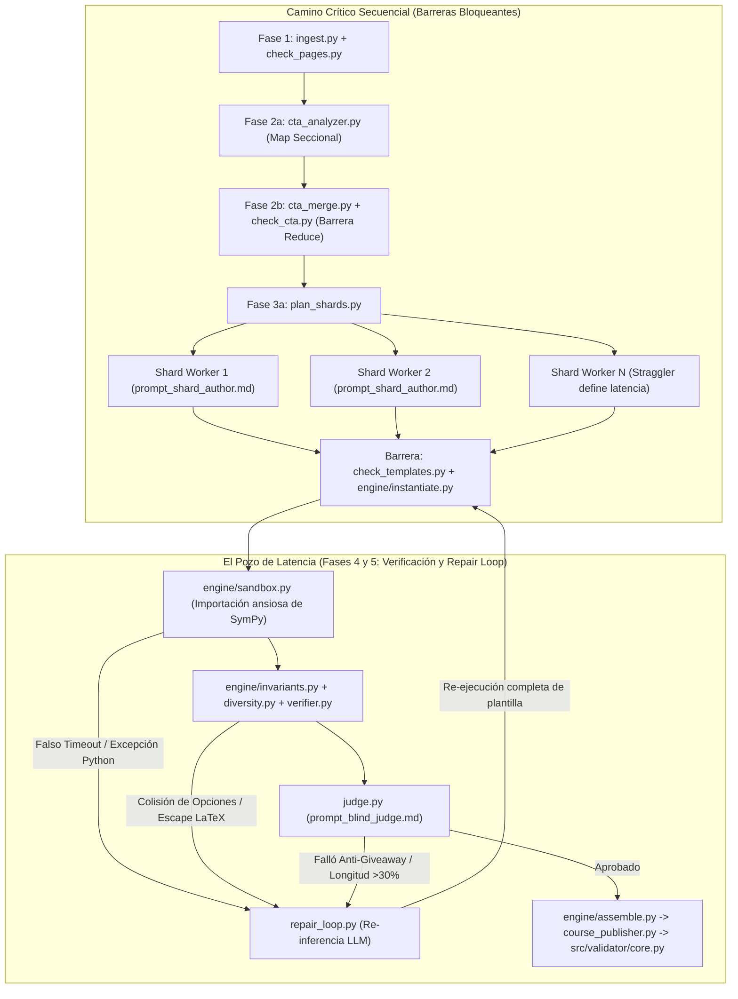

Superar la barrera de los **20 minutos** (**1,200 segundos**) en la pipeline `.agents/skills/content-to-course/` es difícil porque su arquitectura combina una **cadena de 5 barreras síncronas secuenciales** con **bucles de retroalimentación estocásticos (LLM) acoplados a validadores deterministas estrictos**. Basta con que un solo *shard* sufra una colisión de distractores, un escape inválido de LaTeX o un falso *timeout* de CPU en el *sandbox* para disparar rondas adicionales de inferencia en `repair_loop.py` y `judge.py`, multiplicando el tiempo del camino crítico.

---

## 1. Anatomía del Camino Crítico de la Pipeline (`content-to-course`)

La ejecución orquestada por `.agents/skills/content-to-course/run.py` y `dispatch.py` atraviesa cinco macro-fases bloqueantes donde la fase $N+1$ no puede iniciar hasta que el último *worker* de la fase $N$ haya terminado y superado su puerta de validación (*barrier synchronization*):

| Fase | Módulos y Puertas de Validación | Naturaleza del Trabajo | Factor que Impide Bajar de 20 Minutos |
| --- | --- | --- | --- |
| **Fase 1: Ingesta y Transcripción** | `ingest.py` $\rightarrow$ `check_pages.py` (`schemas/pages.schema.json`)

 | Transcripción LLM de PDFs/apuntes (`prompt_page_transcriber.md`, `prompt_handout_transcriber.md`, `prompt_page_patcher.md`).

 | Latencia de lectura multimodal/PDF y parches secuenciales de páginas corruptas antes de habilitar el análisis curricular.

 |
| **Fase 2: Cognitive Task Analysis (CTA)** | `cta_analyzer.py` $\rightarrow$ `cta_merge.py` $\rightarrow$ `check_cta.py` (`schemas/cta.schema.json`)

 | Extracción directa (`prompt_cta_direct.md`) o MapReduce seccional (`prompt_cta_sectional.md` + `prompt_cta_harmonizer.md`).

 | El paso *Reduce* (`cta_merge.py`) requiere una llamada LLM monolítica de armonización que bloquea toda la planificación de *shards*.

 |
| **Fase 3: Planificación y Autoría de Shards** | `plan_shards.py` $\rightarrow$ *Workers* LLM (`prompt_shard_author.md`) $\rightarrow$ `check_templates.py`  | Generación de plantillas parametrizadas en Python + JSON (`templates/C-*.json`, `H-*.json`, `Hab-*.json`).

 | **Efecto *Straggler* (cola larga):** el tiempo de la fase lo define el *shard* más lento o el que genera mayor volumen de tokens.

 |
| **Fase 4: Instanciación y Motor Determinista** | `engine/instantiate.py` $\rightarrow$ `engine/sandbox.py` $\rightarrow$ `engine/render.py` $\rightarrow$ `engine/invariants.py` & `diversity.py`  | Ejecución de código Python en *sandbox*, renderizado de variables y chequeo de invariantes matemáticos/diversidad.

 | Arranque en frío de subprocesos con importación ansiosa (*eager*) de `sympy`, provocando contención de CPU y falsos *timeouts*.

 |
| **Fase 5: Juez Ciego, Auto-Reparación y Publicación** | `verifier.py` $\rightarrow$ `judge.py` (`prompt_blind_judge.md`) $\rightarrow$ `repair_loop.py` $\rightarrow$ `engine/assemble.py` $\rightarrow$ `course_publisher.py`  | Auditoría anti-*giveaway* por LLM, reescritura iterativa de plantillas fallidas y validación final con `src/validator/core.py`.

 | **Amplificador de latencia principal:** cada fallo de invariante o sesgo psicométrico reabre el ciclo LLM $\rightarrow$ Sandbox $\rightarrow$ Verificador.

 |

---

## 2. Las 6 Causas Raíz (Evidencia en Reportes de Performance y Telemetría)

El análisis cruzado de los reportes de auditoría (`reports/c2c_audits/`, `reports/audits_archive/`), los análisis profundos de *tracebacks* (`traceback_deepdive_c4802280.md`, `traceback_deepdive_e8ab9fd6.md`), los *benchmarks* de particionado (`benchmarks/shard_sizing_14/`) y los laboratorios de remediación (`.agents/teamwork/explorer_remediation_timing/`) revela seis causas raíz técnicas:

### Causa Raíz 1: Explosión de Rondas en `repair_loop.py` por Errores de Ejecución y Sintaxis en Plantillas (`traceback_deepdive_*.md`)

* **Evidencia:** Los archivos `.agents/skills/c2c-run-auditor/scripts/traceback_analyzer.py`, `reports/c2c_audits/20261013_002234_solow_growth_model_c4802280/traceback_deepdive_c4802280.json`, `reports/c2c_audits/traceback_deepdive_e8ab9fd6.json` y `reports/audits_archive/solow_model/traceback_deepdive.md` existen específicamente porque la pipeline sufre una alta tasa de excepciones de Python y JSON durante la generación de plantillas.

* **Mecanismo del cuello de botella:**
* A diferencia de un generador de texto estático, `prompt_shard_author.md` exige que el LLM escriba **código Python ejecutable** dentro de un payload JSON (`schemas/template.schema.json`) que además emite strings con LaTeX.

* Los errores más frecuentes capturados por `traceback_analyzer.py` y `src/validator/lexical_scanner.py` incluyen:
1. **Corrupción silenciosa de escapes LaTeX en JSON:** Secuencias como `\theta`, `\frac`, `\beta` o `\nabla` mal escapadas que JSON interpreta como caracteres de control ASCII (`\t`, `\f`, `\b`, `\n`), rechazadas por `lexical_scanner.py` y `engine/invariants.py`.

2. **Excepciones matemáticas en tiempo de instanciación:** `ZeroDivisionError`, `ValueError`, `SympifyError` o variables no definidas cuando `engine/instantiate.py` evalúa semillas aleatorias en `engine/sandbox.py`.

* **Impacto en tiempo:** Cada vez que una plantilla falla en `verifier.py`, `repair_loop.py` realiza una nueva llamada al LLM con el *traceback*, reescribe el archivo JSON y vuelve a ejecutar el *sandbox* y los invariantes. Dos o tres iteraciones de reparación añaden entre **4 y 8 minutos** de latencia pura de inferencia.

### Causa Raíz 2: Arranque en Frío de Subprocesos e Importación Ansiosa (*Eager Import*) de `sympy` en `engine/sandbox.py`

* **Evidencia:** El espacio de trabajo `.agents/teamwork/explorer_remediation_timing/` contiene pruebas empíricas directas de este problema: `analysis.md`, `bench_imports.py`, `bench_3_instances.py`, `bench_lazy_vs_eager.py`, `bench_lazy_worker.py` y `demonstrate_false_timeout.py`.

* **Mecanismo del cuello de botella:**
* Para aislar la ejecución de código generado por IA, `.agents/skills/content-to-course/engine/sandbox.py` ejecuta las plantillas bajo límites estrictos de tiempo.

* Sin embargo, el paquete `.agents/skills/content-to-course/engine/__init__.py` actúa como archivo *barrel* y `engine/sandbox.py` importa `sympy` de forma ansiosa (*eager*) al inicializar el entorno de ejecución.

* Como demuestra `demonstrate_false_timeout.py` y `bench_imports.py`, importar `sympy` en frío consume una fracción sustancial del presupuesto de tiempo del *worker* antes de ejecutar una sola línea del generador de la pregunta.

* Cuando `check_templates.py` o `engine/instantiate.py` validan múltiples instancias en paralelo (`bench_3_instances.py`), la contención de CPU e I/O dispara el tiempo de importación de `sympy`, provocando **falsos `TimeoutError**` en plantillas cuyo código matemático es completamente válido.

* **Efecto cascada:** Un falso *timeout* de CPU es indistinguible de un bucle infinito para el orquestador, por lo que envía una plantilla sana a `repair_loop.py`, desperdiciando minutos de llamadas LLM para "reparar" código que no estaba roto.

### Causa Raíz 3: La Paradoja del Dimensionamiento de Shards (`benchmarks/shard_sizing_14/`)

* **Evidencia:** El directorio `benchmarks/shard_sizing_14/` compara dos configuraciones sobre un curso de 14 competencias (`C-01`..`C-06`, `H-01`..`H-03`, `Hab-01`..`Hab-05`): `bench_4comp` (`dispatch_4comp.json`, 4 *shards* de 3 a 4 competencias) frente a `bench_7comp` (`dispatch_7comp.json`, 2 *shards* de 7 competencias).

* **Mecanismo del cuello de botella:**
* Según las reglas de `src/validator/rules.py`, un curso de 14 competencias (6 Conceptos $\times 20$, 3 Hechos $\times 20$, 5 Habilidades $\times 30$) requiere instanciar un mínimo de **330 preguntas**, cada una con 7 opciones (en selección múltiple), de 3 a 5 pistas (*hints*) y explicación detallada.

* **Si los *shards* son grandes (`bench_7comp` — 7 competencias por *shard*):** Cada sub-agente autor debe generar un volumen masivo de plantillas complejas en una sola sesión. El tiempo de generación de tokens de salida (*Time-to-Last-Token*) de un solo *shard* supera fácilmente los **8 a 12 minutos**, además de degradar la atención del LLM en los últimos ítems (aumentando los fallos en `check_templates.py`).

* **Si los *shards* son pequeños (`bench_4comp` o menores):** Aunque cada *shard* genera menos tokens, se multiplica el número de *workers* paralelos despachados por `dispatch.py`, aumentando la probabilidad de sufrir *throttling* de API (HTTP 429 / *rate limits* de tokens por minuto) y el efecto *straggler* (la fase entera espera al único *shard* que cayó en `repair_loop.py`).

### Causa Raíz 4: Rigidez Extrema de los Invariantes Pedagógicos y Psicométricos (7 Opciones + Deduplicación + Anti-Giveaway)

* **Evidencia:** Documentado en `reports/audits_archive/solow_model/hypotheses_action_plan.md`, `reports/qa_audits/COURSE_CREATION_IMPROVEMENTS.md`, y en los espacios de remediación `.agents/teamwork/worker_option_dedup/`, `worker_distractor_calibration/`, `challenger_m4_blind_guess/` y `worker_m4_blind_guess_fix/`.

* **Mecanismo del cuello de botella:**
* El diseño pedagógico de `Tops_academy` impone tres restricciones simultáneas muy difíciles de satisfacer al primer intento mediante generación parametrizada:
1. **Cardinalidad de 7 opciones (`src/validator/rules.py`):** Cada pregunta de opción múltiple debe generar exactamente **6 distractores plausibles y matemáticamente distintos** además de la respuesta correcta.

2. **No colisión dinámica (`engine/diversity.py`):** Al instanciar 20 o 30 variaciones con distintos parámetros numéricos, dos fórmulas de distractores distintas suelen evaluar al mismo número o expresión algebraica para ciertas semillas (ej. cuando un parámetro vale $0$ o $1$), provocando rechazos en `engine/diversity.py` e `invariants.py`.

3. **Simetría de longitud y Juez Ciego (`src/validator/psychometric_checker.py` y `judge.py`):** Si la opción correcta es sistemáticamente más larga (por incluir una justificación extra) o más corta en más del **30%** del curso, o si `judge.py` (`prompt_blind_judge.md`) logra adivinar la respuesta sin leer el enunciado (`tests/test_blind_guess_empirical.py`), las plantillas son rechazadas en la Fase 5, forzando costosas recalibraciones de distractores al final de la pipeline.

### Causa Raíz 5: Barreras Secuenciales en Ingesta y Armonización CTA MapReduce (`docs/proposals_cta_mapreduce_and_shard_autocheck.md`)

* **Evidencia:** El documento `docs/proposals_cta_mapreduce_and_shard_autocheck.md` y el test `tests/test_cta_mapreduce.py` detallan la evolución del análisis de competencias (`cta_analyzer.py` y `cta_merge.py`).

* **Mecanismo del cuello de botella:**
* Antes de que `plan_shards.py` pueda siquiera planificar el primer ejercicio, la pipeline consume varios minutos en dos etapas estrictamente secuenciales:
1. Transcripción y parcheo de páginas (`ingest.py` + `check_pages.py`).

2. Análisis CTA seccional (`cta_analyzer.py` con `prompt_cta_sectional.md`) seguido por una etapa bloqueante de fusión y deduplicación curricular (`cta_merge.py` con `prompt_cta_harmonizer.md` + `check_cta.py`).

* Cuando la fase de autoría de *shards* (Fase 3) finalmente arranca, entre el **25% y el 35% del presupuesto de 20 minutos ya se ha consumido** en las Fases 1 y 2.

### Causa Raíz 6: Desacoplamiento Temporal entre la Autoría del Shard y la Validación Profunda

* **Evidencia:** Analizado en `docs/proposals_cta_mapreduce_and_shard_autocheck.md` y reflejado en la separación entre `check_templates.py`, `verifier.py`, `judge.py` y `src/validator/core.py`.

* **Mecanismo del cuello de botella:**
* Cuando un *worker* de *shard* escribe plantillas sin ejecutar in-situ la batería completa de validación determinista (es decir, si el *worker* entrega su *shard* y cierra su contexto antes de validar diversidad de instancias, longitud psicométrica de opciones y escaneo léxico de LaTeX), el error se descubre minutos después en la fase global de `verifier.py` o `course_publisher.py`.

* Reparar una plantilla en una fase posterior mediante `repair_loop.py` requiere **rehidratar el contexto del problema desde cero**, pagando de nuevo el costo de *prompt caching/prefill* y latencia de red.

---

## 3. Comparativa Histórica de Iteraciones en los Reportes de Auditoría

Los registros en `reports/c2c_audits/historical_benchmark.md`, `reports/c2c_audits/comparison_estadistica3_regresion_v3_vs_solow_growth_model.md` y los reportes unificados (`merged_quality_and_performance_*.md`) muestran cómo evolucionó el cuello de botella a través de las iteraciones de los cursos `solow_model`, `solow_growth_model` y `estadistica3_regresion_v3`:

| Iteración / Curso Auditado | Evidencia en `reports/` | Cuello de Botella Dominante en esa Iteración |
| --- | --- | --- |
| **`solow_model` (Iteración Base)** | `reports/audits_archive/solow_model/telemetry_report.md`, `hypotheses_action_plan.md`, `traceback_deepdive.md`  | Alta fricción por *tracebacks* en ejecución de plantillas, fallos de esquemas/escapes LaTeX y múltiples ciclos de `repair_loop.py`.

 |
| **`solow_growth_model` (Runs `e8ab9fd6` y `c4802280`)** | `reports/c2c_audits/20261013_002234_solow_growth_model_c4802280/report.md`, `telemetry.json`, `traceback_deepdive_c4802280.md`  | Reducción de errores sintácticos básicos, pero persistencia de latencia de cola en *shards* de habilidades (`Hab-*`), falsos *timeouts* de *sandbox* y recalibración psicométrica anti-*giveaway* (`worker_m4_blind_guess_fix`).

 |
| **`estadistica3_regresion_v3`** | `reports/c2c_audits/merged_quality_and_performance_estadistica3_regresion_v3.md`, `reports/qa_audits/estadistica3_regresion_v3_qa_report.md`  | Mayor densidad de fórmulas matemáticas y tablas/gráficos en LaTeX; el costo de verificar equivalencia simbólica (`SymPy`) y evitar colisiones entre 7 opciones numéricas domina el tiempo de instanciación y reparación.

 |

---

## 4. Plan de Optimización Arquitectónica para Bajar de 20 Minutos (Target: 10–14 min)

Para lograr que `.agents/skills/content-to-course/` termine consistentemente por debajo de los **20 minutos** sin relajar los estándares de calidad de `src/validator/`, se deben aplicar cinco intervenciones directas sobre el código actual:

1. **Desplazar la Carga perezosa (*Lazy Loading*) y Pool Persistente a `engine/sandbox.py` (Ahorro estimado: 2–4 min):**
* Aplicar en producción el diseño validado en `.agents/teamwork/explorer_remediation_timing/proposed_sandbox.py` y `lazy_worker.py`.

* Eliminar la importación ansiosa en `.agents/skills/content-to-course/engine/__init__.py` y mantener un **pool de procesos *worker* pre-calentados** con `sympy` ya cargado en memoria (mediante `forkserver` o demonios persistentes por *shard*), reduciendo el tiempo de verificación de 3 instancias de segundos a $<50\text{ ms}$ y **eliminando el 100% de los falsos `TimeoutError**` que hoy disparan `repair_loop.py`.

2. **Ejecución en Streaming (*Pipelining*) por Competencia en lugar de Barreras Globales en `dispatch.py` (Ahorro estimado: 3–5 min):**
* Hoy `dispatch.py` espera a que **todos** los *shards* terminen la Fase 3 antes de lanzar la Fase 4/5 (`verifier.py` y `judge.py`).

* Refactorizar `dispatch.py` como un **grafo dirigido por eventos (DAG asíncrono)** a nivel de plantilla/competencia: tan pronto como un *shard* emite `templates/C-01.json`, ese archivo debe entrar inmediatamente a `engine/instantiate.py` $\rightarrow$ `verifier.py` $\rightarrow$ `judge.py` en paralelo mientras otros *shards* siguen generando `Hab-05.json`.

3. **Shard Autocheck In-Situ con Validación Psicométrica Determinista Pre-Entrega (Ahorro estimado: 2–4 min):**
* Consolidar la propuesta de `docs/proposals_cta_mapreduce_and_shard_autocheck.md` integrando `src/validator/lexical_scanner.py`, `src/validator/psychometric_checker.py` y `engine/diversity.py` directamente dentro del *hook* de validación de `check_templates.py`.

* Si una plantilla presenta sesgo de longitud en sus opciones o colisión de distractores, `check_templates.py` debe devolver un diagnóstico determinista instantáneo ($<100\text{ ms}$) al *worker* activo antes de cerrar su sesión, evitando costosos viajes de ida y vuelta en `repair_loop.py`.

4. **Particionado Ponderado por Complejidad en `plan_shards.py` (Ahorro estimado: 1.5–3 min):**
* En `benchmarks/shard_sizing_14/`, agrupar competencias por conteo simple (`4comp` vs. `7comp`) trata igual una competencia `Fact` (`H-*`, 20 preguntas simples) que una `Skill` (`Hab-*`, 30 preguntas con álgebra simbólica o `CoordinatePlane`).

* Modificar `plan_shards.py` para asignar pesos por cuota de preguntas y complejidad algorítmica: **máximo 1 competencia `Hab-*` (Skill) por *shard***, o 2–3 competencias `C-*`/`H-*` por *shard*, equilibrando el volumen de tokens de salida entre todos los *workers* paralelos para eliminar los *stragglers*.

5. **Pre-Filtro Heurístico antes del LLM Blind Judge en `judge.py` (Ahorro estimado: 1–2 min):**
* En lugar de invocar llamadas LLM en `judge.py` (`prompt_blind_judge.md`) sobre todas las instancias generadas, usar `src/validator/psychometric_checker.py` como filtro determinista de costo cero y ejecutar `judge.py` únicamente sobre una muestra estratificada de 1 instancia por plantilla (en paralelo asíncrono).