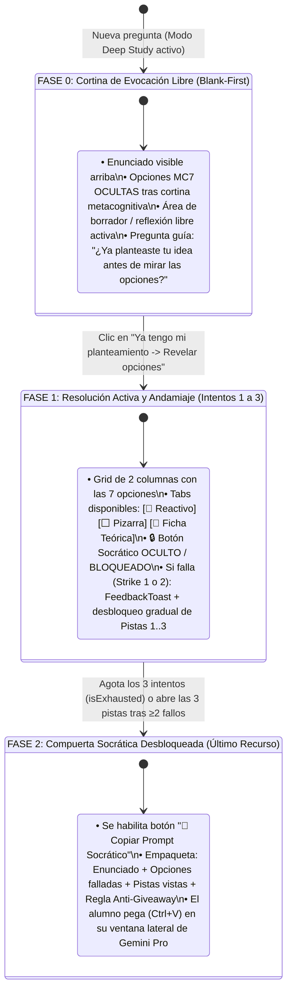

# Especificación Técnica Detallada — Milestone 6
## Antigravity Study Harness 2.0 (Multi-Panel Split-View, Modo Blank-First y Transferencia Khanmigo $0 API)

> **Documento de Especificación Técnica y Diseño de UI/UX**  
> **Hito Vinculado:** Milestone 6 en [`FUTURE_MILESTONES.md`](file:///d:/Augusto/personal_portfolio/Tops_academy/FUTURE_MILESTONES.md)  
> **Estado:** Fase 1 (layout adaptativo y container queries) ✅ CERRADA; Fase 2 (Micro-Harness cognitivo) 🛠️ EN PROGRESO.  
> **Regla de Sincronización:** Toda modificación sobre la interacción de usuario, la máquina de estados de la cortina *Blank-First*, la suite de prompts o los componentes de `platform/` debe reflejarse en este archivo y en [`FUTURE_MILESTONES.md`](file:///d:/Augusto/personal_portfolio/Tops_academy/FUTURE_MILESTONES.md).

---

## 1. Arquitectura de Flujo Cognitivo e Interacción

```mermaid
sequenceDiagram
    autonumber
    actor Estudiante
    participant Canvas as Panel 1: Question Canvas (Tops Academy)
    participant Source as Panel 2: Hoja en Blanco / Teoría en Tabs (o PDF Externo)
    participant Tutor as Panel 3: Tutor Socrático (Ventana Gemini Pro / Botón Prompt)

    Estudiante->>Canvas: Lee problema y reflexiona en ventana compacta (1/3 o 1/2 pantalla)
    alt Acierto directo
        Estudiante->>Canvas: Envía respuesta correcta
        Canvas-->>Estudiante: Refuerzo positivo inmediato + Siguiente pregunta (Flow continuo)
    else Duda o Primer Fallo (Fricción Cognitiva)
        Canvas-->>Estudiante: Mantiene opciones; estimula recuerdo activo
        Note over Estudiante,Source: Tab 1: Hoja en Blanco / Pizarra (Free Recall activo sin ver teoría)
        Estudiante->>Canvas: Reintento autónomo
    else Segundo Fallo o Consulta Teórica
        Canvas->>Source: Estudiante conmuta a Tab 2 (Teoría / Núcleo conceptual de la competencia)
        Note over Estudiante,Source: Consulta la definición, fórmulas clave y prerrequisitos del JSON sin salir de la pregunta
        Estudiante->>Canvas: Reintento basado en el análisis conceptual
    else Bloqueo Persistente
        Canvas->>Tutor: Clic en botón "Copiar Prompt Socrático" (Copia al portapapeles con anti-giveaway)
        Estudiante->>Tutor: Pega en ventana externa de Gemini Pro (Ctrl+V)
        Tutor-->>Estudiante: Guía socrática de primer principio (sin regalar la respuesta ni la letra)
        Estudiante->>Canvas: Resuelve y consolida el aprendizaje profundo
    end
```

---

## 2. Diagnóstico Estratégico y Contraste: Solo Maintainer vs. Harness Monolítico

En el diseño original del Milestone 6 se concibió un harness monolítico "todo-en-uno" con visor interno de PDFs (`react-pdf`), servidor estático de archivos fuente, metadatos `source_anchor` inyectados en el pipeline C2C y un sidecar de chat con Google Gemini embebido dentro del cliente React.

### 2.1. Contraste de Realidad Operativa (Hipótesis Huerta)
Un equipo corporativo dispone de desarrolladores 24/7 y presupuestos de tokens dedicados. En Tops Academy, el proyecto es liderado por un único mantenedor (Augusto Huerta) con acceso a un plan Pro de IA personal. Desarrollar un visor de PDF integrado y un proxy de chat LLM con consumo de API dedicada introduce una triple penalización:
1. **Sobrecosto financiero innecesario:** Pagar tokens de API por cada consulta cuando ya se dispone de una suscripción Pro activa en el navegador.
2. **Deuda técnica y consumo de RAM:** Incrustar visores de PDF pesados en React (`pdf.js` workers, problemas de CORS, Canvas scaling) cuando los visores nativos del sistema operativo y del navegador ya renderizan documentos a 60 FPS con búsqueda `Ctrl+F` instantánea.
3. **Mantenimiento sobredimensionado:** Mantener endpoints y estado multi-panel reactivo complejo en un solo dispositivo.

### 2.2. Veredicto de la Hipótesis de Ventana 1/3 – 1/2
Permitir que la plataforma se comprima limpiamente a **1/3 (~450px–640px)** o **1/2 (~680px–960px)** del ancho de la pantalla horizontal mediante Snap Layouts del sistema operativo (`Win + Z`), liberando el resto del monitor para los apuntes/PDF y para la ventana de IA Pro externa, es **arquitectónicamente superior en un 85%**. Sin embargo, para no degradar el rigor pedagógico del Harness, se deben resolver las dos brechas remanentes:
- **Preservar el principio de "Hoja en Blanco Primero":** Evitar que el alumno mire de inmediato las opciones mediante una pestaña limpia de trabajo previo (*Scratchpad*).
- **Resolver el puente contextual con la IA:** Proporcionar un botón de **1-clic ("Copiar Prompt Socrático")** que extraiga el enunciado KaTeX, el error cometido y el contrato anti-giveaway, listo para pegar en la ventana externa de Gemini Pro.

---

## 3. Matriz Comparativa: Vía Pragmática vs. Vía Monolítica

| Criterio de Comparación | Vía Pragmática (Modo 1/3–1/2 + Micro-Tabs + Prompt) | Vía Monolítica (Harness Embebido Completo) |
| :--- | :---: | :---: |
| **Tiempo de Implementación** | **~45 a 90 minutos (1 sesión de trabajo)** | **3 a 5 días hábiles de desarrollo intensivo** |
| **Costo Operativo Mensual** | **\$0.00 USD** (aprovecha la suscripción Pro personal del usuario) | **Variable según tokens de API** (Gemini Pro/Flash API calls) |
| **Complejidad Arquitectural** | **100% Frontend React/Tailwind local**, cero dependencias pesadas | Servidor de archivos estáticos, workers PDF.js, proxy API, gestión de cuotas |
| **Riesgo de Deuda Técnica** | **Mínimo** (utiliza los datos ya presentes en `courses/*.json`) | **Alto** (requiere regenerar todos los cursos para inyectar `source_anchor`) |
| **Ergonomía de Multitarea** | **Máxima:** Integración fluida con el gestor de ventanas del SO | Confinada dentro de las pestañas del navegador en un solo canvas |
| **Efecto Cognitivo (*Free Recall*)** | **Idéntico (100%):** Hoja en blanco primero, teoría en tab oculta y guía socrática | **Idéntico (100%):** Paneles sincronizados con ancla de página |

---

## 4. Arquitectura de Estados de la Cortina Metacognitiva ("Blank-First")



---

## 5. Wireframes de Interfaz (Layout 1/2 de Pantalla)

```text
┌──────────────────────────────────────────────────────────────────────┐
│ [ 📝 Reactivo ]  [ ⬜ Pizarra Libre ]  [ 📖 Ficha Teórica ]   [🧠 ON] │
├──────────────────────────────────────────────────────────────────────┤
│ ENUNCIADO (Competencia Hab-02 · Dificultad: Hard):                   │
│ Sea X_n una sucesión tal que √n(X_n - θ) -> N(0, σ²). Determine la  │
│ distribución asintótica de g(X_n) = X_n² mediante el Método Delta.   │
├──────────────────────────────────────────────────────────────────────┤
│                                                                      │
│   ╔══════════════════════════════════════════════════════════════╗   │
│   ║  🧠 FASE 1: EVOCACIÓN EN HOJA EN BLANCO (Opciones Ocultas)   ║   │
│   ║                                                              ║   │
│   ║  ¿Ya lo has intentado en papel o en tu cabeza?               ║   │
│   ║  ¿Tienes claro qué teorema aplicar y a qué forma llegar?     ║   │
│   ║                                                              ║   │
│   ║  ┌────────────────────────────────────────────────────────┐  ║   │
│   ║  │ (Opcional) Anota aquí tu derivada g'(θ) o tu idea...   │  ║   │
│   ║  └────────────────────────────────────────────────────────┘  ║   │
│   ║                                                              ║   │
│   ║   [ 💡 Ya tengo mi idea -> Revelar Opciones ]  [ No sé aún ] ║   │
│   ╚══════════════════════════════════════════════════════════════╝   │
│                                                                      │
│ 🔒 Tutor Socrático IA: bloqueado hasta agotar tus intentos y pistas  │
└──────────────────────────────────────────────────────────────────────┘
                                   │
                    (Al pulsar "Revelar Opciones")
                                   ▼
┌──────────────────────────────────────────────────────────────────────┐
│ [ 📝 Reactivo ]  [ ⬜ Pizarra Libre ]  [ 📖 Ficha Teórica ]   [🧠 ON] │
├──────────────────────────────────────────────────────────────────────┤
│ (Enunciado visible arriba...)                                        │
│ ┌────────────────────────────────┐ ┌───────────────────────────────┐ │
│ │ (A) √n(X_n² - θ²) -> N(0,4θ²σ²)│ │ (B) √n(X_n² - θ²) -> N(0,2θσ²)│ │
│ └────────────────────────────────┘ └───────────────────────────────┘ │
│ ┌────────────────────────────────┐ ┌───────────────────────────────┐ │
│ │ (C) n(X_n² - θ²) -> N(0,4θ²σ²) │ │ (D) ... (7 opciones en grid)  │ │
│ └────────────────────────────────┘ └───────────────────────────────┘ │
├──────────────────────────────────────────────────────────────────────┤
│ ▼ Pistas Progresivas (3/3 consultadas) · Intentos: ❌ ❌ ❌ (Agotados)│
│ ┌──────────────────────────────────────────────────────────────────┐ │
│ │ 🔓 Has agotado tus intentos autónomos. ¿Sigues con duda?         │ │
│ │ [ 🤖 Copiar Prompt Socrático para Gemini Pro (Anti-Giveaway) ]   │ │
│ └──────────────────────────────────────────────────────────────────┘ │
└──────────────────────────────────────────────────────────────────────┘
```

---

## 6. Suite de 4 Prompts Especializados Estilo Khanmigo ($0 API)

### Prompt 1: Tutor Socrático de Reactivo (*Anti-Giveaway*)
Se desbloquea únicamente tras agotar intentos/pistas. Se copia automáticamente al portapapeles:
```text
Actúa como un profesor universitario socrático riguroso en [NOMBRE_DEL_CURSO].
Estoy resolviendo este problema sobre la competencia "[NOMBRE_COMPETENCIA]":

ENUNCIADO:
[STEM_EN_LATEX]

MI PLANTEAMIENTO INICIAL EN HOJA EN BLANCO:
[AUDIT_TRAIL_TEXT_O_VACIO]

MI RESPUESTA INCORRECTA:
[OPCION_SELECCIONADA]
DIAGNÓSTICO DEL SISTEMA:
[ERROR_RATIONALE]

REGLA ESTRICTA ANTI-GIVEAWAY:
NO me des la respuesta correcta ni me indiques qué opción marcar.
Hazme UNA sola pregunta conceptual de primer principio que me ayude a detectar dónde cometí el error de razonamiento o qué supuesto pasé por alto.
```

### Prompt 2: Puente de Analogías (*"Explain Like I'm Intuiting It"*)
Disponible en `PreExerciseModal.tsx` y en la pestaña *Ficha Teórica*:
```text
Actúa como un experto pedagógico en [NOMBRE_DEL_CURSO].
Explícame el concepto "[NOMBRE_COMPETENCIA]" usando una analogía cotidiana o intuición física antes del formalismo matemático.
Supuestos clave del modelo:
[LISTA_ASSUMPTIONS]
No resuelvas un ejercicio numérico; concéntrate en transmitir la intuición geométrica o causal.
```

### Prompt 3: Debate de Ruptura de Supuestos (*"Challenge My Assumptions"*)
Entrenamiento directo para el Arquetipo 4 (Casos Frontera):
```text
Actúa como un examinador socrático en [NOMBRE_DEL_CURSO].
Para el modelo gobernado por estos supuestos:
[LISTA_ASSUMPTIONS_CON_VIOLATION_CONSEQUENCE]

Plantéame un contraejemplo concreto o un choque donde uno de estos supuestos se viole. 
Hazme una pregunta para ver si puedo identificar qué propiedad del estimador o teorema colapsa.
```

### Prompt 4: *Snapshot* Diagnóstico de Sesión (`CompletionScreen.tsx`)
Empaqueta el desempeño de la sesión:
```text
Actúa como mi mentor académico en [NOMBRE_DEL_CURSO]. Acabo de terminar una sesión de estudio:
- Habilidades promovidas: [LISTA_PROMOVIDAS]
- Habilidades degradadas: [LISTA_DEGRADADAS]
- Trampas conceptuales cometidas: [LISTA_ERROR_RATIONALE]

Diseña un micro-plan de estudio de 15 minutos enfocado en reparar los conceptos que provocaron las degradaciones.
```

---

## 7. Plan de Ejecución de la Fase 2 del Micro-Harness
1. **Paso 1:** Agregar selector de tabs en cabecera de `PracticeSession.tsx` (`[ 📝 Reactivo ]`, `[ ⬜ Pizarra ]`, `[ 📖 Ficha Teórica ]`).
2. **Paso 2:** Implementar la cortina *Blank-First* como un flag configurable en sesión (`showBlankFirst: boolean`), con persistencia del texto en `sessionStorage`.
3. **Paso 3:** Implementar compuerta estricta: `isExhausted || (hintsViewedCount >= 3 && wrongAttempts >= 2)` para habilitar el botón de copiado de prompt socrático.
4. **Paso 4:** Superposición de `<canvas>` táctil/ratón sobre `<CoordinatePlane />` con `PointerEvents`.
