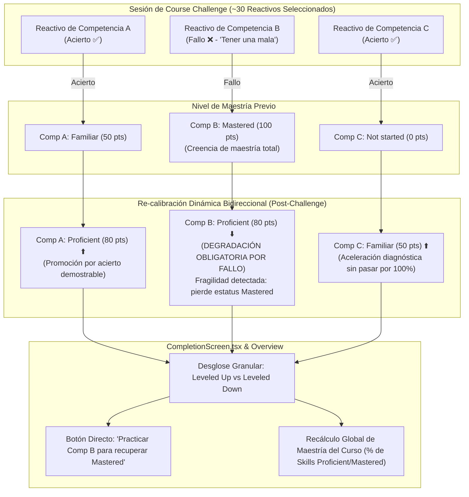

# Especificación Técnica Detallada — Milestone 14
## Motor de Maestría Integral 2.0 Estilo Khan Academy (Calibración Bidireccional en Challenge/Test/Quiz, Híbrido 80/20, Hint-Cap y Simulador Adaptativo)

> **Documento de Especificación Técnica y Psicométrica**  
> **Hito Vinculado:** Milestone 14 en [`FUTURE_MILESTONES.md`](file:///d:/Augusto/personal_portfolio/Tops_academy/FUTURE_MILESTONES.md)  
> **Estado:** ✅ **COMPLETADO / VERIFICADO (Nov 2026) — Componentes Core, Fluidez y Recomendantes.**  
> **Regla de Sincronización:** Cualquier ajuste en la lógica de transiciones de maestría, penalización por fallo, cálculo global o componentes de `platform/src/utils/masteryStorage.ts` debe registrarse en este archivo y en [`FUTURE_MILESTONES.md`](file:///d:/Augusto/personal_portfolio/Tops_academy/FUTURE_MILESTONES.md).

---

## 1. Fundamentos Psicométricos y Pedagógicos (Estándar Khan Academy)



1. **Evaluación Transversal, No Maestría Automática (*Assessment, Not Full Mastery*):**
   - El Course Challenge consta de ~30 preguntas estratificadas a lo largo de todo el árbol curricular.
   - Rendir o aprobar el Course Challenge ajusta los niveles de cada destreza individualmente, pero **no infla ciegamente todas las competencias al 100%**.
2. **Impacto en Niveles de Habilidad (Ajuste Bidireccional):**
   - Concluir una evaluación recalibra los niveles individuales (`Not started` $\leftrightarrow$ `Attempted` $\leftrightarrow$ `Familiar` $\leftrightarrow$ `Proficient` $\leftrightarrow$ `Mastered`) según el desempeño específico en cada competencia.
3. **Penalización y Degradación Estricta por Fallo Individual (*"En Caso de Tener una Mala"*):**
   - Si un alumno ostentaba una competencia en nivel `Mastered` (100 pts) o `Proficient` (80 pts) y durante el Course Challenge falla la pregunta de esa competencia, **la plataforma degrada inmediatamente su nivel** (`Mastered` $\to$ `Proficient`, o `Proficient` $\to$ `Familiar`).
   - Erradica la "maestría como trofeo estático inmutable": un error en un examen acumulativo demuestra fragilidad en la recuperación (*retrieval failure*) o interferencia proactiva/retroactiva que requiere remediación deliberada.

---

## 2. Matriz Canónica de Transición de Niveles en Evaluaciones Intercaladas

Cada pregunta contestada en `Course Challenge`, `Unit Test` o `Quiz` se mapea a su `competency_id`:

| Nivel Previo de la Skill | Desempeño en Pregunta(s) | Nuevo Nivel de la Skill | $\Delta$ Puntos | Efecto Pedagógico / Psicométrico |
| :--- | :---: | :---: | :---: | :--- |
| **`Mastered` (100 pts)** | ❌ **Incorrecta (Fallo)** | **`Proficient`** | **$-20$ pts** | **Degradación:** Pierde la maestría total ante evidencia de fallo. Obliga a re-evaluar la destreza. |
| **`Mastered` (100 pts)** | ✅ **Correcta (Acierto)** | **`Mastered`** | **$0$ pts** | **Ratificación:** Confirma retención a largo plazo y estabilidad en memoria activa. |
| **`Proficient` (80 pts)** | ❌ **Incorrecta (Fallo)** | **`Familiar`** | **$-30$ pts** | **Degradación:** Pierde la categoría intermedia por error conceptual; se sugiere práctica deliberada. |
| **`Proficient` (80 pts)** | ✅ **Correcta (Acierto)** | **`Proficient`** *(o `Mastered` si acumula Unit Test previo $\ge 80\%$ y 0 fallos históricos)* | **$0$ a $+20$ pts** | **Consolidación:** Mantiene solidez; puede alcanzar `Mastered` si cumple condición de prueba acumulada. |
| **`Familiar` (50 pts)** | ❌ **Incorrecta (Fallo)** | **`Attempted`** | **$-25$ pts** | **Degradación:** Retrocede a nivel elemental de intento. |
| **`Familiar` (50 pts)** | ✅ **Correcta (Acierto)** | **`Proficient`** | **$+30$ pts** | **Promoción:** Valida suficiencia operativa y eleva a nivel intermedio. |
| **`Attempted` (25 pts)** | ❌ **Incorrecta (Fallo)** | **`Attempted`** | **$0$ pts** | **Contención:** Registra el intento fallido sin cambios de nivel negativo. |
| **`Attempted` (25 pts)** | ✅ **Correcta (Acierto)** | **`Familiar`** | **$+25$ pts** | **Promoción:** Supera el umbral introductorio demostrando resolución correcta. |
| **`Not started` (0 pts)** | ❌ **Incorrecta (Fallo)** | **`Attempted`** | **$+25$ pts** | **Iniciación:** Marca la competencia como abordada por primera vez. |
| **`Not started` (0 pts)** | ✅ **Correcta (Acierto)** | **`Familiar`** | **$+50$ pts** | **Aceleración Diagnóstica:** Valida conocimiento previo significativo saltando al nivel *Familiar*. |

### Regla de Multi-Reactivo por Competencia
Si una evaluación incluye más de una pregunta de la misma competencia:
- **Acierto $\ge 80\%$:** Promoción o ratificación de nivel.
- **Acierto entre $50\%$ y $79\%$:** Retiene nivel actual (excepto si estaba en `Mastered`, en cuyo caso cualquier error degrada a `Proficient`).
- **Acierto $< 50\%$:** **Degradación estricta de 1 nivel hacia abajo**.

---

## 3. Extensión de Tipos y Métodos en `masteryStorage.ts`

```typescript
export interface ChallengeSkillResult {
  competency_id: string;
  competency_name: string;
  total_questions: number;
  correct_questions: number;
  previous_tier: MasteryTier;
  new_tier: MasteryTier;
  direction: 'up' | 'down' | 'maintained';
}

export interface ChallengeExecutionSummary {
  record: CourseMasteryRecord;
  overall_score: number;
  overall_total: number;
  overall_percentage: number;
  skills_leveled_up: ChallengeSkillResult[];
  skills_leveled_down: ChallengeSkillResult[];
  skills_maintained: ChallengeSkillResult[];
}

export function updateCourseChallengeWithSkillCalibration(
  course: Course,
  questionResults: Array<{ question: Question; isCorrect: boolean }>
): ChallengeExecutionSummary;
```

---

## 4. Las Extensiones Estructurales del Motor Khan Academy 2.0

1. **Calibración Cross-Skill en `Quiz` y `Unit Test` Intercalados:**
   - Dado que `sessionShuffler.ts` inyecta preguntas de prerrequisitos y unidades previas en `Quiz` y `Unit Test`, `handleCompleteSession` aplica actualización atómica por `question.competency_id` en toda sesión intercalada.
2. **Fórmula Híbrida 80/20 en `calculateCourseProgress`:**
   - Promedio de Unit Tests aporta 0–80% y Course Challenge (100% requerido) aporta el 20% restante, requiriendo 100% en ambos para el estatus *Completed* (Verde Fuerte).
3. **Maestría Autónoma vs. Asistida por Pistas (*Hint-Assisted Cap*):**
   - Consultar la Pista 1 (recordatorio suave) no penaliza; abrir las Pistas 2 a 5 marca el reactivo como `assisted = true`, topando el ascenso máximo en `Familiar` (50 pts) hasta demostrar evocación autónoma.
4. **Degradación en Práctica/Quiz + Indicador *Red Dot* (`needs_review`):**
   - Cometer errores en una práctica o quiz enciende el indicador ámbar/rojo (*"Needs Review"*) en `MasteryGrid.tsx` y en el header de la unidad.
5. **Motor Persistente *"Up Next for You"* con Jerarquía Pedagógica de 5 Niveles (`CourseOverview.tsx`):**
   - El banner no desaparece y guía continuamente al estudiante:
     - **Prioridad 1 (Remediación):** Si existen unidades con `needs_review: true` (rojo/ámbar), recomienda `"Repasar ahora ➔"` para la primera unidad afectada.
     - **Prioridad 2 (Nueva Unidad):** Recomienda la primera unidad en orden ordinal no iniciada (`Not started`) con `"Comenzar práctica ➔"`.
     - **Prioridad 3 (Unit Test Pendiente):** Recomienda la primera unidad cuyo Unit Test no esté al 100% con `"Rendir Unit Test ➔"`.
     - **Prioridad 4 (Course Challenge):** Recomienda `"Rendir Course Challenge ➔"` una vez que todos los Unit Tests están al 100%.
     - **Prioridad 5 (Maestría Total):** Banner de felicitación por alcanzar el 100% con botón `"Darle otra repasada ➔"`.
6. **Sistema de Fluidez y Telemetría de Tiempos:**
   - Medición de latencia por reactivo en `PracticeSession.tsx` (con tope de seguridad de 300 s contra abandono y sin pausa por cambio de pestaña).
   - Récord personal (`best_avg_seconds_per_question`) actualizado **únicamente con 100% de aciertos**.
   - Pantalla previa unificada `PreExerciseModal.tsx` con metas de récord de tiempo.
   - Evaluación estricta en `CompletionScreen.tsx`: `⬆️ Leveled Up`, `🔻 Leveled Down` o `⏸️ No change` basados en `TIER_POINTS`.
   - Consolidación por unidad de las áreas a reforzar evitando filas duplicadas.
7. **[POSTERGADO / FUERA DE ALCANCE] Simulador Adaptativo de Examen Parcial en 2 Módulos (SAT Bluebook):**
   - El enrutamiento dinámico a mitad de prueba (Módulo 1 diagnóstico $\to$ Módulo 2 Estándar vs. Avanzado) y el cronómetro de examen con cuenta regresiva universitario fueron postergados y desacoplados formalmente hacia **Milestone 14-B**.

---

## 5. Criterios de Aceptación Cumplidos (AC-32 a AC-36)
- **AC-32 (Calibración Granular por Skill):** Actualización atómica de `record.competencies[comp_id]` tras Course Challenge (`updateCourseChallengeWithSkillCalibration`).
- **AC-33 (Degradación Obligatoria ante Fallo):** Todo error en `Mastered` degrada a `Proficient` ($100 \to 80$ pts); en `Proficient` degrada a `Familiar` ($80 \to 50$ pts); en `Familiar` degrada a `Attempted` ($50 \to 25$ pts).
- **AC-34 (Promoción Progresiva ante Acierto):** Ningún Challenge individual promueve de `Not started` a `Mastered` directamente (*Assessment, Not Full Mastery*).
- **AC-35 (Desglose Visual en UI):** `CompletionScreen.tsx` despliega bloques diferenciados `Leveled Up`, `Leveled Down` y `No change`, tiempo promedio, tiempo total y áreas a reforzar consolidadas.
- **AC-36 (Trazabilidad y Pruebas Unitarias):** Registro en `history` del evento `{ date, score, total, type, previous_tier, new_tier, total_seconds, avg_seconds_per_question }`. Verificado con [`tests/test_mastery_calibration_bidirectional.py`](file:///d:/Augusto/personal_portfolio/Tops_academy/tests/test_mastery_calibration_bidirectional.py).

---

## 6. Registro de Decisiones de Alcance y Elementos Obviados en la Sesión de Desarrollo (Nov 2026)

Durante el alineamiento técnico de la sesión de desarrollo (ronda *Grill-Me* y plan de ejecución aprobado), se establecieron los siguientes límites explícitos de alcance:

| Componente | Estado en esta Entrega | Justificación Técnica / Pedagógica | Hito Destino |
| :--- | :---: | :--- | :---: |
| **Calibración Bidireccional de Maestría** | ✅ **Implementado** | Núcleo psicométrico esencial de Khan Academy en `masteryStorage.ts`. | Milestone 14 |
| **Degradación Inmediata por Fallo** | ✅ **Implementado** | Erradica la maestría como trofeo inmutable; degradación de $-20$ y $-30$ pts. | Milestone 14 |
| **Hint-Cap (Tope en Familiar por pistas 2–5)** | ✅ **Implementado** | Honestidad cognitiva: penaliza la dependencia de muletas. | Milestone 14 |
| **Telemetría de Tiempos y Récord (100% aciertos)** | ✅ **Implementado** | Fluidez de Sistema 1: `best_avg_seconds_per_question` y `last_avg`. | Milestone 14 |
| **Pantalla Previa Unificada (`PreExerciseModal`)** | ✅ **Implementado** | Visualización de récords antes de Practice, Quiz, Test y Challenge. | Milestone 14 |
| **Motor Persistente 'Up Next for You' (5 Niveles)** | ✅ **Implementado** | Jerarquía pedagógica ininterrumpida orientada al menor ordinal y remediación. | Milestone 14 |
| **Consolidación de Áreas a Reforzar** | ✅ **Implementado** | Agrupa fallos por unidad eliminando filas duplicadas en `CompletionScreen`. | Milestone 14 |
| **Simulador Cronometrado 2 Módulos (SAT Bluebook)** | ⏳ **Obviado / Postergado** | Desacoplado para evitar sobrecargar el hito; requiere arnés de router adaptativo M1 $\to$ M2. | **Milestone 14-B** |
| **Decaimiento Temporal Ebbinghaus (SRS)** | ⏳ **Obviado / Delegado** | La degradación por paso de días (14 y 45 días sin práctica) pertenece a retención espaciada. | **Milestone 8** |
| **Mastery Challenge con Cooldown de 12 Horas** | ⏳ **Obviado / Delegado** | Tarjeta de evocación rápida con bloqueo temporal para retención a largo plazo. | **Milestone 8** |
