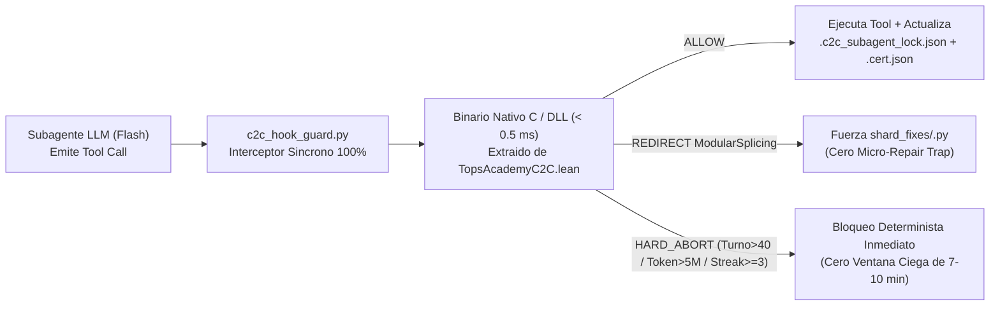

# Especificación Técnica Detallada — Milestones 15 a 18
## Certificación Formal Neuro-Simbólica, Gobernanza FSM en Lean 4, Deducción SMT Z3 y Arnés de Verificación Continua

> **Documento de Especificación Técnica, Verificación Formal y Kernel Matemático**  
> **Hitos Vinculados:** Milestones 15, 16, 17 y 18 en [`FUTURE_MILESTONES.md`](file:///d:/Augusto/personal_portfolio/Tops_academy/docs/future_milestones/FUTURE_MILESTONES.md)  
> **Estado:** Fases 1 (isomórficas en Python) ✅ CERRADAS; M17 (**✅ Cerrado: DAG `cta_merge.py` ✅, $\alpha_{\text{Kernel}}=0$ `judge.py` ✅ y Clausura Epistémica `engine/epistemic_closure.py` ✅** con **hard gate quirúrgico `[TPL-EPISTEMIC-CLOSURE]` en `open_symbolic` `expected_answer`** [`0/497` falsos positivos] y modo `WARN` en `detailed_solution`); M16 F2 (**Fase 1 `[Z3-RULE-WARNING]` en `engine/shard_ast_transforms.py` ✅** en modo sombra, `0` falsos positivos en `805` plantillas; Fase 2 AST acotado en `check_templates.py` **P1**); M18 (**Compuerta Prompt-Compiler CI ✅** + Benchmark SLA **P1**); M15 F2 (**DRT `Hypothesis` `tests/pipeline/test_c2c_hook_guard_drt.py` ✅**, binario Lean 4 FFI diferido a **P3 Investigación**).  
> **Regla de Sincronización:** Cualquier ajuste en los teoremas formales, contratos de `formal/TopsAcademyC2C.lean`, esquemas en `engine/interstage_schemas.py` o hooks de `c2c_hook_guard.py` debe registrarse en este archivo y en [`FUTURE_MILESTONES.md`](file:///d:/Augusto/personal_portfolio/Tops_academy/docs/future_milestones/FUTURE_MILESTONES.md).

---

## 1. Arquitectura del Kernel Formal de Gobernanza (Milestone 15)

### Los 6 Teoremas Constructivos de `formal/TopsAcademyC2C.lean`
Auditados formalmente con `#print axioms`, libres de `sorry` y dependientes únicamente de la lógica intuicionista estándar:
1. **Teorema 1 (`competencias_certificadas_monotonas`):** $K_t \subseteq K_{t+1}$ — ninguna transición válida ni ola de reparación destruye competencias ya certificadas fuera del conjunto explícito invalidado.
2. **Teorema 2 (`exclusividad_publicacion_stage6`):** Es matemáticamente imposible alcanzar el estado `Published` sin certificados válidos de todas las etapas previas y `passed_50_seeds = true`.
3. **Teorema 3 (`seguridad_presupuestaria_tokens`):** Ningún paso o secuencia de pasos puede violar $\text{tokensConsumidos} \le \text{presupuestoTokens}$ (5M tokens/subagente) ni $\text{turn\_count} \le 40$.
4. **Teorema 4 (`progreso_estricto_sin_ciclos_infinitos`):** Toda transición válida reduce estrictamente una medida de energía bien fundada $\mathcal{E}(s) \in \mathbb{N}$ o transita a `Failed` al alcanzar $\text{maxSameErrorStreak} = 3$, garantizando terminación finita (*Liveness*).
5. **Teorema 5 (`erradicacion_trampa_micro_reparaciones` — Función 2D `decidirEstrategiaEdicion`):** Formaliza que si $1 \le \text{errores} < 6$ y $\text{lineasInfractoras} \le 5$, se exige `edit_file`; si $\text{errores} \ge 6$ o $\text{lineasInfractoras} > 5$, se bloquea la edición in-place y se redirige a `ModularSplicing`.
6. **Teorema 6 (`dominancia_arbitraje_kernel_lean4`):** Formaliza $\alpha_{\text{Kernel}} = 0$ — cuando el verificador formal refuta una instancia o aprueba una identidad algebraica, su veredicto domina estrictamente cualquier consenso estocástico de jueces LLM.

### Compilación Nativa Perceus C (`< 0.5 ms`) y FFI
El código Lean 4 se compila mediante `lake build` a binario nativo C vía *Perceus Reference Counting* (FBIP), exportando la función `@[export c2c_verify_transition_c]`. `c2c_hook_guard.py` la invoca síncronamente vía `ctypes`/FFI con sobrecarga $< 0.5\text{ ms}$, eliminando la latencia de intérpretes externos.

---

## 2. Deducción Algebraica Automática con `z3-solver` en Python (Milestone 16 Fase 2 — P1)

- **Elección de Arquitectura Híbrida (`z3-solver` + `SymPy` + `Seeds`, descartando `cvc5` y lemas Lean 4):** Benchmark empírico en Python `3.12` (Windows x64) comparando `z3-solver 5.4.1.0`, `cvc5 1.4.2`, `SymPy` y el pipeline actual (`check_templates.py`, `engine/instantiate.py`):
  - **Arranque en frío:** `import z3` = **`68.34 ms`** | `import cvc5` + `pythonic` = **`184.84 ms`** (`172.18 + 12.66 ms`) | `import sympy` = **`432.55 ms`** | `warm_up_sandbox()` = **`856.32 ms`**.
  - **Colisiones y clones con dominio (`TPL-D4` / `If` / `x > 0, α ∈ (0,1)`):** `z3` resuelve colisión rara (`2a = b²` en `[2, 20]`) en **`10.994 ms`** (`sat`, `[a=18, b=6]`) y prueba plantilla segura (`2a+1 = 2b`) en **`2.192 ms`** (`unsat`), frente a `107.10 ms` (Stage 3, `50` seeds) / `129.93 ms` (Stage 4) y frente a `SymPy` sin suposiciones que falla (`False`, `85.058 ms`) donde `z3` certifica equivalencia en **`2.283 ms`** (`unsat`).
  - **No lineal pesado vs. Trascendentes:** `z3` resolvió los 3 casos no lineales (`NRA` 4 vars grado 5 en `9.499 ms` `sat`, `NIA` 6 vars en `28.325 ms` `sat`, Cobb-Douglas cúbica en `6.282 ms` `unsat`), mientras `cvc5` devolvió `unknown` en los 3 (`245–563 ms`). En trascendentes (`exp`, `ln`, `sin`), `z3` no aplica y `cvc5` hizo timeout/`unknown` en `ln(ab)=ln(a)+ln(b)` (`1093.38 ms`), `sin²+cos²=1` (`503.64 ms`) y `exp(x)=2` (`505.01 ms`), ganando **`SymPy` (`positive=True`, `12.88 ms`) + `seeds` numéricas (`0.046 ms`, error `1.33e-15`)**.
- **Por qué no desaparecen los `seeds`:** Stage 4 debe instanciar reactivos reales (`~8.3–8.5 s` en Mateco/Estadística) y Stage 3 validar KaTeX/texto y funciones trascendentes; traducir Python imperativo libre de `generate(rng)` a Z3 tomaría ~1–2 semanas sin cubrir el 100%.
- **Implementación en 2 fases (~1–2 días total, alto ROI):**
  1. **Fase 1 (`✅` en modo sombra `[Z3-RULE-WARNING]`):** `_z3_check_sympy_equiv(..., timeout_ms=150)` integrado en [`engine/shard_ast_transforms.py`](file:///d:/Augusto/personal_portfolio/Tops_academy/.agents/skills/content-to-course/engine/shard_ast_transforms.py) cuando `SymPy` falla o no reduce a cero, emitiendo `[Z3-RULE-WARNING]` sin bloquear Stage 3. Medido sobre los 3 cursos reales (`mateco_4_optimizacion_v20_k_3`, `estadistica_3_pre_pc2_m20`, `solow_m20_v5`, `805` plantillas totales): **`0` falsos positivos**, **`68.12–127.93 ms`** totales de análisis anti-clon.
  2. **Fase 2 (`~1 día`):** analizador AST acotado en `check_templates.py` únicamente para plantillas declarativas simples (sin bucles ni trascendentes) para certificar `TPL_D4_Universal` sobre todo `rng.randint(a, b)`, manteniendo `SymPy` (`positive=True`) + `seeds` para el resto. *(Se descartan `cvc5`, traducción imperativa completa y lemas manuales Lean 4 por ROI).*

---

## 3. DAG Curricular, Clausura Epistémica y Arbitraje Ciego (Milestone 17 — P0)

1. ✅ **Certificación del DAG Curricular (`ReglasStage1`):** Ordenamiento topológico estable (`cta_merge.py`), conectividad y aciclicidad (`connected_components == 1`, `root_ratio <= 0.20`) y monotonicidad epistémica $K_t \subseteq K_{t+1}$ en ejecuciones `--append`.
2. ✅ **Auditor de Clausura Epistémica de Símbolos Libres ([`engine/epistemic_closure.py`](file:///d:/Augusto/personal_portfolio/Tops_academy/.agents/skills/content-to-course/engine/epistemic_closure.py)):** Reutiliza `KaTeXAST.parse` (corrigiendo de paso un bucle infinito ante `}` huérfana en `KaTeXParser.parse_item()`) y opera con alcance dual en `check_templates.py`:
   - **Hard Gate quirúrgico `[TPL-EPISTEMIC-CLOSURE]` en `open_symbolic` (`expected_answer`):** bloquea en Stage 3 variables simbólicas de respuesta no declaradas en `stem_variants` (en `$...$` o `` `var` ``), certificado con **`0/497` (`0.00%`) falsos positivos** en Mateco (`0/177`), Estadística (`0/224`) y Solow (`0/96`).
   - **Modo `WARN` `[EPISTEMIC-CLOSURE-WARNING]` en `detailed_solution`:** informativo no bloqueante tras calibración (`12.36%` Mateco, `15.47%` Estadística, `20.60%` Solow) sin disparar re-compilaciones LLM por notación explicativa.
3. ✅ **Arbitraje Neuro-Simbólico Bicameral con $\alpha_{\text{Kernel}} = 0$:** Implementado en [`judge.py`](file:///d:/Augusto/personal_portfolio/Tops_academy/.agents/skills/content-to-course/judge.py#L1902) (dominancia formal matemática absoluta + Cámara Epistémica LLM de 1 semilla por plantilla).

---

## 4. Arnés de Certificación Continua y Anti-Drift (Milestone 18 — Recortado P1)

1. **✅ Compuerta CI de Auto-Compilación de Prompts (`tests/pipeline/test_system_prompts_compile_clean.py`):** Extrae y valida en CI los bloques `Hab-01` y `C-02` (`MC7` + `open_symbolic` + `invariant_canvas`), los 5 micro-ejemplos M20 (`proof_dag`, `adversarial_break` `find_fallacy`/`counterexample`, `unstructured_model`, `concept_matching`) y `ast.parse` de todos los bloques Python en `system_prompts/lean/*.md`, evitando que el compilador evolucione dejando obsoletos los ejemplos de los subagentes.
2. **⏳ Benchmark SLA C2C v4.0:** Control continuo de regresiones de tiempo (`< 12.0 min`), consumo de tokens (`< 12M`) y tasa de compilación en Turno 1.
3. *(Elementos recortados/diferidos)*: Se descarta expandir `engine/interstage_schemas.py` hacia JSONs intermedios que el workflow en memoria (`c2c_wave_workflow.py`) ya no emite en disco; el arnés `#print axioms` con nonce queda condicionado a si se retoma `formal/TopsAcademyC2C.lean` en P3 Investigación.
