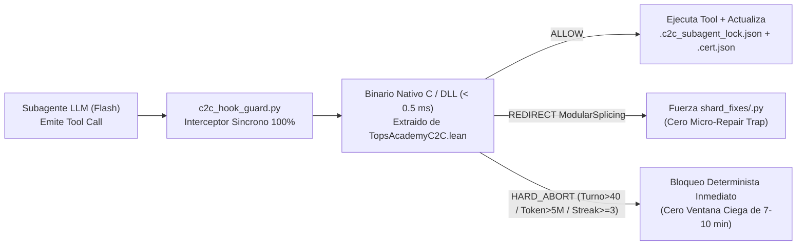

# Especificación Técnica Detallada — Milestones 15 a 18
## Certificación Formal Neuro-Simbólica, Gobernanza FSM en Lean 4, Deducción SMT Z3 y Arnés de Verificación Continua

> **Documento de Especificación Técnica, Verificación Formal y Kernel Matemático**  
> **Hitos Vinculados:** Milestones 15, 16, 17 y 18 en [`FUTURE_MILESTONES.md`](file:///d:/Augusto/personal_portfolio/Tops_academy/FUTURE_MILESTONES.md)  
> **Estado:** Fases 1 (isomórficas en Python) ✅ CERRADAS; Fases 2 (Kernel nativo C, Z3, FFI y arnés `#print axioms`) 🛡️ EN HOJA DE RUTA ACTIVA.  
> **Regla de Sincronización:** Cualquier ajuste en los teoremas formales, contratos de `formal/TopsAcademyC2C.lean`, esquemas en `engine/interstage_schemas.py` o hooks de `c2c_hook_guard.py` debe registrarse en este archivo y en [`FUTURE_MILESTONES.md`](file:///d:/Augusto/personal_portfolio/Tops_academy/FUTURE_MILESTONES.md).

---

## 1. Arquitectura del Kernel Formal de Gobernanza (Milestone 15)



### Los 6 Teoremas Constructivos de `formal/TopsAcademyC2C.lean`
Auditados formalmente con `#print axioms`, libres de `sorry` y dependientes únicamente de la lógica intuicionista estándar:
1. **Teorema 1 (`competencias_certificadas_monotonas`):** $K_t \subseteq K_{t+1}$ — ninguna transición válida ni ola de reparación destruye competencias ya certificadas fuera del conjunto explícito invalidado.
2. **Teorema 2 (`exclusividad_publicacion_stage6`):** Es matemáticamente imposible alcanzar el estado `Published` sin certificados válidos de todas las etapas previas y `passed_50_seeds = true`.
3. **Teorema 3 (`seguridad_presupuestaria_tokens`):** Ningún paso o secuencia de pasos puede violar $\text{tokensConsumidos} \le \text{presupuestoTokens}$ (5M tokens/subagente) ni $\text{turn\_count} \le 40$.
4. **Teorema 4 (`progreso_estricto_sin_ciclos_infinitos`):** Toda transición válida reduce estrictamente una medida de energía bien fundada $\mathcal{E}(s) \in \mathbb{N}$ o transita a `Failed` al alcanzar $\text{maxSameErrorStreak} = 3$, garantizando terminación finita (*Liveness*).
5. **Teorema 5 (`erradicacion_trampa_micro_reparaciones` — Función 2D `decidirEstrategiaEdicion`):** Formaliza que si $1 \le \text{errores} < 6$ y $\text{lineasInfractoras} \le 5$, se exige `edit_file`; si $\text{errores} \ge 6$ o $\text{lineasInfractoras} > 5$, se bloquea la edición in-place y se redirige a `ModularSplicing`.
6. **Teorema 6 (`dominancia_arbitraje_kernel_lean4`):** Formaliza $\alpha_{\text{Kernel}} = 0$ — cuando el verificador formal refuta una instancia o aprueba una identidad algebraica, su veredicto domina estrictamente cualquier consenso estocástico de jueces LLM.

### Compilación Nativa Perceus C (`< 0.5 ms`) y FFI
El código Lean 4 se compila mediante `lake build` a binario nativo C vía *Perceus Reference Counting* (FBIP), exportando la función `@[export c2c_verify_transition_c]`. `c2c_hook_guard.py` la invoca síncronamente vía `ctypes`/FFI con sobrecarga $< 0.5\text{ ms}$, eliminando la latencia de intérpretes externos.

---

## 2. Deducción Algebraica Automática con Z3 y Lean 4 (Milestone 16 Fase 2)

- **Solver SMT Z3:** Demostración universal de invariantes `TPL_D4_Universal` y `Zero_Magic_Mult_Universal` directamente sobre expresiones simbólicas parametrizadas en $rng.randint(a, b)$.
- **Tácticas Lean 4 (`omega`, `ring`, `grind`):** Certificación matemática de equivalencia algebraica entre la fórmula de la clave y las funciones generadoras, garantizando que los 4 arquetipos posean expresiones AST disjuntas.

---

## 3. DAG Curricular, Clausura Epistémica y Arbitraje Ciego (Milestone 17)

1. **Certificación del DAG Curricular (`ReglasStage1`):** Ordenamiento topológico estricto, detección de aciclicidad y conectividad en `cta_merge.py`, garantizando monotonicidad $K_t \subseteq K_{t+1}$ en ejecuciones `--append`.
2. **Auditor de Clausura Epistémica de Símbolos Libres:** Linter léxico-simbólico que verifica que el conjunto de símbolos matemáticos en la solución satisfaga $S_{\text{sol}} \subseteq S_{\text{stem}} \cup S_{\text{std}}$, bloqueando enunciados incompletos (como `Hab-19` sin función de utilidad o `C-01` con ambigüedad de dominio).
3. **Arbitraje Neuro-Simbólico Bicameral con $\alpha_{\text{Kernel}} = 0$:**
   - **Cámara Formal (`SymPy`/`Z3`/Lean 4):** Certifica la verdad matemática con poder de veto absoluto.
   - **Cámara Epistémica LLM (1 semilla pre-verificada por plantilla):** Evalúa exclusivamente claridad verbal, ausencia de giveaways y tono pedagógico.

---

## 4. Arnés de Certificación Continua y Anti-Drift (Milestone 18)

1. **Contrato Único Tipado Inter-Etapa (`engine/interstage_schemas.py`):** Esquemas Pydantic únicos para `compile_<id>.json`, `pass_<id>.json`, `template_failures.json`, `publish_rejection_spec.json` y `*.cert.json`, impidiendo desincronizaciones de claves entre productor y consumidor.
2. **Auditoría Anti-Trampas `#print axioms` con Nonce Criptográfico:** Verificador independiente que inyecta `#print axioms <teorema>` sellado con un nonce por corrida, certificando que las demostraciones dependen únicamente de `{propext, Classical.choice, Quot.sound}` y bloqueando `sorry`, `unsafe` o `axiom` espurios.
3. **Compuerta CI de Auto-Compilación de Prompts (`test_system_prompts_compile_clean.py`):** Extrae los bloques canónicos ```python de los system prompts y los compila contra `compile_shard.py` con compuertas de Stage 6, impidiendo que el compilador evolucione dejando obsoletos los ejemplos de los agentes.
