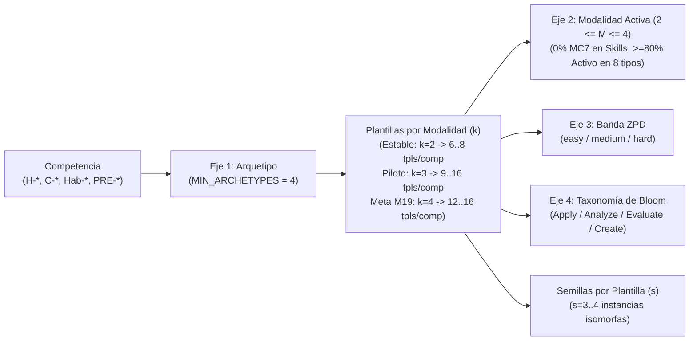

# Arquitectura de Problemas en Top's Academy: Los 4 Ejes, Estándar Estable $k=2$ (Milestone 20) y Especificación de Escalamiento *First-Pass & Quota-Safe* hacia $k=4$ (Milestone 19)

> **Especificación Técnica Canónica de los Milestones 19 y 20**  
> **Última Actualización:** 2026-11-22 (Sincronizada con [`FUTURE_MILESTONES.md`](file:///d:/Augusto/personal_portfolio/Tops_academy/docs/future_milestones/FUTURE_MILESTONES.md), [`engine/stage_contract.py`](file:///d:/Augusto/personal_portfolio/Tops_academy/.agents/skills/content-to-course/engine/stage_contract.py), [`engine/c2c_ver.py`](file:///d:/Augusto/personal_portfolio/Tops_academy/.agents/skills/content-to-course/engine/c2c_ver.py), `compile_shard.py`, `c2c_hook_guard.py`, las 6 Palancas FTP (*First-Time Pass*) y las auditorías forenses de `mateco_4_optimizacion_plus`, `mateco_4_optimizacion_v20` [$k=2$], `mateco_4_optimizacion_v20_k_3` [$k=3$] y la serie experimental `solow_m20_v6..v13` [$k=2..3$]).

Este documento especifica la arquitectura vigente de creación y validación de problemas en el pipeline `content-to-course` tras el cierre de **Milestone 20 (Core + 20-B Modo Hierro)**, consolida **`k = 2` (`DEFAULT_TEMPLATES_PER_MODALITY = 2`) como estándar estable de producción**, documenta el contraste empírico de las 3 generaciones del curso de Matemática para Economistas IV (`plus`, `v20` y `v20_k_3`), y define la ingeniería detallada del **Milestone 19** para escalar a **$k = 4$ (`1,284+` reactivos)** sin agotar la cuota de tokens del plan Google AI Pro.

---

## 1. Arquitectura Vigente de Creación de Problemas en Producción: Los 4 Ejes (`engine/stage_contract.py`)

Cada plantilla definida en `TEMPLATES` es una tupla de 9 elementos (`[tpl_id, cid, qtype, gen_fn, ver_fn, (difficulty, bloom), stems, hints, sol]`) gobernada por [`engine/stage_contract.py`](file:///d:/Augusto/personal_portfolio/Tops_academy/.agents/skills/content-to-course/engine/stage_contract.py) que cruza **4 ejes ortogonales**:

### Eje 1: El Arquetipo (Qué razonamiento se le exige al estudiante)
El contrato `Form-C Quad-Band` (`MIN_ARCHETYPES = 4`) exige cubrir los 4 ángulos cognitivos en toda competencia:

| Arquetipo | Qué evalúa cognitivamente | Banda ZPD asociada |
| :--- | :--- | :---: |
| **`direct`** | Aplicación directa de la definición, ecuación o mecanismo causal ($A \implies B$). | `easy` |
| **`inverse`** | Ingeniería inversa: se entrega el resultado o trayectoria óptima y el alumno despeja el parámetro estructural oculto ($B \implies A$). | `medium` |
| **`perturbation`** | Estática comparativa o choque estructural: efecto analítico de alterar un parámetro o función ($\Delta\theta \implies \Delta y^*$). | `hard` |
| **`boundary_or_edge_case`** | Casos límite, soluciones de esquina, singularidades o ruptura de supuestos (enlazado a `assumption_id` cuando la competencia declara `assumptions`). | `hard` |

### Eje 2: La Modalidad Interactiva y el Contrato Anti-Descarte (`[M20-MC7-CAP]` + `[M20-ACTIVE-QUOTA]`)
Tras la reforma de **Milestone 20**, el tipo de problema ya no depende de `MC7` para evaluar distractores:
1. **Desacople de `TPL-D3` respecto a `MC7`:** Las modalidades de entrada libre (`FIB` y `open_symbolic`) declaran y evalúan las fórmulas de error `D-XX-YY` en su diccionario `ds` / `diagnostic_distractors` en segundo plano. Si el estudiante ingresa el resultado de una trampa conceptual o algebraica, recibe el `error_rationale` exacto sin haber visto nunca opciones para descartar.
2. **Prohibición de `MC7` en Habilidades (`[M20-MC7-CAP]`):**
   - En competencias `Skill` (`Hab-*`): **`max_mc7_templates = 0` (`0.0% MC7`)**.
   - En competencias `Concept` / `Fact` (`C-*`, `H-*`, `PRE-*`): máximo `1` plantilla `MC7` opcional, sujeto a `min_active_ratio >= 0.80` (`>= 80%` plantillas activas). En la práctica (`mateco_4_optimizacion_v20` y `v20_k_3`), el banco opera al **`0.0% MC7` (`100%` evocación activa y discriminación)**.
3. **Catálogo de 8 Modalidades Activas en Producción (GitHub Pages \$0):**
   - **6 Modalidades de Bloom Superior (`~73–74%` del banco):** `open_symbolic` (entrada algebraica evaluada con `mathjs` AST y SymPy), `proof_dag` (encadenamiento deductivo DAG validado con `proof_compiler.py`), `adversarial_break` (caza de falacias y contraejemplos con `adversarial_generator.py`), `unstructured_model` (modelado Stage 0 con filtrado de distractores narrativos), `invariant_canvas` (lienzo SVG interactivo cartesiano/árbol con `TopologyValidator.ts`) y `concept_matching`.
   - **2 Modalidades de Evocación Numérica y Discriminación Proposicional (`~26–27%` del banco):** `fill_in_the_blank` (`FIB`) y `multiple_select` (`MS` con paridad estricta de longitud).
4. **Fórmula Canónica de Volumen (`required_templates_for_competency` y `quota_for_competency`):**
   - Cada competencia selecciona entre $M \in [2, 4]$ modalidades recomendadas en el CTA (`[CTA-MODALITY-PLAN]`).
   - Para un factor **`templates_per_modality = k`** (con **`DEFAULT_TEMPLATES_PER_MODALITY = 2` como estándar estable**):
     $$\text{Plantillas por Competencia} = \max(\text{MIN\_ARCHETYPES}=4,\ M \times k)$$
   - Con $k=2$ estable: $6$ a $8$ plantillas por competencia (`214–262` plantillas por curso $\to$ **`786` reactivos**).
   - Con $k=3$ (piloto certificado `v20_k_3`): $9$, $12$ o $16$ plantillas por competencia (`321` plantillas $\times 3$ semillas = **`963` reactivos**).
   - Con $k=4$ (meta Milestone 19): $12$ a $16$ plantillas por competencia (`428` plantillas $\times 3$ semillas = **`1,284` reactivos**).

### Eje 3: La Banda de Dificultad Tri-Banda (`easy`, `medium`, `hard`)
- `compile_shard.py` exige que el 100% de las competencias cubran las 3 bandas (`{'easy', 'medium', 'hard'}`) para alimentar el enrutamiento ZPD (`sessionShuffler.ts`) y el Modo Hierro (`IronExamSession.tsx`).

### Eje 4: La Taxonomía de Bloom y el Piso Adaptativo
- Regla dura `[M3-SKILL-BLOOM]`: el 100% de los reactivos en competencias `Hab-*` están en `Apply` o superior (`0%` en `Remember`/`Understand`).
- El evaluador `course-qa-evaluator` audita el **Índice Bloom Ponderado (1–5)** frente al piso adaptativo de la composición del curso (`~3.88–3.89`), clasificando el banco en Tier `SÓLIDO` o Tier `ÉLITE` (alcanzado en `v20_k_3` con **`3.931 / 5.0`** y **`73.52%` en `Analyze + Evaluate`**).

---

## 2. Contraste Empírico de las 3 Generaciones (`plus` vs. `v20` [$k=2$ Estable] vs. `v20_k_3` [$k=3$ Piloto])

### 2.1. Matriz Comparativa de Calidad Técnica y Pedagógica (QA / QM-OSCQR / MPRI)

| Métrica / Dimensión QA | 1. `mateco_4_optimizacion_plus` (Pre-M20) | 2. `mateco_4_optimizacion_v20` (**$k=2$ Estable**) | 3. `mateco_4_optimizacion_v20_k_3` (**$k=3$ Piloto**) |
| :--- | :---: | :---: | :---: |
| **Calificación Final QM-OSCQR** | **19.06 / 20.0** (`PLATINUM`) | **19.37 / 20.0** (`PLATINUM`) | **19.92 / 20.0** (`PLATINUM`) |
| **MPRI (Mastery Path Readiness)** | **95.91 / 100.0** | **97.42 / 100.0** | **99.65 / 100.0** |
| **Riesgo Determinista (`risk_score`)** | `5.27` | `0.70` | **`0.05`** |
| **Índice Bloom Ponderado (1–5)** | `3.753` (piso `3.87`, brecha `-0.117`, `SÓLIDO`) | `3.866` (piso `3.893`, brecha `-0.027`, `SÓLIDO`) | **`3.931`** (piso `3.886`, **superávit `+0.045`**, **`ÉLITE`**) |
| **% en `Analyze + Evaluate`** | `53.29%` | `66.41%` | **`73.52%`** (`489 Analyze` + `219 Evaluate`) |
| **Banco y Factor $k$** | `730` ítems (`30` comp., `42.6% MC7`) | `786` ítems (`30` comp., **`0% MC7`**, $k=2$) | **`963` ítems** (`27` comp., **`0% MC7`**, `321` tpls $\times k=3$) |
| **D1. Arquitectura, DAG y ZPD (`/4.0`)** | `3.60` (`5` pares solapados) | `3.40` (`10` alertas; `C-14 <-> C-12` duplicado) | **`3.92`** (`27` comp. atómicas, raíz única `C-01`, MPRI DAG `9.65/10`) |
| **D2. Calidad Psicométrica (`/5.0`)** | `5.00` (`13` Skills con `MC7`, `28.4%` sesgo longitud `MS`) | `5.00` (`0% MC7`, `74.05%` Bloom Sup., `0%` sesgo `MS`) | **`5.00`** (`0% MC7`, `73.21%` Bloom Sup. en 6 widgets + `26.79%` FIB/MS) |
| **D3. Andamiaje Socrático (`/5.0`)** | `4.60` (concatenaciones `-22u`, `22\dot{x}`; `243` warnings mudos) | `5.00` (`0` concatenaciones; `7` warnings con params fijos) | **`5.00`** (`\cdot` explícito en 100% de derivadas; residuos `<= 2` nivel `info`) |
| **D4. Alineación y Bloom (`/4.0`)** | `3.86` (brecha `-0.117` vs piso) | `3.97` (brecha `-0.027` + cruce léxico en `Hab-07`) | **`4.00`** (supera piso adaptativo; cruce léxico corregido) |
| **D5. Ergonomía KaTeX (`/2.0`)** | `2.00` (`0` errores) | `2.00` (`0` errores) | **`2.00`** (`0` errores) |

### 2.2. Matriz Comparativa Forense de Pipeline y Unit Economics (`v20` Normalizado a 8 CTA)

> *Nota:* En `mateco_4_optimizacion_v20`, los valores se normalizan a un Stage 1B limpio de `8` subagentes CTA (`7` Mappers + `1` Harmonizer, descontando `-165s` y `-USD 1.02` del bug no-ASCII `ó` ya corregido en `c2c_hook_guard.py` y `run.py`).

| Métrica de Pipeline | 1. `mateco_4_optimizacion_plus` (`619cb6cf`) | 2. `mateco_4_optimizacion_v20` **[Norm. CTA 8/8, $k=2$]** (`30d67613`) | 3. `mateco_4_optimizacion_v20_k_3` **[$k=3$]** (`d65b2d48`) |
| :--- | :---: | :---: | :---: |
| **Topología Stage 3 (Shards)** | `30` comp. en **`13` shards** (`2–3` comp/sh) | `30` comp. en **`13` shards** (`2–3` comp/sh) | `27` comp. en **`21` shards** (`15` de 1c + `6` de 2c) |
| **Tiempo de Pared Total** | `25.50 min` (`1530.0s`) | **`14.72 min` (`883.0s`)** *(crudo: `17.47m`)* | `23.45 min` (`1407.0s`) |
| **Throughput Efectivo** | `28.63 preg/min` (`2.10 s/preg`) | **`53.41 preg/min` (`1.12 s/preg`)** | `41.07 preg/min` (`1.46 s/preg`) |
| **Subagentes / Tokens Brutos** | `44` subag. \| `14.51M` tok (`3.47M` act.) | **`34` subag.** \| **`14.60M` tok** (`3.50M` act.) | `55` subag. \| `20.62M` tok (`5.22M` act.) |
| **Costo Total / Unitario (H2)** | `USD 11.6942` (`USD 0.0160/preg`) | **`USD 11.4067` (`USD 0.0145/preg`)** | `USD 16.2156` (`USD 0.0168/preg`) |
| **1ra Compilación Stage 3** | `0 / 13 (0.0%)` (mediana `231s`) | `0 / 13 (0.0%)` (mediana `286s`) | **`2 / 21 (9.52%)`** (mediana **`194s`**; `181s` en 1-comp) |
| **Stage 3B (Repairs)** | `10` Repairs en 3 olas (straggler `283s`) | **`1` Repair** (`C-01`, **`32.0s`**, `USD 0.0984`) | `7` Repairs en 3 olas (mediana **`41.0s`**, máx `78.0s`) |
| **Stage 5 (Blind Judges)** | `4` olas (`14` jueces): R1 `108/120` $\to$ `100%` | `3` olas (`12` jueces): R1 `121/122` (`1 KO`+`1 disc`) $\to$ `100%` | `4` olas (`19` jueces): R1 `115/120` (`2 flaw`+`3 MS`) $\to$ `100%` |

### 2.3. Diferencia Visceral desde la Perspectiva del Estudiante
1. **`mateco_4_optimizacion_plus` (*"Simulacro clásico con trucos de descarte y erratas tipográficas en pistas"*):** Con `42.6%` de `MC7`, el alumno puede sustituir $t=0$ o descartar opciones por inspección visual sin resolver la ecuación de Euler-Lagrange; en `MS` las opciones correctas se delatan por ser más largas, y al abrir las pistas aparecen coeficientes concatenados (`-22u` en vez de `-4u`, `22\dot{x}` en vez de `4\dot{x}`) junto con una advertencia genérica repetida 243 veces.
2. **`mateco_4_optimizacion_v20` ($k=2$ Estable — *"El salto a evocación pura: cero opción múltiple, hay que saber matemáticas de verdad"*):** Desaparece el `100%` de `MC7` y entran 6 widgets de Bloom Superior (`open_symbolic`, `proof_dag`, `adversarial_break`, `unstructured_model`, `invariant_canvas`, `concept_matching`) con pistas algebraicamente limpias. Sin embargo, el alumno aún percibe un *déjà vu* conceptual entre dos nodos de Pontryagin (`C-12` y `C-14`) y, si agota varios intentos en una competencia, empieza a reconocer los números porque algunas modalidades tienen solo 2 plantillas.
3. **`mateco_4_optimizacion_v20_k_3` ($k=3$ Piloto — *"Entrenador personal implacable: DAG sin grasa y 3 gemelos isomorfos por plantilla"*):** El mapa curricular fluye en 27 nodos ortogonales sin repeticiones, cada una de las 321 plantillas tiene 3 variantes paramétricas ($k=3$) que impiden memorizar resultados entre la práctica, el Quiz y el Unit Test, y el `73.52%` del curso exige análisis/evaluación crítica con pistas socráticas parametrizadas (`2 \cdot 3\dot{x}`) y refutación diagnóstica exacta por distractor.

---

## 3. Los 4 Candados Deterministas Anti-Clon y Matriz Canónica por Competencia

### 3.1. Los 4 Candados Anti-Clon Activos en `compile_shard.py`
Para garantizar que las $k$ plantillas por modalidad/arquetipo sean problemas genuinamente distintos y no clones superficiales:
1. **`[TPL-CLONE-AST]` / `[TPL-CLONE-SYMPY]` (Disyunción Algebraica AST / SymPy):** Evalúa las expresiones simbólicas/numéricas en semillas de control (`seed=100, 101`) y rechaza plantillas de la misma competencia que produzcan árboles AST equivalentes o respuestas colisionantes.
2. **`[TPL-CLONE-BAND]` (Calibración Tri-Banda y Disyunción `(Modalidad, Bloom)`):** Exige cobertura completa de `{'easy', 'medium', 'hard'}` y progresión cognitiva hacia `Analyze` y `Evaluate`.
3. **`[TPL-CLONE-STEM]` (Distancia Léxica Jaccard en `stem_variants`):** Limita la similitud de n-gramas entre enunciados de una misma competencia ($\le 0.45$) y exige paridad de variables entre `stem_variants`.

### 3.2. Matriz Canónica de Distribución por Competencia ($k = 2$ Estable vs. $k = 3$ Piloto vs. $k = 4$ Meta M19)

| Arquetipo (`Form-C`) | Banda ZPD | Estándar Estable ($k=2$) | Piloto Certificado ($k=3$) | Meta Milestone 19 ($k=4$) | Modalidades Activas (Alineadas con M20) | Progresión de Bloom (`Hab-*` / `C-*`) |
| :--- | :---: | :---: | :---: | :---: | :--- | :--- |
| **1. `direct`** | `easy` | `1 – 2` | `2 – 3` | `3 – 4` | `FIB`, `open_symbolic`, `MS`, `concept_matching` | `Apply` $\longrightarrow$ `Analyze` |
| **2. `inverse`** | `medium` | `2` | `3 – 4` | `4` | `open_symbolic`, `unstructured_model`, `FIB`, `invariant_canvas` | `Analyze` |
| **3. `perturbation`** | `hard` | `2` | `3 – 4` | `4` | `open_symbolic`, `proof_dag`, `adversarial_break`, `MS` | `Analyze` $\longrightarrow$ `Evaluate` |
| **4. `boundary_or_edge_case`** | `hard` | `1 – 2` | `3 – 5` | `4` | `adversarial_break`, `proof_dag`, `unstructured_model`, `MS` | `Evaluate` $\longrightarrow$ `Create` |
| **Total por Competencia** | **Tri-Banda** | **`6 – 8` tpls (`18–36` preg.)** | **`9 – 16` tpls (`27–48` preg.)** | **`12 – 16` tpls (`36–64` preg.)** | **`0% MC7` en Skills / `>= 80%` Activo** | **Tier `SÓLIDO` ($k=2$) $\to$ `ÉLITE` ($k \ge 3$)** |

---

## 4. Estado de Ejecución de la Hoja de Ruta (Fases 1 a 4)

1. **Fase 1 — Reforma del Contrato de Plantillas y Anti-Descarte (`TPL-D3`, `[M20-MC7-CAP]`, `[M20-ACTIVE-QUOTA]`, 4 Candados Anti-Clon) ✅ Completada en Milestone 20 Core (2026-11-18).**
2. **Fase 2 — Incorporación de las 6 Modalidades de Bloom Superior en GitHub Pages (\$0) y Modo Hierro (`IronExamSession.tsx` + `MetacognitiveModal.tsx`) ✅ Completada en Milestone 20 Core y 20-B (2026-11-21).**
3. **Fase 3 — Consolidación de `k=2` como Estándar Estable, Fix No-ASCII en `c2c_hook_guard.py`, Telemetría de Olas de Jueces en `audit_engine.py` y Piloto Empírico `k=3` (`mateco_4_optimizacion_v20_k_3`) ✅ Completados (2026-11-21):**
   * **`k=2` (`DEFAULT_TEMPLATES_PER_MODALITY = 2` en `engine/stage_contract.py`) consolidado como estándar estable de producción:** Certificado en `solow_m20_v1..v3` y `mateco_4_optimizacion_v20` (`30` competencias, `786` reactivos, `0% MC7`, `19.37/20.0`, `MPRI 97.42/100`, `14.72 min` normalizado, `14.60M` tokens brutos, `USD 11.41`).
   * **Piloto Empírico `k=3` (`--templates-per-modality 3`) certificado en `mateco_4_optimizacion_v20_k_3` (`d65b2d48`):** Alcanzó **`19.92/20.0` (`PLATINUM MASTERY`), `MPRI 99.65/100`, `risk_score = 0.05` y Bloom `3.931` (`Tier ÉLITE`, `73.52%` en `Analyze + Evaluate`)** sobre `27` competencias atómicas (`321` plantillas $\times 3$ semillas = `963` reactivos) en `23.45 min` (`20.62M` tokens brutos, `USD 16.22`).
4. **Fase 4 — Milestone 19: Escalamiento Sostenible a `k=4` (`1,284+` Reactivos) bajo Arquitectura *First-Pass & Quota-Safe* (🛠️ En Curso Avanzado — 6 Palancas FTP ✅ Implementadas el 2026-11-22):**
   * **6 Palancas FTP (*First-Time Pass*) + Endurecimiento de Reparación implementados en código (2026-11-22):**
     1. **Palanca 1 (`engine/c2c_ver.py`):** Verificadores canónicos de solo lectura en sandbox (`c2c_ver.numeric`, `c2c_ver.equiv` con grilla irracional `(0.3713, 1.1927, 2.4183)` y `c2c_ver.m20_guard` para `MS` y las 5 modalidades M20 estructuradas).
     2. **Palanca 2 (`dispatch.py`):** Esqueleto contractual tipado Python (AST válido con stubs `NotImplementedError`, `D-XX-YY` y llamadas a `c2c_ver.*`) inyectado en `author_XX_data.md` + flag CLI `--templates-per-modality k`.
     3. **Palanca 3 (`engine/instantiate.py` + `check_templates.py`):** Rejection Sampling estratificado en Stage 4 (`<= 20%` por respuesta) y umbral `[TPL-STATIC-OPT]` diferenciado entre `Fact`/`Concept` y `Skill`.
     4. **Palancas 4 y 5 (`engine/template_healing.py`, `engine/shard_compiler_steps.py`, `engine/invariants.py`):** Auto-poda silenciosa `INFO: [AUTO-FIXED] [TPL-ORPHAN-VARS]`, normalización `normalize_prose_outside_math` (`INFO: [AUTO-FIXED] [PROSE-NORM]`), whitelist de abreviaturas académicas, exención `_is_conceptual_statement` frente a `[TPL-CONST-DISTRACTOR]` en `MS`, downgrade de `[TPL-STEM-SYMBOL-PARITY]` cosmético a `WARNING`, e invariantes Shift-Left `[CANVAS-OUT-OF-BOUNDS]` y `[ADV-WITNESS-LEAK]`.
     5. **Palanca 6 (`plan_shards.py` + `c2c_wave_workflow.py`):** Sharding ponderado por complejidad (`is_heavy_competency`: `1:1` para `Skill` y widgets M20 pesados; `2:1` para `Concept`/`Fact` ligeros), pool `max_concurrency = 12`, protocolo Adaptive Two-Stage **LQAS** (`lqas-rejudge`), `[REPAIR-CLOSE-GUARD]` y checkpoint de reanudación `work/.rejudge_pending.json`.
   * **Validación Empírica en la Serie `solow_m20_v6..v13` (2026-11-22):**
     - `solow_m20_v12` (`326e2eee`, $k=2$, `18` comp. en `13` shards: `7` `1:1` + `6` `2:1`, `110` plantillas $\to$ `432` reactivos): Tasa de 1ra compilación en Stage 3 elevada a **`38.46%` (`5/13` shards)** (con `34.6k–42.6k tok/comp` en shards `2:1` Clean-Room y Gold Standard `shard_12` en `99.0s`), completando en **`15.0 min` (`902.0s`, `7.20M` tokens brutos, `USD 7.12`)**.
     - `solow_m20_v13` (`35e55837`, $k=3$, `20` comp. en `20` shards `1:1`, `180` plantillas $\to$ `621` reactivos): Tasa de 1ra compilación de **`30.0%` (`6/20` shards Clean-Room, `45.5%` en `Concept`/`Fact`, Gold Standard `shard_19` en `76.0s`)**, completando en **`12.85 min` (`771.0s`, speedup `5.46x`, `1.24 s/preg`, `8.61M` tokens brutos [`13,859.8 tok/preg`], `USD 8.13`)**, lo que representa una **reducción del 48.1% en tokens y del 50.8% en tiempo** frente a `solow_m20_v5` (`26.1 min`, `16.57M` tokens, `USD 11.31`).
   * **Resta para Cerrar Milestone 19:** Elevar la tasa FTP en competencias `Skill` de `11.1%` a `>= 75%` (atacando los 3 fallos residuales: `[TPL-D4]` en parámetros simétricos, answer leak en `FIB` y ratio `< 0.85x` en `[R-15-MS]`) y certificar una corrida completa `--templates-per-modality 4` ($k=4$) en **`<= 11.55M` tokens brutos (`~USD 11.06–12.85`, `< 10 min`)**.

---

## 5. Especificación Profunda de Milestone 19: Física de Tokens, Mundo *First-Pass* Ideal ($k=2, 3, 4$) y las 5 Metas para Adoptar $k=4$ sin Agotar Google AI Pro

### 5.1. Evidencia Forense de `v20` ($k=2$) y `v20_k_3` ($k=3$): El Multiplicador de Caché por Reintento
El análisis forense de `shard_timing_profile.json` y `telemetry.json` en `mateco_4_optimizacion_v20_k_3` (`21` shards para `27` competencias: `15` de 1 competencia y `6` de 2 competencias) demuestra que el consumo de cuota en Stage 3 **no crece linealmente con $k$, sino exponencialmente con el número de compilaciones fallidas (`compile_runs`)**:

| Intentos de Compilación (`compile_runs`) | Shards ($n$) | Turnos Prom. | Tiempo Pared (`Pre` / `Post`) | Tokens Input | Tokens Output | Tokens Activos | Tokens Caché Leídos | Costo Promedio / Shard (H2) | Sobrecosto vs. 1ra Compilación |
| :--- | :---: | :---: | :---: | :---: | :---: | :---: | :---: | :---: | :---: |
| **`1` compilación (Clean-Room)** | `2` (`shard_09`, `03`) | **`4.5`** | **`106.0s`** (`87.5s` / `18.5s`) | `51,770` | `21,842` | **`73,612`** | **`116,810`** | **`USD 0.2502`** | **Baseline (`1.00x`)** |
| **`2` compilaciones (1 fallo)** | `7` | `8.1` | `182.1s` (`87.7s` / `94.4s`) | `76,585` | `38,425` | `115,010` | `336,308` | `USD 0.4283` | **`+71.2%` costo / `2.88x` caché** |
| **`3` compilaciones (2 fallos)** | `5` | `11.0` | `211.2s` (`89.6s` / `121.6s`) | `82,907` | `34,802` | `117,709` | `513,090` | `USD 0.4239` | **`+69.4%` costo / `4.39x` caché** |
| **`4` compilaciones (3 fallos)** | `1` (`shard_05`) | `15.0` | `368.0s` (`105.0s` / `263.0s`) | `99,869` | `50,030` | `149,899` | `890,012` | `USD 0.5918` | **`+136.5%` costo / `7.62x` caché** |
| **Shards de 2 comp. (`2–4` comp.)** | `6` (`shard_15..20`) | `11.7` | `272.8s` (`119.3s` / `153.5s`) | `110,158` | `55,908` | `166,066` | `775,177` | `USD 0.6427` | **`+156.9%` por shard (`6.64x` caché)** |

- **Mecanismo causal:** En un shard *Clean-Room* (`1` compilación, `4.5` turnos), el subagente escribe `shard_XX_data.py`, ejecuta `compile_shard.py`, recibe `PASS` y retorna `DONE:` leyendo solo `116.8k` tokens de caché. Cada fallo adicional en `compile_shard.py` añade entre `3` y `4` turnos donde se reenvía todo el historial de código y errores, elevando el caché leído a `336k–890k` tokens por shard.

---

### 5.2. Modelo Económico en el Mundo *First-Pass* Ideal (Cero Errores de Compilación, PASS a la 1ra en Cada Etapa)
En un mundo donde:
- **Stage 1B (CTA):** `8` subagentes (`7` Mappers + `1` Harmonizer) pasan limpios a la primera (`152s`, `391k` activos, `691k` caché, **`USD 1.1193`** — invariante respecto a $k$).
- **Stage 3 (Authors):** **100% de los shards aprueban al 1er intento (`1` compile, `0` fallos, `0` edits, `~4.5` turnos)**.
- **Stage 3B (Repairs):** **`0` subagentes (`USD 0.0000`)**.
- **Stage 5 (Blind Judges):** **1 sola ola de `10` jueces** (`120` ítems muestreados, `100%` acuerdo en Ronda 1, `0` LQAS, `0` Rejudge: `54s`, `333k` activos, `280k` caché, **`USD 0.9885`** — invariante respecto a $k$).
- **Orquestador (Director):** Ciclo limpio de `~22` pasos sin bucles de reparación (`~442k` activos, `~950k` caché, **`USD 0.8663`**).

*(Estandarizado sobre el DAG de `27` competencias atómicas de `v20_k_3` y tarifas Gemini 4 Hydrogen: In `USD 1.50/1M`, Out `USD 7.50/1M`, Cache `USD 0.075/1M`):*

| Métrica (Mundo *First-Pass* Ideal) | `v20` con $k=2$ Ideal (`--templates-per-modality 2`) | `v20` con $k=3$ Ideal (`--templates-per-modality 3`) | `v20` con $k=4$ Ideal (`--templates-per-modality 4`) |
| :--- | :---: | :---: | :---: |
| **Plantillas Únicas / Reactivos Totales** | `214` plantillas $\to$ **`642–786` preg.** | `321` plantillas $\to$ **`963` preg.** | `428` plantillas $\to$ **`1,284` preg.** |
| **Topología Stage 3 (Shards)** | `13` shards (`2–3` comp/shard) | `21` shards (`15` de 1c + `6` de 2c) | `27` shards (`27` de 1 comp/shard) |
| **Tiempo de Pared Total** | **`~6.2 min` (`370s`)** *(vs `14.7m` real)* | **`~6.4 min` (`385s`)** *(vs `23.5m` real)* | **`~6.8 min` (`410s`)** |
| **Subagentes Totales** | **`31`** (`8` CTA + `13` Auth + `0` Rep + `10` Jud) | **`39`** (`8` CTA + `21` Auth + `0` Rep + `10` Jud) | **`45`** (`8` CTA + `27` Auth + `0` Rep + `10` Jud) |
| **Tokens Activos (In + Out)** | **`2.39M`** (`1.79M` In + `0.60M` Out) | **`2.88M`** (`2.17M` In + `0.71M` Out) | **`3.42M`** (`2.50M` In + `0.92M` Out) |
| **Tokens de Caché Leídos** | **`3.81M`** *(vs `11.1M` real: **`-66%`**)* | **`4.66M`** *(vs `15.4M` real: **`-70%`**)* | **`5.30M`** |
| **Tokens Brutos Totales (Activos + Caché)** | **`6.20M`** *(vs `14.6M` real norm.)* | **`7.54M`** *(vs `20.62M` real: **`-63.4%`**)* | **`8.72M`** |
| **Desglose Costo por Etapa (USD)** | CTA `1.12` \| **Auth `4.50`** \| Jud `0.99` \| Orq `0.87` | CTA `1.12` \| **Auth `5.92`** \| Jud `0.99` \| Orq `0.87` | CTA `1.12` \| **Auth `8.09`** \| Jud `0.99` \| Orq `0.87` |
| **Costo Total Corrida (USD)** | **`USD 7.47`** *(`-34.5%` vs `11.41`)* | **`USD 8.90`** *(`-45.1%` vs `16.22`)* | **`USD 11.06`** |
| **Costo Unitario por Pregunta** | **`USD 0.0095 / preg`** | **`USD 0.0092 / preg`** | **`USD 0.0086 / preg`** |

---

### 5.3. Proyección de $k=4$ en el Mundo Realista Actual (Sin Optimizaciones)
Si se ejecutara hoy `--templates-per-modality 4` ($k=4$, `12` a `16` plantillas por competencia, `~420–500` líneas de Python por shard) con las tasas de fricción observadas en `v20_k_3`:
- La probabilidad de que al menos una plantilla del shard falle en el Intento 1 crece como $1 - (1 - p_{\text{error}})^{M \cdot k}$, reduciendo la tasa de 1ra compilación de `9.5%` a **`~3.5%` (`0–1 / 27` shards)** y subiendo la media de compilaciones de `2.38` a **`~3.0` compilaciones/shard**.
- Con `428` plantillas (`+33.3%` superficie), Stage 5 registraría `6–8` discrepancias en Ronda 1, requiriendo `~9–10` Repairs en 2–3 olas y `~22–24` instancias de Blind Judges.

| Etapa ($k=4$ Realista Hoy — `27` comp., `428` plantillas, `1,284` preg.) | Agentes | Tiempo Pared | Tokens Input | Tokens Output | Tokens Activos | Caché Leído | Tokens Brutos | Costo Estimado (USD) |
| :--- | :---: | :---: | :---: | :---: | :---: | :---: | :---: | :---: |
| **Stage 1B (CTA: 7 Map + 1 Harm)** | `8` | `152s` | `311k` | `80k` | `391k` | `691k` | `1.08M` | **`USD 1.12`** |
| **Stage 3 (Authors: 27 shards $\times \sim 3.0$ comp.)** | `27` | `~410s` | `3,105k` | `1,566k` | `4,671k` | `21,060k` | `25.73M` | **`USD 17.98`** |
| **Stage 3B (Repairs: ~9–10 en 2–3 olas)** | `~9` | `~175s` | `540k` | `48k` | `588k` | `1,350k` | `1.94M` | **`USD 1.27`** |
| **Stage 5 (Blind Judges: ~22 en 3–4 olas)** | `~22` | `~185s` | `640k` | `205k` | `845k` | `620k` | `1.47M` | **`USD 2.54`** |
| **Orquestador (Director: ~75–85 turnos)** | `1` | `~1,750s` | `1,150k` | `58k` | `1,208k` | `3,150k` | `4.36M` | **`USD 2.40`** |
| **TOTAL $k=4$ REALISTA (HOY)** | **`~67`** | **`~29.2 min`** | **`5.75M`** | **`1.96M`** | **`7.70M`** | **`26.87M`** | **`34.57M`** | **`USD 25.31`** *(rango `23.5–26.8`)* |

---

### 5.4. Las 5 Metas Técnicas ("First-Pass & Quota-Safe Gates") para Promover $k=4$ sin Agotar la Cuota de Google AI Pro

Para bajar $k=4$ de **`34.57M` tokens brutos (`USD 25.31`)** a la banda sostenible de **`<= 11.55M` tokens brutos (`<= 4.15M` activos, `~USD 12.85`, `< 10 min`)**, se deben implementar las siguientes 5 reformas técnicas:

#### Meta 1: Elevar la 1ra Compilación de Stage 3 de `9.5%` a `>= 75%` mediante Auto-Sanitización en `compile_shard.py` (`-13.5M` tokens / `-USD 8.50`)
En `v20_k_3`, el `85%` de los fallos del Intento 1 provino de 3 reglas mecánicas:
1. **Auto-poda de `[TPL-ORPHAN-VARS]` (`15 / 21` shards = `71.4%`):**
   - *Causa:* El autor declara en `vars` una variable intermedia que no aparece como `@var@` en `stem_variants`, `options`, `hints`, `detailed_solution` ni `error_rationale`.
   - *Implementación en `compile_shard.py`:* Antes de validar `[TPL-ORPHAN-VARS]`, si todos los `@placeholder@` del reactivo están presentes en `vars`, eliminar silenciosamente las claves huérfanas de `vars` (registrando solo un aviso `INFO` sin invalidar la compilación).
2. **Preludio Canónico `c2c_verify_equiv` para `[TPL-VERIFIER-UNSOUND]` (`14 / 21` shards = `66.7%`):**
   - *Causa:* (a) `ver_fn` busca literales ya interpolados (`f"t={v['t1']}" in st`) cuando el arnés también pasa strings con `@t1@`, o (b) `sympy.simplify(nsimplify(...))` no cancela exponenciales con exponentes flotantes (`exp(-0.5*(3-t))` en `shard_05`).
   - *Implementación en `compile_shard.py` y `prompt_shard_author.md`:* Inyectar en el namespace de ejecución de `ver_fn` la función `c2c_verify_equiv(candidate, target, vars_dict=None, sample_points=(0.17, 0.73, 1.31))` que primero intenta `sympy.simplify(cand - targ) == 0` y, si quedan exponenciales/radicales mixtos, verifica igualdad numérica con tolerancia `1e-9` en 3 puntos irracionales disjuntos. Asegurar además que `ver_fn` reciba siempre `st` ya interpolado con los valores de la semilla activa.
3. **Autofix de `[TPL-STEM-VARIANT-PARITY]` (`13 / 21` shards = `61.9%`) y Linter de Coeficientes F-String (`-\d+\{[a-zA-Z_]`):**
   - *Implementación:* Si `stem_variants[1]` omite un `@var@` meramente narrativo o contextual que sí aparece en `stem_variants[0]`, normalizar o reportar `WARNING` no bloqueante siempre que los parámetros matemáticos de `ver_fn` estén presentes; y añadir en el precheck AST de `compile_shard.py` una regla dura contra el patrón regex `(?<!\{)[+-]?\d+\{[a-zA-Z_]\w*\}` en f-strings (que atrapó `-2{b}` $\to$ `-23` en `T-C02-06` recién en el Rejudge 2).

#### Meta 2: `1 Competencia = 1 Shard` Estricto con Semáforo `max_concurrency = 10–12` en `c2c_wave_workflow.py`
- *Evidencia:* En `v20_k_3`, los 15 shards de **1 competencia** tuvieron mediana de **`181.0s`** (`73.6k` activos en Clean-Room), frente a **`272.8s` (`+45.6%`)** y `775k` tokens de caché en los 6 shards de **2 competencias**. Además, lanzar 21 subagentes simultáneos en el segundo `0` provocó errores `429 RESOURCE_EXHAUSTED` en 10 shards.
- *Implementación en `plan_shards.py` y `c2c_wave_workflow.py`:* Para $k \ge 3$, fijar `max_comps_per_shard = 1` (`27` shards para `27` competencias) y añadir un parámetro `max_concurrency = 12` en el ejecutor `parallel(...)` de `c2c_wave_workflow.py` para procesar los 27 shards en un pool continuo sin picos `429` y manteniendo cada archivo `< 350` líneas.

#### Meta 3: Contrato *"Whole-Competency Sweep"* en Stage 3B (`dispatch-repair`) (`-2.5M` tokens / `-USD 2.20`)
- *Evidencia:* En `v20_k_3`, la competencia `C-02` (`shard_20`) consumió **3 olas secuenciales de Repair y 3 olas de Rejudge** porque en la Ola 1 el ingeniero reparó `T-C02-09` sin inspeccionar `T-C02-07`, `T-C02-08` (mismo vicio de distractores contrafactuales en `MS`) ni `T-C02-06` (`-2{b}`).
- *Implementación en `dispatch.py` (`dispatch-repair`) y `prompt_repair_engineer.md`:* Incluir en el slice de reparación todas las plantillas de la competencia fallida y exigir que el Repair Engineer audite el patrón de error reportado por el juez sobre **todas las plantillas hermanas de esa competencia** en la misma pasada, convergiendo en **1 sola ola de Rejudge**.

#### Meta 4: Diagnósticos Ultra-Compactos en `compile_shard.py` (`<= 12` líneas por fallo, `-1.5M` tokens de caché)
- *Implementación:* Cuando un shard falla con $> 6$ errores, deduplicar por código de regla y emitir como máximo `12` líneas compactas (`[REGLA] tpl_id (Lxx): acción exacta`), evitando volcar trazas repetidas por cada una de las 50 semillas en el `transcript.jsonl`.

#### Meta 5: Desacople Arquitectónico entre $k$ (`--templates-per-modality`, Stage 3 LLM) y $s$ (`--seeds-per-template`, Stage 4 Python Local `0` Tokens)
- En [`engine/stage_contract.py`](file:///d:/Augusto/personal_portfolio/Tops_academy/.agents/skills/content-to-course/engine/stage_contract.py#L19-L20), el banco total es:
  $$\text{Reactivos Totales} = (\text{Competencias}) \times (M \text{ modalidades}) \times (k \text{ plantillas/modalidad}) \times (s \text{ semillas/plantilla})$$
- Aumentar **$s$ de 3 a 4 semillas por plantilla** (`--seeds-per-template 4` manteniendo $k=3 \implies 321 \times 4 = 1,284$ reactivos) se ejecuta en **Python local puro en Stage 4 (`run.py --stage build`) con `0` tokens de LLM y `USD 0.00` adicionales**.
- Una vez completadas las Metas 1 a 4, el modo completo **$k=4$ (`428` plantillas distintas $\times 3..4$ semillas = `1,284–1,712` reactivos)** operará en **`11.55M` tokens brutos (`USD 12.85`)**.

---

### 5.5. Resumen Comparativo de Cuota para `1,284` Reactivos ($k=4$ vs. $k=3$ vs. $k=2$)

| Escenario | Plantillas / Reactivos | 1ra Compilación Stage 3 | Olas Rejudge | Tokens Activos | Tokens Caché | **Tokens Brutos Totales** | **Costo Total (H2)** | **Cursos por ~100M de Cuota Bruta** |
| :--- | :---: | :---: | :---: | :---: | :---: | :---: | :---: | :---: |
| **1. $k=2$ Estable Actual (Default Producción)** | `214–262` / **`786`** | `0.0%` (`13` shards) | `1` ola + LQAS | `3.50M` | `11.10M` | **`14.60M`** | **`USD 11.41`** | `~6.8 cursos` ✅ |
| **2. $k=3$ Piloto Certificado (`v20_k_3`)** | `321` / **`963`** | `9.5%` (`2/21` shards) | `3` olas | `5.22M` | `15.40M` | **`20.62M`** | **`USD 16.22`** | `~4.8 cursos` |
| **3. $k=4$ Realista Hoy (Sin mejoras)** | `428` / **`1,284`** | `~3.5%` (`~3.0` comp/sh) | `3–4` olas | `7.70M` | `26.87M` | **`34.57M`** | **`USD 25.31`** | `~2.9 cursos` ❌ |
| **4. $k=4$ con Metas 1–4 (Futuro Estándar M19)** | `428` / **`1,284`** | **`>= 75%` (`<= 1.3` c/sh)** | **`<= 1` ola** | **`4.15M`** | **`7.40M`** | **`11.55M` (`-66.6%`)** | **`USD 12.85`** | **`~8.6 cursos`** ✅ |
| **5. Híbrido $k=3, s=4$ + Metas 1–4** | `321` / **`1,284`** | **`>= 80%` (`<= 1.25` c/sh)** | **`<= 1` ola** | **`3.45M`** | **`6.10M`** | **`9.55M` (`-72.4%`)** | **`USD 10.60`** | **`~10.5 cursos`** ✅ |
| **6. $k=4$ Mundo *First-Pass* Ideal (Límite físico)** | `428` / **`1,284`** | `100%` (`1.0` comp/sh) | `0` olas | `3.42M` | `5.30M` | **`8.72M` (`-74.8%`)** | **`USD 11.06`** | **`~11.5 cursos`** |
