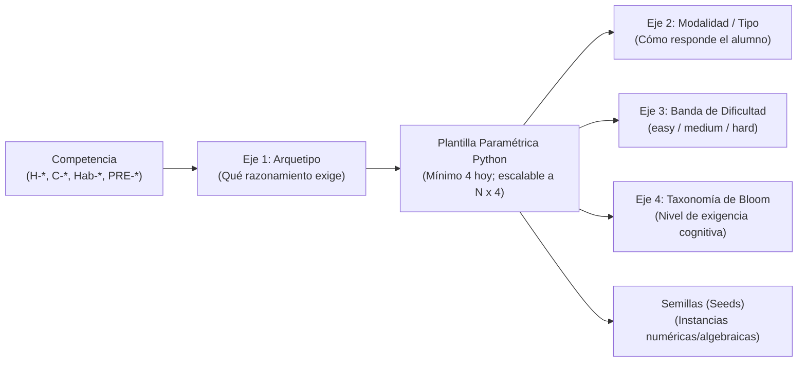

# Arquitectura de Problemas en Top's Academy: Los 4 Ejes y Propuesta de Evolución hacia Evocación Activa y Anti-Overfitting

Este documento sintetiza cómo funciona hoy la creación de problemas en el pipeline `content-to-course` (verificado directamente contra `compile_shard.py`, `compile_cta.py` y `prompt_shard_author.md`) y presenta una propuesta concreta para cumplir tus dos objetivos estratégicos:
1. **Pasar del reconocimiento por descarte a la producción y análisis profundo** (subir en la Taxonomía de Bloom reduciendo el peso de `MC7` a favor de respuestas directas y modalidades analíticas paso a paso).
2. **Erradicar el overfitting del estudiante y la pereza del autor LLM** exigiendo múltiples plantillas estructuralmente distintas por arquetipo, combinadas con instanciación paramétrica masiva.

---

## 1. Cómo funciona hoy la creación de problemas: Los 4 Ejes

Cuando se crea una competencia en Top's Academy, cada plantilla definida en `TEMPLATES` es una tupla de 9 elementos (`[tpl_id, cid, qtype, gen_fn, ver_fn, (difficulty, bloom), stems, hints, sol]`) que cruza **4 ejes independientes**:

### Eje 1: El Arquetipo (Qué razonamiento se le pide al alumno)
El contrato actual (`Form-C Quad-Band`, `MIN_ARCHETYPES = 4`) exige cubrir 4 ángulos de ataque por cada competencia:

| Arquetipo | Qué evalúa cognitivamente | Banda de dificultad asociada |
| :--- | :--- | :---: |
| **`direct`** | Aplicación directa de la definición, fórmula o mecanismo causal ($A \implies B$). | `easy` |
| **`inverse`** | Ingeniería inversa: se entrega el resultado o estado final y el alumno debe despejar el parámetro oculto o la causa ($B \implies A$). | `medium` |
| **`perturbation`** | Estática comparativa o choque estructural: qué ocurre cuando un parámetro cambia o se altera una relación no lineal ($\Delta\theta \implies \Delta y^*$). | `hard` |
| **`boundary_or_edge_case`** | Casos límite, singularidades o ruptura de supuestos teóricos (si la competencia tiene `assumptions`, se enlaza obligatoriamente a un `assumption_id`). | `hard` |

### Eje 2: El Tipo o Modalidad de Problema (Cómo responde el alumno)
Los tipos de problema **no son arquetipos**, sino el formato de interacción. Cualquier arquetipo puede expresarse en distintos formatos:
* **Estado actual en producción:**
  * `MC7` (*Multiple Choice 7 Options*): Reconocimiento asistido (1 correcta + 6 distractores diagnósticos).
  * `FIB` (*Fill in the Blank*): Evocación directa (el alumno escribe el valor o resultado exacto sin ver opciones).
  * `MS` (*Multiple Select*): Discriminación proposicional (4 a 6 afirmaciones; el alumno evalúa la veracidad de cada una sin saber cuántas son verdaderas).
* **Regla actual verificada en `compile_shard.py` (líneas 3932–3975):**
  * La mezcla se exige **a nivel de competencia**, no atada de forma rígida a cada arquetipo.
  * En habilidades (`Hab-*`): el validador exige obligatoriamente **al menos 2 plantillas de práctica activa (`FIB` o `MS`), de las cuales al menos 1 debe ser `FIB`** (patrón estándar: `1 MC7 + 2 FIB + 1 MS`).
  * En conceptos y hechos (`C-*`, `H-*`, `PRE-*`): el validador exige al menos `1` plantilla activa (`FIB` o `MS`). Es importante notar una asimetría actual: el prompt del autor (`prompt_shard_author.md`) recomienda `2 MC7 + 1 FIB + 1 MS` para cubrir hasta 12 distractores de golpe, lo que en la práctica inclina los conceptos hacia `MC7`.
  * **Por qué hoy se abusa de `MC7` cuando hay muchos distractores (`TPL-D3`):** El validador exige que el 100% de los distractores `D-XX-YY` de la competencia aparezcan evaluados en `seed=42`. Como cada `MC7` aloja 6 distractores y `FIB` aloja 0, cuando una competencia tiene más de 6 distractores ($N_d > 6$), la regla actual obliga a añadir más plantillas `MC7` (`ceil(N_d / 6)`).

### Eje 3: La Banda de Dificultad (`easy`, `medium`, `hard`)
* Se declara por plantilla dentro de la tupla `(difficulty, bloom)`.
* `compile_shard.py` (líneas 3906–3914) exige que toda competencia cubra **las 3 bandas** (`{'easy', 'medium', 'hard'}`).
* El motor de sesiones de la plataforma (`sessionShuffler.ts`) usa esta banda para ubicar al alumno en su Zona de Desarrollo Próximo (ZPD).

### Eje 4: La Taxonomía de Bloom (Profundidad cognitiva)
Opera en dos niveles dentro del código:
1. **En el análisis curricular (`compile_cta.py` y `cta_direct.md`):**
   * **Hechos (`H-*`):** `Remember` / `Understand`.
   * **Conceptos (`C-*`):** `Understand` / `Analyze`.
   * **Habilidades (`Hab-*`):** `Apply` / `Analyze` / `Evaluate` / `Create`.
2. **En la validación de plantillas (`compile_shard.py`, líneas 3916–3960):**
   * Toda competencia debe tener **al menos 2 niveles de Bloom distintos** entre sus plantillas.
   * **Regla dura `[M3-SKILL-BLOOM]`:** Si una competencia es de habilidad (`Hab-*`), **está prohibido** que cualquiera de sus plantillas tenga Bloom `Remember` o `Understand` (el compilador rechaza el shard). Todas sus plantillas deben ser de `Apply` hacia arriba.

---

## 2. El Diagnóstico: Por qué el sistema actual aún permite "Descarte" y "Overfitting"

Tu lectura del problema da en el clavo por tres razones técnicas que hoy están en el código:

1. **El candado `TPL-D3` empuja hacia `MC7`:** Como `TPL-D3` exige instanciar todos los distractores `D-XX-YY` en `seed=42` y el formato que más distractores empaqueta es `MC7` (6 por plantilla), el pipeline incentiva `MC7`. En `MC7`, un alumno astuto puede usar **ingeniería inversa o descarte por magnitud/signo** en vez de resolver el problema desde cero.
2. **1 plantilla por arquetipo permite aprenderse "el molde" (Overfitting):** Si el arquetipo `inverse` de una competencia tiene **una sola plantilla**, aunque le metas 50 semillas con números distintos, la estructura sintáctica y el despeje algebraico son siempre el mismo. Al tercer intento, el alumno ya no razona: aplica una receta mecánica.
3. **`FIB` actual solo recibe números o strings cortos:** Para exigir niveles altos de Bloom (`Analyze`, `Evaluate`, `Create`) sin opciones múltiples, el alumno necesita poder introducir **expresiones algebraicas libres**, **encadenar pasos de una demostración** o **detectar el paso exacto donde falla un argumento**.

---

## 3. Propuesta Arquitectónica Alineada a tus Objetivos

Para lograr **mayor exigencia cognitiva (evocación pura + Bloom superior)** y **cero overfitting (múltiples plantillas reales por arquetipo)** aprovechando la capacidad de **Gemini 4**, propongo una reforma en 3 pilares.

### Pilar 1: Reemplazar el predominio de `MC7` por Evocación Activa y Análisis Paso a Paso
En lugar de usar los distractores únicamente como "opciones falsas para elegir en un `MC7`", los distractores pasan a ser **detectores de trampas en entrada libre** (`FIB` / `open_symbolic`) o **pasos falaces a cazar** (`adversarial_break` / `proof_dag`).

| Nivel Cognitivo (Bloom) | Modalidad Actual (A reducir) | Nueva Modalidad Propuesta (Milestones 5 y 20) | Cómo elimina el descarte y exige análisis real |
| :--- | :--- | :--- | :--- |
| **`Apply` / `Analyze`** (Cálculo y despeje) | `MC7` numérica | **`FIB` + `open_symbolic`** (MathLive + `mathjs` / SymPy) | El alumno enfrenta la **hoja en blanco**. Debe escribir el número o la fórmula simbólica ($x^*(p, m) = \dots$). Si escribe la fórmula correspondiente al distractor `D-XX-01`, el sistema detecta exactamente qué error cometió sin haberle mostrado nunca la opción. |
| **`Analyze`** (Estructura del problema) | `MC7` de texto largo | **`unstructured_model` (Stage 0)** | Antes de calcular, el alumno debe construir el modelo desde una narrativa con datos distractores: identificar variables endógenas/exógenas, restricciones y condición de primer/segundo orden. |
| **`Analyze` / `Evaluate`** (Encadenamiento lógico) | `MS` estático | **`proof_dag` (Demostración paso a paso)** | El alumno no elige una respuesta final: debe ordenar y justificar cada paso deductivo de una derivación ($P_1 \implies P_2 \implies P_3$). Si no evalúa paso a paso, el grafo falla. |
| **`Evaluate`** (Auditoría crítica) | `MC7` conceptual | **`adversarial_break` (Caza de falacias / contraejemplo)** | Se le muestra una resolución "aparentemente correcta" (que contiene un error sutil, como ignorar que la condición de 2do orden da un mínimo). El alumno debe señalar el paso exacto que viola el supuesto o dar un contraejemplo numérico. |

> [!IMPORTANT]
> **Reforma clave en `compile_shard.py` (`TPL-D3`):** Permitir que una plantilla `FIB` u `open_symbolic` declare en su diccionario `ds` / `RATS` las **fórmulas o valores de los errores comunes (`D-XX-YY`)**. Así, si el alumno ingresa en blanco el valor que resulta de olvidar un signo o derivar mal, recibe el feedback diagnóstico exacto de ese distractor, y **ya no hace falta crear plantillas `MC7` solo para cumplir la cuota de distractores**.

---

### Pilar 2: Multiplicación de Plantillas por Arquetipo (`K` plantillas por arquetipo) con Garantía Anti-Clon
En vez de `1 plantilla × 4 arquetipos = 4 plantillas`, pasamos a un esquema parametrizado **`TEMPLATES_PER_ARCHETYPE = K`** (por ejemplo, $K = 2$ o $K = 3$, dando **8 a 12 plantillas por competencia**), donde cada plantilla genera múltiples semillas.

Para evitar que el autor LLM haga trampa creando 3 plantillas casi idénticas dentro del mismo arquetipo, se imponen **3 candados deterministas en `compile_shard.py`**:

1. **Disyunción de Árbol Sintáctico Algebraico (AST / SymPy / Z3):**
   * Dentro de un mismo arquetipo (ej. las 3 plantillas de `inverse`), la variable objetivo a despejar o la estructura funcional **debe ser algebraicamente no equivalente**.
   * *Ejemplo en Microeconomía (`inverse`):*
     * Plantilla `inverse_1`: Dado el óptimo $x_1^*$, despejar el parámetro de preferencia $\alpha$.
     * Plantilla `inverse_2`: Dada la elasticidad precio en el óptimo, despejar el ingreso $m$.
     * Plantilla `inverse_3`: Dado el multiplicador de Lagrange $\lambda^*$, recuperar el precio $p_1$.
   * `compile_shard.py` evalúa las expresiones simbólicas y rechaza el shard si dos plantillas del mismo arquetipo comparten la misma fórmula canónica o el mismo flujo AST.
2. **Disyunción de Modalidad y Nivel de Bloom dentro del Arquetipo:**
   * Si un arquetipo tiene 3 plantillas, no pueden tener la misma tupla `(modalidad, bloom)`. Por ejemplo, dentro del arquetipo `perturbation`:
     * Plantilla 1: `FIB` en nivel `Analyze` (calcular la magnitud exacta del cambio).
     * Plantilla 2: `open_symbolic` o `proof_dag` en nivel `Evaluate` (demostrar el signo de la derivada cruzada).
     * Plantilla 3: `adversarial_break` o `MS` en nivel `Evaluate` (evaluar qué condiciones de frontera invierten el efecto).
3. **Distancia Léxica y de Escenario en `stem_variants`:**
   * Exigir baja similitud Jaccard/n-gramas entre los enunciados de las plantillas de un mismo arquetipo (distintos contextos aplicados o marcos narrativos), impidiendo que el estudiante reconozca la plantilla por las primeras cinco palabras.

---

### Pilar 3: Nueva Matriz de Distribución por Competencia (Propuesta Concreta)

Con $K = 2$ o $K = 3$ plantillas por arquetipo (8 a 12 plantillas por competencia):

| Arquetipo | Banda | Plantillas por Arquetipo ($K=2..3$) | Modalidades Permitidas (Foco en Producción) | Niveles de Bloom Exigidos (`Hab-*` / `C-*`) |
| :--- | :---: | :---: | :--- | :--- |
| **1. `direct`** | `easy` | 2 – 3 | `FIB`, `open_symbolic`, `MS` *(máx. 1 `MC7` en toda la competencia)* | `Apply` $\to$ `Analyze` |
| **2. `inverse`** | `medium` | 2 – 3 | `FIB`, `open_symbolic`, `unstructured_model` | `Analyze` |
| **3. `perturbation`** | `hard` | 2 – 3 | `open_symbolic`, `proof_dag`, `FIB`, `MS` | `Analyze` $\to$ `Evaluate` |
| **4. `boundary_or_edge_case`** | `hard` | 2 – 3 | `adversarial_break`, `proof_dag`, `MS`, `FIB` | `Evaluate` $\to$ `Create` |

**Impacto en números para el estudiante:**
* **Plantillas por competencia:** sube de `4` a **`8 – 12` plantillas estructuralmente distintas**.
* **Semillas por plantilla:** `5 a 10` semillas instanciadas (o generación dinámica en runtime).
* **Banco real por competencia:** **`40 a 120` problemas únicos**, donde **$\ge 80\%$ son de producción activa o análisis paso a paso** (cero descarte mecánico) y donde repetir la competencia obliga a razonar cada paso porque cambia tanto la incógnita como la estructura deductiva.

---

## 4. Plan de Implementación Sugerido (Hojas de Ruta y Archivos a Tocar)

Para llevar esto a cabo sin romper los cursos actuales, el orden óptimo de ejecución es:

1. **Fase 1 — Reforma del Contrato de Plantillas y Anti-Descarte (Back-end C2C, impacto inmediato):**
   * **Desacoplar `TPL-D3` de `MC7`** en `compile_shard.py` y `check_templates.py`: permitir que `FIB` (y luego `open_symbolic`) capturen distractores diagnósticos (`ds`/`RATS`) comparando la respuesta errónea del alumno contra los resultados de cada trampa.
   * **Invertir la cuota de modalidades**: pasar de exigir "mínimo 1 o 2 activas" a exigir **"máximo 1 `MC7` por competencia (o 0 en `Hab-*`) y $\ge 80\%$ en `FIB`/`MS`/nuevas modalidades"**.
   * **Parametrizar `TEMPLATES_PER_ARCHETYPE`** (default actual `1`, nuevo modo `2` o `3`) en `plan_shards.py`, `compile_shard.py` y `prompt_shard_author.md`, añadiendo el verificador AST de no-equivalencia entre plantillas del mismo arquetipo.
2. **Fase 2 — Incorporación de Modalidades de Bloom Superior (Unificación con Milestones 5 y 20):**
   * Activar `open_symbolic` (`mathjs` AST en cliente + `SymPy` en compilación) para que el alumno escriba fórmulas y derivaciones cortas.
   * Activar `proof_dag` (encadenamiento paso a paso) y `adversarial_break` (caza del paso erróneo en una demostración), que atacan directamente `Analyze` y `Evaluate` en la Taxonomía de Bloom.
3. **Fase 3 — Piloto Empírico con Gemini 4:**
   * Probar una corrida de un curso (o un shard piloto) con `TEMPLATES_PER_ARCHETYPE = 3` (12 plantillas por competencia) usando Gemini 4 para medir tiempo de generación, tasa de aprobación en Turno 1 y variedad real de las plantillas generadas.
