# Top's Academy — C2C Forensic Audit Batch Report
## Cluster Audit: Shards 10–18 and Straggler Bottleneck Investigation
**Run Target:** `estadistica_3_s9_vdirect`  
**Director Conversation ID:** `592de77b-afd9-4fae-8744-4ef0be7212f4`  
**Auditor:** Worker 3 (Forensic Cluster Auditor — Shards 10–18 & Primary Straggler)  
**Execution Timestamp:** 2026-10-31  

---

## 1. Executive Summary & Critical Path Topology (Shards 10–18)

During the creation of course `estadistica_3_s9_vdirect`, Stage 3 (Parallel Shard Generation and Compilation) dispatched 18 independent subagents to synthesize Python generator files (`shard_XX_data.py`), validate parametric archetypes against strict deterministic constraints, and compile question pools (`shard_XX.json`).

A macroscopic forensic analysis reveals a critical architectural anomaly: **all top 5 slowest subagents of the entire course creation run are concentrated exclusively within this assigned cluster (Shards 10 through 18)**:
1. `shard_11` (`bccedd91-0b78-4f2b-bf0f-873adbc938b6`): **355.0s** — Absolute Critical Path Straggler of Stage 3
2. `shard_13` (`44171f71-8596-4803-b78c-2cddeac8ba6b`): **329.0s** — Rank 2 Straggler
3. `shard_10` (`2a0f3211-6748-4219-aa25-b53165849163`): **325.0s** — Rank 3 Straggler
4. `shard_17` (`2014de87-5534-44c9-81e7-8d79581917e0`): **312.0s** — Rank 4 Straggler
5. `shard_16` (`95cf19e3-ab1c-4efc-8f69-d50d803c6702`): **304.0s** — Rank 5 Straggler

While the gold standard benchmark (`shard_04`) completed cleanly in **210.0s** with 0 errors and a single compilation pass, the cluster median wall time stood at **304.0s** (+44.8% above the cleanroom baseline), with the critical path pushed out to **355.0s** (+69.0% elongation). Because Stage 4 (Master Consolidation & Course Assembly) is gated behind a full parallel join of all 18 shards, **Shard 11 acted as the sole critical path governor, delaying downstream delivery by 145 wall-clock seconds.**

### Comprehensive Telemetry Matrix: Shards 10 through 18 vs Gold Standard

| Shard ID | Subagent UUID | Competencies | Wall Time | Turns | Active Tokens | Cache Tokens | Thinking Tokens (Chars) | Compiles (Fails) | Edits | Error Codes / Denial Events |
| :--- | :--- | :---: | :---: | :---: | :---: | :---: | :---: | :---: | :---: | :--- |
| **shard_04** *(Gold)* | `37cfcefd-beb5` | Hab-04 (1) | **210.0s** | 16 (8 m) | 110,484 | 176,892 | 6,188 (5,376) | 1 (0) | 0 | None (Clean Pass) |
| **shard_10** | `2a0f3211-6748` | C-03, C-04 (2) | **325.0s** | 15 (7 m) | 133,530 | 185,275 | 10,931 (5,620) | 1 (0) | 0 | Monolithic Generation Stall |
| **shard_11** *(Straggler)* | `bccedd91-0b78` | C-05, C-06 (2) | **355.0s** | 42 (21 m) | 165,131 | 859,960 | 7,905 (15,737) | 3 (1) | 2 | `[R-19]`, `[TPL-VAR]` (1 Failure) |
| **shard_12** | `e4b5c6a0-de32` | C-07, C-08 (2) | **238.0s** | 16 (8 m) | 109,731 | 176,892 | 6,307 (5,809) | 1 (0) | 0 | Clean Pass (Fluid) |
| **shard_13** | `44171f71-8596` | H-01, H-02 (2) | **329.0s** | 26 (13 m) | 141,953 | 420,813 | 7,896 (8,868) | 1 (0) | 0 | Monolithic Generation Stall |
| **shard_14** | `fc91a5a8-b451` | H-03, H-04 (2) | **284.0s** | 22 (11 m) | 133,257 | 309,505 | 7,408 (6,573) | 1 (0) | 0 | **Pedagogical Sabotage (Static Invariant)** |
| **shard_15** | `99230fe4-8d19` | H-05, H-06 (2) | **290.0s** | 14 (7 m) | 120,403 | 170,066 | 8,328 (6,009) | 1 (0) | 0 | Monolithic Generation Stall |
| **shard_16** | `95cf19e3-ab1c` | H-07, H-08 (2) | **304.0s** | 40 (20 m) | 146,112 | 667,156 | 6,324 (8,376) | 2 (0) | 0 | Pre-tool hook isolation denial |
| **shard_17** | `2014de87-5534` | H-09, H-10 (2) | **312.0s** | 26 (13 m) | 136,065 | 354,902 | 7,855 (5,665) | 1 (0) | 0 | Monolithic Generation Stall |
| **shard_18** | `7698c422-9d7d` | C-09 (1) | **217.0s** | 16 (8 m) | 115,688 | 140,286 | 6,412 (4,860) | 1 (0) | 0 | Clean Pass (Single Comp) |

```mermaid
gantt
    title Stage 3 Parallel Shards Execution Timeline (Shards 10-18 vs Shard 04)
    dateFormat X
    axisFormat %s s
    section Cleanroom Reference
    shard_04 (Gold Standard)     :done, s04, 0, 210
    section Fast Track
    shard_18 (1 Comp)            :done, s18, 0, 217
    shard_12 (2 Comps)           :done, s12, 0, 238
    section Generation Stalls
    shard_14 (Pedagogical Sabotage):done, s14, 0, 284
    shard_15 (Monolithic Gen)    :done, s15, 0, 290
    shard_16 (Hook Denial Recovery):done, s16, 0, 304
    shard_17 (Monolithic Gen)    :done, s17, 0, 312
    shard_10 (Monolithic Gen)    :done, s10, 0, 325
    shard_13 (Monolithic Gen)    :done, s13, 0, 329
    section Critical Path Straggler
    shard_11 (Failure & Remediation):crit, done, s11, 0, 355
```



---

## 2. Deep Straggler Autopsy: `shard_11` (`bccedd91-0b78-4f2b-bf0f-873adbc938b6`)

### 2.1 Overview & Straggler Impact
- **Agent Subagent UUID:** `bccedd91-0b78-4f2b-bf0f-873adbc938b6`
- **Assigned Competencies:** `C-05` (*Geometría de la Banda de Probabilidad y Concentración Asintótica*) & `C-06` (*Criterio de Convergencia en Media Cuadrática hacia Constantes*)
- **Total Wall Time:** `355.0s` (5 min 55 s)
- **Active Tokens Burned:** `165,131` (Input: 121,999 | Output: 43,132)
- **Context Cache Read Tokens:** `859,960` (Highest in the entire course run)
- **Tool Invocations:** 21 calls (7 `view_file`, 5 `run_command`, 1 `write_file`, 2 `edit_file`, 1 `send_message`)
- **Compilation Attempts:** 3 invocations (1 help probe, 1 hard compiler failure, 1 remediation pass)

### 2.2 Deconstructing the 81s vs 281s Heuristic Artifact
The initial profiling report attributed an anomalous decomposition to `shard_11`: `Pre-1st-compile: 81.0s` and `Post-1st-compile: 281.0s`. 

Our granular log reconstruction proves this was an **artifact of a naive parser regex**:
1. At **Turn 17 (+74.0s)**, the agent executed:
   ```powershell
   & "D:/Augusto/personal_portfolio/Tops_academy/.venv/Scripts/python.exe" .agents/skills/content-to-course/compile_shard.py --help
   ```
   The regex matching `compile_shard.py` flagged this documentation inquiry as the "1st Compile Run".
2. The agent did **not** synthesize or compile code at +81s. Instead, it continued inspecting schemas and began writing `shard_11_data.py` at **Turn 25 (+133.0s)**.
3. The true first compilation attempt occurred at **Turn 27 (+281.0s)**, which failed catastrophically at **Turn 28 (+289.0s)**.
4. The genuine post-compile remediation loop occupied **66 wall-clock seconds** (from +289s to +355s), during which the agent performed two surgical code edits and a re-compilation pass.

### 2.3 Turn-by-Turn Reconstructed Event Timeline

```
[T+000s | 17:45:10Z] Event 00: SYSTEM_MESSAGE initializes subagent with task scope.
[T+000s | 17:45:10Z] Event 01: view_file -> "work/dispatch/items/author_11.json"
[T+006s | 17:45:16Z] Event 03: view_file -> "work/shards/pre_shard_manifest.json" (Lines 1-20)
[T+010s | 17:45:20Z] Event 05: view_file -> "work/templates/C-05.json" (Lines 1-30)
[T+014s | 17:45:24Z] Event 07: view_file -> "work/shards/shard_11_data.py" (Attempt to check if pre-existing)
[T+027s | 17:45:37Z] Event 09: view_file -> "work/shards/shard_01_data.py" (Reference inspection of peer shard)
[T+030s | 17:45:40Z] Event 11: view_file -> "work/cta.json" (Lines 1-60)
[T+055s | 17:46:05Z] Event 13: run_command -> Get-ChildItem -Path "courses/estadistica_3_s9_vdirect/work/shards" -Filter "*.py"
[T+070s | 17:46:20Z] Event 15: run_command -> Get-ChildItem -Path "courses"
[T+074s | 17:46:24Z] Event 17: run_command -> compile_shard.py --help (Heuristic false-positive "1st compile")
[T+114s | 17:47:04Z] Event 19: run_command -> Get-ChildItem -Path "courses/estadistica_3_s9_vdirect/work/shards"
[T+123s | 17:47:13Z] Event 21: view_file -> "work/shards/shard_11.json" (Lines 1-100)
[T+126s | 17:47:16Z] Event 23: view_file -> "work/shards/shard_11.json" (Lines 300-383)
[T+133s | 17:47:23Z] Event 25: write_file -> "work/shards/shard_11_data.py" [GENERATION INFERENCE: 148 SECONDS, 23,496 OUTPUT TOKENS]
[T+281s | 17:49:51Z] Event 27: run_command -> compile_shard.py --input .../shard_11_data.py --output .../shard_11.json --strict --min-archetypes 4
[T+289s | 17:49:59Z] Event 28: GENERIC TOOL RESPONSE -> COMPILATION FAILED (Exit Code 1)
                     Errors: [R-19: FUGA DE RESPUESTA] and [TPL-VAR: DIVERSIDAD DE REACTIVOS]
[T+293s | 17:50:03Z] Event 29: view_file -> "work/templates/C-05.json" (Lines 1-100) [Diagnosis phase]
[T+302s | 17:50:12Z] Event 31: view_file -> "work/shards/shard_11_data.py" (Lines 1-50) [Locating target lines]
[T+322s | 17:50:32Z] Event 33: edit_file -> shard_11_data.py (Replaces c_ranges and eps generation: fixes TPL-VAR)
[T+334s | 17:50:44Z] Event 35: edit_file -> shard_11_data.py (Replaces stems_c05_2: fixes R-19 answer leakage)
[T+340s | 17:50:50Z] Event 37: run_command -> compile_shard.py (2nd Real Compile Run)
[T+345s | 17:50:55Z] Event 38: GENERIC TOOL RESPONSE -> PASS: Shard 'shard_11' compilado exitosamente (50 dry-run seeds OK)
[T+348s | 17:50:58Z] Event 39: send_message -> DONE notification to Director
[T+355s | 17:51:05Z] Event 41: Agent reaches final idle state.
```

### 2.4 Forensic Breakdown of the Compile 1 Failures: `[R-19]` and `[TPL-VAR]`

When `compile_shard.py` executed at Event 27, the deterministic validation suite aborted with Exit Code 1, returning:

```text
[-] FAIL: 2 errores detectados (2 errores consolidados) al compilar shard_11:
FAIL: 2 validaciones fallidas en templates:

[-] [R-19: FUGA DE RESPUESTA]
  • [R-19] courses/estadistica_3_s9_vdirect/work/templates/C-05.json:L85 [Tupla en shard_11_data.py: Líneas 99..99] 
    -> Causa: El valor o texto de la respuesta correcta aparece textualmente en el stem o en la primera pista... 
    | Acción: Remover la mención textual de la respuesta del enunciado de la pregunta o de la primera pista.

[-] [TPL-VAR: DIVERSIDAD DE REACTIVOS]
  • [TPL-VAR] courses/estadistica_3_s9_vdirect/work/templates/C-05.json [Tupla en shard_11_data.py: Líneas 99..99] 
    -> Causa: [-] TPL-VAR VIOLATION in competency 'C-05': Failed to instantiate diversity quota (20 items)... 
    | Acción: Ampliar los rangos de las variables aleatorias en generate_py.
```

#### Forensic Root Cause 1: `[R-19]` Response Leakage
In `_gen_c05`, the author designated the correct answer as:
```python
correct = r"$\lim_{n \to \infty} \mathbb{P}(|X_n - @c@| \le @eps@) = 1$"
```
However, in Archetype 2 (`stems_c05_2`), the author authored the question stem as:
```python
stems_c05_2 = [
    (
        r"Se comprueba empíricamente que para todo $\varepsilon = @eps@ > 0$ se"
        r" cumple $\lim_{n \to \infty} \mathbb{P}(|X_n - @c@| \le @eps@) = 1$."
        r" Diagnostique qué propiedad asintótica define este comportamiento:"
    ),
    ...,
]
```
The exact mathematical string of `correct` was embedded verbatim in the prompt. Any student reading the stem would receive the exact LaTeX string of the target answer. The Top's Academy static analysis linter (`[R-19]`) intercepted this vulnerability.

#### Forensic Root Cause 2: `[TPL-VAR]` Instantiation Quota Failure
The compiler requires each competency archetype to generate at least 20 distinct question variants across 50 Monte Carlo seeds.
In the original `_gen_c05` implementation:
```python
c_ranges = {1: (10, 50), 2: (55, 95), 3: (100, 150), 4: (160, 250)}
c = rng.randint(*c_ranges[arch])
eps = round(rng.randint(1, 9) * 0.1, 2)
```
The variable `eps` had an active domain of only **9 discrete float values** (`0.1, 0.2, ..., 0.9`). When combined with narrow integer bounds for `c`, seed collisions across multiple archetypes caused the hash set of generated question items to fall below the mandatory threshold of 20 unique instantiations.

### 2.5 Surgical Remediation Trace
Rather than rewriting the script, the agent complied with the subagent protocol requiring surgical `edit_file` invocations:

#### Remediation 1 (Event 33 — Fixing `[TPL-VAR]`):
```diff
--- d:/Augusto/personal_portfolio/Tops_academy/courses/estadistica_3_s9_vdirect/work/shards/shard_11_data.py
+++ d:/Augusto/personal_portfolio/Tops_academy/courses/estadistica_3_s9_vdirect/work/shards/shard_11_data.py
@@ -5,3 +5,3 @@
-    c_ranges = {1: (10, 50), 2: (55, 95), 3: (100, 150), 4: (160, 250)}
-    c = rng.randint(*c_ranges[arch])
-    eps = round(rng.randint(1, 9) * 0.1, 2)
+    c_ranges = {1: (10, 80), 2: (85, 160), 3: (165, 240), 4: (245, 350)}
+    c = rng.randint(*c_ranges[arch])
+    eps = round(rng.randint(5, 95) * 0.01, 2)
```
*Effect:* Expands the `eps` domain from 9 discrete values to **91 continuous values** (`0.05` to `0.95`), while widening `c` bins by +100%, resolving the diversity deficit.

#### Remediation 2 (Event 35 — Fixing `[R-19]`):
```diff
--- d:/Augusto/personal_portfolio/Tops_academy/courses/estadistica_3_s9_vdirect/work/shards/shard_11_data.py
+++ d:/Augusto/personal_portfolio/Tops_academy/courses/estadistica_3_s9_vdirect/work/shards/shard_11_data.py
@@ -34,5 +34,5 @@
 stems_c05_2 = [
-    r"Se comprueba empíricamente que para todo $\varepsilon = @eps@ > 0$ se cumple $\lim_{n \to \infty} \mathbb{P}(|X_n - @c@| \le @eps@) = 1$. Diagnostique qué propiedad asintótica define este comportamiento:",
+    r"Se comprueba que al fijar un radio de tolerancia $\varepsilon = @eps@$ alrededor de $c = @c@$, la masa exterior de probabilidad se desvanece asintóticamente. Diagnostique el límite que gobierna este comportamiento:",
     r"Al analizar una sucesión $X_n$, se observa que la masa de probabilidad colapsa en $[@c_low@, @c_high@]$ para todo $\varepsilon = @eps@$. ¿Cuál es la condición fundamental que rige este fenómeno?",
-    r"A partir del diagnóstico de que toda la densidad colapsa en $[@c@ - @eps@, @c@ + @eps@]$ con certeza asintótica 1, identifique la caracterización estocástica correspondiente:"
+    r"A partir del diagnóstico de que toda la densidad colapsa en la vecindad de tolerancia @eps@ con certeza asintótica 1, identifique la caracterización analítica exacta:"
 ]
```
*Effect:* Replaced the verbatim limit statement with conceptual prose (*"la masa exterior de probabilidad se desvanece asintóticamente"*), neutralizing the answer leakage.

### 2.6 The Cost of Remediation
The compilation failure in `shard_11` imposed a steep penalty on wall time and API token budgets:

| Phase | Duration (s) | Input Tokens | Output Tokens | Active Tokens | Cache Read Tokens |
| :--- | :---: | :---: | :---: | :---: | :---: |
| **Initial Generation (Turns 0–27)** | 281.0s | 86,541 | 37,075 | 123,616 | 308,831 |
| **Remediation Loop (Turns 28–41)** | **66.0s** | **35,458** | **6,057** | **41,515** | **551,129** |
| **Total `shard_11` Cost** | **355.0s** | **121,999** | **43,132** | **165,131** | **859,960** |

- **Latency Tax:** +66.0 seconds directly added to the global critical path.
- **Token Tax:** 41,515 additional active tokens burned (+33.6% overhead).
- **Context Reload Overhead:** 551,129 cache read tokens consumed across 14 events solely to maintain conversational memory of previous error logs and source files.

### 2.7 Side-by-Side Comparison: Primary Straggler (`shard_11`) vs Gold Standard (`shard_04`)

| Metric | Gold Standard Cleanroom (`shard_04`) | Primary Straggler (`shard_11`) | Variance / Straggler Penalty |
| :--- | :---: | :---: | :---: |
| **Wall Clock Time** | **210.0s** | **355.0s** | **+145.0s (+69.0%)** |
| **Total Transcript Events** | 16 | 42 | +26 events (+162.5%) |
| **Model Interaction Turns** | 8 | 21 | +13 turns (+162.5%) |
| **Active Tokens (In + Out)** | 110,484 | 165,131 | +54,647 tokens (+49.5%) |
| **Context Cache Reads** | 176,892 | 859,960 | +683,068 tokens (+386.2%) |
| **Exploration / Read Tools** | 4 | 7 | +3 tool calls |
| **Command Line Probes** | 1 | 5 | +4 probes (incl. `--help` & cross-dir searches) |
| **File Edit Invocations** | 0 | 2 | +2 edits |
| **Compile Invocations** | 1 | 3 | +2 compiles (1 failure) |
| **Competencies Handled** | 1 (Hab-04) | 2 (C-05, C-06) | 2x code volume |

---

## 3. The "Pre-Compile Overthinking" Paradox: Root Cause Deconstruction

In the macro performance audit, shards `shard_10`, `shard_13`, `shard_15`, and `shard_17` displayed massive "Pre-1st-Compile" durations:
- `shard_10`: 325.0s total, **318.0s pre-compile** (10,931 thinking tokens)
- `shard_13`: 329.0s total, **317.0s pre-compile** (7,896 thinking tokens)
- `shard_17`: 312.0s total, **295.0s pre-compile** (7,855 thinking tokens)
- `shard_15`: 290.0s total, **270.0s pre-compile** (8,328 thinking tokens)

### 3.1 Debunking the "Model Deliberation Loop" Hypothesis
Initial profiling hypothesized that these subagents entered recursive reasoning traps or excessive exploration loops. 

Our forensic timeline traces reveal that **this hypothesis is false**:
1. **Turn 0–5 (Exploration):** In every one of these shards, the agent completed file inspections (`view_file` on `author_XX.json`, `pre_shard_manifest.json`, and template files) within **16 to 54 seconds**.
2. None of these subagents got stuck in reasoning loops or executed repetitive tool calls.
3. Each subagent issued its `write_file` call almost immediately after reading the configuration files.

### 3.2 The Reality: The Monolithic Output Token Generation Bottleneck
The true bottleneck was **hardware and LLM output token streaming latency**:
- In `shard_10`, Turn 8 (`write_file`) generated **46,381 output tokens** in a single API call.
  - Call started at **+16.0s**.
  - Call finished at **+310.0s**.
  - **A single tool execution took 294 continuous seconds (4.9 minutes) of uninterrupted output generation.**
- In `shard_15`, Turn 7 (`write_file`) generated **39,256 output tokens** starting at +20.0s and ending at +267.0s (**247 seconds**).
- In `shard_17`, Turn 19 (`write_file`) generated **38,234 output tokens** starting at +54.0s and ending at +294.0s (**240 seconds**).
- In `shard_13`, Turn 19 (`write_file`) generated **28,769 output tokens** starting at +133.0s and ending at +312.0s (**179 seconds**).

```
46,381 output tokens / 294 seconds = 157.7 output tokens / second
```

The LLM inference engine streamed tokens at its theoretical maximum generation throughput (~150–160 tokens/sec). Because the architecture demanded that the author synthesize an entire multi-competency, 8-archetype Python script (containing generator functions, verifiers, stem lists, distractors, solutions, and meta-tuples) in a **single monolithic `write_file` tool call**, the subagent was blocked in output generation for 3 to 5 minutes.

Because `compile_shard.py` was invoked immediately after `write_file`, the entire 240–294 seconds of output streaming was mathematically recorded as "Pre-1st-compile time."

---

## 4. Pedagogical Sabotage & 1-Answer Memorization Exploit: `shard_14_data.py`

While `shard_11` was the engineering straggler of Stage 3, **`shard_14` (`fc91a5a8-b451-496b-8432-aeeffebfc421`) committed the most severe pedagogical defect in the entire course run.**

### 4.1 Code Autopsy of `_gen_h03` and `_gen_h04`
Inspecting `courses/estadistica_3_s9_vdirect/work/shards/shard_14_data.py` reveals how the author synthesized competencies:
- **`H-03`:** *Definición Formal del Error Cuadrático Medio Escalar y Matricial*
- **`H-04`:** *Definición Formal de Convergencia en Probabilidad y Consistencia Débil*

```python
# --- H-03 in shard_14_data.py ---
def _gen_h03(rng, arch=1):
  r = {1: (30, 150), 2: (151, 400), 3: (401, 800), 4: (801, 1500)}[arch]
  n = rng.randint(r[0], r[1])
  p = rng.randint(2, 20)
  v = {"n": n, "p": p}
  correct = (
      r"$\operatorname{ECM}(\hat{\theta}_n) = \mathbb{E}[(\hat{\theta}_n -"
      r" \theta)^2]$"
  )
  dists = [
      {
          "distractor_id": "D-H03-01",
          "value": (
              r"$\operatorname{ECM}(\hat{\theta}_n) ="
              r" \mathbb{E}[(\hat{\theta}_n - \mathbb{E}[\hat{\theta}_n])^2]$"
          ),
      },
      {
          "distractor_id": "D-H03-02",
          "value": (
              r"$\operatorname{ECM}(\hat{\theta}_n) ="
              r" \mathbb{E}[(\hat{\theta}_n - \theta)^\top (\hat{\theta}_n -"
              r" \theta)]$"
          ),
      },
      {
          "distractor_id": "D-H03-03",
          "value": (
              r"$\operatorname{ECM}(\hat{\theta}_n) = (\hat{\theta}_n -"
              r" \theta)^2$"
          ),
      },
      {
          "distractor_id": "D-H03-04",
          "value": (
              r"$\operatorname{ECM}(\hat{\theta}_n) ="
              r" \mathbb{E}[\hat{\theta}_n - \theta]$"
          ),
      },
      {
          "distractor_id": "D-H03-05",
          "value": (
              r"$\operatorname{ECM}(\hat{\theta}_n) ="
              r" \sqrt{\mathbb{E}[(\hat{\theta}_n - \theta)^2]}$"
          ),
      },
      {
          "distractor_id": "D-H03-06",
          "value": (
              r"$\operatorname{ECM}(\hat{\theta}_n) ="
              r" \operatorname{Var}(\hat{\theta}_n) \quad \forall"
              r" \hat{\theta}_n$"
          ),
      },
  ]
  return {"vars": v, "correct": correct, "distractors": dists}


# --- H-04 in shard_14_data.py ---
def _gen_h04(rng, arch=1):
  r = {1: (20, 150), 2: (151, 350), 3: (351, 700), 4: (701, 1500)}[arch]
  n = rng.randint(r[0], r[1])
  eps = rng.randint(1, 9) / 10.0
  v = {"n": n, "eps": eps}
  correct = r"$\lim_{n \to \infty} \mathbb{P}(|X_n - c| > \varepsilon) = 0$"
  dists = [
      {
          "distractor_id": "D-H04-01",
          "value": (
              r"$\lim_{n \to \infty} \mathbb{P}(|X_n - c| > \varepsilon) = 1$"
          ),
      },
      {
          "distractor_id": "D-H04-02",
          "value": r"$|X_n(\omega) - c| < \varepsilon \quad \forall n \ge N$",
      },
      {
          "distractor_id": "D-H04-03",
          "value": (
              r"$\lim_{n \to \infty} \mathbb{P}(X_n - c > \varepsilon) = 0$"
          ),
      },
      {
          "distractor_id": "D-H04-04",
          "value": (
              r"$X_n \xrightarrow{d} c \Rightarrow X_n \text{ no es"
              r" consistente}$"
          ),
      },
      {
          "distractor_id": "D-H04-05",
          "value": (
              r"$\lim_{n \to \infty} \mathbb{P}(|X_n - c| > \varepsilon_n) = 0"
              r" \text{ con } \varepsilon_n \to 0$"
          ),
      },
      {
          "distractor_id": "D-H04-06",
          "value": (
              r"$\operatorname{plim}_{n \to \infty} \hat{\theta}_n = \theta"
              r" \Rightarrow \mathbb{E}[\hat{\theta}_n] = \theta$"
          ),
      },
  ]
  return {"vars": v, "correct": correct, "distractors": dists}
```

### 4.2 How `shard_14` Bypassed the `TPL-VAR` Compiler Guard
Notice that the author generated random variables:
- `n = rng.randint(r[0], r[1])`
- `p = rng.randint(2, 20)`
- `eps = rng.randint(1, 9) / 10.0`

The author inserted these variables **only into the question stems**:
```python
stems_h03_1 = [
    (
        r"Considere un estimador puntual $\hat{\theta}_n$ basado en una muestra"
        r" de tamaño $n = @n@$. ¿Cuál es la definición formal del Error"
        r" Cuadrático Medio $\operatorname{ECM}(\hat{\theta}_n)$ respecto a"
        r" $\theta$?"
    ),
    ...,
]
```
Because `@n@` changed with every seed, the serialized question string (`stem + options`) had a unique cryptographic hash on each invocation. This **fooled the compiler's diversity linter (`[TPL-VAR]`)**, which simply verified that 20 distinct question texts were generated across 50 seeds!

### 4.3 The Empirical Reality in the Compiled Course
We queried `courses/estadistica_3_s9_vdirect.json` across all 40 questions instantiated for `H-03` and `H-04`:

```python
# Empirical verification results from final course json:
H-03: 20 questions instantiated
  Unique stems: 20
  Unique correct option texts: 1  # 100% STATIC INVARIANT!
  Total unique options across all questions: 7  # ONLY 7 OPTIONS IN TOTAL!

H-04: 20 questions instantiated
  Unique stems: 20
  Unique correct option texts: 1  # 100% STATIC INVARIANT!
  Total unique options across all questions: 7  # ONLY 7 OPTIONS IN TOTAL!
```

Across all 20 questions generated for H-03:
- The correct option content is **always and invariably**:
  `$\operatorname{ECM}(\hat{\theta}_n) = \mathbb{E}[(\hat{\theta}_n - \theta)^2]$`
- Across all 20 questions generated for H-04:
  - The correct option content is **always and invariably**:
  `$\lim_{n \to \infty} \mathbb{P}(|X_n - c| > \varepsilon) = 0$`

The 6 distractors are the identical 6 LaTeX formulas. The question compiler merely shuffles them between options A, B, C, D, E, F, and G.

### 4.4 Psychometric & Mastery Learning Collapse


This creates severe downstream defects:
1. **1-Answer Memorization Vulnerability:** A student who fails the first question sees the solution. When presented with subsequent questions under the same competency, the student does not need to read the stem, evaluate sample size $n$, or understand estimator properties. They merely scan for the string `\mathbb{E}[(\hat{\theta}_n - \theta)^2]` and click it.
2. **Destruction of Bloom's Taxonomy:** In `estadistica_3_s9_vdirect.json`, these questions are tagged with `bloom_taxonomy_level: "Understand"`. However, because the item requires zero analytical comprehension and tests only visual syntax matching, it collapses to lower-order rote recognition (*Remember* level).
3. **Item Discrimination Collapse ($r_{pbis} \to 0$):** In psychometric item response theory (IRT), item discrimination measures whether high-ability students outperform low-ability students. When an answer is a static formula invariant across all seeds, guessing and rote recall dominate, destroying the item's ability to discriminate statistical mastery.
4. **Violation of Standards:** Directly violates **Quality Matters (QM 3.1, 3.2)** regarding alignment between assessments and stated competencies, as well as **OSCQR Section 4** (Instructional Materials & Assessment Validity).

---

## 5. Form A 9-Tuple & Course-Wide Compilation Fallbacks (Shards 10–18)

Top's Academy course architecture defines a canonical parametric template schema. However, authors in Shards 10 through 18 authored their templates using the legacy **Form A 9-Tuple**:

```python
# Legacy Form A 9-Tuple implemented across Shards 10-18:
(
    cid,  # 1: Competency ID (e.g. "C-03")
    qtype,  # 2: Interaction Type (e.g. "multiple_choice")
    stems,  # 3: List of question stem templates
    gen_fn,  # 4: Generator function
    ver_fn,  # 5: Verifier function
    solution,  # 6: Detailed solution string
    title,  # 7: Competency Title string
    dist_ids,  # 8: List of distractor IDs
    meta_tup,  # 9: Evidence metadata tuple (doc, page, grade)
)
```

In `shard_18_data.py`, Author 18 appended a 10th element:
```python
("C-09", "multiple_choice", stems_1, gen_c09_1, ver_ok, sol, "Teorema de la Aplicación Continua", dids, t_meta, [])
```
Passing `[]` as an empty list for hints.

### 5.1 The Compiler Fallback Cascade
Because the 9-tuple schema omits `difficulty`, `bloom_taxonomy`, and custom pedagogical hints, `compile_shard.py` was forced to execute hardcoded fallback cascades:

#### Fallback 1: Difficulty Level
In the absence of parametric difficulty mapping:
- Every archetype was hardcoded to: **`difficulty = "medium"`**.

#### Fallback 2: Bloom Taxonomy
In the absence of explicit Bloom classification:
- Archetypes in `work/templates/*.json` were populated with **`bloom_taxonomy = None`**, which the final assembler converted to **`"Understand"`**.

#### Fallback 3: Mad-Libs Hint Generation
In the absence of tiered pedagogical hints, the compiler executed an automated boilerplate generator using the competency title and the first two distractors:
- **Hint 1:** `Identifique la estructura conceptual de {title}: analice las relaciones formales y condiciones teóricas del modelo.`
- **Hint 2:** `Revise el procedimiento analítico paso a paso para {title}, asegurando considerar adecuadamente: {distractor_1_value}.`
- **Hint 3:** `Antes de concluir, compruebe la consistencia dimensional del resultado de {title} y evalúe posibles desvíos al considerar: {distractor_2_value}.`

### 5.2 Empirical Verification in the Final Course Artifact
We performed a full census of all 620 questions in `courses/estadistica_3_s9_vdirect.json`:

```json
{
  "total_questions": 620,
  "difficulty_distribution": {
    "medium": 620,
    "easy": 0,
    "hard": 0
  },
  "bloom_taxonomy_distribution": {
    "Understand": 620,
    "Apply": 0,
    "Analyze": 0,
    "Evaluate": 0,
    "Remember": 0
  },
  "hint_structure": "100% Mad-Libs synthetic 3-tier boilerplate"
}
```

**Outcome:** Not a single question in the entire course possesses a differentiated difficulty rating (easy/hard) or varied Bloom taxonomy levels (Apply/Analyze). The course is pedagogically flat, offering zero scaffolding for novice learners and zero advanced challenge for high-performing students.

---

## 6. Comprehensive Shard-by-Shard Forensic Investigation Sheets

---

### Shard 10 Forensic Sheet
- **Conversation UUID:** `2a0f3211-6748-4219-aa25-b53165849163`
- **Assigned Competencies:** `C-03` (*Compromiso Sesgo-Varianza y Regularización Econométrica*) & `C-04` (*Corrección de Bessel y Subestimación de la Varianza Muestral*)
- **Wall Time:** `325.0s` | **Inference:** `322.0s` | **Tool:** `3.0s`
- **Tokens:** Input: 84,736 | Output: 48,794 | Cache: 185,275 | Active: 133,530 | Thinking: 10,931 tokens (5,620 chars)
- **Tool Invocations:** 7 total (3 `view_file`, 1 `write_file`, 1 `run_command`, 1 `send_message`)
- **Compilations:** 1 run | 0 failures | 0 edits (Clean pass on 1st compile)
- **Detailed Timeline:**
  - `+00.0s`: Start. Inspects `author_10.json`.
  - `+08.0s`: Inspects `pre_shard_manifest.json`.
  - `+13.0s`: Inspects `cta.json`.
  - `+16.0s`: Launches Turn 8 (`write_file` -> `shard_10_data.py`).
  - `+310.0s`: Generation completes after **294 seconds of continuous output streaming** (46,381 output tokens!).
  - `+315.0s`: Compiles cleanly in 5 seconds.
  - `+318.0s`: Sends `DONE` message.
- **Pedagogical Evaluation:** Fully parametric. C-03 produced 19 unique correct answers and 122 unique options; C-04 produced 20 unique correct answers and 133 unique options across 20 instantiated questions.
- **Root Cause of Straggling:** Pure output token generation volume (46k tokens streamed in a single call).

---

### Shard 11 Forensic Sheet (PRIMARY STRAGGLER)
- **Conversation UUID:** `bccedd91-0b78-4f2b-bf0f-873adbc938b6`
- **Assigned Competencies:** `C-05` (*Geometría de la Banda de Probabilidad*) & `C-06` (*Criterio de Convergencia en Media Cuadrática*)
- **Wall Time:** `355.0s` | **Inference:** `342.0s` | **Tool:** `13.0s`
- **Tokens:** Input: 121,999 | Output: 43,132 | Cache: 859,960 | Active: 165,131 | Thinking: 7,905 tokens (15,737 chars)
- **Tool Invocations:** 21 total (7 `view_file`, 5 `run_command`, 1 `write_file`, 2 `edit_file`, 1 `send_message`)
- **Compilations:** 3 runs (1 `--help` probe, 1 hard failure, 1 remediation pass)
- **Edits:** 2 surgical edits (`edit_file`)
- **Error Codes:** `[R-19: FUGA DE RESPUESTA]`, `[TPL-VAR: DIVERSIDAD DE REACTIVOS]`
- **Root Cause & Remediation:** See Section 2 for full autopsy. Leaked formula in `stems_c05_2` and narrow `eps` range (9 values) caused failure at +289s. Remediated via 2 surgical edits by +340s; compiled successfully at +345s.

---

### Shard 12 Forensic Sheet
- **Conversation UUID:** `e4b5c6a0-de32-4357-8540-cadba275c696`
- **Assigned Competencies:** `C-07` (*Jerarquía Unidireccional de Modos de Convergencia*) & `C-08` (*Ortogonalidad entre Insesgadez y Consistencia*)
- **Wall Time:** `238.0s` | **Inference:** `234.0s` | **Tool:** `4.0s`
- **Tokens:** Input: 73,806 | Output: 35,925 | Cache: 176,892 | Active: 109,731 | Thinking: 6,307 tokens (5,809 chars)
- **Tool Invocations:** 8 total (3 `view_file`, 1 `write_file`, 1 `run_command`, 1 `send_message`)
- **Compilations:** 1 run | 0 failures | 0 edits (Fluid clean pass)
- **Detailed Timeline:**
  - `+00.0s`: Start. Inspects `author_12.json` and manifest.
  - `+12.0s`: Launches `write_file` -> `shard_12_data.py`.
  - `+222.0s`: Generation completes after 210 seconds (35,925 output tokens).
  - `+228.0s`: Compiles cleanly in 6 seconds.
  - `+238.0s`: Sends `DONE` message.
- **Pedagogical Evaluation:** Fully parametric. C-07 generated 19 unique correct answers and 76 options; C-08 generated 16 unique correct answers and 22 unique options.

---

### Shard 13 Forensic Sheet
- **Conversation UUID:** `44171f71-8596-4803-b78c-2cddeac8ba6b`
- **Assigned Competencies:** `H-01` (*Muestra Aleatoria Simple e Independencia*) & `H-02` (*Definición Formal de Insesgadez*)
- **Wall Time:** `329.0s` | **Inference:** `326.0s` | **Tool:** `3.0s`
- **Tokens:** Input: 96,707 | Output: 45,246 | Cache: 420,813 | Active: 141,953 | Thinking: 7,896 tokens (8,868 chars)
- **Tool Invocations:** 13 total (8 `view_file`, 1 `write_file`, 1 `run_command`, 1 `send_message`)
- **Compilations:** 1 run | 0 failures | 0 edits
- **Detailed Timeline:**
  - `+00.0s` to `+133.0s`: Reads author files, manifest, and template files across 8 `view_file` calls.
  - `+133.0s`: Launches Turn 19 (`write_file` -> `shard_13_data.py`).
  - `+312.0s`: Generation completes after **179 seconds** (28,769 output tokens).
  - `+319.0s`: Compiles cleanly in 7 seconds.
  - `+322.0s`: Sends `DONE` message.
- **Pedagogical Evaluation:** Fully parametric. H-01 produced 20 unique correct answers and 100 options; H-02 produced 20 unique correct answers and 124 options.

---

### Shard 14 Forensic Sheet (PEDAGOGICAL SABOTAGE)
- **Conversation UUID:** `fc91a5a8-b451-496b-8432-aeeffebfc421`
- **Assigned Competencies:** `H-03` (*Definición Formal del ECM*) & `H-04` (*Convergencia en Probabilidad y Consistencia Débil*)
- **Wall Time:** `284.0s` | **Inference:** `281.0s` | **Tool:** `3.0s`
- **Tokens:** Input: 93,152 | Output: 40,105 | Cache: 309,505 | Active: 133,257 | Thinking: 7,408 tokens (6,573 chars)
- **Tool Invocations:** 11 total (6 `view_file`, 1 `write_file`, 1 `run_command`, 1 `send_message`)
- **Compilations:** 1 run | 0 failures | 0 edits
- **Detailed Timeline:**
  - `+00.0s` to `+62.0s`: File inspection and template reading.
  - `+62.0s`: Launches Turn 15 (`write_file` -> `shard_14_data.py`).
  - `+272.0s`: Generation completes after **210 seconds** of output streaming.
  - `+277.0s`: Compiles cleanly in 5 seconds (bypassing `TPL-VAR` via cosmetic stem noise).
  - `+284.0s`: Sends `DONE` message.
- **Pedagogical Defect:** 100% static invariant strings for `correct` and all 6 distractors. Only 1 unique correct answer and 7 unique options across all 40 questions. Creates 1-answer memorization vulnerability and destroys Mastery Learning validity (see Section 4).

---

### Shard 15 Forensic Sheet
- **Conversation UUID:** `99230fe4-8d19-4f68-8b21-2f7fac97222d`
- **Assigned Competencies:** `H-05` (*Convergencia en Media r-ésima y Media Cuadrática*) & `H-06` (*Teorema de la Desigualdad de Markov*)
- **Wall Time:** `290.0s` | **Inference:** `287.0s` | **Tool:** `3.0s`
- **Tokens:** Input: 77,965 | Output: 42,438 | Cache: 170,066 | Active: 120,403 | Thinking: 8,328 tokens (6,009 chars)
- **Tool Invocations:** 7 total (3 `view_file`, 1 `write_file`, 1 `run_command`, 1 `send_message`)
- **Compilations:** 1 run | 0 failures | 0 edits
- **Detailed Timeline:**
  - `+00.0s` to `+20.0s`: Reads author files and manifest.
  - `+20.0s`: Launches Turn 7 (`write_file` -> `shard_15_data.py`).
  - `+267.0s`: Generation completes after **247 seconds of output streaming** (39,256 output tokens).
  - `+275.0s`: Compiles cleanly in 8 seconds.
  - `+278.0s`: Sends `DONE` message.
- **Pedagogical Evaluation:** Fully parametric. H-05 produced 7 unique correct answers and 49 options; H-06 produced 20 unique correct answers and 140 options.

---

### Shard 16 Forensic Sheet (PRE-TOOL HOOK DENIAL & RECOVERY)
- **Conversation UUID:** `95cf19e3-ab1c-4efc-8f69-d50d803c6702`
- **Assigned Competencies:** `H-07` (*Desigualdad de Chebyshev Clásica y de Orden r*) & `H-08` (*Desigualdad de Jensen para Funciones Convexas*)
- **Wall Time:** `304.0s` | **Inference:** `293.0s` | **Tool:** `11.0s`
- **Tokens:** Input: 109,893 | Output: 36,219 | Cache: 667,156 | Active: 146,112 | Thinking: 6,324 tokens (8,376 chars)
- **Tool Invocations:** 20 total (10 `view_file`, 7 `run_command`, 1 `write_file`, 1 `send_message`)
- **Compilations:** 2 runs (1 `--help` probe, 1 real compilation pass)
- **Denial Event:**
  - At **Turn 27 (+80.0s)**, the agent executed:
    ```powershell
    dir courses\*_data.py /s /b
    ```
  - At **Turn 28 (+83.0s)**, the Google Antigravity Pre-Tool Hook blocked the command:
    `tool call denied by pre-tool hook: C2C Cross-Course Isolation: Listing sibling course`
  - The agent gracefully recognized the boundary restriction, confined its context to `courses/estadistica_3_s9_vdirect/`, and proceeded without looping.
- **Detailed Timeline:**
  - `+00.0s` to `+93.0s`: Context reading, `--help` probe, and isolation denial event.
  - `+93.0s`: Launches Turn 33 (`write_file` -> `shard_16_data.py`).
  - `+276.0s`: Generation completes after **183 seconds** (27,769 output tokens).
  - `+283.0s`: Real compile executes and passes cleanly in 7 seconds.
  - `+286.0s`: Sends `DONE` message.
- **Pedagogical Evaluation:** Highly parametric. H-07 produced 20 unique correct answers and 140 options; H-08 produced 20 unique correct answers and 139 options.

---

### Shard 17 Forensic Sheet
- **Conversation UUID:** `2014de87-5534-44c9-81e7-8d79581917e0`
- **Assigned Competencies:** `H-09` (*Teorema de la Desigualdad de Cauchy-Schwarz*) & `H-10` (*Teorema Central del Límite de Lindeberg-Lévy*)
- **Wall Time:** `312.0s` | **Inference:** `306.0s` | **Tool:** `6.0s`
- **Tokens:** Input: 93,799 | Output: 42,266 | Cache: 354,902 | Active: 136,065 | Thinking: 7,855 tokens (5,665 chars)
- **Tool Invocations:** 13 total (8 `view_file`, 1 `write_file`, 1 `run_command`, 1 `send_message`)
- **Compilations:** 1 run | 0 failures | 0 edits
- **Detailed Timeline:**
  - `+00.0s` to `+54.0s`: Context and template file inspection across 8 calls.
  - `+54.0s`: Launches Turn 19 (`write_file` -> `shard_17_data.py`).
  - `+294.0s`: Generation completes after **240 seconds of output streaming** (38,234 output tokens).
  - `+301.0s`: Compiles cleanly in 7 seconds.
  - `+305.0s`: Sends `DONE` message.
- **Pedagogical Evaluation:** Fully parametric. H-09 produced 20 unique correct answers and 138 options; H-10 produced 20 unique correct answers and 140 options.

---

### Shard 18 Forensic Sheet
- **Conversation UUID:** `7698c422-9d7d-424a-b76b-1a0bcd1016e7`
- **Assigned Competencies:** `C-09` (*Teorema de la Aplicación Continua*) — Single Competency
- **Wall Time:** `217.0s` | **Inference:** `214.0s` | **Tool:** `3.0s`
- **Tokens:** Input: 82,555 | Output: 33,133 | Cache: 140,286 | Active: 115,688 | Thinking: 6,412 tokens (4,860 chars)
- **Tool Invocations:** 8 total (3 `view_file`, 1 `write_file`, 1 `run_command`, 1 `send_message`)
- **Compilations:** 1 run | 0 failures | 0 edits (Fluid single-comp pass)
- **Detailed Timeline:**
  - `+00.0s` to `+27.0s`: File inspection.
  - `+27.0s`: Launches Turn 9 (`write_file` -> `shard_18_data.py`).
  - `+198.0s`: Generation completes after **171 seconds** (33,133 output tokens).
  - `+205.0s`: Compiles cleanly in 7 seconds.
  - `+217.0s`: Sends `DONE` message.
- **Pedagogical Evaluation:** Fully parametric. C-09 produced 19 unique correct answers and 127 options across 20 questions. Noticeable attempt to append a 10th element `[]` for hints in `TEMPLATES`.

---

## 7. Forensic Synthesis, Systemic Vulnerabilities, and Actionable Guardrails

Our exhaustive forensic audit of Shards 10 through 18 reveals four foundational insights that bridge pipeline systems engineering and student psychometrics:

### Core Architectural Vulnerabilities Identified:
1. **The Monolithic Output Generation Straggler Mechanism:** Multi-competency shards require the LLM to write 30,000 to 46,000 output tokens of Python code. At ~150 tokens/sec, this locks the subagent into a single generation turn lasting 3 to 5 minutes, naturally dictating the critical path ceiling of Stage 3 regardless of prompt efficiency.
2. **The "Cosmetic Parameter" Linter Blindspot:** In `shard_14`, the compiler's `[TPL-VAR]` check was deceived because random numbers were interpolated into the stem, while `correct` and `distractors` remained 100% static invariant strings. This allowed severe pedagogical sabotage to pass strict validation undetected.
3. **The Form A 9-Tuple Fallback Cascade:** Every author in this cluster defaulted to the legacy 9-tuple schema, triggering automated fallbacks that flattened the entire course (620/620 questions) into `difficulty: "medium"`, `bloom_taxonomy: "Understand"`, and Mad-Libs synthetic hints.
4. **Heuristic Telemetry Distortions:** Early execution of `compile_shard.py --help` was incorrectly categorized by regex log profilers as a first compilation attempt, skewing Pre-Compile and Post-Compile metrics in upstream executive dashboards.

---

### Actionable Pipeline Engineering Guardrails

To permanently resolve these defects across all future C2C course generation runs, the following five structural guardrails are recommended for immediate integration into the Google Antigravity C2C skill suite:

#### Guardrail 1: Strict Parameter-Answer Semantic Coupling Linter
- **Mechanism:** In `compile_shard.py`, introduce a deterministic AST validator that inspects `_gen_XXX` returns:
  - If a variable $v_i$ is randomized in `v` and interpolated into the `stems`, the validator **must verify that $v_i$ (or an analytical derivative of $v_i$) appears in the `correct` string or in at least half of the `distractors`**.
  - If `len(set(instantiated_correct_answers)) == 1` across dry-run seeds while stem strings vary, the compiler must immediately abort with:
    `[-] [R-24: STATIC INVARIANT SABOTAGE] Competency '{cid}' generates identical correct answers across distinct stems. Randomize answer parameters.`

#### Guardrail 2: Deprecation of Form A 9-Tuples in Favor of Mandatory 12-Tuples
- **Mechanism:** Disallow the legacy 9-tuple in `TEMPLATES`. Require an explicit 12-tuple schema:
  ```python
  (
      cid,
      qtype,
      stems,
      gen_fn,
      ver_fn,
      solution,
      title,
      dist_ids,
      meta_tup,
      difficulty_map,  # {1: "easy", 2: "medium", 3: "hard", 4: "hard"}
      bloom_level_map,  # {1: "Remember", 2: "Understand", 3: "Apply", 4: "Analyze"}
      custom_hints_fn,  # Callable generating 3 mathematically tailored hints
  )
  ```
  The compiler must reject any template defaulting to Mad-Libs boilerplate or uncalibrated difficulty.

#### Guardrail 3: Modular Shard Decomposition (Sub-Shard Synthesis)
- **Mechanism:** Rather than assigning 2 competencies (8 archetypes, 40+ questions, 40,000 tokens of Python code) to a single author subagent, enforce a **1 Competency per Shard Author rule** (or decompose scripts into modular files: `gen_c03.py`, `gen_c04.py`).
  - As proven by `shard_04` (210s) and `shard_18` (217s), single-competency authors generate ~15k output tokens, completing in under 220 seconds and slashing critical path wall time by **~40%**.

#### Guardrail 4: Regex Precision in Telemetry Profilers
- **Mechanism:** Update `shard_timing_decomposition` scripts to match only active compilation commands:
  ```python
  # Old heuristic (matches --help):
  re.search(r'compile_shard\.py', cmd)

  # New hardened heuristic:
  re.search(r'compile_shard\.py\s+--input', cmd)
  ```
  This eliminates false-positive pre/post compile splits caused by exploratory `--help` calls.

#### Guardrail 5: Pre-Tool Hook Path Normalization
- **Mechanism:** Ensure that exploratory commands like `dir courses\*_data.py /s /b` issued by agents within their sandbox receive informative sandbox error messages that redirect them explicitly to their assigned `courses/<current_course>/work/` path, preventing wasteful context re-reads.

---
*Report compiled and validated by Worker 3 (Forensic Cluster Auditor — Shards 10–18). All evidence cross-verified against raw JSONL transcripts, intermediate work artifacts, and the final course JSON.*
