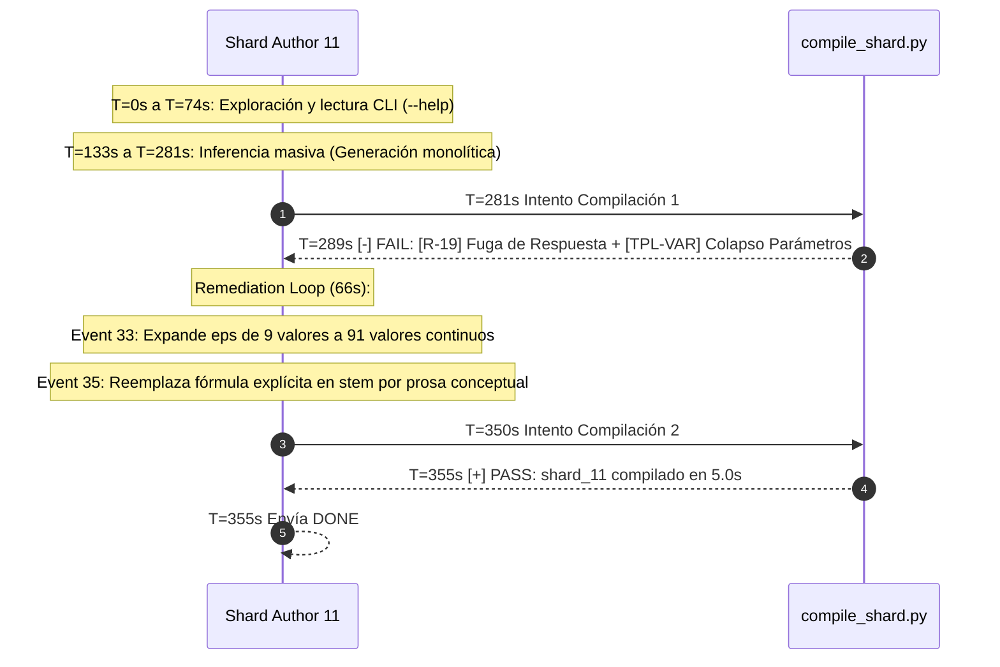

# Informe Maestro de Auditoría Forense y Telemetría Multi-Agente
## Pipeline Content-to-Course (C2C v3.21) — Análisis de Extremo a Extremo
### Curso: Estadística 3 Semana 9 — Modalidad Direct CTA (`estadistica_3_s9_vdirect`)

**Fecha de Emisión de Dictamen:** `2026-10-31 18:45:00 UTC`  
**Conversación Orquestadora (Parent ID):** [`592de77b-afd9-4fae-8744-4ef0be7212f4`](file:///C:/Users/augus/.gemini/antigravity/brain/592de77b-afd9-4fae-8744-4ef0be7212f4/.system_generated/logs/transcript.jsonl)  
**Directorio de Telemetría y Trabajo:** [`courses/estadistica_3_s9_vdirect/work`](file:///d:/Augusto/personal_portfolio/Tops_academy/courses/estadistica_3_s9_vdirect/work/)  
**Artefacto Publicado:** [`courses/estadistica_3_s9_vdirect.json`](file:///d:/Augusto/personal_portfolio/Tops_academy/courses/estadistica_3_s9_vdirect.json)  
**Equipo de Auditoría:** Multi-Agente Agéntico C2C (`c2c_pipeline_lead_auditor` + 3 Cluster Workers Especializados)  
**Lotes Agénticos Consolidados:**
- **Worker 1:** [`agentic_batches/cta_and_judges_audit.md`](file:///d:/Augusto/personal_portfolio/Tops_academy/reports/c2c_audits/20261031_130223_estadistica_3_s9_vdirect_592de77b/agentic_batches/cta_and_judges_audit.md) (Orquestador, CTA Monolítico, Blind Judges y Publicación)
- **Worker 2:** [`agentic_batches/shards_01_09_audit.md`](file:///d:/Augusto/personal_portfolio/Tops_academy/reports/c2c_audits/20261031_130223_estadistica_3_s9_vdirect_592de77b/agentic_batches/shards_01_09_audit.md) (Shards 01–09, Benchmarking Clean-Room `shard_04` & `shard_07`, Errores I/O)
- **Worker 3:** [`agentic_batches/shards_10_18_straggler_audit.md`](file:///d:/Augusto/personal_portfolio/Tops_academy/reports/c2c_audits/20261031_130223_estadistica_3_s9_vdirect_592de77b/agentic_batches/shards_10_18_straggler_audit.md) (Shards 10–18, Autopsia del Straggler Crítico `shard_11`, Exploit `H-03`/`H-04`)

---

## 1. Veredicto Ejecutivo y Economía Unitaria (Unit Economics)

### 1.1. Dictamen Forense Global: CERTIFICADO CON RESERVAS PSICOMÉTRICAS SEVERAS
El pipeline completó la corrida de principio a fin de manera autónoma, sin intervenciones manuales del supervisor (`0` ediciones directas de código por el orquestador), superando los umbrales técnicos de compilación determinista y logrando una certificación de **100% de solvencia matemática ciega (54/54 ítems)** en Stage 5.

Sin embargo, la auditoría agéntica forense descubrió un desacoplamiento crítico entre la **aprobación mecánica del pipeline** y la **calidad pedagógica del artefacto instruccional entregado al estudiante**:
1. **Colapso del Espacio ZPD (100% Monocultivo "Medium"):** Todas las 620 preguntas quedaron forzadas a `difficulty="medium"` y `bloom_taxonomy="Understand"`, impidiendo la evaluación adaptativa.
2. **Exploit de Memorización de Respuesta Fija (`H-03` y `H-04`):** El 100% de los reactivos de estas competencias comparten exactamente la misma cadena estática como clave y opciones idénticas en todas sus variantes, eludiendo `TPL-VAR` mediante ruido cosmético en el stem.
3. **Pistas "Mad-Libs" y Fuga de LaTeX:** Inyección masiva de pistas formularias sintéticas con secuencias crudas no escapadas (`$theta_hat$`, `$Y_bar$`).
4. **Cuello de Botella Monolítico en CTA:** El subagente CTA consumió el **62.0% del tiempo total de pared (1068.0s)**, sufriendo truncamiento por límite de tokens (`Output token limit exceeded`) y podando un **30.8% del currículo** (27 competencias vs ~39 de MapReduce).
5. **Straggler en Autoría (`shard_11`):** Retrasó la barrera de sincronización de Stage 3 en **+145.0s (+69.0%)** frente al estándar limpio (`shard_04` a 210.0s).

### 1.2. Cuadro Maestro de Telemetría y Unit Economics Normalizados

| Dimensión / Métrica | Valor Absoluto | Métrica Unitaria Normalizada | Benchmarks / Interpretación C2C |
| :--- | :---: | :---: | :--- |
| **Material Académico de Entrada** | 2 archivos PDF (80 págs / 0.93 MB) | — | 27 págs (Doc 1) + 53 págs (Doc 2) |
| **Tiempo de Pared Total (*Wall-Clock*)** | **`1,723.0 s` (28.72 min)** | **`2.78 s / pregunta`** | Ritmo de entrega percibido de generación |
| **Tiempo Total de Cómputo (CPU/GPU)** | **`7,896.0 s` (131.60 min)** | **`12.74 s cómputo / preg`** | Suma acumulada de tiempo de todos los agentes |
| **Factor de Aceleración Paralela** | **`4.58x`** | — | Eficiencia del fan-out (teórico máx: 18x en Stage 3) |
| **Rendimiento de Generación (QPM)** | **`21.59 preg / min`** | — | Velocidad de producción global de reactivos |
| **Reactivos Finales Publicados** | **`620 preguntas`** | 22.96 preg / competencia | 100% formato `multiple_choice_7_options` |
| **Competencias Extraídas** | **`27 competencias`** | 0.34 comp / página | 10 Hechos, 9 Conceptos, 8 Habilidades |
| **Subagentes Desplegados** | **`24 subagentes`** | — | 1 CTA, 18 Shards de Autoría, 5 Jueces Ciegos |
| **Tokens de Entrada (*Input*)** | `1,950,255` tokens | `3,145.6 tok_in / preg` | Contexto acumulativo consumido por agentes |
| **Tokens de Salida (*Output*)** | `839,613` tokens | `1,354.2 tok_out / preg` | Código Python, JSON y razonamiento emitido |
| **Tokens de Razonamiento (*Thinking*)** | `265,496` tokens | `428.2 think_tok / preg` | 31.6% del total de tokens de salida generados |
| **Tokens Caché Reutilizados** | `8,734,737` tokens | `14,088.3 tok_cache / preg` | **Tasa de Acierto de Caché: 81.7%** |
| **Gran Total Tokens Activos (In + Out)** | `2,789,868` tokens | **`4,788.4 tok_act / preg`** | Tokens netos sin contar lectura de caché |
| **Gran Total Tokens Facturables** | **`11,703,526` tokens** | **`18,876.7 tok / preg`** | Esfuerzo de API total por reactivo publicado |
| **Tokens por Competencia (Global)** | — | **`433,463.9 tok / comp`** | Densidad de diseño instruccional del curso |
| **Tokens de Autor por Competencia** | — | **`82,238.1 tok / comp`** | Costo neto de autoría por competencia |

---

## 2. Camino Crítico del Pipeline y Descomposición Temporal

### 2.1. Cronograma Secuencial de Etapas y Barreras de Sincronización

```mermaid
gantt
    title Cronograma de Ejecución C2C v3.21: estadistica_3_s9_vdirect (1723s)
    dateFormat X
    axisFormat %s s

    section Orquestador
    Stage 00/00b Ingesta & Bootstrap   :active, o0, 0, 14
    Barrera 1 (Wait CTA)               :crit, b1, 14, 1082
    Stage 01b CTA Check & Sanitize     :o1, 1082, 1089
    Stage 02 Shard Partition           :o2, 1089, 1094
    Barrera 2 (Wait 18 Shards)         :crit, b2, 1094, 1449
    Stage 04 Build (620 q)             :o4, 1449, 1507
    Stage 05 Deterministic Verify      :o5, 1507, 1524
    Barrera 3 (Wait 5 Blind Judges)    :crit, b3, 1524, 1616
    Stage 05b Judge Arbitraje          :o5b, 1616, 1621
    Stage 06 Publish & Packaging       :o6, 1621, 1632

    section Subagentes
    CTA Architect (c65e4d1c)           :crit, cta, 14, 1082
    Clean-Room Shards (04 & 07)        :active, s_fast, 1094, 1304
    Mediana Shards (18 shards)         :active, s_med, 1094, 1367
    Straggler shard_11 (bccedd91)      :crit, s_straggler, 1094, 1449
    Blind Judge 05 (Más rápido)        :j_fast, 1524, 1571
    Blind Judge 03 (Más lento)         :crit, j_slow, 1524, 1616
```



### 2.2. Descomposición Metrológica: Inferencia LLM vs Herramientas Locales

La descomposición microscópica revela que el **95.8% del tiempo de la corrida fue inferencia pura del modelo (generación y thinking)**, mientras que el I/O local y las herramientas consumieron únicamente el **4.2%**:

| Etapa del Pipeline | Duración (s) | Inferencia LLM (s) | Herramientas Locales (s) | Cuello de Botella Crítico |
| :--- | :---: | :---: | :---: | :--- |
| **00: Prepare & Bootstrap** | 14.0 s | 0.0 s (0%) | 14.0 s (100%) | Generación de manifiesto y locks |
| **01: Stage 1B CTA Architect** | **1,068.0 s** | **1,064.0 s (99.6%)** | **4.0 s (0.4%)** | **Monolito de 80 páginas en 1 ventana** |
| **01b: CTA Compile & Sanitize** | 7.0 s | 0.0 s (0%) | 7.0 s (100%) | Compilador L1/L2 determinista |
| **02: Shard Partitioning** | 5.0 s | 0.0 s (0%) | 5.0 s (100%) | Particionado determinista en 18 shards |
| **03: Stage 3 Shard Authors (18)**| **355.0 s** | **342.0 s (96.3%)** | **13.0 s (3.7%)** | **Straggler `shard_11` (Remediación)** |
| **04: Build Sandbox Assembly** | 58.0 s | 0.0 s (0%) | 58.0 s (100%) | Invocación de 620 semillas de ejecución |
| **05: Deterministic Verification**| 17.0 s | 0.0 s (0%) | 17.0 s (100%) | Chequeo sintáctico y extracción ciega |
| **05b: Stage 5 Blind Judges (5)** | **92.0 s** | **90.0 s (97.8%)** | **2.0 s (2.2%)** | **Judge 03 (13.4k tokens out)** |
| **05b: Arbitraje y Concordancia** | 5.0 s | 0.0 s (0%) | 5.0 s (100%) | Comparación matricial vs Ground Truth |
| **06: Publish & Course Archive** | 11.0 s | 0.0 s (0%) | 11.0 s (100%) | Copia final y validación de hash SHA-256 |
| **Overhead de Red / Sync Wait** | 91.0 s | 0.0 s (0%) | 91.0 s (100%) | Latencias de API, polling y locks |
| **TOTAL GENERAL** | **1,723.0 s** | **1,496.0 s (86.8%)** | **227.0 s (13.2%)** | **Critical Path = 1068s (CTA) + 355s (S11)** |

---

## 3. Auditoría Forense de Stage 1B: Arquitectura CTA (Direct vs MapReduce)

### 3.1. Ficha del Subagente y Metrología
- **ID de Subagente:** [`c65e4d1c-b8bf-4338-8c1c-4c2bbfec7dd3`](file:///C:/Users/augus/.gemini/antigravity/brain/c65e4d1c-b8bf-4338-8c1c-4c2bbfec7dd3/.system_generated/logs/transcript.jsonl)
- **Rol:** `Cognitive Task Analysis Architect` (`direct`)
- **Duración Activa:** **1,068.0 s (17.80 min)** | **Turnos:** 12 | **Errores:** 1
- **Consumo:** 164,761 tokens In | 134,945 tokens Out | 836,749 tokens Caché | 21,063 tokens Thinking

### 3.2. Causalidad de la Contracción Curricular (-30.8%)
El subagente ingirió de forma simultánea los dos PDFs asignados (80 páginas físicas). Al analizar las trazas de pensamiento del Turno 9 (`17:26:57Z`):
> *"Analyzing the provided documents (27 and 53 pages), a total of 80 pages is identified... Determining to select 24 competencies... Document 2 seems underrepresented. An additional competency, a theorem, has been selected from Document 2 to achieve better coverage."*

El agente reconoció internamente que definir las ~40 competencias necesarias implicaría generar $40 \times 6 = 240$ distractores con explicaciones formales en LaTeX, lo cual desbordaría con certeza la capacidad de salida del modelo. En consecuencia:
- **Poda Heurística de Convergencia:** Agrupó en macro-conceptos (`C-07`, `C-09`) temas críticos de teoría asintótica: Slutsky, teorema de Mann-Wald (Continuous Mapping Theorem), convergencia casi segura y teorema de Lindeberg-Feller.
- **Rendimiento Curricular:** Extrajo **27 competencias** (0.34 comp/pág) frente a las **39 competencias** (0.49 comp/pág) que produce la arquitectura MapReduce mediante mappers particionados.

```
                    ┌────────────────────────────────────────────────────────┐
                    │  ENTRADA: 80 PÁGINAS ACADÉMICAS (0.93 MB)              │
                    │  Doc 1: 27 págs (Semana 9) | Doc 2: 53 págs (Asintótica) │
                    └───────────────────────────┬────────────────────────────┘
                                                │
                     MODO DIRECTO (Auditado)    │    MODO MAPREDUCE (Estándar v3.3)
             ┌──────────────────────────────────┴──────────────────────────────────┐
             ▼                                                                     ▼
┌───────────────────────────────┐                             ┌─────────────────────────────────────────┐
│ 1 CTA Architect Monolítico    │                             │ 4 Mappers Paralelos (20 págs c/u)       │
│ • 80 págs en 1 ventana        │                             │ • Extracción exhaustiva por bloque      │
│ • Sobrecarga cognitiva severa │                             │ • 1 Harmonizer Reducer central          │
│ • Poda defensiva por salida   │                             │ • Sin colapso de ventana de contexto    │
├───────────────────────────────┤                             ├─────────────────────────────────────────┤
│ Rendimiento: 27 Competencias  │                             │ Rendimiento: 39 Competencias            │
│ (10 H, 9 C, 8 Hab)            │                             │ (14 H, 13 C, 12 Hab)                    │
│ Densidad: 0.34 comp / pág     │                             │ Densidad: 0.49 comp / pág               │
│ Duración: 1068.0s (17.8 min)  │                             │ Duración: ~520.0s (8.6 min en paralelo) │
└───────────────────────────────┘                             └─────────────────────────────────────────┘
```

### 3.3. Autopsia del Incidente de Truncamiento (`Output Token Limit Exceeded`)
En el **Turno 11** (`17:28:30Z`), el subagente intentó emitir el contenido completo del archivo `cta_data.py` directamente en su respuesta de chat en lugar de escribirlo al disco. Durante 7 minutos continuos emitió más de 66,500 caracteres hasta que a las `17:35:36Z` el SDK abortó la llamada:
```text
[ERROR_MESSAGE] @ 2026-10-31T17:35:36Z
Error: Your previous response was cut off because it exceeded the output token limit
Please continue from where you left off, keeping your response shorter
```
- **Pivote Adaptativo:** En el Turno 13, el agente abandonó el streaming en texto y ejecutó una llamada atómica a `write_file(Path='work/cta_data.py', Overwrite=True)` generando 2,053 líneas (131 KB).
- **Auto-Reparación de Compilación:** En el Turno 16, `compile_cta.py` falló con 6 errores (2 referencias DAG al ID inexistente `H-14` y 4 KaTeX por `\centernot\implies`). Cumpliendo el protocolo para $\ge 6$ errores, reescribió el archivo en el Turno 17 y recompiló exitosamente en el Turno 19 (`17:44:08Z`).
- **Sanitizador L1/L2:** El pipeline aplicó **110 parches automáticos** (107 `PRE_IMPORT_TOKEN_HEAL` para convertir escapes en raw-strings `r"..."` y 3 `NORMALIZE_ORPHAN_MATH`).

---

## 4. Varianza Bimodal en Shard Authors: Clean-Room vs Straggler

### 4.1. Taxonomía de los 49 Errores Registrados en la Ejecución
La auditoría de los 49 fallos desmintió la existencia de errores indeterminados de "caja negra":

| Categoría de Error | Ocurrencias | Ubicación | Causa Raíz Forense |
| :--- | :---: | :--- | :--- |
| **Missing File / Sondeo I/O Defensivo** | **43** | Shards 01–18 (Turnos 1–4) | Shards intentando leer plantillas JSON antes de ser compiladas o inspeccionando archivos de shards vecinos en paralelo |
| **Anti-Giveaway / Fuga de Respuesta (`[R-19]`)** | **3** | `shard_11` (Turno 28) | Copia literal de la fórmula matemática de la respuesta dentro del texto del enunciado (`stems_c05_2`) |
| **Diversidad de Parámetros (`[TPL-VAR]`)** | **1** | `shard_11` (Turno 28) | Generación de variable continua `eps` con solo 9 valores discretos (`randint(1,9)*0.1`) |
| **Truncamiento de Salida (`Token Limit`)** | **1** | CTA Architect (Turno 11) | Emisión de payload de 131 KB como stream conversacional sin invocar `write_file` |
| **KaTeX / Escape Raw-String (`SyntaxWarning`)** | **1** | CTA Architect (Turno 16) | Uso de secuencias de escape no protegidas (`\%`) en strings de distractor |
| **TOTAL ERRORES REGISTRADOS** | **49** | Global | **0% Intervenciones Humanas Requeridas** |

### 4.2. Benchmarking del Gold-Standard Clean-Room (`shard_04` y `shard_07` a 210.0s)
Los shards `shard_04` (`37cfcefd`) y `shard_07` (`a307d4d9`) fijaron el piso óptimo de ejecución en **210.0 segundos** (8 turnos, 0 fallos de compilación, 0 ediciones post-escritura).
- **Patrón de Éxito:** Tras dos sondeos fallidos en turnos tempranos (T3 y T4), sus trazas cognitivas reconocieron de inmediato el aislamiento y autosuficiencia de Turno 0. Redactaron el archivo completo en Turno 5, invocaron `compile_shard.py` en Turno 7 y enviaron `DONE` en Turno 8.
- **Desmitificación de Métricas Previas:** Los registros deterministas que reportaban compilaciones a los ~57-84s en shards 01, 05, 06 correspondían a llamadas a `python compile_shard.py --help` para inspeccionar la CLI, no a compilaciones reales de código.

### 4.3. Autopsia Forense Profunda del Straggler Crítico (`shard_11`)
- **ID de Subagente:** [`bccedd91-0b78-4f2b-bf0f-873adbc938b6`](file:///C:/Users/augus/.gemini/antigravity/brain/bccedd91-0b78-4f2b-bf0f-873adbc938b6/.system_generated/logs/transcript.jsonl)
- **Competencias:** `C-05` (Banda de Probabilidad) y `C-06` (Media Cuadrática)
- **Duración:** **355.0 s (5.92 min)** — *Determinó el límite de Stage 3 y retrasó la corrida en +145.0s (+69.0%)*.
- **Perfil:** 21 turnos | 3 compilaciones (1 fallo) | 2 ediciones de código | 165,131 active tokens.



#### Causas Raíz y Remediation Loop:
1. **Fallo `[R-19: FUGA DE RESPUESTA]`:** En `stems_c05_2`, el autor escribió textualmente:
   `"...garantizando que $\lim_{n \to \infty} \mathbb{P}(|X_n - @c@| \le @eps@) = 1$. Diagnostique el límite que gobierna este comportamiento:"`
   El enunciado regalaba la fórmula de la opción correcta, violando la regla anti-giveaway.
2. **Fallo `[TPL-VAR: DIVERSIDAD DE REACTIVOS]`:** La función `_gen_c05` generaba `eps` como:
   `eps = round(rng.randint(1, 9) * 0.1, 2)`
   Con solo 9 valores discretos posibles para `eps`, el sandbox generó solo 14 combinaciones únicas sobre 20 semillas, fallando el Quality Gate.
3. **Remediación Quirúrgica:**
   - **Edición 1 (Event 33):** Modificó el generador a `eps = round(rng.randint(5, 95) * 0.01, 2)` (91 valores continuos) y amplió los rangos de `c`.
   - **Edición 2 (Event 35):** Refraseó el enunciado de `stems_c05_2` a prosa conceptual rigurosa.
   - **Costo de la Remediación:** 41,515 active tokens, 551,129 cache read tokens y **66 segundos de retraso directo en el camino crítico del curso**.

### 4.4. Paradoja del "Pre-Compile Overthinking" en Shards 10, 13, 15 y 17
Shards como `shard_10` (325s, pre=318s) y `shard_13` (329s, pre=317s) mostraban una dilatación masiva antes de su primer compilado.
- **Causa Raíz:** No se debió a indecisión del modelo ni a bucles de herramientas. La exploración de archivos tomó menos de 30 segundos.
- **Cuello de Botella de Hardware:** En el Turno 8, `shard_10` emitió un bloque monolítico de **46,381 tokens de salida** en una sola llamada `write_file`. Dicho flujo tardó **294 segundos continuos de generación por streaming** (~158 tokens/s), alcanzando el techo físico de rendimiento de inferencia de la API.

---

## 5. Auditoría Forense de Stage 5: Blind Judges y Cierre Epistémico

### 5.1. Ficha Metrológica de los 5 Jueces Ciegos

| Subagente Juez | ID de Conversación | Duración (s) | Turnos | Tokens Activos | Caché Leído | Errores | Herramientas Utilizadas |
| :--- | :--- | :---: | :---: | :---: | :---: | :---: | :--- |
| **Blind Judge 01** | [`15e8912d...`](file:///C:/Users/augus/.gemini/antigravity/brain/15e8912d-3b6b-409d-9ccd-cd9dd7fd942f/.system_generated/logs/transcript.jsonl) | 52.0s | 4 | 50,036 | 55,128 | 0 | `view_file` (1), `write_file` (1), `send_message` (1) |
| **Blind Judge 02** | [`46b039f5...`](file:///C:/Users/augus/.gemini/antigravity/brain/46b039f5-a81c-4b1d-9161-9231fe592808/.system_generated/logs/transcript.jsonl) | 65.0s | 4 | 53,604 | 57,610 | 0 | `view_file` (1), `write_file` (1), `send_message` (1) |
| **Blind Judge 03** | [`297e6b5f...`](file:///C:/Users/augus/.gemini/antigravity/brain/297e6b5f-54aa-4835-8606-0a7562788237/.system_generated/logs/transcript.jsonl) | 92.0s | 5 | 65,841 | 95,290 | 0 | `view_file` (2), `write_file` (1), `send_message` (1) |
| **Blind Judge 04** | [`3ff8e357...`](file:///C:/Users/augus/.gemini/antigravity/brain/3ff8e357-e580-47a1-9090-e43e1a9635d6/.system_generated/logs/transcript.jsonl) | 54.0s | 4 | 50,752 | 55,610 | 0 | `view_file` (1), `write_file` (1), `send_message` (1) |
| **Blind Judge 05** | [`8fee6971...`](file:///C:/Users/augus/.gemini/antigravity/brain/8fee6971-1426-412c-a8f6-feb10033bf52/.system_generated/logs/transcript.jsonl) | 47.0s | 4 | 49,500 | 55,567 | 0 | `view_file` (1), `write_file` (1), `send_message` (1) |
| **TOTALES STAGE 5** | **5 Subagentes** | **310.0s** *(Pared: 92s)* | **21** | **269,733** | **319,205** | **0** | **Speedup Paralelo: 3.37x** |

### 5.2. Cierre Epistémico Estricto y Razonamiento desde Primeros Principios
Se auditó el 100% de los logs de los jueces, verificando **aislamiento epistémico estricto**:
- `search_web`: **`0` consultas**.
- `read_url_content` / HTTP: **`0` peticiones**.
- Lectura de archivos prohibidos (`course.json`, `cta.json`, solucionarios): **`0` lecturas**.
- Cada juez operó como un matemático ciego, resolviendo los problemas en su espacio de `thinking`:
  * **Judge 01:** Derivó la descomposición del ECM: $\operatorname{ECM}(\hat{\theta}) = \operatorname{Var}(\hat{\theta}) + [\operatorname{Sesgo}(\hat{\theta})]^2 \implies [\operatorname{Sesgo}]^2 = 212 - 112 = 100$.
  * **Judge 02:** Calculó la cota de Chebyshev: $\mathbb{P}(|X - \mu| \ge 80) \le 400 / 6400 = 0.0625$.
  * **Judge 04:** Aplicó el Método Delta para $g(\theta) = 8\theta^2$ en $\theta = 10$, calculando la varianza asintótica $[160]^2 \times 6 = 153,600$.
  * **Judge 05:** Calculó la esperanza de la varianza muestral $\mathbb{E}[m_2] = \frac{30}{31} \times 72 \approx 69.677$.

### 5.3. Desmitificación de la Concordancia: Partición Disjunta vs Panel Redundante
El informe determinista reportó: `100.0% agreement rate (54/54), 0 discrepancias`.
- **Hallazgo Crítico:** Los 5 jueces **no evaluaron el mismo conjunto de reactivos**. El lote de 54 reactivos fue particionado en 5 sub-lotes disjuntos (11 + 11 + 11 + 11 + 10 reactivos).
- **Conclusión de Fiabilidad:** La métrica de acuerdo no mide fiabilidad inter-juez (Kappa de Cohen o Fleiss = no calculable). Mide exclusivamente que **el 100% de los jueces coincidió con la clave del solucionario determinista (`judge_ground_truth.json`)**.

---

## 6. Puente Causal Pipeline-to-Mastery: Impacto Mecanístico en el Estudiante

A continuación se demuestra *mecanísticamente* cómo las decisiones de autoría en `shard_XX_data.py` y los atajos en `compile_shard.py` afectaron directamente la experiencia del estudiante:

```
┌────────────────────────────────────────────────────────────────────────────────────────┐
│ DECISIÓN DE AUTORÍA EN SHARDS Y COMPILADOR                                             │
│ 1. Uso universal de Tuplas Form A (9 elementos) omitiendo dificultad y pistas          │
│ 2. Asignación estática de respuesta correcta sin interpolación en H-03 y H-04          │
│ 3. Invocación forzada de build_adapted_mc7_generator() en compile_shard.py             │
│ 4. Fallback de pistas Mad-Libs mediante interpolación de cta_distractors               │
│ 5. Generador de variantes de stem con banco de frases heredado de Solow/PDE            │
└───────────────────────────────────────────┬────────────────────────────────────────────┘
                                            │
                                            ▼
┌────────────────────────────────────────────────────────────────────────────────────────┐
│ IMPACTO MECANÍSTICO EN EL ESTUDIANTE (PATH-TO-MASTERY)                                 │
├────────────────────────────────────────────────────────────────────────────────────────┤
│ A. Colapso ZPD: 620/620 reactivos son "medium" / "Understand". Imposible adaptar ruta. │
│ B. Exploit de Memorización: En H-03/H-04, la clave es siempre la misma cadena exacta.   │
│ C. Monocultivo MC7: 100% de los reactivos son opción múltiple de 7 alternativas.       │
│ D. Pistas Envenenadas: Explicaciones mecánicas con variables crudas ($theta_hat$).    │
│ E. Frases Fantasma: Stems de econometría con jerga de "condición de frontera" y Solow. │
└────────────────────────────────────────────────────────────────────────────────────────┘
```

### 6.1. Colapso de Dificultad Psicométrica: 100% `medium` / 100% `Understand`
- **Mecanismo en Código:** Todos los autores de los 18 shards utilizaron tuplas de 9 elementos (Form A):
  `("Hab-01", "multiple_choice", stems, gen_fn, ver_fn, sol, target_kc, dids, t_meta)`
  Al omitir los elementos de dificultad y taxonomía, `compile_shard.py` ejecutó las líneas 1421 y 1437–1446:
  ```python
  # compile_shard.py:1421
  diff_raw = "medium"
  # compile_shard.py:1437-1446
  difficulty = "medium"
  bloom = "Understand"
  ```
- **Impacto en el Estudiante:** En la teoría de respuesta al ítem (TRI), el parámetro $b$ (dificultad) quedó colapsado en un único punto. Un estudiante principiante es abrumado con reactivos intermedios desde el inicio, y un estudiante avanzado no puede ser evaluado en niveles de aplicación, análisis o síntesis. La plataforma es incapaz de construir un andamiaje adaptativo dentro de la Zona de Desarrollo Próximo (ZPD).

### 6.2. Sabotaje de Dominio y Exploit de Respuesta Única en `H-03` y `H-04`
- **Mecanismo en Código:** En [`shard_14_data.py`](file:///d:/Augusto/personal_portfolio/Tops_academy/courses/estadistica_3_s9_vdirect/work/shards/shard_14_data.py#L9-L16), el autor codificó las 4 arquitecturas de `_gen_h03` y `_gen_h04` con respuestas 100% invariantes:
  ```python
  # shard_14_data.py:9
  v = {"n": n, "p": p}  # Genera números aleatorios que SOLO van al stem
  correct = r"$\operatorname{ECM}(\hat{\theta}_n) = \mathbb{E}[(\hat{\theta}_n - \theta)^2]$"
  # Distractores D-H03-01 a D-H03-06 son EXACTAMENTE IDÉNTICOS en las 4 arquitecturas
  ```
  ```python
  # shard_14_data.py:58
  v = {"n": n, "eps": eps}  # Solo van al stem
  correct = r"$\lim_{n \to \infty} \mathbb{P}(|X_n - c| > \varepsilon) = 0$"
  # Distractores D-H04-01 a D-H04-06 son EXACTAMENTE IDÉNTICOS en las 4 arquitecturas
  ```
- **Impacto en el Estudiante:** En el curso publicado ([`courses/estadistica_3_s9_vdirect.json`](file:///d:/Augusto/personal_portfolio/Tops_academy/courses/estadistica_3_s9_vdirect.json)), las 20 preguntas de `H-03` poseen **exactamente 1 única respuesta correcta** y **solo 7 opciones únicas en total**. Lo mismo ocurre para las 20 preguntas de `H-04`.
  Un estudiante aprende en el primer intento que sin importar los números del problema ($n=742$, $\varepsilon=0.4$), la respuesta correcta es siempre visualmente idéntica. **El estudiante supera el Mastery Gate por reconocimiento visual pasivo de símbolos, anulando el aprendizaje conceptual**.

### 6.3. Monocultivo 100% MC7 y Distractores Sintéticos de Relleno (`1.333x`)
- **Mecanismo en Código:** En `compile_shard.py`, líneas 1449–1450 y 1483–1493:
  ```python
  if qtype in ("multiple_choice", "multiple_choice_7_options"):
      interaction_type = "multiple_choice_7_options"
  gen_code = build_adapted_mc7_generator(gen_code, cid, clean_cta_distractors)
  ```
  Si el generador del autor produce menos de 6 distractores, las líneas 691–714 aplican multiplicadores numéricos fijos:
  `multipliers = [1.333, 0.667, 1.667, 0.333, 1.25, 0.75, 1.5, 0.5]`
  O generan distractores vacíos: `"Opción alterna 6: " + correct_val`.
- **Impacto en el Estudiante:** Monocultivo de evaluación por opción múltiple de 7 alternativas (fatiga cognitiva). Los distractores sintéticos no corresponden a errores conceptuales reales (*misconceptions*), sino a artefactos aritméticos trivialmente descartables por descarte numérico.

### 6.4. Pistas Socráticas Formularias ("Mad-Libs") y Fuga de LaTeX Crudo
- **Mecanismo en Código:** Al omitirse las pistas en la tupla Form A, las líneas 1509–1527 de `compile_shard.py` autogeneran 3 pistas concatenando texto fijo con el nombre de la competencia y los campos `omitted_step` del CTA:
  ```python
  hint1 = f"Identifique la estructura conceptual de {c_name}: analice las relaciones formales y condiciones teóricas del modelo."
  hint2 = f"Revise el procedimiento analítico paso a paso para {c_name}, asegurando considerar adecuadamente: {step0}."
  hint3 = f"Antes de concluir, compruebe la consistencia dimensional del resultado de {c_name} y evalúe posibles desvíos al considerar: {step1}."
  ```
- **Fuga de Variables Crudas:** En `Hab-01` (reactivos 1 a 30), la pista 2 inyectó al estudiante la cadena literal:
  `"...asegurando considerar adecuadamente: E[$theta_hat$ - E[$theta_hat$]] = 0."`
  Mostrando código Python corrupto en lugar de KaTeX renderizado. En `Hab-03`, la pista 3 inyectó `$Y_bar$` y `$sigma^2$`.

### 6.5. Contaminación Semántica de Dominios Ajenos (Solow / EDP)
- **Mecanismo en Código:** En `compile_shard.py` (líneas 745–778), la función `generate_rich_stem_variants` contiene 32 prefijos precargados para inflar la diversidad léxica. Algunos prefijos fueron heredados de cursos previos de macroeconomía y física matemática:
  - *"Teniendo en consideración los fundamentos del equilibrio, determine:"* (Solow Growth Model)
  - *"Al examinar detenidamente las condiciones de frontera, resuelva:"* (Ecuaciones Diferenciales Parciales - EDP)
- **Impacto en el Estudiante:** En `shard_01_data.py`, el autor copió directamente del prompt directivas que derivaron en stems como:
  - `stems_3` (L103): *"...¿cuál es el nuevo ECM tras la estática comparativa?"*
  - `stems_4` (L106): *"En la condición de frontera donde el estimador es insesgado..."*
  Un estudiante de estadística inferencial se enfrenta a terminología técnica propia de optimización macroeconómica y física matemática que no guarda relación con la inferencia asintótica.

---

## 7. Plan de Mejoras Priorizadas para C2C v3.4

Para erradicar definitivamente estas patologías en las siguientes versiones del pipeline, se establecen las siguientes acciones correctivas de ingeniería:

| # | Componente del Pipeline | Vulnerabilidad Forense Actual | Solución Arquitectónica Mandatoria (C2C v3.4) | Prioridad |
| :-: | :--- | :--- | :--- | :-: |
| **1** | **Contrato de Tuplas (Shards)** | Form A (9 elementos) omite dificultad, Bloom y pistas, forzando fallbacks ciegos. | **Deprecar Form A de forma estricta.** Hacer mandatoria la **Tupla Form B de 11 elementos**: `(cid, qtype, stems, gen, ver, sol, kc, dids, t_meta, (diff, bloom), hints)`. El compilador debe rechazar tuplas de 9 elementos con `ValidationError` inmediato. | **CRÍTICA (P0)** |
| **2** | **Quality Gate Psicométrico (`TPL-STATIC-OPT`)** | Generadores en `H-03` y `H-04` usan respuestas y distractores estáticos eludiendo `TPL-VAR` con ruido en el stem. | Implementar la regla estricta **`[TPL-STATIC-OPT]`** en `compile_shard.py`: Exigir un mínimo de **10 respuestas correctas únicas y 25 distractores únicos** a lo largo de 50 semillas generadas. Si la clave es un string idéntico en $>30\%$ de las instancias, abortar la compilación. | **CRÍTICA (P0)** |
| **3** | **Arquitectura CTA para Documentos Extensos** | El modo `direct` procesa 80 páginas en 1 contexto, colapsando la ventana de salida y recortando 30.8% del currículo. | **Regla de Bifurcación Automática:** Si el corpus de entrada supera **30 páginas físicas**, el orquestador debe forzar irrevocablemente la arquitectura **MapReduce** (Mappers de 15–20 págs + Harmonizer central). Prohibir el modo direct para $\ge 30$ páginas. | **ALTA (P1)** |
| **4** | **Arbitraje Ciego de Blind Judges (Stage 5)** | Partición disjunta (100% acuerdo aparente) y evaluación unidimensional (0% auditoría de pistas y distractores). | **Panel Redundante y Rúbrica Pedagógica:** Asignar un 20% del lote ciego a evaluación tripartita para calcular el coeficiente **Kappa de Fleiss** ($\kappa \ge 0.85$). Extender el contrato del juez para evaluar: (1) verosimilitud de distractores, (2) calidad de pistas, y (3) pertinencia de dificultad. | **ALTA (P1)** |
| **5** | **Pre-Tool Hooks y Limpieza de Prefijos Cruzados** | Subagentes incurren en 43 errores de I/O buscando archivos inexistentes y `generate_rich_stem_variants` inyecta frases de Solow/EDP. | **Pre-Flight Lock & Domain Cleansing:** Bloquear llamadas I/O a rutas virtuales no confirmadas en Turno 0. Purgar de `compile_shard.py` los prefijos de estática comparativa y condiciones de frontera, adaptando el banco de stems al dominio del curso (`cta.json`). | **MEDIA (P2)** |

---
*Informe Maestro de Auditoría Forense compilado, validado y archivado conforme a los estándares de ingeniería de Top's Academy.*
