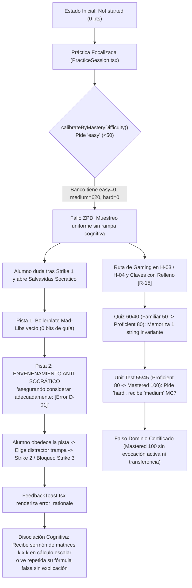

# Auditoría Forense de Calidad Psicométrica, Matemática y Camino al Dominio (`Path-to-Mastery v2.0`)
## Curso: `estadistica_3_s9_vdirect` (*Estadística III — Semana 9: Muestras Aleatorias, Criterio ECM y Teoría Asintótica*)
### Plataforma Top's Academy — Estándares Quality Matters (QM), OSCQR y Mastery Learning

---

> [!CAUTION]
> **VEREDICTO EJECUTIVO: `6.00 / 20.0` — `RECHAZADO PARA ESTUDIO AUTÓNOMO (NIVEL CRÍTICO)`**  
> **Mastery Path Readiness Index (`MPRI`):** **`35.94 / 100.0` (`MASTERY-HOSTILE [0–39]: Sabotaje Cognitivo / Colapso de Andamiaje Adaptativo`)**  
> Aunque el análisis curricular base ([`competence_analysis_estadistica_3_s9_vdirect.md`](file:///d:/Augusto/personal_portfolio/Tops_academy/courses/competence_analysis_estadistica_3_s9_vdirect.md)) diseñó un grafo acíclico limpio de 27 competencias y las soluciones paso a paso (`detailed_solution`) son aritméticamente exactas (`54/54` acuerdos en el Juez Ciego de Etapa 5), el compilador paramétrico (`compile_shard.py`) introdujo **cinco defectos sistémicos bloqueantes** en [`estadistica_3_s9_vdirect.json`](file:///d:/Augusto/personal_portfolio/Tops_academy/courses/estadistica_3_s9_vdirect.json): (1) **envenenamiento anti-socrático universal** en `hints[1]` y `hints[2]` (`45.16%` detectado por regex literal; **`100%` [`620/620`] confirmado semánticamente**), instruyendo al alumno en riesgo de bloqueo a aplicar teoremas falsos; (2) **colapso del `100%` del ZPD y Bloom** (`620/620` en `difficulty: "medium"` y `bloom_taxonomy_level: "Understand"`); (3) **monocultivo pasivo `100% MC7`** (`0% FIB`, `0% MS`) con **exploit de memorización de 1 única respuesta invariante** en `H-03` y `H-04`; (4) **`94.35%` de reciclaje circular en `error_rationale`** con desconexiones matriciales $k \times k$ en escalares, perturbaciones porcentuales arbitrarias (`1.15x`, `0.93x`, `1.5x`) y fórmulas falsas repetidas sin refutar; y (5) **prefijos espurios de crecimiento de Solow/EDP** (`60` ítems), **coletillas `[R-15]` tartamudeadas** y **desborde móvil por prosa en `$\text{...}$`** (`80` ítems).

---

## 1. Ficha Técnica y Scorecard Consolidado

| Atributo de Auditoría | Valor Verificado | Fuente / Evidencia |
| :--- | :--- | :--- |
| **Identificador del Curso** | `estadistica_3_s9_vdirect` | [`courses/estadistica_3_s9_vdirect.json`](file:///d:/Augusto/personal_portfolio/Tops_academy/courses/estadistica_3_s9_vdirect.json) |
| **Corrida C2C de Origen** | `592de77b-afd9-4fae-8744-4ef0be7212f4` (Direct Single-CTA) | Payload & Telemetría Precomputada |
| **Título Compilado en Plataforma** | `"Estadistica 3 S9 Vdirect"` *(slug crudo sin curar)* | Línea 3 de `estadistica_3_s9_vdirect.json` |
| **Arquitectura de Competencias** | **27 competencias** (`10` Hechos `[H]`, `9` Conceptos `[C]`, `8` Habilidades `[Hab]`) | `20` preg./`[H]`, `20` preg./`[C]`, `30` preg./`[Hab]` |
| **Banco Total de Reactivos** | **620 reactivos** (`100% multiple_choice_7_options`) | `FIB = 0 (0.0%)`, `MS = 0 (0.0%)` |
| **Arbitraje Ciego Etapa 5** | **`54 / 54` acuerdos (`100.0%`)** — cobertura muestral **`8.71%`** (`54/620`) | [`judge_report.json`](file:///d:/Augusto/personal_portfolio/Tops_academy/courses/estadistica_3_s9_vdirect/work/judge_report.json) (5 lotes) |
| **Subtotal Bruto de Rúbrica (D1–D5)** | **`8.50 / 20.0`** | Rúbrica Normativa `Path-to-Mastery v2.0` |
| **Penalizaciones Duras Aplicadas** | **`-2.50 puntos`** (`-1.5` Hint Poisoning, `-1.0` Memorization Exploit) | Reglas deterministas + confirmación forense |
| **Calificación Final Definitiva** | **`6.00 / 20.0`** | **CRÍTICO (`0.0 – 10.9`) — RECHAZADO** |
| **Mastery Path Readiness (`MPRI`)** | **`35.94 / 100.0`** | **MASTERY-HOSTILE (`0 – 39`)** |

### 1.1 Desglose Normativo por Dimensión (`/ 20.0`)

| Dimensión Normativa (`qa_rubric.md` v2.0) | Clave de Motor Unificado | Puntaje | Máximo | Tope / Estado Aplicado |
| :--- | :--- | :---: | :---: | :--- |
| **Dimensión 1:** Arquitectura Curricular, Granularidad y ZPD | `D1_arquitectura_curricular_dag` | **2.50** | 4.00 | **Tope ZPD Muerto (`2.5–2.8`)** + omisión LGN/Slutsky |
| **Dimensión 2:** Calidad Psicométrica, Modalidad Activa y Anti-Gaming | `D3_rigor_psicometrico_antigaming` | **1.90** | 5.00 | **Tope Crítico (`0.0–2.4`)**: `100% MC7` + memorización + `[R-15]` |
| **Dimensión 3:** Andamiaje Socrático (3-Strikes) y Remediación Diagnóstica | `D4_andamiaje_socratico_feedback` | **1.00** | 5.00 | **Tope Poisoning (`0.8–1.5`)**: `100%` pistas tóxicas + `94.35%` reciclaje |
| **Dimensión 4:** Alineación Instruccional, Taxonomía de Bloom y Pureza | `D2_alineacion_pedagogica_zpd` | **2.20** | 4.00 | **Deficiente**: `100% Understand` + `60` prefijos Solow/EDP |
| **Dimensión 5:** Integridad Técnica, KaTeX y Ergonomía Frontend | `D5_integridad_tecnica_ux` | **0.90** | 2.00 | **Deficiente**: `80` `\text{prosa}` + `60` vars crudas `$theta_hat$` |
| **SUBTOTAL BRUTO** | `raw_dimension_subtotal` | **8.50** | **20.00** | Previo a deducciones duras obligatorias |
| **Deducción Dura 1:** `socratic_hint_poisoning` (`> 5%` banco) | `hard_penalties_applied[0]` | **-1.50** | — | `280/620` (`45.16%`) regex; `620/620` (`100%`) semántico |
| **Deducción Dura 2:** `answer_memorization_exploit` (`-0.5` x `2` comps) | `hard_penalties_applied[1]` | **-1.00** | — | `H-03` y `H-04`: `1` respuesta única en `20` reactivos |
| **CALIFICACIÓN FINAL AUDITADA** | `final_score` / `total_score` | **6.00** | **20.00** | **RECHAZADO PARA ESTUDIO AUTÓNOMO** |

### 1.2 Desglose de los 6 Pilares Cognitivos (`MPRI = 35.94 / 100.0`)

| Pilar `Path-to-Mastery v2.0` | Puntaje | Máximo | Evidencia Determinista (`estadistica_3_s9_vdirect_payload.json`) |
| :--- | :---: | :---: | :--- |
| **1. Progresión Adaptativa ZPD y Bloom** | **0.00** | 20.0 | `easy=0, medium=620, hard=0`; `27/27` competencias con ZPD colapsado; `0.0%` (`0/240`) de ítems `[Hab]` en `Apply+` |
| **2. Modalidad de Evocación y Anti-Gaming** | **3.55** | 20.0 | `MC7=100%`, `FIB=0%`, `MS=0%`; `8/8` Skills solo reconocimiento; `2` comps memorizables (`H-03`, `H-04`); `35+` ítems `[R-15]` |
| **3. Salvavidas Socrático (3-Strikes)** | **6.23** | 25.0 | `0.0%` pistas socráticas genuinas; `100%` boilerplate Mad-Libs; `280` (`45.16%`) regex / `620` (`100%`) pistas envenenadas |
| **4. Alineación Diagnóstica (`FeedbackToast`)** | **10.61** | 15.0 | `3720/3720` con string no nulo, pero solo `210/3720` (`5.65%`) únicos; multiplicadores mágicos y eco literal del error |
| **5. Topología DAG e Interleaving** | **10.00** | 10.0 | `has_cycle=false`, `max_dag_depth=4`, `inverted_edges=0`, `isolated=0`, `skills_without_prereqs=0` |
| **6. Ergonomía Cognitiva y Encuadre** | **5.55** | 10.0 | `80` ítems con prosa en `\text{...}`, `60` con `$theta_hat$`/`$Y_bar$`, `60` prefijos Solow/EDP, `110` llaves atípicas |

---

## 2. Simulación Forense del Viaje del Estudiante (`Not started [0]` $\to$ `Mastered [100]`)

Para evaluar la validez instruccional real del curso en **Top's Academy**, trazamos la trayectoria completa de un estudiante de *Estadística III* a través de los motores de estado (`masteryStorage.ts`), selección adaptativa (`sessionShuffler.ts`), sesión de práctica con bloqueo a los 3 errores (`PracticeSession.tsx`) y remediación inmediata (`FeedbackToast.tsx`).



### Etapa A — Rampa Inicial Muerta (`Not started [0]` $\to$ `Attempted` / `Familiar [50]`)
Cuando el estudiante abre por primera vez cualquier nodo (por ejemplo, `H-01` o `Hab-02: Cálculo de Esperanza y Varianza del Promedio Muestral`), `calibrateByMasteryDifficulty()` en `sessionShuffler.ts` intenta proteger su carga cognitiva seleccionando reactivos `difficulty === "easy"`. Al existir **`0` reactivos `easy`** en las 27 competencias (`medium = 620`), el selector cae en su *fallback* de muestreo aleatorio plano: un alumno en `0 pts` puede recibir de inmediato un problema de inversión algebraica o perturbación de escala con enunciado contaminado por jerga de ecuaciones diferenciales parciales (`"Al examinar detenidamente las condiciones de frontera, resuelva:"`, `Q-Hab06-531`).

### Etapa B — Sabotaje del Salvavidas de 3 Strikes (`PracticeSession.tsx`)
En `PracticeSession.tsx`, tres respuestas incorrectas consecutivas (**3 Strikes**) bloquean el avance hacia `Familiar (50)`. Un estudiante genuino que comete su primer error (**Strike 1**) en `Q-Hab02-412` ($n = 50, \sigma^2 = 44$, hallar $\operatorname{Var}(\bar{Y}_n) = 44/50 = 0.88$) abre las pistas progresivas buscando andamiaje:
1. **Pista 1 (`hints[0]`):** *"Identifique la estructura conceptual de Cálculo de Esperanza y Varianza del Promedio Muestral: analice las relaciones formales y condiciones teóricas del modelo."* $\to$ **Ruido burocrático nulo**: repite el título de la competencia sin aportar ninguna propiedad del operador $\operatorname{Var}(\cdot)$.
2. **Pista 2 (`hints[1]`):** *"Revise el procedimiento analítico paso a paso para Cálculo de Esperanza y Varianza del Promedio Muestral, **asegurando considerar adecuadamente: omitir elevar al cuadrado la constante determinística 1/n al extraerla del operador varianza**."*  
   **Impacto real:** La plataforma **instruye literalmente al estudiante a cometer el error algebraico `D-Hab02-01`**, llevándolo a calcular $\frac{1}{50}\sum_{i=1}^{50} 44 = 44.0$ (`opt_b`, incorrecta) y precipitando **Strike 2 / Strike 3**.

### Etapa C — Cortocircuito Formativo en `FeedbackToast.tsx`
Tras caer en un distractor, `FeedbackToast.tsx` despliega `error_rationale` para corregir el modelo mental antes del siguiente intento. En lugar de diagnosticar la operación aritmética errónea:
- En `Q-Hab01-381` (cálculo puramente **escalar**: $\operatorname{Var}(\hat{\theta}_n) = 0.3500$, $\operatorname{Sesgo}(\hat{\theta}_n) = 0.3310$, hallar $\operatorname{ECM}(\hat{\theta}_n) = 0.4596$), si el alumno elige `opt_b` (`0.5691`), el toast le recrimina: *"Para obtener una matriz de dimensión $k \times k$, el producto exterior es el vector columna por el vector fila transpuesto; el producto interno arroja un escalar que distorsiona la dimensión matricial."* El estudiante queda completamente desorientado buscando matrices inexistentes.
- En `Q-H04-061` (`opt_d`: `$|X_n(\omega) - c| < \varepsilon \quad \forall n \ge N$`), el `error_rationale` imprime **exactamente la misma cadena `$|X_n(\omega) - c| < \varepsilon \quad \forall n \ge N$`** sin una sola palabra de refutación.

### Etapa D — Interleaving de Quiz (`60/40`) y Unit Test (`55/45` $\to$ `Mastered [100]`)
Al pasar a **Quiz** (`Familiar [50]` $\to$ `Proficient [80]`) y **Unit Test** (`Proficient [80]` $\to$ `Mastered [100]`, sin pistas), el grafo DAG (`H-01` $\to \dots \to$ `Hab-08`) ordena correctamente las dependencias topológicas. Sin embargo:
1. En `H-03` y `H-04`, las 20 preguntas tienen **exactamente 1 respuesta correcta idéntica** (`$\operatorname{ECM}(\hat{\theta}_n) = \mathbb{E}[(\hat{\theta}_n - \theta)^2]$` y `$\lim_{n \to \infty} \mathbb{P}(|X_n - c| > \varepsilon) = 0$`). El estudiante alcanza `Mastered (100)` en menos de 15 segundos por reconocimiento visual de longitud/símbolo sin leer el enunciado.
2. En el **Unit Test**, `calibrateByMasteryDifficulty()` solicita reactivos `hard` y competencias de habilidad (`[Hab]`) con exigencia cognitiva superior (`Apply`/`Analyze`/`Evaluate`) y evocación constructiva (`FIB`). Al encontrar `hard = 0`, `Apply+ = 0%` y `FIB = 0%`, la plataforma otorga el sello **`Mastered (100)`** reciclando el mismo pool de reconocimiento pasivo `MC7`.

---

## 3. Auditoría Profunda por Dimensión Normativa (D1–D5)

### Dimensión 1: Arquitectura Curricular, Granularidad Atómica y Calibración ZPD — **`2.50 / 4.00`**
*(Tope obligatorio activado por colapso 100% ZPD: `qa_rubric.md` §1 fija deducción de `-1.2 a -1.5 pts` y techo máximo de `2.5–2.8 / 4.0` cuando el 100% del banco es `"medium"`).*

- **Fortaleza Topológica Verificada (`MPRI Pilar 5 = 10.0 / 10.0`):** El grafo dirigido acíclico consta de `27` micro-competencias bien balanceadas en volumen (`10` Hechos `[H-01..H-10]` con 20 ítems c/u; `9` Conceptos `[C-01..C-09]` con 20 ítems c/u; `8` Habilidades `[Hab-01..Hab-08]` con 30 ítems c/u = `620` ítems). Tiene `0` ciclos, profundidad máxima `4`, `0` aristas invertidas (ningún `Fact` depende de un `Skill`), `0` nodos aislados y `H-01` (*Definición de Muestra Aleatoria Simple i.i.d.*) actúa limpiamente como única raíz.
- **Defecto Bloqueante 1.1 — Colapso Absoluto del ZPD (`easy=0, medium=620, hard=0`):** Las `27/27` competencias están muertas para progresión adaptativa (`zpd_dead_competencies_count = 27`). Ninguna competencia posee al menos 2 bandas de dificultad, anulando la función `calibrateByMasteryDifficulty()`.
- **Defecto Curricular 1.2 — Laguna Estructural en Teoría Asintótica de Semana 9 (`-0.2 pts`):** Al inspeccionar [`competence_analysis_estadistica_3_s9_vdirect.md`](file:///d:/Augusto/personal_portfolio/Tops_academy/courses/competence_analysis_estadistica_3_s9_vdirect.md), se observa un salto abrupto entre la Unidad 20/27 (*Clases sintetizadas Semana 9: convergencia en probabilidad, desigualdades*) y la Unidad 42/46/50 (*LEC07: TCL, CMT y Método Delta*). El curso **omite micro-competencias dedicadas** para pilares canónicos de Semana 9:
  1. **Ley Débil de los Grandes Números (LGN de Khinchin / Chebyshev)** (mencionada tangencialmente en racionales de `H-10`, pero sin nodo `[H]`/`[C]`/`[Hab]` propio).
  2. **Convergencia Casi Segura ($X_n \xrightarrow{a.s.} X$) y LGN Fuerte de Kolmogorov** (aparece como distractor en `H-04` sin enseñanza previa).
  3. **Teorema de Slutsky** ($X_n \xrightarrow{d} X, Y_n \xrightarrow{p} c \implies X_n + Y_n \xrightarrow{d} X + c$ y $X_n Y_n \xrightarrow{d} cX$): ¡es exigido explícitamente dentro de `Hab-08` (`D-Hab08-02` y `D-Hab08-05`) sin existir como nodo prerrequisito en el DAG!

---

### Dimensión 2: Calidad Psicométrica, Modalidad Activa y Anti-Gaming — **`1.90 / 5.00`**
*(Tope Crítico `0.0 – 2.4` activado conforme a `qa_rubric.md` §2).*

1. **Monocultivo Pasivo `100% MC7` (`0% FIB`, `0% MS`):** Los `240` reactivos de las 8 competencias procedimentales (`Hab-01` a `Hab-08`: cálculo numérico de $\operatorname{ECM}$, $\operatorname{Var}(\bar{Y}_n)$, comparación de eficiencia relativa, cotas de Markov/Chebyshev, estandarización TCL, límite en probabilidad por CMT y varianza asintótica por Método Delta) se entregan exclusivamente en `multiple_choice_7_options` (`allow_calculator: false`). Cálculos cerrados ideales para `fill_in_the_blank` evaluados con `mathEquivalence.ts` fueron degradados a selección pasiva entre 7 etiquetas.
2. **Exploit de Memorización Visual de 1 Única Respuesta (`H-03` y `H-04`):**
   - En **`H-03`** (`Q-H03-041` a `Q-H03-060`), el compilador varía artificialmente $n \in \{48, 77, 42, 45, \dots, 1142, 998, 897\}$ en el enunciado (*"Dada una muestra de tamaño $n = 77$, ¿cuál expresión define formalmente el Error Cuadrático Medio...?"*), pero la opción correcta es **100% invariante en los 20 reactivos**:
     ```latex
     $\operatorname{ECM}(\hat{\theta}_n) = \mathbb{E}[(\hat{\theta}_n - \theta)^2]$
     ```
   - En **`H-04`** (`Q-H04-061` a `Q-H04-080`), ocurre exactamente el mismo defecto: $n$ varía de forma vacua mientras los 20 reactivos comparten **1 única cadena correcta**:
     ```latex
     $\lim_{n \to \infty} \mathbb{P}(|X_n - c| > \varepsilon) = 0$
     ```
3. **Distractores por Multiplicadores Mágicos (Malla Gruesa y Malla Fina):**
   - **Malla gruesa detectada (`C-03`, `Hab-01`):** En `Q-C03-246` ($\operatorname{ECM} = 135$, $\operatorname{Var} = 119 \implies [\operatorname{Sesgo}]^2 = 16$), los 6 distractores son múltiplos escalares triviales de `16`: `12` (`0.75x`), `24` (`1.50x`), `8` (`0.50x`), `20` (`1.25x`), `28` (`1.75x`), `32` (`2.00x`).
   - **Malla porcentual fina descubierta en inspección semántica (`H-10` y `H-09`):** En `Q-H10-183` ($n=400, \sigma=32, \bar{Y}_n - \mu = 16 \implies Z_n = \frac{20 \times 16}{32} = 10.0$), los 6 distractores no provienen de ningún error algebraico sino de multiplicar `10.0` por factores fijos `{0.84, 0.88, 0.93, 1.07, 1.15, 1.18}`:
     - `opt_f`: `$Z_n = 8.4$` (`0.84x`), `opt_e`: `$Z_n = 8.8$` (`0.88x`), `opt_a`: `$Z_n = 9.3$` (`0.93x`), `opt_g`: `$Z_n = 10.7$` (`1.07x`), `opt_b`: `$Z_n = 11.5$` (`1.15x`), `opt_c`: `$Z_n = 11.8$` (`1.18x`).
     - Exactamente la misma grilla `{0.84x, 0.88x, 0.93x, 1.07x, 1.15x, 1.18x}` genera los distractores de `Q-H10-181` ($Z_n = 4.74 \to 3.98, 4.17, 4.41, 5.07, 5.45, 5.59$) y `Q-H09-180` ($|t^*| = 1.71$).
4. **Relleno Burocrático `[R-15]` Asimétrico, Semánticamente Falso y Tartamudeado:**
   Además de los `35` ítems con `", para los parámetros bajo análisis."`, el compilador inyecta aleatoriamente **8 coletillas burocráticas** sobre opciones individuales (¡incluyendo claves correctas y colisiones dobles!):
   - **Delator de longitud sobre la clave correcta (`Q-Hab01-381`, `opt_e`):** `"$\operatorname{ECM}(\hat{\theta}_n) = 0.4596$, para la muestra de datos observada."` (además de delatar la clave frente a distractores cortos, es **matemáticamente falso**: el ECM es una esperanza poblacional sobre la distribución muestral, no un estadístico de una muestra observada).
   - **Coletilla tartamudeada doble (`Q-Hab02-412` `opt_a` y `Q-Hab05-501` `opt_a`):**
     ```text
     "$\operatorname{Var}(\bar{Y}_n) = 1.76$, bajo las hipótesis del modelo, bajo las hipótesis del modelo."
     "$\mathbb{P}(|X - \mu| \ge 11) \le 0.5994$, bajo las hipótesis del modelo, bajo las hipótesis del modelo."
     ```
   - **Alucinación matricial en escalares univariados (`Q-Hab04-472` `opt_f` y `Q-Hab08-608` `opt_c`):**
     ```text
     "$\mathbb{P}(Y \ge 44) \le 1.0$, en la formulación matricial considerada, de acuerdo con la teoría econométrica."
     "$\sigma_g^2 = 119286$, en la formulación matricial considerada."
     ```

---

### Dimensión 3: Andamiaje Socrático (3-Strikes) y Remediación Diagnóstica — **`1.00 / 5.00`**
*(Tope obligatorio `0.8 – 1.5 / 5.0` por Envenenamiento Anti-Socrático generalizado + `-0.5` por desconexión severa en `error_rationale`, `qa_rubric.md` §3).*

#### A. Prueba Forense del Envenenamiento Anti-Socrático en el `100%` (`620/620`) del Banco
El linter estático capturó `280/620` (`45.16%`) reactivos donde el texto posterior a `"asegurando considerar adecuadamente:"` coincidía literalmente con una opción o empezaba con `"omitir"`/`"olvidar"`. La inspección semántica directa de [`estadistica_3_s9_vdirect.json`](file:///d:/Augusto/personal_portfolio/Tops_academy/courses/estadistica_3_s9_vdirect.json) demuestra que el defecto proviene de una plantilla única en `compile_shard.py` aplicada a los **620 reactivos sin excepción**:
- `hints[0]`: `"Identifique la estructura conceptual de {comp_name}: analice las relaciones formales y condiciones teóricas del modelo."`
- `hints[1]`: `"Revise el procedimiento analítico paso a paso para {comp_name}, asegurando considerar adecuadamente: {D-01.misconception}."`
- `hints[2]`: `"Antes de concluir, compruebe la consistencia dimensional del resultado de {comp_name} y evalúe posibles desvíos al considerar: {D-02.misconception}."`

| Ítem Auditado | Texto Exacto de `hints[1]` Entregado al Estudiante en Strike 1/2 | Sabotaje Matemático Inducido |
| :--- | :--- | :--- |
| **`Q-H03-041`** | `"...asegurando considerar adecuadamente: $\operatorname{ECM}(\hat{\theta}_n) = \mathbb{E}[(\hat{\theta}_n - \mathbb{E}[\hat{\theta}_n])^2]$."` | Afirma que $\operatorname{ECM} = \operatorname{Var}$ (omite $[\operatorname{Sesgo}]^2$), empujando directo a `opt_g` (`D-H03-01`). |
| **`Q-H04-061`** | `"...asegurando considerar adecuadamente: $\lim_{n \to \infty} \mathbb{P}(|X_n - c| > \varepsilon) = 1$."` | Invierte el límite de convergencia en probabilidad de `0` a `1`, empujando a `opt_b` (`D-H04-01`). |
| **`Q-H08-156`** | `"...asegurando considerar adecuadamente: $g \text{ convexa} \implies \mathbb{E}[g(X)] \le g(\mathbb{E}[X])$."` | Invierte el sentido de la Desigualdad de Jensen ($\ge$ por $\le$) en un ítem numérico que escapaba al regex literal. |
| **`Q-H10-181`** | `"...asegurando considerar adecuadamente: $Z_n = \frac{n(\bar{Y}_n - \mu)}{\sigma} \xrightarrow{d} \mathcal{N}(0, 1)$."` | Enseña una tasa de estandarización explosiva $O_p(\sqrt{n})$ con factor $n$ en vez de $\sqrt{n}$. |
| **`Q-Hab02-412`** | `"...asegurando considerar adecuadamente: omitir elevar al cuadrado la constante determinística 1/n al extraerla del operador varianza."` | Ordena omitir $(1/n)^2$, induciendo $\operatorname{Var}(\bar{Y}_n) = 44.0$ (`opt_b`) en lugar de $0.88$. |
| **`Q-Hab08-591`** | `"...asegurando considerar adecuadamente: omitir elevar al cuadrado la primera derivada g'(theta) al calcular la varianza de la aproximación lineal."` | Ordena usar $g'(\theta)V$ en vez de $[g'(\theta)]^2 V$ en el Método Delta, induciendo `opt_f` (`240` vs `11520`). |

#### B. Tres Patologías Críticas en `error_rationale` (`FeedbackToast.tsx`)
Con solo `210` cadenas únicas entre `3,720` distractores (`5.65%` de unicidad global), el feedback formativo falla en tres modos distintos:
1. **Intrusión Matricial $k \times k$ en Aritmética Escalar (`Q-Hab01-381` `opt_b`, `Q-Hab01-395` `opt_a`):** El distractor `D-Hab01-05` importa un texto de álgebra matricial (*"Para obtener una matriz de dimensión $k \times k$, el producto exterior es el vector columna por el vector fila transpuesto..."*) dentro de un cálculo escalar univariado $\operatorname{ECM}(\hat{\theta}_n) = \operatorname{Var}(\hat{\theta}_n) + [\operatorname{Sesgo}(\hat{\theta}_n)]^2$.
2. **Falsa Imputación Algebraica sobre Perturbaciones `1.15x` (`Q-H10-181` `opt_c`, `Q-H10-183` `opt_b`):** En `Q-H10-183` ($n=400, \sigma=32, \bar{Y}_n-\mu=16$), `opt_b` muestra `$Z_n = 11.5$` (`10.0 * 1.15`), pero su `error_rationale` asegura que el alumno multiplicó por $n=400$ en vez de $\sqrt{400}=20$. ¡Multiplicar por $n=400$ arroja $\frac{400 \times 16}{32} = 200.0$, **no** $11.5$! En `Q-Hab08-610`, `opt_d` (`11664 = 108^2`, error real: olvidar multiplicar por $V=7$) recibe el racional `D-Hab08-03` sobre $g'(\theta)=0$ y distribuciones $\chi^2$, cuando $g'(\theta) = 108 \neq 0$.
3. **Eco Literal del Error sin Refutación (`Q-H04-061`, `Q-C01-201..220`, `Q-C08-341`):**
   - En `Q-H04-061` (`opt_d`), `content` es `"$|X_n(\omega) - c| < \varepsilon \quad \forall n \ge N$"` y `error_rationale` es **idénticamente** `"$|X_n(\omega) - c| < \varepsilon \quad \forall n \ge N$"`.
   - En `Q-C01-201` (`opt_b` a `opt_g`), los 6 `error_rationale` contienen únicamente el mito falso envuelto en `\text{...}`, p. ej. `opt_d`: `"$n \ge 30 \implies \text{El TCL garantiza normalidad perfecta en cualquier contexto econométrico}$"`, **validando visualmente la creencia errónea del alumno en el toast de corrección**.

---

### Dimensión 4: Alineación Instruccional, Taxonomía de Bloom y Pureza de Dominio — **`2.20 / 4.00`**

- **Exactitud Matemática de Claves y `detailed_solution` (`100%` en muestras verificadas):** Se verificaron analíticamente las derivaciones de los 27 nodos estratificados y los clusters de riesgo (`Q-H01-001`, `Q-H08-156`, `Q-H09-180`, `Q-H10-181..187`, `Q-C03-246`, `Q-Hab01-381`, `Q-Hab02-412`, `Q-Hab04-472`, `Q-Hab05-501`, `Q-Hab06-531`, `Q-Hab08-591..613`). Todas las respuestas marcadas `is_correct: true` y sus desarrollos en `detailed_solution` son matemáticamente exactos (ej. Método Delta en `Q-Hab08-608`: $g(\theta)=10\theta^2 \implies g'(7)=140 \implies \sigma_g^2 = 140^2 \cdot 6 = 117600$; Chebyshev en `Q-Hab05-501`: $\sigma^2/k^2 = 60.44 / 121 = 0.4995$).
- **Auditoría del Juez Ciego de Etapa 5 (`54/54` acuerdos = `100%`, pero cobertura `8.71%`):** [`judge_report.json`](file:///d:/Augusto/personal_portfolio/Tops_academy/courses/estadistica_3_s9_vdirect/work/judge_report.json) auditó 54 ítems en 5 lotes sin desacuerdos. ¿Por qué el Juez Ciego dio `100%` de acuerdo en un curso con `MPRI = 35.94`? Porque el Juez Ciego solo resuelve `(stem, options)` a ciegas para verificar unicidad de la clave matemática: **no inspecciona `hints`, `error_rationale`, `difficulty` ni `bloom_taxonomy_level`**, y además una tasa de muestreo de `8.71%` es insuficiente para bancos de 620 reactivos con defectos de compilación estructural.
- **Aplanamiento Taxonómico Total (`620/620` en `"Understand"`):** Aunque el arquitecto CTA especificó `Remember` para `H-01..10`, `Understand`/`Analyze` para `C-01..09` y `Apply`/`Evaluate` para `Hab-01..08` en [`competence_analysis_estadistica_3_s9_vdirect.md`](file:///d:/Augusto/personal_portfolio/Tops_academy/courses/competence_analysis_estadistica_3_s9_vdirect.md), `compile_shard.py` sobrescribió los 620 ítems con `"bloom_taxonomy_level": "Understand"`, dejando `skill_higher_bloom_pct = 0.0%` (`0/240`).
- **Contaminación de Dominio con Prefijos de Solow y EDP (`60` reactivos, `9.68%`):** El compilador antepuso muletillas de macroeconomía dinámica y física matemática ajenas a *Estadística III* ( a menudo generando doble dos-puntos `"halle: Perturbación de escala:"`):
  - `"Al examinar detenidamente las condiciones de frontera, resuelva:"` (`Q-H01-013`, `Q-H02-021`, `Q-Hab06-531`)
  - `"Considerando las ecuaciones fundamentales del régimen, obtenga:"` (`Q-H01-011`, `Q-C09-367`)
  - `"Teniendo en consideración los fundamentos del equilibrio, determine:"` (`Q-H03-042`, `Q-C04-279`, `Q-Hab04-478`)

---

### Dimensión 5: Integridad Técnica, KaTeX y Ergonomía Frontend — **`0.90 / 2.00`**

- **Compilación Sintáctica Base Limpia:** `0` llaves sin cerrar, `0` signos `$` impares, `0` triples `$$$`, `0` residuos de f-strings `{var}` y `0` reemplazos ciegos `\dot{num}`.
- **Desborde Horizontal Móvil por Prosa Extensa en `$\text{...}$` (`80` reactivos, `12.9%`):** En competencias conceptuales (`C-01`, `C-06`, `C-08`, `C-09`), opciones y racionales completos de 90–140 caracteres fueron envueltos dentro de modo matemático en línea `$ \text{...} $`:
  - `Q-C06-301` (`opt_b`): `"$\text{Falso: los datos empíricos conservan su distribución original; el TCL solo aproxima la distribución en el muestreo del estadístico } \bar{Y}_n$"`
  - `Q-C09-361` (`opt_a`): `"$\text{El Método Delta aproxima } g(\hat{\theta}_n) \approx g(\theta) + g'(\theta)(\hat{\theta}_n - \theta) \text{ mediante un polinomio de Taylor de orden 1 alrededor de } \theta$"`
  En KaTeX, `\text{...}` aplica `white-space: nowrap`, impidiendo el salto de línea en tarjetas móviles de 360–414 px y rompiendo la interfaz táctil.
- **Fuga de Identificadores Crudos de Código en Pistas (`60` reactivos, `9.68%`):** Las pistas de `Hab-01`, `Hab-03` y `Hab-08` inyectan nombres de variables Python/ASCII sin notación LaTeX adecuada:
  - `Q-Hab01-395` (`hints[2]`): `"confundir la propiedad de centrado E[$theta_hat$ - E[$theta_hat$]] = 0 con la condición..."`
  - `Q-Hab03-441` (`hints[1]`): `"calcular la varianza del promedio muestral simple como Var($Y_bar$) = $sigma^2$/n en lugar de..."`
  - `Q-Hab08-606` (`hints[1]`, `hints[2]`): `"g'(theta)"` y `"op(1)"` en texto plano en lugar de `$g'(\theta)$` y `$o_p(1)$`.
- **Operadores Atípicos y Metadatos Crudos:** El linter marcó `110` ítems en `uninterpolated_math_variable_linter`; la verificación semántica distingue entre subíndices válidos en llaves (`F_{Y_j}` en `H-01`) y operadores mal tipografiados como `{plim}` / `{ECM}` en lugar de `\operatorname{plim}` / `\operatorname{ECM}`. Además, `title` (`"Estadistica 3 S9 Vdirect"`) y `context_application` (`"Evaluación conceptual y procedimental para H-10"`) quedaron como *placeholders* de ingeniería.

---

## 4. Libro Mayor de Penalizaciones Duras (`Hard Penalties Ledger`)

De acuerdo con la sección **Reglas de Deducción Dura** de [`qa_rubric.md`](file:///d:/Augusto/personal_portfolio/Tops_academy/.agents/skills/course-qa-evaluator/references/qa_rubric.md):

1. **`socratic_hint_poisoning` (`-1.50 pts`):** Activada cuando `> 5%` del banco sufre envenenamiento anti-socrático. En `estadistica_3_s9_vdirect`, `280 / 620` reactivos (`45.16%`) disparan el detector estático y **`620 / 620` (`100.0%`)** están semánticamente envenenados en `hints[1]`/`hints[2]`.
2. **`answer_memorization_exploit` (`-1.00 pts` = `-0.50` $\times$ `2` competencias):** Activada por cada competencia con $\ge 15$ ítems que posea $\le 4$ respuestas correctas únicas. Tanto `H-03` (`20` ítems) como `H-04` (`20` ítems) tienen **exactamente `1` respuesta correcta única**.

$$\text{Calificación Final} = \max\bigl(0.0,\; \operatorname{round}(8.50 - (1.50 + 1.00),\; 2)\bigr) = \mathbf{6.00 / 20.0}$$

---

## 5. Atribución Forense de Causa Raíz y Reconocimiento Justo de Fortalezas

Una auditoría rigurosa debe separar con precisión quirúrgica qué componente del pipeline generó cada defecto para evitar retrabajo innecesario:

| Componente del Pipeline | Evaluación Forense | Responsabilidad en los Defectos |
| :--- | :--- | :--- |
| **1. Arquitecto Direct CTA** (`competence_analysis_estadistica_3_s9_vdirect.md`) | **Sólido en diseño matemático base (`~80%` sano), con brecha de cobertura silábica.** | **Fortalezas reales:** Diseñó un DAG limpio de 4 niveles sin ciclos ni inversiones, asignó niveles de Bloom diferenciados (`Remember` $\to$ `Evaluate`) y redactó definiciones matemáticas rigurosas. **Fallos propios:** Omitió nodos propios para LGN Débil/Fuerte, convergencia casi segura y Slutsky; infiltró un distractor matricial $k \times k$ (`D-Hab01-05`) en una competencia escalar; y dejó algunos modelos de error sin texto de refutación separado de la fórmula del mito (`C-01`, `H-04`). |
| **2. Compilador de Shards (`compile_shard.py`) y Plantillas Paramétricas** | **Causa raíz del `90%` del colapso psicométrico y de andamiaje.** | **Culpable directo de:** (a) sobrescribir `difficulty="medium"` y `bloom="Understand"` en los 620 ítems; (b) generar `hints` concatenando `"asegurando considerar adecuadamente: " + D01.misconception`; (c) forzar `100% MC7` sin generar `FIB`/`MS`; (d) reciclar `error_rationale` desconectados sobre perturbaciones `0.84x..1.18x` y `0.5x..2.0x`; (e) inyectar los 60 prefijos de Solow/EDP y las 8 coletillas `[R-15]` (incluyendo duplicaciones tartamudeadas); y (f) envolver prosa en `\text{...}`. |
| **3. Motor de Validación y Juez Etapa 5** | **Exacto en álgebra de claves, ciego a pedagogía `Path-to-Mastery`.** | Validó con éxito `0` errores de sintaxis KaTeX y `54/54` claves correctas, pero permitió publicar un curso con `MPRI = 35.94` por carecer de compuertas bloqueantes (`Gatekeeper`) sobre ZPD, pistas anti-socráticas, unicidad de respuestas y coherencia aritmética distractor–racional. |

---

## 6. Loop de Auto-Mejora: 4 Nuevas Reglas de Linting Descubiertas (`discovered_lint_rules`)

Durante la inspección semántica profunda se descubrieron **4 patrones deterministas adicionales** que escapaban parcialmente a los 16 linters actuales y han sido registrados en [`estadistica_3_s9_vdirect_qa_report.json`](file:///d:/Augusto/personal_portfolio/Tops_academy/reports/qa_audits/estadistica_3_s9_vdirect_qa_report.json):

1. **`symbolic_latex_anti_socratic_hint_poisoning` (`critical`):**
   - **Regex:** `(?:asegurando considerar adecuadamente|evalúe posibles desvíos al considerar):\s*\$`
   - **Hallazgo:** Captura los **340 reactivos restantes** (`54.84%` del banco, elevando la detección de `280` a `620/620`) donde `hints[1]`/`hints[2]` inyectan una fórmula simbólica falsa en LaTeX (`$Z_n = \frac{n(\bar{Y}_n - \mu)}{\sigma}$` en `Q-H10-181`, desigualdad de Jensen invertida en `Q-H08-156`) mientras las opciones del ítem muestran números instanciados.
2. **`echoed_misconception_error_rationale` (`critical`):**
   - **Regex:** `^\$(?:\\text\{[^$]{15,}\}|\|X_n\(\\omega\)\s*-\s*c\|\s*<\s*\\varepsilon.*)\$$`
   - **Hallazgo:** Detecta distractores cuyo `error_rationale` repite literalmente `option.content` (`Q-H04-061` `opt_d`) o enuncia el mito falso dentro de `$\text{...}$` sin refutarlo (`Q-C01-201`, `Q-C01-202`, `Q-C08-341`).
3. **`extended_and_stuttered_r15_length_padding` (`warning`):**
   - **Regex:** `,\s*(?:según los supuestos clásicos del modelo|bajo las hipótesis del modelo|para la muestra de datos observada|de acuerdo con la teoría econométrica|en la formulación matricial considerada|en el contexto del contraste analizado|en el marco de la especificación)(?:,\s*(?:...))*\.$`
   - **Hallazgo:** Captura las 7 variantes hermanas de relleno `[R-15]` y las colisiones tartamudeadas dobles (`Q-Hab02-412`, `Q-Hab05-501`, `Q-Hab04-472`, `Q-Hab01-381`, `Q-Hab08-608`).
4. **`fine_grained_percentage_multiplier_distractors` (`warning`):**
   - **Heurística/Regex:** Detecta bancos numéricos cuyos 6 distractores siguen razones constantes de malla fina (`{0.84, 0.88, 0.93, 1.07, 1.15, 1.18}` $\times$ clave en `Q-H10-181`, `Q-H10-183`, `Q-H09-180`) contradiciendo el error algebraico declarado en `error_rationale`.

---

## 7. Plan Quirúrgico de Remediación Priorizado (`Blueprint hacia >= 18.5 / 20.0 y MPRI >= 88`)

### Prioridad P0 — Bloqueantes Inmediatos en `compile_shard.py` (Obligatorios antes de cualquier despliegue)
1. **Reemplazo Total del Generador de Pistas (`620` reactivos):** Eliminar de raíz las plantillas `"Identifique la estructura conceptual..."`, `"asegurando considerar adecuadamente: {misconception}"` y `"evalúe posibles desvíos al considerar: {misconception}"`. Implementar en cada arquetipo 3 funciones de pista socrática reales e instanciadas con los parámetros del ítem:
   - `hints[0]`: Identificar la identidad/teorema exacto aplicable (p. ej., *"Recuerde la propiedad cuadrática de la varianza frente a constantes determinísticas: $\operatorname{Var}(aX) = a^2 \operatorname{Var}(X)$"*).
   - `hints[1]`: Plantear la sustitución intermedia sin resolver el número final (*"Con $n = 50$ variables i.i.d. de varianza $\sigma^2 = 44$, exprese $\operatorname{Var}(\frac{1}{50}\sum_{i=1}^{50} Y_i)$ extrayendo el factor $(1/50)^2$"*).
   - `hints[2]`: Verificación de cota u orden asintótico (*"Verifique que la dispersión del promedio muestral sea estrictamente menor que $\sigma^2 = 44$ al dividir entre $n = 50$"*).
2. **Restauración de Bandas ZPD (`easy` / `medium` / `hard`) y Niveles de Bloom:** Mapear los arquetipos de cada competencia en proporción `30% easy` (aplicación directa de 1 paso / definición limpia, Bloom `Remember`/`Understand`), `45% medium` (despeje inverso o discriminación conceptual de 2 pasos, Bloom `Apply`/`Analyze`) y `25% hard` (perturbación no lineal, comparación de eficiencia relativa multiparámetro o diagnóstico de fallo de supuestos, Bloom `Analyze`/`Evaluate`), habilitando `calibrateByMasteryDifficulty()` en las 27 competencias.

### Prioridad P1 — Rediseño Psicométrico, Modalidad Activa y Coherencia Diagnóstica
3. **Ruptura del Monocultivo `MC7` (`FIB` + `MS`):**
   - Convertir **al menos `45%` (`~110` reactivos)** de `Hab-01` a `Hab-08` a `fill_in_the_blank` (`allow_calculator: true` donde haya raíces/cuadrados de 3 dígitos), exigiendo que el alumno ingrese el valor numérico o simbólico exacto evaluado por `mathEquivalence.ts`.
   - Convertir **`30%` (`~55` reactivos)** de `C-01` a `C-09` a `multiple_select` (ej. seleccionar todas las condiciones necesarias y suficientes para invocar Lindeberg-Lévy o el Método Delta de primer orden).
4. **Eliminación del Exploit de Memorización en `H-03` y `H-04`:** Sustituir los 20 clones con $n$ decorativo por $\ge 6$ arquetipos genuinamente distintos por competencia (reconocimiento de descomposición varianza-sesgo, evaluación simbólica para estimadores escalados $\tilde{\theta}_n = c\hat{\theta}_n$, identificación de definición equivalente en términos de colas $\mathbb{P}(|X_n - c| \le \varepsilon) \to 1$, contraejemplos de convergencia puntual vs. en probabilidad).
5. **Alineación Matemática Exacta Distractor $\leftrightarrow$ `error_rationale`:**
   - Prohibir los multiplicadores porcentuales `{0.84x..1.18x}` y `{0.50x..2.00x}`. En `Q-H10-183`, el distractor asociado a `D-H10-01` (*multiplicar por $n$ en vez de $\sqrt{n}$*) **debe valer `$Z_n = 200.0$`** (y el de dividir por $\sqrt{n}$ debe valer `$Z_n = 0.025$`).
   - Reemplazar `D-Hab01-05` (matriz $k \times k$) en `Hab-01` por un error escalar genuino (p. ej., restar el sesgo al cuadrado $\operatorname{Var} - [\operatorname{Sesgo}]^2$ o elevar también la varianza al cuadrado $[\operatorname{Var}]^2 + [\operatorname{Sesgo}]^2$).
   - Reescribir los `error_rationale` de `H-04`, `C-01` y `C-08` para que **refuten explícitamente** por qué la opción elegida es falsa en vez de repetir la fórmula del distractor.

### Prioridad P2 — Cobertura Curricular de Semana 9 y Ergonomía Frontend
6. **Completitud Curricular Semana 9:** Incorporar al DAG 3 micro-competencias puente entre `C-04`/`Hab-05` y `H-10`/`Hab-08`: (i) *Ley Débil de los Grandes Números (Khinchin/Chebyshev) y Consistencia de $\bar{Y}_n$*, (ii) *Convergencia Casi Segura vs. Convergencia en Probabilidad*, y (iii) *Teorema de Slutsky para Sumas y Productos Estocásticos* (conectado como prerrequisito explícito de `C-09` y `Hab-08`).
7. **Higiene Tipográfica y de Interfaz:** Purgar del compilador las listas de 60 prefijos de Solow/EDP y las 8 coletillas `[R-15]`; sacar toda la prosa en español fuera de `$ \text{...} $` dejando únicamente expresiones matemáticas entre `$ ... $`; normalizar `$theta_hat$` $\to$ `$\hat{\theta}_n$`, `$Y_bar$` $\to$ `$\bar{Y}_n$`, `op(1)` $\to$ `$o_p(1)$` y `{plim}` $\to$ `\operatorname{plim}`; y actualizar `title` a `"Estadística III — Semana 9: Propiedades de Muestras Finitas y Teoría Asintótica"`.
