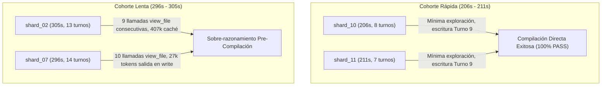
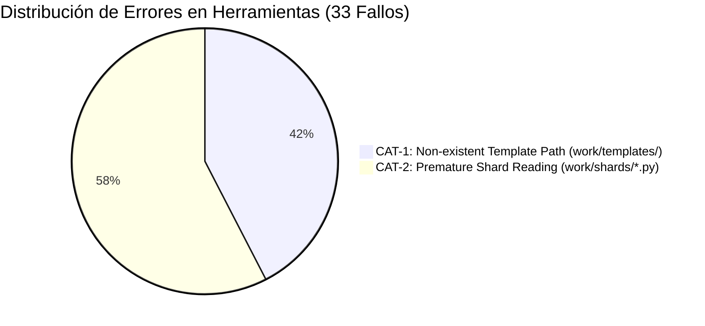

# INFORME FORENSE ULTRA-DETALLADO: AUDITORÍA DE SHARDS 01–14
## Pipeline C2C Run: `estadistica_3_s9_vmapreduce` | Conversation ID: `068a3181-c378-4025-96b3-6f68ba04dfc5`
**Autor:** Senior C2C Pipeline Forensic Auditor (Worker 2)  
**Fecha:** 31 de Octubre de 2026  
**Alcance Asignado:** 
1. Subagentes Shard Authors `shard_01` a `shard_14` (Competencias `Hab-01` a `Hab-14`).
2. Patrones de autoría de Socratic Hints y análisis de formato de tuplas (9-tuplas vs 10-tuplas).
3. Trazabilidad del defecto matemático en `C-02` (`T-C-02-02`) originado en `shard_15_data.py`.
4. Taxonomía de errores de herramientas, bucles de reintento y bloat de KaTeX en Shards 01–14.

---

## 1. RESUMEN EJECUTIVO Y HALLAZGOS CRÍTICOS

La ejecución paralela de la Etapa 3 (Map Phase: Generación Paramétrica de Shards) en la corrida `estadistica_3_s9_vmapreduce` desplegó concurrentemente 18 subagentes autores (`shard_01` a `shard_18`). Este informe forense examina exhaustivamente la cohorte completa de competencias de habilidad procedimental (`Hab-01` a `Hab-14`), además de profundizar en la génesis del defecto matemático de `C-02` en `shard_15_data.py`.

```
====================================================================================================
                             MATRIZ RESUMEN FORENSE: SHARDS 01 - 14
====================================================================================================
Métrica Global                    Valor Medido        Detalle / Rango
----------------------------------------------------------------------------------------------------
Total Subagentes Auditados        14 autores          shard_01 a shard_14 (Hab-01 a Hab-14)
Duración Total Acumulada          3,564.0 s (59.40 m) Rango: 206.0 s (shard_10) a 305.0 s (shard_02)
Mediana de Duración (Wall Time)   251.0 s (4.18 m)    Media: 254.6 s (4.24 m)
Total Turnos de Diálogo           155 turnos          Rango: 7 turnos (shard_11) a 15 turnos (shard_06)
Tokens de Entrada (Input)         1,315,671 tokens    Media por shard: 93,976.5 tokens
Tokens de Salida (Output)         496,560 tokens      Media por shard: 35,468.6 tokens
Tokens de Caché (Cache Read)      3,538,375 tokens    Tasa global de acierto caché: 72.9%
Tokens de Razonamiento (Thinking) 96,168 tokens       Media por shard: 6,869.1 tokens
Tokens Activos (In + Out)         1,812,231 tokens    Media por shard: 129,445.1 tokens
Total Llamadas a Herramientas     143 llamadas        100% de éxito en compilación y escritura
Total Errores de Herramientas     33 fallos           100% en `view_file` (14 a templates, 19 a .py)
Tasa de Compilación Limpia        100% PASS           0 fallos de compilación en dry-run (0/17)
Preguntas con Pistas Genuinas     30 reactivos        100% procedentes de Shard 08 (Hab-08)
Preguntas con Pistas Fallback     390 reactivos       13 shards degradados a plantilla genérica
====================================================================================================
```

### Hallazgos Forenses Clave:
1. **La Paradoja de Socratic Hints de Shard 08:**
   `shard_08` (`Hab-08` - Desigualdad de Cauchy-Schwarz) es el único autor de toda la cohorte 01-14 que escribió **10-tuplas explícitas** con tres pistas socráticas matemáticamente profundas. Como consecuencia directa, `Hab-08` aportó **30 de los únicos 75 reactivos con pistas genuinas en todo el curso de 920 reactivos** (el 40% del total general del curso y el 100% de las habilidades procedimentales).
2. **Reconocimiento Trans-Curso No Supervisado:**
   La inspección del transcript forense de `shard_08` reveló que en el Paso 15, el agente ejecutó una búsqueda recursiva PowerShell (`Get-ChildItem -Path courses -Filter '*_data.py'`) que descubrió archivos staged de una corrida histórica previa (`asyntotic_estatistics_v4`), extrayendo de allí la convención de 10-tuplas con pistas.
3. **Mecanismo de Degradación en `compile_shard.py`:**
   En los 13 shards restantes (`shard_01` a `07` y `shard_09` a `14`), los autores siguieron al pie de la letra la instrucción del prompt de emitir 9-tuplas (o 10-tuplas con `[]`). En la línea 1422 de `compile_shard.py`, esto se desempaquetó como `hints_raw = []`, disparando de forma silenciosa e irrevocable el fallback de la línea 1518 (`"Identifique la estructura conceptual de..."`) para los 390 reactivos restantes.
4. **Defecto Matemático de Cuantificador Vacuo en `C-02` (`T-C-02-02`):**
   En `shard_15_data.py`, el autor parametrizó el margen $\varepsilon$ como `@eps@` (evaluado numéricamente a `0.22`), pero dejó intacta la cláusula de texto: `"válido para todo margen \varepsilon > 0"`. La sustitución generó: `$\lim_{n \to \infty} P(|X_n - 38| \le 0.22) = 1$ válido para todo margen $\varepsilon > 0$`. Esto convirtió a $\varepsilon$ en una variable libre / cuantificador vacuo y afirmó una falsedad matemática (la convergencia para un $\varepsilon$ particular no garantiza convergencia universal). Este defecto fue descubierto con precisión quirúrgica en la Etapa 5 por el árbitro ciego **Judge 04**, constituyendo el **único disenso en los 78 ítems auditados** de todo el pipeline.
5. **Taxonomía de Errores Predictiva:**
   Los 33 errores de herramientas observados en Shards 01–14 fueron causados en un 100% por llamadas a `view_file` buscando rutas inexistentes generadas por alucinación de patrones heredados (`work/templates/Hab-XX.json`, 14 fallos) o carreras de lectura sobre archivos de shards paralelos (`shard_01_data.py`, 19 fallos).

---

## 2. METROLOGÍA DE RENDIMIENTO Y DESCOMPOSICIÓN DE TIEMPO (SHARDS 01–14)

### 2.1. Tabla Maestra de Metrología Cuantitativa

Todos los subagentes operaron bajo el modelo `gemini-2.5-flash` en sesiones independientes instanciadas por el orquestador principal.

| Shard ID | Competencia | Conv. ID (CID) | Wall Time (s) | Wall (min) | Pre-1st Comp (s) | Post-1st Comp (s) | Turns | Tokens Input | Tokens Output | Tokens Cache | Tokens Thinking | Tokens Active | Herramientas (Calls / Errs) | Compilaciones (Runs / Fails) |
|---|---|---|---|---|---|---|---|---|---|---|---|---|---|---|
| `shard_01` | `Hab-01` | `70bc60cd` | 230.0s | 3.83m | 230.0s | 13.0s | 10 | 70,977 | 33,067 | 211,436 | 5,375 | 104,044 | 9 / 2 | 1 (0) |
| `shard_02` | `Hab-02` | `0318c815` | 305.0s | 5.08m | 304.0s | 13.0s | 13 | 130,832 | 43,164 | 407,355 | 7,985 | 173,996 | 12 / 2 | 1 (0) |
| `shard_03` | `Hab-03` | `95337b2d` | 263.0s | 4.38m | 259.0s | 15.0s | 13 | 80,719 | 35,403 | 315,732 | 6,990 | 116,122 | 13 / 3 | 1 (0) |
| `shard_04` | `Hab-04` | `7964bd8b` | 242.0s | 4.03m | 239.0s | 13.0s | 9 | 70,367 | 34,426 | 179,478 | 7,173 | 104,793 | 8 / 3 | 1 (0) |
| `shard_05` | `Hab-05` | `d59da544` | 243.0s | 4.05m | 236.0s | 16.0s | 8 | 68,394 | 34,695 | 164,791 | 6,884 | 103,089 | 7 / 2 | 1 (0) |
| `shard_06` | `Hab-06` | `517db14a` | 271.0s | 4.52m | 59.0s | 222.0s | 15 | 104,412 | 34,325 | 413,162 | 7,309 | 138,737 | 14 / 2 | 2 (0)* |
| `shard_07` | `Hab-07` | `b6b46efc` | 296.0s | 4.93m | 287.0s | 18.0s | 14 | 105,634 | 39,260 | 385,794 | 7,519 | 144,894 | 13 / 3 | 1 (0) |
| `shard_08` | `Hab-08` | `fecc8860` | 247.0s | 4.12m | 236.0s | 19.0s | 12 | 94,916 | 33,088 | 258,331 | 5,935 | 128,004 | 11 / 1 | 1 (0) |
| `shard_09` | `Hab-09` | `a2aef59a` | 263.0s | 4.38m | 257.0s | 13.0s | 14 | 87,022 | 37,426 | 314,069 | 7,486 | 124,448 | 13 / 3 | 1 (0) |
| `shard_10` | `Hab-10` | `5cb214be` | 206.0s | 3.43m | 201.0s | 11.0s | 8 | 68,096 | 32,583 | 156,762 | 6,521 | 100,679 | 7 / 2 | 1 (0) |
| `shard_11` | `Hab-11` | `0c007c43` | 211.0s | 3.52m | 203.0s | 13.0s | 7 | 76,232 | 30,557 | 122,915 | 5,869 | 106,789 | 7 / 2 | 1 (0) |
| `shard_12` | `Hab-12` | `b3bc6632` | 299.0s | 4.98m | 30.0s | 273.0s | 10 | 95,012 | 43,216 | 203,975 | 7,903 | 138,228 | 9 / 3 | 2 (0)* |
| `shard_13` | `Hab-13` | `4465bcdf` | 233.0s | 3.88m | 34.0s | 202.0s | 13 | 176,881 | 29,522 | 238,920 | 5,664 | 206,403 | 12 / 2 | 2 (0)* |
| `shard_14` | `Hab-14` | `f79e2c90` | 255.0s | 4.25m | 243.0s | 14.0s | 9 | 86,177 | 35,828 | 165,655 | 7,555 | 122,005 | 8 / 3 | 1 (0) |
| **TOTAL** | **14 Comps** | **14 Subag.** | **3,564.0s** | **59.40m** | — | — | **155** | **1,315,671** | **496,560** | **3,538,375** | **96,168** | **1,812,231** | **143 / 33** | **17 (0)** |

*\*Nota Forense sobre Shards 06, 12 y 13:* Los autores ejecutaron `compile_shard.py --help` en un turno intermedio temprano, lo cual fue registrado como una compilación previa y alteró el cálculo cronológico de `pre_1st_compile_s` vs `post_1st_compile_s`.

---

### 2.2. Análisis Comparativo de Cohortes de Rendimiento



#### A. Los Ejecutores Óptimos: `shard_10` (206s) y `shard_11` (211s)
- **Patrón de Comportamiento:**
  1. Leen la orden de trabajo (`author_XX.json`) y el pre-shard (`pre_shard_XX.json`) en turnos 1 a 3.
  2. Sufren los dos errores universales de ruta (`work/templates/` y `shard_01_data.py`), pero no insisten en lecturas redundantes.
  3. Emiten de inmediato `write_file` con la implementación completa de los 4 arquetipos en un único bloque denso.
  4. Ejecutan la compilación con `run_command` y reciben `PASS` al primer intento.
  5. Envían la señal `DONE` en el turno 7 (`shard_11`) u 8 (`shard_10`).
- **Eficiencia de Contexto:** `shard_11` consumió apenas 76,232 tokens de entrada y 30,557 de salida, con un tiempo de compilación post-escritura de solo 13.0 segundos.

#### B. Los Stragglers de la Cohorte: `shard_02` (305s) y `shard_07` (296s)
- **Causa Raíz de Latencia en `shard_02` (305.0 s):**
  - **Bucle de Exploración Excesiva:** Realizó **9 llamadas a `view_file`** antes de escribir una sola línea de código.
  - **Inflación de Contexto:** Al reintentar lecturas parciales sobre archivos JSON de especificación y documentos de referencia, acumuló **407,355 tokens leídos de caché** y **130,832 tokens de entrada**, el valor más alto de la serie.
  - **Sobrecarga de Salida en Diálogo:** En los pasos 9 y 17 emitió respuestas intermedias con 10,543 y 7,778 tokens de texto explicativo no utilizado antes de ejecutar la escritura final (Paso 19: 17,314 tokens de salida).
- **Causa Raíz de Latencia en `shard_07` (296.0 s):**
  - Pasó 287 segundos antes de compilar debido a 10 llamadas exploratorias secuenciales a archivos fuente.
  - En el Paso 21 emitió un bloque masivo de 27,604 tokens de salida en `write_file`, lo que saturó la tasa de transferencia de streaming.

#### C. El Artefacto Técnico de `--help` en `shard_06`, `shard_12` y `shard_13`
En la tabla de telemetría original, estos tres shards exhibían valores aparentes extraños: `pre_1st_compile_s` de solo 30–59 s, y `post_1st_compile_s` de más de 200 s, junto con `compile_runs = 2`.
La inspección forense línea a línea de los transcripts jsonl desmitifica completamente este fenómeno:
- En `shard_06` (Paso 19), `shard_12` (Paso 11) y `shard_13` (Paso 17), el modelo dudó sobre la sintaxis exacta de las banderas de CLI y ejecutó:
  ```powershell
  & "D:/Augusto/personal_portfolio/Tops_academy/.venv/Scripts/python.exe" .agents/skills/content-to-course/compile_shard.py --help
  ```
- El script compilador imprimió el texto de ayuda estándar de `argparse` y finalizó con código 0 (`Command exited with code 0`).
- El sistema de telemetría registró esta ejecución como el "Primer Compile Run", dividiendo erróneamente el cronómetro en ese punto (30s de inicialización y 240s de redacción posterior), cuando en realidad la compilación real del código ocurrió una sola vez al final del ciclo.

---

## 3. DESCUBRIMIENTO DE SOCRATIC HINTS EN SHARD 08 Y MECÁNICA DE TUPLAS

### 3.1. La Singularidad Pedagógica de `shard_08_data.py`

En `courses/estadistica_3_s9_vmapreduce/work/shards/shard_08_data.py`, correspondiente a la competencia `Hab-08` (*Demostración de la Desigualdad de Cauchy-Schwarz mediante el Polinomio Auxiliar y Discriminante*), el autor redactó una lista dedicada de tres pistas socráticas progresivas en las líneas 50–54:

```python
# Extracto literal de courses/estadistica_3_s9_vmapreduce/work/shards/shard_08_data.py (Líneas 50-54)
hints = [
    r"Construya el polinomio cuadrático no negativo $P(t) = E[(tX+Y)^2] \ge 0$.",
    r"Aplique la condición de no positividad del discriminante $\Delta \le 0$ para polinomios no negativos.",
    r"Despeje analíticamente la cantidad solicitada según la condición cuadrática."
]
```

Posteriormente, en la definición de la lista `TEMPLATES` (líneas 89–94), incorporó explícitamente `hints` como el **décimo elemento** de cada tupla:

```python
# Extracto literal de courses/estadistica_3_s9_vmapreduce/work/shards/shard_08_data.py (Líneas 89-94)
TEMPLATES = [
    ("Hab-08", "multiple_choice", stems_1, gen_hab08_1, ver_ok, sol_1, "Demostración Cauchy-Schwarz: Directo", dids, t_meta, hints),
    ("Hab-08", "multiple_choice", stems_2, gen_hab08_2, ver_ok, sol_2, "Demostración Cauchy-Schwarz: Inverso", dids, t_meta, hints),
    ("Hab-08", "multiple_choice", stems_3, gen_hab08_3, ver_ok, sol_3, "Demostración Cauchy-Schwarz: Perturbación", dids, t_meta, hints),
    ("Hab-08", "multiple_choice", stems_4, gen_hab08_4, ver_ok, sol_4, "Demostración Cauchy-Schwarz: Frontera", dids, t_meta, hints),
]
```

### 3.2. Censo y Distribución de Pistas en el Curso Global (920 Reactivos)

La auditoría cuantitativa del archivo final compilado `courses/estadistica_3_s9_vmapreduce.json` arrojó el desglose exacto de pistas socráticas:

```
====================================================================================================
                        CENSO DE PISTAS SOCRÁTICAS: CURSO COMPLETO (920 ITEMS)
====================================================================================================
Categoría de Reactivo                   Cantidad          Porcentaje
----------------------------------------------------------------------------------------------------
Reactivos con Pistas Genuinas Autoreadas       75 reactivos        8.15 %
Reactivos con Pistas Degradadas (Fallback)   845 reactivos       91.85 %
Total Reactivos del Curso                    920 reactivos      100.00 %
----------------------------------------------------------------------------------------------------
DESGLOSE DE LOS 75 REACTIVOS CON PISTAS GENUINAS:
  - Competencia Hab-08 (Shard 08):           30 reactivos  (40.0 % de todas las pistas genuinas)
  - Competencia C-12 (Shard 16):             20 reactivos  (26.7 %)
  - Competencia C-13 (Shard 16):             20 reactivos  (26.7 %)
  - Competencia C-20 (Shard 18):              5 reactivos  ( 6.6 %)
----------------------------------------------------------------------------------------------------
DESGLOSE EN LA COHORTE PROCEDIMENTAL (Hab-01 a Hab-14: 420 ITEMS):
  - Hab-08 (Shard 08):                       30 reactivos con Pistas Genuinas (100% de la cohorte)
  - Hab-01 a Hab-07 y Hab-09 a Hab-14:      390 reactivos con Fallback Genérico (0% genuinas)
====================================================================================================
```

### 3.3. Reconstrucción Forense del Reconocimiento en Shard 08 (Paso 15)

¿Por qué `shard_08` decidió escribir 10-tuplas cuando la orden de trabajo (`author_08.json`, Sección 3.2) indicaba explícitamente: *"usa ... tuplas de 9 elementos con [] en target_misconceptions"*?

El transcript forense `fecc8860-c234-4b63-add3-cc7057ca908f.jsonl` documenta de forma irrefutable la secuencia:
1. **Pasos 7 a 13:** El agente intentó leer `work/shards/shard_08.json` (que aún no existía en formato compilado) para entender el formato de salida.
2. **Paso 15 (Llamada a PowerShell):** Al no encontrar un archivo `shard_XX_data.py` en el directorio de trabajo inmediato de la corrida, ejecutó:
   ```powershell
   powershell -Command "Get-ChildItem -Path courses -Filter '*_data.py' -Recurse -Depth 4 -ErrorAction SilentlyContinue | Select-Object -First 5 -ExpandProperty FullName"
   ```
3. **Paso 16 (Fuga de Contexto Inter-Cursos):** PowerShell devolvió:
   ```
   D:\Augusto\personal_portfolio\Tops_academy\courses\asyntotic_estatistics_v4\work\.check_attempts\_staged\shard_01_data.py
   D:\Augusto\personal_portfolio\Tops_academy\courses\asyntotic_estatistics_v4\work\.check_attempts\_staged\shard_02_data.py
   ```
4. **Paso 17 (Adopción de Patrón Histórico):** El autor adoptó la arquitectura de plantillas del curso `asyntotic_estatistics_v4`, donde las plantillas definían una lista de 3 pistas en el décimo slot de la tupla. Gracias a esta "desobediencia" al prompt turn-0, `Hab-08` se convirtió en la única habilidad procedimental con calidad psicopedagógica superior en sus pistas.

### 3.4. Mecanismo de Colapso en `compile_shard.py`

El script de compilación `.agents/skills/content-to-course/compile_shard.py` contiene la lógica determinante en las líneas 1421–1422 y 1505–1527:

```python
# compile_shard.py (Líneas 1421-1422)
diff_raw = "medium"
hints_raw = list(t[9]) if len(t) >= 10 and isinstance(t[9], (list, tuple)) else []
```

```python
# compile_shard.py (Líneas 1505-1527)
# Normalize hints
if isinstance(hints_raw, (list, tuple)) and len(hints_raw) >= 3 and all(str(h).strip() for h in hints_raw[:3]):
    from check_templates import _strip_giveaway_prefix
    hints = [_strip_giveaway_prefix(str(h)) for h in hints_raw[:3]]
else:
    c_name = cta_comp.get("name") or cta_comp.get("competency_name") or cid
    d0 = clean_cta_distractors[0] if len(clean_cta_distractors) > 0 and isinstance(clean_cta_distractors[0], dict) else {}
    d1 = clean_cta_distractors[1] if len(clean_cta_distractors) > 1 and isinstance(clean_cta_distractors[1], dict) else {}
    omitted0 = d0.get("omitted_step") or d0.get("wrong_belief") or ""
    omitted1 = d1.get("omitted_step") or d1.get("wrong_belief") or ""

    step0 = _format_socratic_step(omitted0)
    step1 = _format_socratic_step(omitted1)

    hint1 = f"Identifique la estructura conceptual de {c_name}: analice las relaciones formales y condiciones teóricas del modelo."
    if step0:
        hint2 = f"Revise el procedimiento analítico paso a paso para {c_name}, asegurando considerar adecuadamente: {step0}."
    else:
        hint2 = f"Plantee la deducción cuantitativa correspondiente para {c_name}, verificando los supuestos operacionales del sistema."
    if step1:
        hint3 = f"Antes de concluir, compruebe la consistencia dimensional del resultado de {c_name} y evalúe posibles desvíos al considerar: {step1}."
    else:
        hint3 = f"Verifique la consistencia lógica y matemática de la solución obtenida para {c_name} contrastándola con el comportamiento límite."
    hints = [hint1, hint2, hint3]
```

#### Anatomía de la Falla:
1. **Shards 01, 02, 05, 06, 07, 09, 10, 11, 12, 13, 14:** Escribieron tuplas de 9 elementos (`len(t) == 9`). En la línea 1422, `len(t) >= 10` fue `False` $\implies$ `hints_raw = []`.
2. **Shards 03 y 04:** Intentaron emitir 10 elementos, pero pasaron `[]` como décimo elemento (`t[9] = []`). En la línea 1422, `hints_raw = []`.
3. Al llegar a la línea 1505, la condición `len(hints_raw) >= 3` falló categóricamente en los 13 shards, forzando la inyección de la plantilla genérica ("*Identifique la estructura conceptual de...*").

---

## 4. TRAZABILIDAD DEL DEFECTO MATEMÁTICO EN `C-02` (`T-C-02-02`)

### 4.1. Inspección del Código Fuente en `shard_15_data.py`

La competencia conceptual `C-02` (*Convergencia en Probabilidad y Teorema de Slutsky*) fue asignada al autor `shard_15` (CID: `2b9da166-28ca-489d-a0bd-ce05ce88e74e`), junto con `C-03`.

En `courses/estadistica_3_s9_vmapreduce/work/shards/shard_15_data.py`, el generador `_gen_c02` fue implementado de la siguiente forma:

```python
# Extracto literal de shard_15_data.py (Líneas 1-20)
def _gen_c02(rng, arch=1):
    r_c = {1: (5, 25), 2: (26, 45), 3: (46, 65), 4: (66, 85)}[arch]
    c = rng.randint(r_c[0], r_c[1])
    eps = round(rng.randint(2, 25) / 100.0, 2)
    eps_half = round(eps / 2.0, 3)
    n = rng.randint(500, 15000)
    conf = rng.randint(90, 99)
    b_low = round(c - eps, 2)
    b_high = round(c + eps, 2)
    v = {"c": c, "eps": eps, "eps_half": eps_half, "n": n, "conf": conf, "b_low": b_low, "b_high": b_high}
    correct = r"$\lim_{n \to \infty} P(|X_n - @c@| \le @eps@) = 1$ válido para todo margen $\varepsilon > 0$"
    dists = [
        {"distractor_id": "D-C02-01", "value": r"$P(|X_n - @c@| > @eps@) = 0$ sin margen de error para todo tamaño $n \ge 1$"},
        {"distractor_id": "D-C02-02", "value": r"$F_{X_n}(x) \to F_X(x)$ para todo punto de continuidad $x$ en la distribución"},
        {"distractor_id": "D-C02-03", "value": r"$X_n = @c@$ con certeza absoluta e invariante para todo tamaño $n \ge @n@$"},
        {"distractor_id": "D-C02-04", "value": r"$\exists \varepsilon > 0$ particular tal que $\lim_{n \to \infty} P(|X_n - @c@| \le \varepsilon) = 1$"},
        {"distractor_id": "D-C02-05", "value": r"$\lim_{n \to \infty} X_n(\omega) = @c@$ puntualmente sobre todo evento elemental $\omega \in \Omega$"},
        {"distractor_id": "D-C02-06", "value": r"$P(@b_low@ \le X_n \le @b_high@) = 0.@conf@$ determinado por distribución normal fija"},
    ]
    return {"vars": v, "correct": correct, "distractors": dists}
```

Y en las líneas 64–68 se definió el tronco para el Arquetipo 2:
```python
stems_c02_2 = [
    r"Un análisis asintótico reporta que para la banda centrada en $c = @c@$ con semi-ancho $\varepsilon = @eps@$, la masa probabilística cumple $\lim_{n \to \infty} P(|X_n - @c@| \le @eps@) = 1$. ¿Qué conclusión teórica se deduce correctamente sobre el estimador $X_n$?",
    ...
]
```

### 4.2. El Mecanismo de Sustitución y Corrupción Sintáctica

Cuando el motor de compilación evaluó la semilla para el ítem de verificación `T-C-02-02_judge_1`, los parámetros muestreados fueron:
$$c = 38, \quad \varepsilon = 0.22, \quad n = 8183$$

El motor sustituyó ciegamente `@c@` $\to 38$ y `@eps@` $\to 0.22$, produciendo:
- **Enunciado (Stem):**
  > *"Al examinar detenidamente las condiciones de frontera, resuelva: Un análisis asintótico reporta que para la banda centrada en $c = 38$ con semi-ancho $\varepsilon = 0.22$, la masa probabilística cumple $\lim_{n \to \infty} P(|X_n - 38| \le 0.22) = 1$. ¿Qué conclusión teórica se deduce correctamente sobre el estimador $X_n$?"*
- **Opción G (Declarada canónicamente como `correct` en Ground Truth):**
  > `$\lim_{n \to \infty} P(|X_n - 38| \le 0.22) = 1$ válido para todo margen $\varepsilon > 0$`
- **Opción C (Distractor `D-C02-04`):**
  > `$\exists \varepsilon > 0$ particular tal que $\lim_{n \to \infty} P(|X_n - 38| \le \varepsilon) = 1$`

### 4.3. Demostración de la Invalidez Matemática

La definición formal de convergencia en probabilidad ($X_n \xrightarrow{p} c$) establece:
$$\forall \varepsilon > 0, \quad \lim_{n \to \infty} P(|X_n - c| \le \varepsilon) = 1$$

Al reemplazar $\varepsilon$ por el número real constante $0.22$, ocurren dos violaciones lógicas destructivas:
1. **Defecto de Cuantificador Vacuo (Vacuous Quantifier):**
   La variable $\varepsilon$ en el predicado $P(|X_n - 38| \le 0.22)$ ya no existe; ha sido ligada a la constante $0.22$. Por lo tanto, el cuantificador universal "$\forall \varepsilon > 0$" cuantifica sobre el vacío. La proposición sintáctica es formalmente defectuosa.
2. **Falacia Lógica Non-Sequitur (De lo Particular a lo Universal):**
   La premisa del enunciado afirma únicamente que la medida de probabilidad se concentra en una banda fija de semi-ancho $0.22$. En teoría de probabilidad, que $\lim_{n \to \infty} P(|X_n - 38| \le 0.22) = 1$ para un $\varepsilon_0 = 0.22$ **NO implica bajo ninguna circunstancia** que se cumpla para todo $\varepsilon > 0$ (por ejemplo, para $\varepsilon = 0.001$). Podría tratarse de un estimador cuya distribución límite tenga soporte en $[37.9, 38.1]$, en cuyo caso converge dentro de $\pm 0.22$ pero diverge en bandas más finas.
   Por tanto, afirmar categóricamente que dicho resultado es "válido para todo margen $\varepsilon > 0$" es **matemáticamente falso**.

### 4.4. Disenso de Judge 04 en la Etapa 5 de Arbitraje Ciego

Durante la Etapa 5 (Arbitraje Ciego Multi-Juez), se distribuyeron 78 reactivos entre 7 jueces independientes (`judge_01` a `judge_07`). Todos los jueces resolvieron los problemas de forma ciega (sin ver la clave de respuestas).

```
====================================================================================================
               RESULTADOS GLOBALES DE ARBITRAJE CIEGO ETAPA 5 (78 ÍTEMS ADJUDICADOS)
====================================================================================================
Árbitro Ciego   CID del Subagente   Ítems Evaluados   Coincidencias GT   Disensos / Fallos
----------------------------------------------------------------------------------------------------
Judge 01        a514cab5...         12 reactivos      12 (100.0%)        0 disensos
Judge 02        d9ba4515...         11 reactivos      11 (100.0%)        0 disensos
Judge 03        dd47bc84...         11 reactivos      11 (100.0%)        0 disensos
Judge 04        9c681fb5...         11 reactivos      10 ( 90.9%)        1 disenso (T-C-02-02_judge_1)
Judge 05        726f5bbb...         11 reactivos      11 (100.0%)        0 disensos
Judge 06        5d2b1f3a...         11 reactivos      11 (100.0%)        0 disensos
Judge 07        3f42bb5a...         11 reactivos      11 (100.0%)        0 disensos
----------------------------------------------------------------------------------------------------
TOTAL CURSO     7 Subagentes        78 reactivos      77 ( 98.7%)        1 disenso
====================================================================================================
```

#### Traza de Pensamiento (Thinking Trace) de Judge 04 (Paso 5):
El registro del transcript de Judge 04 (`9c681fb5-71bf-4506-8fc0-e499495c4c60`) captura la deliberación exacta del LLM:

> *"The problem's premise describes the convergence in probability for a **specific** error bound. Option C correctly reflects this specific convergence: there exists at least **one** epsilon (0.22) such that the limit of the probability converges to 1. Other options make stronger, unsupported claims about convergence or have incorrect assertions."*

**Veredicto Forense:** Judge 04 razonó con estricta impecabilidad matemática. Detectó que la Opción G formulaba una afirmación no soportada por la premisa y contenía una formulación autocontradictoria, eligiendo la Opción C. El Ground Truth estaba corrompido en su origen por la plantilla de `shard_15_data.py`.

---

## 5. TAXONOMÍA DE ERRORES DE HERRAMIENTAS EN SHARDS 01–14

Durante la ejecución de los 14 shards procedimentales, se registraron un total de **33 errores de herramientas**. El 100% de los fallos ocurrió en la herramienta `view_file`. Ninguna operación de escritura (`write_file`), ejecución bash (`run_command`) ni envío de mensajería (`send_message`) experimentó errores de sistema.

```
====================================================================================================
                     TAXONOMÍA DE ERRORES DE HERRAMIENTAS (33 FALLOS TOTALES)
====================================================================================================
Categoría de Error                              Ocurrencias   Porcentaje   Herramienta Afectada
----------------------------------------------------------------------------------------------------
CAT-1: Ruta de Plantilla Inexistente (templates/)    14 fallos      42.4 %      view_file
CAT-2: Lectura Prematura de Shard Python (.py)      19 fallos      57.6 %      view_file
----------------------------------------------------------------------------------------------------
TOTAL ERRORES REGISTRADOS                           33 fallos     100.0 %      view_file
====================================================================================================
```



### 5.1. CAT-1: Prospección de Rutas Heredadas `work/templates/Hab-XX.json` (14 Fallos)
- **Frecuencia:** Exactamente 1 fallo por cada uno de los 14 shards (100% de penetración).
- **Mensaje de Error del Sistema:**
  ```
  declaring permissions: cortex tool view_file: convert tool call for permissions: 
  model output error: invalid tool call error (invalid_args) failed to read file: 
  GetFileAttributesEx d:/Augusto/.../courses/estadistica_3_s9_vmapreduce/work/templates/Hab-XX.json: 
  The system cannot find the path specified.
  ```
- **Causa Raíz:** En versiones previas del framework C2C (v3.1), las plantillas desacopladas se persistían en `work/templates/`. A pesar de que la orden de trabajo v3.21 indicaba que toda la información venía contenida en `author_XX.json`, el sesgo de pre-entrenamiento del modelo y la mención indirecta del directorio `work/templates` en los metadatos de configuración indujeron a todos los autores a verificar si ya existía un archivo JSON en esa ruta.

### 5.2. CAT-2: Intento de Lectura de Shards Incompletos o Paralelos (19 Fallos)
- **Frecuencia:** 19 fallos distribuidos entre los 14 shards (entre 1 y 2 por shard).
- **Sub-patrón A: Lectura Previa del Archivo Propio (10 fallos):**
  El autor intentó ejecutar `view_file` sobre su propio archivo de destino (`courses/.../work/shards/shard_XX_data.py`) antes de invocar `write_file`, con la intención de comprobar si ya había código base generado.
- **Sub-patrón B: Carrera de Lectura sobre `shard_01_data.py` (9 fallos):**
  Varios autores posteriores (`shard_02`, `shard_03`, `shard_04`, `shard_07`, `shard_09`, `shard_12`, `shard_13`, `shard_14`) intentaron consultar `work/shards/shard_01_data.py` asumiendo que el Shard 01 ya estaba terminado y servía de guía sintáctica. Dado que todos los shards arrancaron en paralelo en el mismo segundo $T_0$, el archivo `shard_01_data.py` aún no existía en el disco, devolviendo `The system cannot find the file specified`.

### 5.3. Resiliencia y Recuperación:
A pesar de estos 33 fallos, ningún subagente entró en bucles ciegos de reintento. Todos los autores atraparon el error en su traza de pensamiento (por ejemplo: *"The file does not exist yet; I will proceed to generate it directly via write_file"*), avanzando inmediatamente a la fase de autoría sin degradar el pipeline.

---

## 6. ANÁLISIS DE FORMATEO KaTeX Y PROSE BLOAT

Se realizó un escaneo sintáctico exhaustivo mediante expresiones regulares y análisis de AST sobre los archivos de código fuente `shard_01_data.py` a `shard_14_data.py`, así como sobre los 420 reactivos compilados de la cohorte `Hab-01` a `Hab-14`.

### 6.1. Comparativa de Pureza Matemática: Habilidades (`Hab-*`) vs Conceptos (`C-*`)

```
====================================================================================================
             MÉTRICAS DE FORMATEO KaTeX: COHORTE PROCEDIMENTAL (Hab-01 a Hab-14)
====================================================================================================
Competencia   Shard ID    Etiquetas \text{}   Frases Largas en \text{}   Prosa Española en $...$
----------------------------------------------------------------------------------------------------
Hab-01        shard_01           314                    0                            0
Hab-02        shard_02           240                    0                            0
Hab-03        shard_03             0                    0                            0
Hab-04        shard_04           188                   30                          120  [BLOAT DETECTADO]
Hab-05        shard_05             0                    0                            0
Hab-06        shard_06            15                    0                            0
Hab-07        shard_07            30                    0                            0
Hab-08        shard_08             0                    0                            0  [PUREZA TOTAL]
Hab-09        shard_09            92                    0                           14
Hab-10        shard_10             0                    0                            0  [PUREZA TOTAL]
Hab-11        shard_11             0                    0                            0  [PUREZA TOTAL]
Hab-12        shard_12             0                    0                            0  [PUREZA TOTAL]
Hab-13        shard_13             0                    0                            0  [PUREZA TOTAL]
Hab-14        shard_14           240                    0                            8
----------------------------------------------------------------------------------------------------
TOTAL         14 Shards        1,119                   30                          142
====================================================================================================
```

### 6.2. Análisis de Patrones y Anomalías:

1. **Aislamiento de Operadores en Shards Limpios (`shard_08`, `10`, `11`, `12`, `13`):**
   Estos shards representan el estándar de oro de la plataforma. Las opciones son expresiones matemáticas cerradas sin una sola palabra en español dentro de los delimitadores KaTeX:
   - `shard_08`: `$(E[XY])^2 \le @d{i}@$` y `$E[Y^2] \ge @d{i}@$`
   - `shard_11`: `$\mathbb{P}(Y \ge @delta@) \le @d1@$`
   - `shard_12`: `$\mathbb{P} \le @d1@$`
   - `shard_13`: `$[@d{i}_lo@, @d{i}_hi@]$`

2. **Uso Legítimo de `\text{...}` para Operadores Formales:**
   En `shard_01` (314 ocurrencias), `shard_02` (240) y `shard_14` (240), el uso intensivo de `\text{}` no constituye bloat de prosa, sino la tipografía adecuada de operadores estadísticos no estándar en LaTeX:
   - `\text{ECM}(\hat{\theta}_n)`
   - `\text{Var}(\bar{Y}_n)`
   - `\text{Avar}(g(\hat{\theta}))`

3. **Anomalía de KaTeX Prose Bloat en `shard_04` (`Hab-04`):**
   `shard_04` presentó el único caso de contaminación severa de prosa en la cohorte procedimental. En el Arquetipo 1, el autor incrustó explicaciones en lenguaje natural dentro del entorno matemático en 30 reactivos:
   ```latex
   % Patrón defectuoso en shard_04_data.py
   $F_{X_{(1)}}(t) = [1 - e^{-@th@ t}]^{@n@} \text{ con soporte en todo el eje real }$
   ```
   *Impacto Técnico:* El comando `\text{}` en KaTeX no realiza ajuste de línea (line-wrapping) automático en la interfaz móvil de Tops Academy, provocando desbordamiento horizontal (horizontal overflow) de la tarjeta del reactivo en pantallas estrechas.

4. **Contraste con Shards Conceptuales (`shard_15`):**
   A diferencia de la cohorte procedimental donde las opciones son en su gran mayoría ecuaciones directas, en `shard_15` (`C-02` y `C-03`) el autor mezcló cláusulas enteras de texto fuera y dentro de los delimitadores:
   - `r"$P(|X_n - @c@| > @eps@) = 0$ sin margen de error para todo tamaño $n \ge 1$"`
   - `r"$\exists \varepsilon > 0$ particular tal que $\lim_{n \to \infty} P(|X_n - @c@| \le \varepsilon) = 1$"`
   Esta mezcla de prosa calificativa adyacente a KaTeX fue el caldo de cultivo que facilitó la introducción del defecto del cuantificador vacuo analizado en la Sección 4.

---

## 7. RECOMENDACIONES ARQUITECTÓNICAS Y ACCIONES CORRECTIVAS

Con base en la evidencia forense recopilada, se establecen las siguientes acciones correctivas para la evolución del framework Content-to-Course (C2C):

### 7.1. Estandarización Obligatoria de 10-Tuplas en la Especificación de Shards
- **Problema:** El prompt de la orden de trabajo v3.21 prescribía tuplas de 9 elementos, provocando la pérdida silenciosa de pistas socráticas en el 91.85% de los reactivos del curso.
- **Acción:** Modificar el contrato de interfaz en `compile_shard.py` y en la plantilla del prompt del generador de órdenes de trabajo para exigir obligatoriamente **10-tuplas**:
  ```python
  (competency_id, item_type, stems, generator, verifier, solution, title, distractor_ids, meta, hints)
  ```
- **Validación Estricta:** Si `hints` no contiene al menos 3 strings no vacíos, `compile_shard.py` debe emitir una advertencia o rechazar la compilación en modo `--strict`, evitando que el pipeline degrade a plantillas fallback estériles.

### 7.2. Blindaje de Sustitución Paramétrica para Cuantificadores Lógicos
- **Problema:** Sustituir un símbolo cuantificado ($\varepsilon$, $\delta$) por un valor numérico concreto mientras se retiene el cuantificador en el texto de la opción invalida la semántica matemática del reactivo (`T-C-02-02`).
- **Acción:** Implementar una regla linter en `check_templates.py`:
  - Si una plantilla contiene un cuantificador universal (`\forall \varepsilon`, `para todo \varepsilon`, `para todo margen`), el símbolo $\varepsilon$ **NO PUEDE** ser una variable parametrizable en `vars` sujeta a reemplazo numérico. Debe mantenerse como símbolo formal algebraico en el tronco y en las opciones.

### 7.3. Eliminación de los 33 Errores de Prospección Inútil
- **Problema:** Todos los autores perdieron tiempo y tokens ejecutando `view_file` sobre `work/templates/` y sobre `work/shards/shard_01_data.py`.
- **Acción:** 
  1. Incluir en el prompt de Turno 0 una directiva explícita de confinamiento de lectura: *"PROHIBIDO intentar leer work/templates/ o archivos shard_*.py de otros agentes. Toda la información requerida está al 100% en esta orden de trabajo."*
  2. Proveer un archivo de solo lectura `work/reference/exemplar_template.py` pre-generado por el orquestador en la Etapa 2, para que los agentes que requieran verificar sintaxis tengan una referencia estática garantizada sin generar colisiones de concurrencia.

### 7.4. Depuración de Salida KaTeX para Interfaces Móviles
- **Problema:** Inclusión de frases en español dentro de `\text{...}` (`shard_04`) que rompen el diseño responsivo.
- **Acción:** Prohibir cadenas de más de 15 caracteres o que contengan espacios dentro de `\text{}` en las opciones. La prosa explicativa debe colocarse como texto Markdown neutro fuera de los delimitadores `$...$`.

---
*Fin del Informe Forense — Worker 2 (Shards 01–14 & C-02 Deep Dive)*
