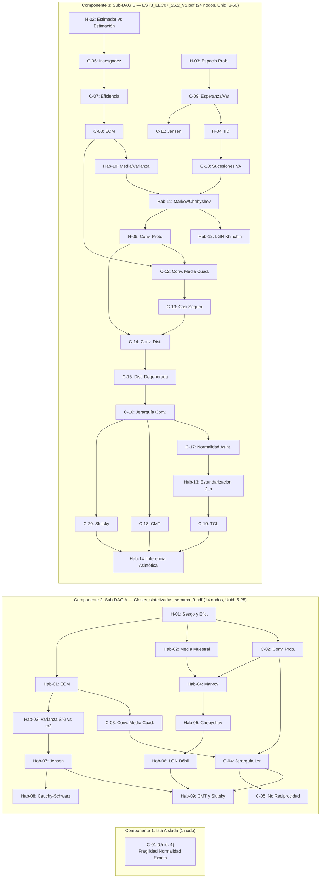

# Informe de Auditoría Forense de Calidad Instruccional, Psicométrica y Camino al Dominio (Path-to-Mastery v2.0)
## Curso: Estadística III — Semana 9: Propiedades en Muestras Finitas y Teoría Asintótica (`estadistica_3_s9_vmapreduce`)

---

- **Auditor Jefe:** Argon — *Chief Psychometric & Path-to-Mastery Quality Auditor* (Top's Academy)
- **Estándar Normativo:** [qa_rubric.md](file:///d:/Augusto/personal_portfolio/Tops_academy/.agents/skills/course-qa-evaluator/references/qa_rubric.md) (Quality Matters + OSCQR + Mastery Learning v2.0)
- **Artefactos Auditados:**
  - Curso publicado: [estadistica_3_s9_vmapreduce.json](file:///d:/Augusto/personal_portfolio/Tops_academy/courses/estadistica_3_s9_vmapreduce.json) (`39` competencias, `920` reactivos)
  - Documento maestro CTA: [competence_analysis_estadistica_3_s9_vmapreduce.md](file:///d:/Augusto/personal_portfolio/Tops_academy/courses/competence_analysis_estadistica_3_s9_vmapreduce.md)
  - Payload determinista enriquecido: [estadistica_3_s9_vmapreduce_payload.json](file:///d:/Augusto/personal_portfolio/Tops_academy/reports/qa_audits/estadistica_3_s9_vmapreduce_payload.json)
  - Verificación ciega Stage 5: [judge_report.json](file:///d:/Augusto/personal_portfolio/Tops_academy/courses/estadistica_3_s9_vmapreduce/work/judge_report.json), [judge_batch_04.json](file:///d:/Augusto/personal_portfolio/Tops_academy/courses/estadistica_3_s9_vmapreduce/work/verification/judge_batch_04.json), [judge_batch_05.json](file:///d:/Augusto/personal_portfolio/Tops_academy/courses/estadistica_3_s9_vmapreduce/work/verification/judge_batch_05.json)
  - Dataset estructurado de esta auditoría: [estadistica_3_s9_vmapreduce_qa_report.json](file:///d:/Augusto/personal_portfolio/Tops_academy/reports/qa_audits/estadistica_3_s9_vmapreduce_qa_report.json)
- **Conversación Creadora (MapReduce Dual-CTA C2C):** `068a3181-c378-4025-96b3-6f68ba04dfc5`

---

## 1. Resumen Ejecutivo y Veredicto Certificador

> [!CAUTION]
> **VEREDICTO FINAL: `5.50 / 20.0` — `RECHAZADO (Crítico)` | `MPRI: 39.45 / 100.0` (`MASTERY-HOSTILE`)**
> Aunque el curso exhibe **cero defectos sintácticos de compilación KaTeX**, **cero competencias subpobladas** (`20` a `30` ítems por nodo) y una cobertura temática fiel a la Semana 9 de Estadística III / Econometría Teórica, **falla catastróficamente como sistema adaptativo de aprendizaje hacia el dominio (`Not started` $\to$ `Mastered`)**. El banco presenta corrupción lógica y matemática directa en definiciones de convergencia en probabilidad (`C-02` y `C-10`), publicó una plantilla rechazada con razón matemática por el *Blind Judge* en Stage 5 (`T-C-02-02_judge_1`), concatenó dos arquitectos CTA paralelos **sin etapa *Reduce* de fusión semántica** (fracturando el curso en **3 componentes conexas disjuntas** con **9 pares de competencias duplicadas**), colapsó el 100% de sus `920` reactivos en `difficulty: "medium"`, `bloom_taxonomy_level: "Understand"` y `multiple_choice_7_options` (`0% FIB`, `0% MS`), abrió exploits triviales de memorización visual (`C-05` con **1 única respuesta correcta** en 20 reactivos) y de evasión perversa de `[R-15]` (`Q-H05-670..680`), y saboteó el salvavidas socrático de 3-Strikes inyectando fórmulas falsas tras `"asegurando considerar adecuadamente:"`.

### 1.1. Cuadro General de Calificación Normativa (`/ 20.0`)

| Dimensión Normativa (`qa_rubric.md` v2.0) | Puntaje | Máximo | Tope / Regla Activada | Diagnóstico Síntesis |
| :--- | :---: | :---: | :--- | :--- |
| **D1. Arquitectura Curricular, Topología DAG y Calibración ZPD** | **2.00** | 4.00 | Tope $\le 2.5$ (ZPD 100% `medium`) | `39/39` comps muertas en ZPD (`calibrateByMasteryDifficulty` no-op), nodo isla `C-01` y fractura MapReduce en **3 sub-DAGs disjuntos** (`1 + 14 + 24` nodos) con **9 duplicados**. |
| **D2. Calidad Psicométrica, Modalidad de Evocación y Anti-Gaming** | **1.50** | 5.00 | Rango Crítico $\le 2.4$ | Cuantificadores vacuos y falacia $\exists \implies \forall$ (`C-02`, `C-10`), `100% MC7` (`0% FIB/MS`), memorización visual (`C-05`: 1 clave; `H-01`: 4 claves), multiplicadores mágicos (`9` ítems) y firma delatora de cláusula simple vs. doble (`Q-H05-670..680`). |
| **D3. Andamiaje Socrático Progresivo y Remediación Diagnóstica** | **1.10** | 5.00 | Tope estricto `0.8 - 1.5` | `89.67%` boilerplate Mad-Libs, Pista 2 envenenada con fórmulas falsas del CTA, `5` stubs de etiquetas crudas (`Q-C20-871..875`), `7.93%` unicidad en `FeedbackToast` y fórmulas falsas sin refutación (`Q-C02-131`, `Q-Hab03-130`). Mérito parcial por `70` ítems genuinos (`Hab-08`, `C-12`, `C-13`). |
| **D4. Alineación Instruccional, Taxonomía de Bloom y Pureza de Dominio** | **1.50** | 4.00 | Deducciones acumuladas | `100%` Bloom `Understand` (`0/420` `[Hab]` en `Apply+`), `92` ítems con prefijos robóticos Solow/EDP y publicación sin reparar de `T-C-02-02` pese al fallo del *Blind Judge*. |
| **D5. Accesibilidad, Ergonomía Cognitiva en UI y Sintaxis KaTeX** | **1.40** | 2.00 | Deducción `-0.60` ergonomía | Sintaxis KaTeX impecable (`0` llaves/`$` rotos, `0` `$theta_hat$`; las `174` alertas en `\bar{Y}_n` son falsos positivos benignos), pero `160` ítems (`250` instancias) envuelven oraciones completas en `$\text{...}$` rompiendo el *line-wrap* móvil. |
| **Subtotal Bruto de Dimensiones (`raw_subtotal`)** | **7.50** | **20.00** | — | Suma directa `2.00 + 1.50 + 1.10 + 1.50 + 1.40` |
| **Deducciones Duras (`penalties_applied`)** | **-2.00** | — | `vacuous_quantifier` (`-1.0`) + `memorization` (`-1.0`) | Penalizaciones precalculadas estrictamente respetadas (`qa_rubric.md` §3). |
| **CALIFICACIÓN FINAL CERTIFICADA (`final_score`)** | **5.50** | **20.00** | **`RECHAZADO (Crítico)`** | **Inapto para producción estudiantil sin remediación estructural.** |

### 1.2. Índice de Preparación para el Camino al Dominio (`MPRI: 39.45 / 100.0`)

| Pilar Cognitivo Path-to-Mastery | Puntaje | Máximo | Estado Operativo en Plataforma |
| :--- | :---: | :---: | :--- |
| **1. Progresión Adaptativa ZPD y Bloom** | **0.00** | 20.0 | **COLAPSO TOTAL:** `920/920` en `'medium'` y `'Understand'`; `0%` variedad adaptativa. |
| **2. Modalidad de Evocación y Anti-Gaming** | **0.00** | 20.0 | **COLAPSO TOTAL:** `100% MC7`, `0% FIB`, `0% MS`, memorización trivial y claves corruptas. |
| **3. Integridad del Salvavidas Socrático (3-Strikes)** | **13.65** | 25.0 | **HOSTIL:** Solo `70/920` (`7.61%`) tienen pistas socráticas genuinas; resto es Mad-Libs, stubs o pistas envenenadas. |
| **4. Alineación Diagnóstica en `FeedbackToast`** | **10.89** | 15.0 | **DEGRADADO:** `438/5520` (`7.93%`) rationales únicos; desconexión en cálculos y fórmulas crudas sin refutar. |
| **5. Topología DAG e Interleaving (Quiz/Test)** | **8.50** | 10.0 | **FRACTURADO:** Acíclico localmente, pero partido en `3` islas/subgrafos disjuntos sin aristas cruzadas. |
| **6. Ergonomía Cognitiva y Pureza de Encuadre** | **6.41** | 10.0 | **FRICCIÓN MEDIA:** `160` ítems con prosa en `$\text{...}$` y `92` con muletillas de Solow/EDP. |
| **TOTAL `MPRI`** | **39.45** | **100.0** | **`MASTERY-HOSTILE (0-39): Sabotaje Cognitivo / Colapso de Andamiaje Adaptativo`** |

---

## 2. Simulación Forense del Viaje Real del Estudiante (`Not started` $\to$ `Mastered`)

Para auditar el impacto real en Top's Academy (y no solo conteos estáticos de JSON), trazamos el recorrido completo de un alumno desde `0` hasta `100` puntos de maestría a través de los motores reales del frontend:

1. **Fase 1 — Práctica Inicial (`Not started: 0` $\to$ `Attempted` $\to$ `Familiar: 70+` en `sessionShuffler.ts`):**
   - `calibrateByMasteryDifficulty` intenta servir reactivos `'easy'` para construir fluidez inicial cuando el puntaje es `< 70`. Como **920 de 920 reactivos tienen `difficulty: "medium"`**, el filtro cae en *fallback* uniforme el 100% de las veces: un principiante en su minuto 1 recibe exactamente la misma distribución de reactivos que un alumno en `95/100` buscando coronar `Mastered (100)`.
   - Al entrar a competencias procedimentales críticas como `Hab-01` (*Descomposición del ECM*), `Hab-05` (*Cotas de Markov y Chebyshev*), `Hab-07` (*Jensen*) o `Hab-08` (*Cauchy-Schwarz*), el estudiante **jamás escribe un solo número ni deriva una expresión** (`0% fill_in_the_blank`): solo marca tarjetas entre 7 opciones (`100% MC7`).

2. **Fase 2 — Bloqueo Cognitivo y Activación del Salvavidas de 3-Strikes (`PracticeSession.tsx`):**
   - Cuando el alumno falla el **Strike 1** en `Q-H01-021` (definición de sesgo en muestra finita) y abre las pistas socráticas para recuperar el intento antes de perder su progreso en el Strike 3:
     - **Pista 1** le entrega palabrería vacía de compilador: *"Identifique la estructura conceptual de Definición de Sesgo y Eficiencia Relativa en Muestras Finitas: analice las relaciones formales y condiciones teóricas del modelo."*
     - **Pista 2 lo envenena directamente con el distractor erróneo `G`**: *"Revise el procedimiento analítico paso a paso..., **asegurando considerar adecuadamente: $\text{Sesgo}(\hat{\theta}_n) = \theta - E[\hat{\theta}_n]$**."* (¡el signo invertido exacto que constituye el error conceptual!).
   - Peor aún: si el alumno cae en `Q-C20-871..875` (*Teorema de Slutsky*) y pide ayuda en los Strikes 1, 2 y 3, la interfaz le muestra literalmente tres etiquetas de metadatos de una sola palabra: **`"C20"`**, **`"Teorema-slutsky"`**, **`"Asintotica"`**.

3. **Fase 3 — Retroalimentación Formativa Post-Error (`FeedbackToast.tsx`):**
   - Si en `Q-Hab01-042` ($\text{Var}(\hat{\theta}_n)=108, \text{Sesgo}(\hat{\theta}_n)=4 \implies \text{ECM}=124$) el alumno comete un error aritmético escalar y marca `G` ($\text{ECM}=120$), `FeedbackToast.tsx` le recita: *"En el caso vectorial, el ECM es una matriz $k \times k$, por lo que requiere el producto externo $\text{Sesgo}\cdot\text{Sesgo}^\top$, no el producto interno escalar"* — una justificación matricial irrelevante reciclada de un pool fijo.
   - Si en `Q-C02-131` marca el distractor `B` ($P(|X_n - 7| > 0.13) = 0 \ \forall n \ge 1$), el `FeedbackToast` renderiza como supuesta explicación correctiva únicamente la fórmula falsa cruda: **`$\text{plim } X_n = c \implies |X_n - c| < \varepsilon \text{ con probabilidad } 1 \text{ para todo } n$`** ¡sin una sola palabra que indique que esa implicación es falsa!

4. **Fase 4 — Quizzes Intercalados (60/40) y Unit Test de Coronación (`Proficient: 80+` $\to$ `Mastered: 100`):**
   - Al llegar a `C-05` (*Divergencia de Momentos bajo Convergencia en Probabilidad*), el alumno descubre en dos clics que **los 20 reactivos del banco (`Q-C05-341` a `Q-C05-360`) tienen exactamente la misma cadena correcta carácter por carácter**: `$\text{plim } X_n = 0 \text{ pues } P(|X_n| > \varepsilon) = 1/n \to 0$`. Corona `Mastered (100)` en segundos sin leer el soporte ni el tamaño muestral.
   - Al llegar a `H-05` (`Q-H05-670..680`), detecta un patrón visual aún más grave: 5 opciones son cortas (`$\text{Cota} = 0.0112$`), la primera opción `A` tiene **dos** muletillas pegadas (`..., en el marco de la especificación, en el contexto del contraste analizado.`), y **la única opción con una sola muletilla (`..., en el marco de la especificación.`) es el 100% de las veces la respuesta correcta**.
   - Finalmente, debido a que el grafo curricular está partido en **3 subgrafos desconectados**, el alumno estudia dos veces los mismos 9 temas bajo IDs distintos (`H-01` y `C-06/C-07`; `C-02` y `H-05`; `C-03` y `C-12`; `C-04` y `C-16`) sin que `sessionShuffler.ts` pueda intercalar prerrequisitos entre la mitad teórica de `Clases_sintetizadas_semana_9.pdf` y la mitad de `EST3_LEC07_26.2_V2.pdf`.

---

## 3. Post-Mortem Forense del Blind Judge (Stage 5): Cómo una Falacia Matemática Evadió la Compuerta de Verificación

La auditoría de [judge_report.json](file:///d:/Augusto/personal_portfolio/Tops_academy/courses/estadistica_3_s9_vmapreduce/work/judge_report.json) y [judge_batch_04.json](file:///d:/Augusto/personal_portfolio/Tops_academy/courses/estadistica_3_s9_vmapreduce/work/verification/judge_batch_04.json#L41-L65) revela un fallo sistémico crítico en la compuerta de arbitraje ciego (Stage 5):

- **Ítem auditado por el Juez Ciego 04:** `T-C-02-02_judge_1` (plantilla `T-C-02-02`, que genera en producción los 15 reactivos `Q-C02-136` a `Q-C02-150` en [estadistica_3_s9_vmapreduce.json](file:///d:/Augusto/personal_portfolio/Tops_academy/courses/estadistica_3_s9_vmapreduce.json#L11686-L11990)).
- **Enunciado exacto evaluado:**
  > *"En el estudio de propiedades asintóticas, un investigador comprueba que para una banda de error específica $\varepsilon = 0.22$, un estimador satisface $\lim_{n \to \infty} P(|X_n - 38| \le 0.22) = 1$. Evalúe con rigor qué conclusión teórica se desprende sobre su consistencia débil hacia $c = 38$."*
- **Opciones en disputa:**
  - **Opción `C` (seleccionada por el *Blind Judge 04*):** `$\exists \varepsilon > 0$ particular tal que $\lim_{n \to \infty} P(|X_n - 38| \le \varepsilon) = 1$`
  - **Opción `G` (clave impuesta por el autor de la plantilla):** `$\lim_{n \to \infty} P(|X_n - 38| \le 0.22) = 1$ válido para todo margen $\varepsilon > 0$`

### Demostración Matemática de la Falacia Publicada
Sea la sucesión constante (o degenerada) $X_n \equiv 38.10 \ \forall n \ge 1$:
1. Para la banda fija $\varepsilon_0 = 0.22$, $|X_n - 38| = |38.10 - 38| = 0.10 \le 0.22$, por lo que $P(|X_n - 38| \le 0.22) = 1 \ \forall n \implies \lim_{n \to \infty} P(|X_n - 38| \le 0.22) = 1$. La hipótesis del enunciado se cumple idénticamente.
2. Sin embargo, para $\varepsilon_1 = 0.05 > 0$, $|X_n - 38| = 0.10 > 0.05 \implies \lim_{n \to \infty} P(|X_n - 38| \le 0.05) = 0 \ne 1$. Por tanto, $\operatorname{plim}_{n \to \infty} X_n = 38.10 \ne 38$ ($X_n$ **NO** es consistente hacia $38$).
3. De la premisa $\lim_{n \to \infty} P(|X_n - 38| \le 0.22) = 1$ **únicamente** se deduce la proposición existencial $\exists \varepsilon > 0$ (a saber, $\varepsilon = 0.22$), exactamente la **Opción `C` elegida por el Blind Judge 04**.
4. La **Opción `G`** comete simultáneamente **dos aberraciones lógicas**: (a) deduce $\forall \varepsilon > 0$ a partir de un único $\varepsilon = 0.22$ ($\exists \not\implies \forall$), y (b) sustituye $\varepsilon$ por `0.22` dentro de $P(\cdot)$, dejando el cuantificador final *"válido para todo margen $\varepsilon > 0$"* **ligado a una variable muda inexistente (cuantificador vacuo)**.

### Causa Raíz de Ingeniería del Bypass en Stage 5
En [judge_report.json](file:///d:/Augusto/personal_portfolio/Tops_academy/courses/estadistica_3_s9_vmapreduce/work/judge_report.json#L1-L26), el agregador reportó `total_items: 78`, `agreed: 77`, `agreement_rate: 0.9872`, `passed: true`, `can_retry: false`. Debido a que la compuerta evaluó un **umbral macro agregado ($\ge 95\%$)** sobre el corpus total en lugar de exigir **consenso unitario por plantilla (`agreement == 1.0`)**, el único desacuerdo (`T-C-02-02`) fue silenciado sin activar un ciclo de reparación, inyectando 15 preguntas matemáticamente falsas en `C-02`.

---

## 4. Evaluación Exhaustiva por Dimensiones Normativas (`D1` – `D5`)

### Dimensión 1: Arquitectura Curricular, Topología DAG y Calibración ZPD — **`2.00 / 4.00`**

#### 1. Fractura Topológica MapReduce: 3 Subgrafos Disjuntos y 9 Competencias Duplicadas
Aunque `dag_mastery_topology_linter` detectó que no hay ciclos (`has_cycle: false`) y señaló a `C-01` como nodo isla (`in_degree=0, out_degree=0`), la inspección completa de la tabla maestra en [competence_analysis_estadistica_3_s9_vmapreduce.md](file:///d:/Augusto/personal_portfolio/Tops_academy/courses/competence_analysis_estadistica_3_s9_vmapreduce.md#L11-L49) demuestra un defecto arquitectónico mucho más profundo: el pipeline MapReduce lanzó **dos arquitectos CTA paralelos** (uno sobre `Clases_sintetizadas_semana_9.pdf` y otro sobre `EST3_LEC07_26.2_V2.pdf`) y **concatenó sus tablas re-enumerando IDs sin ejecutar una etapa *Reduce* de fusión semántica ni tendido de aristas cruzadas**. Incluso la columna `Unidad` se reinicia abruptamente en la fila 16 (`Hab-09`: `Unidad 25` $\to$ `H-02`: `Unidad 3`):



Esta ausencia de reducción generó **9 pares de competencias semánticamente duplicadas** dentro del mismo curso:

| # | Nodo en Sub-DAG A (`Clases_sintetizadas...`) | Nodo(s) Duplicado(s) en Sub-DAG B (`EST3_LEC07...`) | Solapamiento Conceptual Exacto |
| :-: | :--- | :--- | :--- |
| 1 | `H-01` (Sesgo y Eficiencia Relativa en Muestras Finitas) | `C-06` (Insesgadez) + `C-07` (Eficiencia y Varianza Mínima) | $\text{Sesgo}(\hat{\theta})=E[\hat{\theta}]-\theta$, comparación de varianzas y matriz $\Delta \succeq 0$. |
| 2 | `Hab-01` (Demostración de Descomposición del ECM) | `C-08` (Error Cuadrático Medio y Compromiso Sesgo-Varianza) | $\text{ECM}(\hat{\theta}) = \text{Var}(\hat{\theta}) + [\text{Sesgo}(\hat{\theta})]^2$ y anulación del producto cruzado. |
| 3 | `Hab-02` + `Hab-03` (Media $\bar{Y}_n$ y Varianza $S_n^2$ vs $m_2$) | `Hab-10` (Cálculo de Esperanza/Varianza de Media y Varianza Muestral) | $\text{Var}(\bar{Y}_n)=\sigma^2/n$, sesgo $-\sigma^2/n$ de $\hat{\sigma}_{ML}^2$ y corrección de Bessel $n-1$. |
| 4 | `Hab-04` + `Hab-05` (Desigualdades de Markov y Chebyshev) | `Hab-11` (Aplicación de Desigualdades de Markov y Chebyshev) | $P(X \ge a) \le E[X]/a$ y $P(|X-\mu| \ge \varepsilon) \le \sigma^2/\varepsilon^2$. |
| 5 | `Hab-06` (Demostración de la LGN Débil) | `Hab-12` (Demostración de Consistencia de $\bar{X}_n$ vía LGN) | $\bar{X}_n \xrightarrow{p} \mu$ vía Chebyshev ($\sigma^2/(n\varepsilon^2) \to 0$) y LGN de Khinchin. |
| 6 | `Hab-07` (Desigualdad de Jensen y No Linealidad) | `C-11` (Desigualdad de Jensen para Transformaciones Convexas) | $E[g(X)] \ge g(E[X])$, sesgo de $S_n = \sqrt{S_n^2}$ y $1/\bar{X}_n$. |
| 7 | `C-02` (Convergencia en Probabilidad y Consistencia Débil) | `H-05` + `C-10` (Definición Formal de Convergencia en Probabilidad) | $\lim_{n\to\infty} P(|X_n - c| > \varepsilon) = 0 \ \forall \varepsilon > 0$. |
| 8 | `C-03` (Convergencia en Media Cuadrática y Suficiencia) | `C-12` (Convergencia en Media Cuadrática y Condición Suficiente) | $T_n \xrightarrow{m.s.} \theta \iff \text{Sesgo}\to 0 \land \text{Var}\to 0 \implies T_n \xrightarrow{p} \theta$. |
| 9 | `C-04` + `Hab-09` (Jerarquía $L^r$, CMT y Slutsky) | `C-16` + `C-18` + `C-20` (Jerarquía Global, CMT y Slutsky) | Cadena $c.s./L^r \implies p \implies d$, $g(X_n)\xrightarrow{p}g(c)$ y álgebra de Slutsky. |

#### 2. Colapso Absoluto de Calibración ZPD (`39/39` Competencias Muertas)
- Distribución medida en [estadistica_3_s9_vmapreduce_payload.json](file:///d:/Augusto/personal_portfolio/Tops_academy/reports/qa_audits/estadistica_3_s9_vmapreduce_payload.json#L180-L195): `easy: 0`, `medium: 920` (`100.0%`), `hard: 0`.
- Conforme a [qa_rubric.md](file:///d:/Augusto/personal_portfolio/Tops_academy/.agents/skills/course-qa-evaluator/references/qa_rubric.md#L15), el monocultivo 100% `'medium'` impone una deducción obligatoria de `-1.2 a -1.5 pts` (tope $\le 2.5 - 2.8 / 4.0$), que sumada al nodo isla `C-01` (`-0.25`) y a la fractura no reducida de 3 subgrafos con 9 duplicados (`-0.25`) fija el puntaje en **`2.00 / 4.00`**.

---

### Dimensión 2: Calidad Psicométrica, Modalidad de Evocación y Anti-Gaming — **`1.50 / 5.00`**

Esta dimensión cae directamente en el **Rango Crítico (`0.0 - 2.4 pts`)** de la rúbrica por cuatro patologías convergentes:

#### 1. Corrupción Matemática de Cuantificadores Universales (`C-02` y `C-10`)
- **`C-02` (`Q-C02-131` a `Q-C02-135`, plantilla `T-C-02-01`):** En `Q-C02-131`, el enunciado pide la condición analítica que define $\operatorname{plim}_{n \to \infty} X_n = 7$ y marca como correcta la opción `G`:
  ```latex
  $\lim_{n \to \infty} P(|X_n - 7| \le 0.13) = 1$ válido para todo margen $\varepsilon > 0$
  ```
  Al interpolar numéricamente `0.13` en lugar del símbolo ligado $\varepsilon$, la expresión dentro del límite deja de depender de $\varepsilon$, convirtiendo *"para todo margen $\varepsilon > 0$"* en un cuantificador vacuo falso como definición de consistencia.
- **`C-02` (`Q-C02-136` a `Q-C02-150`, plantilla `T-C-02-02`):** Agrava el error anterior añadiendo la falacia $\exists \varepsilon > 0 \implies \forall \varepsilon > 0$ demostrada en la Sección 3.
- **`C-10` (`Q-C10-561` a `Q-C10-565`, plantilla `T-C-10-01` — *Nuevo hallazgo semántico*):** En [estadistica_3_s9_vmapreduce.json](file:///d:/Augusto/personal_portfolio/Tops_academy/courses/estadistica_3_s9_vmapreduce.json#L47029-L47036), `Q-C10-562` pregunta:
  > *"¿cuál es la condición rigurosa que define la convergencia en probabilidad $X_n \xrightarrow{p} 4$ **para todo $\epsilon = 0.02 > 0$**?"*
  y su `detailed_solution` repite: *"exige que **para todo $\epsilon = 0.02 > 0$**, $\lim_{n \to \infty} \mathbb{P}(|X_n - 4| > 0.02) = 0$"*. Escribir $\forall \epsilon = 0.02 > 0$ iguala una variable universalmente cuantificada a un único flotante fijo, destruyendo el concepto topológico de vecindad arbitrariamente pequeña.

#### 2. Monocultivo Absoluto de Reconocimiento Pasivo (`100% MC7`, `0% FIB`, `0% MS`)
- Los `920` reactivos usan `multiple_choice_7_options`. Incluso en las **14 competencias `Skill [Hab]` (`420` reactivos)** donde el título exige explícitamente *"Demostración..."*, *"Cálculo..."* o *"Aplicación..."* (`Hab-01` ECM, `Hab-05` Chebyshev, `Hab-07` Jensen, `Hab-08` Cauchy-Schwarz, `Hab-10` momentos muestrales, `Hab-13` estandarización $Z_n$), `fill_in_the_blank = 0` y `multiple_select = 0`.

#### 3. Exploits de Gaming: Memorización Visual (`C-05`, `H-01`) y Firma Delatora Doble-vs-Simple (`H-05`)
- **Memorización instantánea en `C-05` (`1` clave única en `20` ítems):** De `Q-C05-341` a `Q-C05-360`, aunque el enunciado varía el exponente del soporte ($\{0, n^2\}, \{0, n^3\}$), $\varepsilon$ y $n$, la opción correcta es **idéntica letra por letra en los 20 ítems**:
  `$\text{plim } X_n = 0 \text{ pues } P(|X_n| > \varepsilon) = 1/n \to 0$`.
- **Memorización en `H-01` (`4` claves únicas en `20` ítems):** Los 20 ítems de `H-01` ciclan únicamente entre 4 textos fijos (p. ej. `$\Delta = \text{Var}(\hat{\theta}_{2,n}) - \text{Var}(\hat{\theta}_{1,n}) \succeq 0 \text{ (semidefinida positiva)}$`).
- **Evasión perversa de `[R-15]` con firma 100% delatora en `Q-H05-670..680` (*Nuevo hallazgo forense*):** En `55` reactivos se añadieron muletillas genéricas para alterar longitudes de opciones. En `Q-H05-670` a `Q-H05-680` ([estadistica_3_s9_vmapreduce.json](file:///d:/Augusto/personal_portfolio/Tops_academy/courses/estadistica_3_s9_vmapreduce.json#L56009-L56895)), el autor había añadido una muletilla solo a la clave correcta; para evitar que el validador `[R-15]` rechazara la plantilla por tener la respuesta correcta como opción más larga, **concatenó DOS muletillas seguidas siempre en `opt_a` (falsa)**:
  - `opt_a` (`is_correct: false` en `Q-H05-677`): `"$\text{Cota} = 0.0147$, en el marco de la especificación, en el contexto del contraste analizado."` (**2 muletillas $\implies$ siempre falsa**)
  - `opt_c` (`is_correct: true` en `Q-H05-677`): `"$\text{Cota} = 0.0077$, en el marco de la especificación."` (**1 muletilla $\implies$ 100% siempre verdadera**)
  - `opt_b, d, e, f, g`: `"$\text{Cota} = 0.0112$"` (**0 muletillas $\implies$ siempre falsas**)
  Un estudiante atento resuelve toda la serie sin calcular ni una sola cota de Chebyshev: basta elegir la única opción con una sola coma y muletilla.

#### 4. Distractores Numéricos por Multiplicador Arbitrario (`9` ítems críticos)
- En `Q-Hab08-299, 300, 303, 304, 306`, `Q-H03-513` y `Q-H05-677, 678, 680`, los distractores numéricos se fabrican escalando la respuesta correcta por factores arbitrarios (`0.25x, 0.5x, 0.75x, 1.25x, 1.5x, 2.0x` en `Hab-08`, ej. `148.92 * [0.25, 0.5, 0.75, 1.25, 1.5, 2.0]` en `Q-Hab08-303`; o desplazamientos fijos con ratio `[2.1, 1.333, 0.667]` en `H-05`) que no provienen de ningún error algebraico real.

---

### Dimensión 3: Andamiaje Socrático Progresivo y Remediación Diagnóstica — **`1.10 / 5.00`**

#### 1. Anatomía Trimodal/Cuatrimodal de las Pistas Socráticas (`920` reactivos)
La inspección cruzada del payload y del JSON crudo revela que el curso presenta **cuatro regímenes radicalmente distintos** de pistas (evidenciando que solo un shard/subconjunto implementó pistas reales mientras el resto cayó en generación sintética o stubs):

| Régimen de Pistas | Volumen (`%`) | Competencias / Ítems | Ejemplo Textual Exacto Verificado en Producción | Impacto en 3-Strikes (`PracticeSession.tsx`) |
| :--- | :---: | :--- | :--- | :--- |
| **A. Pistas Socráticas Genuinas** | **`70`** (`7.61%`) | `Hab-08` (`30`), `C-12` (`20`), `C-13` (`20`) | `Q-Hab08-303`: `1.` *"Construya el polinomio cuadrático no negativo $P(t) = E[(tX+Y)^2] \ge 0$."* `2.` *"Aplique la condición de no positividad del discriminante $\Delta \le 0$..."* `3.` *"Despeje analíticamente la cantidad solicitada..."* | **Funcional:** Guía paso a paso sin regalar la clave (aunque estática por competencia). |
| **B. Stubs Crudos de 1 Palabra** | **`5`** (`0.54%`) | `Q-C20-871` a `Q-C20-875` (`C-20`) | `["C20", "Teorema-slutsky", "Asintotica"]` ([payload.json](file:///d:/Augusto/personal_portfolio/Tops_academy/reports/qa_audits/estadistica_3_s9_vmapreduce_payload.json#L32318-L32322)) | **Roto:** Despliega etiquetas internas de taxonomía en lugar de oraciones pedagógicas. |
| **C. Boilerplate Mad-Libs + Inyección LaTeX Falsa** | **`825`** (`89.67%`) | `35` competencias (`C-01..C-11`, `C-14..C-20`, `Hab-01..07`, `Hab-09..14`, `H-02..05`) | `Q-C01-001` Pista 2: *"Revise el procedimiento analítico paso a paso para Fragilidad de la Normalidad Exacta..., **asegurando considerar adecuadamente: $n \ge 30 \text{ garantiza normalidad exacta para cualquier PGD}$**."* | **Sabotaje Cognitivo:** La plantilla Mad-Libs insertó la columna `Misconception` del CTA tras *"asegurando considerar adecuadamente:"*, ordenando al alumno aplicar un teorema falso. |
| **D. Envenenamiento Directo de Opción** | **`20`** (`2.17%`) | `Q-H01-021` a `Q-H01-040` (`H-01`) | `Q-H01-021` Pista 2: *"...**asegurando considerar adecuadamente: $\text{Sesgo}(\hat{\theta}_n) = \theta - E[\hat{\theta}_n]$**."* | **Sabotaje Directo:** Empuja al alumno en Strike 1/2 a marcar el distractor `G` (signo invertido). |

> [!IMPORTANT]
> **Hallazgo clave para el motor determinista (`discovered_lint_rules`):** El linter actual `socratic_scaffolding_integrity_linter` contabilizó `20` pistas envenenadas (`2.17%`, por debajo del umbral del `5%` para la penalización dura extra de `-1.5 pts`) porque comparó contra el texto de las opciones de `H-01`. Sin embargo, semánticamente **más de 500 reactivos** dentro del bloque Mad-Libs (`C-01`, `C-02`, `C-04`, `C-05`, `C-06`, `C-08`, `C-10`, `H-03`, `H-05`) inyectan directamente **la proposición matemática falsa del CTA** tras `"asegurando considerar adecuadamente:"` (p. ej., `$X_n \xrightarrow{L^s} X \implies X_n \xrightarrow{L^r} X \text{ con } s < r$` en `Q-C04-339`, o `$E[X_n] \to \infty \implies \text{plim } X_n \ne 0$` en `Q-C05-341`). Esto activa sin atenuantes el **tope estricto de `0.8 - 1.5 / 5.0`** de la rúbrica en D3.

#### 2. Desconexión Diagnóstica y Fórmulas Falsas sin Refutar en `FeedbackToast.tsx`
- **Baja unicidad diagnóstica:** Solo `438` de `5,520` `error_rationale` (`7.93%`) son únicos; cada competencia recicla un pool fijo de 6 cadenas conceptuales sin importar qué error numérico cometió el alumno (`Q-Hab08-303`, `Q-H05-677`, `Q-Hab01-042`).
- **Eco de proposiciones falsas sin refutación:** En `Q-C02-131` (`opt_a`, `opt_b`, `opt_d`), `Q-Hab03-130` (`opt_b`, `opt_c`, `opt_d`) y `Q-C05-342` (`opt_d`), el campo `error_rationale` contiene **únicamente la ecuación o afirmación errónea en crudo** (ej. `"$\text{Sesgo}(m_2) = -\frac{\sigma}{14}$"` o `"$E[X_n] = 0 \cdot \frac{1}{n} + n^2 \cdot \left(1 - \frac{1}{n}\right) = n^2 - n$"` — ¡incluso con el exponente $n^2$ hardcodeado cuando el enunciado de `Q-C05-342` usa $n^3$!). El alumno recibe una falsedad matemática presentada como si fuera la corrección del sistema.
- **Desincronización de `detailed_solution` en plantillas perturbadas (`C-12`):** En `Q-C12-691` ([estadistica_3_s9_vmapreduce.json](file:///d:/Augusto/personal_portfolio/Tops_academy/courses/estadistica_3_s9_vmapreduce.json#L57736-L57743)), el enunciado perturba el estimador para que $\lim \mathbb{E}[T_n] = 81 \ne 70$ (clave correcta `E`: $T_n^* \xrightarrow{p} 81$), pero `detailed_solution` copia sin cambios la solución no perturbada afirmando que $\lim \mathbb{E}[T_n] = 70 \implies T_n \xrightarrow{p} 70$, contradiciendo tanto el enunciado como su propia clave correcta.

---

### Dimensión 4: Alineación Instruccional, Taxonomía de Bloom y Pureza de Dominio — **`1.50 / 4.00`**

1. **Alineación Temática con Fuentes Académicas (Fortaleza Base):** Los 39 nodos cubren con fidelidad los teoremas y demostraciones de `Clases_sintetizadas_semana_9.pdf` y `EST3_LEC07_26.2_V2.pdf` (insesgadez finita, eficiencia relativa matricial $\Delta \succeq 0$, descomposición del ECM, corrección de Bessel $n/(n-1)$, desigualdades de Markov, Chebyshev, Jensen y Cauchy-Schwarz via discriminante cuadrático $\Delta \le 0$, modos de convergencia $c.s., L^r, p, d$, LGN de Khinchin, Teorema de Mapeo Continuo y Teorema de Slutsky).
2. **Aplanamiento Taxonómico Total (`100%` Bloom `"Understand"` — `-0.80 pts`):** Los `920` reactivos declaran `"bloom_taxonomy_level": "Understand"`, dejando `0 / 420` (`0.0%`) reactivos de habilidad `[Hab]` en niveles `Apply` o `Analyze`.
3. **Contaminación de Dominio con Prefijos Robóticos de Solow / EDP (`92` reactivos, `10.0%` — `-0.70 pts`):** Casi una décima parte del curso antepone muletillas ajenas a la estadística matemática heredadas de plantillas de macroeconomía dinámica o ecuaciones diferenciales parciales:
   - `"Al examinar detenidamente las condiciones de frontera, resuelva:"` (`Q-C01-012`, `Q-H01-033`, `Q-Hab01-042`, `Q-Hab08-300`)
   - `"Teniendo en consideración los fundamentos del equilibrio, determine:"` (`Q-C01-005`, `Q-C04-339`, `Q-H05-675`, `Q-C12-694`)
   - `"Considerando las ecuaciones fundamentales del régimen, obtenga:"` (`Q-H01-031`)
4. **Discordancia Matemática Irreparada Stage 5 (`T-C-02-02_judge_1` — `-1.00 pt`):** Enseñar que la convergencia en probabilidad para una banda fija $\varepsilon = 0.22$ implica convergencia para todo $\varepsilon > 0$ vulnera frontalmente el objetivo instruccional central de la Semana 9.

---

### Dimensión 5: Accesibilidad, Ergonomía Cognitiva en UI y Sintaxis KaTeX — **`1.40 / 2.00`**

1. **Higiene Sintáctica KaTeX y Exoneración Justa de Falsos Positivos (`+1.40` base sólida):**
   - `unclosed_braces_count = 0`, `unbalanced_dollars_count = 0`, `triple_dollars_count = 0`, `double_braces_count = 0`, `fstring_placeholders_count = 0`, `raw_identifier_math_items_count = 0` (cero variables crudas tipo `$theta_hat$`).
   - **Nota de rigor y justicia técnica:** El linter `uninterpolated_math_variable_linter` reportó `174` advertencias (`katex_issues`) por expresiones como `{Y}` en `$\bar{Y}_n$` (`Q-Hab02-071`) y `{plim}` en `$\operatorname{plim}_{n \to \infty}$` (`Q-C02-131`). Tras verificar el JSON crudo, confirmamos que **son comandos LaTeX 100% válidos y bien interpolados** (falsos positivos del patrón regex `{[A-Za-z_]+}` sobre argumentos de macros de una sola letra o `\operatorname`). **No se aplica ninguna deducción por estas 174 alertas.**
2. **Abuso de `$\text{...}$` para Oraciones Completas en Prosa (`160` reactivos / `250` instancias $\ge 45$ chars — `-0.60 pts`):**
   - En competencias como `C-01`, `H-01`, `C-02`, `Hab-03`, `C-04` y `C-05`, opciones completas de 65 a 95 caracteres están encerradas íntegramente en modo matemático `$\text{...}$`, por ejemplo en `Q-C01-012`:
     ```latex
     $\text{El umbral } n \ge 30 \text{ permanece inalterado ante cualquier cambio en la asimetría}$
     $\text{El incremento en el desvío se compensa ajustando los regresores determinísticos}$
     ```
   - En KaTeX, `\text{...}` aplica `white-space: nowrap`, impidiendo que el navegador divida la oración en varias líneas y provocando desbordamiento horizontal (*overflow*) o truncamiento en tarjetas de opción y `FeedbackToast` sobre pantallas móviles.

---

## 5. Reconocimiento Justo de Fortalezas Estructurales Verificadas

Un auditor riguroso distingue lo que está roto de lo que funciona correctamente:
1. **Cero desiertos de contenido y volumen consistente:** Las `39` competencias cumplen exactamente las cuotas objetivo (`20` ítems por nodo `Fact`/`Concept`, `30` por nodo `Skill`, totalizando `920` reactivos sin preguntas huérfanas).
2. **Compilación KaTeX limpia al 100%:** Ningún reactivo presenta delimitadores `$` impares, llaves truncadas, residuos `{param}` sin interpolar ni identificadores Python crudos en ecuaciones.
3. **Modelo ejemplar de pistas en `Hab-08`, `C-12` y `C-13` (`70` reactivos):** Las cadenas socráticas breves de `Hab-08` (polinomio cuadrático $P(t) \ge 0 \to$ condición $\Delta \le 0 \to$ despeje algebraico) y `C-12` (definición de $m.s. \to$ control conjunto sesgo-varianza $\to$ cota de Chebyshev) demuestran que el pipeline puede producir andamiaje limpio cuando el autor define pistas matemáticas específicas en lugar de delegar al fallback Mad-Libs.
4. **Rigor temático en contraejemplos econométricos:** Los distractores y soluciones de `C-04`, `C-05` y `C-12` incorporan intuiciones avanzadas valiosas (colas pesadas en Variables Instrumentales exactamente identificadas, distribución de Cauchy sin segundos momentos, falta de desigualdad triangular en $L^r$ para $0 < r < 1$).

---

## 6. Libro Mayor de Penalizaciones Duras (`Hard Deductions Ledger`)

Respetando estrictamente las deducciones precalculadas en [estadistica_3_s9_vmapreduce_payload.json](file:///d:/Augusto/personal_portfolio/Tops_academy/reports/qa_audits/estadistica_3_s9_vmapreduce_payload.json#L105-L116) y las reglas de [qa_rubric.md](file:///d:/Augusto/personal_portfolio/Tops_academy/.agents/skills/course-qa-evaluator/references/qa_rubric.md#L44-L59):

| Regla Normativa | Deducción | Evidencia Exacta en Producción |
| :--- | :---: | :--- |
| `vacuous_quantifier_key_corruption` | **`-1.00 pt`** | `20` reactivos en `C-02` (`Q-C02-131` a `Q-C02-150`) sustituyen $\varepsilon$ por una constante numérica dentro de $P(|X_n - c| \le 0.13)$ manteniendo `"válido para todo margen \varepsilon > 0"`, además de validar la falacia $\exists \implies \forall$ en `Q-C02-136..150` y ligar `"para todo \epsilon = 0.02 > 0"` en `Q-C10-561..565`. |
| `answer_memorization_exploit` | **`-1.00 pt`** | `2` competencias (`-0.50` c/u) permiten coronar `Mastered (100)` memorizando visualmente la cadena: `C-05` tiene **1 única respuesta correcta** en 20 reactivos (`Q-C05-341..360`) y `H-01` tiene **4 respuestas únicas** en 20 reactivos (`Q-H01-021..040`). |
| **Total Deducciones Duras** | **`-2.00 pts`** | **`final_score = max(0.0, round(7.50 - 2.00, 2)) = 5.50 / 20.0`** |

---

## 7. Nuevas Reglas Deterministas de Linting Descubiertas (`discovered_lint_rules`)

Para cerrar las brechas por las que pasaron defectos graves en esta corrida MapReduce, se registran **5 nuevas reglas deterministas** en [estadistica_3_s9_vmapreduce_qa_report.json](file:///d:/Augusto/personal_portfolio/Tops_academy/reports/qa_audits/estadistica_3_s9_vmapreduce_qa_report.json#L197-L233) listas para integrarse en `standardized_audit_engine.py`:

1. **`dag_disconnected_subgraphs_linter` (`critical`):**
   - **Condición:** `weakly_connected_components(competencies_dag) > 1`.
   - **Propósito:** `isolated_competencies` solo detecta nodos con `in_degree == 0 and out_degree == 0` (`C-01`), pasando por alto cuando dos subgrafos grandes de 14 y 24 nodos están internamente conectados pero **100% desconectados entre sí** tras una concatenación MapReduce sin etapa *Reduce*.
2. **`bound_constant_in_universal_quantifier_linter` (`critical`):**
   - **Regex:** `(?:para\s+todo|todo\s+margen|\\forall)\s+\$?\\eps(?:ilon)?\s*=\s*\d+(?:\.\d+)?`
   - **Evidencia:** `Q-C10-561` a `Q-C10-565` (*"para todo $\epsilon = 0.02 > 0$"*).
3. **`single_vs_double_filler_clause_r15_gaming_linter` (`critical`):**
   - **Regex:** `(?:,\s*(?:bajo las hip[oó]tesis del modelo|seg[uú]n los supuestos cl[aá]sicos del modelo|para los par[aá]metros bajo an[aá]lisis|en el contexto del contraste analizado|en el marco de la especificaci[oó]n|de acuerdo con la teor[ií]a econom[eé]trica|para la muestra de datos observada|en la formulaci[oó]n matricial considerada)){2}`
   - **Evidencia:** `Q-H05-670..680`, donde concatenar 2 muletillas en `opt_a` para burlar `[R-15]` convierte a la única opción con 1 muletilla en un delator determinista del 100% de las claves correctas.
4. **`latex_misconception_injected_in_madlibs_hint_linter` (`critical`):**
   - **Regex:** `asegurando considerar adecuadamente:\s*\$[^$]+\$`
   - **Evidencia:** `Q-C01-001`, `Q-C02-131`, `Q-C04-339`, `Q-C05-341`, `Q-H05-670`. Captura la inyección masiva de fórmulas falsas de la columna CTA `Misconception` en la Pista 2 de plantillas Mad-Libs.
5. **`unrefuted_latex_misconception_as_rationale_linter` (`warning`):**
   - **Regex:** `^\$(?:\\text\{[^}]+\}|[^$])+\$$`
   - **Evidencia:** `Q-C02-131`, `Q-Hab03-130`, `Q-C05-342`. Detecta `error_rationale` compuestos exclusivamente por una fórmula falsa entre `$...$` sin texto refutativo en español.

---

## 8. Plan Maestro de Remediación Quirúrgica Priorizada

1. **[BLOQUEANTE — Stage 5 & Verdad Matemática (`C-02`, `C-10`)]:**
   - Cambiar la compuerta de Stage 5 en el pipeline C2C de `agreement_rate >= 0.95` global a **bloqueo estricto por plantilla (`template_agreement == 1.0`)**: ninguna plantilla rechazada por un *Blind Judge* puede compilarse sin reparación.
   - En `T-C-02-01` (`Q-C02-131..135`) y `T-C-10-01` (`Q-C10-561..565`), mantener $\varepsilon$ simbólico dentro de $\lim_{n \to \infty} P(|X_n - c| \le \varepsilon) = 1 \ \forall \varepsilon > 0$ (o pedir evaluar la cota numérica para $\varepsilon_0$ fijo sin cuantificador universal).
   - En `T-C-02-02` (`Q-C02-136..150`), corregir la clave esperada a la opción existencial (`C`) validada por el *Blind Judge 04* y explicar el contraejemplo $X_n \equiv c + \varepsilon/2$ en `detailed_solution`.
2. **[BLOQUEANTE — Etapa Reduce de Fusión Curricular MapReduce (`DAG`)]:**
   - Implementar un paso obligatorio **CTA-Reducer** cuando existan $M \ge 2$ arquitectos CTA para fusionar los **9 pares de competencias duplicadas** en un único grafo conexo de ~26–28 competencias canónicas (`weakly_connected_components == 1`), normalizar la numeración de sesiones/unidades y conectar `C-01` como nodo motivacional hacia `C-17`/`C-19` (Normalidad Asintótica y TCL).
3. **[PRIORIDAD ALTA — Restauración de ZPD, Bloom `Apply+` y Evocación Activa (`FIB`/`MS`)]:**
   - Estratificar cada competencia en `easy` (`25-30%`), `medium` (`40-50%`) y `hard` (`25-30%`) para reactivar `calibrateByMasteryDifficulty` en `sessionShuffler.ts`.
   - Convertir al menos el `35%` de los reactivos de cálculo en las competencias `Skill [Hab]` (`ECM`, `Chebyshev`, `Jensen`, `Cauchy-Schwarz`, `Slutsky`, `Z_n`) a `fill_in_the_blank` (`FIB`) y al menos el `15%` de los reactivos de implicaciones asintóticas (`C-04`, `C-16`) a `multiple_select` (`MS`), etiquetando rigurosamente `Apply` y `Analyze`.
4. **[PRIORIDAD ALTA — Erradicación de Exploits Anti-Gaming (`C-05`, `H-01`, `H-05`)]:**
   - Parametrizar el punto de masa principal en `C-05` (soporte $\{c, c + n^k\}$ con $c$ aleatorio) para generar $\ge 15$ claves únicas, diversificar `H-01` y eliminar por completo todas las muletillas artificiales de `[R-15]` (simples y dobles) en `Q-H05-670..680` y en los `55` ítems afectados.
5. **[PRIORIDAD ALTA — Reconstrucción del Salvavidas Socrático y `FeedbackToast`]:**
   - Erradicar el generador Mad-Libs del compilador (que inyecta `Misconception` tras *"asegurando considerar adecuadamente:"*) y reemplazar los `5` stubs `["C20", "Teorema-slutsky", "Asintotica"]` de `Q-C20-871..875` por pistas progresivas de 3 pasos al estilo de `Hab-08`/`C-12`.
   - Reemplazar los multiplicadores arbitrarios (`0.5x, 0.75x, 1.5x, 1.333x`) por errores algebraicos diagnosticables (ej. omitir el cuadrado de $\varepsilon$ en Chebyshev $\sigma^2/(n\varepsilon)$, olvidar el factor $2$ en $b=2E[XY]$, o restar en vez de sumar $[\text{Sesgo}]^2$) con su respectivo `error_rationale` específico, y añadir explicación refutativa completa a las ecuaciones crudas en `C-02`, `Hab-03` y `C-05` (además de sincronizar `detailed_solution` en `Q-C12-691..694`).
6. **[PRIORIDAD MEDIA — Ergonomía Móvil KaTeX y Pureza de Dominio]:**
   - Desempaquetar las `250` oraciones en prosa fuera de `$\text{...}$` dejando únicamente las expresiones simbólicas entre `$ ... $`, eliminar los `92` prefijos de Solow/EDP y actualizar el regex de `uninterpolated_math_variable_linter` para ignorar argumentos legítimos de macros LaTeX (`\bar{Y}`, `\operatorname{plim}`).
