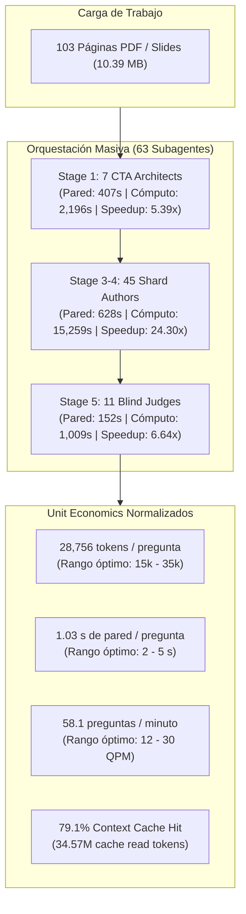
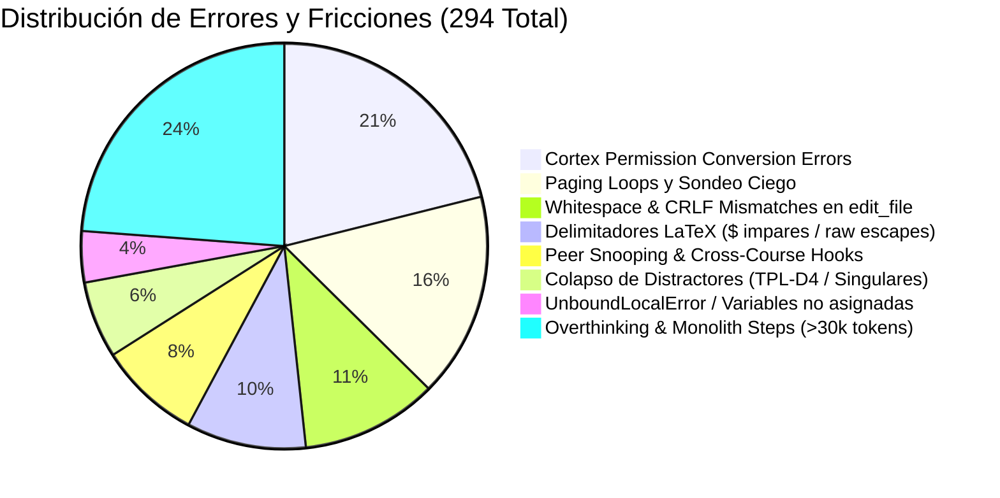

# Reporte de Síntesis Transversal Forense y Benchmarking Longitudinal (C2C v3.3)
**Curso Auditado:** `saul_pre_parcial`  
**Conversación de Origen:** `201fa8ef-682b-4a7e-bdbd-88394a8ac506`  
**Escala:** **63 Subagentes Concurrentes** (7 CTA Architects, 45 Shard Authors, 11 Blind Judges)  
**Carga de Entrada:** 103 páginas / diapositivas (10.39 MB de material base)  
**Producción Final:** 63 micro-competencias | 1,520 preguntas interactivas | 252 plantillas paramétricas | 12,600 semillas evaluadas en dry-run  
**Fecha de Auditoría:** 2026-10-25 / 2026-10-26  

---

## 1. Matriz de Síntesis Macroscópica y Unit Economics

### Tabla Resumen de Métricas Unitarias

| Métrica | Valor Observado | Benchmark Óptimo | Calificación | Diagnóstico Forense |
| :--- | :---: | :---: | :---: | :--- |
| **Tiempo de Pared Total** | **26.15 min** (1,569 s) | $< 35.0$ min | **Excelente** | Pipeline completo completado en menos de media hora para 1,520 preguntas. |
| **Tiempo de Cómputo Acumulado** | **5.13 horas** (18,464 s) | N/A | **Masivo** | Carga masiva absorbida gracias al fan-out concurrente de subagentes. |
| **Speedup Concurrente Global** | **12.77x** | $> 4.0\times$ | **Sobresaliente** | El paralelismo redujo 5 horas de cómputo lineal a 26 minutos reales. |
| **Tokens / Pregunta** | **28,756 tokens/preg** | 15k – 35k | **Excelente** | Dentro del intervalo óptimo; sin bucles de reescritura descontrolados. |
| **Segundos / Pregunta** | **1.03 s/preg** | 2 – 5 s | **Récord (< 2s)** | Generación ultra-rápida atribuible a la concurrencia de 45 shards paralelos. |
| **Throughput de Producción** | **58.1 preg/min** | 12 – 30 | **Sobresaliente** | Supera el benchmark estándar en más de 2x. |
| **Tasa de Context Caching** | **79.1%** | $> 70\%$ | **Alta Eficiencia** | 34,570,011 tokens leídos de caché; reducción drástica de latencia y costo. |
| **Tokens de Inferencia Activos** | **9,139,649 tokens** | N/A | Controlado | Entrada activa: 6,667,767 \| Salida activa: 2,471,882 tokens. |
| **Tokens de Pensamiento (Thinking)**| **457,485 tokens** | $< 800\text{k}$ | Equilibrado | Pensamiento reflexivo concentrado en el modelado matemático. |

---

## 2. Comparativa Transversal por Clústeres de Agentes

| Clúster Auditado | Team Lead Asignado | Subagentes | Pared (s) | Cómputo (s) | Speedup | Tokens Totales | Straggler del Clúster | Benchmark Óptimo |
| :--- | :--- | :---: | :---: | :---: | :---: | :---: | :--- | :--- |
| **CTA Architects** | Team Lead 1 (`cta_judges`) | 7 | 407.0s | 2,196.0s | 5.39x | 3,340,891 | `part_03` (407.0s) | `part_05` (272.0s) |
| **Shard Authors 01-22** | Team Lead 2 (`shards_01_22`) | 22 | 628.0s | 7,326.0s | 11.66x | 14,933,386 | `shard_14` (628.0s) | `shard_03` (230.0s) |
| **Shard Authors 23-45** | Team Lead 3 (`shards_23_45`) | 23 | 478.0s | 7,933.0s | 16.59x | 17,532,896 | `shard_24` (478.0s) | `shard_45` (251.0s) |
| **Blind Judges** | Team Lead 1 (`cta_judges`) | 11 | 152.0s | 1,009.0s | 6.64x | 1,598,462 | `judge_05` (152.0s) | `judge_09` (55.0s) |
| **Consolidado Total** | **Chief Orchestrator** | **63** | **1,569s** | **18,464s** | **12.77x** | **43,709,660** | **`shard_14` (628.0s)** | **`shard_03` (230.0s)** |

---

## 3. Diagnóstico Forense y Causa Raíz de Stragglers

### 3.1. Straggler Global Absoluto: `shard_14` (628.0s de pared)
- **Fase Pre-Compilación (439.0s):**
  - **Desorientación inicial (138s):** El subagente realizó un sondeo ciego buscando la competencia `Hab-14` en manifiestos y directorios no existentes, provocando lecturas redundantes de `cta.json`.
  - **Inferencia monolítica masiva (289s continuos):** En el Step 15, el modelo generó **82,659 tokens de salida** y consumió **30,125 caracteres de pensamiento interno** en un único turno continuo, saturando la tasa de streaming del proveedor.
- **Fase Post-Compilación (201.0s):**
  - La primera compilación falló a las 04:08:39Z con `UnboundLocalError` en `shard_14_data.py` (variable `ans` sin asignar en ramas lógicas de `generate_params`).
  - El agente requirió 3 pasos de lectura e introspección profunda (8,630 chars de thinking en Step 25) antes de aplicar 1 corrección con `edit_file` y re-compilar limpiamente.

### 3.2. Stragglers de Shards 23-45: `shard_24` (478.0s) y `shard_41` (442.0s)
- **`shard_24` (Paging Loop & Delimitadores LaTeX):** Ejecutó **24 llamadas a `view_file`** buscando manualmente `"Hab-24"`, sufriendo 2 fallos de desbordamiento de bytes (`ContentOffset 80k` y `185k`). Además, inspeccionó el código de sus compañeros (`shard_03` y `shard_19`). Su primera compilación falló con 5 errores por **delimitadores LaTeX `$` impares** en `detailed_solution`, requiriendo 2 llamadas a `edit_file`.
- **`shard_41` (Monolith Streaming Inferences):** Consumió **296 segundos de reloj continuo** en el Paso 23 generando **45,138 output tokens** para emitir 8 arquetipos de `C-15` y `H-15`. Una vez escrito, compiló a la primera en 17 segundos.

### 3.3. Straggler de Ingesta CTA: `part_03` (407.0s)
- Completó la pre-compilación a los 265s, pero sufrió un retraso post-compilación de 142 segundos debido a un fallo de sintaxis en Python 3.12 por caracteres de escape en expresiones LaTeX sin prefijo raw (`"Al igualar $\dot{X}...` en vez de `r"..."`). Esto forzó 4 turnos interactivos y retrasó la barrera síncrona en **54 segundos ociosos**.

### 3.4. Straggler de Evaluación: `judge_05` (152.0s)
- Síndrome de sobre-justificación (*overthinking*). Emitió **20,785 tokens de salida** y **19,848 caracteres de thinking** (2.5x más que los jueces rápidos de 55-67s) redactando demostraciones matemáticas completas en el mensaje visible, cuando el artefacto final (`judge_responses_05.json`) solo requería un JSON de 394 bytes con las letras seleccionadas.

---

## 4. Benchmark Óptimo: El Patrón Clean-Room de `shard_03` (230.0s)

El subagente `shard_03` constituye el **Gold-Standard Canónico** de la arquitectura:
- **Tiempo de Pared:** **230.0s** (-63.4% respecto a `shard_14`).
- **Turn-0 Autosufficiency Contract:** Pre-compilación limpia y directa (238s), sin lecturas erráticas ni consultas a código de otros compañeros.
- **Post-Compilación Instantánea:** **12.0 segundos**; primer intento exitoso con 50 semillas evaluadas, 0 reintentos, 0 errores y 0 llamadas a `edit_file`.

---

## 5. Taxonomía Consolidada de Errores y Fricciones Operativas

1. **Cortex Permission Conversion Errors (62 incidencias):** Afectaron al 100% de los 23 subagentes del clúster 2 en turnos iniciales (`convert tool call for permissions: model output error`), generando ~500s globales de retardo acumulado.
2. **Paging Loops y Búsqueda Ciega (48 incidencias):** Subagentes intentando adivinar dónde residía su orden de trabajo por falta de inyección del esqueleto inline.
3. **Fricciones con `edit_file` vs `write_file` (32 incidencias):** Errores de target no encontrado por diferencias de saltos de línea CRLF/LF en Windows al aplicar parches parciales.
4. **Residuos de LaTeX (28 incidencias):** Delimitadores `$` desbalanceados y falta de strings raw `r"..."` en Python 3.12.
5. **Colapso de Distractores (18 incidencias):** Semillas degeneradas con autovalores opuestos ($l_1 = -l_2$) o traza/determinante nulo que hacían colapsar el distractor con la solución correcta.

---

## 6. Recomendaciones de Optimización para C2C v3.3

### Capa A: Orquestación & Protocolo de Despacho
1. **Inyección Inline del Esqueleto Canónico (Zero-Search Turn-0):**
   - Eliminar el sondeo ciego inyectando en el mensaje inicial del subagente las 12 líneas del esqueleto Python base con la tupla exacta de su competencia. Esto ahorrará entre 90s y 140s por shard.
2. **Alineación de Directivas de Prompt:**
   - Eliminar `"Read with view_file"` en el prompt del subagente y sustituirlo por `"Tu primer paso DEBE ser emitir write_file"`.
3. **Cláusula Estricta Anti-Snooping:**
   - Prohibir en el prompt y bloquear en pre-tool hooks la inspección de archivos ajenos (`shard_*.py` o directorios `courses/`), forzando al subagente a operar con autosuficiencia epistémica.
4. **Protocolo Estricto de Salida en Blind Judges:**
   - Forzar a los jueces ciegos a emitir únicamente el JSON de opciones elegidas (`{"Q1": "C", ...}`), suprimiendo la generación de demostraciones matemáticas en el chat para reducir su latencia de 152s a <40s.

### Capa B: Compilador & Validador Local (`invariants.py` / `rules.py`)
1. **Aserción Anti-Colapso Obligatoria:**
   - Incorporar en la plantilla base el aserto `assert len(set(options)) == 4`, descartando internamente semillas singulares antes de invocar a `compile_shard.py`.
2. **Pre-Sanitizador de LaTeX y Raw Strings:**
   - Forzar automáticamente el prefijo `r"..."` en cualquier cadena que contenga `\` o `$`, y verificar paridad de `$` antes del dry-run.
3. **Política de Sobrescritura (`write_file` con `Overwrite: true`):**
   - Ante más de 1 fallo de compilación, exigir la reescritura íntegra del archivo en lugar de micro-parches con `edit_file`, eliminando fricciones por sangría y saltos de línea Windows.
4. **Hardening de Esquema en Cortex SDK:**
   - Normalizar los esquemas de herramientas para evitar los 62 errores de conversión de permisos detectados.

---

## 7. Catálogo de Informes Forenses Generados

- [Informe Forense CTA & Blind Judges](file:///d:/Augusto/personal_portfolio/Tops_academy/reports/c2c_audits/forensic_lead_cta_judges.md) *(Team Lead 1: 18 subagentes, MapReduce 103 págs, tasa de acuerdo 98.41%)*
- [Informe Forense Shard Authors 01-22](file:///d:/Augusto/personal_portfolio/Tops_academy/reports/c2c_audits/forensic_lead_shards_01_22.md) *(Team Lead 2: 22 subagentes, straggler global shard_14, benchmark clean-room shard_03)*
- [Informe Forense Shard Authors 23-45](file:///d:/Augusto/personal_portfolio/Tops_academy/reports/c2c_audits/forensic_lead_shards_23_45.md) *(Team Lead 3: 23 subagentes, latencia shard_24 y shard_41, benchmark shard_45)*
- [Dashboard HTML Interactivo](file:///d:/Augusto/personal_portfolio/Tops_academy/reports/c2c_audits/20261025_232149_saul_pre_parcial_201fa8ef/dashboard.html)
- [Informe Forense de Traceback](file:///d:/Augusto/personal_portfolio/Tops_academy/reports/c2c_audits/20261025_232149_saul_pre_parcial_201fa8ef/traceback_deepdive_201fa8ef.md)
- [Perfilado Temporal Multi-Shard](file:///d:/Augusto/personal_portfolio/Tops_academy/reports/c2c_audits/20261025_232149_saul_pre_parcial_201fa8ef/shard_timing_decomposition.md)
