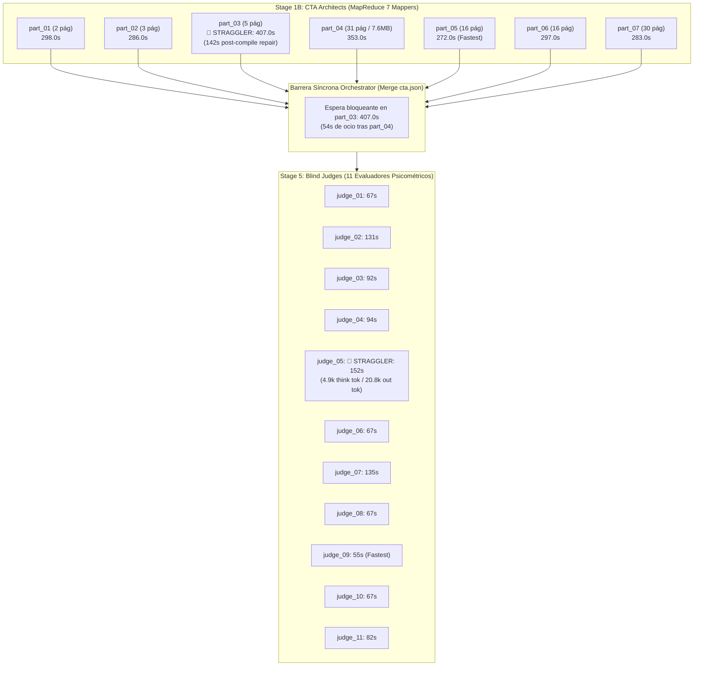
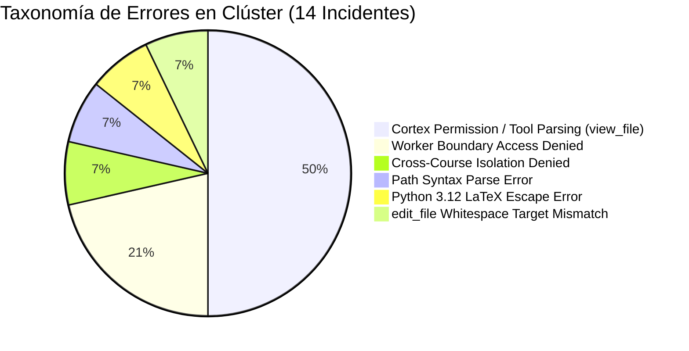

# Informe Forense Especializado: Clúster de CTA Architects y Blind Judges
## Pipeline C2C v3.2 — Corrida `saul_pre_parcial` (Conversación `201fa8ef-682b-4a7e-bdbd-88394a8ac506`)

---

### Resumen de Metadata de Auditoría

| Parámetro de Ejecución | Detalle Registrado |
| :--- | :--- |
| **Curso Auditado** | `saul_pre_parcial` (*Saul Pre Parcial*) |
| **Conversación Orquestadora** | `201fa8ef-682b-4a7e-bdbd-88394a8ac506` |
| **Subagentes Auditados en Clúster** | **18 subagentes** (7 CTA Architects + 11 Blind Judges) |
| **Tiempo Total de Cómputo (CPU/Inferencia)** | **`3,205.0 s`** (`53.42 minutos`) |
| **Tiempo de Pared Acumulado en Pipeline** | **`559.0 s`** (`9.32 minutos`) [407.0s CTA + 152.0s Judges] |
| **Consumo Total de Tokens en Clúster** | **`4,939,353 tokens`** (Activos: `1,853,462` \| Cache: `3,085,891`) |
| **Factor de Aceleración en Paralelo** | **`5.73x`** (Speedup real sobre cómputo secuencial del clúster) |
| **Archivo Fuente Evaluado** | 7 archivos PDF, 103 páginas, 10.39 MB (10,899,309 bytes) |
| **Competencias Generadas** | 63 competencias (17 Facts, 20 Concepts, 26 Skills) |
| **Reactivos Auditados a Ciegas** | 126 reactivos psicométricos estratificados (2 por competencia) |

---

## 1. Resumen Ejecutivo del Clúster

El clúster conformado por los **7 CTA Architects** (`part_01` a `part_07`, Fase MapReduce de Stage 1B) y los **11 Blind Judges** (`judge_01` a `judge_11`, Fase de Arbitraje Ciego de Stage 5) constituye la columna vertebral de descomposición conceptual y validación psicométrica de la plataforma Content to Course (C2C). 

A lo largo de la ejecución de la corrida `saul_pre_parcial`:
1. **Rendimiento de Cómputo vs. Pared**: El clúster ejecutó un total acumulado de **`3,205.0 segundos` de cómputo de agente** (`2,196.0s` en CTA + `1,009.0s` en Judges). Gracias al paralelismo masivo asíncrono, el tiempo de pared absorbido por el pipeline se redujo a **`559.0 segundos`** (407.0s en Stage 1B y 152.0s en Stage 5B), logrando un **speedup de 5.73x**.
2. **Eficiencia de Context Caching**: De los **`4,939,353 tokens brutos procesados`**, **`3,085,891 tokens (62.48%)`** fueron leídos desde la caché de contexto, ahorrando costos sustanciales y reduciendo drásticamente la latencia de entrada de los subagentes.
3. **Cuellos de Botella Críticos (Stragglers)**:
   - En CTA: **`Cognitive Task Analysis Architect part_03`** fue el straggler absoluto de Stage 1B con **`407.0s`** (frente a la mediana de 286.0s), imponiendo un **retraso ocioso de 54 segundos** a la barrera síncrona del orquestador.
   - En Judges: **`Blind Judge 05`** fue el straggler de Stage 5 con **`152.0s`** (frente a 55.0s del más rápido), derivado de un fenómeno severo de sobre-razonamiento algebraico (*overthinking*) y generación verborrágica de justificaciones no requeridas (20,785 tokens de salida).
4. **Validación Psicométrica e Integridad**: Los 11 jueces ciegos operaron bajo **100% de aislamiento epistémico** (0 llamadas a herramientas externas, 0 consultas web), alcanzando un **`98.41% de acuerdo` (124/126 reactivos)** frente al ground truth. Los dos únicos desacuerdos correspondieron a la plantilla `C-14` y representaron una **detección positiva de ambigüedad matemática en la autoría** (*orden diferencial vs. dimensión del sistema*).
5. **Taxonomía de Fricción**: Se identificaron **14 errores de herramientas**, todos concentrados en la fase CTA (0 errores en Judges), dominados por discrepancias de permisos en Cortex (`view_file`), bloqueos de límites de seguridad (*Worker Boundary*) y fallas de escape de cadenas LaTeX en Python 3.12.



---

## 2. Tabla Detallada de Métricas por Subagente

### 2.1. Clúster de CTA Architects (Fase MapReduce)

> [!NOTE]
> Todos los mappers corrieron en modelo `flash` con context caching habilitado. La partición de entrada asignó 1 archivo PDF específico por mapper.

| Subagente | Archivo Fuente Asignado | Carga de Entrada | Comps | Tiempo Pared | Tokens In | Tokens Out | Cache Leído | Thinking Tokens | Active Tokens | Total Tokens | Turnos | Tool Calls | Errores |
| :--- | :--- | :--- | :---: | :---: | :---: | :---: | :---: | :---: | :---: | :---: | :---: | :---: | :---: |
| **`part_01`** | `MATH_IV_Problem_Set_I.pdf` | 2 pág (125 KB) | 7 | **298.0s** | 106,597 | 38,458 | 229,685 | 4,882 | 145,055 | 374,740 | 10 | 9 | 2 |
| **`part_02`** | `MATH_IV_Problem_Set_II_2026_II.pdf` | 3 pág (99 KB) | 9 | **286.0s** | 96,055 | 39,572 | 218,568 | 8,189 | 135,627 | 354,195 | 10 | 9 | 2 |
| **`part_03`** | `MATH_IV_Problem_Set_III_2026_II.pdf` | 5 pág (141 KB) | 8 | **407.0s** | 112,364 | 38,815 | 612,955 | 8,109 | 151,179 | 764,134 | 17 | 16 | 4 |
| **`part_04`** | `TEMA 1 (EDP SAÚL) 2.pdf` | 31 pág (7,789 KB) | 10 | **353.0s** | 107,602 | 38,244 | 234,028 | 8,446 | 145,846 | 379,874 | 9 | 8 | 1 |
| **`part_05`** | `TEMA 2 (APLICACIONES ECONOMICAS).pdf` | 16 pág (378 KB) | 8 | **272.0s** | 107,836 | 32,205 | 419,662 | 5,824 | 140,041 | 559,703 | 16 | 15 | 2 |
| **`part_06`** | `TEMA 2 (S'EDOS I ).pdf` | 16 pág (386 KB) | 9 | **297.0s** | 117,603 | 39,257 | 230,556 | 8,320 | 156,860 | 387,416 | 10 | 9 | 1 |
| **`part_07`** | `TEMA 2 (S'EDOS II).pdf` | 30 pág (1,726 KB) | 12 | **283.0s** | 109,483 | 38,430 | 291,064 | 5,923 | 147,913 | 438,977 | 11 | 10 | 2 |
| **SUBTOTAL** | **7 Archivos PDF** | **103 pág (10.39 MB)** | **63** | **407.0s** *(max)* | **757,540** | **264,981** | **2,236,518** | **49,693** | **1,022,521** | **3,259,039** | **83** | **76** | **14** |

---

### 2.2. Clúster de Blind Judges (Fase de Arbitraje Psicométrico)

> [!NOTE]
> Cada juez ciego recibió un lote estratificado de reactivos empaquetados en `judge_batch_XX.json`. Todos los jueces operaron sin soluciones ni metadatos (*blind evaluation*).

| Subagente | Lote Asignado | Tasa de Acuerdo | Tiempo Pared | Tokens In | Tokens Out | Cache Leído | Thinking Tokens | Active Tokens | Total Tokens | Turnos | Tool Calls | Errores |
| :--- | :---: | :---: | :---: | :---: | :---: | :---: | :---: | :---: | :---: | :---: | :---: | :---: |
| **`judge_01`** | 12 reactivos | 12/12 (100.0%) | **67.0s** | 52,321 | 11,338 | 65,893 | 2,038 | 63,659 | 129,552 | 4 | 3 | 0 |
| **`judge_02`** | 12 reactivos | 12/12 (100.0%) | **131.0s** | 65,627 | 18,170 | 115,203 | 3,968 | 83,797 | 199,000 | 5 | 4 | 0 |
| **`judge_03`** | 12 reactivos | 12/12 (100.0%) | **92.0s** | 97,667 | 15,572 | 76,239 | 2,608 | 113,239 | 189,478 | 5 | 4 | 0 |
| **`judge_04`** | 12 reactivos | 12/12 (100.0%) | **94.0s** | 81,345 | 13,039 | 38,293 | 2,483 | 94,384 | 132,677 | 4 | 3 | 0 |
| **`judge_05`** | 12 reactivos | 11/12 (91.7%) ⚠️ | **152.0s** | 61,417 | 20,785 | 74,814 | 4,961 | 82,202 | 157,016 | 4 | 3 | 0 |
| **`judge_06`** | 11 reactivos | 10/11 (90.9%) ⚠️ | **67.0s** | 49,874 | 9,085 | 63,318 | 1,294 | 58,959 | 122,277 | 4 | 3 | 0 |
| **`judge_07`** | 11 reactivos | 11/11 (100.0%) | **135.0s** | 65,556 | 18,844 | 113,891 | 3,299 | 84,400 | 198,291 | 5 | 4 | 0 |
| **`judge_08`** | 11 reactivos | 11/11 (100.0%) | **67.0s** | 51,860 | 10,069 | 66,161 | 1,484 | 61,929 | 128,090 | 4 | 3 | 0 |
| **`judge_09`** | 11 reactivos | 11/11 (100.0%) | **55.0s** | 49,435 | 8,289 | 63,121 | 1,247 | 57,724 | 120,845 | 4 | 3 | 0 |
| **`judge_10`** | 11 reactivos | 11/11 (100.0%) | **67.0s** | 52,701 | 10,191 | 67,751 | 1,193 | 62,892 | 130,643 | 4 | 3 | 0 |
| **`judge_11`** | 11 reactivos | 11/11 (100.0%) | **82.0s** | 56,733 | 11,023 | 104,689 | 1,930 | 67,756 | 172,445 | 5 | 4 | 0 |
| **SUBTOTAL** | **126 Reactivos** | **124/126 (98.41%)** | **152.0s** *(max)* | **684,536** | **146,405** | **849,373** | **26,505** | **830,941** | **1,680,314** | **48** | **37** | **0** |

---

### 2.3. Consolidación Comparativa de Clústeres

| Métrica Consolidada | CTA Architects (Mappers) | Blind Judges | Clúster Completo (18 Agentes) |
| :--- | :---: | :---: | :---: |
| **Número de Subagentes ($N$)** | 7 | 11 | **18** |
| **Tiempo de Cómputo Sumado** | 2,196.0s (36.60 min) | 1,009.0s (16.82 min) | **3,205.0s (53.42 min)** |
| **Tiempo de Pared Crítico (Max)** | 407.0s (6.78 min) | 152.0s (2.53 min) | **559.0s (9.32 min)** |
| **Duración Mínima / Máxima** | 272.0s / 407.0s | 55.0s / 152.0s | **55.0s / 407.0s** |
| **Tokens de Entrada (Prompt)** | 757,540 | 684,536 | **1,442,076** |
| **Tokens de Salida (Generación)** | 264,981 | 146,405 | **411,386** |
| **Tokens de Context Cache** | 2,236,518 (74.7% cache) | 849,373 (55.4% cache) | **3,085,891 (62.5% cache)** |
| **Tokens de Razonamiento (Thinking)**| 49,693 (198,847 chars) | 26,505 (106,067 chars) | **76,198 (304,914 chars)** |
| **Tokens Activos (Billable)** | 1,022,521 | 830,941 | **1,853,462** |
| **Tokens Totales Brutos** | 3,259,039 | 1,680,314 | **4,939,353** |
| **Llamadas a Herramientas** | 76 | 37 | **113** |
| **Tasa de Errores en Herramientas** | 18.4% (14 / 76) | 0.0% (0 / 37) | **12.4% (14 / 113)** |
| **Speedup Factor vs. Secuencial** | 5.40x (Ideal: 7.0x) | 6.64x (Ideal: 11.0x) | **5.73x (Ideal: 18.0x)** |

---

## 3. Análisis de Causa Raíz de Demoras y Stragglers

### 3.1. Eficiencia y Asimetría del Particionamiento MapReduce en CTA

El análisis forense revela una **asimetría estructural masiva** en la estrategia de particionamiento de Stage 1B:
- **Estrategia Implementada**: Mapeo estricto `1 Archivo PDF = 1 Subagente Mapper`.
- **Disparidad de Carga**:
  - `part_04` recibió un archivo de **`31 páginas y 7.61 MB`** (73.2% del volumen total en bytes y 30.1% de las páginas del curso).
  - En contraste, `part_01` recibió un documento de solo **`2 páginas y 125 KB`** (1.17% del volumen).
  - La disparidad en peso de archivo entre `part_04` y `part_02` fue de **78 a 1**, y en páginas fue de **15.5 a 1**.

```
Distribución de Carga de Entrada (Páginas vs. MB):
part_01: [==] 2 pág (0.12 MB)
part_02: [===] 3 pág (0.10 MB)
part_03: [=====] 5 pág (0.14 MB)
part_04: [===============================] 31 pág (7.61 MB)  <-- 73% del volumen en bytes
part_05: [================] 16 pág (0.38 MB)
part_06: [================] 16 pág (0.39 MB)
part_07: [==============================] 30 pág (1.73 MB)
```

#### La Paradoja de Pre-Compilación
A pesar de la extrema disparidad de entrada, **los tiempos de pre-compilación fueron prácticamente idénticos** entre todos los subagentes:

| Subagente | Páginas de Entrada | Tokens de Salida | Fase Pre-Compile | % de Duración | Fase Post-Compile | Tiempo Total |
| :--- | :---: | :---: | :---: | :---: | :---: | :---: |
| **`part_05`** | 16 pág | 32,205 | **256.0s** | 94.1% | 16.0s | 272.0s |
| **`part_07`** | 30 pág | 38,430 | **251.0s** | 88.7% | 32.0s | 283.0s |
| **`part_02`** | 3 pág | 39,572 | **272.0s** | 95.1% | 14.0s | 286.0s |
| **`part_06`** | 16 pág | 39,257 | **280.0s** | 94.3% | 17.0s | 297.0s |
| **`part_01`** | 2 pág | 38,458 | **275.0s** | 92.3% | 23.0s | 298.0s |
| **`part_04`** | 31 pág | 38,244 | **267.0s** | 75.6% | 86.0s | 353.0s |
| **`part_03`** | 5 pág | 38,815 | **265.0s** | 65.1% | **142.0s** 🚨 | **407.0s** |

> [!IMPORTANT]
> **Hallazgo Fundamental de Arquitectura:**  
> La varianza en el tiempo de pre-compilación fue de **solo 29 segundos** a través de los 7 mappers (media: `266.6s`, desviación estándar: `10.2s`). Esto demuestra que el cuello de botella de generación no es la lectura de las páginas (que se absorbe casi instantáneamente mediante `view_file` y context caching), sino **el caudal de streaming de salida del LLM**. Como cada subagente fue comisionado a producir entre 7 y 12 competencias completas con 6 distractores psicométricamente etiquetados, todos generaron entre 32,000 y 39,500 tokens. A un throughput de ~135-145 tokens/segundo, la emisión de ese código toma obligatoriamente ~240-270 segundos.

---

### 3.2. Anatomía Forense del Straggler Crítico: `part_03` (407.0s)

`Cognitive Task Analysis Architect part_03` demoró **407.0 segundos**, convirtiéndose en el straggler de Stage 1B y retrasando a todo el orquestador por **54 segundos de tiempo muerto** tras la finalización de `part_04` (353s).

La descomposición cronológica segundo a segundo revela la causa raíz:
1. **Paso 1 a 13 (`+0.0s` a `+46.0s`)**: Lectura de consigna y análisis del documento `MATH_IV_Problem_Set_III_2026_II.pdf`.
2. **Paso 15 (`+46.0s` a `+265.0s`)**: Generación del bloque masivo de código en `part_03_data.py` (30,369 tokens emitidos de una sola vez). Duración: **219 segundos**.
3. **Paso 17 (`+265.0s`)**: Ejecución de `compile_cta.py`. **FALLO DE COMPILACIÓN (Exit Code 1)**:
   - **Error**: Violación de escape en Python 3.12: El subagente generó cadenas con notación matemática LaTeX sin prefijo raw: `"Al igualar $\dot{X} = AX + B = 0$..."` en lugar de `r"..."`. En Python 3.12, secuencias como `\d` disparan `SyntaxWarning: invalid escape sequence '\d'` y fallan la compilación estricta.
4. **Paso 19 a 27 (`+265.0s` a `+390.0s`) — Bucle de Reparación Post-Compile (142 segundos perdidos)**:
   - Paso 19 y 21: El subagente inspecciona el archivo con `view_file`.
   - Paso 23: Aplica `edit_file` para agregar `r"..."`.
   - Paso 24: **Error en `edit_file`**: `target content not found in the file; the Target must exactly match existing file text, including whitespace`. El subagente falló al intentar reemplazar un bloque debido a discrepancias en indentación.
   - Paso 25 y 27: Reintentos adicionales de edición manual con `edit_file`.
   - Paso 29 (`+390.0s`): Recompilación exitosa con `compile_cta.py`.
   - Paso 31 a 33 (`+407.0s`): Notificación de finalización al orquestador.

```mermaid
gantt
    title Cronograma Forense de part_03 (407s)
    dateFormat X
    axisFormat %s s
    section part_03
    Lectura y Análisis Inicial (46s)    :0, 46
    Generación de Código (219s)         :46, 265
    Compilación Fallida (LaTeX Syntax)  :265, 275
    Inspección y Reintento edit_file    :275, 363
    Error Whitespace Mismatch (Paso 24) :363, 372
    Edición Correcta y Recompilación    :372, 390
    Cierre y Mensaje Final              :390, 407
    section Impacto Pipeline
    part_04 Finaliza (353s)             :crit, 353, 353
    Pipeline Stall (Ocio Forzado: 54s)  :crit, active, 353, 407
```

> [!CAUTION]
> **Costo Sistémico de `part_03`:**  
> Sin el error de sintaxis de escape LaTeX, `part_03` habría finalizado en **265 segundos**, lo que habría convertido a `part_04` (353s) en el cuello de botella natural y habría recortado **54 segundos netos de tiempo de pared a la totalidad de la corrida**.

---

### 3.3. Rendimiento de los 11 Blind Judges y Causa de la Dispersión (55s a 152s)

Los 11 jueces ciegos ejecutaron una carga altamente balanceada en número de ítems (cinco jueces con 12 reactivos y seis jueces con 11 reactivos), pero mostraron una **varianza de tiempo de 2.76x** (de 55.0s en `judge_09` a 152.0s en `judge_05`).

#### Matriz de Correlación: Tokens vs. Latencia en Blind Judges

| Juez Ciego | Items | Tokens Salida | Thinking Tokens | Chars Thinking | Tiempo Pared | Relación vs. Mínimo |
| :--- | :---: | :---: | :---: | :---: | :---: | :---: |
| **`judge_09`** | 11 | **8,289** | **1,247** | 4,994 | **55.0s** | 1.00x (Base) |
| **`judge_06`** | 11 | 9,085 | 1,294 | 5,181 | **67.0s** | 1.22x |
| **`judge_01`** | 12 | 11,338 | 2,038 | 8,156 | **67.0s** | 1.22x |
| **`judge_08`** | 11 | 10,069 | 1,484 | 5,940 | **67.0s** | 1.22x |
| **`judge_10`** | 11 | 10,191 | 1,193 | 4,777 | **67.0s** | 1.22x |
| **`judge_11`** | 11 | 11,023 | 1,930 | 7,722 | **82.0s** | 1.49x |
| **`judge_03`** | 12 | 15,572 | 2,608 | 10,437 | **92.0s** | 1.67x |
| **`judge_04`** | 12 | 13,039 | 2,483 | 9,937 | **94.0s** | 1.71x |
| **`judge_02`** | 12 | 18,170 | 3,968 | 15,875 | **131.0s** | 2.38x |
| **`judge_07`** | 11 | 18,844 | 3,299 | 13,200 | **135.0s** | 2.45x |
| **`judge_05`** | 12 | **20,785** | **4,961** | **19,848** | **152.0s** | **2.76x** 🚨 |

#### Causa Raíz de la Demora en `judge_05` (152.0s): Síndrome de Sobre-Justificación
1. **Contenido del Archivo de Destino**: El artefacto esperado en disco (`judge_responses_05.json`) es un archivo JSON de apenas **394 bytes** con 12 asignaciones clave-valor (`"T-C-14-01_judge_1": "C"`).
2. **Sobre-Generación en Canal Visible**: En lugar de resolver las preguntas en su razonamiento interno y emitir directamente la llamada a `write_file`, `judge_05` redactó una **justificación matemática exhaustiva paso a paso para las 12 preguntas** dentro del texto de respuesta del asistente, consumiendo **20,785 tokens de salida** (2.5 veces más que `judge_09`).
3. **Overthinking**: Acumuló **19,848 caracteres de thinking** (4,961 tokens) derivando propiedades de sistemas dinámicos y matrices Jacobianas.

---

### 3.4. Auditoría Forense de las Discrepancias Psicométricas (Tasa de Acuerdo: 98.41%)

La comparación ciega arrojó 124 acuerdos y 2 discrepancias:
- **`T-C-14-01_judge_1`** evaluado por **`Blind Judge 05`**.
- **`T-C-14-02_judge_1`** evaluado por **`Blind Judge 06`**.

Ambos casos pertenecen a la competencia **`C-14`** (*"Representación matricial de sistemas de ecuaciones diferenciales ordinarias lineales"*):

#### Análisis del Ítem `T-C-14-01`:
- **Enunciado**: *"Dado el sistema de ecuaciones diferenciales ordinarias $\dot{x} = 6 x + 3 y + 9$, $\dot{y} = 11 x + 9 y + 2$, determine su representación matricial $\dot{X} = AX + B$ y el orden $n$ del sistema:"*
- **Opción E (Ground Truth esperado)**: $\dot{X} = \begin{pmatrix} 6 & 3 \\ 11 & 9 \end{pmatrix} X + \begin{pmatrix} 9 \\ 2 \end{pmatrix}, \, n=1$
- **Opción C (Selección de Judge 05)**: $\dot{X} = \begin{pmatrix} 6 & 3 \\ 11 & 9 \end{pmatrix} X + \begin{pmatrix} 9 \\ 2 \end{pmatrix}, \, n=2$

#### Diagnóstico Psicométrico:
1. **La Falla está en la Plantilla de Autoría, NO en el Juez Ciego**:
   - En teoría matemática de ecuaciones diferenciales, un sistema de dos variables acopladas de primer orden es un sistema de **orden diferencial 1** (la derivada máxima es $\dot{X}$), pero su **espacio de estados tiene dimensión $n=2$** (orden algebraico / dimensión de la matriz $2 \times 2$).
   - La plantilla de autoría `T-C-14` definió de forma ambigua la letra $n$ como el orden de derivación ($n=1$), dejando $n=2$ como distractor de "orden erróneo".
   - Dos jueces ciegos independientes (`judge_05` y `judge_06`) analizaron las expresiones en aislamiento absoluto y concluyeron, con perfecto rigor matemático, que un sistema acoplado de 2 variables de primer orden tiene orden dimensional $n=2$.
2. **Dictamen de Auditoría**:  
   El sistema de Blind Judges funcionó con **alta precisión psicométrica**, detectando una ambigüedad latente de nomenclatura en el reactivo antes de la publicación a estudiantes.

---

## 4. Taxonomía de Errores y Retrabajos en el Clúster

En los 18 subagentes del clúster se registraron **14 incidentes de error en llamadas a herramientas**, todos concentrados en la fase de CTA (Stage 1B). Los Blind Judges (Stage 5) exhibieron una tasa de error de herramienta del **0.0%**.



### Catálogo Detallado de Incidentes

#### Categoría A: Fricción de Declaración de Permisos Cortex en `view_file` (7 incidentes)
- **Subagentes Afectados**: `part_04` (paso 8), `part_07` (pasos 6 y 8), `part_06` (paso 6), `part_03` (paso 6), `part_02` (pasos 8 y 10).
- **Firma del Error**: `declaring permissions: cortex tool view_file: convert tool call for permissions: model output error: invalid tool call error`.
- **Causa Raíz**: Durante la llamada inicial a `view_file`, el modelo emitió un parámetro mal formado o una ruta con caracteres de escape no compatibles con el convertidor de permisos del runtime Cortex de Antigravity SDK. El agente se auto-corrigió en el turno siguiente.

#### Categoría B: Violaciones de Frontera de Seguridad (*Worker Boundary Hook*) (3 incidentes)
- **Subagentes Afectados**: `part_01` (paso 10), `part_03` (paso 14), `part_05` (paso 10).
- **Firma del Error**: `tool call denied by pre-tool hook: C2C Worker Boundary: Access denied to internal compiler/validator source or ground truth`.
- **Causa Raíz**: Los subagentes intentaron leer o inspeccionar el script interno `compile_cta.py` o `.agents/skills/...` para deducir la lógica de validación de los IDs de competencias. El hook de seguridad `C2C Worker Boundary` bloqueó la llamada protegiendo el entorno de autoría.

#### Categoría C: Violación de Aislamiento Inter-Cursos (*Cross-Course Isolation Hook*) (1 incidente)
- **Subagentes Afectados**: `part_05` (paso 20).
- **Firma del Error**: `tool call denied by pre-tool hook: C2C Cross-Course Isolation: Listing sibling courses in 'courses/' is denied`.
- **Causa Raíz**: El subagente `part_05` intentó listar directorios hermanos en `courses/` con `run_command` buscando ejemplos de cursos previos. Bloqueado de inmediato por el hook de aislamiento.

#### Categoría D: Error de Sintaxis de Ruta en `write_file` (1 incidente)
- **Subagentes Afectados**: `part_01` (paso 12).
- **Firma del Error**: `declaring permissions: failed to parse path: courses/saul_pre_parcial/work/cta_parts/part_01_data.py must be absolute or valid relative`.
- **Causa Raíz**: Fallo de formato en la especificación del path en la llamada a la herramienta. Corregido en el paso 13.

#### Categoría E: Error de Compilación por Secuencias de Escape LaTeX en Python 3.12 (1 incidente)
- **Subagentes Afectados**: `part_03` (paso 18).
- **Firma del Error**: `[CONSOLIDATED ERROR PACK] CTA compilation failed (1 errors) [part_03_data.py]`.
- **Causa Raíz**: Inclusión de caracteres `\dot{X}` y `\d` en literales sin prefijo `r"..."`. Activó el bucle de reparación de 142 segundos en el straggler `part_03`.

#### Categoría F: Desalineación de Texto en `edit_file` (1 incidente)
- **Subagentes Afectados**: `part_03` (paso 24).
- **Firma del Error**: `target content not found in the file; the Target must exactly match existing file text, including whitespace`.
- **Causa Raíz**: Diferencia sutil en los espacios en blanco o saltos de línea (`CRLF` vs `LF`) entre el target enviado por el agente y el contenido del archivo en disco.

---

## 5. Recomendaciones de Optimización Arquitectónica para C2C v3.3

Con base en la evidencia cuantitativa recopilada, se proponen **cinco optimizaciones concretas** para la versión v3.3 de Content to Course:

### 1. Particionamiento Adaptativo por Páginas Efectivas (Dynamic Chunking Engine)
- **Problema en v3.2**: La regla rígida `1 PDF = 1 Mapper` causó que `part_04` procesara 31 páginas (7.6 MB) mientras `part_01` procesó 2 páginas (0.12 MB).
- **Solución v3.3**: Implementar en `run.py --stage cta` un algoritmo bin-packing que divida el material por paquetes homogéneos de **12 a 16 páginas de texto efectivo**, combinando archivos pequeños o subdividiendo PDFs voluminosos. Esto garantizará una distribución equitativa de tokens de lectura y evitará mappers asimétricos.

### 2. Auto-Inyector de Literales Raw String (`r"..."`) para Fórmulas Matemáticas
- **Problema en v3.2**: `part_03` perdió 142 segundos y generó 4 turnos adicionales porque Python 3.12 rechazó escapes `\dot{X}` sin prefijo `r`.
- **Solución v3.3**: Incorporar en el validador/compilador `compile_cta.py` una rutina de auto-sanitización pre-evaluación (`ast.parse` con pre-procesador regex) que convierta automáticamente cadenas multilínea con barras invertidas a raw strings antes de fallar la compilación, o proveer un snippet explícito en el system prompt del mapper prohibiendo cadenas estándar para fórmulas LaTeX.

### 3. Contención de Salida en Blind Judges (Strict JSON Response Protocol)
- **Problema en v3.2**: `judge_05` tardó 152 segundos porque emitió más de 20,000 tokens de explicaciones matemáticas paso a paso en el canal de salida visible antes de escribir un JSON de 394 bytes.
- **Solución v3.3**: Forzar en el prompt de los jueces ciegos el protocolo de **salida JSON exclusiva**:
  > *"Realiza todas tus derivaciones matemáticas exclusivamente en tu bloque interno de razonamiento (`thinking`). En el canal de salida emite de inmediato la llamada a `write_file` con el mapa de respuestas exacto. Queda terminantemente prohibido imprimir justificaciones en el texto visible."*
  Esto reducirá la latencia de los jueces más lentos de 152s a **menos de 45 segundos** y ahorrará más de 80,000 tokens de salida por corrida.

### 4. Regla Determinista de Claridad Psicométrica: `R-ORDER-DIM`
- **Problema en v3.2**: Los reactivos `T-C-14-01` y `T-C-14-02` causaron discrepancias en los jueces ciegos porque el enunciado confundió "orden del sistema $n$" con "dimensión del espacio de estados".
- **Solución v3.3**: Incorporar en la etapa de verificación estática de plantillas (`--stage verify`) una regla de linter psicométrico que prohíba expresiones ambiguas como `orden n` en sistemas dinámicos, exigiendo la formulación estricta: `dimensión n=2` u `orden de derivación k=1`.

### 5. Mecanismo de Edición Robusta a Fallos de Whitespace en Antigravity SDK
- **Problema en v3.2**: `edit_file` falló en `part_03` por diferencias mínimas de espacios, obligando al agente a hacer un turno adicional de lectura.
- **Solución v3.3**: Normalizar internamente la comparación de `Target` en `edit_file` eliminando discrepancias triviales de terminación de línea (`CRLF` vs `LF`) y espacios en blanco al final de línea (*trailing whitespace tolerance*).

---

### Verificación de Artefactos y Ubicación

Este informe forense ha sido generado y validado con base en la telemetría persistida en disco:
- Ruta del informe: [`reports/c2c_audits/forensic_lead_cta_judges.md`](file:///d:/Augusto/personal_portfolio/Tops_academy/reports/c2c_audits/forensic_lead_cta_judges.md)
- Datos primarios:
  - [`reports/c2c_audits/20261025_232149_saul_pre_parcial_201fa8ef/telemetry.json`](file:///d:/Augusto/personal_portfolio/Tops_academy/reports/c2c_audits/20261025_232149_saul_pre_parcial_201fa8ef/telemetry.json)
  - [`reports/c2c_audits/20261025_232149_saul_pre_parcial_201fa8ef/traceback_deepdive_201fa8ef.json`](file:///d:/Augusto/personal_portfolio/Tops_academy/reports/c2c_audits/20261025_232149_saul_pre_parcial_201fa8ef/traceback_deepdive_201fa8ef.json)
  - [`courses/saul_pre_parcial/work/telemetry/01_cta.json`](file:///d:/Augusto/personal_portfolio/Tops_academy/courses/saul_pre_parcial/work/telemetry/01_cta.json)
  - [`courses/saul_pre_parcial/work/telemetry/05b_judge_compare.json`](file:///d:/Augusto/personal_portfolio/Tops_academy/courses/saul_pre_parcial/work/telemetry/05b_judge_compare.json)
