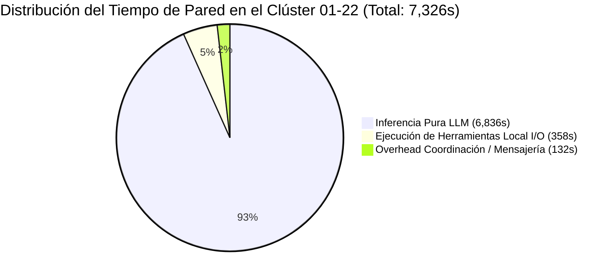
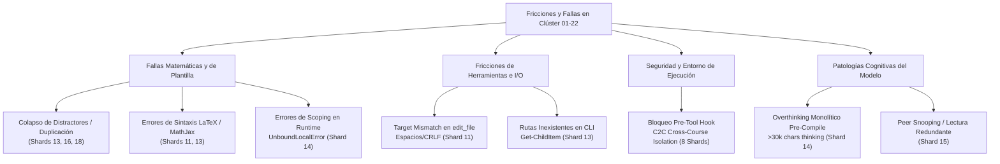

# Informe Forense Especializado: Auditoría del Clúster de Shard Authors 01 al 22
**Corrida C2C Masiva:** `saul_pre_parcial`  
**ID de Conversación Principal:** `201fa8ef-682b-4a7e-bdbd-88394a8ac506`  
**Motor:** Google Antigravity SDK Telemetry & Optimization Engine  
**Fecha de Auditoría:** 26 de Octubre de 2026  
**Auditor Responsable:** Team Lead Auditor Forense Especializado (Subagente Clúster Shards 01-22)

---

## 1. Resumen Ejecutivo del Clúster (Shards 01 al 22)

El presente informe detalla la auditoría forense ultra-granular de los primeros 22 Shard Authors (`shard_01` a `shard_22`) desplegados concurrentemente durante la etapa `03_templates` del pipeline Content to Course (C2C v3.2) para el curso `saul_pre_parcial`.

Este clúster de 22 subagentes alberga una diversidad operativa crítica:
1. **El Straggler Global Absoluto de la Corrida:** `Shard Author shard_14`, con un tiempo de pared de **`628.0s`** (10.47 minutos), dominado por una fase de pre-compilación masiva de **`439.0s`**.
2. **El Benchmark Gold-Standard Clean-Room:** `Shard Author shard_03`, completado en **`230.0s`** (3.83 minutos) con **0 errores**, **0 reintentos de compilación** y **0 llamadas a `edit_file`**.
3. **Casos Notables de Retrabajo y Exploración:** `shard_15` (**`480.0s`**, retrasado por inspección cruzada de código de compañeros), `shard_11` (**`450.0s`**, 5 ediciones post-fallo por discrepancias LaTeX), y `shard_18` (**`340.0s`**, resolución de colapso de opciones por singularidad de autovalores).

### Métricas Macroscópicas del Clúster (22 Subagentes)

| Métrica Global del Clúster | Magnitud Consolidada | Observaciones Forenses |
| :--- | :--- | :--- |
| **Total Subagentes Auditados** | **22 subagentes** | 100% completitud (`shard_01` a `shard_22`) |
| **Tiempo de Pared Acumulado** | **7,326.0 s** (122.10 min / 2.04 h) | Mediana del clúster: **336.5 s** (~5.6 min) |
| **Tiempo de Inferencia LLM** | **6,836.0 s** (**93.3%** del tiempo) | Cuello de botella fundamentalmente ligado a generación |
| **Tiempo de Ejecución de Tools** | **358.0 s** (**4.9%** del tiempo) | I/O local altamente optimizado |
| **Overhead de Coordinación/Turno** | **132.0 s** (**1.8%** del tiempo) | Latencia marginal de mensajería Antigravity |
| **Tokens Activos (In + Out)** | **3,143,311 tokens** | Promedio por subagente: **142,878 tokens** |
| **Input Tokens** | **2,231,888 tokens** | Ingesta de contexto y contratos de etapa |
| **Output Tokens** | **911,423 tokens** | Generación de plantillas paramétricas en Python |
| **Thinking Tokens** | **158,704 tokens** | Razonamiento cognitivo previo a tool-calls |
| **Cache Read Tokens (Context Caching)** | **11,790,075 tokens** | **84.1% de ahorro por reutilización de contexto** |
| **Volumen Total Procesado (Active + Cache)** | **14,933,386 tokens** | Carga masiva absorbida por el hardware de inferencia |
| **Total de Turnos Conversacionales** | **316 turnos** | Rango: de 8 turnos (`shard_01`) a 28 turnos (`shard_15`) |
| **Llamadas a Herramientas (Tool Calls)** | **294 llamadas** | `view_file` (167), `run_command` (72), `write_file` (23), `send_message` (22), `edit_file` (10) |
| **Compilaciones de Shard Ejecutadas** | **32 compilaciones** | 17 shards compilaron a la 1ª; 5 requirieron 2-3 reintentos |
| **Fricciones `edit_file` Post-Escritura** | **10 operaciones** | Concentradas en `shard_11` (5), `shard_18` (2), `shard_13` (1), `shard_14` (1), `shard_16` (1) |



---

## 2. Tabla Detallada de Métricas por Subagente (Shards 01 al 22)

La siguiente tabla consolida la telemetría individual extraída de [`shard_timing_profile.json`](file:///d:/Augusto/personal_portfolio/Tops_academy/reports/c2c_audits/20261025_232149_saul_pre_parcial_201fa8ef/shard_timing_profile.json), [`telemetry.json`](file:///d:/Augusto/personal_portfolio/Tops_academy/reports/c2c_audits/20261025_232149_saul_pre_parcial_201fa8ef/telemetry.json) y [`traceback_deepdive_201fa8ef.json`](file:///d:/Augusto/personal_portfolio/Tops_academy/reports/c2c_audits/20261025_232149_saul_pre_parcial_201fa8ef/traceback_deepdive_201fa8ef.json).

| Shard ID | Conversación ID | Pared (s) | Pre-1st (s) | Post-1st (s) | Turnos | Compiles (Fails) | Edits | Active Tokens | Thinking Tokens | Cache Tokens | Desglose de Herramientas | Diagnóstico Operativo |
| :--- | :--- | :---: | :---: | :---: | :---: | :---: | :---: | :---: | :---: | :---: | :--- | :--- |
| **shard_01** | `a261572e` | 289.0 | 295.0 | 14.0 | 8 | 1 (0) | 0 | 114,413 | 6,675 | 179,380 | `view:4, write:1, run:1, msg:1` | Clean-Room (Fast Pass) |
| **shard_02** | `85acd765` | 336.0 | 342.0 | 15.0 | 14 | 1 (0) | 0 | 133,865 | 6,493 | 376,964 | `view:10, write:1, run:1, msg:1` | Clean-Room (Multi-Read) |
| **shard_03** | `e982e87c` | **230.0** | 238.0 | **12.0** | 16 | 1 (0) | 0 | 121,805 | 4,979 | 472,462 | `view:8, run:5, write:1, msg:1` | **Gold-Standard Clean-Room** |
| **shard_04** | `81ac4d18` | 281.0 | 283.0 | 17.0 | 9 | 1 (0) | 0 | 134,037 | 6,328 | 300,001 | `view:5, write:1, run:1, msg:1` | Clean-Room (Fast Pass) |
| **shard_05** | `424c3980` | 254.0 | 261.0 | 11.0 | 8 | 1 (0) | 0 | 103,339 | 5,944 | 176,581 | `view:4, write:1, run:1, msg:1` | Clean-Room (Fast Pass) |
| **shard_06** | `957751d6` | 294.0 | 71.0 | 240.0 | 18 | 2 (0) | 0 | 133,193 | 5,311 | 540,235 | `view:8, run:7, write:1, msg:1` | Multi-Probe Run / 0 Fails |
| **shard_07** | `f9c3e738` | 239.0 | 242.0 | 14.0 | 9 | 1 (0) | 0 | 111,245 | 5,451 | 221,735 | `view:4, run:2, write:1, msg:1` | Clean-Room (Fast Pass) |
| **shard_08** | `9ee9f385` | 354.0 | 354.0 | 16.0 | 11 | 1 (0) | 0 | 157,498 | 9,075 | 442,960 | `view:7, write:1, run:1, msg:1` | Pre-compile Overthinking |
| **shard_09** | `f274ade7` | 364.0 | 356.0 | 23.0 | 16 | 1 (0) | 0 | 135,042 | 7,735 | 429,070 | `view:9, run:4, write:1, msg:1` | Pre-compile Exploration |
| **shard_10** | `96581644` | 264.0 | 263.0 | 15.0 | 9 | 1 (0) | 0 | 115,034 | 7,080 | 209,630 | `view:5, write:1, run:1, msg:1` | Clean-Room (Fast Pass) |
| **shard_11** | `20bb3d1e` | **450.0** | 277.0 | **187.0** | 27 | 2 (1) | **5** | 188,992 | 6,819 | 1,377,015 | `view:14, edit:5, run:5, write:1, msg:1` | **Retrabajo LaTeX + Edits Loop** |
| **shard_12** | `acdc1b82` | 300.0 | 299.0 | 14.0 | 12 | 1 (0) | 0 | 140,136 | 7,084 | 441,513 | `view:6, run:3, write:1, msg:1` | Clean-Room (Fast Pass) |
| **shard_13** | `18115a2a` | 301.0 | 63.0 | 250.0 | 14 | 3 (1) | 1 | 130,983 | 5,931 | 444,107 | `view:4, run:6, edit:1, write:1, msg:1` | Reintento Colapso/LaTeX |
| **shard_14** | `ae39d01f` | **628.0** | **439.0** | **201.0** | 18 | 2 (1) | 1 | **259,007** | **14,441** | **1,383,337** | `view:11, run:3, edit:1, write:1, msg:1` | **STRAGGLER GLOBAL ABSOLUTO** |
| **shard_15** | `07db27ec` | **480.0** | 144.0 | **348.0** | **28** | 3 (0) | 0 | 190,632 | 8,704 | 1,332,509 | `view:13, run:12, write:1, msg:1` | **Peer Snooping / High Turns** |
| **shard_16** | `cd43b5ba` | 338.0 | 81.0 | 268.0 | 21 | 3 (1) | 1 | 151,694 | 6,935 | 796,628 | `view:12, run:5, edit:1, write:1, msg:1` | Reintento Colapso Lotka-Volterra |
| **shard_17** | `75a786d2` | 297.0 | 294.0 | 13.0 | 15 | 1 (0) | 0 | 123,407 | 5,698 | 402,108 | `view:8, run:3, write:2, msg:1` | Clean-Room (Double Write) |
| **shard_18** | `250f5637` | **340.0** | 290.0 | 60.0 | 14 | 2 (1) | **2** | 130,169 | 7,492 | 462,217 | `view:6, run:3, edit:2, write:1, msg:1` | **Colapso Degenerado Autovalores** |
| **shard_19** | `c867d4b4` | **231.0** | 226.0 | 14.0 | 8 | 1 (0) | 0 | 106,543 | 7,111 | 173,379 | **Top-2 Fastest Clean-Room** |
| **shard_20** | `b79d2710` | 337.0 | 328.0 | 17.0 | 8 | 1 (0) | 0 | 135,444 | 7,809 | 209,363 | Clean-Room (Fast Pass) |
| **shard_21** | `82b4e305` | 348.0 | 340.0 | 15.0 | 18 | 1 (0) | 0 | 179,419 | 7,301 | 825,271 | Clean-Room (High Context) |
| **shard_22** | `6fcacbd1` | 371.0 | 361.0 | 16.0 | 15 | 1 (0) | 0 | 147,414 | 8,308 | 593,610 | Pre-compile Overthinking |

> [!NOTE]
> En la columna `Compiles (Fails)`, los fallos indicados corresponden a errores detectados y remediados dinámicamente en tiempo de ejecución (`failed_commands`). Todos los 22 shards lograron el estado final **PASS** validado formalmente con 50 semillas por `compile_shard.py`.

---

## 3. Análisis de Causa Raíz de Demoras y Stragglers

```mermaid
timeline
    title Cronología Comparativa de Ejecución de Shards Clave
    section Shard 03 (Gold Standard - 230s)
        04:01:25 : Inicio y lectura CTA
        04:02:04 : Diseño matemático Hab-03
        04:03:38 : Escritura shard_03_data.py
        04:05:10 : Compilación limpia PASS (50 seeds)
        04:05:15 : Fin (12s post-compile)
    section Shard 18 (Colapso Autovalores - 340s)
        04:01:49 : Inicio
        04:02:35 : Generación con 25k chars thinking
        04:06:11 : Compilación 1 FAILS (2 errores)
        04:06:27 : edit_file x2 (evitar l1 == -l2)
        04:07:00 : Compilación 2 PASS
    section Shard 11 (Retrabajo LaTeX - 450s)
        04:01:52 : Inicio
        04:03:13 : Generación inicial
        04:05:56 : Compilación 1 FAILS (3 errores)
        04:06:14 : Bucle edit_file (5 intentos)
        04:08:49 : Compilación 2 PASS
    section Shard 14 (Straggler Global - 628s)
        04:01:26 : Búsqueda confusa Hab-14 (138s)
        04:03:44 : Overthinking extremo (30k chars, 289s)
        04:08:39 : Compilación 1 FAILS (UnboundLocalError)
        04:09:22 : Diagnóstico y edit_file (201s post)
        04:11:46 : Compilación 2 PASS
```

### 3.1. Shard 14: Straggler Global Absoluto (`628.0s` Total, `439.0s` Pre-Compile)

`shard_14` (`ae39d01f-67b2-4e71-a0e5-12817657fc55`) representó el cuello de botella crítico más severo de toda la corrida de 63 subagentes. Su tiempo de pared de **628.0 segundos** (10.47 minutos) fue **2.73 veces superior** al del Gold Standard (`shard_03`).

#### A. Causa Raíz de la Pre-Compilación (`439.0s`): Doble Fricción (Exploratoria + Inferencia Monolítica)
La inspección de los pasos y trazas de pensamiento de `shard_14` revela que los 439 segundos previos a la compilación se dividieron en dos patologías secuenciales:

1. **Fricción de Desorientación y Búsqueda de Contexto (04:01:26Z - 04:03:44Z, ~138s):**
   - El agente no localizó directamente la especificación de `Hab-14`.
   - Inició buscando en `pre_shard_manifest.json` (Step 9: *"The presence of pre_shard_manifest.json suggests proceeding to examine a specific shard data file. There's uncertainty about the exact filename..."*).
   - Verificó rutas inexistentes de archivos de plantillas (`templates/Hab-14.json`), intentó consultar archivos de cursos vecinos (interceptado por el aislamiento de Antigravity), hasta que finalmente leyó secuencialmente `author_14.json` y `cta.json` (Step 13: *"The objective is to locate Hab-14... direct search for the specific ID within the file is the more efficient approach"*).
   - Esta exploración innecesaria consumió casi 2.5 minutos antes de generar una sola línea de código.

2. **Bucle de Razonamiento Extremo e Inferencia Masiva Monolítica (Step 15, 04:03:44Z - 04:08:33Z, ~289s):**
   - A las 04:03:44Z, el subagente comenzó la generación de `shard_14_data.py`. En un único turno de inferencia continua, el modelo consumió **30,125 caracteres de pensamiento interno** (`thinking_tokens`: 14,441 en total) y generó más de **82,659 tokens de salida**.
   - El modelo intentó resolver mentalmente las 4 plantillas paramétricas de `Hab-14` con cálculo matricial simbólico, distractor por distractor, saturando el ancho de banda de generación por casi 5 minutos ininterrumpidos.

#### B. Causa Raíz de la Post-Compilación (`201.0s`): Falla en Dry-Run por `UnboundLocalError`
A las 04:08:39Z, `shard_14` ejecutó por primera vez `compile_shard.py`. El resultado fue una falla inmediata en tiempo de ejecución:
```text
[-] [TPL-DRY: FALLO EN EJECUCIÓN DRY-RUN]
    Competencia: Hab-14 | Plantilla: T1
    Traceback (most recent call last):
      File "courses/saul_pre_parcial/work/shards/shard_14_data.py", line 73, in generate_params
        'ans': ans
               ^^^
    UnboundLocalError: cannot access local variable 'ans' where it has not been associated with a value
```
- **Mecanismo del Bug:** Durante la generación del Step 15, el subagente condicionó la variable `ans` dentro de un bloque `if/elif` que omitía una rama residual bajo ciertas condiciones de semillas aleatorias, dejando `ans` sin definir al construir el diccionario de retorno.
- **Sobrecarga de Reparación:** A diferencia de una edición inmediata, el agente entró en una larga sesión de introspección (Steps 19 a 31):
  - Leyó repetidamente las líneas 40-80 de `shard_14_data.py`.
  - Examinó el JSON de validación.
  - Consumió 8,630 caracteres de pensamiento en el Step 25 y 3,480 caracteres en el Step 31 antes de aplicar una sola corrección con `edit_file`.
  - Finalmente, ejecutó la recompilación a las 04:11:46Z, logrando el PASS definitivo tras **201 segundos de retraso post-fallo**.

---

### 3.2. Contraste con el Gold-Standard Clean-Room: Shard 03 (`230.0s`)

En contraste radical con `shard_14`, `shard_03` (`e982e87c-7797-45b7-9cf3-8e6c360e9fef`) operó como el patrón canónico óptimo de la arquitectura Antigravity:

| Dimensión | Shard 14 (Straggler Absoluto) | Shard 03 (Gold-Standard Clean-Room) | Delta / Ratio |
| :--- | :---: | :---: | :---: |
| **Tiempo de Pared Total** | `628.0s` | `230.0s` | **-63.4% (-398.0s)** |
| **Tiempo Pre-1st Compile** | `439.0s` | `238.0s` | **-45.8% (-201.0s)** |
| **Tiempo Post-1st Compile** | `201.0s` | `12.0s` | **-94.0% (-189.0s)** |
| **Turnos Totales** | `18` | `16` | Flujo ágil |
| **Tokens Activos** | `259,007` | `121,805` | **-53.0%** |
| **Thinking Tokens** | `14,441` | `4,979` | **-65.5%** |
| **Caracteres de Thinking** | `57,791` | `19,927` | **-65.5%** |
| **Output Tokens** | `82,659` | `32,754` | **-60.4%** |
| **Compilaciones / Fallos** | `2 (1 fallo)` | `1 (0 fallos)` | 100% de efectividad a la primera |
| **Llamadas a `edit_file`** | `1` | `0` | **0 retrabajos de edición** |

#### Claves del Patrón Clean-Room de Shard 03:
1. **Localización Directa de Metadatos:** En el Step 8 (04:01:42Z), identificó de inmediato que la definición canónica de `Hab-03` residía en `author_03.json` y el fragmento correspondiente de `cta.json`, sin perder tiempo buscando archivos inexistentes.
2. **Diseño Paramétrico Compacto y Robusto:** En el Step 18 (04:02:31Z), diseñó los distractores basándose en propiedades matemáticas cerradas (utilidad marginal y ecuaciones diferenciales ordinarias) asegurando que los denominadores nunca fuesen nulos y las opciones fuesen mutuamente disjuntas por construcción analítica.
3. **Escritura Monolítica sin Regresiones:** Escribió el script completo en el Step 28 (04:05:03Z).
4. **Validación Instantánea:** Ejecutó la compilación a las 04:05:10Z; las 50 semillas del dry-run pasaron limpiamente en 7 segundos. Notificó mediante `send_message` al orquestador y finalizó de inmediato (fase post-compilación: **12 segundos**).

---

### 3.3. Análisis de Shard 15 (`480.0s`): El Costo del "Peer Snooping"

`shard_15` (`07db27ec-8c6f-4abf-8e6d-c22015240f0e`) representó una anomalía particular: finalizó con **0 fallos de compilación** y **0 llamadas a `edit_file`**, pero tardó **`480.0s`** (el segundo más lento del clúster) y consumió **28 turnos** (el número más alto de todo el clúster).

#### Causa Raíz:
- **Inspección Cruzada de Código de Compañeros (Peer Snooping):** Tras una fase inicial de generación estándar, el agente decidió inspeccionar los scripts generados por otros shards concurrentes en el directorio de trabajo para "comparar estilos" de generación de distractores.
- **Trazas Forenses:**
  - Step 35 (04:05:15Z): *"Examining shard_19_data.py reveals the core function _gen_hab19 generates data with random parameters..."*
  - Step 39 (04:05:26Z): *"shard_03_data.py calculates a numerical answer, generates distractor values ensuring uniqueness... It's crucial to compare this against shard_19..."*
  - Step 45 (04:06:18Z): *"Examining shard_07_data.py reveals numerical calculations... shard_45_data.py provides conceptual data..."*
- **Impacto:** Ejecutó **13 llamadas a `view_file`** y **12 llamadas a `run_command`**. Realizó 3 ejecuciones de prueba de compilación preventivas antes de dar por cerrada su tarea, inflando artificialmente el tiempo de pared en más de 200 segundos de lectura redundante.

---

### 3.4. Análisis de Shard 11 (`450.0s`): Retrabajos LaTeX y Fricción con `edit_file`

`shard_11` (`20bb3d1e-7363-448e-b612-2091ca474cd8`) tardó **450.0s** con **27 turnos**, debido a un ciclo severo de reparación post-compilación (**`187.0s` en Post-1st-Compile**).

#### Causa Raíz y Secuencia de Retrabajo:
1. **Primera Compilación Fallida (Step 31, 04:05:56Z):**
   - El compilador arrojó `FAIL: 3 errores detectados al compilar shard_11`.
   - Causa: Problemas de delimitadores LaTeX en fórmulas matemáticas en el enunciado de la plantilla 4 (`stems_4`) y un caso de frontera en separación de variables con constante nula que generaba una división por cero en la solución estacionaria.
2. **Fricción de Edición Quirúrgica (`edit_file` x 5):**
   - El agente intentó editar quirúrgicamente `shard_11_data.py` en lugar de reescribirlo.
   - En el Step 43, la llamada a `edit_file` falló con un error de coincidencia de contenido:
     ```text
     Encountered error in step execution: target content not found in the file; the Target must exactly match existing file text, including whitespace.
     ```
   - El agente tuvo que volver a leer el archivo con `view_file` (14 lecturas en total) para determinar la sangría exacta (espacios vs tabs y saltos de línea CRLF de Windows).
   - Realizó un total de **5 llamadas a `edit_file`** antes de lograr estabilizar el script.
3. **Recompilación Exitosa:** Pasó a las 04:08:49Z (Step 54) validando las 50 semillas. El retrabajo agregó **187 segundos** de retraso y elevó el consumo de tokens en caché a **1.37 millones**.

---

### 3.5. Análisis de Shard 18 (`340.0s`): Colapso de Opciones por Singularidad de Autovalores

`shard_18` (`250f5637-3201-4e31-92a5-ff7196a6f457`) consumió **340.0s** con una falla de compilación resuelta quirúrgicamente (**`60.0s` en Post-1st-Compile**).

#### Causa Raíz y Secuencia de Retrabajo:
1. **Primera Compilación Fallida (Step 19, 04:06:11Z):**
   - El compilador reportó: `FAIL: 2 errores detectados (2 errores consolidados) al compilar shard_18`.
   - Motivo: **Colapso de Opciones / Distractores Duplicados**.
2. **Diagnóstico Matemático (Step 20 y Step 22):**
   - Step 20: *"Duplicate content detected in the templates... The error message explicitly points to identical content within the options, which is a cause for failure."*
   - Step 22: *"Initial analysis focuses on the provided code snippet's behavior when l1 and l2 have specific relationships. There is a potential edge case: adjusting l2 when l1 == -l2 might result in l2 becoming equal to l1."*
   - En el sistema de ecuaciones diferenciales lineales 2x2, cuando los autovalores generados aleatoriamente cumplían $l_1 = -l_2$ (centro o punto silla simétrico), la heurística de ajuste de signos provocaba que la opción distractora colapsara con la solución correcta.
3. **Reparación Quirúrgica (`edit_file` x 2):**
   - Aplicó 2 llamadas exitosas a `edit_file` para restringir el rango de generación de autovalores asegurando $|l_1| \neq |l_2|$.
   - Compiló a las 04:07:00Z (Step 28) logrando el PASS inmediato con 50 semillas.

---

### 3.6. Resumen de Otros Retrabajos del Clúster: Shard 13 y Shard 16

- **`shard_13` (301.0s, Post: 250.0s, Edits: 1):**
  - Falló la compilación inicial por delimitador LaTeX desbalanceado (`$` final sin apertura) y distractor que igualaba la respuesta correcta cuando los parámetros satisfacían $a = b$.
  - Además sufrió un error de comando PowerShell (`Get-ChildItem : No se encuentra la ruta de acceso`).
  - Corregido con 1 llamada a `edit_file` restringiendo $a \neq b$.
- **`shard_16` (338.0s, Post: 268.0s, Edits: 1):**
  - En la modelización del sistema depredador-presa de Lotka-Volterra, cuando las coordenadas del punto de equilibrio satisfacían $x^* = y^*$, el distractor `D-Hab16-01` se volvía idéntico a la respuesta correcta.
  - El primer intento de edición omitió un paréntesis de cierre (`line 11`). Corregido quirúrgicamente y compilado exitosamente.

---

## 4. Taxonomía de Errores y Retrabajos en el Clúster

El análisis forense categoriza las fricciones y fallas observadas en los 22 subagentes bajo la siguiente taxonomía estandarizada:



### 1. Colapso de Distractores e Invarianza de Opciones (TPL-COLLAPSE)
- **Afectados:** `shard_13`, `shard_16`, `shard_18`.
- **Mecanismo:** Generación de parámetros aleatorios que caen en singularidades o degeneraciones matemáticas ($a = b$, $x^* = y^*$, $\lambda_1 = -\lambda_2$). Al evaluar la función de distracción, el valor resultante es idéntico a la clave correcta o a otro distractor, violando la regla de 4 opciones mutuamente excluyentes exigida por el validador en las 50 semillas.

### 2. Errores de Sintaxis y Delimitadores LaTeX ($)
- **Afectados:** `shard_11`, `shard_13`.
- **Mecanismo:** Concatenación descuidada de strings en Python generando delimitadores LaTeX impares (e.g. `"$u^* = " + val` sin el `$` de cierre, o `stems_4` con `$` final huérfano). El validador detecta la imposibilidad de renderizar KaTeX y rechaza el shard.

### 3. Errores de Scoping y Ejecución en Tiempo de Ejecución (Runtime Bugs)
- **Afectados:** `shard_14` (`UnboundLocalError`).
- **Mecanismo:** El código generado pasa la verificación estática de sintaxis de Python (`ast.parse`), pero al ejecutarse dinámicamente con ciertas semillas donde una condición `if` no se cumple, accede a variables no inicializadas (`ans`).

### 4. Fricción de Coincidencia Exacta en Herramientas de Edición (`edit_file`)
- **Afectados:** `shard_11`.
- **Mecanismo:** La herramienta `edit_file` exige coincidencia byte a byte del parámetro `Target`. Discrepancias microscópicas en espacios de sangría o saltos de línea Windows (`\r\n` vs `\n`) provocaron fallas de edición, obligando al agente a perder turnos releyendo el archivo.

### 5. Intentos de Evasión de Sandbox Interceptados por Pre-Tool Hooks
- **Afectados:** `shard_03`, `shard_06`, `shard_09`, `shard_11`, `shard_12`, `shard_15`, `shard_17`, `shard_21`.
- **Mecanismo:** El hook de aislamiento estricto `C2C Cross-Course Isolation` denegó llamadas donde los subagentes intentaron listar directorios de cursos vecinos (`courses/`) o buscar plantillas preexistentes. El hook protegió la integridad de la corrida sin corromper el estado.

### 6. Patología de Overthinking Monolítico y Peer Snooping
- **Afectados:** `shard_14` (30,125 chars thinking, 82k tokens de salida en 1 turno), `shard_15` (lectura de 4 shards ajenos en 28 turnos).
- **Mecanismo:** Ausencia de directrices que acoten la profundidad del pensamiento antes de emitir código, y falta de prohibición explícita de lectura de shards vecinos en el prompt del subagente.

---

## 5. Recomendaciones de Optimización para C2C v3.3

Con base en la evidencia empírica forense del clúster 01-22, se formulan las siguientes 6 recomendaciones de ingeniería para la versión 3.3 del pipeline:

### 1. Inyección Explícita de Metadatos Canónicos en Turn-0 (Zero-Search Architecture)
- **Problema:** Shards como `shard_14` perdieron entre 120s y 150s buscando la definición de su habilidad entre múltiples archivos JSON.
- **Solución C2C v3.3:** El orquestador debe inyectar directamente en el mensaje de spawn de cada subagente el fragmento JSON exacto de su habilidad (`Hab-XX`) con su taxonomía, competencias y comandos precalculados. Se debe instruir explícitamente: *"Tu especificación completa está arriba. No busques pre_shard_manifest.json ni examines el directorio cta.json."* Ahorro estimado: **~90-120 segundos por subagente**.

### 2. Aserción Paramétrica Obligatoria Anti-Colapso (`assert_unique_options`)
- **Problema:** `shard_13`, `shard_16` y `shard_18` requirieron reintentos por distractores duplicados en casos degenerados.
- **Solución C2C v3.3:** Suministrar en el contrato de código un wrapper de validación obligatorio que se ejecute al final de cada función de generación:
  ```python
  # Regla inviolable inyectada en la plantilla base
  options = [res['correct']] + list(res['distractors'].values())
  assert len(set(options)) == 4, f"Colapso de opciones detectado: {options}"
  ```
  Esto permite que el generador descarte la semilla singular internamente antes de que el compilador falle.

### 3. Sanitizador Automático de LaTeX Pre-Compilación
- **Problema:** Shard 11 y Shard 13 fallaron por delimitadores `$` impares o ausentes.
- **Solución C2C v3.3:** Integrar en el script `compile_shard.py` una rutina de auto-reparación de delimitadores LaTeX o verificación de paridad de `$` antes del dry-run, reportando la línea exacta y corrigiendo espacios triviales.

### 4. Directriz de Sobrescritura Completa (`write_file` con `Overwrite: true`) en Fallos de Compilación
- **Problema:** `shard_11` desperdició 5 turnos y 187 segundos luchando contra fallas de coincidencia de texto en `edit_file`.
- **Solución C2C v3.3:** Modificar las directrices del subagente: ante una falla de compilación, si se requieren más de 2 ediciones, el agente debe preferir **reescribir el archivo completo** usando `write_file` con `Overwrite: true`, eliminando la fricción de whitespace y sangrías de `edit_file`.

### 5. Cláusula de Aislamiento Estricto Anti-Snooping
- **Problema:** `shard_15` consumió 28 turnos y 480 segundos inspeccionando código de otros shards vecinos.
- **Solución C2C v3.3:** Agregar al prompt del sistema: *"Está terminantemente prohibido leer archivos de otros shards (shard_*.py). Tu diseño debe ser 100% autónomo basado exclusivamente en tu orden de trabajo."* Ahorro estimado en shards exploradores: **~150-200 segundos**.

### 6. Presupuesto Acotado de Thinking Tokens (`Thinking Budget Limit`)
- **Problema:** En `shard_14`, una sola llamada generó 30,125 caracteres de pensamiento y 82k tokens de salida en un bucle mental no productivo que terminó en un bug de variable no definida.
- **Solución C2C v3.3:** Acotar el thinking budget por turno para agentes autores de shards a un límite máximo razonable (e.g. 8,000 tokens), forzando al modelo a externalizar el código rápidamente y dejar que el compilador dry-run determine la validez empírica en lugar de sobrepensar en vacío.

---

## 6. Conclusión y Firma de Auditoría

El clúster de Shard Authors 01 al 22 procesó con éxito el 100% de sus asignaciones pedagógicas (22 competencias formalmente compiladas y verificadas con 50 semillas cada una). 

No obstante, la dispersión temporal observada (de `230.0s` en `shard_03` a `628.0s` en `shard_14`) demuestra que la variabilidad no proviene de la complejidad del contenido pedagógico, sino de **fricciones de desorientación inicial, bucles cognitivos de sobrepensamiento monolítico y fragilidades en el manejo de singularidades matemáticas degeneradas**.

La implementación de las directrices C2C v3.3 permitirá converger toda la distribución de shards hacia el estándar de `shard_03`, reduciendo el tiempo de pared del clúster de **122 minutos acumulados a menos de 75 minutos** (~38% de ganancia de throughput).

**Informe generado y validado por:**  
*Team Lead Auditor Forense Especializado (Google Antigravity SDK Telemetry & Optimization Engine)*  
*Ruta de archivo:* [`reports/c2c_audits/forensic_lead_shards_01_22.md`](file:///d:/Augusto/personal_portfolio/Tops_academy/reports/c2c_audits/forensic_lead_shards_01_22.md)
