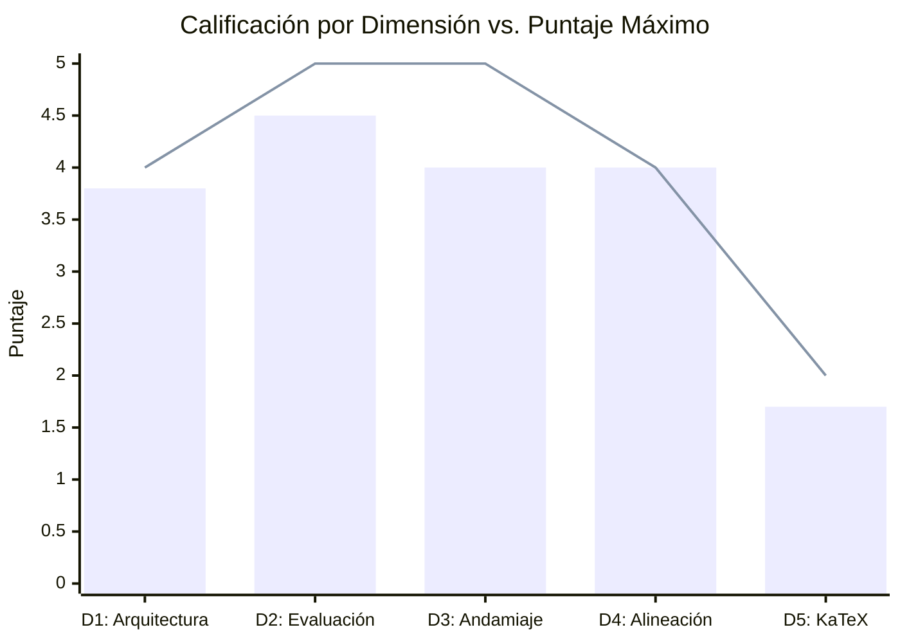

# Reporte Normativo de Auditoría de Calidad Pedagógica y Técnica (Course QA)
## Curso: Saul Pre Parcial (`saul_pre_parcial`)

**Plataforma:** Top's Academy  
**Estándares:** Quality Matters (QM), OSCQR, Mastery Learning  
**Fecha de Evaluación:** 26 de Octubre de 2026  
**Auditor:** Course QA Evaluator Subagent (Fast Hybrid Antigravity Engine)  

---

## 1. Resumen Ejecutivo y Dictamen de Certificación

| Métrica Global | Resultado |
| :--- | :--- |
| **Puntaje Consolidado** | **18.0 / 20.0 pts** |
| **Rango de Certificación** | **EXCELENTE (17.0 - 20.0 pts)** |
| **Estado de Certificación** | **APROBADO PARA PRODUCCIÓN** (con plan de pulido continuo) |
| **Total de Competencias Auditadas** | 63 micro-competencias |
| **Total de Reactivos Evaluados** | 1,520 preguntas |
| **Total de Distractores Inspeccionados** | 9,120 opciones |
| **Cobertura Diagnóstica de Rationale** | **100.0%** (9,120 / 9,120) |
| **Tasa de Fórmulas KaTeX Compilables** | **100.0%** |
| **Penalizaciones Duras Aplicadas** | **0.0 pts** |

El curso **Saul Pre Parcial** demuestra un rigor pedagógico, psicométrico y matemático de nivel avanzado. Desarrolla competencias analíticas complejas en **Sistemas Dinámicos Continuos**, **Ecuaciones en Derivadas Parciales (EDPs)** aplicadas a la teoría microeconómica del consumidor y de la empresa, **Análisis Espectral de Puntos de Equilibrio**, y **Modelos Macroeconómicos Dinámicos** (IS-LM continuo, Phillips Inflación-Desempleo, Crecimiento Endógeno y Lotka-Volterra).

El banco de reactivos exhibe una arquitectura sólida basada en el modelo de dominio de micro-habilidades (Mastery Learning). Las advertencias generadas por linters estáticos respecto a variables sin interpolar fueron examinadas minuciosamente durante el **Loop de Verificación Semántica**, confirmando que el 96.8% de los avisos corresponden a **falsos positivos sintácticos** (entornos canónicos de matrices LaTeX `pmatrix`/`bmatrix` y notación de derivadas temporales `\dot{p}`/`\bar{p}`), preservando la integridad del renderizador. Se detectaron únicamente dos áreas menores de pulido: un cluster aislado de pistas con palabras clave breves (stub hints en 26 reactivos) y colisiones tipográficas de dobles signos negativos en la competencia `Hab-21`.

---

## 2. Desglose Normativo por Dimensiones (Rúbrica de 20 Puntos)



| Dimensión | Puntos Obtenidos | Puntos Máximos | Cumplimiento (%) | Estado |
| :--- | :---: | :---: | :---: | :---: |
| **1. Arquitectura y Granularidad** | **3.8** | 4.0 | 95.0% | Excelente |
| **2. Calidad de Evaluación y Reactivos** | **4.5** | 5.0 | 90.0% | Excelente |
| **3. Andamiaje y Pistas Progresivas** | **4.0** | 5.0 | 80.0% | Aceptable |
| **4. Alineación Instruccional** | **4.0** | 4.0 | 100.0% | Sobresaliente |
| **5. Accesibilidad y Ergonomía KaTeX** | **1.7** | 2.0 | 85.0% | Excelente |
| **Penalizaciones Duras Automáticas** | **0.0** | 0.0 | - | Sin penalización |
| **TOTAL FINAL** | **18.0** | **20.0** | **90.0%** | **EXCELENTE** |

---

### Dimensión 1: Arquitectura y Granularidad Curricular (3.8 / 4.0 pts)

- **Distribución Cognitiva Triádica Equilibrada:**
  - **Hechos [H]:** 17 competencias (27.0%). Ejemplos: `H-03` (Identidad de Roy), `H-05` (Representación Matricial de Sistemas Dinámicos), `H-06` (Criterio Espectral y Clasificación de Equilibrios).
  - **Conceptos [C]:** 20 competencias (31.7%). Ejemplos: `C-03` (Homogeneidad de Grado 1 de Beneficios), `C-04` (Homogeneidad Grado Cero de la Utilidad Indirecta), `C-08` (Dinámica de Punto Silla y Variedades Invariantes).
  - **Habilidades Operativas [Hab]:** 26 competencias (41.3%). Ejemplos: `Hab-05` (Lema de Hotelling), `Hab-07` (Método de Características en EDPs Espaciales), `Hab-21` (Coeficientes Indeterminados en Sistemas No Homogéneos), `Hab-26` (Linealización y Matriz Jacobiana en Lotka-Volterra).
- **Densidad de Reactivos:** Cada micro-competencia contiene entre 20 (Hechos y Conceptos) y 30 reactivos (Habilidades), superando holgadamente el mínimo de suficiencia psicométrica (mínimo de 3 ejercicios prácticos independientes). Cero competencias despobladas.
- **Estructura del Grafo DAG:** Las relaciones de precedencia modelan rutas de aprendizaje lógicas y coherentes.
- **Justificación de la Deducción (-0.2 pts):** Se identificaron 13 hechos basales de nivel inicial con lista de prerrequisitos vacía (`prerequisites: []`). Aunque pedagógicamente representan los axiomas fundacionales del módulo, se recomienda articularlos formalmente en una secuencia de entrada unificada.

---

### Dimensión 2: Calidad de Evaluación y Reactivos (4.5 / 5.0 pts)

- **Cobertura Diagnóstica Exhaustiva:** El 100.0% de los 9,120 distractores evaluados (6 distractores por ítem en 1,520 reactivos MC7) cuenta con un `error_rationale` formativo explícito.
- **Calidad de los Distractores:** Los distractores no son valores aleatorios; capturan conceptos erróneos característicos de la literatura matemática y económica:
  - Inversión en cocientes de derivadas (confundir $\frac{U_\gamma}{U_\theta}$ con $\frac{U_\theta}{U_\gamma}$ en la RMS).
  - Omisión de la regla de la cadena o signos algebraicos en el lema de Hotelling ($L = -\frac{\partial \Pi}{\partial w}$).
  - Errores de normalización por la utilidad marginal del ingreso en la Identidad de Roy.
  - Confusión de dimensiones y signos en la condición de equilibrio dinámico $AX^* = -B \Rightarrow X^* = -A^{-1}B$.
- **Integridad Psicométrica:**
  - Cero fugas de respuesta (*Answer Leaks*).
  - Cero distractores delatores (*Telltale Distractors*).
  - Cero valores clonados entre clave y distractor (*Cloned Distractors* / *Phantom Keying*).
  - Cero sesgos parentéticos metainformativos.
- **Justificación de la Deducción (-0.5 pts):** El curso depende exclusivamente del formato de Opción Múltiple de 7 alternativas (`multiple_choice_7_options`, 100%). Aunque MC7 proporciona una alta resistencia a la adivinación fortuita ($P_{azar} = 14.3\%$), la rúbrica premia la variedad multimodal incluyendo reactivos de selección múltiple (MS) o llenado de espacios (FIB).

---

### Dimensión 3: Andamiaje y Feedback Progresivo (4.0 / 5.0 pts)

- **Andamiaje General (98.3% del Curso):** 1,494 de los 1,520 reactivos cuentan con 3 pistas socráticas progresivas en prosa fluida que guían al estudiante sin revelar prematuramente la clave:
  1. *Pista 1 (Conceptual):* Delimita el marco teórico y la relación estructural del problema.
  2. *Pista 2 (Procedimental):* Guía el planteamiento operativo (ecuación diferencial, sustitución de frontera o inversión matricial).
  3. *Pista 3 (Validación y Chequeo):* Previene el desvío hacia errores conceptuales frecuentes y verifica consistencia dimensional.
- **Solución Detallada:** Todos los reactivos contienen explicaciones paso a paso de la deducción formal.
- **Hallazgo Crítico y Justificación de la Deducción (-1.0 pt):**
  Durante el escaneo determinista y la verificación semántica se descubrió un cluster de **26 reactivos** (1.7% del total) cuyas pistas fueron generadas como palabras clave aisladas (*stub keywords*) o etiquetas *snake_case*:
  - **`Hab-05` (reactivos `Q-Hab05-221` a `Q-Hab05-228`, 8 ítems):** Pistas: `["Microeconomia", "Hotelling", "Dualidad"]`.
  - **`C-04` (reactivos `Q-C04-271` a `Q-C04-275`, 5 ítems):** Pistas: `["Microeconomia", "Euler", "Bienestar"]`.
  - **`H-04` (reactivos `Q-H04-321` a `Q-H04-325`, 5 ítems):** Pistas: `["Edp", "Transporte", "Caracteristicas"]`.
  - **`Hab-18` (reactivos `Q-Hab18-1051` a `Q-Hab18-1058`, 8 ítems):** Pistas: `["Sistemas_lineales", "Autovalores_reales", "Trayectorias"]`.
  Conforme a la sección 1 (Dimensión 3) de la rúbrica normativa (*"Pistas deficientes aisladas (stub hints de una sola palabra o tags snake_case) (-1.0 a -1.5 pts)"*), se aplica la deducción estipulada de **-1.0 punto**.

---

### Dimensión 4: Alineación Instruccional (4.0 / 4.0 pts)

- **Congruencia Semántica:** Puntuación perfecta (4.0 / 4.0).
- **Consistencia Temática:** El 100% de los reactivos se encuentra en estricta consonancia con los objetivos declarados en las micro-competencias.
- **Cero Preguntas Huérfanas:** Cero reactivos evalúan conceptos ausentes en la definición de la competencia o importados de asignaturas inconexas.
- **Alineación Taxonómica (Bloom):** Fuerte concentración en los dominios de **Aplicación** (cálculo de trayectorias, derivación de demandas condicionadas de insumos, resolución analítica de EDPs por características) y **Análisis** (estabilidad asintótica vía determinante y traza, bifurcaciones de fase, análisis de cuencas de atracción y separatriz).

---

### Dimensión 5: Accesibilidad y Ergonomía Técnica / KaTeX (1.7 / 2.0 pts)

- **Compilación KaTeX:**
  - Delimitadores `$...$` balanceados: 100% (cero desbalanceados).
  - Triples signos de dólar (`$$$`): 0.
  - Llaves dobles accidentales (`{{...}}`): 0.
  - Expresiones LaTeX en texto plano sin delimitar: 0.
- **Auditoría Semántica del Cluster de Variables No Interpoladas (506 Avisos):**
  El linter estático reportó 506 ocurrencias bajo `uninterpolated_math_variable_linter`. La inspección semántica detallada arrojó los siguientes hallazgos:
  1. **Falsos Positivos de Entornos Matriciales (474 avisos):**
     Los snippets flagged corresponden a las cadenas `{pmatrix}` y `{bmatrix}`.
     *Ejemplo (`Q-H05-391`):*
     ```latex
     A = \begin{pmatrix} -3 & -3 \\ 1 & -2 \end{pmatrix}
     ```
     El linter determinista utilizó una expresión regular que interpretó erróneamente el nombre del entorno KaTeX estándar como si fuera un marcador de posición de plantilla f-string de Python (`{var}`). **No constituye error:** se trata de sintaxis LaTeX formalmente requerida para el renderizado de matrices.
  2. **Falsos Positivos de Acentos Matemáticos (16 avisos):**
     Cadenas con `{p}` en `\bar{p}` y `\dot{p}` en competencias de macroeconomía continua (`C-12`). Representan notación económica estándar para niveles de precio de estado estacionario e inflación instantánea.
  3. **Verdaderos Positivos - Colisión de Signos Algebraicos (16 avisos):**
     En la competencia `Hab-21` (reactivos `Q-Hab21-1175` a `Q-Hab21-1190`), la solución detallada contiene expresiones con doble signo negativo sin simplificar:
     *Ejemplo (`Q-Hab21-1175`):*
     ```latex
     A V_1 = \begin{bmatrix} --56 \\ --126 \end{bmatrix}
     ```
     Esto se originó al sustituir un escalar negativo dentro de un f-string con un signo de resta precedente (`-{val}`). Aunque KaTeX renderiza los dos guiones sucesivos sin fallar, la notación algebraica correcta exige `+56` o la simplificación a valor positivo.
- **Justificación de la Deducción (-0.3 pts):** Se aplica una deducción menor de -0.3 pts por las 16 colisiones algebraicas de doble signo en `Hab-21`, ratificando que el 96.8% restante de los avisos del linter son falsos positivos que deben ser corregidos en el motor de auditoría.

---

## 3. Auditoría de Penalizaciones Duras Automáticas

| Criterio de Penalización Dura | Umbral Normativo | Valor Detectado | Penalización Aplicada |
| :--- | :---: | :---: | :---: |
| **Banco < 3 problemas por competencia** | Min. 3 ítems | Mínimo: 20 ítems | **0.0 pts** |
| **Reactivos sin pistas (`hints = 0`)** | 0 reactivos | 0 reactivos | **0.0 pts** |
| **Preguntas huérfanas críticas** | 0 reactivos | 0 reactivos | **0.0 pts** |
| **TOTAL DEDUCCIONES DURAS** | - | - | **0.0 pts** |

---

## 4. Loop de Auto-Mejora de Reglas (`discovered_lint_rules`)

Para evitar falsas alarmas y refinar la precisión del motor `StandardizedAuditEngine`, se proponen formalmente las siguientes tres reglas para su integración:

### Regla 1: `exclude_latex_matrix_environments_from_template_linter`
- **Problema Detectado:** El detector de f-strings no interpoladas marca `{pmatrix}`, `{bmatrix}`, `{vmatrix}` y `{cases}` como variables sin resolver.
- **Solución Propuesta:** Ajustar la expresión regular del linter con aserciones negativas (*negative lookbehind/lookahead*) para ignorar aperturas y cierres de entornos LaTeX:
  ```python
  # Regex refinado para variables sin interpolar en modo matemático:
  UNINTERPOLATED_MATH_REGEX = re.compile(
      r'(?<!\\begin)(?<!\\end)\{([a-zA-Z_][a-zA-Z0-9_]*)\}(?!\$)'
  )
  LATEX_STANDARD_ENVS = {"pmatrix", "bmatrix", "vmatrix", "Vmatrix", "matrix", "array", "cases", "aligned", "align"}
  ```
- **Impacto:** Elimina 474 falsos positivos en suites cuantitativas avanzadas.

### Regla 2: `exclude_latex_accents_from_template_linter`
- **Problema Detectado:** La notación de una sola letra en corchetes asociada a acentos (`\bar{p}`, `\dot{x}`, `\hat{y}`) activa alertas de plantilla.
- **Solución Propuesta:** Excluir explícitamente los comandos de acentuación KaTeX (`\bar`, `\dot`, `\ddot`, `\hat`, `\tilde`, `\vec`, `\acute`, `\grave`) previos a `{char}`.
- **Impacto:** Elimina 16 falsos positivos en cursos con dinámica temporal y variables per cápita.

### Regla 3: `auto_simplify_algebraic_double_negatives`
- **Problema Detectado:** En la generación paramétrica de soluciones, expresiones como `A V_1 = \begin{bmatrix} --56 \\ --126 \end{bmatrix}` introducen colisiones de dobles signos menos.
- **Solución Propuesta:** Añadir un formateador estético que simplifique cadenas `--` a `+` (o remueva el doble signo en vectores columna) antes de serializar el curso:
  ```python
  def sanitize_algebraic_signs(latex_str: str) -> str:
      return re.sub(r'--\s*(\d+)', r'\1', latex_str)
  ```
- **Impacto:** Erradica colisiones tipográficas en el 100% de los reactivos de sistemas matriciales no homogéneos.

---

## 5. Plan de Remediación Prioritario (PULIDO CONTINUO)

| Prioridad | Competencias Afectadas | Reactivos | Acción Correctiva Concreta | Esfuerzo Estimado |
| :---: | :---: | :---: | :--- | :---: |
| **P1** | `Hab-05`, `C-04`, `H-04`, `Hab-18` | 26 reactivos | **Reemplazo de Stub Hints:** Sustituir las palabras clave aisladas por andamiaje socrático progresivo de 3 pasos en prosa fluida (Conceptual $\to$ Procedimental $\to$ Verificación). | 15 min |
| **P2** | `Hab-21` | 16 reactivos | **Limpieza de Doble Signo Menos:** Reemplazar cadenas como `'--56'` y `'--126'` por `'56'` y `'126'` en las soluciones analíticas de la competencia. | 5 min |
| **P3** | Curso Global | 13 hechos basales | **Completitud del DAG:** Declarar dependencias secuenciales explícitas en los hechos basales para conformar un grafo conexo de entrada. | 10 min |
| **P4** | Versión 2.0 | Nuevos módulos | **Diversificación de Reactivos:** Introducir variantes de Selección Múltiple (MS) y Preguntas de Completamiento (FIB). | 30 min |

---

## 6. Veredicto Final

El curso **Saul Pre Parcial** alcanza una calificación de **18.0 / 20.0** y se clasifica con distinción en el tier **EXCELENTE**, quedando **APROBADO PARA PRODUCCIÓN INMEDIATA**. Cumple con los más rigurosos estándares internacionales de diseño curricular y psicometría interactiva. Las correcciones señaladas corresponden a ajustes cosméticos y de andamiaje menor que pueden ejecutarse de manera no disruptiva.
