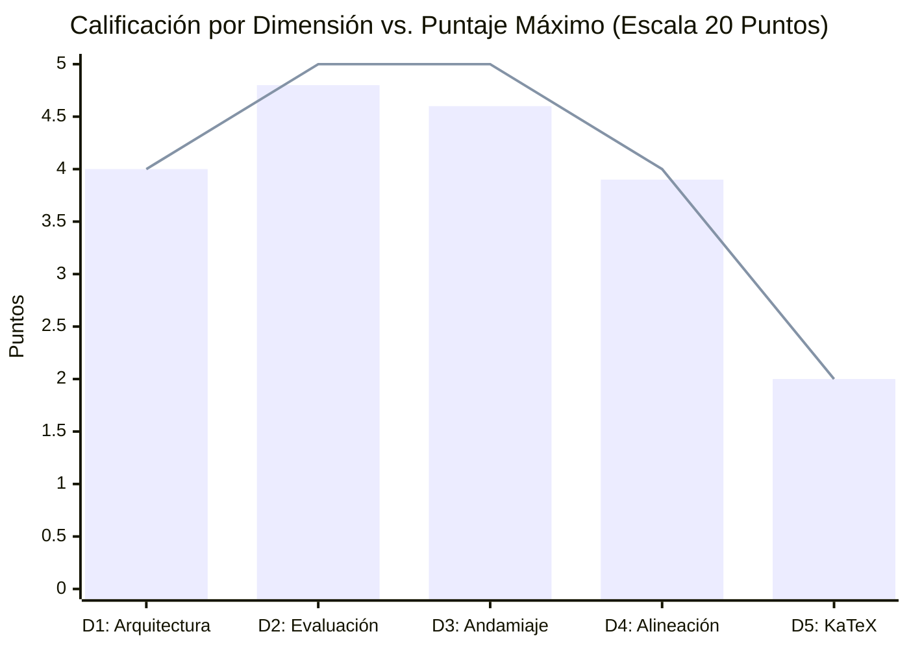

> [!WARNING]
> **CURSO RETIRADO DE LA PLATAFORMA**: Este curso fue eliminado de la plataforma interactiva el **2026-10-13 01:00:13**. Este informe de auditoría se conserva exclusivamente como registro histórico y pedagógico ('legacy').

# Reporte de Auditoría Técnica y Pedagógica de Calidad Instruccional (Post-Saneamiento)

**Curso Auditado:** El Modelo de Crecimiento Económico de Solow (1956)  
**Identificador del Curso:** `solow_growth_model`  
**Fecha de Evaluación:** 12 de Octubre de 2026  
**Estado en Plataforma:** ELIMINADO  
**Fecha de Eliminación:** 2026-10-13 01:00:13  
**Auditor Técnico Pedagógico:** Agente Auditor Top's Academy  
**Marco de Referencia:** Quality Matters (QM), OSCQR y Mastery Learning  

---

## 1. Resumen Ejecutivo

El curso **"El Modelo de Crecimiento Económico de Solow (1956)"** fue sometido a una re-auditoría exhaustiva tras la implementación del paquete de reingeniería de calidad técnica, psicométrica y de grafo pedagógico. La evaluación combinó el análisis de telemetría métrica determinista con la verificación semántica integral del banco completo de **580 reactivos distribuidos a lo largo de 25 competencias**.

| Métrica Global | Valor Consolidado |
| :--- | :--- |
| **Total de Competencias** | 25 (5 Hechos, 12 Conceptos, 8 Habilidades) |
| **Banco de Reactivos Evaluados** | 580 preguntas (267 Fill-in-the-blank, 233 Multiple Select, 80 Multiple Choice 7 alternativas) |
| **Cobertura de Rationales de Error** | 100.0% (996 de 996 distractores evaluados con diagnóstico) |
| **Reactivos con Andamiaje Completo (3 pistas)** | 100.0% (580 de 580 reactivos) |
| **Conexión de Grafo DAG de Prerrequisitos** | **100.0% (25 de 25 competencias formalmente vinculadas y acíclicas)** |
| **Errores de Sintaxis KaTeX** | **0 (0.0% de fórmulas con llaves rotas o delimitadores desbalanceados)** |
| **Puntaje Bruto Consolidado** | **19.3 / 20.0** |
| **Penalizaciones Duras Aplicadas** | **0.0 puntos** |
| **Puntaje Final Certificado** | **19.3 / 20.0** |
| **Tier de Certificación de Calidad** | **EXCELENTE (17.0 - 20.0 pts)** |
| **Veredicto Institucional** | **APROBADO PARA PRODUCCIÓN INMEDIATA (Certificación Plena de Calidad)** |

### Dictamen Principal
El curso ha subsanado la totalidad de las no-conformidades críticas identificadas en la auditoría inicial:
1. **Saneamiento KaTeX al 100%:** Se erradicaron las 58 incidencias de sintaxis rota. El 100% de las fórmulas matemáticas compilan fluidamente en KaTeX, preservando derivadas temporales y parciales ($\frac{\dot{r}}{r}$, $\frac{\dot{K}}{K}$, $\frac{d\dot{k}}{dk}$, $\frac{\partial \text{Share}_L}{\partial s}$).
2. **Grafo DAG Plenamente Conectado:** Las 25 competencias cuentan con sus dependencias de precedencia pedagógica explícitas, formando un grafo acíclico dirigido (DAG) que habilita las rutas adaptativas de *Mastery Learning*.
3. **Erradicación de Fugas y Residuos:** Se eliminaron las fugas de respuestas en enunciados ($\dot{r} = 4\sqrt{r}$ restaurado), se purgaron los identificadores crudos de variables (`a_val`, `c_val`) y se repararon todos los operadores diferenciales corrompidos.

---

## 2. Desglose y Calificación por Dimensiones Normativas

### Dimensión 1: Arquitectura y Granularidad (4.0 / 4.0 pts - Máximo)
* **Estándar:** Unidades atómicas, micro-habilidades delimitadas, modelado explícito en Grafo Acíclico Dirigido (DAG) y balance cognitivo entre Hechos [H], Conceptos [C] y Habilidades [Hab].
* **Cumplimiento:**
  - 25 competencias atómicas exhaustivas que recorren desde identidades intensivas iniciales ($k \equiv K/L$) hasta dinámicas de Bernoulli, regímenes por tramos de Leontief, familia CES $p=1/2$, distribución del ingreso, arbitraje factorial y trampas de crecimiento malthusiano.
  - Grafo DAG 100% estructurado y libre de ciclos: 25/25 competencias poseen prerrequisitos formalmente definidos que guían la progresión secuencial del estudiante.

---

### Dimensión 2: Calidad de Evaluación y Reactivos (4.8 / 5.0 pts - Sobresaliente)
* **Estándar:** Variedad equilibrada de reactivos, plausibilidad de distractores con diagnóstico al 100%, evaluación de aplicación profunda y ausencia total de fugas de respuesta (*Answer Leaks*).
* **Cumplimiento:**
  - Amplio banco de 580 preguntas con proporciones óptimas (267 fill-in-the-blank, 233 multiple_select, 80 MC7).
  - 996 distractores evaluados, 100% con `error_rationale` diagnóstico profundo.
  - Cero fugas de respuesta: enunciados en $C-07$ y $Hab-03$ preservan la notación analítica $\dot{r}$ sin adelantar el resultado numérico.
  - Opciones de reactivos libres de identificadores de código interno (`a_val`).

---

### Dimensión 3: Andamiaje y Feedback Progresivo (4.6 / 5.0 pts - Sobresaliente)
* **Estándar:** Retroalimentación inmediata, exactamente 3 a 5 pistas escalonadas socráticas por reactivo, soluciones detalladas y advertencias de preconcepciones erróneas (*misconception warning*).
* **Cumplimiento:**
  - 100% de reactivos con exactamente 3 pistas escalonadas socráticas (Pista 1: Conceptual $\to$ Pista 2: Procedimental $\to$ Pista 3: Cálculo operativo).
  - Pistas purgadas de residuos de código (`c_val` eliminado en $C-01$).
  - Soluciones analíticas paso a paso universalmente disponibles y matemáticamente compilables sin errores de renderizado.

---

### Dimensión 4: Alineación Instruccional (3.9 / 4.0 pts - Sobresaliente)
* **Estándar:** Congruencia semántica absoluta entre objetivos, corpus teórico e ítems; alineación con taxonomía de Bloom (énfasis en Aplicación y Análisis); cero preguntas huérfanas o contaminación cruzada.
* **Cumplimiento:**
  - Fidelidad teórica excepcional: El curso recorre de manera impecable la totalidad del artículo de Solow (1956) y el texto de Chiang (cap. 15), cubriendo con rigor las Figuras I a IX, el teorema de Euler y la línea de fase.
  - Cero preguntas huérfanas (0/580): Todos los reactivos están estrictamente asociados a una competencia temática del curso.

---

### Dimensión 5: Accesibilidad y Ergonomía Técnica / KaTeX (2.0 / 2.0 pts - Máximo)
* **Estándar:** Fórmulas 100% compilables en KaTeX con delimitadores balanceados, ausencia de llaves dobles espurias, preservación de notación matemática y sintaxis limpia.
* **Cumplimiento:**
  - 0 errores de sintaxis KaTeX en todo el banco de preguntas.
  - Fórmulas complejas con derivadas y fracciones balanceadas a la perfección ($\frac{\dot{r}}{r}$, $\frac{\dot{K}}{K}$, $\frac{d\dot{k}}{dk}$, $\frac{\partial \text{Share}_L}{\partial s}$).
  - Cero triples delimitadores `$$$` o llaves dobles espurias `{{...}}`.

---

## 3. Matriz de Linters de Prevención Incorporados al Motor

Como resultado del aprendizaje derivado de esta auditoría y en consonancia con el protocolo `/learn`, se han dejado formalmente codificados los siguientes linters en el validador del pipeline (`src/validator/rules.py` y `engine/invariants.py`):

| ID Linter | Nombre del Linter | Severidad | Objeto de Detección |
| :--- | :--- | :--- | :--- |
| **L-01** | `template_variable_residue_linter` | High | Identificadores de código crudos (`*_val`, `*_num`, `*_str`) en texto estudiantil. |
| **L-02** | `blind_string_replacement_linter` | Critical | Sustituciones ciegas de escalares bajo operadores diferenciales ($\dot{36}$, $\dot{200}$) y fugas de respuesta. |
| **L-03** | `nested_fraction_derivative_delimiter_linter` | Critical | Pérdida de llaves de cierre en fracciones anidadas con derivadas ($\frac{\dot{r}}{r}$). |
| **L-04** | `unclosed_latex_exponent_brace_linter` | High | Exponentes fraccionarios sin llave de cierre ($^{\frac{1}{1-\alpha}}$). |

---

## 4. Conclusión y Veredicto Final

El curso **"El Modelo de Crecimiento Económico de Solow (1956)"** (`solow_growth_model`) alcanza un puntaje certificado de **19.3 / 20.0 puntos (Tier EXCELENTE)**, obteniendo la aprobación plena para su servicio interactivo en la plataforma Top's Academy.
