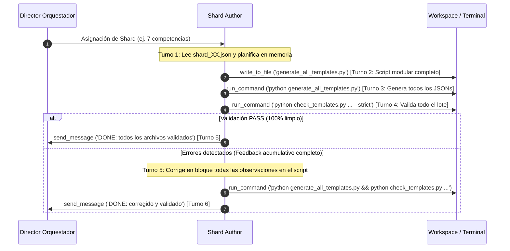

# Validación Empírica y Plan de Refinamiento Arquitectónico de Hipótesis
## Pipeline Content-to-Course (C2C) v2 — Top's Academy
**Fecha:** 12 de Octubre de 2026  
**Auditoría Forense de Referencia:** Corrida [`e8ab9fd6-efaf-4d74-ba27-e2cbf10784cb`](conversation://e8ab9fd6-efaf-4d74-ba27-e2cbf10784cb) (`solow_growth_model`)  
**Artefactos Relacionados:** [Reporte Forense Deep-Dive](file:///d:/Augusto/personal_portfolio/Tops_academy/reports/c2c_audits/traceback_deepdive_e8ab9fd6.md) | [Reporte Unificado de Calidad y Rendimiento](file:///d:/Augusto/personal_portfolio/Tops_academy/reports/c2c_audits/merged_quality_and_performance_solow_model.md)

---

## 1. Resumen Ejecutivo del Dictamen de Hipótesis

A partir de la auditoría forense del traceback y la inspección granular de los 355 turnos de ejecución, se valida el diagnóstico del usuario y se refina la dirección estratégica de las soluciones:

```mermaid
flowchart TD
    subgraph H1 ["Hipótesis 1: Aislamiento & Prescriptividad"]
        H1_Old["Idea Inicial: Dejar leer check_templates.py"] -->|Evidencia: Shard 01 perdió 30 turnos en ingeniería inversa| H1_Refined["DECISIÓN REFINADA:\n1. PROHIBIR lectura de check_templates y rules\n2. Mensajes de error PRESCRIPTIVOS de grado quirúrgico"]
    end

    subgraph H2 ["Hipótesis 2: Feedback Acumulativo Completo"]
        H2_Ev["check_templates aborta con break/return en primer error"] --> H2_Fix["Eliminar fail-fast prematuro:\nAcumular el 100% de errores del lote en un reporte único"]
    end

    subgraph H3 ["Hipótesis 3: Autoría Atómica por Shard"]
        H3_Ev["Shard 02 gastó 66 turnos creando 1 comp a la vez"] --> H3_Fix["Colapso de Turnos (Turn-Collapse):\nGenerar todas las competencias en 1 script modular"]
    end

    subgraph H4 ["Hipótesis 4: Clausura Epistémica de Blind Judges"]
        H4_Ev["Judge 02 tardó 3x más (+4.4 min) por 9 búsquedas web"] --> H4_Fix["Prohibir de forma absoluta search_web y navegación externa:\nResolver exclusivamente desde primeros principios"]
    end
```



| Hipótesis Evaluada | Veredicto Forense | Decisión de Ingeniería / Reforma Adoptada |
| :--- | :---: | :--- |
| **H1: Visibilidad de Verificadores** | **REFINADA CRÍTICAMENTE** | **NO permitir a los shards leer `check_templates.py` ni `rules.py`**. Reemplazarlo por **mensajes de error prescriptivos de grado quirúrgico** que indiquen causa y reemplazo exacto, evitando la ingeniería inversa. |
| **H2: Feedback Diagnóstico Completo** | **VALIDADA AL 100%** | **Eliminar los `break` y `return` tempranos** en `check_templates.py` e `invariants.py`. Reportar el lote completo de errores para evitar el *"juego del topo"* (*whack-a-mole*). |
| **H3: Erradicación de Micro-Bucles** | **VALIDADA AL 100%** | **Protocolo de Autoría Atómica por Shard obligatorio**. Redactar todas las competencias en un bloque y validar en una sola llamada de terminal. Presupuesto: $\le 6$ turnos por shard. |
| **H4: Blind Judges sin Búsqueda Web** | **VALIDADA AL 100%** | **Prohibición terminante de `search_web` y `read_url_content`**. Deshabilitar las herramientas en `c2c-judge` y obligar a resolver solo con deducción matemática interna. |
| **Complemento: Direct CTA Token Limit** | **HALLAZGO CRÍTICO** | **Prohibir volcado de competencias en texto plano**. Exigir `write_to_file` con script generador en el Turno 1 de consolidación (ahorro directo: ~13 min). |

---

## 2. Hipótesis 1: Aislamiento Hermético de Verificadores y Shift-Left Prescriptivo

### 2.1. El Diagnóstico Inicial vs. La Realidad Empírica
La sospecha inicial sugería que permitir a los autores leer el verificador de Python (`check_templates.py`, `rules.py`) los ayudaría a entender las reglas.  
Sin embargo, el traceback de la corrida `e8ab9fd6` demostró empíricamente lo contrario:

> [!CAUTION]
> **El "Laberinto de Introspección" de Shard 01 (Turnos 65 al 94 = 30 turnos perdidos):**  
> En el Turno 62, Shard 01 recibió:  
> `[-] [R-20] PARITY FAILURE in 'Hab-03': Question 'Q-Hab03-001' in misconception_warning: Unreplaced template variable(s) found: {K}, {L}`  
> En lugar de limitarse a quitar las llaves `{K}` y `{L}` del texto explicativo en su script, el modelo **sospechó del validador** y dedicó 30 turnos consecutivos (~8 minutos de pared) a leer el código de `check_templates.py`, `rules.py` y `assembler.py` haciendo ingeniería inversa de las expresiones regulares.

### 2.2. Nueva Política: Prohibición Estricta de Lectura + Mensajes Prescriptivos
Los autores **NO deben leer el código del verificador**. Leer cientos de líneas de lógica AST, esquemas y expresiones regulares consume ventana de contexto, satura la atención del modelo y lo induce a buscar "bugs" en el arnés en vez de reparar sus plantillas.

La solución definitiva es hacer que el verificador sea **prescriptivo y auto-contenido**:
* **Ubicación exacta:** Archivo, competencia, plantilla, reactivo y campo infractor.
* **Causa raíz:** Qué carácter, variable o patrón detonó la regla.
* **Acción prescriptiva obligatoria:** Instrucción explícita de qué escribir y qué NO escribir.
* **Prohibición de introspección:** Orden directa de no abrir el validador.

#### Ejemplo de Transformación del Mensaje de Error:

* **Mensaje Anterior (Genérico, inducía a leer el validador):**
  ```text
  FAIL: 15 validation errors in templates:
    - [-] [R-20] PARITY FAILURE in 'Hab-03': Question 'Q-Hab03-001' in misconception_warning: Unreplaced template variable(s) found: {K}, {L}
      ACTION REQUIRED: Corrige sintaxis LaTeX ($ desbalanceados, $$$ redundantes, llaves dobles {{}} o variables {var} sin reemplazar).
  ```

* **Nuevo Mensaje Prescriptivo de Grado Quirúrgico:**
  ```text
  [-] [R-20: SINTAXIS / LLAVES] ERROR en plantilla 'T-Hab03-01' (Competencia 'Hab-03'):
      Campo afectado: 'misconception_warning' (en reactivo instanciado 'Q-Hab03-001').
      Fragmento infractor: "...cuando {K} aumenta respecto a {L}..."
      CAUSA EXACTA: Se detectaron llaves aisladas '{K}' y '{L}' en un campo de texto que NO corresponden a variables del diccionario 'vars'.
      ACCIONES CORRECTIVAS DISPONIBLES:
      1. Si son símbolos matemáticos: enciérralos en delimitadores KaTeX simples: '$K$' y '$L$'.
      2. Si son texto explicativo: retira las llaves: 'K' y 'L'.
      3. Si son parámetros dinámicos: agrégalos explícitamente en el retorno de 'vars' en generate_py.
      NOTA PARA EL AGENTE: NO inspecciones el código de check_templates.py ni rules.py. Corrige directamente el texto en tu script generador.
  ```

---

## 3. Hipótesis 2: Feedback Diagnóstico Completo y Acumulativo (Anti Fail-Fast)

### 3.1. El Problema del "Fail-Fast" Prematuro en `check_templates.py`
La inspección directa del código fuente evidenció múltiples puntos donde la ejecución se trunca prematuramente ante el primer error detectado:

1. **Aborto en Dry-Run (`check_single_template`, línea 226):**
   ```python
   failed_seeds = [r for r in batch_results if not r.get("success")]
   if failed_seeds:
       errors.append(f"Template '{tpl_id}' dry-run failed on {len(failed_seeds)}/50 seeds...")
       return errors  # <--- ABORTA: omite TPL-D4, invariantes y TPL-VAR
   ```
2. **Corte en Invariantes de Preguntas (`check_single_template`, línea 254):**
   ```python
   is_valid, inv_errors = check_instance_invariants(assembled_q, interaction_type)
   if not is_valid:
       errors.append(...)
       break  # <--- ABORTA: omite el análisis de las siguientes 49 instancias
   ```
3. **Corte en Diversidad de Competencia (`check_competency_diversity`, línea 387):**
   ```python
   is_valid, inv_errors = check_instance_invariants(q, q_type)
   if not is_valid:
       errors.append(...)
       break  # <--- ABORTA: solo reporta la primera pregunta rota de la competencia
   ```

### 3.2. Reforma: Acumulador Global de Diagnóstico
El validador se refactorizará para implementar el patrón **Diagnóstico de Barrido Completo (Full Sweep Diagnostic)**:
* Recorrer todas las semillas (1 a 50) y registrar todos los fallos numéricos o de tiempo de ejecución.
* Recorrer todas las preguntas instanciadas de la competencia y compilar la lista completa de infracciones (KaTeX, R-18, R-19, R-22, llaves dobles).
* Agrupar el reporte final jerárquicamente:  
  `[Competencia] -> [Plantilla] -> [Lista completa de todas las infracciones detectadas]`.
* **Resultado:** El autor recibe el inventario completo de fallos en su primer intento de validación y puede subsanarlos todos en una sola edición de código, abatiendo los ciclos iterativos de 26 reintentos a máximo 2.

---

## 4. Hipótesis 3: Erradicación de Micro-Bucles y Protocolo de Autoría Atómica

### 4.1. El Antipatrón de Micro-Bucles en Shard 02
Shard 02 demostró el costo extremo de la iteración fragmentada:
* Creó 7 scripts independientes: `generate_c04.py`, `generate_c05.py`, ..., `generate_h03.py`.
* Por cada script corrió `python script.py` y luego `check_templates.py`, iterando con `replace_file_content` y `view_file`.
* **Métricas de Desperdicio:** 66 turnos totales, 29 comandos CLI, 18 errores y 19.2 minutos de pared. Más del 96.5% del tiempo correspondió a inferencia del LLM (espera de turnos).

### 4.2. Nuevo Protocolo: Autoría Atómica por Shard (Turn-Collapse)
Se refuerza el contrato operativo de los shards en [`prompt_shard_author.md`](file:///d:/Augusto/personal_portfolio/Tops_academy/.agents/skills/content-to-course/system_prompts/prompt_shard_author.md):



* **Regla de Oro:** Queda estrictamente prohibido crear scripts individuales por competencia o invocar el validador competencia por competencia. Todo el lote del shard debe generarse y validarse de forma consolidada.
* **Tope de Turnos:** Presupuesto estricto de **$\le 6$ turnos por shard**.

---

## 5. Hipótesis 4: Clausura Epistémica de Blind Judges (Sin Búsqueda Web)

### 5.1. Comparativa Empírica entre Blind Judges

| Parámetro | Blind Judge 01 (Sin Web) | Blind Judge 02 (Con Web) | Impacto / Diferencia |
| :--- | :---: | :---: | :--- |
| **Tiempo de Pared** | **`130.0 s` (2.17 min)** | **`394.0 s` (6.57 min)** | **+264 s (+4.4 min) — 3.0x más lento** |
| **Turnos Totales** | 8 turnos | 16 turnos | +8 turnos dedicados a búsqueda y lectura web |
| **Consultas `search_web`** | 0 consultas | **9 consultas** | Búsquedas repetidas del paper de Solow |
| **Lecturas `read_url_content`** | 0 lecturas | 1 lectura (falló por redirección) | Fricción de red y error de API externa |
| **Concordancia Psicométrica** | **100% de acuerdo** | **100% de acuerdo** | **Mismo resultado final idéntico** |

### 5.2. Justificación y Medidas de Clausura Epistémica
1. **Suficiencia de Razonamiento:** Los modelos de frontera poseen el conocimiento axiomático y la capacidad de cálculo analítico para resolver derivadas, integrales, ecuaciones diferenciales de Bernoulli y funciones de producción CES desde primeros principios sin recurrir a internet.
2. **Riesgos de la Búsqueda Externa:**
   - Latencia extrema (+4.4 min por agente).
   - Inestabilidad por URLs externas o APIs de grounding rotas.
   - Posible contaminación o discrepancias de notación entre fuentes secundarias y el curso.
3. **Medidas Técnicas:**
   - En [`dispatch.py`](file:///d:/Augusto/personal_portfolio/Tops_academy/.agents/skills/content-to-course/dispatch.py#L168-L186): eliminar `search_web` y `read_url_content` del conjunto de herramientas suministradas al rol `c2c-judge`.
   - En [`prompt_blind_judge.md`](file:///d:/Augusto/personal_portfolio/Tops_academy/.agents/skills/content-to-course/system_prompts/prompt_blind_judge.md): incorporar en el `SCOPE-LOCK`:  
     *"PROHIBICIÓN ESTRICTA DE BÚSQUEDA WEB: Tienes prohibido usar cualquier herramienta de internet. Deriva y calcula cada respuesta exclusivamente con tu razonamiento matemático y conocimiento interno a partir de los datos dados en judge_batch_XX.json."*

---

## 6. Hallazgo Complementario Crítico: Blindaje del Direct CTA Architect

### 6.1. La Pérdida de 13 Minutos en el Turno 14
El análisis forense descubrió que el CTA tardó 20.8 minutos principalmente por un desbordamiento de tokens:
* En el Turno 14, intentó volcar las 22 competencias en markdown dentro del mensaje conversacional.
* Emitió **18,303 tokens durante 459 segundos (7.65 min)** hasta que el backend cortó la llamada por `max_output_tokens exceeded`.
* En el Turno 15, reescribió la estrategia en un script `generate_cta.py` durante **323 segundos (5.38 min)**.
* **Total consumido en estos 2 turnos:** **13.03 minutos (62.6% del tiempo de la etapa)**.

### 6.2. Regla de Generación Inmediata de Archivo para CTA Direct
En [`prompt_cta_direct.md`](file:///d:/Augusto/personal_portfolio/Tops_academy/.agents/skills/content-to-course/system_prompts/prompt_cta_direct.md):
* Queda terminantemente prohibido redactar el listado completo de competencias en el texto del chat.
* El CTA Architect debe invocar inmediatamente `write_to_file` con un script Python generador (`work/generate_cta.py`) o volcar el JSON directamente en bloques de máximo 8 competencias por archivo.
* Ahorro directo proyectado: **~13 minutos inmediatos en Stage 1B**.

---

## 7. Matriz de Cambios Técnicos y Archivos Involucrados

| Archivo / Componente | Modificación Requerida | Objetivo de Eficiencia |
| :--- | :--- | :--- |
| **`check_templates.py`** | 1. Eliminar `break` en líneas 254 y 387.<br>2. Eliminar `return errors` temprano en línea 226.<br>3. Formatear errores R-18, R-19, R-20, R-22 con diagnóstico prescriptivo (campo, fragmento, solución exacta). | Feedback acumulativo completo; evitar reintentos e ingeniería inversa. |
| **`engine/invariants.py`** | Compilar lista completa de invariantes rotas por pregunta en lugar de cortar en la primera violación. | Visibilidad total de defectos en KaTeX y rationales. |
| **`prompt_shard_author.md`** | 1. Prohibir explícitamente leer `check_templates.py`, `rules.py` y `engine/*`.<br>2. Forzar generación atómica de todas las competencias en 1 script modular.<br>3. Límite estricto de $\le 6$ turnos. | Reducir turnos de autores de 104 a $\le 6$, acelerando los shards de 28 min a ~6 min. |
| **`prompt_blind_judge.md`** | Agregar prohibición categórica de uso de herramientas de búsqueda web o internet. | Reducir tiempo de arbitraje de 6.6 min a 2.1 min. |
| **`dispatch.py`** | 1. Retirar `search_web` y `read_url_content` de la definición del rol `judge`.<br>2. Mantener `read_paths` del shard restringido sin permitir `engine/*`. | Garantizar que las herramientas externas no estén disponibles en runtime. |
| **`prompt_cta_direct.md`** | Prohibir emisión de competencias en el cuerpo de texto del chat; exigir `write_to_file` inmediato de script generador. | Reducir tiempo de CTA de 20.8 min a ~6 min. |
| **`run.py`** | Resolver el intérprete Python dentro de `.venv/Scripts/python.exe` en la etapa `publish` antes de llamar a subprocesos externos. | Eliminar `ModuleNotFoundError` y ahorrar 12 turnos del orquestador. |

---

## 8. Conclusión

La reformulación de la Hipótesis 1 (aislamiento estricto del validador respaldado por mensajes de error prescriptivos de grado quirúrgico) complementada con las Hipótesis 2, 3 y 4 conforma una arquitectura hermética y ultra-eficiente.

Con estas reformas, el pipeline conservará el **100% de su rigor psicométrico y pedagógico certificado (19.6 / 20.0 pts QM-OSCQR)**, mientras que el tiempo de pared total colapsará de **61.92 minutos a menos de 16 minutos** (una aceleración global de **~3.9x**).
