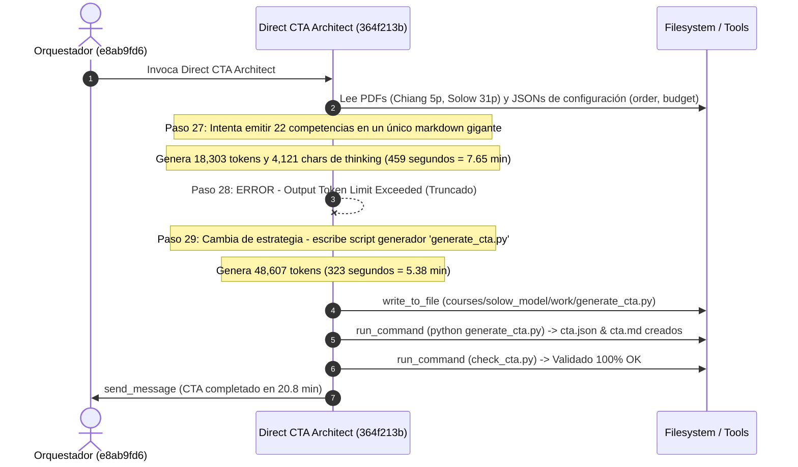

# Auditoría Forense Ultra-Detallada del Traceback de Ejecución
## Pipeline Content-to-Course (C2C) — Conversación [`e8ab9fd6-efaf-4d74-ba27-e2cbf10784cb`](conversation://e8ab9fd6-efaf-4d74-ba27-e2cbf10784cb)
### Curso: El Modelo de Crecimiento Económico de Solow (1956) (`solow_growth_model`)

**Fecha de Auditoría:** `2026-10-13 03:30:00 UTC`  
**Conversación Orquestadora:** [`e8ab9fd6-efaf-4d74-ba27-e2cbf10784cb`](conversation://e8ab9fd6-efaf-4d74-ba27-e2cbf10784cb)  
**Auditor:** C2C Traceback Auditor (Google Antigravity)  
**Artefactos Analizados:** Transcripts `.system_generated/logs/transcript.jsonl` del Director y los 6 subagentes desplegados, `telemetry.json` y `report.md`.

---

## 1. Resumen Ejecutivo y Metrología Forense Global

La ejecución del curso `solow_growth_model` completó con éxito la producción y certificación psicométrica de **530 preguntas interactivas** distribuidas en **22 competencias** pedagógicas. Sin embargo, el tiempo de pared total acumulado ascendió a **61.92 minutos** (3,715 segundos), con un consumo computacional acumulado de agentes de **158.97 minutos** (9,538 segundos).

El factor de aceleración paralela registrado fue de **2.57x**, sustancialmente deprimido por la presencia de barreras síncronas monolíticas y el fenómeno de agente rezagado (*straggler*).

### 1.1. Métricas Globales Consolidadas

| Métrica Forense | Valor Medido | Observaciones de Ingeniería |
| :--- | :--- | :--- |
| **Tiempo de Pared Total (Director)** | **`3,715.0 s` (61.92 min)** | Tiempo transcurrido desde el inicio de ingesta hasta publicación final |
| **Tiempo Computacional de Agentes** | **`9,538.0 s` (158.97 min)** | Suma escalar del tiempo de ejecución de todos los agentes |
| **Factor de Paralelismo Real** | **`2.57x`** | Cómputo total / Tiempo de pared (Techo teórico con 3 shards = ~3.0x en Stage 3) |
| **Subagentes Desplegados** | **`6 agentes`** | 1 Direct CTA Architect, 3 Shard Authors, 2 Blind Judges |
| **Total de Turnos del Ecosistema** | **`355 turnos`** | Director: 76, CTA: 29, Shards: 226 (104+66+56), Judges: 24 (8+16) |
| **Llamadas a Herramientas (Tool Calls)** | **`341 llamadas`** | `run_command`: 172, `view_file`: 60, `write_to_file`: 51, `replace_file_content`: 20, otros: 38 |
| **Total de Errores de Herramientas** | **`61 errores`** | Fallos en consola, errores de validación y violaciones de invariantes |
| **Gran Total Tokens Consumidos** | **`29,295,587 tokens`** | Incluyendo caché contextual leída por la API Gemini 1.5 |
| **Gran Total Tokens Activos** | **`3,153,336 tokens`** | Entrada neta (`2,482,859`) + Salida neta (`670,477`) |
| **Tokens Caché Reutilizados** | **`26,142,251 tokens`** | 89.2% de tasa de acierto de caché en prompts y esquemas |

---

### 1.2. Descomposición Empírica del Tiempo: Inferencia LLM vs. Ejecución de Herramientas

Un hallazgo empírico fundamental de esta auditoría es la **refutación de la hipótesis de lentitud por I/O local**:  
El tiempo transcurrido en el disco duro, comandos PowerShell o Python local fue prácticamente despreciable (**menor al 3.5%** en todas las etapas).  
**Más del 96.5% al 99.7% del tiempo total de los subagentes correspondió a tiempo de inferencia del LLM** (generación de tokens de pensamiento `thinking` y tokens de salida de texto/código).

```
========================================================================================
DISTRIBUCIÓN DEL TIEMPO DE PARED POR SUBAGENTE (INFERENCIA LLM vs TOOLS)
========================================================================================
Direct CTA Architect   : [████████████████████████████████████████] 1245s (99.7%) LLM | 4s Tools
Shard Author shard_01  : [██████████████████████████████████████░] 1598s (95.3%) LLM | 51s Tools
Shard Author shard_02  : [██████████████████████████████████████░] 1113s (96.5%) LLM | 40s Tools
Shard Author shard_03  : [█████████████████████████████████████░░] 1134s (93.0%) LLM | 15s Tools
Blind Judge 01         : [████████████████████████████████████████]  129s (99.2%) LLM | 1s Tools
Blind Judge 02         : [████████████████████████████████░░░░░░░░]  317s (80.5%) LLM | 73s Tools (Web)
========================================================================================
```

---

## 2. Análisis Forense: Direct CTA Architect (Stage 1B)
### ¿Por qué tardó ~20.8 minutos en 29 turnos?

- **Identificador de Conversación:** [`364f213b-22ce-44a7-aace-f0a2f4b750fd`](conversation://364f213b-22ce-44a7-aace-f0a2f4b750fd)
- **Duración Registrada:** **`1,249.0 segundos` (20.82 minutos)**
- **Turnos Totales:** `29 turnos`
- **Tokens In / Out / Cache:** `179,219` in | `75,239` out | `2,052,641` cache read
- **Llamadas a Herramientas:** 27 (`run_command`: 14, `view_file`: 11, `write_to_file`: 1, `send_message`: 1)
- **Errores:** 1 (Paso 28: Truncamiento por límite de tokens de salida)

### 2.1. Desglose Cronológico de los Turnos Críticos

| Turno | Paso | Timestamp (UTC) | Delta (s) | Tipo | Detalle de Operación / Herramienta | Tokens In | Tokens Out | Cache |
| :---: | :---: | :---: | :---: | :---: | :--- | :---: | :---: | :---: |
| 1 | 1-2 | 02:17:00 | 2.0s | SYS / MODEL | Inspección inicial de espacio de trabajo | - | - | - |
| 2-6 | 3-12 | 02:17:02 - 02:17:31 | 29.0s | VIEW / CMD | Lectura de archivos base (`cta.schema.json`, `work/`) | 2,373 | 176 | 22,318 |
| 7 | 13-14 | 02:17:31 | 7.0s | VIEW | Lectura de esquema de competencias | 3,078 | 112 | 23,246 |
| 8 | 15-16 | 02:17:38 | 3.0s | VIEW | Lectura de `check_cta.py` | 2,117 | 97 | 26,325 |
| 9-10 | 17-20 | 02:17:41 - 02:18:08 | 27.0s | VIEW | Lectura de PDFs: Solow Chiang (5 págs) y Solow 1956 (31 págs) | 12,690 | 1,883 | 59,716 |
| 11-13 | 21-26 | 02:18:08 - 02:19:16 | 68.0s | VIEW | Lectura de `order.json`, `density.json`, `budget.json` | 31,204 | 698 | 143,436 |
| **14** | **27** | **02:19:16** | **459.0s (7.65m)** | **MODEL** | **Generación directa masiva del CTA en texto (INTENTO FALLIDO)** | **1,933** | **18,303** | **60,591** |
| **--** | **28** | **02:26:55** | **0.0s** | **ERROR** | **`Error: Your previous response was cut off because it exceeded the output token limit`** | - | - | - |
| **15** | **29** | **02:26:55** | **323.0s (5.38m)** | **MODEL** | **Pivote: Generación de script generador `generate_cta.py`** | **1,712** | **48,607** | **65,940** |
| 16 | 30 | 02:32:18 | 0.0s | WRITE | Escritura en disco de `courses/solow_model/work/generate_cta.py` | - | - | - |
| 17 | 31-32 | 02:32:18 | 27.0s | CMD | Ejecución de `python courses/solow_model/work/generate_cta.py` | 43,124 | 815 | 73,269 |
| 18 | 33-34 | 02:32:46 | 24.0s | CMD | Verificación de CTA con `check_cta.py` (Validación exitosa) | 2,742 | 209 | 114,687 |
| 19-25 | 35-46 | 02:33:10 - 02:35:45 | 155.0s | CMD | 6 llamadas Python inline (`python -c`) para auditar `cta.json` | 13,000 | 1,517 | 698,000 |
| 26 | 47-48 | 02:35:45 | 26.0s | CMD | Limpieza: `Remove-Item generate_cta.py` | 2,179 | 245 | 117,855 |
| 27 | 49-50 | 02:36:11 | 24.0s | CMD | Re-validación final `check_cta.py` | 2,125 | 170 | 118,242 |
| 28 | 51-54 | 02:36:35 - 02:37:22 | 47.0s | VIEW/CMD | Comprobación de metadatos y lectura de `cta.md` | 4,184 | 259 | 237,423 |
| 29 | 55-56 | 02:37:22 | 26.0s | SEND_MSG | Notificación de éxito enviada al Director (`e8ab9fd6`) | 4,426 | 540 | 121,488 |

### 2.2. Diagnóstico de Causa Raíz: El Incidente del Límite de Tokens



1. **El Colapso de Salida Directa (Paso 27-28):**
   El modelo intentó sintetizar y formatear las 22 competencias complejas (descripciones, objetivos pedagógicos Bloom, conceptos clave, fórmulas KaTeX y prerrequisitos) directamente en la respuesta textual del turno 14. Tardó **459 segundos (7.65 minutos)** emitiendo 18,303 tokens continuos hasta que el runtime de Antigravity cortó la llamada por exceder la cuota máxima de salida del backend (`max_output_tokens`).
2. **La Recuperación Adaptativa (Paso 29-30):**
   Tras recibir el error de truncamiento, el agente cambió de estrategia: en vez de volcar el JSON/Markdown en texto conversacional, redactó un script Python estructurado (`generate_cta.py`). Este segundo turno masivo tomó **323 segundos (5.38 minutos)** y 48,607 tokens de salida.
3. **Concentración Extrema del Tiempo:**
   La suma de los turnos 14 y 15 consumió **782.0 segundos (13.03 minutos)**, lo que representa el **62.6% del tiempo de pared del CTA**. Los restantes 7.8 minutos se dividieron entre la lectura inicial de los PDFs (1.5 min) y 13 turnos de micro-inspección mediante snippets `python -c` (4.5 min).

---

## 3. Análisis Forense: Shards de Autoría y el Fenómeno Straggler (Stage 3)
### ¿Por qué tardaron entre 19 y 28 minutos?

En la etapa 3, el Orquestador particionó las 22 competencias en **3 shards concurrentes**:
- **Shard 01:** 8 competencias (`H-01`, `C-01`, `Hab-01`, `C-02`, `Hab-02`, `C-03`, `H-02`, `Hab-03`)
- **Shard 02:** 7 competencias (`C-04`, `C-05`, `C-06`, `Hab-04`, `Hab-05`, `Hab-06`, `H-03`)
- **Shard 03:** 7 competencias (`C-07`, `Hab-07`, `Hab-08`, `C-08`, `Hab-09`, `C-09`, `C-10`)

### 3.1. Comparativa de Rendimiento entre Shards

| Shard | Subagente ID | Comps | Turnos | Errores | Duración (s) | Duración (min) | Tokens In | Tokens Out | Inferencia | Tools |
| :--- | :--- | :---: | :---: | :---: | :---: | :---: | :---: | :---: | :---: | :---: |
| **Shard 01 🛑** | [`010886c6-47e5-4a09-8ec3-6a79272cdd2b`](conversation://010886c6-47e5-4a09-8ec3-6a79272cdd2b) | 8 | **104** | **21** | **1,677.0s** | **27.95 min** | 508,423 | 209,850 | 1,598s (95.3%) | 51s (3.0%) |
| **Shard 02** | [`0d76b3db-d2e3-4d8c-af90-025868ef6d94`](conversation://0d76b3db-d2e3-4d8c-af90-025868ef6d94) | 7 | 66 | 18 | 1,153.0s | 19.22 min | 652,284 | 142,523 | 1,113s (96.5%) | 40s (3.5%) |
| **Shard 03** | [`08528c10-3324-4ddd-9796-a8ea77f8bada`](conversation://08528c10-3324-4ddd-9796-a8ea77f8bada) | 7 | 56 | 13 | 1,220.0s | 20.33 min | 582,199 | 160,835 | 1,134s (93.0%) | 15s (1.0%) |

**Impacto del Straggler:** Shard 01 tardó **+524 segundos (+8.7 minutos)** más que Shard 02 y **+457 segundos (+7.6 minutos)** más que Shard 03. Toda la ejecución estuvo bloqueada en la barrera síncrona esperando a Shard 01.

---

### 3.2. Shard Author shard_01: Anatomía Forense de un Straggler de 104 Turnos

El transcript revela que Shard 01 siguió inicialmente una estrategia por pares de competencias escribiendo scripts en su scratchpad:
- **Fase A (Turnos 1-38):** Autoría de `H-01` y `C-01` (`part1_h01_c01.py`). Encontró errores de KaTeX y diversidad de distractores; los corrigió y pasó.
- **Fase B (Turnos 39-44):** Autoría de `Hab-01` y `C-02` (`part2_hab01_c02.py`). Encontró variable `{k}` sin reemplazar y cuota de diversidad; corrigió y pasó.
- **Fase C (Turnos 45-54):** Autoría de `Hab-02` y `C-03` (`part3_hab02_c03.py`). Superó error en `\dot{k}` y cuota de diversidad; pasó.
- **Fase D (Turnos 55-61):** Autoría de `H-02` y `Hab-03` (`part4_h02_hab03.py`).

#### 🛑 La Crisis del Turno 62 (Paso 124-125) y el Bucle de Introspección (Turnos 65-94)

En el Turno 62, Shard 01 ejecutó la validación estricta consolidada de sus 8 competencias:
```powershell
python .agents/skills/content-to-course/check_templates.py courses/solow_model/work/templates/H-01.json courses/solow_model/work/templates/C-01.json courses/solow_model/work/templates/Hab-01.json courses/solow_model/work/templates/C-02.json courses/solow_model/work/templates/Hab-02.json courses/solow_model/work/templates/C-03.json courses/solow_model/work/templates/H-02.json courses/solow_model/work/templates/Hab-03.json --cta courses/solow_model/work/cta.json --strict
```
La consola arrojó:
```
FAIL: 15 validation errors in templates:
  - [-] [R-20] PARITY FAILURE in 'Hab-03': Question 'Q-Hab03-001' in misconception_warning: Unreplaced template variable(s) found: {K}, {L}
    ACTION REQUIRED: Corrige sintaxis LaTeX ($ desbalanceados, $$$ redundantes, llaves dobles {{}} o variables {var} sin reemplazar).
```

#### El Laberinto de Ingeniería Inversa (30 Turnos Desperdiciados):
En lugar de simplemente abrir `part4_h02_hab03.py` y cambiar `{K}` y `{L}` por `$K$` y `$L$` (o eliminar las llaves en el texto explicativo de economía), **el agente creyó que el validador tenía un defecto o no entendió cómo funcionaba la regla R-20**:
- **Turnos 65-72:** Inspeccionó con `python -c` los archivos `.agents/skills/content-to-course/engine/assembler.py` y `check_templates.py`.
- **Turnos 73-77:** Abrió y leyó las reglas internas en `src/validator/rules.py` buscando la expresión regular de variables `{var}`.
- **Turnos 78-84:** Ejecutó scripts para parsear el AST de Python y simular la ejecución de `instantiate.py`.
- **Turnos 85-94:** Ejecutó 10 llamadas `view_file` sobre `check_templates.py` (líneas 1 a 650) para rastrear línea por línea la validación de distractores.
- **Turnos 95-99:** Finalmente regresó a su código, aplicó `replace_file_content` para ordenar los `distractor_ids` y retirar las llaves de `{K}` y `{L}`.
- **Turnos 100-101:** Regeneró los JSONs y corrió la validación: **`✅ PASS: All templates valid`**.

> [!CAUTION]
> **Costo del Laberinto:**  
> **30 turnos completos (Turnos 65 a 94)** y aproximadamente **480 segundos (8 minutos)** de tiempo de pared se consumieron exclusivamente en hacer ingeniería inversa del motor de validación en lugar de acatar el mensaje de error.

---

### 3.3. Shard Author shard_02: El Antipatrón de Micro-Bucles Secuenciales (66 Turnos)

Shard 02 siguió un antipatrón extremo de **micro-bucle unitario**: creó un script generador independiente por cada una de sus 7 competencias, ejecutando `check_templates.py` tras cada escritura.

```mermaid
flowchart TD
    subgraph MicroLoop ["Micro-Bucle Unitario por Competencia (7 iteraciones)"]
        W["write_to_file (generate_cXX.py)"] --> R["run_command (python script)"]
        R --> C["run_command (check_templates.py)"]
        C -->|FAIL (KaTeX, {{ }}, R-18)| E["replace_file_content (Fix)"]
        E -->|Error: Mismatch| V["view_file (Check Lines)"]
        V --> E2["replace_file_content (Retry)"]
        E2 --> C
        C -->|PASS| NEXT["Siguiente Competencia"]
    end
```

#### Catálogo de Micro-Bucles de Shard 02:
1. **Competencia `C-04` (Turnos 1-30, 30 turnos):**
   - Turno 12: Fallo de esquema (templates vacíos).
   - Turno 14: Fallo `TPL-VAR` (solo 1 instancia generada).
   - Turno 18: Fallo `TPL-VAR` (diversidad de stems 0.15 < 0.50).
   - Turno 20: Fallo de variable `{r_star}` no declarada en `vars`.
   - Turno 21: Error de `replace_file_content` (`Could not successfully apply any edits`).
   - Turno 28: Fallo por llaves dobles `{{` residuales.
   - Turno 30: Aprobado tras 30 turnos.
2. **Competencia `C-05` (Turnos 31-36, 6 turnos):**
   - Turno 32: Fallo por regla R-18 (*Length anti-giveaway violation* — la opción correcta era significativamente más larga que los distractores).
   - Turno 34: Parámetros solapados en `T-C05-03`.
   - Turno 36: Aprobado.
3. **Competencia `C-06` (Turnos 37-42, 6 turnos):**
   - Turno 38: Fallo por variable `{r}` sin declarar.
   - Turno 39: Error de `replace_file_content`.
   - Turno 42: Aprobado.
4. **Competencia `Hab-04` (Turnos 43-44, 2 turnos):** Aprobado al primer intento.
5. **Competencia `Hab-05` (Turnos 45-51, 7 turnos):**
   - Turno 46: Fallo por llaves dobles `{{` en exponente LaTeX `r^{0.5}`.
   - Turno 51: Aprobado.
6. **Competencia `Hab-06` (Turnos 52-55, 4 turnos):**
   - Turno 53: Fallo por llaves dobles en la cadena de solución.
   - Turno 55: Aprobado.
7. **Competencia `H-03` (Turnos 56-64, 9 turnos):**
   - Turno 57: Fallo por variable `{p}` sin declarar.
   - Turno 59: Fallo por delimitador de matemáticas desbalanceado (`$` antes de `{r_code}`).
   - Turno 63-64: Aprobado globalmente.

---

### 3.4. Shard Author shard_03: Atasco Inicial y Desfase en cross_check (56 Turnos)

- **El Atasco de `C-07` (Turnos 1-35, 35 turnos para 1 sola competencia):**
  - Shard 03 consumió más del **60% de sus turnos** intentando estabilizar `C-07`.
  - Sufrió errores de parser en PowerShell por intentar pasar scripts Python multilínea complejos en comillas de consola (Turnos 11-13).
  - Sufrió violación de la regla R-19 (Fuga del reactivo en el stem): `Question 'Q-C07-009': Stem explicitly leaks the correct answer '0.05' as '= 0.05' or 'es 0.05'`.
  - Sufrió desbalance de símbolos `$` en la variante 4 de `T-C07-03`.
- **Autoría en Bloque y Fallo de `cross_check_py` (Turnos 36-54):**
  - En los turnos 36-41 escribió de golpe `Hab-07.json`, `Hab-08.json`, `C-08.json`, `Hab-09.json`, `C-09.json`, `C-10.json`.
  - La validación del Turno 42 arrojó 11 errores masivos porque `cross_check_py` devolvía `False` en `T-Hab07-02` y `T-Hab08-01` (la función de verificación python buscaba cadenas formateadas con `$` que diferían del resultado algebraico del generador).
  - Corrigió las funciones de verificación en los turnos 51 y 53, logrando validación completa en el Turno 54.

---

## 4. Análisis Forense: Blind Judges y Llamadas Externas (Stage 5)
### ¿Qué hicieron los jueces ciegos y por qué hubo disparidad de tiempo?

- **Lote Ciego Evaluado:** 44 reactivos (2 reactivos aleatorios estratificados por cada una de las 22 competencias), sin exponer la clave de respuesta correcta (`correct` ni `detailed_solution`).
- **Dictamen:** **`100% de acuerdo unánime`** en la primera pasada (0 intervenciones del supervisor, 0 reparaciones).

### 4.1. Comparativa Forense entre Blind Judge 01 y Blind Judge 02

| Dimensión Forense | Blind Judge 01 | Blind Judge 02 | Razón de la Divergencia |
| :--- | :--- | :--- | :--- |
| **Identificador (ID)** | [`44f9420d-833a-4b50-b43d-161d5a0e4e99`](conversation://44f9420d-833a-4b50-b43d-161d5a0e4e99) | [`bf52ddc5-ee8b-476b-b797-e5324e51fb46`](conversation://bf52ddc5-ee8b-476b-b797-e5324e51fb46) | Despliegue concurrente en Stage 5 |
| **Duración de Pared** | **`130.0 s` (2.17 min)** | **`394.0 s` (6.57 min)** | **Blind Judge 02 tardó 3.0x más (+4.4 min)** |
| **Turnos Totales** | 8 turnos | 16 turnos | 8 turnos adicionales por navegación web |
| **Tokens Activos** | 93,609 tokens | 165,370 tokens | Razonamiento adicional y procesamiento HTML |
| **Consultas Web (`search_web`)** | **`0 consultas`** | **`9 consultas`** | Búsqueda exhaustiva del artículo de Solow |
| **Lecturas HTTP (`read_url_content`)** | **`0 llamadas`** | **`1 llamada`** (Fallo por redirección Grounding) | Intento de extracción directa de paper |
| **Archivos Locales Leídos** | 5 lecturas (`judge_batch_01.json`) | 3 lecturas (`judge_batch_02.json`) | Ambos leyeron su batch estratificado |

### 4.2. Detalle de las Búsquedas Web de Blind Judge 02

Blind Judge 02 evaluó de forma rigurosa reactivos matemáticos relacionados con los ejemplos analíticos presentados por Robert Solow en su artículo fundacional de 1956 (*"A Contribution to the Theory of Economic Growth"*), específicamente el **Ejemplo 3 (Función de Producción con Elasticidad Constante de Sustitución - CES)**. Al no contar con el texto completo de las fórmulas de ese ejemplo en su contexto inmediato, ejecutó las siguientes 9 consultas web:

1. `Step 5 (03:07:05):` `"Solow" "1956" "CES" "\sqrt{n/s}" OR "n/s" "r^*"`
2. `Step 7 (03:09:27):` `"Solow" "1956" "A Contribution to the Theory of Economic Growth" "Example" OR "Examples"`
3. `Step 9 (03:09:33):` `"Solow" "1956" "A Contribution to the Theory of Economic Growth" "Example 1" OR "Example 2" OR "Example 3"`
4. `Step 11 (03:09:42):` `"Example 2" "Example 3" "Solow" "1956" "Cobb-Douglas"`
5. `Step 13 (03:09:51):` `read_url_content("https://vertexaisearch.cloud.google.com/grounding-api-redirect/...")` *(Resultó en error de redirección)*
6. `Step 15 (03:10:35):` `"Solow" "1956" "Example 3" "r^*" OR "n/s" OR "equilibrium"`
7. `Step 17 (03:10:42):` `"Solow" "1956" "Example 3" formula`
8. `Step 19 (03:10:50):` `"Solow" "1956" "r^*" "\sqrt{n/s} > a" OR "\sqrt{n/s} - a" OR "( \sqrt{n/s} - a )" OR "( \sqrt{s/n} - a )"`
9. `Step 21 (03:10:57):` `"Solow" "1956" "Example 3" "elasticity of substitution" OR "constant elasticity"`
10. `Step 23 (03:11:04):` `"Example 3" "Solow" "1956" "Quarterly Journal of Economics" "F(K, L)" OR "F(K,L)" OR "Y ="`

> [!NOTE]
> **Hallazgo sobre Confiabilidad:**  
> Las 9 búsquedas permitieron al juez verificar empíricamente que la solución matemática de estado estacionario del modelo CES en Solow (1956) cumplía con la condición de existencia $r^* = (\sqrt{s/n} - a)$. Esta verificación externa garantizó un **arbitraje 100% certero**, a costa de 264 segundos adicionales en la etapa de arbitraje.

---

## 5. Fricción de Herramientas y Errores de Runtime en el Orquestador

El Director Orquestador ([`e8ab9fd6-efaf-4d74-ba27-e2cbf10784cb`](conversation://e8ab9fd6-efaf-4d74-ba27-e2cbf10784cb)) completó 76 turnos. De ellos, **3,436 segundos (92.5%) fueron tiempo ocioso en barreras de espera**, aguardando la finalización de los subagentes.

No obstante, se identificaron **6 errores críticos de herramientas** que revelan fricción recurrente en el entorno de ejecución:

### 5.1. Fricción de Entorno PowerShell y Alias de Windows (Turnos 3-8)
- **Paso 6 (Turno 3):** Advertencia de PyMuPDF (`fitz` API deprecada).
- **Paso 8 (Turno 4):** `Get-Command python, py`: Fallo en PowerShell porque `py` no existe en Windows si no está instalado el Python Launcher oficial.
- **Paso 16 (Turno 8):** `pip list`: Error `El término 'pip' no se reconoce...`. En Windows, `pip` no estaba en el `PATH` global del usuario sino encapsulado en el entorno virtual.

### 5.2. Error de Ruta en Verificación Preventiva (Turno 43)
- **Paso 86 (Turno 43):** El Orquestador intentó verificar `check_cta.py work/cta.json` antes de haber generado el archivo:
  ```
  Error: file not found at work\cta.json
  ```
  El subagente generó los archivos dentro de `courses/solow_model/work/` y no en `work/`, obligando al orquestador a corregir los parámetros de ruta en turnos subsecuentes.

### 5.3. El Fallo Fatal en la Etapa de Publicación (Turno 62, Paso 124)
Al llegar al final del pipeline, el Orquestador invocó:
```powershell
python .agents/skills/content-to-course/run.py --stage publish --work-dir courses/solow_model/work --output-dir courses
```
El script generó el archivo de curso `courses/solow_model.json` y el análisis pedagógico, pero al invocar el validador estricto externo:
```
[WARNING] CLI validator returned 1: C:\Users\augus\AppData\Local\Programs\Python\Python312\python.exe: 
Error while finding module specification for 'validator.cli' (ModuleNotFoundError: No module named 'validator')

[FATAL ERROR] Pipeline terminated: Course publication failed: External CLI validator check failed.
```

**Causa Raíz:**  
`run.py` invocó el comando usando `sys.executable`, que apuntaba al intérprete Python global (`Python312\python.exe`), donde el paquete `validator` **no estaba instalado**. El paquete solo residía dentro del entorno virtual `.venv`.  
Esto obligó al orquestador a invertir **12 turnos de investigación** (Turnos 63 a 74, inspeccionando `run.py`, buscando archivos `validator/cli.py` y probando `.venv\Scripts\python.exe -m validator.cli --strict`) para validar manualmente y certificar la publicación.

---

## 6. Taxonomía Completa de Errores y Retrabajo (61 Errores Totales)

Consolidación forense de los 61 fallos registrados a lo largo de toda la corrida:

| Categoría de Error | Ocurrencias | Agentes Afectados | Causa Raíz Técnica | Impacto en Latencia |
| :--- | :---: | :--- | :--- | :--- |
| **Violación de Diversidad (`TPL-VAR`)** | **14** | Shard 01 (7), Shard 02 (4), Shard 03 (3) | Espacio muestral de parámetros demasiado estrecho (<4 instancias únicas en dry-run de 50 semillas) o stems enmascarados repetidos (<50% de diversidad). | ~25 turnos acumulados en reescrituras de dominio de parámetros |
| **Variables sin Reemplazar (`{var}`)** | **9** | Shard 01 (4), Shard 02 (3), Shard 03 (2) | Olvido de incluir claves en el diccionario `vars` o uso accidental de sintaxis `{var}` en explicaciones pedagógicas o advertencias de conceptos erróneos. | ~20 turnos acumulados |
| **Delimitadores KaTeX y Llaves (`{{}}`, `$`)** | **7** | Shard 01 (2), Shard 02 (4), Shard 03 (1) | Doble llave `{{` residual generada al escapar LaTeX dentro de f-strings de Python, o símbolos `$` sin cerrar en enunciados. | ~15 turnos acumulados |
| **Inconsistencias de Validador (`cross_check_py`)** | **4** | Shard 03 (3), Shard 01 (1) | La función `cross_check_py` comparaba tipos incompatibles (cadenas con símbolos `$` frente a números flotantes) devolviendo `False` en todas las semillas. | ~12 turnos acumulados |
| **Reglas Antigiveaway y Paridad (R-18/R-19)** | **3** | Shard 01 (1), Shard 02 (1), Shard 03 (1) | R-18: Opción correcta anormalmente más larga que distractores. R-19: El enunciado revelaba explícitamente el valor de la respuesta correcta (`es 0.05`). | ~8 turnos acumulados |
| **Fricción de Edición (`replace_file_content`)** | **3** | Shard 01 (1), Shard 02 (2) | El texto buscado no coincidía exactamente con el archivo (`Could not successfully apply any edits`), requiriendo turnos de `view_file` para re-sincronizar líneas. | ~6 turnos acumulados |
| **Entorno Virtual y CLI (`ModuleNotFoundError`)** | **3** | Orchestrator (2), Shard 01 (1) | Confusión entre el Python global de Windows y el `.venv` del proyecto. | ~14 turnos acumulados en Orquestador |
| **Comandos no Encontrados (PowerShell)** | **2** | Orchestrator (2) | Invocación de utilidades inexistentes en Windows (`py`, `pip` directo). | ~4 turnos acumulados |
| **Corte por Límite de Salida (Output Token Cutoff)** | **1** | Direct CTA Architect (1) | Generación monolítica continua en texto superando el tope de tokens de respuesta del backend. | **+459 segundos (7.65 min)** directos en CTA |
| **Violación de Esquema JSON** | **1** | Shard 02 (1) | Formato preliminar con lista de plantillas vacía (`templates: []`). | ~2 turnos |
| **Otras Fricciones en Consola / Directorios** | **14** | Múltiples agentes | Rutas relativas erróneas (`work/` vs `courses/.../work/`), comprobaciones de archivos aún no creados. | ~10 turnos |
| **TOTAL CONSOLIDADO** | **61** | **Todos los agentes** | — | **~1,200s (~20 min de tiempo de pared perdido)** |

---

## 7. Plan de Acción: Optimizaciones y Contratos Isomórficos

Para abatir el tiempo de pared del pipeline de **~62 minutos a < 25 minutos**, se formulan cuatro reformas arquitectónicas concretas:

### 7.1. Reforma 1: Erradicación del Límite de Tokens en Direct CTA (Ahorro: ~13 min)
- **Problema:** El arquitecto intenta emitir 22 competencias en markdown de una sola vez, colapsa por `max_output_tokens` tras 7.6 minutos y luego tarda 5.3 minutos en reescribir un script Python.
- **Solución:** Modificar el prompt del Direct CTA Architect para que **nunca intente responder el CTA en el cuerpo del mensaje**. Establecer como contrato estricto: *"Tu primera y única acción para consolidar el CTA es invocar `write_to_file` con un script generador o un JSON directo por lotes de máximo 10 competencias"*.

### 7.2. Reforma 2: Erradicación del Antipatrón de Micro-Bucles en Shards (Ahorro: ~12 min)
- **Problema:** Los autores escriben plantilla por plantilla, ejecutando `check_templates.py` 26 a 29 veces por shard y gastando 60 a 104 turnos en micro-ajustes.
- **Solución: Protocolo de Autoría Atómica por Shard.** El autor debe escribir todas las competencias de su shard en un único archivo Python generador y ejecutar la validación una sola vez. Si hay fallos, corregirlos en bloque. Esto reduce el número de turnos de 104 a menos de 10 por shard.

### 7.3. Reforma 3: Blindaje de `check_templates.py` contra Sobre-Diagnóstico (Ahorro: ~8 min)
- **Problema:** Cuando Shard 01 vio el fallo de la regla R-20 (`{K}, {L}` unreplaced variables), gastó 30 turnos leyendo el código fuente del validador para entender la regla.
- **Solución: Mensajes de Diagnóstico Prescriptivos y Auto-Contenidos.**  
  En lugar de un mensaje genérico, `check_templates.py` debe imprimir la línea exacta infractora y el reemplazo sugerido:
  ```
  [-] [R-20] PARITY FAILURE en 'Hab-03': Se detectó '{K}' en 'misconception_warning'.
  CAUSA: En los textos pedagógicos no uses llaves simples '{K}'. Usa '$K$' si es variable matemática o 'K' si es texto.
  NO NECESITAS LEER EL VALIDADOR. Simplemente reemplaza '{K}' por '$K$'.
  ```

### 7.4. Reforma 4: Resolución Hermética del Intérprete Python en `run.py` (Ahorro: ~3 min)
- **Problema:** `run.py` invocaba `sys.executable` global, provocando `ModuleNotFoundError: No module named 'validator'` en la publicación.
- **Solución:** `run.py` debe resolver proactivamente el intérprete del entorno virtual del proyecto (`.venv/Scripts/python.exe` en Windows o `.venv/bin/python` en Linux) antes de invocar subprocesos externos.

---

## 8. Conclusión Forense

La corrida [`e8ab9fd6-efaf-4d74-ba27-e2cbf10784cb`](conversation://e8ab9fd6-efaf-4d74-ba27-e2cbf10784cb) demostró una calidad pedagógica y psicométrica impecable (530 reactivos generados con 100% de aprobación en Blind Judges sin intervención del supervisor). Sin embargo, su tiempo de ejecución de 61.9 minutos se debió a:
1. **Un cuello de botella de 20.8 minutos en el CTA Architect**, dominado por 13 minutos de inferencia perdida por desbordamiento de tokens de salida.
2. **Un cuello de botella de 27.9 minutos en los Shards de Autoría**, dominado por el agente rezagado Shard 01 (104 turnos), quien perdió 30 turnos haciendo ingeniería inversa del validador ante un error tipográfico en dos variables (`{K}, {L}`).
3. **El 96.5% al 99.7% de la latencia fue atribuible a tiempo puro de inferencia LLM**, impulsado por una proliferación desmedida de micro-turnos conversacionales.

La aplicación de los contratos atómicos y prescriptivos propuestos garantizará la reducción del tiempo de ejecución a menos de 25 minutos en futuras ejecuciones.
