# Auditoría Forense de Telemetría y Rendimiento Multi-Agente (Content-to-Course)

> **Curso Auditado**: Solow Model (`solow_model`)
> **Conversación Raíz (Orquestador)**: `ab9cdbf6-d44c-4ab2-b3bd-4575b6ae7b8f`
> **Directorio de Trabajo Real**: [`courses/solow_model/work/`](file:///d:/Augusto/personal_portfolio/Tops_academy/courses/solow_model/work)
> **Artefactos Publicados**: [`courses/solow_model.json`](file:///d:/Augusto/personal_portfolio/Tops_academy/courses/solow_model.json) | [`courses/competence_analysis_solow_model.md`](file:///d:/Augusto/personal_portfolio/Tops_academy/courses/competence_analysis_solow_model.md)
> **Fecha de Auditoría**: `2026-10-17T01:33:06+00:00`
> **Modo de Auditoría**: Forense Agéntica Directa sobre Transcripciones (`transcript.jsonl` / `transcript_full.jsonl` de 13 conversaciones)

---

## 1. Ficha de Carga de Contenido (Workload Profile) y Resumen Ejecutivo

> [!IMPORTANT]
> **Corrección Forense de Contaminación de Directorio (`work/` vs `courses/solow_model/work/`)**:
> El script headless previo inspeccionó por defecto la carpeta residual `D:\Augusto\personal_portfolio\Tops_academy\work` (perteneciente a una corrida anterior de 5 shards), etiquetando erróneamente el curso como `custom_course`, asignando 7 competencias a `shard_01..03`, 6 a `shard_04..05` y **0 competencias a `shard_06`**, y reportando un falso fallo de los Blind Judges.
> La inspección forense del `transcript.jsonl` del Orquestador (Step 13) y de [`courses/solow_model/work/state.json`](file:///d:/Augusto/personal_portfolio/Tops_academy/courses/solow_model/work/state.json) demuestra que el curso se ejecutó íntegramente en `--work-dir courses/solow_model/work` con `--course-id solow_model`, **6 shards reales** (`6, 6, 6, 5, 5, 5 = 33 competencias`) y **100% de acuerdo en los Blind Judges (66/66 reactivos aprobados en Ciclo 1)**.

| Parámetro de Entrada / Salida | Valor Auditado | Detalle / Desglose Forense |
| :--- | :--- | :--- |
| **ID del Curso / Título** | `solow_model` / **Solow Model** | Publicado en [`courses/solow_model.json`](file:///d:/Augusto/personal_portfolio/Tops_academy/courses/solow_model.json) (`cta_mode: "direct"`) |
| **Archivos Fuente (Input)** | **2 archivos PDF** (`1.49 MB`) | `05_15_07_El_modelo_de_crecimiento_de_Solow.pdf` (5 págs, Chiang cap. 15.7, `958.9 KB`) y `solow1956.pdf` (31 págs, Solow 1956 QJE, `563.9 KB`) |
| **Volumen Documental** | **36 páginas** | **0 páginas** requirieron extracción visual (`Stage 1A Vision = 0 agentes`); texto extraído nativamente con `pymupdf` (`fitz`) |
| **Competencias Extraídas (CTA)** | **33 competencias** | **5 Hechos** (`H-01..H-05`), **15 Conceptos** (`C-01..C-15`), **13 Habilidades** (`Hab-01..Hab-13`) + **198 distractores** (6 por competencia) |
| **Partición de Autoría (Shards)** | **6 Shards** (`shard_01` a `shard_06`) | Balanceo exacto `6 + 6 + 6 + 5 + 5 + 5 = 33 competencias` (**33 plantillas MC7** compiladas, 1 tupla nativa de 9 elementos por competencia) |
| **Banco de Ejercicios Generado** | **790 preguntas validadas** | `100` de Hechos (`20/comp`) + `300` de Conceptos (`20/comp`) + `390` de Habilidades (`30/comp`) |

### Métricas Globales de Rendimiento y Tokens

| Métrica Global | Valor | Observación |
| :--- | :--- | :--- |
| **Tiempo de Pared Total (Wall-Clock)** | **80.4 min** (`4824.0s`) | Desde `00:09:09 UTC` hasta `01:29:33 UTC` (incluye **8.7 min** de recuperación ante borrado externo del directorio en Step 275) |
| **Tiempo de Cómputo Agéntico Acumulado** | **206.9 min** (`12414.0s`) | Suma de tiempos de ejecución del Orquestador (`4824.0s`) + 12 subagentes (`7590.0s`) |
| **Factor de Aceleración Paralela (Speedup)** | **2.57x** | Ganancia neta por ejecución concurrente del Fan-Out de 6 Shard Authors |
| **Volumen Total de Tokens Procesados** | **107,300,562** | `4,122,468` Input (`3.84%`) \| `908,964` Output (`0.85%`) \| `102,269,130` Cache Read (`95.31%`) |
| **Tokens Activos (Input + Output)** | **5,031,432** | Consumo neto excluyendo lecturas de caché |
| **Razonamiento Interno (`thinking_traces`)** | **309 turnos** (`425,494` chars) | Orquestador: `81` turnos (`33,469` chars) \| Subagentes: `228` turnos (`392,025` chars) |
| **Total de Turnos / Llamadas a Herramientas** | **871 turnos** / **860 tool calls** | **91 errores de herramienta** (reclasificados al 100% en 7 categorías técnicas exactas, sin cajas negras) |

---

## 2. Unit Economics (Métricas Normalizadas por Unidad de Carga)

| Indicador de Eficiencia Unitaria | Tokens Totales (incl. Cache) | Tokens Activos (In + Out) | Tiempo / Velocidad |
| :--- | :--- | :--- | :--- |
| **Costo y Latencia por Página Fuente (36 págs)** | `2,980,571.2` tok/pág | **`139,762.0` tok activos/pág** | `134.0 s/pág` (`2.23 min/pág`) |
| **Costo por Kilobyte de Entrada (`1,522.9 KB`)** | `70,459.6` tok/KB | **`3,303.9` tok activos/KB** | — |
| **Costo por Competencia Extraída (33 comps)** | `3,251,532.2` tok/comp | **`152,467.6` tok activos/comp** | `146.2 s/comp` (Pared) |
| **Costo de Autoría (Stage 3) por Competencia** | `2,218,736.2` tok/comp | **`93,957.5` tok activos/comp** | `230.0 s cómputo/comp` (`44.5 s pared/comp`) |
| **Costo y Latencia por Pregunta Validada (790 pregs)** | `135,823.5` tok/preg | **`6,368.9` tok activos/preg** (`1,150.6` Out) | **`6.11 s pared/preg`** (`9.83 pregs/min`) |

---

## 3. Arquitectura y Flujo de Ejecución (Diagrama de Gantt / Flujo Temporal)

```mermaid
flowchart TD
    subgraph S0["Stage 0: Setup & Prepare (00:09:09 - 00:11:31 UTC | 142s)"]
        A0["Orquestador: run.py --stage prepare & define-types (4 Subagent Roles)"]
    end
    subgraph S1B["Stage 1B: Direct CTA Architect (00:11:38 - 00:31:35 UTC | 1197s)"]
        A1["Direct CTA Architect (d8f1dd6f)\n33 turnos | 417.3k active tok\n4 batches write_to_file + 6 replace_file_content\n33 comps + 198 distractores (33 strings sin r'...')"]
    end
    subgraph S3["Stage 3: Parallel Shard Authoring Fan-Out (00:32:24 - 00:56:52 UTC | 1468s Max Wall)"]
        SH1["shard_01 (99522bb8)\n6 comps | 70 turnos | 1034s\n594.1k active tok (99.0k/comp)"]
        SH2["shard_02 (55d7764b)\n6 comps | 130 turnos | 1364s\n651.9k active tok (108.6k/comp)\nBucle R-03 \\frac -> \\x0c en D-Hab03-01"]
        SH3["shard_03 (79de8018)\n6 comps | 80 turnos | 707s\n350.7k active tok (58.5k/comp)"]
        SH4["shard_04 (cb54ea87) 🛑 STRAGGLER\n5 comps | 135 turnos | 1468s\n581.4k active tok (116.3k/comp)\nBucle R-03 \\rho -> \\x0d en Hab-07"]
        SH5["shard_05 (e29b37b4)\n5 comps | 77 turnos | 766s\n402.0k active tok (80.4k/comp)"]
        SH6["shard_06 (10c19faf)\n5 comps | 80 turnos | 741s\n520.6k active tok (104.1k/comp)"]
    end
    subgraph S4["Stage 4 & Pre-Verify Repairs (00:56:53 - 01:09:58 UTC | 785s)"]
        B1["Ep. 1: Fix TPL-VAR 50 seeds en shard_02_data.py (Steps 82, 86)"]
        B2["Ep. 2: Fix dict template loader en run.py (Step 118) -> 790 pregs"]
        B3["Ep. 3: Fix 33 non-raw strings (\\rho -> \\x0d) en cta_data.py (Steps 152-180)"]
    end
    subgraph DR["Catastrophic External Deletion & Transcript Recovery (01:09:59 - 01:18:41 UTC | 522s)"]
        R1["Ep. 4: courses/solow_model borrado externamente en Step 275\nReconstrucción desde transcript.jsonl con fix_cta.py y recover_shards.py (Steps 393-434)"]
    end
    subgraph S5["Stage 5: Sequential Blind Judges & Publish (01:22:15 - 01:29:33 UTC | 438s)"]
        J1["Blind Judges 01..05 (1 turno thinking c/u, 0 web searches, 55s-69s)\nEp. 5: Parche en judge.py para verification/ (Step 518)\n66/66 Acuerdos (100.0%) -> Publicación Final"]
    end
    S0 --> S1B --> S3 --> S4 --> DR --> S5
```

---

## 4. Deep-Dive por Etapas del Pipeline

### 4.0. Telemetría Incremental por Etapa C2C v3.2 (`work/telemetry/*.json` & `state.json`)
- **Aislamiento Zero-Collision Verificado (`conversation_id` = `ab9cdbf6-d44c-4ab2-b3bd-4575b6ae7b8f`):** `match=True` en [`courses/solow_model/work/state.json`](file:///d:/Augusto/personal_portfolio/Tops_academy/courses/solow_model/work/state.json) y 6 snapshots en [`courses/solow_model/work/telemetry/`](file:///d:/Augusto/personal_portfolio/Tops_academy/courses/solow_model/work/telemetry).
- **Estado Maestro (`work/state.json`):** `completed` (Etapa final: `publish`, `artifact_counts`: `36` págs, `33` comps, `6` shards, `33` plantillas compiladas, `790` preguntas).

| Etapa (Snapshot) | Timestamp (UTC) | Duración CLI Etapa | Tokens Etapa (Total / Activos) | Subagentes Capturados | Artefactos / Metadatos Registrados |
| :--- | :--- | :---: | :---: | :---: | :--- |
| **[`00_prepare.json`](file:///d:/Augusto/personal_portfolio/Tops_academy/courses/solow_model/work/telemetry/00_prepare.json)** | `2026-10-17 01:17:11` | `2.95s` | `0` (`0` act) | 0 | `duration_seconds=2.95s` (Re-inicialización tras recuperación) |
| **[`02_shard.json`](file:///d:/Augusto/personal_portfolio/Tops_academy/courses/solow_model/work/telemetry/02_shard.json)** | `2026-10-17 01:17:22` | `0.02s` | `73,218,296` (`3,100,599` act) | 6 (`shard_01..06`) | `shards=6` (Incluye transcripciones pre-extraídas de los 6 autores) |
| **[`04_build.json`](file:///d:/Augusto/personal_portfolio/Tops_academy/courses/solow_model/work/telemetry/04_build.json)** | `2026-10-17 01:19:00` | `9.33s` | `0` (`0` act) | 0 | `total_questions=790` |
| **[`05_verify.json`](file:///d:/Augusto/personal_portfolio/Tops_academy/courses/solow_model/work/telemetry/05_verify.json)** | `2026-10-17 01:19:15` | `5.68s` | `0` (`0` act) | 0 | `verified_course_path=courses/solow_model/work/course_verified.json` |
| **[`05b_judge_compare.json`](file:///d:/Augusto/personal_portfolio/Tops_academy/courses/solow_model/work/telemetry/05b_judge_compare.json)** | `2026-10-17 01:29:03` | `0.04s` | `418,105` (`225,770` act) | 5 (`Judge 01..05`) | `passed=True` (66/66 acuerdos al primer intento) |
| **[`06_publish.json`](file:///d:/Augusto/personal_portfolio/Tops_academy/courses/solow_model/work/telemetry/06_publish.json)** | `2026-10-17 01:29:17` | `3.60s` | `0` (`0` act) | 0 | `published_json=courses/solow_model.json` |

### 4.1. Stage 1A: Extracción Visual (Vision Extraction)
- **Estado**: Omitida (`0 agentes`, `0.0s`).
- **Justificación**: `run.py --stage prepare` determinó `pages_needing_vision: 0` en [`courses/solow_model/work/pre_cta_manifest.json`](file:///d:/Augusto/personal_portfolio/Tops_academy/courses/solow_model/work/pre_cta_manifest.json). Los 2 PDFs tenían capa de texto digital limpia, ahorrando ~3–5 minutos de latencia inicial.

---

### 4.2. Stage 1B: Cognitive Task Analysis (`Direct CTA Architect`)

| Agente | ID Conversación | Inicio (UTC) | Fin (UTC) | Duración | Turnos | Tokens In | Tokens Out | Cache Read | Tokens Activos | Errores |
| :--- | :--- | :--- | :--- | :--- | :--- | :--- | :--- | :--- | :--- | :--- |
| **Direct CTA Architect** | `d8f1dd6f-6984-4640-864c-e92a06695946` | `00:11:38` | `00:31:35` | **1197.0s** (`19.95m`) | **33** (`20` thinking) | `266,891` | `150,425` | `4,431,226` | **417,316** | **6** |

#### Diagnóstico Forense de `Direct CTA Architect` (¿Por qué tomó 19.95 min y 33 turnos?)
1. **Estrategia de Escritura Incremental en 4 Lotes (Steps 7, 9, 11, 13 — `00:12:04` a `00:18:25`, ~6.5 min)**:
   - En lugar de generar `cta_data.py` en un único bloque atómico con cadenas crudas (`r"..."`), el agente dividió la extracción de las 36 páginas en 4 llamadas secuenciales a `write_to_file` (`Overwrite=True` en Step 7 para Chiang cap. 15.7; `Append=True` en Steps 9, 11 y 13 para `solow1956.pdf` págs. 2–12, 13–21 y 22–31), generando `58,355` tokens de salida acumulados en esos 4 turnos (~1,550 líneas de código Python).
2. **Omisión de Delimitadores Matemáticos `$ ... $` en Lotes 2–4 y Llaves `{var}` en `remediation_hint` (Steps 15–30)**:
   - Al ejecutar `compile_cta.py` en **Step 15** (`00:18:25`), el compilador rechazó el archivo con más de 200 líneas de errores `[CTA-SCHEMA]`:
     - En el Lote 1 (Chiang), el agente sí envolvió las fórmulas entre `$ ... $`. Pero en los Lotes 2, 3 y 4 (Solow 1956), escribió comandos LaTeX desnudos (`\frac{...}{...}`, `\left( ... \right)`) dentro de `wrong_belief` y `correct_belief` sin delimitadores `$ ... $`.
     - Además, el validador de plantillas dentro de `compile_cta.py` escaneó los campos `remediation_hint` buscando patrones `{variable}` no sustituidos y reportó `Unsubstituted template variable '{k}' / '{dz}' / '{dt}' / '{s}' / '{ah}' / '{r}'` cuando encontraba expresiones LaTeX como `\bar{k}` o `\frac{dz}{dt}` fuera de delimitadores válidos o con llaves simples.
3. **El Defecto Latente Crítico: 33 Cadenas No-Raw (`"..."` en vez de `r"..."`) que Envenenaron Stage 3 y Stage 5 (Step 24)**:
   - En **Step 24** (`00:20:09`), al inspeccionar `cta_data.py` con Python 3.12, la consola advirtió `SyntaxWarning: invalid escape sequence '\i'`, `'\p'`, `'\l'`, `'\d'`.
   - Aunque el agente pensó en Step 26: *"The code contains an invalid escape sequence warning, specifically `\p`. Python interprets `\p` and `\i` as invalid within string literals"*, **no convirtió las cadenas existentes a raw strings `r"..."`**, sino que dedicó los **Steps 33 a 57 (~11 minutos de inferencia LLM)** a ejecutar 6 operaciones `replace_file_content` (incluyendo 3 reemplazos masivos de ~500 líneas en Steps 47, 51 y 55 que tomaron ~2.2 minutos por turno) solo para agregar signos `$ ... $` y eliminar `{k}` de los `remediation_hint`.
   - **Consecuencia en cascada**: En 33 líneas de `cta_data.py` quedaron secuencias de escape de 1 carácter que Python interpreta como caracteres de control ASCII:
     * En la línea 1104 (`Hab-07`), `"Cálculo de razón capital-trabajo estacionaria con función CES ($\rho = 1/2$)"` convirtió `\r` en **ASCII `0x0D` (Carriage Return)** (`$\x0dho = 1/2$`).
     * En `D-Hab03-01` (`remediation_hint`), `"\frac{...}"` y `"\alpha"` convirtieron `\f` en **ASCII `0x0C` (Form Feed)** y `\a` en **ASCII `0x07` (Bell)**.
   - Como `compile_cta.py` no ejecutaba `lexical_scanner` (`R-03`) sobre `cta.json`, `compile_cta.py` aprobó `cta_data.py` en **Step 59** (`00:31:22`), inyectando esos caracteres de control directamente en `cta.json` y provocando los bucles de `shard_02`, `shard_04` y el fallo de `--stage verify` en el Orquestador.

---

### 4.3. Stage 3: Autoría Paralela de Ejercicios por Shards (`shard_01` a `shard_06`)

> [!WARNING]
> **Por qué la tabla headless anterior estaba distorsionada**:
> Al leer `work/shards/` en vez de `courses/solow_model/work/shards/pre_shard_manifest.json`, el script headless reportó 7 competencias en `shard_01..03`, 6 en `shard_04..05` y **0 en `shard_06` (`0.0 tokens/comp`)**. A continuación se presenta la asignación real verificada en [`courses/solow_model/work/shards/pre_shard_manifest.json`](file:///d:/Augusto/personal_portfolio/Tops_academy/courses/solow_model/work/shards/pre_shard_manifest.json) y las métricas exactas recalculadas.

| Shard ID | ID Conversación | Competencias Reales Asignadas (`solow_model`) | Comps | Preguntas | Tokens In | Tokens Out | Cache Read | Tokens Activos | **Tokens Activos / Comp** | Turnos (Think) | Errores Tool | Duración Pared |
| :--- | :--- | :--- | :---: | :---: | :---: | :---: | :---: | :---: | :---: | :---: | :---: | :---: |
| **`shard_01`** | `99522bb8-953a-4b02-a65a-953f0f42d092` | `H-01, C-01, H-02, Hab-01, C-02, C-03` | **6** | 130 | `518,461` | `75,592` | `8,971,964` | **594,053** | **`99,008.8`** | 70 (18) | 8 | **1034.0s** (`17.23m`) |
| **`shard_02`** | `55d7764b-1170-4251-a28d-ac7f72911e91` | `Hab-02, Hab-03, C-04, H-03, Hab-04, C-05` | **6** | 150 | `531,269` | `120,588` | `20,692,000` | **651,857** | **`108,642.8`** | **130** (55) | 12 | **1364.0s** (`22.73m`) |
| **`shard_03`** | `79de8018-bb8b-4b4b-8502-79fd5682f132` | `C-06, C-07, C-08, Hab-05, Hab-06, H-04` | **6** | 140 | `284,496` | `66,212` | `6,466,613` | **350,708** | **`58,451.3`** | 80 (26) | 10 | **707.0s** (`11.78m`) |
| **`shard_04` 🛑** | `cb54ea87-4604-44b4-a921-b26cc954ab7c` | `Hab-07, C-09, H-05, C-10, Hab-08` | **5** | 120 | `453,023` | `128,373` | `17,064,773` | **581,396** | **`116,279.2`** | **135** (46) | 16 | **1468.0s** (`24.47m`) |
| **`shard_05`** | `e29b37b4-e2ab-4aa6-8e86-2960389d8f29` | `Hab-09, Hab-10, C-11, Hab-11, C-12` | **5** | 130 | `330,437` | `71,533` | `10,211,716` | **401,970** | **`80,394.0`** | 77 (25) | 7 | **766.0s** (`12.77m`) |
| **`shard_06`** | `10c19faf-04c4-4d2c-ae75-c810fd4edd25` | `Hab-12, C-13, C-14, Hab-13, C-15` | **5** | 120 | `447,633` | `72,982` | `6,710,631` | **520,615** | **`104,123.0`** | 80 (33) | 7 | **741.0s** (`12.35m`) |
| **TOTAL / PROM** | **6 Subagentes Paralelos** | **33 Competencias (33 Plantillas MC7)** | **33** | **790** | `2,565,319` | `535,280` | `70,117,697` | **3,100,599** | **`93,957.5`** | **572** (203) | **60** | **1468.0s Max** (`900.0s Med`) |

#### Análisis Forense de los 3 Fenómenos Críticos en Stage 3

1. **Fenómeno 1 (Transversal a los 6 Shards): Bucle de Ingeniería Inversa Inicial (25 a 50 turnos por agente antes de escribir código)**:
   - **Causa Raíz**: Desalineación entre el texto narrativo del prompt de autoría (que mencionaba "6 plantillas por competencia: 2 MC7, 2 FIB, 2 MS") y la arquitectura real de `compile_shard.py` v3.2 (que exige **1 tupla nativa Python de 9 elementos tipo MC7 por competencia** cubriendo sus 6 distractores en `TEMPLATES`).
   - **Evidencia en `thinking_traces`**:
     - `shard_01` invirtió **Steps 1 a 55 (28 turnos, 4.5 min)** leyendo `compile_shard.py`, `check_templates.py`, `src/validator/rules.py` y `engine/assemble.py`.
     - `shard_03` invirtió **Steps 1 a 91 (46 turnos, 5.5 min)** y en Step 62 leyó por accidente la carpeta obsoleta `work/templates/C-07.json` de una corrida previa antes de notar que su directorio era `courses/solow_model/work`.
     - `shard_06` invirtió **Steps 1 a 104 (52 turnos, 6.2 min)** ejecutando más de 20 comandos `python -c "lines = open('...check_templates.py').readlines()..."` y leyendo `tests/test_c2c_solow2_architectural_improvements.py` (Step 105: *"Observed that the `TEMPLATES` structure consistently links one tuple per competency and includes `compile_shard` in both tests"*). *(Nota: El analizador headless contó erróneamente esas 20 lecturas de `check_templates.py` como "25 ejecuciones del validador" en `shard_06` y "0 ejecuciones" en `shard_02`)*.

2. **Fenómeno 2 (Por qué `shard_02` [130 turnos, 1364s] y `shard_04` [135 turnos, 1468s] duplicaron la duración de los demás shards): Envenenamiento Aguas Arriba por Caracteres de Control (`\rho` $\to$ `\x0d` y `\frac` $\to$ `\x0c`) en `cta.json`**:
   - **El Misterio en `shard_02` (Steps 142 a 256 — 57 turnos y 10 minutos atrapado en `Hab-03`)**:
     * Tras corregir `R-18` y `R-16`, `shard_02` ejecutó `compile_shard.py` en **Step 142** y recibió: `[-] [R-03: CONTRATO DE VALIDACIÓN] LaTeX corruption detected in Hab-03`.
     * `shard_02` verificó que todas las cadenas de `shard_02_data.py` tenían el prefijo `r"""..."""`, por lo que no entendía de dónde salía la corrupción LaTeX.
     * Entre **Steps 143 y 248**, `shard_02` hizo ingeniería inversa de `src/validator/lexical_scanner.py` y `engine/assemble.py`, descubriendo en **Step 242–249** que `assemble_question` construye el campo `misconception_warning` copiando el `remediation_hint` del **primer distractor** listado en `target_misconceptions` desde `cta.json` (`D-Hab03-01`), ¡y que `D-Hab03-01` en `cta.json` contenía `\x0c` (`\f` de `\frac`) y `\x07` (`\a` de `\alpha`) porque `Direct CTA Architect` no usó raw strings en `cta_data.py`!
     * Como el contrato Scope-Lock prohibía a `shard_02` editar `cta.json`, en **Step 250** (`00:54:06Z`) `shard_02` pensó: *"Wait a minute! How does `assemble_question` pick which distractor's `remediation_hint` becomes `misconception_warning`? Let's check `D-Hab03-02` vs `D-Hab03-01`!"*, comprobó que `D-Hab03-02` no tenía caracteres de control y **permutó el orden de los distractores 1 y 2 en `Hab-03`** (`Step 254`), logrando que `compile_shard.py` pasara limpiamente en **Step 256**!
   - **El Misterio Gemelo en `shard_04` (Steps 125 a 240 — 58 turnos y 11 minutos atrapado en `Hab-07`)**:
     * En **Step 125**, `shard_04` ejecutó `compile_shard.py --strict` y falló en `Hab-07` por `R-03: LaTeX corruption detected`.
     * Durante **58 turnos (Steps 126 a 240)**, `shard_04` inspeccionó sus funciones `gen_hab07`, `ver_hab07`, `exp_hab07` y luego `check_templates.py` y `lexical_scanner.py`, hasta descubrir en **Step 205–227** que `check_production_parity_for_competency` construye un `mini_course` copiando el nombre de la competencia `Hab-07` desde `cta.json` (`"Cálculo de razón capital-trabajo estacionaria con función CES ($\x0dho = 1/2$)"`), donde `\rho` tenía un Carriage Return `\x0d`!
     * Además, `shard_04` enfrentó fallos de paridad `TPL-VAR` (50 semillas con `--strict` vs 10 semillas por defecto) en `C-09`, `C-10` y `Hab-07` (Steps 181–263), terminando a las `00:56:52 UTC` (`1468.0s`, convirtiéndose en el **Straggler Crítico** de Stage 3).

3. **Fenómeno 3 (Fricción Psicométrica en `compile_shard.py`): `R-18` (Lenguaje Auto-Incriminatorio), `R-16` (Desequilibrio de Longitud) y `TPL-VAR` (Diversidad Paramétrica)**:
   - Cuatro shards (`shard_01` Step 114, `shard_02` Step 114, `shard_04` Step 108, `shard_05` Step 110) fallaron inicialmente la regla `R-18 (Meta-Información / Giveaway)` porque redactaron distractores que empezaban con *"Asumiendo erróneamente que..."* o *"Sumando erróneamente..."*.
   - Cinco shards (`shard_01`, `shard_03`, `shard_04`, `shard_05`, `shard_06`) fallaron la regla `R-16 (Equilibrio de Longitud)` porque sus opciones correctas eran >20% más largas que el distractor más largo (`len(C) > 1.20 * max(len(D))`).
   - Cinco shards tuvieron fallos iniciales de `TPL-VAR` (diversidad de instancias en 20 o 50 semillas), destacando `shard_02`, que validó su shard sin `--strict` (evaluando solo 10 semillas en vez de 50), dejando una deuda técnica en `Hab-03` (`20/50`) y `Hab-04` (`48/50`) que tuvo que reparar el Orquestador en Stage 4.

---

### 4.4. Stage 5: Blind Judges y Verificación Psicométrica (`Judge 01` a `Judge 05`)

> [!TIP]
> **Rectificación Forense del Veredicto de Stage 5**:
> El reporte headless original marcó Stage 5 como `❌ NO PASARON AL PRIMER INTENTO` porque vio 1 iteración de reparación previa en `state.json` (correspondiente al saneamiento de `\rho` en `--stage verify` antes de despachar a los jueces) y las ediciones del Orquestador durante la recuperación del desastre.
> La evidencia de [`courses/solow_model/work/judge_report.json`](file:///d:/Augusto/personal_portfolio/Tops_academy/courses/solow_model/work/judge_report.json) y de las 5 transcripciones de los jueces demuestra que **los 5 Blind Judges aprobaron 66 de 66 reactivos al primer intento (`100.0% agreement rate`, `0 disagreements`) con aislamiento epistémico perfecto**.

| Juez Ciego | ID Conversación | Lote Asignado | Inicio (UTC) | Fin (UTC) | Duración | Turnos (Think) | Chars Thinking | Tokens In | Tokens Out | Cache Read | Tokens Activos | Web Search / URL Reads | Acuerdo (`judge_report.json`) |
| :--- | :--- | :---: | :---: | :---: | :---: | :---: | :---: | :---: | :---: | :---: | :---: | :---: | :---: |
| **`Blind Judge 01`** | `28044e4a-df52-415d-a5fb-a92989e89da1` | Batch 01 (14 ítems) | `01:22:16` | `01:23:11` | **55.0s** | 3 (**1**) | `7,800` | `33,212` | `9,825` | `50,062` | **43,037** | **0 / 0** (`🔒 Aislado`) | **14 / 14 (`100%`)** |
| **`Blind Judge 02`** | `78c93382-1c23-4b68-a1a1-8931d51a65cc` | Batch 02 (13 ítems) | `01:23:18` | `01:24:21` | **63.0s** | 3 (**1**) | `7,364` | `33,515` | `10,334` | `50,115` | **43,849** | **0 / 0** (`🔒 Aislado`) | **13 / 13 (`100%`)** |
| **`Blind Judge 03`** | `baa3ebb2-ca49-43fd-9d37-147f6d4aabb6` | Batch 03 (13 ítems) | `01:24:16` | `01:25:21` | **65.0s** | 3 (**1**) | `12,127` | `35,051` | `12,074` | `51,471` | **47,125** | **0 / 0** (`🔒 Aislado`) | **13 / 13 (`100%`)** |
| **`Blind Judge 04`** | `bc062d44-f245-49b1-9b1f-696e281b3ae3` | Batch 04 (13 ítems) | `01:25:18` | `01:26:27` | **69.0s** | 2 (**1**) | `9,360` | `35,455` | `13,759` | `21,614` | **49,214** | **0 / 0** (`🔒 Aislado`) | **13 / 13 (`100%`)** |
| **`Blind Judge 05`** | `f60af888-b862-473d-9459-0b62d3a1fe3c` | Batch 05 (13 ítems) | `01:26:10` | `01:27:11` | **61.0s** | 2 (**1**) | `9,878` | `30,893` | `11,652` | `19,073` | **42,545** | **0 / 0** (`🔒 Aislado`) | **13 / 13 (`100%`)** |
| **TOTAL JUECES** | **5 Subagentes (Despacho Secuencial)** | **66 reactivos** | `01:22:16` | `01:27:11` | **295.0s** (`313s` sum) | **13 (5)** | **`46,529`** | `168,126` | `57,644` | `192,335` | **225,770** | **0 Búsquedas Web** | **66 / 66 (`100.0%`)** |

#### Observaciones Arquitectónicas de Stage 5
1. **Por qué el Orquestador invocó a los 5 Jueces de forma secuencial en lugar de paralela**:
   - En **Step 469** (`01:22:07Z`), el Orquestador observó que los 5 archivos `judge_01..05.json` sumaban ~140 KB de texto. Para evitar que una única llamada `invoke_subagent` con los 5 prompts embebidos truncara el límite de tokens de salida del modelo, los despachó uno por uno (`Steps 471, 473, 476, 478, 481`). Como cada juez tardó ~60s, el despacho secuencial tomó **4.9 minutos** (`295s`) frente a los **69s** que habría tomado en paralelo (+3.75 min de costo de pared).
2. **El Bug de Rutas entre `dispatch.py` y `judge.py` (Intervención #13 del Orquestador en Step 518)**:
   - Los prompts generados por `dispatch.py` instruyeron a cada juez a guardar su respuesta en `courses/solow_model/work/verification/judge_responses_0X.json`.
   - Sin embargo, cuando el Orquestador ejecutó `run.py --stage judge-compare` en **Step 500**, `judge.py` reportó `"No judge_responses_*.json files found"` y `0/66` acuerdos porque la línea 446 de [`.agents/skills/content-to-course/judge.py`](file:///d:/Augusto/personal_portfolio/Tops_academy/.agents/skills/content-to-course/judge.py#L446) solo buscaba `work_path.glob("judge_responses_*.json")` en la raíz de `work_dir`!
   - En **Step 518**, el Orquestador parcheó `judge.py` para buscar también en `work_path / "verification"`, tras lo cual `run.py --stage judge-compare` (Step 520) certificó **66/66 acuerdos (100.0%)** en la primera pasada.

---

## 5. Auditoría Forense del Orquestador (`ab9cdbf6-d44c-4ab2-b3bd-4575b6ae7b8f`)

### 5.1. Descomposición del Tiempo del Orquestador y las 13 Intervenciones Manuales
El Orquestador ejecutó **253 turnos** (`81` con `thinking_traces`), `254` llamadas a herramientas (`26` errores) y consumió **1,287,747 tokens activos** (`28,815,619` totales). Sus **13 intervenciones manuales de edición/creación de código** no fueron arbitrarias; se agrupan exactamente en **5 Episodios Forenses**:

| Episodio | Steps | Archivos Intervenidos | Herramienta | Causa Raíz Forense Exacta (Verificada en `transcript_full.jsonl`) | Impacto en Tiempo |
| :--- | :---: | :--- | :--- | :--- | :---: |
| **Ep. 1: Deuda de `TPL-VAR` (50 Semillas) en `shard_02`** | **82, 86** (2 ops) | [`courses/solow_model/work/shards/shard_02_data.py`](file:///d:/Augusto/personal_portfolio/Tops_academy/courses/solow_model/work/shards/shard_02_data.py) | `replace_file_content` | `shard_02` ejecutó `compile_shard.py` sin `--strict` (probando 10 semillas en vez de 50). Al correr `run.py --stage templates` (Step 74), `check_templates.py` exigió 50 semillas únicas y falló en `Hab-03` (`20/50`) y `Hab-04` (`48/50`). El Orquestador amplió las listas de parámetros en `gen_hab03` y `gen_hab04`. | **~2.5 min** (`00:57:25` – `00:59:55`) |
| **Ep. 2: Bug de Carga `dict` vs `list` en `run.py`** | **118** (1 op) | [`.agents/skills/content-to-course/run.py`](file:///d:/Augusto/personal_portfolio/Tops_academy/.agents/skills/content-to-course/run.py#L610-L618) | `replace_file_content` | En Step 95, `run.py --stage build` abortó con `No templates found for competency 'H-01'`. **No fue un ciclo en el DAG** (como etiquetó el script headless): `compile_shard.py` guarda cada archivo `work/templates/<ID>.json` como un `dict` (`{"id": "T-H-01", ...}`), pero `run.py` L610 solo aceptaba `{"templates": [...]}`. El Orquestador añadió soporte para `isinstance(data, dict)`. | **~1.7 min** (`01:00:18` – `01:01:59`) |
| **Ep. 3: Saneamiento de `\rho` (`\x0d`) en `cta_data.py`** | **152, 158, 164, 168** (4 ops) | `check_escapes.py`, [`cta_data.py`](file:///d:/Augusto/personal_portfolio/Tops_academy/courses/solow_model/work/cta_data.py), `fix_raw_strings.py` | `write_to_file`, `replace_file_content` | En Step 125, `run.py --stage verify` detectó 1 error `R-03` en `course.json`: el título de `Hab-07` tenía `\x0dho = 1/2` por falta de raw string `r"..."` en `cta_data.py` L1104. El Orquestador escribió `check_escapes.py` y `fix_raw_strings.py`, convirtió las 33 cadenas afectadas a `r"..."`, recompiló `cta.json` y `course.json`, y pasó `--stage verify` con **0 errores** en Step 180. | **~4.6 min** (`01:02:00` – `01:06:36`) |
| **Ep. 4: Borrado Externo de `courses/solow_model` y Recuperación desde Transcripts** | **393, 413, 424, 426, 428** (5 ops) | `scratch/fix_cta.py`, `scratch/recover_shards.py`, [`shard_02_data.py`](file:///d:/Augusto/personal_portfolio/Tops_academy/courses/solow_model/work/shards/shard_02_data.py) | `write_to_file`, `replace_file_content` | **Incidente Catastrófico Externo**: En **Step 275** (`01:09:59 UTC`), mientras el Orquestador preparaba la invocación de los Blind Judges, el directorio `courses/solow_model` fue eliminado externamente del sistema de archivos (`FileNotFoundError`). Tras verificar `$RECYCLE.BIN`, el Orquestador escribió `fix_cta.py` y `recover_shards.py` para **parsear los `transcript.jsonl` de `Direct CTA Architect` y `shard_01..06`**, re-ejecutando todas sus llamadas `write_to_file` y `replace_file_content`, re-aplicó la expansión de `Hab-03`/`Hab-04` en `shard_02_data.py`, y re-ejecutó `prepare`, `compile_cta`, `shard`, `compile_shard`, `build` y `verify` en tiempo récord. | **~8.7 min** (`01:09:59` – `01:18:41`, **80 turnos**) |
| **Ep. 5: Parche de Subdirectorio `verification/` en `judge.py`** | **518** (1 op) | [`.agents/skills/content-to-course/judge.py`](file:///d:/Augusto/personal_portfolio/Tops_academy/.agents/skills/content-to-course/judge.py#L446-L452) | `replace_file_content` | En Step 500, `--stage judge-compare` no halló los archivos `judge_responses_01..05.json` porque los jueces los escribieron en `work/verification/` según su prompt, mientras que `judge.py` solo buscaba en `work/`. El Orquestador actualizó `judge.py` en Step 518 y certificó el `100.0%` de acuerdo en Step 520. | **~1.5 min** (`01:27:15` – `01:28:45`) |

---

## 6. Clasificación Exhaustiva de los 91 Errores de Herramientas (Cero Cajas Negras)

El script headless original dejó **66 de los 91 errores (72.5%)** dentro de una categoría opaca llamada `"Other Console / Tool Failures"`. Mediante la inspección directa de los 91 bloques `error` en `transcript_full.jsonl` (ver detalle completo paso a paso en [`traceback_deepdive_ab9cdbf6.md`](file:///d:/Augusto/personal_portfolio/Tops_academy/reports/c2c_audits/20261016_203306_solow_model_ab9cdbf6/traceback_deepdive_ab9cdbf6.md)), **el 100% de los 91 errores** se clasifica en **7 categorías técnicas exactas**:

| # | Categoría Técnica Real (Sin Cajas Negras) | Errores | % del Total | Agentes Afectados y Causa Raíz |
| :---: | :--- | :---: | :---: | :--- |
| **1** | **Errores de API / Import / Type en One-Liners Python Ad-hoc (Ingeniería Inversa)** | **28** | **30.77%** | `Orchestrator` (7), `shard_04` (7), `shard_02` (5), `shard_03` (5), `shard_05` (3), `shard_06` (1). Llamadas exploratorias `python -c` con firmas incorrectas (`assemble_question()`, `instantiate_competency()`, `validate_katex_syntax()`), `ModuleNotFoundError` (`pypdf`, `validator`, `judge`) o errores de clave al parsear JSON/transcripts. |
| **2** | **Fricción de Quoting en PowerShell, Expansión de `$var` y Sintaxis en `python -c`** | **21** | **23.08%** | `Orchestrator` (7), `shard_02` (4), `shard_04` (3), `shard_06` (3), `shard_01` (2), `shard_03` (2). Comillas dobles anidadas y expansión de `$schema`, `$F(r,1)` o `$_` en PowerShell al ejecutar scripts inline `python -c "..."`. |
| **3** | **Rutas Inexistentes, Rutas Relativas en `view_file` y Borrado Externo del Workspace** | **20** | **21.98%** | `Orchestrator` (8 — incl. `FileNotFoundError` por borrado externo de `courses/solow_model` en S276/S282), `shard_01` (3), `shard_04` (3), `shard_06` (2), `CTA` (1), `shard_02` (1), `shard_03` (1), `shard_05` (1). |
| **4** | **Violaciones de Cuota de Diversidad Paramétrica (`TPL-VAR`: 20 / 50 Semillas)** | **9** | **9.89%** | `shard_01` (2: `C-01, C-02`), `shard_03` (2: `H-04, C-06`), `shard_04` (2: `C-09, Hab-07`), `shard_05` (2: `Hab-10, C-12`), `shard_06` (1: `Hab-13`). Espacio combinatorio insuficiente en `gen_*` al barrer 50 semillas CRC32. |
| **5** | **Fallos Psicométricos y Léxicos en Compilación (`R-18` Giveaway y `R-03` `\rho`/`\frac`)** | **6** | **6.59%** | **4 por `R-18`** (`"asumiendo erróneamente"` en `shard_01` S114, `shard_02` S114, `shard_04` S108, `shard_05` S110) + **2 por `R-03`** (`\frac` $\to$ `\x0c` en `shard_02` S142 y `\rho` $\to$ `\x0d` en `Orchestrator` S125). |
| **6** | **Errores de Compilación CTA (`CTA-SCHEMA`, Delimitadores `$`, Escapes y `CTA-EV`)** | **6** | **6.59%** | `Direct CTA Architect` (5: S16, S22, S24, S26, S30 por falta de `$ ... $`, `{var}` en `remediation_hint` y `SyntaxWarning` por escapes LaTeX) + `Orchestrator` (1: S402 por `CTA-EV` durante recuperación cuando `prepare` se corrió sobre 1 solo PDF antes de pasarlo al directorio completo). |
| **7** | **Incompatibilidad de Formato `dict` vs `list` en `run.py --stage build`** | **1** | **1.10%** | `Orchestrator` (S95: `No templates found for competency 'H-01'` antes de parchear `run.py` en S118). |
| — | **TOTAL AUDITADO (CERO CAJAS NEGRAS)** | **91** | **100.00%** | *(Más 4 notificaciones de tareas asíncronas en background de `compile_shard.py` que finalizaron con código 0).* |

---

## 7. Cuellos de Botella Identificados y Plan de Acción Arquitectónico

1. **[CRÍTICO] Ausencia de Validación de Caracteres de Control ASCII (`R-03`) e Inspección AST de Raw Strings en `compile_cta.py`**:
   - **Problema**: `Direct CTA Architect` escribió 33 cadenas con comandos LaTeX (`\rho`, `\frac`, `\alpha`, `\beta`, `\tau`) sin el prefijo `r"..."`. `compile_cta.py` las dejó pasar, inyectando `\x0d`, `\x0c` y `\x07` en `cta.json`. Esto atrapó a `shard_02` durante 57 turnos, a `shard_04` durante 58 turnos y detuvo `--stage verify` en Stage 5.
   - **Solución**: Integrar `lexical_scanner` (`R-03`) y un chequeo AST en `compile_cta.py` que rechace inmediatamente cualquier string en `cta_data.py` que contenga caracteres de control ASCII (`0x00–0x1F` excepto `\n`, `\t`) o secuencias LaTeX no crudas, indicando exactamente la línea y exigiendo el prefijo `r"..."`.
2. **[ALTO] Desalineación entre el Prompt de Autoría de Shards y el Contrato de Tupla MC7 Nativa de `compile_shard.py` (+ Paridad `--strict` por Defecto)**:
   - **Problema**: Los 6 Shard Authors gastaron entre 25 y 52 turnos cada uno leyendo el código fuente de `compile_shard.py` y `check_templates.py` porque su prompt hablaba de múltiples formatos (MC7/FIB/MS) mientras que el compilador esperaba 1 tupla de 9 elementos por competencia. Además, ejecutar `compile_shard.py` sin `--strict` evaluaba solo 10 semillas mientras que `run.py --stage templates` evaluaba 50 semillas (`TPL-VAR`).
   - **Solución**: Incluir un ejemplo canónico exacto de la tupla de 9 elementos en el prompt generado por `dispatch-authors` y hacer que `compile_shard.py` evalúe las **50 semillas (`--strict`) por defecto**, prohibiendo por prompt que los subagentes lean el código fuente de `src/validator/` o `engine/`.
3. **[MEDIO] Despacho Secuencial vs Paralelo de Blind Judges**:
   - **Problema**: El despacho secuencial de los 5 Blind Judges tomó `295s` frente a `69s` del juez más lento.
   - **Solución**: Como cada juez lee su archivo `verification/judge_0X.json` directamente desde disco con `view_file` (o recibe un prompt compacto que apunta al archivo), el Orquestador puede invocar a los 5 jueces en un único `invoke_subagent` paralelo con prompts cortos de redirección, reduciendo Stage 5B de ~5 minutos a ~1 minuto.
