# Informe de Auditoría Arquitectónica Forense: Rendimiento, Shards y Telemetría Multi-Agente
## Curso: Solow Model / Práctica Parcial Saúl (`practica_parcial_saul`)

**Fecha de Auditoría:** `2026-10-17 11:35:51 UTC`  
**Conversación Orquestadora:** [`9ed41fb3-f9b3-4442-aa04-99f31a3c001c`](conversation://9ed41fb3-f9b3-4442-aa04-99f31a3c001c)  
**Subagente CTA Architect (ID):** [`eefd9616-7f00-4919-a416-6417436d6852`](conversation://eefd9616-7f00-4919-a416-6417436d6852)  
**Directorio de Trabajo Validado (Zero-Collision):** `D:\Augusto\personal_portfolio\Tops_academy\courses\practica_parcial_saul\work` (`match=True`)  
**Estado Final de la Corrida:** `ABORTED_INCOMPLETE` (Artefacto CTA generado y certificado; pipeline congelado tras corte exógeno API 404 del subagente y fallo de notificación reactiva al Director)  
**Enfoque:** Auditoría Forense de Causa Raíz, Telemetría Determinista, Colisiones Inter-Sesión de Workspace y Diagnóstico de API.

---

## 1. Consolidación de Métricas y Caracterización de Carga

| Dimensión / Métrica | Valor Registrado | Observaciones de Ingeniería Forense |
| :--- | :--- | :--- |
| **Material de Entrada** | `3 archivos` (62 págs / 2.43 MB) | `TEMA 2 (APLICACIONES ECONOMICAS).pdf` (16 p.), `TEMA 2 (S'EDOS I ).pdf` (16 p.), `TEMA 2 (S'EDOS II).pdf` (30 p.) |
| **Requerimiento de Visión** | `0 páginas` (0 handouts) | Visión omitida; extracción directa por PyMuPDF en Stage 0 |
| **Corpus Sintetizado** | `0 caracteres` (0 palabras) | Zero-Waste v3.2: `ingest.py` no generó `corpus.md` (desincronización de contrato en Stage 1) |
| **Competencias Extraídas y Certificadas** | **`18 competencias`** | **18 competencias y 108 distractores 100% validados** en `cta.json` (136 KB) y `cta.md` (59 KB) en Paso 80 (`05:59:08Z`) |
| **Shards Particionados** | **`0 shards`** | Nunca ejecutado (pipeline congelado en la barrera entre Stage 1 y Stage 2) |
| **Subagentes Desplegados** | **`1 subagentes`** | 1 Direct CTA Architect (`c2c_cta_architect`); 0 Visión, 0 Autores, 0 Jueces |
| **Reactivos Finales Validados** | **`0 preguntas`** | 0 preguntas generadas por falta de reactivación del Director para Stage 2..6 |
| **Tokens Entrada (Subagentes)** | **`414,397` tokens** | Contexto acumulado a lo largo de 67 turnos |
| **Tokens Salida (Subagentes)** | **`112,535` tokens** | Generación de bloques de tuplas curriculares y micro-ediciones KaTeX |
| **Tokens Caché (Leídos)** | **`9,616,174` tokens** | Relectura reiterada de historial masivo (93.4% del consumo total) |
| **Gran Total Tokens Activos** | **`680,256` tokens** | Entrada + Salida neto (Orquestador: 153,324; Subagente: 526,932) |
| **Gran Total Tokens (con Caché)** | **`10,296,430` tokens** | Consumo total facturable consumido en la corrida |

---

## 2. Ratios Unitarios Normalizados (Unit Economics) y Diagnóstico de Anomalías

| Métrica Unitaria | Valor Obtenido | Interpretación y Diagnóstico Forense |
| :--- | :--- | :--- |
| **Tokens Totales por Pregunta** | **`0.0 tokens/preg`** | Invalorable: Corrida incompleta con 0 preguntas generadas |
| **Tokens Activos por Pregunta** | **`0.0 tokens/preg`** | Invalorable: 680k tokens activos consumidos hasta completar y certificar Stage 1 |
| **Tokens por Competencia (Global)** | **`572,023.9 tokens/comp`** | **Elevado** (10.29M / 18 comps). Causado por micro-bucle interactivo de 25 turnos en KaTeX |
| **Tokens de Autor por Competencia** | **`0.0 tokens/comp`** | Etapa 3 (Shard Authors) no fue iniciada por desconexión reactiva |
| **Tokens Totales por Página / Slide** | **`166,071.5 tokens/pág`** | 10.29M tokens / 62 diapositivas fuente |
| **Segundos de Pared por Pregunta** | **`0.0 s/preg`** | Invalorable: 0 preguntas |
| **Rendimiento de Generación (QPM)** | **`0.0 preg/min`** | Pipeline detenido tras Stage 1 |
| **Factor de Aceleración Paralela** | **`12.11x` (Artefacto)** | ⚠️ **Anomalía de Metrología**: Speedup espurio. Ver sección 2.1 abajo |

### 2.1. Desmitificación Forense del Speedup Reportado (`12.11x`)
> [!CAUTION]
> El valor `12.11x` reportado en el baseline es un **artefacto métrico matemático** y **NO representa paralelismo real**:
> 1. **Cálculo de `audit_engine.py`:**  
>    $$\text{Speedup} = \frac{\text{agent\_compute\_seconds}}{\text{wall\_clock\_seconds}} = \frac{2,821.0\,\text{s}}{233.0\,\text{s}} = 12.107\times \approx 12.11\times$$
> 2. **Causa Raíz de la Distorsión:**  
>    - `wall_clock_seconds` fue extraído exclusivamente del transcript del Orquestador (`9ed41fb3`), que duró apenas **3.88 minutos (233.0 s)** desde su inicio (`05:24:47Z`) hasta el paso 41 (`05:28:40Z`), momento en que invocó al subagente y entró en reposo reactivo (`WaitMsBeforeAsync` / espera pasiva).
>    - El subagente `eefd9616` continuó ejecutándose en segundo plano durante **43.13 minutos (2,588.0 s)** hasta las `06:11:48Z`.
>    - Al computar `agent_compute_seconds = 233s + 2588s = 2821s` y dividirlo entre el tiempo del transcript del orquestador (233s), se genera un falso speedup de 12.11x en una ejecución **100% secuencial con un único subagente activo**.
> 3. **Métrica Real Corregida:**
>    - Tiempo de Pared Global Verdadero: `05:24:47Z` a `06:11:48Z` = **47.02 min (2,821.0 s)**.
>    - Cómputo Total Real: **2,821.0 s**.
>    - **Aceleración Paralela Real: `1.00x`** (Estrictamente secuencial).

---

## 3. Desglose Forense por Etapas Críticas

### 3.1. Stage 0 & 0b: Prepare e Ingestión y Declaración de Tipos
- **Duración:** 87 segundos (`05:24:47Z` a `05:26:18Z`).
- **Comandos Ejecutados por Orquestador:**
  1. `run.py --stage prepare --pdf content/practica_parcial_saul --course-id practica_parcial_saul --work-dir courses/practica_parcial_saul/work --granularity standard --cta-mode direct` (Paso 21, exit code 0).
  2. `run.py --stage define-types --work-dir courses/practica_parcial_saul/work` (Paso 23, exit code 0).
  3. `dispatch.py dispatch-cta --work-dir courses/practica_parcial_saul/work --mode direct` (Paso 35, exit code 0).
- **Invocación:** En Paso 39, el Orquestador invoca `c2c_cta_architect` vía `invoke_subagent` y concluye su turno en Paso 41 (`05:28:40Z`) esperando notificación reactiva.

---

### 3.2. Stage 1: Análisis Cognitivo de Competencias (CTA) — Certificación Exitosa y Corte Exógeno
- **Subagente:** `c2c_cta_architect` (Conversación `eefd9616-7f00-4919-a416-6417436d6852`).
- **Duración Total:** **`43.13 min`** (`2,588.0 s`) en **`67 turnos interactivos`** (134 pasos de transcript).
- **Consumo de Tokens:** 414,397 Input | 112,535 Output | 9,051,941 Cache Read.
- **Resultado en Disco:** **`CERTIFICADO Y COMPLETADO AL 100%`** en Paso 80 (`05:59:08Z`):  
  - Generó exitosamente `courses/practica_parcial_saul/work/cta.json` (**136,141 bytes**) y `cta.md` (**59,643 bytes**).
  - Cumplimiento estricto: **18 competencias, 108 distractores, 100% de reglas schema, CTA-D1, CTA-D2 y evidence constraints validadas en 129.62 ms**.

#### Cronología Forense de la Ejecución de Stage 1:

```mermaid
flowchart TD
    T0["Paso 0-4 (05:28:40Z): Inicio CTA\nIntento de leer corpus.md"] --> E1["❌ Error 1: FileNotFoundError\ncorpus.md NO existe (Zero-Waste desync)"]
    E1 --> T1["Paso 5-20 (05:29-05:44Z): Escritura cta_data.py\nEscribe primer lote (H-01..C-05)\nCompilación exitosa Paso 18"]
    T1 --> E2["Paso 21-22 (05:45:02Z): Compilación Fallida\nSyntaxWarning escape sequences + KaTeX '$$' impar"]
    E2 --> T2["Paso 23-38 (05:45-05:48Z): Fricción replace_file_content\n3 fallos por comillas literales en TargetFile"]
    T2 --> ExtTest["05:47:02Z: COLISIÓN EXTERNA (Sesión 1db5ddea)\npytest ejecuta test_clean_orphan_dirs -> delete_course.py\nshutil.rmtree borra courses/practica_parcial_saul/work/"]
    ExtTest --> T2b["Paso 39-40 (05:48-05:50Z): write_to_file\nRecrea cta_data.py"]
    T2b --> E4["Paso 41-46 (05:51:07Z): Blocker de Manifiesto\nBLOCKER: No existe pre_cta_manifest.json (borrado por test externo)"]
    E4 --> T3["Paso 47-54 (05:52-05:53Z): Recuperación de Manifiesto\nSubagente reconstruye manualmente pre_cta_manifest.json en Paso 53"]
    T3 --> Cert["Paso 55-80 (05:54-05:59:08Z): Redacción y Certificación 100%\ncompile_cta.py PASS en Paso 80 (exit code 0)\nEscribe cta.json (136 KB) y cta.md (59 KB)"]
    Cert --> MicroLoop["Paso 81-134 (06:01-06:11:48Z): Refinamientos Opcionales KaTeX\nMicro-bucle interactivo de 25 turnos en distractores"]
    MicroLoop --> Outage["06:11:48Z: CORTE EXÓGENO DE API (404 NOT_FOUND)\nCae simultáneamente con 517d984d y f6a30810\nFallo de notificación reactiva en 9ed41fb3 -> Director no despierta"]
```

1. **Desincronización de Contrato de Ingesta (Paso 4):**
   - El script `dispatch.py` generó el prompt asignando como lectura obligatoria `courses/practica_parcial_saul/work/corpus.md`.
   - La arquitectura Zero-Waste v3.2 en `ingest.py` eliminó la generación de `corpus.md`. El subagente arrojó `FileNotFoundError` (Error 1) y procedió leyendo los PDFs directos.
2. **Escape LaTeX y SyntaxWarnings (Paso 22):**
   - Cadenas sin prefijo `r"..."` con secuencias `\d`, `\l`, detonando `SyntaxWarning`. `compile_cta.py` detectó además delimitadores `$$` impares en 6 distractores.
3. **Fricción de Herramienta Cortex Tool por Comillas en `TargetFile` (Pasos 34, 36, 38):**
   - `compile_cta.py` ordenó: *"Usa EXCLUSIVAMENTE replace_file_content... PROHIBIDO usar write_to_file con Overwrite=True"*.
   - El modelo intentó obedecer, pero pasó `TargetFile="\"d:\\Augusto\\...\\cta_data.py\""` con comillas dobles literales incrustadas. Cortex tool rechazó las 3 llamadas consecutivas (`does not exist in the current location`). En el Paso 39, el subagente recurrió a `write_to_file(Overwrite=True)`.
4. **Colisión Externa por Ejecución de Tests en Sesión Paralela (05:47:02Z / Pasos 41–53):**
   - Mientras `eefd9616` trabajaba, la sesión paralela `1db5ddea` ejecutó `pytest`, disparando `tests/test_delete_course.py:test_clean_orphan_dirs`.
   - Dicha prueba unitaria llamó a `delete_course.py:clean_orphan_course_dirs(dry_run=False)` sobre el repositorio real, borrando mediante `shutil.rmtree` todos los directorios dentro de `courses/` que aún no contaran con un archivo `.json` de publicación (`practica_parcial_saul/work/`, `pde_saul_1/work/`, `estadistica_regresion/work/`).
   - El subagente `eefd9616` descubrió la desaparición del manifiesto en el Paso 42 (`BLOCKER:: No existe pre_cta_manifest.json`), diagnosticó el estado con `dir` y `git status`, y en el **Paso 53 reconstruyó manualmente `pre_cta_manifest.json` con `write_to_file`**, salvando de forma autónoma su espacio de trabajo.
5. **Certificación y Emisión Exitosa de `cta.json` (Paso 80, 05:59:08Z):**
   - El subagente completó la redacción de las 18 competencias y ejecutó `compile_cta.py`.
   - **Resultado Oficial (Paso 80):**  
     `[*] Compiling CTA data: .../cta_data.py -> .../work`  
     `PASS: cta.json satisfies all schema, CTA-D1, CTA-D2, and evidence constraints.`  
     `[+] Compiled 18 competencies (108 distractors) in 129.62 ms.`  
     `[+] Artifacts written: work/cta.json (136 KB), work/cta.md (59 KB)`.
6. **Micro-Bucle Posterior y Corte Exógeno de API (Pasos 81–134 / 06:11:48Z):**
   - Tras haber certificado `cta.json`, el subagente intentó pulir detalles sintácticos de KaTeX en lugar de cerrar inmediatamente, cayendo en un micro-bucle de 25 turnos.
   - A las **`06:11:48Z`**, una **falla masiva exógena en la API del proveedor (`NOT_FOUND (code 404): Requested entity was not found`)** derribó simultáneamente a tres subagentes Flash en el entorno:
     - `eefd9616` (`practica_parcial_saul`) a las `06:11:48Z`.
     - `517d984d` (`solow_model_v14`) a las `06:11:50Z`.
     - `f6a30810` (`estadistica_regresion`) a las `06:11:52Z`.
   - Mientras que los orquestadores de `solow_model_v14` y `estadistica_regresion` recibieron el `<SYSTEM_MESSAGE>` de notificación de error que les permitió recuperarse, en la sesión `9ed41fb3` el runtime no despachó la reactivación al Director.
   - El Director quedó esperando pasivamente en el Paso 41 a pesar de que el artefacto `cta.json` estaba 100% certificado en disco desde el Paso 80.

---

### 3.3. Stage 3 (Autores) & Stage 5 (Blind Judges) — Etapas No Alcanzadas
- **Stage 3 (Autores):** `0 shards`.
- **Stage 5 (Blind Judges):** `0 jueces`.
- ⚠️ **Corrección del Baseline Determinista:**  
  El badge `❌ NO PASARON AL PRIMER INTENTO` emitido por `audit_engine.py:1571` fue un falso positivo ocasionado por la ausencia de `05b_judge_compare.json` en una corrida interrumpida. La etapa **jamás se ejecutó** (`⚪ NO ALCANZADA`).

---

## 4. Auditoría Forense del Orquestador

- ⏱️ **Tiempo Total Registrado en Transcript:** `3.88 min` (`233.0 s`)
- 💻 **Tiempo en Comandos CLI:** `1.0 min` (`58.0 s`)
- 🛠️ **Intervenciones Manuales:** `0 operaciones`
- 🛑 **Estado Final del Director:** Suspendido en Step 41 esperando reactividad del subagente.

---

## 5. Taxonomía Exhaustiva de Errores Catalogados (10 Ocurrencias)

| # | Paso | Agente | Categoría Forense Real | Causa Raíz Técnica Específica | Archivo / Línea Afectada |
| :-: | :-: | :--- | :--- | :--- | :--- |
| **1** | 4 | `c2c_cta_architect` | **Contract Desync (Phantom File)** | `dispatch.py` ordenó leer `corpus.md`, pero `ingest.py` (v3.2 Zero-Waste) ya no lo genera. | `courses/.../work/corpus.md` |
| **2** | 22 | `c2c_cta_architect` | **LaTeX Escape & KaTeX Delimiter** | Cadenas sin prefijo `r"..."` con escapes `\d` + delimitador `$$` no cerrado en distractores `D-C01-01..06`. | `cta_data.py:L78-642` |
| **3** | 34 | `c2c_cta_architect` | **Cortex Tool Arg Parsing Friction** | El modelo pasó `TargetFile="\"d:\\...\""` con comillas dobles literales incrustadas en el string. | `replace_file_content` |
| **4** | 36 | `c2c_cta_architect` | **Cortex Tool Arg Parsing Friction** | Segundo intento de `replace_file_content` repitiendo comillas literales envolventes. | `replace_file_content` |
| **5** | 38 | `c2c_cta_architect` | **Cortex Tool Arg Parsing Friction** | Tercer intento fallido por comillas; indujo al modelo a hacer un overwrite destructivo. | `replace_file_content` |
| **6** | 42 | `c2c_cta_architect` | **Colisión Exógena de Workspace** | `test_clean_orphan_dirs` en sesión `1db5ddea` ejecutó `shutil.rmtree` sobre `courses/practica_parcial_saul/work/`. | `delete_course.py:L480` |
| **7** | 44 | `c2c_cta_architect` | **Colisión Exógena de Workspace** | Reintento de `compile_cta.py --manifest` fallando por ausencia física tras la purga del test. | `delete_course.py:L480` |
| **8** | 46 | `c2c_cta_architect` | **Cortex Tool Arg Parsing Friction** | `view_file` falló con `GetFileAttributesEx` al buscar el manifiesto borrado con path entrecomillado. | `view_file` (`pre_cta_manifest.json`) |
| **9** | 60 | `c2c_cta_architect` | **LaTeX Escape SyntaxWarning** | Reincidencia de secuencias `\d` sin raw strings tras la reconstrucción del archivo. | `cta_data.py:L827` |
| **10** | 84 | `c2c_cta_architect` | **KaTeX Grammar / Delimiters** | 6 distractores con fórmulas sin encerrar en `$...$` o con `$$` impares en `C-07..C-11` y `Hab-15`. | `cta_data.py:L1258,1354,1482...` |

---

## 6. Antipatrones Detectados y Propuestas de Corrección Arquitectónica

### 🛑 [CRITICAL] 1. Aislamiento Estricto de Tests Unitarios Frente a Cursos Activos
- **Problema:** `tests/test_delete_course.py:test_clean_orphan_dirs` invocó `clean_orphan_course_dirs(dry_run=False)` sobre el directorio real `courses/`, destruyendo carpetas `work/` de cursos que estaban siendo creados en paralelo por subagentes.
- **Acción:** Asegurar que `clean_orphan_course_dirs` y los tests de `delete_course` operen exclusivamente sobre un directorio temporal mockeado (`tmp_path / "courses"`), protegiendo categóricamente el `courses/` real del repositorio.

### 🛑 [CRITICAL] 2. Robustez Reactiva ante Cortes 404 de la API de Modelos
- **Problema:** Cuando la API del LLM arrojó `404 NOT_FOUND` a las `06:11:48Z`, el runtime no entregó la notificación de error al Director `9ed41fb3`, dejándolo en suspensión indefinida.
- **Acción:** Configurar un watchdog o temporizador de reactivación en el orquestador (`manage_task` o liveness check) que verifique periódicamente si los subagentes siguen vivos o si `work/cta.json` ya fue emitido en disco para reanudar el pipeline de forma autónoma.

### 🛑 [CRITICAL] 3. Eliminación del Archivo Fantasma `corpus.md` en `dispatch.py`
- **Problema:** `dispatch.py` inyecta referencias obligatorias a `corpus.md`, induciendo fallos en el Turno 1 del subagente.
- **Acción:** Purgar cualquier mención a `corpus.md` en `dispatch.py` cuando opere en pipelines Zero-Waste v3.2.

### ⚠️ [HIGH] 4. Auto-Sanitizado KaTeX en `compile_cta.py`
- **Problema:** El subagente gastó 25 turnos en micro-ediciones de `$$` a `$` tras haber certificado el archivo en el Paso 80.
- **Acción:** Pre-sanear automáticamente `$$` -> `$` dentro de `sanitize_competency_math` en `compile_cta.py`.

### ⚠️ [HIGH] 5. Corrección de Falsos Positivos y Speedup en `audit_engine.py`
- **Speedup:** Medir `wall_clock_seconds` usando el rango temporal completo (Director + Subagentes), corrigiendo el speedup espurio de 12.11x a 1.00x.
- **Blind Judges:** Omitir el dictamen `❌ NO PASARON` cuando la etapa no haya sido ejecutada por aborto previo.

---
*Informe de auditoría forense actualizado y enriquecido con rigor causal absoluto por el Subagente Forense `c2c-run-auditor`.*