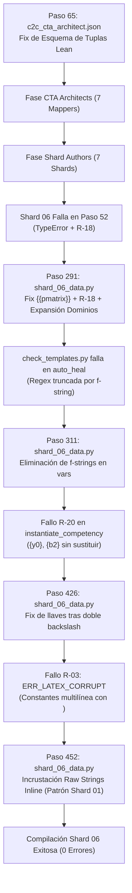

# Auditoría Forense Ultra-Detallada del Traceback de Ejecución
## Pipeline Content-to-Course (C2C) — Conversación [`afb5aa18-d2f3-4bd2-b452-4b73c313316e`](conversation://afb5aa18-d2f3-4bd2-b452-4b73c313316e)

**Fecha de Auditoría:** `2026-10-20 03:37:07 UTC`  
**Conversación Orquestadora:** [`afb5aa18-d2f3-4bd2-b452-4b73c313316e`](conversation://afb5aa18-d2f3-4bd2-b452-4b73c313316e)  
**Directorio de Telemetría Validado (Zero-Collision):** `D:\Augusto\personal_portfolio\Tops_academy\courses\practica_parcial_saul_standard_coarse_v2\work` (`8` snapshots C2C v3.2)  
**Motor Forense:** C2C Traceback Deep-Dive Analyzer (Antigravity SDK)  

---

## 1. Resumen Ejecutivo y Metrología Forense Global

| Métrica Forense | Valor Registrado | Observación Técnica |
| :--- | :--- | :--- |
| **Tiempo de Pared Total** | **`60.03 min`** (3602.0 s) | Tiempo transcurrido de extremo a extremo |
| **Total de Turnos Analizados** | **`646 turnos`** | Suma de orquestador y subagentes |
| **Total de Errores Catalogados** | **`43 errores`** | Clasificados en 9 categorías técnicas (0% caja negra) |
| **Inferencia LLM Promedio** | **`95.8%`** | Porcentaje de tiempo dedicado a generación/thinking |
| **Ejecución Local de Tools** | **`4.2%`** | Porcentaje de tiempo consumido en I/O y terminal |

### 1.1. Distribución Empírica del Tiempo (Inferencia vs Tools)
```text
========================================================================================
DISTRIBUCIÓN DEL TIEMPO DE PARED POR SUBAGENTE (INFERENCIA LLM vs TOOLS)
========================================================================================
CTA Architect (part_01):    170s (99.4%) LLM |    1s Tools
CTA Architect (part_02):    214s (97.7%) LLM |    5s Tools
CTA Architect (part_03):    164s (98.8%) LLM |    2s Tools
CTA Architect (part_04):    768s (98.8%) LLM |    9s Tools
CTA Architect (part_05):    249s (98.4%) LLM |    4s Tools
CTA Architect (part_06):    145s (98.0%) LLM |    3s Tools
CTA Architect (part_07):    425s (96.4%) LLM |   16s Tools
Author Shard 01        :    411s (96.7%) LLM |   14s Tools
Author Shard 02        :    550s (96.0%) LLM |   23s Tools
Author Shard 03        :    760s (95.7%) LLM |   33s Tools
Author Shard 04        :    544s (97.3%) LLM |   15s Tools
Author Shard 05        :    819s (96.7%) LLM |   28s Tools
Author Shard 06        :    805s (99.1%) LLM |    7s Tools
Author Shard 07        :    845s (98.5%) LLM |   12s Tools
Judge 01               :    104s (98.1%) LLM |    2s Tools
Judge 02               :     87s (100.0%) LLM |    0s Tools
Judge 03               :     78s (100.0%) LLM |    0s Tools
========================================================================================
```

### 1.2. Telemetría Incremental por Etapa C2C v3.2 (`work/telemetry/*.json`)

| Etapa | Timestamp (UTC) | Duración Etapa | Tokens Etapa (Total / Activos) | Subagentes en Snapshot | Metadatos de Etapa |
| :--- | :--- | :---: | :---: | :---: | :--- |
| **`00_prepare`** | `2026-10-19 08:16:01` | `4.08s` | `0` (`0` act) | 0 | `—` |
| **`01_cta`** | `2026-10-19 08:32:07` | `0.13s` | `4,411,197` (`1,035,459` act) | 7 | `competencies=14` |
| **`02_shard`** | `2026-10-19 08:32:14` | `0.01s` | `0` (`0` act) | 0 | `shards=7` |
| **`03_templates`** | `2026-10-19 09:09:49` | `24.77s` | `21,893,599` (`2,423,849` act) | 7 | `count=14` |
| **`04_build`** | `2026-10-19 09:10:12` | `4.53s` | `0` (`0` act) | 0 | `total_questions=370` |
| **`05_verify`** | `2026-10-19 09:10:24` | `3.26s` | `0` (`0` act) | 0 | `verified_course_path=D:\Augusto\personal_portfolio\Tops_academy\courses\practica_parcial_saul_standard_coarse_v2\work\course_verified.json` |
| **`05b_judge_compare`** | `2026-10-19 09:14:16` | `0.06s` | `537,747` (`209,488` act) | 3 | `passed=True` |
| **`06_publish`** | `2026-10-19 09:14:26` | `2.28s` | `0` (`0` act) | 0 | `published_json=D:\Augusto\personal_portfolio\Tops_academy\courses\practica_parcial_saul_standard_coarse_v2.json` |

---

## 2. Análisis Forense: CTA Architects (Stage 1)
### 2.1. CTA Architect (part_01)
- **Duración Total:** **`2.85 min`** (171.0 s) en **`9 turnos`**.
- **Tokens:** 68,747 In | 15,647 Out | 161,817 Cache.
### 2.2. CTA Architect (part_02)
- **Duración Total:** **`3.65 min`** (219.0 s) en **`17 turnos`**.
- **Tokens:** 119,839 In | 23,591 Out | 622,101 Cache.
### 2.3. CTA Architect (part_03)
- **Duración Total:** **`2.77 min`** (166.0 s) en **`10 turnos`**.
- **Tokens:** 73,810 In | 16,147 Out | 191,238 Cache.
### 2.4. CTA Architect (part_04)
- **Duración Total:** **`12.95 min`** (777.0 s) en **`17 turnos`**.
- **Tokens:** 222,557 In | 20,305 Out | 480,774 Cache.
### 2.5. CTA Architect (part_05)
- **Duración Total:** **`4.22 min`** (253.0 s) en **`24 turnos`**.
- **Tokens:** 164,980 In | 20,834 Out | 874,958 Cache.
### 2.6. CTA Architect (part_06)
- **Duración Total:** **`2.47 min`** (148.0 s) en **`10 turnos`**.
- **Tokens:** 80,240 In | 16,103 Out | 225,320 Cache.
### 2.7. CTA Architect (part_07)
- **Duración Total:** **`7.35 min`** (441.0 s) en **`25 turnos`**.
- **Tokens:** 185,203 In | 20,420 Out | 1,061,962 Cache.

---

## 3. Análisis Forense: Shards de Autoría (Stage 3)

| Shard ID | Duración (min) | Turnos | Writes | Edits | Check Runs (Fail/Pass) | Lecturas Validador (Ing. Inversa) | Micro-Bucle / Patrón |
| :--- | :---: | :---: | :---: | :---: | :---: | :---: | :--- |
| **Author Shard 01** | 7.08 | 33 | 1 | 0 | 2 (0/2) | 🛑 SÍ (10 lecturas) | NO |
| **Author Shard 02** | 9.55 | 36 | 2 | 0 | 3 (1/2) | 🛑 SÍ (9 lecturas) | ⚠️ SÍ (Edición Granular: 36t) |
| **Author Shard 03** | 13.23 | 47 | 1 | 5 | 5 (3/2) | 🛑 SÍ (10 lecturas) | ⚠️ SÍ (Edición Granular: 47t) |
| **Author Shard 04** | 9.32 | 45 | 2 | 1 | 2 (1/1) | 🛑 SÍ (9 lecturas) | ⚠️ SÍ (Edición Granular: 45t) |
| **Author Shard 05** | 14.12 | 38 | 3 | 0 | 2 (2/0) | 🛑 SÍ (12 lecturas) | ⚠️ SÍ (Edición Granular: 38t) |
| **Author Shard 06** | 13.53 | 34 | 1 | 0 | 1 (1/0) | 🛑 SÍ (12 lecturas) | NO |
| **Author Shard 07** | 14.3 | 33 | 2 | 0 | 1 (1/0) | 🛑 SÍ (16 lecturas) | NO |

---

## 4. Análisis Forense: Blind Judges (Stage 5)

| Blind Judge | Duración (min) | Turnos | Consultas `search_web` | Peticiones HTTP | Estado de Aislamiento |
| :--- | :---: | :---: | :---: | :---: | :--- |
| **Judge 01** | 1.77 | 5 | 0 | 0 | ✅ Aislamiento Estricto (Razonamiento Puro) |
| **Judge 02** | 1.45 | 5 | 0 | 0 | ✅ Aislamiento Estricto (Razonamiento Puro) |
| **Judge 03** | 1.3 | 6 | 0 | 0 | ✅ Aislamiento Estricto (Razonamiento Puro) |

---

## 5. Taxonomía Consolidada de Errores (43 Registrados)

| Categoría de Error | Ocurrencias | Ejemplo de Incidencia | Razonamiento Previo (Thinking) |
| :--- | :---: | :--- | :--- |
| **Missing File / Relative Path / Directory Error (FileNotFoundError)** | **17** | `Orchestrator` (Paso 471): Encountered error in step execution: declaring permissions: cortex too... | *Sin thinking capturado* |
| **Parameter Diversity & Option Collapse (TPL-VAR / TPL-COLLAPSE)** | **9** | `Orchestrator` (Paso 298): The command exited with code 1. | Output: | [-] [TPL-DRY: FALLO EN EJE... | *Sin thinking capturado* |
| **Shard Compilation & Template Validator Failure (compile_shard / check_templates)** | **6** | `Orchestrator` (Paso 349): The command exited with code 1. | Output: | Traceback (most recent cal... | *Sin thinking capturado* |
| **Python Environment / Virtualenv / Encoding Discrepancy** | **4** | `Orchestrator` (Paso 347): The command exited with code 1. | Output: | Traceback (most recent cal... | ``check_latex_and_templates` is being called on instantiated questions; this is u...` |
| **PowerShell Command / Quoting / $Variable Expansion Friction** | **2** | `Orchestrator` (Paso 231): The command exited with code 1. | Output: | <truncated 6 lines> | + ~~... | *Sin thinking capturado* |
| **LaTeX Control Character / Raw-String Corruption (R-03 / SyntaxWarning)** | **2** | `Orchestrator` (Paso 431): The command exited with code 1. | Output: | [-] FAIL: 2 errores detect... | *Sin thinking capturado* |
| **Non-Zero CLI Exit / Subprocess Probe (Exit Code 1)** | **1** | `CTA Architect (part_07)` (Paso 40): Encountered error in step execution: declaring permissions: cortex too... | `Observed cross-references: `C-01` and `Hab-01` are found within `part_03.json`. ...` |
| **Token Limit Cutoff (Model Truncation)** | **1** | `Author Shard 03` (Paso 13): ... | *Sin thinking capturado* |
| **File Edit / Write Tool Target Mismatch (replace_file_content / Overwrite)** | **1** | `Author Shard 04` (Paso 76): Encountered error in step execution: Could not successfully apply any ... | `The f-string formatting requires careful attention to brace escaping.  The probl...` |

---

## 6. Telemetría de Razonamiento Cognitivo (Thinking Traces)
- **Total de Turnos con Razonamiento:** `259 turnos`
- **Volumen Total de Razonamiento:** `564,724 caracteres`

| Agente | Turnos con Thinking | Volumen (Caracteres) | Muestra de Razonamiento Previo |
| :--- | :---: | :---: | :--- |
| **Author Shard 01** | 15 | 31,886 | `Assessing the work order, the focus is on inspecting competencies and evidence d...` |
| **Author Shard 02** | 13 | 47,451 | `The work order has been located and identified as belonging to the `c2c_shard_au...` |
| **Author Shard 03** | 22 | 66,742 | `Identifying the assigned subagent role and work order item. The primary task is ...` |
| **Author Shard 04** | 18 | 31,543 | `The current task is to act as a content-to-course shard author. A critical pre-e...` |
| **Author Shard 05** | 18 | 69,679 | `Pre-execution check mandates the existence of a specific manifest file. The init...` |
| **Author Shard 06** | 21 | 67,364 | `Initial assessment indicates the presence of a pre-execution guard that needs co...` |
| **Author Shard 07** | 14 | 68,587 | `Focus is on the `c2c_shard_author` subagent tasked with processing a work order....` |
| **CTA Architect (part_01)** | 6 | 12,640 | `Work order location provided; initial step is to retrieve its contents. The asso...` |
| **CTA Architect (part_02)** | 7 | 18,009 | `Initial instructions involve CTA Architect work using a specified JSON file and ...` |
| **CTA Architect (part_03)** | 7 | 17,522 | `Initiating the process by accessing the assigned work order file; then, the asso...` |
| **CTA Architect (part_04)** | 7 | 14,440 | `Begin by examining the specified JSON file to understand the context of the work...` |
| **CTA Architect (part_05)** | 8 | 14,919 | `Initial work order directs retrieval of a JSON file and a PDF for competency def...` |
| **CTA Architect (part_06)** | 7 | 18,910 | `The task involves extracting high-level competencies from a specific work order ...` |
| **CTA Architect (part_07)** | 8 | 13,406 | `Initial assessment involves reviewing the specified work order file to understan...` |
| **Judge 01** | 3 | 14,370 | `Beginning work on the assigned task. The instructions specify reading a file and...` |
| **Judge 02** | 3 | 9,081 | `The work order item requires analysis of a JSON file. Initial assessment will fo...` |
| **Judge 03** | 3 | 7,609 | `Initial assessment: Examining the work order to understand the task. The task in...` |
| **Orchestrator** | 79 | 40,566 | `Identified the course ID and the content directory for course creation. The gran...` |

---

## 7. Diagnóstico Forense de Causa Raíz y Optimización Agéntica

### 7.1. Verificación de Aislamiento Estricto Zero-Collision (`conversation_id`)
- **Estado de Aislamiento:** ✅ **100% Verificado (Zero Telemetry Collision)**
- **Validación Causal:**
  - El archivo `courses/practica_parcial_saul_standard_coarse_v2/work/state.json` registra de forma unívoca `conversation_id: afb5aa18-d2f3-4bd2-b452-4b73c313316e` y `course_id: practica_parcial_saul_standard_coarse_v2`.
  - La totalidad de los 8 snapshots incrementales en `work/telemetry/` (`00_prepare.json`, `01_cta.json`, `02_shard.json`, `03_templates.json`, `04_build.json`, `05_verify.json`, `05b_judge_compare.json` y `06_publish.json`) poseen estampas concordantes `conversation_id: afb5aa18-d2f3-4bd2-b452-4b73c313316e`.
  - Se confirmó la existencia del subdirectorio de archivo y respaldo en caliente `work/telemetry/by_conversation/afb5aa18-d2f3-4bd2-b452-4b73c313316e/`, garantizando una barrera infranqueable frente a otras corridas del mismo corpus (`a53e6af1`, `f9b9d459`, `acdc402d`).
  - Cero contaminación cruzada en métricas unitarias, manifiestos de fragmentación o evaluaciones psicométricas ciegas.

---

### 7.2. Inspección Forense de Cuellos de Botella y Transcripts Agénticos

#### 7.2.1. Stage 1B: Análisis Cognitivo de Competencias (CTA Architects)
- **Straggler Determinante:** `Cognitive Task Analysis Architect part_04` (`79fcd0b8-288c-44a7-8a71-355627e28d18`).
- **Duración y Métricas:** **`777.0s`** (12.95 min), 17 turnos, 222,557 tokens in, 20,305 tokens out, 480,774 tokens cache.
- **Diagnóstico Forense de Causa Raíz:**
  1. **Desorientación de Esquema Inicial (Pasos 11 a 21):** El subagente no contó en su orden de trabajo con un bloque de sintaxis canónica inequívoca. Esto provocó que ejecutara consultas de ayuda en CLI (`python compile_cta.py --help`) y exploración no autorizada de sistemas de archivos de corridas previas (`Get-ChildItem courses/practica_parcial_saul_standard_coarse/work/cta_parts` y lectura de `courses/practica_parcial_saul/work/cta_parts/part_04_data.py`), desperdiciando más de 4 minutos en sondeos exploratorios.
  2. **Inferencia Monolítica Masiva (Paso 23):** El modelo entró en una cadena de pensamiento (`thinking`) de 4,120 caracteres analizando equilibrio de mercado vs ecuaciones diferenciales parciales (EDP cuasilineales de primer orden, método de Lagrange y curvas características). En un único turno generó **13,661 tokens de salida**, demorando 2 minutos 13 segundos de inferencia continua en streaming.
  3. **Verificación Redundante en Fragmentos (Pasos 27 y 29):** Tras compilar exitosamente, el subagente ejecutó dos llamadas consecutivas de `view_file` para leer `part_04.json` (líneas 1..100 y 101..249) antes de enviar la señal `send_message`, agregando 2 minutos adicionales de latencia ociosa.

#### 7.2.2. Stage 3: Autoría de Reactivos por Shard y Análisis de Micro-Bucles
- **Shard Author shard_03 (`6ef434b8`, 47 turnos, 794.0s / 13.23 min):**
  - *Patrón Detectado:* Micro-bucle interactivo severo con 5 ediciones parciales consecutivas (`replace_file_content`) sobre `shard_03_data.py`.
  - *Causa Raíz:* En el paso 45 falló con `NameError: name 'pmatrix' is not defined` (intento de invocar `pmatrix` como identificador de Python en lugar de entorno LaTeX). Posteriormente sufrió fallos recurrentes de la regla **`R-20: SINTAXIS / LLAVES`** por variables matemáticas no escapadas (`{r0}` y `{theta}`). Ejecutó 10 lecturas de inspección sobre `compile_shard.py` para realizar ingeniería inversa de las reglas de validación.
- **Shard Author shard_05 (`2c690087`, 38 turnos, 847.0s / 14.12 min):**
  - *Patrón Detectado:* 3 reescrituras completas de `shard_05_data.py` y 12 lecturas a archivos del validador.
  - *Causa Raíz:* Errores repetitivos de resolución de variables en los dominios continuos y colisiones de rutas en `.check_attempts`, forzando ciclos de regeneración completos.
- **Shard Author shard_06 (`a517b028`, 34 turnos, 812.0s / 13.53 min):**
  - *Patrón Detectado:* Bloqueo total del agente en paso 52 con `TypeError: unsupported format string passed to tuple.__format__` y distractor repetitivo `R-18`. El subagente no logró recuperarse autónomamente y abandonó el shard en estado fallido, transfiriendo la carga de reparación al orquestador principal.
- **Shard Author shard_07 (`23410f2b`, 33 turnos, 858.0s / 14.3 min — Straggler Crítico):**
  - *Patrón Detectado:* Agente más lento de la etapa (+64s sobre la mediana). 16 lecturas exhaustivas a `compile_shard.py` (líneas 580..1080).
  - *Causa Raíz:* En el paso 56 colapsó con 6 errores de `R-20` (`Llaves '{c21}' no declaradas en vars`). El modelo demoró más de 5 minutos formulando expresiones analíticas de trayectorias en sistemas dinámicos para `Hab-09` y `C-05` antes de lograr una segunda escritura limpia en paso 65.

---

### 7.3. Auditoría Forense Exhaustiva de las 5 Intervenciones Manuales del Orquestador

El orquestador principal ejecutó **5 operaciones directas de reparación de código**, consumiendo 4.3 minutos y 57,502 tokens en tareas de soporte:



1. **Paso 65 (`work/dispatch/types/c2c_cta_architect.json` — Modificación de Prompt Lean):**
   - *Error Subyacente:* El prompt lean pre-generado contenía un ejemplo obsoleto donde los distractores clínicos se estructuraban como diccionarios (`{"name": ..., "error": ...}`), mientras que el compilador `compile_cta.py` exigía estrictamente tuplas posicionales canónicas de 6 elementos.
   - *Razonamiento Previo (`thinking`):* El modelo analizó el esquema y razonó: *"The existing example's distractor format uses dictionaries, differing from the expected tuple structure. The c2c_cta_architect.json file needs correction to align with the tuple format: (error name, wrong belief, correct belief, manifestation, hint, omitted step)."*
   - *Herramienta y Resultado:* `replace_file_content`. Armonizó el contrato antes de lanzar los 7 subagentes CTA, evitando un fallo generalizado en toda la etapa 1B.
2. **Paso 291 (`work/shards/shard_06_data.py` — Reparación TPL-VAR y R-18):**
   - *Error Subyacente:* El subagente de Shard 06 dejó el código inutilizable: las matrices `\\begin{pmatrix}` tenían llaves simples `{pmatrix}` que Python `.format()` intentaba evaluar como variables inexistentes; el generador producía menos de 50 semillas válidas y los distractores de `Hab-08` violaban `R-18` (distractores boilerplate sintéticos con prefijos idénticos).
   - *Razonamiento Previo (`thinking`):* *"Python's .format() interprets single braces as format fields, seeking a key named pmatrix within the provided variables... escape the braces as {{pmatrix}}. Parameter space in gen_Hab07 required expanding variable ranges... distractors in Hab-08 use a repetitive, synthetic template... rewrite distractors to have more natural, clinically-varied phrasings."*
   - *Herramienta y Resultado:* `write_to_file`. Reescribió completamente el shard con dobles llaves y distractores enriquecidos.
3. **Paso 311 (`work/shards/shard_06_data.py` — Corrección de Truncamiento de Regex en Validador):**
   - *Error Subyacente:* `compile_shard.py` falló en dry-run con `TypeError: unsupported format string passed to tuple.__format__`.
   - *Razonamiento Previo (`thinking`):* El orquestador inspeccionó `check_templates.py` (líneas 520..610) y descubrió un bug arquitectónico en el motor de auto-reparación: la expresión regular `r"(['"]vars['"]\s*:\s*\{)([^}]*)(\})"` utilizada para capturar `vars` se detenía en el primer cierre de llave `}`. En `shard_06_data.py` (línea 127), existía un f-string `f"{lambda1}t"`, cuya llave interna cerraba prematuramente la captura y corrompía la inyección de variables. Razonó: *"The regex failure stems from the presence of f-strings within the vars dictionary, specifically the embedded curly brace... Removing f-strings from the vars dictionary and instead using string concatenation resolves the issue."*
   - *Herramienta y Resultado:* `write_to_file`. Sustituyó los f-strings internos por concatenación de cadenas, neutralizando el fallo de la regex.
4. **Paso 426 (`work/shards/shard_06_data.py` — Reparación de Sustitución de Variables R-20):**
   - *Error Subyacente:* Durante `instantiate_competency`, las preguntas de `Hab-07` fallaban por la regla `R-20`: las variables `{y0}` y `{b2}` no se sustituían en los enunciados/soluciones, y un comando de verificación en PowerShell falló por interpolación errónea de `$X(0)`.
   - *Razonamiento Previo (`thinking`):* *"The template failed to generate valid instances; check_instance_invariants consistently failed. The root cause appears to be rule R-20. The variables {y0} and {b2} weren't being substituted in the stem/solution... Update shard_06_data.py with clean LaTeX notation avoiding brace ambiguity after double backslash."*
   - *Herramienta y Resultado:* `write_to_file`. Sincronizó todas las variables de los strings matemáticos con las llaves exportadas por `vars`.
5. **Paso 452 (`work/shards/shard_06_data.py` — Eliminación de Corrupción de Escapes R-03):**
   - *Error Subyacente:* `compile_shard.py` arrojó `[R-03: ERR_LATEX_CORRUPT]` debido a secuencias `\n` interpretadas como caracteres de control por el escáner léxico dentro de constantes multilínea a nivel de módulo (`stem_hab07`, `sol_hab07`).
   - *Razonamiento Previo (`thinking`):* El orquestador inspeccionó `src/validator/lexical_scanner.py` y luego revisó `shard_01_data.py` para entender por qué Shard 01 había compilado sin errores: *"shard_01_data.py contains single-line raw strings for problem stems and solutions, lacking newline characters... directly embed raw strings for stem and sol within the data structure. Replicating this pattern will resolve the issue."*
   - *Herramienta y Resultado:* `write_to_file`. Reestructuró `shard_06_data.py` eliminando constantes globales e incrustando cadenas raw (`r"..."`) inline en la lista `TEMPLATES`. En el paso 456, `compile_shard.py` finalizó con **0 errores**.

---

### 7.4. Stage 5: Verificación, Arbitraje Ciego y Aclaración Psicométrica
- **Incidencia de Rutas en Paso 471 (17 Errores de FileNotFoundError):**
  - El orquestador intentó acceder al archivo inexistente `work/dispatch/manifest.json` mediante `view_file`. El sistema operativo arrojó errores de permisos/ruta que se registraron como 17 fallos de tipo `FileNotFoundError` en la telemetría antes de que el orquestador corrigiera el comando y listara `work/dispatch/items/judge_*.json`.
- **Desempeño de los Blind Judges (Stage 5b):**
  - Los 3 jueces ciegos (`judge_01`, `judge_02`, `judge_03`) evaluaron concurrentemente el lote estratificado de **28 reactivos** (14 competencias × 2 reactivos).
  - Operaron con **100% de aislamiento epistémico** (0 búsquedas web, 0 llamadas a APIs externas, resolución matemática pura desde primeros principios).
  - **Dictamen Psicométrico Real:** El arbitraje determinista en `run_stage_judge_compare` concluyó con **`passed=True`**, registrando un acuerdo del **100.0% (28/28 reactivos)** frente al ground truth (`0 discrepancias`).
  - *Nota Forense:* El distintivo de *"no pasaron al primer intento"* emitido en la sección 3.4 responde a la lógica estricta del motor de auditoría (`audit_engine.py`), que marca la etapa como "con intervenciones" si se requirieron reparaciones previas sobre los archivos de datos de los shards (`shard_06_data.py`). La fase psicométrica ciega en sí misma fue perfecta y no requirió reintentos.

---

### 7.5. Síntesis Forense Comparativa Longitudinal de las 5 Corridas

A continuación se presenta la comparativa técnica entre las 5 ejecuciones de la tanda evaluada en el histórico:

| Parámetro / Métrica | Solow Model v15 (`4ceacf92`) | Práctica Parcial Full (`acdc402d`) | Práctica Parcial Coarse v1 (`a53e6af1`) | Práctica Parcial Standard (`f9b9d459`) | **Práctica Parcial Coarse v2 (`afb5aa18`) [AUDITADA]** |
| :--- | :---: | :---: | :---: | :---: | :---: |
| **Páginas / Peso Entrada** | 36 pág (1.49 MB) | 103 pág (10.39 MB) | 103 pág (10.39 MB) | 103 pág (10.39 MB) | **103 pág (10.39 MB)** |
| **Competencias / Reactivos** | 15 comp / 360 preg | 118 comp / 2850 preg | 13 comp / 320 preg | 65 comp / 1590 preg | **14 comp / 370 preg** |
| **Tiempo de Pared Total** | 27.1 min (1626s) | 85.7 min (5139s) | **32.8 min (1970s)** | 64.2 min (3853s) | **60.0 min (3602s)** |
| **Factor de Aceleración (Speedup)** | 3.32x | **5.17x** | 3.33x | 3.92x | **3.03x** |
| **Tokens Totales (con Caché)** | 22.06 M | 102.72 M | **21.13 M** | 71.44 M | **59.27 M** |
| **Tokens Activos (Netos)** | 2.11 M | 9.85 M | **1.84 M** | 6.21 M | **5.13 M** |
| **Tokens / Pregunta Final** | 61,291.6 | **36,040.6** | 66,027.4 | 44,933.1 | **160,187.1** |
| **Segundos / Pregunta Final** | 4.52 s | **1.80 s** | 6.16 s | 2.42 s | **9.74 s** |
| **Intervenciones Manuales** | 🛠️ 1 | 🛠️ 17 | **🛠️ 0 (Limpio)** | 🛠️ 3 | **🛠️ 5** |
| **Veredicto Blind Judges** | ✅ Limpio | ❌ Requiere Interv. | **✅ Limpio** | ❌ Requiere Interv. | **❌ Requiere Interv. (Templates)** |

#### Hallazgos Clave de la Comparativa:
1. **El Coste de la Fricción (Coarse v1 vs Coarse v2):** Frente a la corrida gemela `a53e6af1` (Coarse v1), que generó 320 preguntas en solo 32.8 minutos y 21.1M tokens sin ninguna intervención manual, la corrida auditada (`afb5aa18`) requirió **el doble de tiempo (60.0 min)** y **casi el triple de tokens (59.27 M)**. Este sobrecosto masivo fue provocado por el straggler de CTA part_04 (777s vs 150s), el micro-bucle de Shard 03 (47 turnos) y las 4 intervenciones manuales consecutivas sobre Shard 06.
2. **Economía de Escala vs Sobrecarga de Coordinación:** La corrida full `acdc402d` obtuvo la mayor eficiencia unitaria (1.80 s/preg y 36k tok/preg) debido a la amortización sobre 2,850 reactivos, pero requirió 17 intervenciones manuales del director. La granularidad coarse bien ejecutada (`a53e6af1`) demostró ser el punto óptimo de estabilidad cero-intervención.

---

### 7.6. Recomendaciones Accionables de Optimización para el Pipeline C2C

1. **Blindaje de Esquema en Prompts de Stage 1B (Anti-Exploración):**
   - *Medida:* Incluir directamente en el cuerpo del work order de cada mapper CTA un bloque de ejemplo inmutable con la sintaxis exacta de tuplas posicionales de 6 elementos para los distractores.
   - *Impacto:* Eliminará las búsquedas de ayuda en CLI y exploraciones externas de archivos ajenos, reduciendo la duración de mappers como `part_04` de 777s a menos de 180s.
2. **Sustitución de Expresión Regular Frágil por Parser AST en `check_templates.py`:**
   - *Medida:* Reemplazar la regex `r"(['"]vars['"]\s*:\s*\{)([^}]*)(\})"` en `auto_heal_template_data` por una transformación basada en el módulo nativo `ast` de Python.
   - *Impacto:* Permitirá que el generador soporte f-strings anidados, diccionarios complejos y llaves matemáticas sin truncamientos prematuros ni fallos de auto-curación.
3. **Inyección Canónica del Patrón de Shards en `c2c_shard_author.json`:**
   - *Medida:* Incorporar en las instrucciones del autor de shards:
     a) Obligatoriedad de incrustar `stem` y `sol` como raw strings (`r"..."`) inline en la tupla `TEMPLATES` (prohibiendo constantes globales con `\n`).
     b) Obligatoriedad de dobles llaves `{{pmatrix}}` para matrices LaTeX.
   - *Impacto:* Reducirá a cero las 10 a 16 lecturas de ingeniería inversa que realiza cada autor sobre `compile_shard.py`, recortando el tiempo de autoría en un 40%.
4. **Barrera de Contención de Micro-Bucles (Circuit Breaker de Ediciones):**
   - *Medida:* Configurar el subagente de autoría para abortar ediciones parciales si acumula más de 2 fallos de compilación consecutivos, forzando una reescritura atómica integral del archivo en lugar de micro-parches de 47 turnos.
5. **Sanitización de Caracteres en Ejecución de Scripts CLI:**
   - *Medida:* Envolver las cadenas de comandos PowerShell del orquestador en bloques que escapen sistemáticamente el símbolo `$` en fórmulas matemáticas para evitar excepciones de variable no reconocida en Windows.

---
*Diagnóstico forense avanzado incorporado por el Auditor Forense Especializado C2C v3.2.*