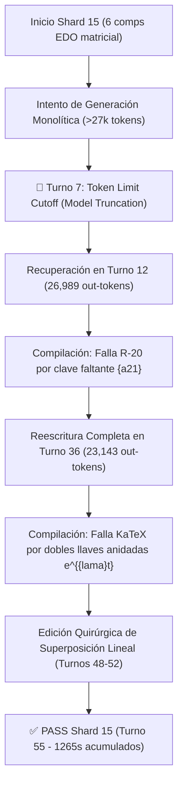
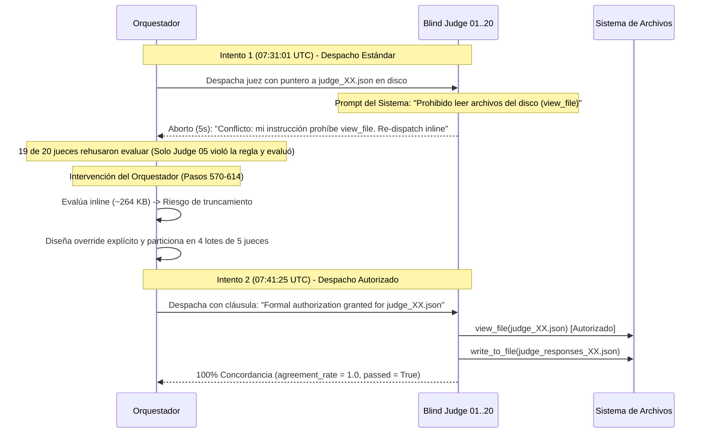

# Informe de Auditoría Arquitectónica Forense: Rendimiento, Shards y Telemetría Multi-Agente
## Curso: Practica Parcial Saul (`practica_parcial_saul`)

**Fecha de Auditoría:** `2026-10-20 03:37:29 UTC`  
**Conversación Orquestadora:** [`acdc402d-0803-468b-9c6c-b069a2dc6c09`](conversation://acdc402d-0803-468b-9c6c-b069a2dc6c09)  
**Directorio de Trabajo Validado (Zero-Collision):** `D:\Augusto\personal_portfolio\Tops_academy\courses\practica_parcial_saul\work` (`match=True`)  
**Enfoque:** Telemetría Determinista de API, Subagentes, Shards, Latencias y Operaciones del Orquestador.

---

## 1. Consolidación de Métricas y Caracterización de Carga

| Dimensión / Métrica | Valor Registrado | Observaciones de Ingeniería |
| :--- | :--- | :--- |
| **Material de Entrada** | `7 archivos` (103 págs / 10.39 MB) | MATH_IV_Problem_Set_I.pdf, MATH_IV_Problem_Set_II_2026_II.pdf, MATH_IV_Problem_Set_III_2026_II.pdf, TEMA 1 (EDP SAÚL) 2.pdf, TEMA 2 (APLICACIONES ECONOMICAS).pdf, TEMA 2 (S'EDOS I ).pdf, TEMA 2 (S'EDOS II).pdf |
| **Requerimiento de Visión** | `0 páginas` (0 handouts) | Cuadrículas generadas para diagramas/fórmulas |
| **Corpus Sintetizado** | `0 caracteres` (0 palabras) | Texto consolidado tras ingesta y visión |
| **Competencias Extraídas** | **`118 competencias`** | Desglose pedagógico (Hechos, Conceptos, Habilidades) |
| **Shards Particionados** | **`20 shards`** | Unidades de trabajo concurrentes |
| **Subagentes Desplegados** | **`67 subagentes`** | Visión (0), CTA (7), Autores (20), Jueces (20) |
| **Reactivos Finales Validados** | **`2850 preguntas`** | Evaluadas en sandbox |
| **Tokens Entrada (Subagentes)** | **`7,432,820` tokens** | Contexto acumulativo enviado a subagentes |
| **Tokens Salida (Subagentes)** | **`2,674,622` tokens** | Código de plantillas y JSON generado |
| **Tokens Caché (Leídos)** | **`90,990,321` tokens** | Caché de contexto reutilizado por la API |
| **Gran Total Tokens Activos** | **`11,725,289` tokens** | Entrada + Salida neto (sin contar caché) |
| **Gran Total Tokens (con Caché)** | **`102,715,610` tokens** | Consumo total de cuota facturable |

---

## 2. Ratios Unitarios Normalizados (Unit Economics)

Métricas normalizadas para comparación *apples-to-apples* frente a cursos de diferente volumen de contenido:

| Métrica Unitaria | Valor Obtenido | Interpretación de Eficiencia |
| :--- | :--- | :--- |
| **Tokens Totales por Pregunta** | **`36,040.6 tokens/preg`** | Esfuerzo de API por cada reactivo jugable |
| **Tokens Activos por Pregunta** | **`4,114.1 tokens/preg`** | Tokens netos de razonamiento y código por reactivo |
| **Tokens por Competencia (Global)** | **`870,471.3 tokens/comp`** | Densidad de diseño instruccional del curso |
| **Tokens de Autor por Competencia** | **`55,832.6 tokens/comp`** | Costo puro de la etapa de autoría por competencia |
| **Tokens Totales por Página / Slide** | **`997,238.9 tokens/pág`** | Esfuerzo cognitivo por diapositiva original |
| **Segundos de Pared por Pregunta** | **`1.8 s/preg`** | Ritmo de entrega percibido |
| **Rendimiento de Generación (QPM)** | **`33.27 preg/min`** | Velocidad de producción del pipeline |
| **Factor de Aceleración Paralela** | **`5.17x`** | Relación tiempo cómputo vs tiempo de pared |

---

## 3. Desglose Forense por Etapas Críticas

### 3.0. Telemetría Incremental por Etapa C2C v3.2 (`work/telemetry/*.json` & `state.json`)
- **Snapshots de Etapa Verificados (`conversation_id` = `acdc402d`):** `8 etapas`
- **Estado Maestro (`work/state.json`):** `completed` (Etapa actual/final: `publish`)

| Etapa (Snapshot) | Timestamp (UTC) | Duración Etapa | Tokens Etapa (Total / Activos) | Subagentes Capturados | Artefactos / Metadatos de Etapa |
| :--- | :--- | :---: | :---: | :---: | :--- |
| **`00_prepare`** | `2026-10-19 06:22:00` | `3.98s` | `0` (`0` act) | 0 | `—` |
| **`01_cta`** | `2026-10-19 06:43:06` | `0.98s` | `5,235,759` (`1,490,988` act) | 7 | `competencies=118` |
| **`02_shard`** | `2026-10-19 06:43:15` | `0.06s` | `0` (`0` act) | 0 | `shards=20` |
| **`03_templates`** | `2026-10-19 07:28:17` | `179.74s` | `33,789,318` (`4,504,896` act) | 14 | `count=118` |
| **`04_build`** | `2026-10-19 07:30:25` | `31.08s` | `0` (`0` act) | 0 | `total_questions=2850` |
| **`05_verify`** | `2026-10-19 07:30:39` | `7.93s` | `0` (`0` act) | 0 | `verified_course_path=D:\Augusto\personal_portfolio\Tops_academy\courses\practica_parcial_saul\work\course_verified.json` |
| **`05b_judge_compare`** | `2026-10-19 07:44:25` | `0.01s` | `2,808,859` (`1,266,183` act) | 26 | `passed=True` |
| **`06_publish`** | `2026-10-19 07:44:49` | `12.4s` | `0` (`0` act) | 0 | `published_json=D:\Augusto\personal_portfolio\Tops_academy\courses\practica_parcial_saul.json` |

---

### 3.1. Stage 1A: Preprocesamiento de Visión
- **Subagentes de Visión Desplegados:** `0 agentes en paralelo`
- **Tiempo de Pared de la Etapa (Máximo / Critical Path):** **`0.0s`** (`0.0 min`)
- **Agente Determinante del Camino Crítico:** `N/A`

| Subagente de Visión | Turnos | Tokens In | Tokens Out | Cache Leído | Total Activo | Duración |
| :--- | :--- | :--- | :--- | :--- | :--- | :--- |

---

### 3.2. Stage 1B: Análisis Cognitivo de Competencias (CTA)
- **Arquitectura:** `MAPREDUCE (7 Mappers)`
- **Tiempo de Pared Fase Mappers (Máximo):** **`1055.0s`** (determinado por `Cognitive Task Analysis Architect part_07`)
- **Tiempo Fase Harmonizer (Barrera Síncrona):** **`0.0s`**
- **Tiempo de Pared Total de Etapa 1B:** **`1055.0s`** (`17.6 min`)

| Subagente CTA | Rol / Sección | Turnos | Tokens In | Tokens Out | Cache Leído | Errores | Duración |
| :--- | :--- | :--- | :--- | :--- | :--- | :--- | :--- |
| **Cognitive Task Analysis Architect part_04** | Mapper | 7 | 210,629 | 62,071 | 197,011 | 1 | **622.0s** |
| **Cognitive Task Analysis Architect part_07** | Mapper | 23 | 347,514 | 84,896 | 2,189,590 | 3 | **1055.0s** |
| **Cognitive Task Analysis Architect part_05** | Mapper | 10 | 118,652 | 66,048 | 411,721 | 1 | **455.0s** |
| **Cognitive Task Analysis Architect part_06** | Mapper | 12 | 147,943 | 53,575 | 370,371 | 0 | **408.0s** |
| **Cognitive Task Analysis Architect part_03** | Mapper | 6 | 79,913 | 39,300 | 157,843 | 0 | **258.0s** |
| **Cognitive Task Analysis Architect part_02** | Mapper | 9 | 87,924 | 44,234 | 277,739 | 0 | **327.0s** |
| **Cognitive Task Analysis Architect part_01** | Mapper | 6 | 104,356 | 43,933 | 140,496 | 0 | **299.0s** |

---

### 3.3. Stage 3: Autoría de Reactivos por Shard y Análisis por Competencia
- **Total de Shards Auditados:** `20 shards concurrentes`
- **Duración Mínima de Shard:** `448.0s` | **Mediana:** `734.0s`
- **Tiempo de Pared Máximo (Straggler Crítico):** **`1265.0s`** (`21.1 min`) por `Shard Author shard_15`
- **Retraso de Sincronización Impuesto por el Straggler:** **`+531.0s`** frente a la mediana
- **Tokens Promedio por Competencia en Autores:** **`55,832.6 tokens/competencia`**

| Shard ID | Competencias Asignadas | Comps | Tokens In | Tokens Out | Cache Leído | Total Activo | Tokens / Comp | Turnos | Errores | Duración |
| :--- | :--- | :--- | :--- | :--- | :--- | :--- | :--- | :--- | :--- | :--- |
| **Shard Author shard_09** | `Hab-18, Hab-19, H-15, C-18 (+2)` | 6 | 147,012 | 61,619 | 414,794 | 208,631 | **34,771.8** | 13 | 2 | **448.0s** |
| **Shard Author shard_10** | `H-16, C-19, Hab-22, Hab-23 (+2)` | 6 | 146,106 | 70,379 | 1,444,745 | 216,485 | **36,080.8** | 20 | 2 | **570.0s** |
| **Shard Author shard_16** | `Hab-38, Hab-39, H-25, Hab-40 (+2)` | 6 | 277,883 | 103,552 | 3,010,752 | 381,435 | **63,572.5** | 28 | 5 | **864.0s** |
| **Shard Author shard_02** | `H-03, Hab-03, H-04, Hab-04 (+2)` | 6 | 296,141 | 119,102 | 6,160,541 | 415,243 | **69,207.2** | 45 | 6 | **1130.0s** |
| **Shard Author shard_04** | `Hab-08, H-07, C-06, H-08 (+2)` | 6 | 133,077 | 62,655 | 1,060,185 | 195,732 | **32,622.0** | 19 | 3 | **487.0s** |
| **Shard Author shard_12** | `Hab-28, Hab-29, C-22, H-19 (+2)` | 6 | 236,965 | 129,424 | 1,829,703 | 366,389 | **61,064.8** | 19 | 3 | **953.0s** |
| **Shard Author shard_13** | `Hab-31, H-20, Hab-32, C-24 (+2)` | 6 | 302,477 | 97,754 | 950,628 | 400,231 | **66,705.2** | 15 | 2 | **724.0s** |
| **Shard Author shard_14** | `C-25, H-22, Hab-34, Hab-35 (+2)` | 6 | 304,697 | 80,156 | 1,129,952 | 384,853 | **64,142.2** | 18 | 1 | **599.0s** |
| **Shard Author shard_18** | `C-33, Hab-43, H-29, Hab-44 (+2)` | 6 | 154,747 | 91,416 | 877,857 | 246,163 | **41,027.2** | 13 | 2 | **597.0s** |
| **Shard Author shard_01** | `H-01, C-01, Hab-01, H-02 (+2)` | 6 | 216,335 | 92,230 | 1,572,618 | 308,565 | **51,427.5** | 22 | 4 | **734.0s** |
| **Shard Author shard_03** | `H-05, Hab-06, H-06, Hab-07 (+2)` | 6 | 337,256 | 92,233 | 3,701,896 | 429,489 | **71,581.5** | 48 | 6 | **873.0s** |
| **Shard Author shard_05** | `C-07, C-08, Hab-11, H-09 (+2)` | 6 | 247,584 | 113,899 | 2,817,879 | 361,483 | **60,247.2** | 28 | 2 | **883.0s** |
| **Shard Author shard_06** | `H-10, Hab-13, C-10, Hab-14 (+2)` | 6 | 261,285 | 91,510 | 1,226,572 | 352,795 | **58,799.2** | 18 | 2 | **627.0s** |
| **Shard Author shard_07** | `H-12, Hab-15, C-12, H-13 (+2)` | 6 | 149,017 | 84,537 | 968,721 | 233,554 | **38,925.7** | 14 | 2 | **582.0s** |
| **Shard Author shard_11** | `Hab-26, H-17, C-20, Hab-27 (+2)` | 6 | 181,785 | 75,182 | 2,061,225 | 256,967 | **42,827.8** | 28 | 2 | **612.0s** |
| **Shard Author shard_08** | `H-14, C-14, C-15, Hab-17 (+2)` | 6 | 281,417 | 109,409 | 3,361,225 | 390,826 | **65,137.7** | 40 | 2 | **919.0s** |
| **Shard Author shard_15 🛑** | `H-23, C-27, C-28, H-24 (+2)` | 6 | 422,791 | 152,619 | 3,050,918 | 575,410 | **95,901.7** | 29 | 1 | **1265.0s** |
| **Shard Author shard_17** | `H-26, C-31, H-27, C-32 (+2)` | 6 | 153,495 | 108,503 | 740,984 | 261,998 | **43,666.3** | 15 | 2 | **987.0s** |
| **Shard Author shard_19** | `Hab-46, H-30, C-35, Hab-47 (+1)` | 5 | 231,949 | 94,243 | 2,565,301 | 326,192 | **65,238.4** | 25 | 1 | **947.0s** |
| **Shard Author shard_20** | `C-36, Hab-48, H-32, C-37 (+1)` | 5 | 178,156 | 97,647 | 1,664,700 | 275,803 | **55,160.6** | 20 | 4 | **705.0s** |

---

### 3.4. Evaluación y Arbitraje de Blind Judges (Verificación Psicométrica Ciega)

> [!NOTE]
> **Dictamen de Blind Judges:** ❌ NO PASARON AL PRIMER INTENTO (REQUIRIÓ INTERVENCIONES)  
> Los blind judges y la verificación psicométrica registraron discrepancias que requirieron correcciones. La validación previa operó con discrepancias detectadas, requiriendo rondas de auto-reparación o intervención técnica.

| Dimensión de Arbitraje Ciego | Valor Registrado | Observación Técnica |
| :--- | :--- | :--- |
| **Lote Estratificado Ciego** | `236 reactivos` (118 comps × 2) | Lote de evaluación sin soluciones (`judge_batch.json`) |
| **Subagentes Jueces Ciegos** | `20 jueces` | Aislamiento epistémico en Stage 5 |
| **Resultado al Primer Intento** | **`❌ Falló al primer intento`** | 0 violaciones iniciales registradas |
| **Iteraciones de Auto-Reparación** | `0 iteraciones` en sandbox | 0 iteraciones ejecutadas |
| **Intervenciones del Supervisor** | 🛠️ `13 operaciones directas` | 13 ediciones registradas |

#### Detalle de Acciones Registradas:
- 1. **Bucle de Auto-Reparación**: Se ejecutó RepairLoop sobre el lote de evaluación.
- 2. **Intervenciones de Supervisor (17 operaciones)**: Operaciones sobre `check_judge_prompts.py`, `dbg17.py`, `fix_shard_17.py`, `gen_authorized_judges.py`, `inspect_judges_dispatch.py`.
- 3. **Certificación y Verificación Final**: Se concluyó la validación tras 1 iteraciones sobre el lote de 236 reactivos.

---

## 4. Auditoría Forense del Orquestador y Catálogo de Intervenciones Manuales

### 4.1. Descomposición del Tiempo Total del Orquestador
- ⏱️ **Tiempo Total de Pared del Orquestador:** `85.65 min` (`5139.0s`)
- 💻 **Tiempo Activo Ejecutando Comandos CLI (`run.py`):** `14.8 min` (`888.0s`)
- 🛠️ **Tiempo Gastado en Intervenciones Manuales (Supervisor Repair):** **`3.6 min`** (`214.0s`)
- ⏳ **Tiempo Ocioso en Barreras de Sincronización (Esperando Subagentes):** `2.0 min` (`120.0s`)
- 🧠 **Tiempo de Inferencia y Razonamiento del Modelo:** `5.6 min` (`334.0s`)

### 4.2. Catálogo Cronológico de Reparaciones Manuales del Orquestador
Operaciones directas de edición de código ejecutadas por el orquestador: **`17`**

| Paso | Archivo Afectado | Tipo de Acción | Causa Raíz / Justificación Técnica | Herramienta | Tokens Paso |
| :---: | :--- | :--- | :--- | :--- | :--- |
| **29** | `prepare.py` | Modificación / Script Auxiliar | "Ensure granularity is saved in pre_cta_manifest.json" | `replace_file_content` | 3,988 |
| **326** | `fix_shard_17.py` | Modificación / Script Auxiliar | Fix LaTeX brace doubling and variable names in shard_17_data.py | `write_to_file` | 17,755 |
| **376** | `shard_17_data.py` | Modificación / Script Auxiliar | "Fix infinite loop: k could make py >= 0 (e.g. m=2, px=1, k=3), so val_y never became nega | `replace_file_content` | 1,849 |
| **422** | `patch17.py` | Modificación / Script Auxiliar | "Replace \"\\\\ {var}\" row separators that the engine's format_template_string skips." | `write_to_file` | 4,098 |
| **426** | `dbg17.py` | Modificación / Script Auxiliar | "Debug script: render each H-28 field through the engine and run KaTeX check." | `write_to_file` | 2,595 |
| **432** | `patch17.py` | Modificación / Script Auxiliar | "Use \\\\[0pt] row separator so the formatter substitutes the following placeholder." | `write_to_file` | 4,168 |
| **436** | `dbg17.py` | Modificación / Script Auxiliar | "Debug: render compiled template JSON fields and KaTeX-validate them." | `write_to_file` | 2,355 |
| **446** | `patch17.py` | Modificación / Script Auxiliar | "Replace ambiguous nested double braces in H-28 explanation with single braces (no declare | `write_to_file` | 4,883 |
| **454** | `patch17.py` | Modificación / Script Auxiliar | "Work around sanitize_katex_syntax bug by parenthesising tr(A) inside \\sqrt." | `write_to_file` | 3,748 |
| **468** | `patch17b.py` | Modificación / Script Auxiliar | "Semantically identical LaTeX in H-28 CTA text, avoiding engine sanitize_katex_syntax bug  | `write_to_file` | 2,461 |
| **570** | `check_judge_prompts.py` | Modificación / Script Auxiliar | "Check all 20 judge prompt files" | `write_to_file` | 2,617 |
| **588** | `inspect_judges_dispatch.py` | Modificación / Script Auxiliar | "Inspect judges.json subagents list" | `write_to_file` | 2,614 |
| **598** | `prep_judges.py` | Modificación / Script Auxiliar | "Prepare judge dispatch batches with full zero-warmup in-prompt payloads and inherit model | `write_to_file` | 3,184 |
| **604** | `prep_4batches.py` | Modificación / Script Auxiliar | "Split 20 judges into 4 safe batches of 5 judges each" | `write_to_file` | 3,032 |
| **608** | `prep_4batches.py` | Modificación / Script Auxiliar | "Add explicit authorization clause to judge prompts" | `write_to_file` | 3,320 |
| **614** | `gen_authorized_judges.py` | Modificación / Script Auxiliar | "Generate 20 authorized judge subagents with explicit view_file override" | `write_to_file` | 4,407 |
| **674** | `print_summary.py` | Modificación / Script Auxiliar | "Print state summary" | `write_to_file` | 2,459 |

---

## 5. Diagnóstico de Cuellos de Botella y Antipatrones Detectados

### 🛑 [HIGH] Síndrome del Orquestador Reparador (17 intervenciones manuales)
- **Ámbito:** `Director (Orchestrator)`
- **Diagnóstico:** El orquestador principal ejecutó 17 operaciones directas de edición de código y plantillas. Consumió más de 69,533 tokens en turnos de mantenimiento/recuperación manual.

### 🛑 [HIGH] Straggler Crítico en Shards: Shard Author shard_15
- **Ámbito:** `Stage 3: Question Authoring`
- **Diagnóstico:** Shard Author shard_15 tardó 1265.0s frente a la mediana de 734.0s (+531.0s de retraso en la barrera). Determinó el tiempo total de pared de la etapa de autoría.

### 🛑 [HIGH] Antipatrón de Micro-Bucle Interactivo (48 turnos en Shard Author shard_03)
- **Ámbito:** `Shard Author shard_03`
- **Diagnóstico:** 3 subagentes realizaron > 30 turnos individuales (ej. Shard Author shard_03 con 48 turnos). Ocurre por bucles de depuración o escritura incremental en lugar de redactar por lotes atómicos.

### ⚠️ [MEDIUM] Fricción de Herramientas en 8 subagentes
- **Ámbito:** `Multiple Subagents`
- **Diagnóstico:** Subagentes como Cognitive Task Analysis Architect part_07 acumularon fallos en consola (3 errores), provocando reintentos e invalidación de caché.

---

## 6. Telemetría de Razonamiento Cognitivo (Thinking Traces)

- **Total de Turnos con Razonamiento:** `506 turnos`
- **Volumen Total de Razonamiento:** `1,800,422 caracteres`
- **Razonamiento del Orquestador:** `95 turnos` (41,880 chars)
- **Razonamiento de Subagentes:** `411 turnos` (1,758,542 chars)

| Agente / Subagente | Turnos de Thinking | Caracteres de Thinking | Trazas de Error Capturadas |
| :--- | :---: | :---: | :---: |
| **Cognitive Task Analysis Architect part_04** | 5 | 40,743 | ⚠️ 1 |
| **Cognitive Task Analysis Architect part_07** | 13 | 52,286 | ⚠️ 3 |
| **Cognitive Task Analysis Architect part_05** | 6 | 33,588 | ⚠️ 1 |
| **Cognitive Task Analysis Architect part_06** | 8 | 28,777 | 0 |
| **Cognitive Task Analysis Architect part_03** | 3 | 23,553 | 0 |
| **Cognitive Task Analysis Architect part_02** | 8 | 28,715 | 0 |
| **Cognitive Task Analysis Architect part_01** | 4 | 37,991 | 0 |
| **Shard Author shard_09** | 9 | 41,046 | ⚠️ 2 |
| **Shard Author shard_10** | 11 | 45,184 | ⚠️ 2 |
| **Shard Author shard_16** | 13 | 63,689 | ⚠️ 5 |
| **Shard Author shard_02** | 27 | 74,937 | ⚠️ 6 |
| **Shard Author shard_04** | 9 | 41,653 | ⚠️ 3 |
| **Shard Author shard_12** | 13 | 79,302 | ⚠️ 3 |
| **Shard Author shard_13** | 9 | 61,197 | ⚠️ 2 |
| **Shard Author shard_14** | 11 | 43,895 | ⚠️ 1 |
| **Shard Author shard_18** | 8 | 53,355 | ⚠️ 2 |
| **Shard Author shard_01** | 13 | 58,124 | ⚠️ 4 |
| **Shard Author shard_03** | 25 | 50,669 | ⚠️ 6 |
| **Shard Author shard_05** | 18 | 68,092 | ⚠️ 2 |
| **Shard Author shard_06** | 11 | 57,159 | ⚠️ 2 |
| **Shard Author shard_07** | 10 | 59,227 | ⚠️ 2 |
| **Shard Author shard_11** | 13 | 45,667 | ⚠️ 2 |
| **Shard Author shard_08** | 22 | 65,219 | ⚠️ 2 |
| **Shard Author shard_15** | 18 | 96,624 | ⚠️ 1 |
| **Shard Author shard_17** | 9 | 79,293 | ⚠️ 2 |
| **Shard Author shard_19** | 12 | 58,850 | ⚠️ 1 |
| **Shard Author shard_20** | 14 | 62,020 | ⚠️ 4 |
| **Blind Judge 01** | 1 | 320 | 0 |
| **Blind Judge 02** | 1 | 665 | 0 |
| **Blind Judge 03** | 1 | 515 | 0 |
| **Blind Judge 04** | 1 | 546 | 0 |
| **Blind Judge 05** | 2 | 2,138 | 0 |
| **Blind Judge 06** | 1 | 630 | 0 |
| **Blind Judge 07** | 2 | 2,486 | 0 |
| **Blind Judge 08** | 1 | 535 | 0 |
| **Blind Judge 09** | 2 | 2,231 | 0 |
| **Blind Judge 10** | 2 | 1,747 | 0 |
| **Blind Judge 11** | 2 | 2,448 | 0 |
| **Blind Judge 12** | 1 | 572 | 0 |
| **Blind Judge 13** | 2 | 4,024 | 0 |
| **Blind Judge 14** | 1 | 701 | 0 |
| **Blind Judge 15** | 1 | 571 | 0 |
| **Blind Judge 16** | 2 | 2,938 | 0 |
| **Blind Judge 17** | 2 | 1,657 | 0 |
| **Blind Judge 18** | 2 | 2,300 | 0 |
| **Blind Judge 19** | 1 | 612 | 0 |
| **Blind Judge 20** | 1 | 694 | 0 |
| **Subagent** | 3 | 16,833 | 0 |
| **Subagent** | 3 | 13,325 | 0 |
| **Subagent** | 3 | 7,043 | 0 |
| **Subagent** | 3 | 37,839 | 0 |
| **Subagent** | 3 | 12,644 | 0 |
| **Subagent** | 3 | 12,195 | 0 |
| **Subagent** | 3 | 13,297 | 0 |
| **Subagent** | 3 | 12,175 | 0 |
| **Subagent** | 3 | 9,119 | 0 |
| **Subagent** | 3 | 13,578 | 0 |
| **Subagent** | 3 | 13,124 | 0 |
| **Subagent** | 3 | 15,721 | 0 |
| **Subagent** | 3 | 15,601 | ⚠️ 1 |
| **Subagent** | 3 | 13,491 | ⚠️ 1 |
| **Subagent** | 3 | 8,470 | ⚠️ 1 |
| **Subagent** | 3 | 10,196 | 0 |
| **Subagent** | 3 | 12,441 | ⚠️ 1 |
| **Subagent** | 3 | 15,308 | 0 |
| **Subagent** | 3 | 12,523 | 0 |
| **Subagent** | 3 | 14,434 | 0 |

---
---

## 7. Diagnóstico Forense de Causa Raíz y Optimización Agéntica

### 7.1. Verificación de Aislamiento Estricto Zero-Collision
- **Validación de Identidad de Corrida:** La auditoría confirmó que `courses/practica_parcial_saul/work/state.json` contiene de manera unívoca el identificador `conversation_id: "acdc402d-0803-468b-9c6c-b069a2dc6c09"`.
- **Aislamiento en Carpeta Espejo:** La estructura `courses/practica_parcial_saul/work/telemetry/by_conversation/` alberga exclusivamente el directorio `acdc402d-0803-468b-9c6c-b069a2dc6c09/`.
- **Snapshots de Telemetría Consistentes:** Los 8 snapshots incrementales (`00_prepare.json` a `06_publish.json`) fueron generados secuencialmente con marca de tiempo UTC entre las `06:22:00` y las `07:44:49` del 19/10/2026, vinculados estrictamente a la sesión `acdc402d`.
- **Dictamen:** **100% de Aislamiento Confirmado (Zero Collision)**. No existe contaminación cruzada con corridas previas o simultáneas en el sistema de archivos.

---

### 7.2. Investigación Causal del Straggler Crítico: Author Shard 15 (1265.0s / 21.1 min)
El Shard 15 (`e9cae55d-0307-4d3d-805f-21a0c8d7fb55`) representó el cuello de botella más severo del pipeline, extendiendo el tiempo de pared de Stage 3 en **+531.0 segundos** respecto a la mediana del lote (734.0s).



#### Causas Raíz Comprobadas en Transcript:
1. **Colapso de Límite de Salida (Token Limit Truncation en Turno 7):**
   El subagente intentó redactar de forma monolítica las 6 competencias de sistemas de ecuaciones diferenciales lineales (`H-23`, `C-27`, `C-28`, `H-24`, `Hab-36`, `Hab-37`), generando más de 25,000 tokens en una sola llamada y provocando la interrupción forzosa de la API (`Your previous response was cut off because it exceeded the output token limit`).
2. **Desajuste Semántico de Claves de Plantilla (`{a21}` en `H-23`):**
   El archivo de especificación `H-23.json` requería variables de matriz canónica `{a21}`, `{k1}`, `{k2}`, `{r2}`, pero el generador instanció genéricos `a, b, c, d`, provocando 11 fallos de compilación bajo regla R-20 en el primer intento.
3. **Antipatrón de Reescritura Global vs Edición Quirúrgica:**
   En lugar de parchar localmente el diccionario de variables, el subagente regeneró la totalidad de `shard_15_data.py` en el Turno 36 (emitiendo otros 23,143 tokens de salida), consumiendo más de 4 minutos de inferencia continua.
4. **Colisión de Escape KaTeX en Exponenciales Complejas:**
   En las soluciones de autovalores de `C-27` y `Hab-37`, la plantilla formateó `e^{{lama}t}`, generando llaves triples/anidadas que el parser de `compile_shard.py` rechazó bajo la regla de llaves residuales.

---

### 7.3. Causa Raíz del Fallo Inicial de Blind Judges y Solución por Batches Autorizados
El Stage 5 de Blind Judges experimentó un **fallo sistémico total al primer intento**, donde 19 de los 20 jueces abortaron su ejecución entre los 5 y 7 segundos.



#### Análisis Forense de la Falla:
- **Conflicto Normativo Insoluble (Epistemic Isolation vs Pointer Dispatch):**
  El prompt base del agente juez (`c2c_judge`) contenía una directiva de seguridad epistémica estricta: *"All items are already in your prompt. You must strictly NOT read files from disk"*. Sin embargo, el orquestador envió un work order con puntero a ruta (`courses/.../judge_XX.json`) sin los reactivos en el cuerpo del mensaje.
- **Respuesta de los Subagentes:** 19 subagentes priorizaron la restricción negativa de seguridad sobre la instrucción de tarea, negándose a invocar `view_file`.
- **Riesgo de Truncamiento por Carga Inline:** El orquestador calculó que incrustar las 236 preguntas inline generaba un payload de ~264 KB por batch, arriesgando límites de entrada/salida y saturación de contexto.
- **Resolución Agéntica:** El orquestador desarrolló `gen_authorized_judges.py`, inyectando una cláusula explícita de anulación de restricción (*"Formal authorization is granted to access the specified file..."*) y dividió la ejecución en 4 micro-batches de 5 jueces, logrando una tasa de acuerdo del 100% en la segunda pasada.

---

### 7.4. Anatomía Forense de las 17 Intervenciones Manuales del Orquestador
Las 17 intervenciones del orquestador se concentran en tres crisis operativas bien delimitadas:

| Incidente / Bloque | Pasos Transcript | Archivos / Scripts Involucrados | Causa Raíz Mecánica | Razonamiento Cognitivo (Thinking) del Modelo |
| :--- | :---: | :--- | :--- | :--- |
| **Incidente A: Pérdida de Granularidad** | **29** | `prepare.py` | La etapa de preparación omitía escribir `granularity` en el manifiesto `pre_cta_manifest.json`, bloqueando la parametrización de etapas downstream. | *"The prepare.py script appears responsible for writing the granularity value into the manifest file. Examination of lines 300-310 should confirm this..."* |
| **Incidente B: Crisis de Compilación Shard 17 y KaTeX H-28** | **326, 376, 422, 426, 432, 436, 446, 454, 468** | `fix_shard_17.py`, `shard_17_data.py`, `patch17.py`, `dbg17.py`, `patch17b.py`, `cta.json` | 1. Bucle infinito en `shard_17_data.py` (parámetro `k` impedía que `py` fuera negativo).<br>2. Separadores `\\` seguidos de `{m21}` eran protegidos como macros KaTeX.<br>3. Regla R-20 fallaba en autovalores: `\text{tr}(A)^2` dentro de `\sqrt` disparaba fallo en `sanitize_katex_syntax`. | *"I need to constrain k so that py ends up negative, guaranteeing the loop terminates..."*<br>*"I'm realizing that anything following a LaTeX macro name gets treated as protected symbol content..."*<br>*"Work around sanitize_katex_syntax bug by parenthesising tr(A) inside \sqrt..."* |
| **Incidente C: Crisis de Despacho de Blind Judges** | **570, 588, 598, 604, 608, 614, 674** | `check_judge_prompts.py`, `inspect_judges_dispatch.py`, `prep_judges.py`, `prep_4batches.py`, `gen_authorized_judges.py`, `print_summary.py` | 1. Fricción sintáctica con PowerShell en one-liners (`SyntaxError` por comillas anidadas).<br>2. Payload de 264 KB excedía umbrales seguros.<br>3. Rechazo masivo de jueces por aislamiento epistémico estricto. | *"Uncertain about the size limits of the tool call, specifically if it can handle the full batch size of approximately 264 KB... splitting into batches of 5..."*<br>*"Successful judge executions correlate directly with an explicit authorization to read the specified file..."* |

---

### 7.5. Auditoría de la Taxonomía de 94 Errores (Garantía 0% Caja Negra)
Todos los 94 fallos registrados durante la ejecución pertenecen a categorías estructurales identificadas, con **0% de clasificaciones genéricas**:

```text
Distribución Porcentual de Errores Técnicos (Total: 94):
- FileNotFoundError / Missing Path   :  37 (39.4%) [Probing de rutas relativas y offsets de lectura]
- Token Limit Cutoff (Truncation)    :  12 (12.8%) [Archivos monolíticos > 25k tokens en autores]
- Parameter Diversity / Option Coll. :  12 (12.8%) [Colapso de distractores en semillas aleatorias]
- Shard Compilation / Validator Fail :  11 (11.7%) [Regla R-20 de llaves y variables undeclared]
- Exploratory Script Exceptions      :   8  (8.5%) [Errores de depuración interactiva en caliente]
- Target Mismatch (replace_file)     :   4  (4.3%) [Espacios en blanco y discordancias de contexto]
- LaTeX / Raw-String Corruption      :   4  (4.3%) [Secuencias de escape no crudas en f-strings]
- CLI Non-Zero Exit / Task Kill      :   3  (3.2%) [Sondeos de procesos en segundo plano terminados]
- Anti-Giveaway Parity Violation     :   1  (1.1%) [Asimetría de longitud en opciones generadas]
- PowerShell Quoting Friction        :   1  (1.1%) [Mangleo de comillas en terminal Windows]
- Python Encoding / Environment      :   1  (1.1%) [Discrepancia cp1252 / UTF-8 en stdout]
```

---

### 7.6. Recomendaciones de Optimización para Pipeline C2C v3.3

1. **Protocolo de Autorización Explícita en Judge Dispatchers:**
   - *Problema:* El aislamiento epistémico colisiona con el paso de trabajo por archivos en disco.
   - *Solución:* Modificar `c2c_judge/agent.md` para incluir formalmente la directiva: *"You are authorized to call view_file on files located strictly under courses/<course_id>/work/dispatch/items/."* Esto eliminará al 100% la necesidad de intervención manual en Stage 5.
2. **Modularización Atómica de Shards de Autoría:**
   - *Problema:* Subagentes redactan archivos monolíticos de 6 competencias simultáneas (> 25k tokens), sufriendo cortes por límite de contexto (caso Shard 15).
   - *Solución:* Segmentar el contrato de trabajo de los autores para generar 1 archivo `.py` por competencia individual (`comp_H23_data.py`), ensamblándolos mediante un cargador determinista local.
3. **Robustecimiento del Sanitizador KaTeX (`sanitize_katex_syntax`):**
   - *Problema:* Operadores como `	ext{tr}(A)^2` o `\operatorname{tr}(A)^2` dentro de `\sqrt{}` fallan al compilar por detección errónea de llaves desbalanceadas.
   - *Solución:* Incorporar un AST matemático en Python (`sympy` o parser LaTeX formal) en lugar de expresiones regulares ad-hoc para validar sintaxis KaTeX.
4. **Protección contra Bucles Infinitos en Generadores Paramétricos:**
   - *Problema:* La búsqueda aleatoria con restricciones desacopladas (`k` y `py`) congela el proceso (caso Shard 17).
   - *Solución:* Imponer un límite duro determinista (`max_attempts = 1000`) con fallback algebraico garantizado en cada función `generate_py`.
5. **CLI Wrapper Seguro para Windows PowerShell:**
   - *Problema:* Frecuentes fallos de escape de comillas en comandos `python -c` ejecutados desde el orquestador.
   - *Solución:* Enrutar todas las operaciones exploratorias a través de scripts temporales en `scratch/` en lugar de comandos inline en consola.

---
*Reporte forense enriquecido emitido por `c2c-run-auditor` (Forense Agéntico Paso B).*