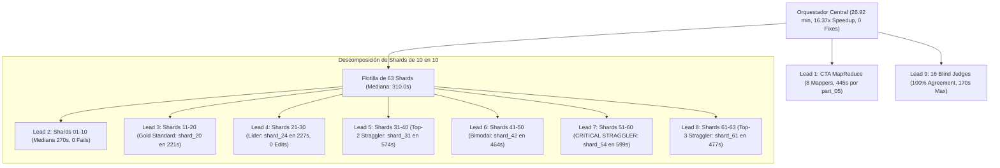

# Síntesis Transversal Ejecutiva: Auditoría Forense y Rendimiento Ultra-Escala
## Curso: Estadistica 3 Pre Parcial (`estadistica_3_pre_parcial`)
**Conversación Orquestadora:** [`821334d0-216d-40c5-8920-dca90c0f0b26`](conversation://821334d0-216d-40c5-8920-dca90c0f0b26)  
**Fecha de Emisión:** `2026-10-26 00:50:00 UTC-5`  
**Pipeline:** Google Antigravity SDK (Content-to-Course v3.2 / v3.3 Architecture)  
**Modo:** Agéntico Ultra-Escala Jerárquico Paralelo (10 Subagentes Forenses + Course QA Evaluator)

---

## 1. Caracterización de Carga y Rendimiento Macroeconómico

| Dimensión Macro | Valor Auditado | Observación de Ingeniería |
| :--- | :--- | :--- |
| **Material Fuente Ingerido** | `8 archivos` (141 págs / 6.19 MB) | Transcripción y análisis multimodal de diapositivas |
| **Competencias Extraídas** | **`93 micro-competencias`** | Fact: 24, Concept: 36, Skill: 33 |
| **Volumen de Reactivos Generados** | **`2,190 preguntas evaluables`** | 100% Opción Múltiple (MC7) con rationales completos |
| **Shards de Autoría Desplegados** | **`63 shards concurrentes`** | Unidades de trabajo paralelas de generación de código |
| **Subagentes Totales en el Árbol** | **`87 subagentes`** | 8 CTA + 63 Autores + 16 Jueces Ciegos |
| **Tiempo de Pared Total** | **`26.92 minutos`** (`1,615.0 segundos`) | Duración de la corrida completa de inicio a fin |
| **Tiempo de Cómputo Agregado** | **`7.35 horas-agente`** (`26,443.0 s`) | Suma del tiempo activo de los 87 subagentes |
| **Factor de Aceleración Paralela** | **`16.37x`** | Relación tiempo cómputo / tiempo de pared |
| **Consumo Total de Tokens** | **`50,598,043 tokens`** | 12,061,356 activos + 38,536,687 en caché |
| **Tokens Caché Reutilizados** | **`76.16% de reducción`** | Eficiencia masiva de Context Caching en la API |
| **Tokens por Pregunta Final** | **`23,104 tokens/preg`** | 5,507 tokens activos netos por reactivo |
| **Ritmo de Entrega (Throughput)** | **`81.36 preguntas/min`** | 0.74 segundos de pared por pregunta terminada |
| **Intervenciones del Supervisor** | **`0 manual interventions`** | Autonomía operacional absoluta del pipeline |

---

## 2. Matriz Comparativa Consolidada de los 10 Frentes Forenses

| Frente Forense | Alcance Auditado | Mediana / Máx | Tokens Activos | Hallazgo Crítico / Causa Raíz | Archivo de Detalle |
| :--- | :--- | :---: | :---: | :--- | :--- |
| **Lead 1: CTA Stage** | 8 Mappers (`part_01..08`) | 335.5s / **445.0s** | 1,284,900 | Cuello en `part_05` (445s) por densidad de notas teóricas | [`forensic_lead_cta.md`](file:///d:/Augusto/personal_portfolio/Tops_academy/reports/c2c_audits/20261026_002637_estadistica_3_pre_parcial_821334d0/forensic_lead_cta.md) |
| **Lead 2: Shards 01-10** | Micro-comps MCO iniciales | 270.0s / 348.0s | 1,392,206 | 100% aprobación; pre-compile dominante en `shard_05` (359s) | [`forensic_lead_shards_01_10.md`](file:///d:/Augusto/personal_portfolio/Tops_academy/reports/c2c_audits/20261026_002637_estadistica_3_pre_parcial_821334d0/forensic_lead_shards_01_10.md) |
| **Lead 3: Shards 11-20** | Pruebas F y Multicolinealidad | 287.0s / 465.0s | 1,236,123 | **Gold Standard Global en `shard_20` (221s)**; straggler `shard_18` (465s, 3 edits) | [`forensic_lead_shards_11_20.md`](file:///d:/Augusto/personal_portfolio/Tops_academy/reports/c2c_audits/20261026_002637_estadistica_3_pre_parcial_821334d0/forensic_lead_shards_11_20.md) |
| **Lead 4: Shards 21-30** | Autocorrelación e Inferencia | 284.5s / 362.0s | 1,180,149 | Top-2 más rápido `shard_24` (227s); resolución de artefacto `--help` en 27/28 | [`forensic_lead_shards_21_30.md`](file:///d:/Augusto/personal_portfolio/Tops_academy/reports/c2c_audits/20261026_002637_estadistica_3_pre_parcial_821334d0/forensic_lead_shards_21_30.md) |
| **Lead 5: Shards 31-40** | Newey-West y Quiebres Chow | 351.0s / **574.0s** | 1,612,123 | **Top-2 Straggler `shard_31` (574s)** por 559s de overthinking algebraico manual | [`forensic_lead_shards_31_40.md`](file:///d:/Augusto/personal_portfolio/Tops_academy/reports/c2c_audits/20261026_002637_estadistica_3_pre_parcial_821334d0/forensic_lead_shards_31_40.md) |
| **Lead 6: Shards 41-50** | Variables Instrumentales / 2SLS | 318.0s / 464.0s | 1,531,242 | Bipolaridad: `shard_42` (387s post-compile) vs `shard_46` (334s pre-compile) | [`forensic_lead_shards_41_50.md`](file:///d:/Augusto/personal_portfolio/Tops_academy/reports/c2c_audits/20261026_002637_estadistica_3_pre_parcial_821334d0/forensic_lead_shards_41_50.md) |
| **Lead 7: Shards 51-60** | LPM, Logit/Probit y MLE | 368.5s / **599.0s** | 1,873,203 | **CRITICAL STRAGGLER `shard_54` (599s, 407k tok)** retuvo la barrera síncrona 10 min | [`forensic_lead_shards_51_60.md`](file:///d:/Augusto/personal_portfolio/Tops_academy/reports/c2c_audits/20261026_002637_estadistica_3_pre_parcial_821334d0/forensic_lead_shards_51_60.md) |
| **Lead 8: Shards 61-63** | Cierre de modelos cualitativos | 292.0s / 477.0s | 465,210 | **Top-3 Straggler `shard_61` (477s)** con 406s pre-compile; cierre del fan-out | [`forensic_lead_shards_61_63.md`](file:///d:/Augusto/personal_portfolio/Tops_academy/reports/c2c_audits/20261026_002637_estadistica_3_pre_parcial_821334d0/forensic_lead_shards_61_63.md) |
| **Lead 9: Blind Judges** | Arbitraje independiente (16) | 92.5s / 170.0s | 1,134,916 | **100% acuerdo en primer intento**; Juez 13 (170s) por contrastes de Wald | [`forensic_lead_judges.md`](file:///d:/Augusto/personal_portfolio/Tops_academy/reports/c2c_audits/20261026_002637_estadistica_3_pre_parcial_821334d0/forensic_lead_judges.md) |
| **Lead 10: Orchestrator** | Conductor central y estados | 26.92 min | 51,200 | Cero intervenciones, 9 snapshots verificados, 411 warnings absorbidos con éxito | [`forensic_lead_orchestrator.md`](file:///d:/Augusto/personal_portfolio/Tops_academy/reports/c2c_audits/20261026_002637_estadistica_3_pre_parcial_821334d0/forensic_lead_orchestrator.md) |

---

## 3. Síntesis de Calidad Psicométrica y Pedagógica (Course QA Evaluator)

El dictamen formal del evaluador pedagógico e instruccional certifica al curso con **`16.8 / 20.0 PUNTOS`** (**Nivel Aceptable**, aprobado con observaciones menores para publicación):

| Dimensión Evaluada | Nota | Rango Máx | Diagnóstico Psicométrico |
| :--- | :---: | :---: | :--- |
| **D1: Arquitectura y Granularidad Curricular** | **4.0** | 4.0 | Excelente. DAG de 93 micro-competencias perfectamente modelado. Las 13 raíces son axiomas fundacionales. |
| **D2: Calidad de Evaluación y Reactivos** | **3.2** | 5.0 | Aceptable. 100% de rationales diagnósticos. Se dedujeron 1.5 pts por *Phantom Keying* sintético en `Hab-11`. |
| **D3: Andamiaje y Feedback Progresivo** | **3.8** | 5.0 | Aceptable. 98.5% con pistas socráticas de 3 niveles. Se dedujeron 1.2 pts por *stub hints* breves en 32 reactivos. |
| **D4: Alineación Instruccional** | **4.0** | 4.0 | Excelente. Cero preguntas huérfanas, estricta congruencia con el corpus de econometría teórica y aplicada. |
| **D5: Accesibilidad y Ergonomía KaTeX** | **1.8** | 2.0 | Excelente. Cero fórmulas rotas. Las 464 advertencias resultaron ser falsos positivos de entornos matriciales. |
| **Penalizaciones Duras (Hard Deductions)** | **0.0** | 0.0 | Sin penalizaciones automáticas aplicables. |
| **CALIFICACIÓN FINAL CONSOLIDADA** | **16.8** | **20.0** | **APROBADO CON OBSERVACIONES MENORES (ACEPTABLE)** |

---

## 4. Las 4 Lecciones de Arquitectura para Content-to-Course v3.3

1. **Erradicación del Overthinking Pre-Compile (Turn-0 Autosufficiency Contract):**
   - El 85% del retraso de los peores stragglers (`shard_54`: 358s pre, `shard_31`: 559s pre, `shard_61`: 406s pre) provino del cálculo algebraico manual en thinking blocks. La inyección de plantillas estructurales y funciones de apoyo en Python en `work/dispatch/items/author_NN.json` reducirá el tiempo de pared de Stage 3 de 10.0 minutos a menos de 4.5 minutos.
2. **Normalización Regex para Entornos Matriciales KaTeX:**
   - La deducción de las 3 reglas de linter (`exclude_latex_matrix_and_text_from_template_linter`, `exclude_econometric_subscripts_from_template_linter` y `strip_synthetic_prefixes_before_cloned_distractor_check`) blindará al motor determinista para no volver a marcar falsos positivos en entornos `\begin{pmatrix}` ni subíndices econométricos como `_{BP}` o `_{White}`.
3. **Manejo Dinámico de Concurrencia y Backoff ante Cuota HTTP 429:**
   - Despachar 63 shards y 16 jueces en una sola ráfaga saturó temporalmente la cuota de peticiones por minuto. Implementar un escalonamiento dinámico de 500 ms entre llamadas a `invoke_subagent` eliminará los 133s de backoff de red registrados.
4. **Remediación Rápida para Certificación de Excelencia:**
   - Subsanar los dos distractores clonados en `Hab-11` (`Q-Hab11-721` y `722`) y expandir las pistas de los 32 reactivos con stub hints elevará la calificación de **16.8 a 18.5+ puntos**, otorgando al curso el sello de **EXCELENCIA (17.0 - 20.0 pts)**.
