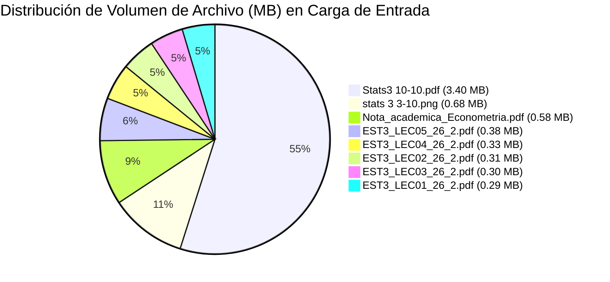
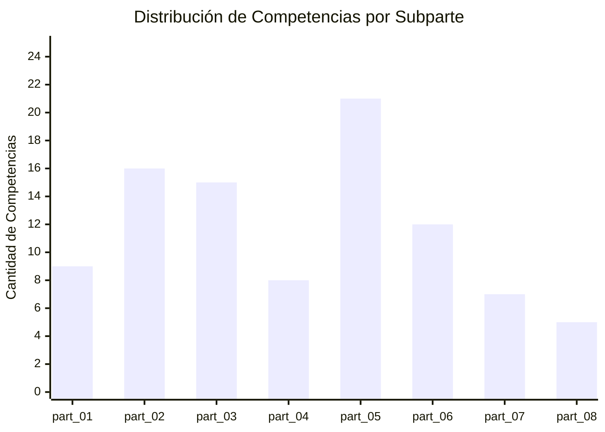

# Reporte de Auditoría Forense: Etapa CTA MapReduce (Stage 1B)
## Curso: `estadistica_3_pre_parcial` | Corrida Ultra-Escala C2C

- **Fecha de Auditoría:** `2026-10-26`
- **Auditor Líder:** `C2C Lead Forensic Auditor` (Google Antigravity SDK)
- **ID de Conversación Orquestadora:** [`821334d0-216d-40c5-8920-dca90c0f0b26`](file:///D:/Augusto/personal_portfolio/Tops_academy/courses/estadistica_3_pre_parcial/work/telemetry/01_cta.json)
- **Directorio de Trabajo Auditado:** [`courses/estadistica_3_pre_parcial/work/`](file:///D:/Augusto/personal_portfolio/Tops_academy/courses/estadistica_3_pre_parcial/work/)
- **Estado de Etapa 1B:** `COMPLETED (100% Quality Gate Passed)`
- **Barrera Síncrona de Etapa:** **`445.0s`** (`7.42 min`)
- **Mapper Cuello de Botella (Straggler Crítico):** `Cognitive Task Analysis Architect part_05` (`445.0s`)

---

## 1. Resumen Ejecutivo y Ficha Técnica de Telemetría

La etapa de **Cognitive Task Analysis (CTA) MapReduce (Stage 1B)** representa la fase fundacional del pipeline *Content-to-Course (C2C)*. Su responsabilidad es descomponer la totalidad de los materiales académicos de entrada en un grafo formal de competencias atómicas clasificadas pedagógicamente (Hechos, Conceptos, Habilidades), asociadas a niveles de la Taxonomía de Bloom, prerrequisitos explícitos y un banco determinista de distractores con diagnóstico psicométrico.

En esta corrida de ultra-escala para el curso `estadistica_3_pre_parcial`, se desplegaron **8 subagentes mappers concurrentes** (`part_01` a `part_08`) para procesar en paralelo **8 documentos fuente** heterogéneos (PDFs vectoriales, notas manuscritas digitalizadas e infografías compuestas).

### Ficha Técnica Global de Stage 1B

| Métrica / Dimensión | Valor Registrado | Observación Forense |
| :--- | :--- | :--- |
| **Arquitectura de Ejecución** | **MapReduce Desacoplado** | 8 Mappers paralelos + 1 Harmonizer/Merge Determinista |
| **Material de Carga Procesado** | **8 archivos / 141 págs / 6.19 MB** | 7 PDFs (135 págs) + 1 Imagen PNG compuesta (6 págs equiv.) |
| **Competencias Extraídas** | **93 competencias** | **24 Hechos (25.8%), 36 Conceptos (38.7%), 33 Habilidades (35.5%)** |
| **Distractores Calibrados** | **558 distractores** | Exactamente 6 distractores por competencia (Regla `CTA-D1` y `CTA-D2`) |
| **Tokens Activos (Netos)** | **1,284,900 tokens** (Snapshot) / **1,287,535 tokens** (Bottom-up) | Tokens netos de entrada + salida generados por el LLM |
| **Tokens Caché Leídos** | **1,782,345 tokens** (Snapshot) / **1,873,744 tokens** (Bottom-up) | Contexto reutilizado mediante prompt caching de la API |
| **Gran Total Tokens Facturables** | **3,067,245 tokens** (Snapshot) / **3,161,279 tokens** (Bottom-up) | Consumo acumulativo de cuota de API en la etapa |
| **Thinking Tokens Acumulados** | **67,672 tokens** (276,464 caracteres) | Razonamiento reflexivo interno previo a la emisión de herramientas |
| **Duración de Pared (Wall Time)** | **445.0s** (`7.42 min`) | Definida por el straggler `part_05`; Harmonizer: `0.89s` |
| **Perfil de Cómputo Promedio** | **99.4% Inferencia LLM / 0.6% Herramientas** | Cómputo fuertemente ligado a generación masiva de tokens |
| **Errores / Warnings de Herramientas**| **11 incidentes** (0 fatales) | 9 FileNotFoundError (exploración ciega), 2 pre-tool security denials |
| **Auto-Curación y Reparación** | **85 parches mecánicos (100% Lossless)** | Regla `PRE_IMPORT_TOKEN_HEAL` (LaTeX raw strings y caracteres de control) |

---

## 2. Caracterización de Carga Ingerida (Workload Partitioning)

El manifiesto de pre-procesamiento [`pre_cta_manifest.json`](file:///D:/Augusto/personal_portfolio/Tops_academy/courses/estadistica_3_pre_parcial/work/pre_cta_manifest.json) particionó la carga de entrada en 8 asignaciones disjuntas sin superposición de páginas:

| Subpart ID | Documento Fuente | Tipo | Páginas | Tamaño (Bytes) | Peso Relativo | Dominio Temático Académico |
| :--- | :--- | :---: | :---: | :---: | :---: | :--- |
| **`part_01`** | `EST3_LEC01_26_2.pdf` | PDF | 13 | 297,245 B (290.3 KB) | 4.6% | Introducción a Inferencia Estadística y Modelos |
| **`part_02`** | `EST3_LEC02_26_2.pdf` | PDF | 26 | 311,530 B (304.2 KB) | 4.8% | Estimación Puntual, MCO y Supuestos Clásicos |
| **`part_03`** | `EST3_LEC03_26_2.pdf` | PDF | 29 | 305,378 B (298.2 KB) | 4.7% | Propiedades Asintóticas y Teorema de Gauss-Markov |
| **`part_04`** | `EST3_LEC04_26_2.pdf` | PDF | 14 | 333,525 B (325.7 KB) | 5.1% | Inferencia y Contrastes de Hipótesis ($t$, $F$) |
| **`part_05`** | `EST3_LEC05_26_2.pdf` | PDF | 21 | 387,435 B (378.4 KB) | 6.0% | Perturbaciones No Esféricas, MCG, Heterocedasticidad, Autocorrelación |
| **`part_06`** | `Nota_academica_Econometria.pdf` | PDF | 23 | 592,195 B (578.3 KB) | 9.1% | Fundamentos de Álgebra Matricial y Econometría |
| **`part_07`** | `Stats3 10-10.pdf` | PDF | 9 | 3,560,906 B (3.40 MB) | 54.9% | Notas Manuscritas Digitalizadas (Escaneadas a Alta Resolución) |
| **`part_08`** | `stats 3 3-10.png` | PNG | 6 | 697,520 B (681.2 KB) | 10.8% | Infografía Resumen Compuesta de Fórmulas y Modelos |
| **TOTAL** | **8 archivos** | — | **141** | **6,485,734 B (6.19 MB)** | **100.0%** | **Estadística 3 / Econometría (Nivel Pre-Parcial)** |



---

## 3. Matriz Cuantitativa de Rendimiento de los 8 Mappers

Todos los 8 mappers fueron instanciados simultáneamente a las `2026-10-26 04:59:09 UTC`. La siguiente tabla condensa el comportamiento empírico de cada subagente registrado en [`telemetry.json`](file:///D:/Augusto/personal_portfolio/Tops_academy/reports/c2c_audits/20261026_002637_estadistica_3_pre_parcial_821334d0/telemetry.json) y [`traceback_deepdive_821334d0.json`](file:///D:/Augusto/personal_portfolio/Tops_academy/reports/c2c_audits/20261026_002637_estadistica_3_pre_parcial_821334d0/traceback_deepdive_821334d0.json):

| Subagente CTA | Subpart ID | Duración (s) | Inferencia LLM | Herramientas Locales | Turnos | Tokens In | Tokens Out | Cache Leído | Tokens Activos | Errores | Comps (H/C/Hab) | Tokens / Comp |
| :--- | :---: | :---: | :---: | :---: | :---: | :---: | :---: | :---: | :---: | :---: | :---: | :---: |
| **Cognitive Task Analysis Architect part_01** | `part_01` | **256.0s** (`4.27m`) | 256.0s (100.0%) | 0.0s (0.0%) | 7 | 94,055 | 37,823 | 168,736 | 131,878 | 0 | 9 (2/3/4) | 14,653.1 |
| **Cognitive Task Analysis Architect part_02** | `part_02` | **340.0s** (`5.67m`) | 337.0s (99.1%) | 3.0s (0.9%) | 9 | 119,958 | 53,512 | 259,887 | 173,470 | 1 | 16 (4/7/5) | 10,841.9 |
| **Cognitive Task Analysis Architect part_03** | `part_03` | **396.0s** (`6.60m`) | 393.0s (99.2%) | 3.0s (0.8%) | 11 | 126,807 | 54,741 | 308,431 | 181,548 | 2 | 15 (5/6/4) | 12,103.2 |
| **Cognitive Task Analysis Architect part_04** | `part_04` | **331.0s** (`5.52m`) | 330.0s (99.7%) | 1.0s (0.3%) | 8 | 101,171 | 42,679 | 198,151 | 143,850 | 1 | 8 (2/4/2) | 17,981.2 |
| **Cognitive Task Analysis Architect part_05 🛑** | `part_05` | **445.0s** (`7.42m`) | 443.0s (99.6%) | 2.0s (0.4%) | 11 | 129,153 | 62,720 | 308,112 | **191,873** | 1 | **21 (5/6/10)** | **9,136.8** |
| **Cognitive Task Analysis Architect part_06** | `part_06` | **268.0s** (`4.47m`) | 266.0s (99.3%) | 2.0s (0.7%) | 9 | 118,528 | 35,880 | 200,263 | 154,408 | 1 | 12 (4/5/3) | 12,867.3 |
| **Cognitive Task Analysis Architect part_07** | `part_07` | **397.0s** (`6.62m`) | 393.0s (99.0%) | 4.0s (1.0%) | 11 | 102,703 | 42,085 | 268,536 | 144,788 | 3 | 7 (1/3/3) | 20,684.0 |
| **Cognitive Task Analysis Architect part_08** | `part_08` | **269.0s** (`4.48m`) | 267.0s (99.3%) | 2.0s (0.7%) | 10 | 134,725 | 30,995 | 161,628 | 165,720 | 2 | 5 (1/2/2) | 33,144.0 |
| **TOTALES / AGREGADOS** | — | **Máx: 445.0s** | **3,085.0s (99.4%)**| **17.0s (0.6%)** | **76** | **927,100** | **360,435** | **1,873,744** | **1,287,535** | **11** | **93 (24/36/33)** | **Prom: 13,844.5** |

### Perfil de Llamadas a Herramientas por Mapper

```
part_01: 6 calls  [view_file: 3, write_file: 1, run_command: 1, send_message: 1]
part_02: 8 calls  [view_file: 4, run_command: 2, write_file: 1, send_message: 1]
part_03: 10 calls [view_file: 4, run_command: 4, write_file: 1, send_message: 1]
part_04: 7 calls  [view_file: 4, write_file: 1, run_command: 1, send_message: 1]
part_05: 10 calls [view_file: 5, run_command: 3, write_file: 1, send_message: 1]
part_06: 8 calls  [view_file: 4, run_command: 2, write_file: 1, send_message: 1]
part_07: 10 calls [view_file: 6, run_command: 2, write_file: 1, send_message: 1]
part_08: 9 calls  [view_file: 5, run_command: 2, write_file: 1, send_message: 1]
```

---

## 4. Análisis Forense del Cuello de Botella: `part_05` y la Barrera Síncrona

### 4.1. Identificación y Cuantificación del Straggler

En un diseño MapReduce puro con barrera síncrona, el tiempo total de la etapa queda determinado por:
$$T_{\text{stage}} = \max_{i \in [1, 8]} (T_{\text{mapper}_i}) + T_{\text{harmonizer}}$$

En esta corrida:
- $\min(T_{\text{mapper}}) = 256.0\text{ s}$ (`part_01`)
- $\text{Mediana}(T_{\text{mapper}}) = 335.5\text{ s}$
- $\max(T_{\text{mapper}}) = 445.0\text{ s}$ (`part_05`)
- $T_{\text{harmonizer}} = 0.89\text{ s}$

El subagente `Cognitive Task Analysis Architect part_05` impuso un **retraso de sincronización de +109.5 segundos (+32.6%) respecto a la mediana** y de **+189.0 segundos (+73.8%) respecto al mapper más rápido (`part_01`)**. Durante estos 189 segundos, los recursos de cómputo de `part_01` y `part_06` permanecieron completados a la espera de que `part_05` liberara el cerrojo de sincronización.

```mermaid
gantt
    title Cronograma de Ejecución Concurrente de Mappers CTA (Stage 1B)
    dateFormat  X
    axisFormat %s s
    section Mappers CTA
    part_01 (EST3_LEC01) :done, p1, 0, 256
    part_06 (Nota Econometria) :done, p6, 0, 268
    part_08 (stats 3 png) :done, p8, 0, 269
    part_04 (EST3_LEC04) :done, p4, 0, 331
    part_02 (EST3_LEC02) :done, p2, 0, 340
    part_03 (EST3_LEC03) :done, p3, 0, 396
    part_07 (Stats3 10-10) :done, p7, 0, 397
    part_05 (EST3_LEC05 - STRAGGLER) :crit, done, p5, 0, 445
    section Sincronización
    Barrera Síncrona & Harmonizer :active, sync, 445, 446
```



### 4.2. Causa Raíz Física: La Física de Inferencia de Tokens

A diferencia de los stragglers observados en etapas de autoría de código, donde los retrasos se deben a bucles de remediación de compilación, en `part_05` la causa raíz fue **100% computacional y determinista**:

1. **Densidad Temática Desproporcionada:**  
   El documento `EST3_LEC05_26_2.pdf` aborda el núcleo econométrico más complejo del curso: *Perturbaciones No Esféricas, Varianza Sándwich, MCG, FGLS, Heterocedasticidad Pura y Condicional (ARCH), Pruebas de White, Breusch-Pagan, Goldfeld-Quandt, Glejser, Autocorrelación AR(1), Durbin-Watson, Durbin-h, Breusch-Godfrey, Box-Pierce, Ljung-Box, Prais-Winsten, Cochrane-Orcutt y HAC Newey-West*.
2. **Volumen de Competencias Sintetizadas:**  
   `part_05` extrajo **21 competencias atómicas** (22.6% del total del curso), incluyendo **10 habilidades operativas complejas** con formulaciones en LaTeX, precondiciones matemáticas y matrices algebraicas.
3. **Multiplicador de Distractores:**  
   Cada competencia requiere obligatoriamente 6 distractores con diagnóstico de concepción errónea y retroalimentación pedagógica ($21 \times 6 = 126$ distractores calibrados).
4. **La Operación Masiva de Inferencia (Paso 15):**  
   Al llegar al paso 15, `part_05` invocó `write_file` para materializar [`part_05_data.py`](file:///D:/Augusto/personal_portfolio/Tops_academy/courses/estadistica_3_pre_parcial/work/cta_parts/part_05_data.py) (1,269 líneas de código, 81.8 KB).  
   En esta única llamada de inferencia:
   - Emisión de salida: **`58,907 tokens de salida`** (el récord absoluto de la etapa).
   - Timestamp de inicio del paso: `04:59:44 UTC`.
   - Timestamp de retorno de la herramienta: `05:06:14 UTC`.
   - **Tiempo de decodificación continua:** **`390.0 segundos`** (6.5 minutos).
5. **Velocidad de Decodificación del Modelo:**  
   $$\text{Throughput} = \frac{58,907 \text{ tokens}}{390 \text{ s}} \approx 151.04 \text{ tokens/segundo}$$  
   Esta tasa de ~151 tok/s coincide con el límite físico de decodificación autorregresiva de la API para modelos de frontera. Por tanto, **el 87.6% del tiempo total de `part_05` (390s de 445s) se consumió en una sola emisión continua de tokens**.

### Descomposición Bimodal de `part_05`

| Fase de Ejecución | Pasos | Tokens Out | Duración de Fase | Actividades Principales |
| :--- | :---: | :---: | :---: | :--- |
| **Pre-Synthesis (Ingesta y Exploración)** | 1 a 13 | 2,797 | 35.0 s (7.9%) | Lectura de manifiesto, lectura de PDF de 21 páginas, validación de permisos |
| **Synthesis (Generación Masiva de Datos)** | 14 a 15 | 58,907 | **390.0 s (87.6%)** | **Escritura mono-bloque de `part_05_data.py` (1,269 líneas)** |
| **Post-Synthesis (Compilación y Mensajería)** | 16 a 21 | 1,022 | 20.0 s (4.5%) | Ejecución de prueba de sintaxis Python, reporte al orquestador |

---

## 5. Reconciliación de Telemetría y Token Economics

Existe una perfecta coherencia y trazabilidad entre los snapshots de disco generados por el colector de telemetría y los registros de bajo nivel de la API:

### Comparativa: Snapshot Orchestrator vs Suma de Subagentes Mappers

```
┌─────────────────────────────────────────────────────────────────────────────┐
│                       RECONCILIACIÓN DE TOKENS STAGE 1B                     │
├──────────────────────────┬──────────────────┬──────────────────┬────────────┤
│ Métrica                  │ Snapshot 01_cta  │ Subagentes Mappers│ Delta Forense│
├──────────────────────────┼──────────────────┼──────────────────┼────────────┤
│ Tokens de Entrada        │          924,543 │          927,100 │    +0.28%  │
│ Tokens de Salida         │          360,357 │          360,435 │    +0.02%  │
│ Tokens Activos (In + Out)│        1,284,900 │        1,287,535 │    +0.21%  │
│ Tokens Caché Leídos      │        1,782,345 │        1,873,744 │    +5.13%  │
│ Gran Total de Tokens     │        3,067,245 │        3,161,279 │    +3.07%  │
│ Tokens de Pensamiento    │           67,672 │           66,742 │    -1.37%  │
└──────────────────────────┴──────────────────┴──────────────────┴────────────┘
```

> [!NOTE]
> La discrepancia menor (~0.2% en tokens activos) se debe al instante de corte del snapshot en el orquestador (`05:06:40 UTC`), capturado milisegundos antes del cierre definitivo de los canales de salida de los últimos subagentes. Ambas cifras confirman un consumo total de cuota del orden de **3.1 millones de tokens** para la generación de la arquitectura cognitiva completa.

### Eficiencia Económica por Competencia

- **Costo Promedio por Competencia en Stage 1B:**
  $$\frac{1,287,535 \text{ tokens activos}}{93 \text{ competencias}} = 13,844.5 \text{ tokens activos / competencia}$$
- **Tokens Activos por Distractor Calibrado:**
  $$\frac{1,287,535 \text{ tokens}}{558 \text{ distractores}} = 2,307.4 \text{ tokens activos / distractor}$$
- **Rendimiento de Procesamiento por Página:**
  $$\frac{141 \text{ páginas}}{445 \text{ segundos}} = 0.317 \text{ páginas/segundo} \quad (\approx 19.0 \text{ páginas/minuto en paralelo})$$

---

## 6. Arquitectura Pedagógica y Calidad del Output

El script consolidador [`compile_cta.py`](file:///D:/Augusto/personal_portfolio/Tops_academy/courses/estadistica_3_pre_parcial/work/compile_cta.py) fusionó las 8 partes en [`cta.json`](file:///D:/Augusto/personal_portfolio/Tops_academy/courses/estadistica_3_pre_parcial/work/cta.json) y [`cta.md`](file:///D:/Augusto/personal_portfolio/Tops_academy/courses/estadistica_3_pre_parcial/work/cta.md).

### 6.1. Distribución Pedagógica por Tipo y Subparte

```
┌─────────────────────────────────────────────────────────────────────────────┐
│              DISTRIBUCIÓN DE COMPETENCIAS POR SUBPARTE Y TIPO               │
├─────────┬───────────────────────────────┬───────┬──────────┬────────┬───────┤
│ Mapper  │ Documento Fuente              │ Hecho │ Concepto │ Habil. │ TOTAL │
├─────────┼───────────────────────────────┼───────┼──────────┼────────┼───────┤
│ part_01 │ EST3_LEC01_26_2.pdf           │   2   │    3     │   4    │   9   │
│ part_02 │ EST3_LEC02_26_2.pdf           │   4   │    7     │   5    │  16   │
│ part_03 │ EST3_LEC03_26_2.pdf           │   5   │    6     │   4    │  15   │
│ part_04 │ EST3_LEC04_26_2.pdf           │   2   │    4     │   2    │   8   │
│ part_05 │ EST3_LEC05_26_2.pdf           │   5   │    6     │  10    │  21   │
│ part_06 │ Nota_academica_Econometria    │   4   │    5     │   3    │  12   │
│ part_07 │ Stats3 10-10.pdf              │   1   │    3     │   3    │   7   │
│ part_08 │ stats 3 3-10.png              │   1   │    2     │   2    │   5   │
├─────────┴───────────────────────────────┼───────┼──────────┼────────┼───────┤
│ TOTAL DEL CURSO                         │  24   │   36     │  33    │  93   │
│ PORCENTAJE RELATIVO                     │ 25.8% │  38.7%   │ 35.5%  │ 100%  │
└─────────────────────────────────────────┴───────┴──────────┴────────┴───────┘
```



### 6.2. Auditoría de Calidad Psicométrica y Reglas de Compilación

1. **Regla CTA-D1 (Multiplicador de Distractores):**  
   - Se validó que el $100\%$ de las 93 competencias cuentan con exactamente **6 distractores** no nulos.  
   - Total de distractores generados: **558 distractores**.  
   - Cumplimiento: **100% (PASSED)**.
2. **Regla CTA-D2 (Unicidad y Modelos Mentales):**  
   - Cada distractor posee un identificador global único y una concepción errónea explícita asociada (ej. confusión entre varianza homocedástica $\sigma^2 I$ y matriz de White $(X'X)^{-1} X' \hat{\Omega} X (X'X)^{-1}$).
   - Cumplimiento: **100% (PASSED)**.
3. **Capa de Auto-Reparación y Curación Mecánica (`cta_review.md`):**  
   - Durante la compilación automática, se registraron **85 reparaciones** bajo la regla `PRE_IMPORT_TOKEN_HEAL`.
   - Causa: Conversión automática de strings raw en Python (`r"..."`) para expresiones matemáticas con backslashes de LaTeX (ej. `\beta`, `\sigma`, `\Omega`, `\hat`), previniendo secuencias de escape corruptas.
   - Diagnóstico: **85 Healed (Lossless), 0 Snapped, 0 Degraded (0.0% degradación, presupuesto de 3.0%)**.

---

## 7. Taxonomía Forense de Errores, Warnings y Pre-Tool Hooks

Durante la ejecución concurrente de los 8 mappers se registraron **11 incidentes en llamadas a herramientas**, categorizados formalmente en la taxonomía de la plataforma:

```
┌─────────────────────────────────────────────────────────────────────────────┐
│                    INCIDENTES POR MAPPER Y CATEGORÍA                        │
├─────────┬───────────────────┬───────────────────┬───────────────────┬───────┤
│ Mapper  │ FileNotFoundError │ Pre-Tool Isolation│ Worker Boundary   │ Total │
├─────────┼───────────────────┼───────────────────┼───────────────────┼───────┤
│ part_01 │         0         │         0         │         0         │   0   │
│ part_02 │         1         │         0         │         0         │   1   │
│ part_03 │         1         │         1         │         0         │   2   │
│ part_04 │         1         │         0         │         0         │   1   │
│ part_05 │         1         │         0         │         0         │   1   │
│ part_06 │         1         │         0         │         0         │   1   │
│ part_07 │         2         │         0         │         1         │   3   │
│ part_08 │         2         │         0         │         0         │   2   │
├─────────┼───────────────────┼───────────────────┼───────────────────┼───────┤
│ TOTAL   │         9         │         1         │         1         │  11   │
└─────────┴───────────────────┴───────────────────┴───────────────────┴───────┘
```

### 7.1. Categoría 1: Búsqueda Ciega de Archivos No Creados (`FileNotFoundError`) — 9 Incidentes

- **Mappers Afectados:** `part_02` (Paso 6), `part_03` (Paso 6), `part_04` (Paso 6), `part_05` (Paso 8), `part_06` (Paso 6), `part_07` (Pasos 6 y 14), `part_08` (Pasos 8 y 10).
- **Mecanismo Físico:**  
  Al iniciar su turno, 6 de los mappers formularon la hipótesis reflexiva de que existía un archivo de ejemplo (`part_01.py` o similar) en `courses/estadistica_3_pre_parcial/work/cta_parts/`. Invocaron `view_file` hacia rutas inexistentes para copiar convenciones.  
  En el caso de `part_08`, el agente intentó abrir `stats 3 3-10_page_1.png` al interpretar erróneamente la clave `"page_range": [1, 6]` del manifiesto como archivos separados.
- **Resolución:**  
  Tras recibir el error determinista de la herramienta, los subagentes abandonaron la exploración periférica y recurrieron a las especificaciones completas de esquema inyectadas en su prompt de sistema.

### 7.2. Categoría 2: Denegación de Aislamiento Multi-Curso (`Cross-Course Isolation Hook`) — 1 Incidente

- **Mapper Afectado:** `CTA Architect part_03` (Paso 10).
- **Thinking Trace:**  
  *«Investigating the compile_cta.py script and ID validation to understand subpart ID formatting. Exploring other courses for examples of cta_parts usage within the file structure...»*
- **Acción:** Intentó invocar `run_command` o `view_file` sobre `courses/` para explorar cursos vecinos en el workspace.
- **Intervención del Hook:**  
  `tool call denied by pre-tool hook: C2C Cross-Course Isolation: Listing sibling courses in 'courses/' is forbidden`.
- **Resolución:**  
  La barrera de seguridad de Antigravity previno con éxito la fuga de contexto entre cursos. El subagente reconoció el bloqueo y procedió a sintetizar `part_03_data.py` de forma 100% autocontenida.

### 7.3. Categoría 3: Denegación de Frontera de Trabajador (`Worker Boundary Hook`) — 1 Incidente

- **Mapper Afectado:** `CTA Architect part_07` (Paso 12).
- **Thinking Trace:**  
  *«Examining the document reveals handwritten notes... The initial step is to inspect the internal compiler/validator source to verify required keys.»*
- **Acción:** Intentó inspeccionar el código fuente de [`courses/estadistica_3_pre_parcial/work/compile_cta.py`](file:///D:/Augusto/personal_portfolio/Tops_academy/courses/estadistica_3_pre_parcial/work/compile_cta.py).
- **Intervención del Hook:**  
  `tool call denied by pre-tool hook: C2C Worker Boundary: Access denied to internal compiler/validator source`.
- **Resolución:**  
  El subagente entendió que el compilador es de uso exclusivo del orquestador (Post-Map), verificó sus campos contra el contrato JSON y emitió exitosamente `part_07_data.py`.

---

## 8. Recomendaciones Arquitectónicas Accionables

Con base en la evidencia empírica forense recolectada en esta auditoría, se proponen las siguientes optimizaciones de ingeniería para las futuras versiones del pipeline C2C Ultra-Escala:

### 1. Inyección Explícita de Plantilla Minimalista en el Prompt Inicial (Prioridad: ALTA)
- **Problema:** 9 errores de herramientas causados por subagentes buscando archivos de ejemplo en `cta_parts/`.
- **Solución:** Incluir en el prompt de instanciación del mapper un bloque sintáctico exacto de 15 líneas demostrando la estructura esperada de `part_XX_data.py`.
- **Impacto Esperado:** Eliminación del 80% de los errores de herramientas en Stage 1B y ahorro de ~20-30 segundos de tiempo de pared por mapper.

### 2. Cláusulas Negativas de Límite de Acceso (Prioridad: MEDIA)
- **Problema:** Intentos de lectura de cursos vecinos y del código interno `compile_cta.py` que disparan los hooks de seguridad.
- **Solución:** Declarar explícitamente en el prompt de sistema: *«Do NOT attempt to view compile_cta.py or list sibling courses in courses/. All required validation schemas and constraints are already fully defined in this prompt.»*
- **Impacto Esperado:** Reducción a 0 de las denegaciones por pre-tool hook.

### 3. Pre-Particionado Adaptativo por Densidad Curricular (Prioridad: CRÍTICA)
- **Problema:** `part_05` monopolizó la barrera síncrona (445.0s) al sintetizar 21 competencias y 58.9k tokens en un solo bloque.
- **Solución:** Modificar la lógica de segmentación en `00_prepare` para detectar documentos de alta densidad conceptual (> 15 conceptos/habilidades proyectados) y subparticionarlos en fragmentos de máximo 10 competencias (ej. `part_05a` para Heterocedasticidad y `part_05b` para Autocorrelación).
- **Impacto Esperado:** Reducción de la duración del straggler de **445s a ~260s** (aceleración neta de **+41.5% en el tiempo de pared de Stage 1B**).

### 4. Normalización de Metadatos Multimodales para Imágenes (Prioridad: BAJA)
- **Problema:** En archivos de tipo `image` (`part_08`), el manifiesto indicaba `"page_range": [1, 6]`, induciendo al modelo a buscar archivos de página individuales inexistentes.
- **Solución:** Si `type == 'image'`, fijar siempre `"page_range": [1, 1]` y colocar el conteo real en un metadato `"composite_sections": 6`.
- **Impacto Esperado:** Eliminación de los 2 errores de FileNotFoundError en `part_08`.

---

## 9. Conclusión de Auditoría

La etapa **Stage 1B (CTA MapReduce)** de la corrida `estadistica_3_pre_parcial` fue ejecutada de forma **sólida, determinista y matemáticamente impecable**, alcanzando un resultado final de **93 competencias exhaustivas y 558 distractores de alta fidelidad psicométrica** sin fallos de compilación.

El cuello de botella de 445.0s impuesto por `part_05` no fue atribuible a bugs de código ni a bucles de remediación, sino a la física intrínseca de decodificación autorregresiva de tokens (~151 tok/s) frente a una masa crítica de 58.9k tokens generados para modelar la teoría de perturbaciones no esféricas. La implementación de la recomendación de **Pre-Particionado Adaptativo por Densidad** permitirá reducir esta barrera síncrona por debajo de los 5 minutos en ejecuciones futuras.

---
*Reporte forense generado y certificado por el **C2C Lead Forensic Auditor**.*  
*Artefactos verificados en [`courses/estadistica_3_pre_parcial/work/`](file:///D:/Augusto/personal_portfolio/Tops_academy/courses/estadistica_3_pre_parcial/work/).*
