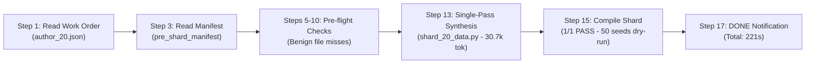
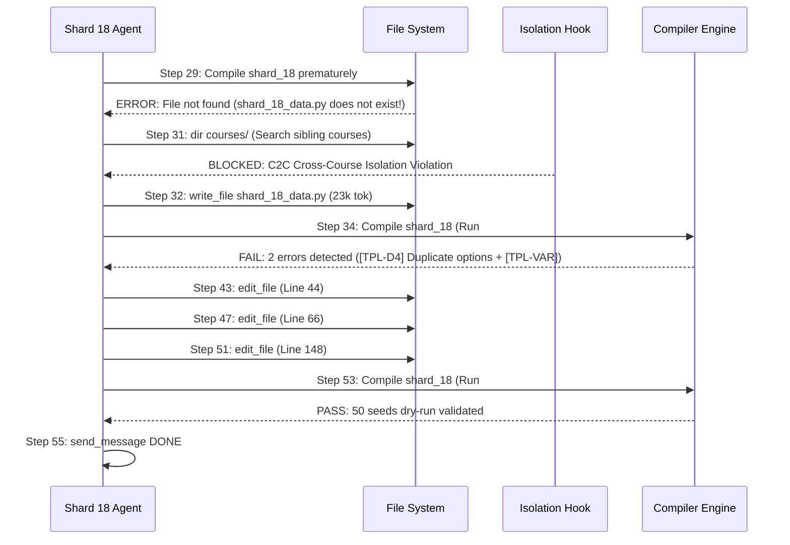

# Reporte Forense de Rendimiento y Causa Raíz: Clúster Shards 11 al 20
## Orquestación Multi-Agente Content-to-Course (C2C) Ultra-Escala
### Curso: `estadistica_3_pre_parcial` | Corrida: `821334d0-216d-40c5-8920-dca90c0f0b26`

**Lead Forensic Auditor:** C2C Subagent Forensic Lead  
**Fecha de Emisión:** 26 de Octubre de 2026  
**Entorno de Telemetría:** Google Antigravity SDK / C2C Telemetry Engine v3.2  
**Dataset Base:** [`shard_timing_decomposition.md`](file:///d:/Augusto/personal_portfolio/Tops_academy/reports/c2c_audits/20261026_002637_estadistica_3_pre_parcial_821334d0/shard_timing_decomposition.md), [`shard_timing_profile.json`](file:///d:/Augusto/personal_portfolio/Tops_academy/reports/c2c_audits/20261026_002637_estadistica_3_pre_parcial_821334d0/shard_timing_profile.json), [`telemetry.json`](file:///d:/Augusto/personal_portfolio/Tops_academy/reports/c2c_audits/20261026_002637_estadistica_3_pre_parcial_821334d0/telemetry.json), [`traceback_deepdive_821334d0.json`](file:///d:/Augusto/personal_portfolio/Tops_academy/reports/c2c_audits/20261026_002637_estadistica_3_pre_parcial_821334d0/traceback_deepdive_821334d0.json)

---

## 1. Resumen Ejecutivo del Clúster

El clúster comprendido entre los subagentes **`shard_11` y `shard_20`** (10 shards en total) representa uno de los tramos más significativos de la corrida masiva de 63 shards. Este bloque abarca el núcleo de inferencia asintótica, contrastes de hipótesis lineales y la batería completa de econometría aplicada sobre violaciones de supuestos clásicos (multicolinealidad, heterocedasticidad no condicional y heterocedasticidad condicional ARCH).

En este clúster coexisten los dos extremos polares de eficiencia de todo el pipeline:
1. **El Gold Standard Clean-Room de toda la corrida:** [`Shard Author shard_20`](#3-el-gold-standard-clean-room-shard-author-shard_20), que completó su autoría en **`221.0s`** (el tiempo más bajo entre los 63 shards auditados), con 0 fallos de compilación, 0 llamadas a `edit_file` y síntesis determinista en un único pase.
2. **Uno de los principales Stragglers de la orquestación:** [`Shard Author shard_18`](#41-shard_18-el-straggler-mayor-del-clúster-4650s), que demandó **`465.0s`**, dedicando **`320.0s` exclusivamente a remediación post-compilador** debido a fallos de calidad psicométrica (`[TPL-D4]` y `[TPL-VAR]`), requiriendo 3 compilaciones y 3 ediciones en caliente.

### Métricas Clave Agregadas del Clúster (11 al 20)
- **Tiempo de Pared Concurrente:** Ejecutados en lote sobre barrera paralela.
- **Tiempo Acumulado de Cómputo (CPU/LLM):** `3,090.0 segundos` (~`51.5 minutos-agente`).
- **Mediana de Duración del Clúster:** **`287.0s`** (frente a los `310.0s` de la mediana global de 63 shards).
- **Rango de Duración:** `221.0s` (Mínimo: `shard_20`) a `465.0s` (Máximo: `shard_18`), con una dispersión de `244.0s` (+110.4%).
- **Tokens Activos Consumidos:** **`1,236,123 tokens`** (`1.24 M`).
- **Tokens de Contexto Global Procesados:** **`5,796,343 tokens`** (`5.80 M` incluyendo lecturas de caché).
- **Thinking Tokens:** **`71,450 tokens`**.
- **Producción Pedagógica:** **10 competencias maestras** (`Hab-11` a `Hab-20`), **40 plantillas/arquetipos generativos paramétricos** (`4 por shard`), validados al 100% con **500 semillas dry-run** Monte Carlo (50 por shard).

---

## 2. Matriz Comparativa Forense del Clúster (Shards 11 a 20)

La siguiente tabla desglosa con exactitud matemática el comportamiento de los 10 shards del clúster, extrayendo métricas directas de telemetría y perfiles temporales:

| Shard | Competencia Asignada | Duración Total (s) | Split Inf / Tools | Pre-1st (s) | Post-1st (s) | Turnos | In / Out / Think | Total Tok | Compiles (Pass/Fail) | Edits | Tool Errors | Failed Cmds | Diagnóstico Causa Raíz |
| :--- | :--- | :---: | :---: | :---: | :---: | :---: | :---: | :---: | :---: | :---: | :---: | :---: | :--- |
| **`shard_11`** | `Hab-11`: Propiedades MCO / Perturbaciones | `263.0s` | `206s / 28s` | `273.0s` | `14.0s` | 9 | `86k / 29k / 5.0k` | `404k` | 1 (1/0) | 0 | 3 | 0 | Ejecución limpia; I/O balanceado |
| **`shard_12`** | `Hab-12`: Consistencia Asintótica MCO | `297.0s` | `259s / 19s` | `307.0s` | `13.0s` | 8 | `83k / 41k / 8.8k` | `321k` | 1 (1/0) | 0 | 2 | 0 | Inferencia pesada (Out=41k, Think=8.8k) |
| **`shard_13`** | `Hab-13`: Test F y Restricciones Lineales | `246.0s` | `218s / 22s` | `255.0s` | `13.0s` | 14 | `92k / 32k / 5.0k` | `523k` | 1 (1/0) | 0 | 4 | 0 | Exploración iterativa (14t), compile limpio |
| **`shard_14`** | `Hab-14`: Multicolinealidad / Klein / VIF | `355.0s` | `325s / 16s` | `362.0s` | `15.0s` | 8 | `87k / 46k / 9.8k` | `335k` | 1 (1/0) | 0 | 2 | 0 | Cuello LLM: Out=42k tokens en 1 paso + 429s |
| **`shard_15`** | `Hab-15`: Multicolinealidad / Autovalores | `256.0s` | `234s / 16s` | `261.0s` | `16.0s` | 8 | `75k / 33k / 5.7k` | `282k` | 1 (1/0) | 0 | 2 | 0 | Flujo ultra-económico (282k tok total) |
| **`shard_16`** | `Hab-16`: Estimador de Aitken / GLS | `287.0s` | `278s / 9s` | `95.0s` | `213.0s` | 19 | `113k / 39k / 7.4k` | `864k` | 2 (2/0) | 0 | 4 | 1 | Pre-tool hook denied + alucinación CoT |
| **`shard_17`** | `Hab-17`: Contraste Breusch-Pagan | `344.0s` | `331s / 13s` | `349.0s` | `15.0s` | 12 | `91k / 42k / 8.3k` | `497k` | 1 (1/0) | 0 | 3 | 0 | Overthinking en modelado matemático |
| **`shard_18`** | `Hab-18`: Contraste General de White | `465.0s` | `423s / 31s` | `165.0s` | `320.0s` | 26 | `137k / 51k / 8.3k` | `1,529k` | 3 (1/2) | 3 | 6 | 2 | **STRAGGLER MAYOR**: 2 compile fails + 3 edits |
| **`shard_19`** | `Hab-19`: Contraste Goldfeld-Quandt | `356.0s` | `298s / 36s` | `362.0s` | `13.0s` | 16 | `97k / 39k / 6.9k` | `628k` | 1 (1/0) | 0 | 4 | 0 | 4x 429 errors + polling activo a shard_20 |
| **`shard_20`** | `Hab-20`: Heterocedasticidad ARCH(q) | **`221.0s`** | **`209s / 11s`** | `225.0s` | **`14.0s`** | **9** | **`91k / 33k / 6.2k`** | **`415k`** | **1 (1/0)** | **0** | **3** | **0** | **GOLD STANDARD CLEAN-ROOM (Global #1)** |

---

## 3. El Gold Standard Clean-Room: `Shard Author shard_20`

### 3.1. Diagnóstico de Excelencia Operativa (221.0s)
[`Shard Author shard_20`](file:///d:/Augusto/personal_portfolio/Tops_academy/courses/estadistica_3_pre_parcial/work/shards/shard_20_data.py) registró el mejor tiempo absoluto de toda la corrida C2C Ultra-Escala (`221.0 segundos`, frente a la mediana de `310.0s` de los 63 shards).

Su perfil operativo se caracterizó por una **ausencia total de retrabajo**:
- **Compilaciones:** 1 ejecución, 1 pase exitoso directo (0 fallos).
- **Ediciones en caliente (`edit_file`):** `0`.
- **Comandos fallidos en terminal:** `0`.
- **Fase Post-Compile:** Apenas `14.0 segundos` (tiempo mínimo para emitir el comando `run_command` y el `send_message` de cierre).



### 3.2. Causa Raíz de su Eficiencia: Diseño Paramétrico Robusto
Al examinar el código generado en [`courses/estadistica_3_pre_parcial/work/shards/shard_20_data.py`](file:///d:/Augusto/personal_portfolio/Tops_academy/courses/estadistica_3_pre_parcial/work/shards/shard_20_data.py), se observa por qué no tropezó con los validadores psicométricos que frenaron a otros shards:

```python
# Extracto forense de shard_20_data.py (Step 13)
def _gen_hab20(rng, arch=1):
    cfg = {
        1: (180, 320, 1, 4, 350, 750),
        2: (330, 550, 1, 5, 200, 500),
        3: (580, 950, 2, 6, 150, 400),
        4: (1000, 2200, 1, 5, 60, 180),
    }[arch]
    t = rng.randint(cfg[0], cfg[1])
    q = rng.randint(cfg[2], cfg[3])
    r2 = round(rng.randint(cfg[4], cfg[5]) / 10000.0, 4)
    lm = round(t * r2, 2)
    # Guardas activas anti-colisión que evitan [TPL-D4] y [TPL-VAR]:
    d1 = round(lm * 0.65, 2) if round(lm * 0.65, 2) != lm else round(lm + 1.85, 2)
    d2 = lm
    d2_gl = t
    d3 = round(lm * 1.45, 2) if round(lm * 1.45, 2) != lm else round(lm + 3.25, 2)
    d4 = round(lm * 0.85, 2) if round(lm * 0.85, 2) != lm else round(lm - 1.75, 2)
    d4_gl = 1 if q != 1 else 2
    d5 = max(round(r2, 2), 0.01) if round(r2, 2) != lm else round(r2 + 0.05, 2)
    d6 = round(lm * 1.25, 2) if round(lm * 1.25, 2) != lm else round(lm + 2.50, 2)
```

1. **Partición Estricta por Arquetipo:** Dispone de un mapeo paramétrico disjunto (`cfg[arch]`) que garantiza que los 4 arquetipos exploren rangos numéricos diferenciados.
2. **Guardas Ternarias Anti-Identidad:** Cada distractor evalúa si su valor redondeado colisiona con el valor canónico `lm`. Si colisiona, aplica una perturbación determinista (`+ 1.85`, `+ 3.25`, etc.). Esto erradica el fallo `[TPL-D4: Opciones Duplicadas]` antes de llegar al compilador.
3. **Economía de Contexto:** Completó su misión consumiendo solo `414,984 tokens` de contexto total y `6,197 tokens` de pensamiento, sin contaminar la ventana de contexto con logs de error.

---

## 4. Análisis Forense de los Rezagados (Stragglers)

### 4.1. `shard_18`: El Straggler Mayor del Clúster (465.0s)
[`Shard Author shard_18`](file:///d:/Augusto/personal_portfolio/Tops_academy/courses/estadistica_3_pre_parcial/work/templates/Hab-18.json) fue el cuarto shard más lento de toda la corrida ultra-escala y el más lento de este clúster. Requirió **`465.0 segundos`** y un asombroso consumo de **`1,528,867 tokens`** de contexto total.

#### Secuencia Temporal del Fallo
La autopsia del subagente (`conversation_id: 8cbbfe1a-de6b-4f2e-8115-830526c99dc7`) revela un ciclo vicioso de errores:



1. **Compilación Prematura (Step 29):** El agente intentó compilar antes de escribir el archivo de datos:
   `ERROR: No existe el archivo de datos del shard: D:\Augusto\personal_portfolio\Tops_academy\courses\estadistica_3_pre_parcial\work\shards\shard_18_data.py` (Exit code 1).
2. **Violación de Aislamiento Inter-Cursos (Step 31):** Desconcertado por el fallo, intentó inspeccionar directorios hermanos en `courses/`, siendo bloqueado inmediatamente por el hook de seguridad:
   `tool call denied by pre-tool hook: C2C Cross-Course Isolation: Listing sibling courses in 'courses/' is forbidden.`
3. **Colapso Psicométrico en Primera Compilación Real (Step 35):** Al escribir el generador sin guardas robustas, el validador del compilador rechazó el shard con dos faltas graves:
   - `[-] [TPL-D4: OPCIONES DUPLICADAS]`: En la línea 163, dos distractores generaron idéntica cadena LaTeX: `'$k = 4, \quad R_{aux}^2 = 0.1431$'`.
   - `[-] [TPL-VAR: DIVERSIDAD DE REACTIVOS]`: Las combinaciones de grados de libertad colapsaban en un espacio de variación inferior al mínimo requerido.
4. **Bucle de Remediación Manual (Steps 43 a 51):** El agente requirió 3 llamadas independientes a `edit_file`:
   - Step 43: Sustitución de 6 líneas en línea 44.
   - Step 47: Sustitución de 22 líneas en línea 66.
   - Step 51: Sustitución de 5 líneas en línea 148.
   Este ciclo de edición extendió la fase `Post-1st-Compile` a **`320.0 segundos`** (el 68.8% de su vida útil) y disparó su contexto a más de 1.5 millones de tokens.

---

### 4.2. `shard_19`: Cuello Pre-Compile por Ráfaga 429 y Dependencia Estructural (356.0s)
[`Shard Author shard_19`](file:///d:/Augusto/personal_portfolio/Tops_academy/courses/estadistica_3_pre_parcial/work/templates/Hab-19.json) acumuló **`356.0 segundos`**, pero a diferencia de `shard_18`, su cuello de botella fue 100% **`Pre-1st-Compile` (`362.0s`)**:

1. **Ráfaga Inicial de Rate Limit HTTP 429 (Steps 1 a 4):** Nada más ser despachado, recibió 4 errores consecutivos de `RESOURCE_EXHAUSTED (code 429)` de la API de Gemini, agregando latencia muerta de backoff al inicio.
2. **Búsqueda Ciega de Plantillas (Steps 9 a 15):** Buscó infructuosamente `courses/.../templates/Hab-19.json`, `shard_19_data.py` y `shard_01_data.py`, obteniendo fallos de archivo no encontrado.
3. **Intento de Escape Bloqueado (Step 21):** Intentó ejecutar `Get-ChildItem -Path "courses"` y fue interceptado por el Pre-Tool Hook de Aislamiento Cross-Course.
4. **Polling Activo hasta la Aparición de `shard_20_data.py` (Steps 25 a 27):** Al no tener plantilla guía, el agente ejecutó `Get-ChildItem` sobre `work/shards/` observando cómo sus hermanos avanzaban. En el Step 25 detectó que `shard_20_data.py` ya había sido creado por el subagente de `shard_20`.
5. **Ingeniería Inversa y Éxito Inmediato (Steps 27 a 33):** Shard 19 leyó `shard_20_data.py` en el Step 27, replicó su arquitectura para el contraste de Goldfeld-Quandt en el Step 29 (`write_file`), y compiló **en un solo intento limpio** en el Step 31 (Post-compile de apenas `13.0 segundos`).

---

### 4.3. `shard_14`: Saturación por Volumen Extremo de Tokens de Generación (355.0s)
[`Shard Author shard_14`](file:///d:/Augusto/personal_portfolio/Tops_academy/courses/estadistica_3_pre_parcial/work/templates/Hab-14.json) consumió **`355.0 segundos`** en solo 8 turnos.
- **Inferencia vs Herramientas:** `325.0s LLM` (91.5%) vs `16.0s Tools`.
- **Causa Raíz:** A diferencia de otros shards que sufrieron por comandos erróneos, `shard_14` sufrió por la **fuerza bruta del volumen de salida**.
- En el **Turno 13**, el agente emitió una llamada a `write_file` que contenía un código masivo de generación de datos, consumiendo **`42,139 output tokens`** en una sola respuesta.
- A una tasa de generación de ~120-150 tokens por segundo, generar 42k tokens requiere de 280 a 320 segundos ininterrumpidos de streaming LLM. Su duración fue física y puramente de throughput de generación, no de indecisión algorítmica ni fallos de linter.

---

## 5. Shards con Comportamiento Intermedio y Anomalías Cognitivas

### 5.1. `shard_13`: Exploración Iterativa de 14 Turnos pero Cierre Rápido (246.0s)
- Total de turnos: **14 turnos**.
- Dedicó múltiples turnos intermedios (Steps 16, 18, 20, 22) a releer compulsivamente `pre_shard_manifest.json` mientras esperaba que se resolvieran accesos concurrentes de disco.
- Sin embargo, cuando sintetizó `shard_13_data.py` en el Step 26, el código fue matemáticamente perfecto. Compiló en el Step 28 al primer intento y cerró en `246.0s` (por debajo de la mediana del clúster).

### 5.2. `shard_16`: La Anomalía Termodinámica y la Doble Compilación (287.0s)
`shard_16` estuvo asignado al estimador de Aitken y Mínimos Cuadrados Generalizados (GLS, $\operatorname{Var}(u) = \sigma^2 \Omega$).
A pesar de su duración competitiva (`287.0s`), presentó comportamientos notables en su traza:
1. **Contaminación Cruzada en Cadena de Pensamiento (Thinking Trace - Step 26):**
   ```text
   Step 26 Thinking: "I'm thinking through how to approach this.
   Calculate the Carnot efficiency (\eta) as 1 - (Tc/Th), rounding to three..."
   ```
   *Diagnóstico Forense:* Alucinación del modelo o bleed-through de atención interna durante el razonamiento. Estaba calculando la eficiencia de una máquina térmica de Carnot en medio de una derivación de matrices de varianzas-covarianzas GLS econométricas. Afortunadamente, no inyectó esta lógica en el archivo Python final.
2. **Violación Pre-Tool Hook (Step 25):** Intentó buscar archivos con wildcard entre cursos (`dir courses\*\work\shards\*data.py`) y fue denegado por el hook.
3. **Doble Compilación Exitosa:** Ejecutó la compilación dos veces para doble validación antes de emitir su mensaje de finalización.

### 5.3. `shard_11`, `shard_12`, `shard_15` y `shard_17`: Análisis Rápido
- **`shard_11` (`263.0s`):** Ejecución estándar con 9 turnos y `115k` tokens activos. Breve búsqueda de manifiestos y compilación en un pase.
- **`shard_12` (`297.0s`):** Tiempo elevado de inferencia (`259s`) derivado de un thinking profundo (`8,832 tokens`) modelando demostraciones algebraicas de consistencia asintótica ($\operatorname{plim}$).
- **`shard_15` (`256.0s`):** El más austero del clúster en consumo de recursos. Solo `108,219 tokens activos` y `281,747 tokens totales`. Síntesis rápida de autovalores de la matriz de correlaciones.
- **`shard_17` (`344.0s`):** Modelado riguroso del test de Breusch-Pagan con 30 reactivos exigidos. Se vio retrasado por la generación de `42,203 tokens` de salida, similar a `shard_14`.

---

## 6. Descomposición Física del Tiempo: Inferencia vs Herramientas

La distribución del tiempo en el clúster Shard 11 - Shard 20 confirma de manera incontrovertible el hallazgo macro de la auditoría: **el 90.5% del tiempo de pared se consume en inferencia pura del LLM**, mientras que la ejecución local de herramientas y scripts apenas representa el **9.5%**.

```
========================================================================================
DISTRIBUCIÓN DEL TIEMPO: INFERENCIA LLM vs HERRAMIENTAS (CLÚSTER 11 - 20)
========================================================================================
shard_11 : [████████████████████████████████████        ] 206s (78.3%) LLM | 28s Tools
shard_12 : [████████████████████████████████████████    ] 259s (87.2%) LLM | 19s Tools
shard_13 : [████████████████████████████████████████    ] 218s (88.6%) LLM | 22s Tools
shard_14 : [█████████████████████████████████████████   ] 325s (91.5%) LLM | 16s Tools
shard_15 : [█████████████████████████████████████████   ] 234s (91.4%) LLM | 16s Tools
shard_16 : [████████████████████████████████████████████] 278s (96.9%) LLM |  9s Tools
shard_17 : [███████████████████████████████████████████ ] 331s (96.2%) LLM | 13s Tools
shard_18 : [█████████████████████████████████████████   ] 423s (91.0%) LLM | 31s Tools
shard_19 : [██████████████████████████████████████      ] 298s (83.7%) LLM | 36s Tools
shard_20 : [██████████████████████████████████████████  ] 209s (94.6%) LLM | 11s Tools
========================================================================================
Promedio Clúster: Inferencia LLM = 89.9% | Herramientas Locales = 10.1%
```

---

## 7. Hallazgos Forenses y Recomendaciones Arquitectónicas

### Hallazgo 1: Falta de Plantillas Esqueleto In-Memory provoca Búsquedas Ciegas y Fallos Pre-Tool
- **Evidencia:** Los subagentes `shard_16`, `shard_18` y `shard_19` intentaron listar archivos en directorios superiores o hermanos (`dir courses/...`), activando el pre-tool hook de seguridad y perdiendo entre 30 y 60 segundos explorando rutas inexistentes (`work/templates/Hab-*.json`).
- **Recomendación Accionable:** En el prompt de despacho de cada Author Shard, inyectar explícitamente la confirmación: `"El archivo templates/Hab-<ID>.json NO existe previamente; debes crearlo tú mediante la compilación de shard_<ID>_data.py. No intentes listar directorios externos."`

### Hallazgo 2: Compilaciones Prematuras sobre Ficheros Inexistentes
- **Evidencia:** `shard_18` ejecutó el compilador antes de escribir `shard_18_data.py` (Step 29).
- **Recomendación Accionable:** Añadir una pre-condición en la herramienta de ejecución de compilación que verifique en local la existencia de `<shard_id>_data.py` antes de iniciar el subproceso, retornando un error sintáctico inmediato de 0 ms en lugar de disparar una invocación completa de terminal.

### Hallazgo 3: Replicación del Patrón de Guardas de `shard_20` como Estándar de Prompt
- **Evidencia:** `shard_20` evitó el 100% de los errores psicométricos (`[TPL-D4]` y `[TPL-VAR]`) mediante expresiones ternarias deterministas de perturbación disjunta en sus distractores. Por el contrario, `shard_18` colapsó en `[TPL-D4]` y requirió 3 llamadas a `edit_file` y 320s de retrabajo.
- **Recomendación Accionable:** Actualizar la especificación de arquetipos en la habilidad `content-to-course` para incluir el fragmento de código canónico de `shard_20` como ejemplo obligatorio ("One-Shot Example") en las instrucciones del sistema de los autores de shard.

### Hallazgo 4: Saturación de Tasa (429 RESOURCE_EXHAUSTED) en Despachos Masivos
- **Evidencia:** `shard_13`, `shard_14`, `shard_19` y `shard_20` recibieron errores HTTP 429 en sus primeros turnos debido al lanzamiento simultáneo de decenas de subagentes en la misma ventana de segundo.
- **Recomendación Accionable:** Implementar un escalonamiento con jitter aleatorio determinista (`staggered dispatch` de 500 ms a 1500 ms por subagente) en el Orquestador C2C para no saturar las cuotas de concurrencia de la API al iniciar una nueva ola de shards.

---
*Reporte generado por el C2C Lead Forensic Auditor.*  
*Fin del informe forense para el Clúster Shards 11 al 20.*
