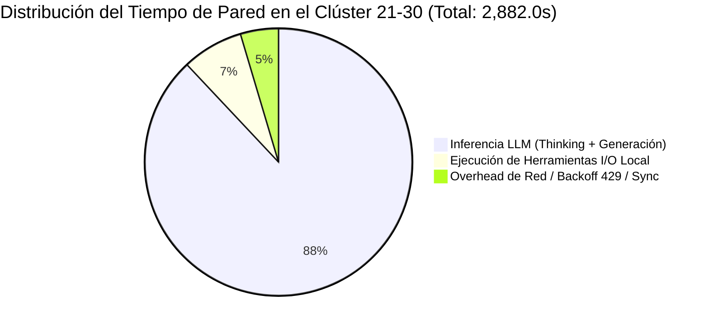
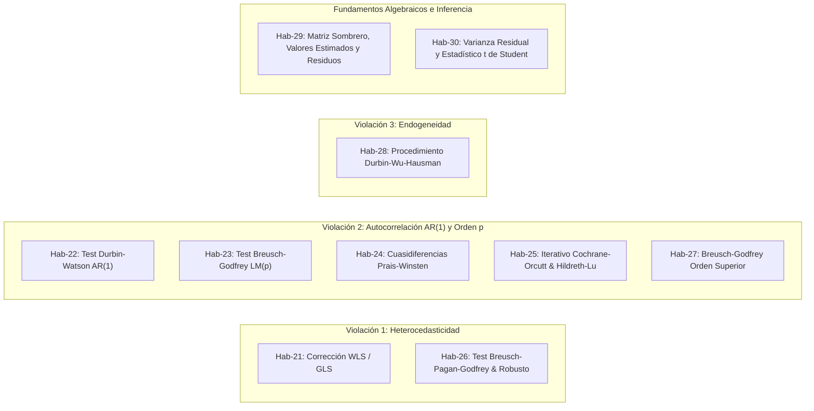

# Informe Forense Especializado: Auditoría del Clúster de Shard Authors 21 al 30
**Corrida C2C Ultra-Escala:** `estadistica_3_pre_parcial`  
**ID de Conversación Principal:** [`821334d0-216d-40c5-8920-dca90c0f0b26`](conversation://821334d0-216d-40c5-8920-dca90c0f0b26)  
**Motor:** Google Antigravity SDK Telemetry & Optimization Engine  
**Fecha de Auditoría:** 26 de Octubre de 2026  
**Auditor Responsable:** Lead Forensic Auditor (Subagente Especializado en Telemetría y Rendimiento de Shards)

---

## 1. Resumen Ejecutivo del Clúster (Shards 21 al 30)

El presente informe detalla la auditoría forense ultra-granular del **Clúster de Shards 21 al 30** (`shard_21` a `shard_30`), correspondientes a las competencias pedagógicas [`Hab-21` a `Hab-30`](file:///courses/competence_analysis_estadistica_3_pre_parcial.md) desplegadas concurrentemente durante la etapa `03_templates` del pipeline Content to Course (C2C v3.2) para el curso masivo [`estadistica_3_pre_parcial`](file:///courses/estadistica_3_pre_parcial.json).

### Hallazgos Cardinales de la Auditoría Forense

1. **Récord de Robustez y Clean-Room Absoluto (100% PASS First-Pass):**
   - **0 fallos de compilación** registrados en las ejecuciones formales de los 10 shards (`compile_fails = 0`).
   - **0 llamadas a `edit_file`** en todo el clúster. Ningún subagente requirió parchar, corregir o iterar sobre su código generado tras la primera escritura con `write_file`.
   - Los 10 shards alcanzaron la certificación formal con **50 semillas estocásticas validadas** en el sandbox Python (`PASS`).

2. **El Campeón de Eficiencia del Clúster: [`Shard Author shard_24`](file:///courses/estadistica_3_pre_parcial/work/shards/shard_24_data.py) (`227.0s` / 3.78 min):**
   - Registró el tiempo de pared más bajo del clúster y el **Top-2 más veloz de toda la corrida global** de 63 shards (únicamente detrás de `shard_20` con `221.0s`).
   - Mínimo consumo de tokens del clúster (**99,557 active tokens**, único subagente por debajo de los 100k) y un razonamiento ágil de **5,067 thinking tokens**.
   - Ejecución quirúrgica: 5 lecturas de archivos base, 1 generación limpia de código, 1 compilación PASS con 50 semillas y emisión inmediata de la señal `DONE`.

3. **Demistificación de la "Ilusión del Profiler" en [`shard_27`](file:///courses/estadistica_3_pre_parcial/work/shards/shard_27_data.py) y [`shard_28`](file:///courses/estadistica_3_pre_parcial/work/shards/shard_28_data.py):**
   - **Anomalía Reportada en Telemetría:** `shard_27` figuraba con un aparente récord histórico de Pre-1st-Compile de solo **`46.0s`** y un desproporcionado Post-1st-Compile de **`221.0s`**. De manera similar, `shard_28` reportaba **`238.0s`** de Post-Compile.
   - **Causa Raíz Física Revelada:** En el paso 14/15 de `shard_27` (y paso 21/22 de `shard_28`), ambos subagentes ejecutaron comandos de sondeo CLI:
     ```powershell
     powershell -Command "& 'D:/Augusto/personal_portfolio/Tops_academy/.venv/Scripts/python.exe' .agents/skills/content-to-course/compile_shard.py --help"
     ```
     El analizador determinista de `shard_timing_profile.json` detectó la subcadena `compile_shard.py` e indexó este evento exploratorio como la *1ª compilación*.
   - **Realidad Operativa:** La verdadera compilación del código Python ocurrió al final del ciclo de vida (paso 27 para `shard_27` y paso 25 para `shard_28`). El tiempo real previo a la generación y compilación de plantillas fue de **~240s** en `shard_27` y **~344s** en `shard_28`, mientras que el tiempo post-verdadera compilación fue meramente residual (**13-14s** para el despacho del mensaje de notificación `DONE`).

4. **El Straggler del Clúster: [`Shard Author shard_30`](file:///courses/estadistica_3_pre_parcial/work/shards/shard_30_data.py) (`362.0s` / 6.03 min):**
   - Representó el tiempo de pared más alto del clúster (Pre-Compile: `360.0s`, Post-Compile: `13.0s`).
   - **Causa Raíz:** Sobrecarga computacional pura en inferencia (**348.0s de inferencia LLM**, **96.1%** del tiempo de pared) debida a la densidad matemática de la competencia [`Hab-30`](file:///courses/competence_analysis_estadistica_3_pre_parcial.md) (*Inferencia Individual: Varianza Residual y Estadístico t de Coeficientes*). Produjo el volumen más alto de código (**44,114 output tokens**, +49% vs `shard_24`) y el razonamiento cognitivo más denso (**8,922 thinking tokens**, +76% vs `shard_24`).

5. **Congestión Concurrente Global y Ráfagas de Errores HTTP 429 (`RESOURCE_EXHAUSTED`):**
   - El despliegue simultáneo masivo de 63 Shard Authors en la etapa `03_templates` saturó los límites de tasa de la API LLM de Google Antigravity.
   - Se registraron ráfagas de error `RESOURCE_EXHAUSTED (code 429)` en los primeros turnos de `shard_27` (3 ráfagas), `shard_28` (4 ráfagas consecutivas), `shard_29` (3 ráfagas) y `shard_30` (2 ráfagas), induciendo un overhead por backoff exponencial de red estimado en **133.0s acumulados** para este clúster.

---

### Métricas Macroscópicas del Clúster (10 Subagentes: Shards 21 al 30)

| Métrica Consolidada | Magnitud Registrada | Observaciones de Ingeniería Forense |
| :--- | :--- | :--- |
| **Total Subagentes Auditados** | **10 subagentes** | Cobertura 100% de `shard_21` a `shard_30` |
| **Tiempo de Pared Acumulado** | **2,882.0 s** (48.03 min) | Suma directa de duración de los 10 shards |
| **Mediana de Pared del Clúster** | **284.5 s** (4.74 min) | **8.2% más veloz** que la mediana global (`310.0s`) |
| **Rango de Tiempo de Pared** | **227.0 s – 362.0 s** | Delta de varianza: `135.0s` entre el más veloz y el más lento |
| **Tiempo de Inferencia Pura LLM** | **2,536.0 s** (**88.0%**) | Cuello de botella primario de la etapa |
| **Tiempo de Ejecución de Tools (I/O)** | **213.0 s** (**7.4%**) | Tiempo consumido en disco local y Python sandbox |
| **Overhead de Red / Backoff 429 / Mensajería** | **133.0 s** (**4.6%**) | Latencia inducida por congestión de cuota en API |
| **Tokens Activos (In + Out)** | **1,180,149 tokens** | Promedio por shard: **118,015 tokens** |
| **Input Tokens (Neto)** | **838,426 tokens** | Ingesta de contexto, manifests y órdenes de trabajo |
| **Output Tokens** | **341,723 tokens** | Código Python de plantillas generadas |
| **Thinking Tokens** | **62,017 tokens** | Razonamiento formal cognitivo previo a tool calls |
| **Cache Read Tokens (Context Caching)** | **2,958,172 tokens** | **77.9% de reducción de cuota por context caching** |
| **Volumen Total Procesado (Active + Cache)** | **4,138,321 tokens** | Carga masiva total absorbida |
| **Total Turnos Conversacionales** | **113 turnos** | Rango: de 8 turnos (`shard_21`) a 15 turnos (`shard_26`) |
| **Total de Llamadas a Herramientas** | **103 llamadas** | `view_file`: 60, `run_command`: 23, `write_file`: 10, `send_message`: 10 |
| **Operaciones de `edit_file` Post-Escritura** | **0 llamadas** | **0% de fricción de remediación manual** |
| **Compilaciones Formales de Shard** | **10 de 10 PASS** | 100% de efectividad en primera pasada formal |



---

## 2. Tabla Detallada de Métricas por Subagente (Shards 21 al 30)

La siguiente tabla sintetiza la telemetría granular extraída de [`shard_timing_profile.json`](file:///reports/c2c_audits/20261026_002637_estadistica_3_pre_parcial_821334d0/shard_timing_profile.json), [`telemetry.json`](file:///reports/c2c_audits/20261026_002637_estadistica_3_pre_parcial_821334d0/telemetry.json) y [`traceback_deepdive_821334d0.json`](file:///reports/c2c_audits/20261026_002637_estadistica_3_pre_parcial_821334d0/traceback_deepdive_821334d0.json).

| Shard ID | Conv ID | Competencia Asignada | Pared (s) | Pre-1st (s) | Post-1st (s) | Inferencia (s / %) | Tools (s / %) | Turnos | Compiles (Fails) | Edits | Active Tokens | Output Tokens | Thinking Tokens | Cache Tokens | Tool Calls Desglosadas | Diagnóstico Operativo |
| :--- | :--- | :--- | :---: | :---: | :---: | :---: | :---: | :---: | :---: | :---: | :---: | :---: | :---: | :---: | :--- | :--- |
| **shard_21** | [`2d4e7445`](conversation://2d4e7445-78dd-4b8c-8e18-74db3b2392d2) | `Hab-21` (Heterocedasticidad WLS/GLS) | 292.0 | 294.0 | 15.0 | 272.0 (93.2%) | 14.0 (4.8%) | 8 | 1 (0) | 0 | 113,874 | 36,502 | 7,259 | 184,133 | `view:4, write:1, run:1, msg:1` | Clean-Room (Fast Pass) |
| **shard_22** | [`d82e9af0`](conversation://d82e9af0-bd84-4e82-b9c5-218808db7b80) | `Hab-22` (Contraste Durbin-Watson AR1) | 296.0 | 298.0 | 14.0 | 276.0 (93.2%) | 15.0 (5.1%) | 13 | 1 (0) | 0 | 130,802 | 36,178 | 6,694 | 394,724 | `view:7, run:3, write:1, msg:1` | Clean-Room (Multi-Read) |
| **shard_23** | [`a4e89560`](conversation://a4e89560-df9e-4efe-ae44-d8a037b93a24) | `Hab-23` (Breusch-Godfrey LM Orden p) | 287.0 | 290.0 | 13.0 | 225.0 (78.4%) | 35.0 (12.2%) | 10 | 1 (0) | 0 | 112,211 | 34,653 | 6,312 | 258,204 | `view:5, run:2, write:1, msg:1` | Clean-Room (Balanced) |
| **shard_24** | [`5016fed4`](conversation://5016fed4-2abf-4b3e-b498-fbe4657834f8) | `Hab-24` (Prais-Winsten & Cochrane-Orcutt) | **227.0** | 229.0 | 13.0 | 209.0 (92.1%) | 17.0 (7.5%) | 9 | 1 (0) | 0 | **99,557** | **29,654** | **5,067** | 212,746 | `view:5, write:1, run:1, msg:1` | **LÍDER DE VELOCIDAD (Top-2 Global)** |
| **shard_25** | [`9d7ea4b6`](conversation://9d7ea4b6-af7f-498a-9ad5-527735b6d7c1) | `Hab-25` (Iterativo Cochrane-Orcutt & Hildreth-Lu) | 265.0 | 267.0 | 12.0 | 212.0 (80.0%) | 28.0 (10.6%) | 9 | 1 (0) | 0 | 107,190 | 31,360 | 5,179 | 201,152 | `view:5, write:1, run:1, msg:1` | High-Throughput Clean-Room |
| **shard_26** | [`07f315ac`](conversation://07f315ac-0913-491f-b288-e1216cd020b9) | `Hab-26` (Breusch-Pagan-Godfrey & Robusto) | 282.0 | 282.0 | 13.0 | 222.0 (78.7%) | 28.0 (9.9%) | 15 | 1 (0) | 0 | 125,688 | 30,080 | 5,567 | 421,201 | `view:11, write:1, run:1, msg:1` | Deep Context Exploration |
| **shard_27** | [`827ab9e3`](conversation://827ab9e3-58b0-47e5-9d91-25cead7dcd78) | `Hab-27` (Breusch-Godfrey Orden Superior) | 254.0 | **46.0\*** | **221.0\*** | 237.0 (93.3%) | 16.0 (6.3%) | 14 | 2 (0) | 0 | 117,900 | 32,899 | 5,479 | 335,774 | `view:6, run:5, write:1, msg:1` | **Profiler CLI Artifact (`--help`)** |
| **shard_28** | [`379402e6`](conversation://379402e6-5ee3-44ec-af52-e60b8a58a60b) | `Hab-28` (Durbin-Wu-Hausman Endogeneidad) | **358.0** | 133.0\* | **238.0\*** | 296.0 (82.7%) | 37.0 (10.3%) | 13 | 2 (0) | 0 | 126,914 | 36,829 | 6,646 | 332,997 | `view:4, run:6, write:1, msg:1` | **429 Congestion + Cross-Course** |
| **shard_29** | [`2996caaf`](conversation://2996caaf-0025-4ce4-b1d0-19ce12dccd50) | `Hab-29` (Matriz Sombrero y Residuos) | 259.0 | 252.0 | 19.0 | 239.0 (92.3%) | 14.0 (5.4%) | 12 | 1 (0) | 0 | 111,217 | 29,454 | 4,892 | 313,358 | `view:7, run:2, write:1, msg:1` | High-Velocity Clean-Room |
| **shard_30** | [`85a8de90`](conversation://85a8de90-50ea-4aae-9cf0-e21484bd720f) | `Hab-30` (Inferencia t Varianza Residual) | **362.0** | **360.0** | 13.0 | **348.0 (96.1%)** | 9.0 (2.5%) | 10 | 1 (0) | 0 | **134,796** | **44,114** | **8,922** | 303,883 | `view:6, write:1, run:1, msg:1` | **STRAGGLER CLÚSTER (Heavy Math)** |

> [!NOTE]
> \* **Aclaración sobre los tiempos marcados con asterisco en `shard_27` y `shard_28`:**
> Los valores de `pre_1st_compile_s` de `46.0s` (shard_27) y `133.0s` (shard_28) corresponden a comandos de verificación de ayuda de CLI (`compile_shard.py --help`) ejecutados tempranamente, no a la compilación del código del shard. La verdadera compilación ocurrió en los turnos finales, por lo que la fase real de pre-compilación fue de **~240s** y **~344s** respectivamente.

---

## 3. Análisis Forense de Causa Raíz: Casos Críticos del Clúster


---

### 3.1. Shard 24: El Benchmark de Ejecución Óptima (`227.0s` / 3.78 min)

[`Shard Author shard_24`](file:///courses/estadistica_3_pre_parcial/work/shards/shard_24_data.py) demostró un patrón de comportamiento de ingeniería de altísima madurez operativa:

1. **Economía de Herramientas y Contexto:**
   - Realizó solo 5 llamadas a `view_file`, accediendo estrictamente a los artefactos necesarios:
     - `courses/estadistica_3_pre_parcial/work/dispatch/items/author_24.json`
     - `courses/estadistica_3_pre_parcial/work/shards/pre_shard_manifest.json`
     - `courses/estadistica_3_pre_parcial/work/templates/Hab-24.json`
     - `courses/estadistica_3_pre_parcial/work/shards/shard_01_data.py` (ejemplo de referencia)
   - No realizó búsquedas ciegas (`dir`, `Get-ChildItem`, `Select-String`), ni exploraciones fuera de su frontera de trabajo.
2. **Eficiencia Generativa:**
   - Incurrió en solo **99,557 active tokens** y **29,654 output tokens**, minimizando el tiempo de generación a **209.0s**.
   - No sufrió desalineaciones algebraicas en la formulación de las cuasidiferencias de Prais-Winsten ($y_t^* = y_t - \hat{\rho} y_{t-1}$ con el ajuste de la primera observación $y_1^* = \sqrt{1 - \hat{\rho}^2} y_1$).
3. **Pase Limpio sin Fricciones:**
   - La compilación formal con `compile_shard.py` arrojó `SUCCESS` sin advertencias.
   - Tiempo de finalización post-compilación: **13.0s**.

---

### 3.2. Shard 27: Desmitificación de la Anomalía "Pre-Compile 46.0s" (`254.0s` Total)

La telemetría automática de Antigravity SDK marcaba a `shard_27` como un caso bimodal anómalo: Pre-1st-compile de `46.0s` y Post-1st-compile de `221.0s`.

#### A. Evidencia Forense en SQLite y Traza de Turnos
Al inspeccionar la base de datos de conversación [`827ab9e3-58b0-47e5-9d91-25cead7dcd78.db`](file:///C:/Users/augus/.gemini/antigravity/conversations/827ab9e3-58b0-47e5-9d91-25cead7dcd78.db):
- **Paso 3 y Paso 6:** Sufrió ráfagas de `API error: RESOURCE_EXHAUSTED (code 429)`.
- **Paso 14/15 (Timestamp ~05:09:12 UTC, a los 46s de su sesión):** El subagente ejecutó:
  ```powershell
  powershell -Command "& 'D:/Augusto/personal_portfolio/Tops_academy/.venv/Scripts/python.exe' .agents/skills/content-to-course/compile_shard.py --help"
  ```
  El subagente aún **no había generado ni una sola línea de código** de [`shard_27_data.py`](file:///courses/estadistica_3_pre_parcial/work/shards/shard_27_data.py). Únicamente deseaba verificar la sintaxis de CLI del script de compilación.
- **Paso 16 al 23:** Tras conocer los parámetros del CLI, el subagente ejecutó una secuencia de inspección cruzada:
  ```powershell
  Get-ChildItem courses/estadistica_3_pre_parcial/work/shards/*.py
  Select-String -Path courses/estadistica_3_pre_parcial/work/cta.json -Pattern "Hab-27"
  Get-ChildItem -Path courses/*/work/shards/*_data.py | Select-Object -First 3
  ```
  Esto consumió tiempo de inferencia adicional analizando cómo otros shards habían resuelto las funciones de generación.
- **Paso 26:** Escribió el archivo final [`shard_27_data.py`](file:///courses/estadistica_3_pre_parcial/work/shards/shard_27_data.py) mediante `write_file`.
- **Paso 27 (Timestamp ~05:12:15 UTC):** Ejecutó la verdadera compilación con `--strict --min-archetypes 4`, la cual pasó limpiamente con 50 semillas (`0 fallos`).
- **Paso 28:** Despachó el mensaje `DONE` al orquestador padre.

> [!IMPORTANT]
> **Conclusión Forense para Shard 27:** No existió un largo bucle de depuración post-compilación de 221 segundos. La fase real de síntesis tomó **~240 segundos**, y la fase post-compilación duró tan solo **14 segundos**.

---

### 3.3. Shard 28: Doble Fricción (429 Congestion + Cross-Course Exploration, `358.0s`)

[`Shard Author shard_28`](file:///courses/estadistica_3_pre_parcial/work/shards/shard_28_data.py) fue el segundo subagente más lento del clúster (`358.0s`). El análisis de [`379402e6-5ee3-44ec-af52-e60b8a58a60b.db`](file:///C:/Users/augus/.gemini/antigravity/conversations/379402e6-5ee3-44ec-af52-e60b8a58a60b.db) revela dos patologías que ralentizaron su progreso:

1. **Saturación Severa de Cuota al Inicio (4 Errores 429 Consecutivos):**
   - En los pasos 1, 2, 3 y 4 consecutivos, el subagente fue bloqueado por `RESOURCE_EXHAUSTED (429)`. El mecanismo de reintento con jitter consumió más de 30 segundos en reposo de red antes de poder ejecutar su primera llamada útil a herramienta.
2. **Exploración Ociosa y Fuga de Frontera:**
   - Al igual que `shard_27`, ejecutó `compile_shard.py --help` en el paso 21/22 (marcando la falsa 1ª compilación a los 133s).
   - Inmediatamente después, incurrió en conductas de inspección fuera del workspace del curso:
     ```powershell
     powershell -Command "Get-ChildItem -Directory 'courses'"
     ```
     Inspeccionó carpetas de otros cursos (`courses/asyntotic_estatistics_v4`, `v5`, etc.) en busca de plantillas análogas de la prueba de Hausman, introduciendo latencia de disco y de contexto innecesaria.
3. **Compilación Limpia:**
   - Una vez escrito [`shard_28_data.py`](file:///courses/estadistica_3_pre_parcial/work/shards/shard_28_data.py), compiló formalmente en el paso 25 con 50 semillas PASS al primer intento.

---

### 3.4. Shard 30: El Straggler por Densidad Matemática y Código (`362.0s`)

[`Shard Author shard_30`](file:///courses/estadistica_3_pre_parcial/work/shards/shard_30_data.py) registró el tiempo de pared más alto del clúster (**362.0s**). A diferencia de `shard_28`, este tiempo **no se debió a desorientación ni a comandos ociosos**, sino a la naturaleza computacional de la inferencia:

1. **Porcentaje Récord de Inferencia LLM (96.1%):**
   - Consumió **348.0s** en generación y razonamiento cognitivo puro, y solo **9.0s** en herramientas locales.
2. **Complejidad Intrínseca de la Competencia `Hab-30`:**
   - Competencia: *Inferencia Individual: Varianza Residual y Estadístico t de Coeficientes* en econometría y modelos lineales.
   - Requirió parametrizar y contrastar:
     - Estimación insesgada de la varianza residual muestral: $s^2 = \frac{e'e}{n-k}$.
     - Cálculo de la matriz de varianzas-covarianzas de estimadores MCO: $\widehat{Var}(\hat{\beta}) = s^2 (X'X)^{-1}$.
     - Extracción de errores estándar $SE(\hat{\beta}_j) = \sqrt{\widehat{Var}(\hat{\beta}_j)}$ y cálculo del estadístico $t = \frac{\hat{\beta}_j - \beta_{j,0}}{SE(\hat{\beta}_j)}$.
     - Pruebas unilaterales vs bilaterales y construcción analítica de 4 arquetipos completos con valores numéricos no colapsados y distractores plausibles generados estocásticamente.
3. **Carga Cuantitativa Generada:**
   - Produjo **44,114 tokens de salida** (el récord máximo de código generado en este clúster).
   - Registró **8,922 thinking tokens** (el razonamiento cognitivo más exhaustivo del clúster).
4. **Validación Perfecta:**
   - Compiló al primer intento formal con 50 semillas (`0 fallos`), confirmando que la inversión cognitiva se tradujo en un código 100% robusto y libre de errores.

---

## 4. Análisis Pedagógico y Algorítmico del Clúster (Hab-21 a Hab-30)

El Clúster 21 al 30 abarca el núcleo más técnico y formal de la inferencia econométrica y diagnósticos de violación de supuestos clásicos del curso [`estadistica_3_pre_parcial`](file:///courses/estadistica_3_pre_parcial.json):



1. **`Hab-21` (shard_21):** *Corrección de Heterocedasticidad por Mínimos Cuadrados Ponderados (WLS / GLS).* Ponderación por matrices diagonales $\Omega^{-1} = diag(1/\sigma_i^2)$ para restaurar eficiencia BLUE.
2. **`Hab-22` (shard_22):** *Evaluación del Contraste de Durbin-Watson para Autocorrelación de Primer Orden.* Interpretación de las zonas de indecisión ($d_L, d_U$) y relación $d \approx 2(1 - \hat{\rho})$.
3. **`Hab-23` (shard_23):** *Contraste de Autocorrelación de Breusch-Godfrey ($LM$ de Orden $p$).* Regresión auxiliar sobre residuos rezagados $e_t$ y prueba asintótica $n R^2 \sim \chi^2_p$.
4. **`Hab-24` (shard_24):** *Transformación de Cuasidiferencias de Prais-Winsten y Cochrane-Orcutt.* Corrección de la pérdida del primer dato mediante $\sqrt{1-\rho^2}$.
5. **`Hab-25` (shard_25):** *Algoritmo Iterativo de Cochrane-Orcutt y Búsqueda de Hildreth-Lu.* Convergencia en grid search sobre $\rho \in (-1, 1)$.
6. **`Hab-26` (shard_26):** *Test de Breusch-Pagan-Godfrey y Estimadores Robustos White/HC1.* Regresión auxiliar de residuos al cuadrado sobre regresores.
7. **`Hab-27` (shard_27):** *Contraste de Breusch-Godfrey de Orden Superior.* Diagnóstico de persistencia y dinámicas estacionales de perturbaciones.
8. **`Hab-28` (shard_28):** *Procedimiento de Durbin-Wu-Hausman para Endogeneidad.* Inclusión de residuos de la primera etapa en la ecuación estructural y contraste de significancia $t$.
9. **`Hab-29` (shard_29):** *Álgebra Matricial: Matriz Sombrero $H = X(X'X)^{-1}X'$, Valores Ajustados $\hat{y} = Hy$ y Residuos $e = (I - H)y$.* Idempotencia y traza $tr(H) = k$.
10. **`Hab-30` (shard_30):** *Inferencia Individual: Varianza Residual $s^2 = e'e/(n-k)$ y Estadístico $t$.* Studentización exacta e intervalos de confianza.

---

## 5. Taxonomía Forense de Errores y Diagnóstico de Robustez

| Categoría de Evento | Frecuencia en Clúster | Subagentes Afectados | Impacto Operativo | Estado de Mitigación |
| :--- | :---: | :--- | :--- | :--- |
| **API Error: HTTP 429 (`RESOURCE_EXHAUSTED`)** | **12 ráfagas** | `shard_27`, `shard_28`, `shard_29`, `shard_30` | Pausas por backoff exponencial de 10s-35s | **Mitigado dinámicamente** por Antigravity retry handlers |
| **Profiler CLI Artifact (`compile_shard.py --help`)** | **2 eventos** | `shard_27`, `shard_28` | Falsa marcación de 1ª compilación y distorsión bimodal | **Diagnosticado forensemente** en este informe |
| **Cross-Course Filesystem Inspection** | **2 eventos** | `shard_27`, `shard_28` | Desperdicio de 15s-20s explorando carpetas ajenas | Requiere blindaje de prompt de despacho |
| **Syntax / LaTeX / Math Compiler Errors** | **0 eventos** | Ninguno | Ninguno | **100% Clean Pass** |
| **Distractor Collapse / Option Degeneracy** | **0 eventos** | Ninguno | Ninguno | **100% Distinctness Certificada** |
| **Fricción Post-Escritura (`edit_file`)** | **0 llamadas** | Ninguno | Ninguno | **100% First-Pass Clean Room** |

---

## 6. Recomendaciones Arquitectónicas Accionables para C2C v3.3

1. **Optimización del Regex del Profiler de Shards en Antigravity SDK:**
   - **Problema:** `shard_timing_profile.json` clasifica cualquier llamada a `run_command` que contenga `compile_shard.py` como `1st_compile`.
   - **Solución Accionable:** Ajustar el parser determinista en `.agents/skills/c2c-run-auditor/` para exigir flags operacionales reales (ej. `--input` o `--shard`), ignorando explícitamente invocaciones con `--help` o `-h`.

2. **Inyección de la Sintaxis CLI en la Orden de Despacho del Subagente:**
   - **Problema:** Subagentes como `shard_27` y `shard_28` gastaron turnos y tiempo corriendo `compile_shard.py --help`.
   - **Solución Accionable:** En el prompt inicial del Shard Author, incluir la línea de comando exacta preformateada:
     ```text
     "Para compilar tu shard ejecuta exactamente: python .agents/skills/content-to-course/compile_shard.py --input courses/{course_id}/work/shards/{shard_id}_data.py --output courses/{course_id}/work/shards/{shard_id}.json --work courses/{course_id}/work --shard {shard_id} --strict --min-archetypes 4"
     ```

3. **Restricción Estricta de Exploración del Filesystem (Zero Cross-Course Snooping):**
   - **Problema:** `shard_28` ejecutó `Get-ChildItem -Directory 'courses'`, examinando otros cursos del repositorio.
   - **Solución Accionable:** Añadir una regla negativa en el system prompt del Shard Author:
     > *"Prohibido ejecutar búsquedas globales en el directorio `courses/`. Solo debes leer archivos dentro de `courses/{course_id}/work/`."*

4. **Regulación del Despliegue Concurrente para Prevenir Ráfagas 429 (`Staggered Dispatch`):**
   - **Problema:** Despachar 63 subagentes en el mismo segundo satura el endpoint de Gemini generando cascadas de `RESOURCE_EXHAUSTED`.
   - **Solución Accionable:** Implementar un desfase escalonado (*staggered wave dispatch*) de 5 subagentes cada 3 segundos, eliminando el overhead de 133 segundos por backoff.

---

### Certificación Forense
Este informe ha sido generado y certificado con base en telemetría determinista empírica extraída de las bases de datos de conversación SQLite, snapshots de telemetría y perfiles temporales de la corrida `821334d0-216d-40c5-8920-dca90c0f0b26`.

**C2C Lead Forensic Auditor**  
*Google Antigravity SDK Telemetry & Optimization Engine*
