# Auditoría Forense Consolidada Ultra-Escala: Content to Course (C2C v3.3)
**Conversación Orquestadora:** `857d5b79-79a1-4b2f-aaed-9e5c9f6511d5`  
**Curso Generado:** `estadistica_3_pre_parcial_v2`  
**Escala:** 112 Subagentes + 1 Director (Total: 113 Agentes)  
**Partición Agéntica Ultra-Escala:** Lotes de 10 en 10 segmentados por rol.

---

## 1. Topología de la Arquitectura Multi-Agente

```mermaid
flowchart TD
    Director["Director Orquestador
(857d5b79 / 29.32 min / 17.7x Speedup)"] --> CTA_Cluster["Cluster CTA Architects
(12 agentes / 2 lotes)"]
    Director --> Shard_Cluster["Cluster Shard Authors
(80 agentes / 8 lotes)"]
    Director --> Judge_Cluster["Cluster Blind Judges
(20 agentes / 2 lotes)"]
    
    subgraph CTABatches ["CTA Batches (10 en 10)"]
        CTA_Cluster --> CTA01["CTA Batch 01 (part_01..10)"]
        CTA_Cluster --> CTA02["CTA Batch 02 (part_11..12)"]
    end
    
    subgraph ShardBatches ["Shard Authors Batches (10 en 10)"]
        Shard_Cluster --> S01["Shard Batch 01 (01..10)"]
        Shard_Cluster --> S02["Shard Batch 02 (11..20)"]
        Shard_Cluster --> S03["Shard Batch 03 (21..30)"]
        Shard_Cluster --> S04["Shard Batch 04 (31..40)"]
        Shard_Cluster --> S05["Shard Batch 05 (41..50)"]
        Shard_Cluster --> S06["Shard Batch 06 (51..60 / Straggler 51)"]
        Shard_Cluster --> S07["Shard Batch 07 (61..70)"]
        Shard_Cluster --> S08["Shard Batch 08 (71..80)"]
    end
    
    subgraph JudgeBatches ["Blind Judges Batches (10 en 10)"]
        Judge_Cluster --> J01["Judge Batch 01 (01..10)"]
        Judge_Cluster --> J02["Judge Batch 02 (11..20)"]
    end
```

---

## 2. Resumen Comparativo de Lotes por Rol

| Segmento | Lote | Agentes | Tokens Totales | Latencia Mediana (s) | Herramientas | Tasa Éxito | Straggler del Lote |
| :--- | :--- | :---: | :---: | :---: | :---: | :---: | :--- |
| **Director** | **Orquestador** | 1 | 9,838,706 | 1759.0 (29.3m) | 151 | 98.7% | N/A (Barrera 57s) |
| **CTA** | **Batch 01** | 10 | 4,892,154 | 382.4 | 114 | 96.5% | `part_08` (456.0s) |
| **CTA** | **Batch 02** | 2 | 877,371 | 351.5 | 22 | 100.0% | `part_12` (362.0s) |
| **Shards** | **Batch 01** | 10 | 5,612,410 | 185.2 | 148 | 97.3% | `shard_09` (288.0s) |
| **Shards** | **Batch 02** | 10 | 5,498,200 | 192.1 | 152 | 96.7% | `shard_18` (302.0s) |
| **Shards** | **Batch 03** | 10 | 5,310,120 | 174.5 | 141 | 98.6% | `shard_27` (264.0s) |
| **Shards** | **Batch 04** | 10 | 5,820,330 | 210.4 | 165 | 95.8% | `shard_38` (318.0s) |
| **Shards** | **Batch 05** | 10 | 5,504,110 | 188.7 | 150 | 97.3% | `shard_44` (295.0s) |
| **Shards** | **Batch 06** | 10 | 6,104,890 | 245.8 | 178 | 94.4% | `shard_51` (430.0s) 🚨 |
| **Shards** | **Batch 07** | 10 | 5,420,900 | 181.3 | 146 | 97.9% | `shard_66` (272.0s) |
| **Shards** | **Batch 08** | 10 | 6,211,400 | 230.1 | 172 | 95.3% | `shard_78` (340.0s) |
| **Judges** | **Batch 01** | 10 | 1,556,200 | 112.4 | 92 | 100.0% | `judge_07` (145.0s) |
| **Judges** | **Batch 02** | 10 | 1,558,764 | 115.1 | 94 | 100.0% | `judge_19` (148.0s) |

---

## 3. Análisis Forense de Stragglers y Cuello de Botella Crítico

### Shard Author `shard_51` (Latencia Máxima: 430.0s)
- **Fase de Retraso:** Pre-Compilación prolongada (285s) debida a sobre-análisis algebraico en bloques de pensamiento antes de invocar la escritura del script Python, sumado a 2 reintentos de validación de distancias relativas de distractores `[R-19: Minimum Distractor Epsilon]`.
- **Resolución:** El agente convergió de forma autónoma generando 24 reactivos válidos sin requerir intervención del supervisor.

---

## 4. Auditoría de Unit Economics y Rendimiento Global
- **Corpus Procesado:** 122 diapositivas / páginas (6.86 MB).
- **Rendimiento de Producción:** 2,770 reactivos sobre 118 competencias en 29.32 minutos de tiempo de pared.
- **Speedup Concurrente:** **17.7x** (520.1 minutos de cómputo de agentes completados en ~29 minutos).
- **Consumo Unitario:** **23,178 tokens/pregunta** y **0.64 s/pregunta** de tiempo de pared.
- **Throughput Efectivo:** **94.5 preguntas/minuto**.
