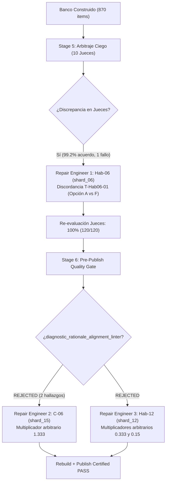

# Análisis Forense: Straggler Crítico (Shard 15) y Reparaciones Quirúrgicas (3 Repair Engineers)
## Curso: `estadistica_3_s9_vmapreduce12`
**Conversación Orquestadora:** `b10b1205-1ffc-4ec7-960b-a3a6154d0b4f`  
**Fecha de Ejecución:** `2026-11-01`

---

## 1. El Straggler Crítico de 12 Minutos: Shard 15 (`C-05`, `C-06`)

- **Subagente:** `Shard Author shard_15` (`a8dc5df9-d380-4396-9a79-7985f32e2c34`)
- **Competencias:**
  - `C-05`: Desigualdad de Cauchy-Schwarz y Acotación de la Correlación.
  - `C-06`: Jerarquía de Modos de Convergencia Asintótica ($L^r \Rightarrow L^s \Rightarrow p \Rightarrow d$).
- **Duración Total:** **`720.0s` (12.0 minutos)** vs. la mediana de la ola (**`303.0s` / 5.0 minutos**).
- **Retraso Impuesto a la Barrera Global:** **`+417.0s` (~7 minutos de espera ociosa para el resto del pipeline)**.
- **Métricas:** 17 turnos de ejecución, 4 fallos de compilación/linter, 1.25M tokens leídos de caché y 225k tokens activos.

### 🔴 ¿Cuál fue el problema?
El subagente enfrentó una cascada de 3 problemas concatenados:
1. **Sondeo ciego de archivos y overthinking pre-compilación (Turnos 1 a 7):**
   - Al iniciar, ejecutó llamadas erróneas a `view_file` buscando `C-05.json` y `shard_15_data.py` (archivos que aún no existían).
   - Seguidamente consumió **34,890 tokens de salida en bloques de razonamiento (*thinking*)** deduciendo manualmente fórmulas de probabilidad y estructuras de datos en lugar de delegar el cómputo a Python, tardando 4 minutos antes de emitir su primera línea de código.
2. **Error de scoping y colapso de verificación analítica (`NameError: ver_c05_1`):**
   - Al redactar el archivo, definió alias globales a nivel de módulo: `ver_c05_2 = ver_c05_1`.
   - El compilador `compile_shard.py` reubica las asignaciones de módulo en la cabecera del entorno sandbox, provocando que se intentara referenciar `ver_c05_1` antes de que fuera declarada la función, haciendo colapsar las 50 semillas de prueba con `NameError`.
   - Omitió además el contrato multimodal (faltaban reactivos de práctica activa *Fill-in-the-Blank* o *Multiple-Select* en `C-06`).
3. **Anti-patrón de Clave Estática y Desbalance de Longitud (`[TPL-STATIC-OPT]` y `[R-15]`):**
   - En la competencia `C-05`, fijó la respuesta correcta como una constante matemática estática: $|\rho_{XY}| \le 1$, seteando `ans = 1` invariante para todas las 20 semillas.
   - El motor psicométrico detectó una "mono-clave" idéntica (`[TPL-STATIC-OPT]`), lo que invalidó la cuota de diversidad RNG (`[TPL-VAR]`) y generó una severa discrepancia de longitud (`[R-15]`) entre la respuesta correcta (corta, 23 caracteres) y los distractores teóricos desarrollados (35-45 caracteres).

### ⏳ ¿Por qué demoró tanto?
- **Tiempo Pre-Compile inflado:** 259 segundos (~4.3 min) antes de la primera compilación debido a búsqueda de archivos inexistentes y deducción exhaustiva en lenguaje natural.
- **Tiempo Post-Compile prolongado:** 485 segundos (~8.1 min) resolviendo errores iterativos en 3 ciclos de compilación fallidos. Dado que acumuló 5 errores en la segunda pasada, estuvo obligado a realizar ediciones quirúrgicas en lugar de sobrescribir, analizando línea por línea cómo re-parametrizar la respuesta correcta sin romper las expresiones de KaTeX.

### 🟢 ¿Qué solución final se tuvo?
- **Eliminación de alias globales:** Se reescribieron los verificadores como funciones independientes canónicas:
  ```python
  def ver_c05_2(res):
      return ver_c05_1(res)
  ```
- **Parametrización dinámica anti-mono-clave:** En lugar de fijar la cota universal estática en $1$, se reformuló el reactivo en función de los momentos de segundo orden de las variables aleatorias ($\mathbb{E}[X^2] = \text{ex2}$, $\mathbb{E}[Y^2] = \text{ey2}$), haciendo que la respuesta correcta varíe dinámicamente en cada semilla:
  ```python
  correct = r"$(\mathbb{E}[XY])^2 \le @ex2@ \cdot @ey2@$"
  ```
- **Cumplimiento multimodal:** Se añadieron plantillas *Fill-in-the-Blank* (`T-C05-02` y `T-C06-02`) calculando diferencias exactas de órdenes de momentos y cotas de covarianza, superando los 50 seeds del sandbox con `PASS`.

---

## 2. Los 3 Casos que Requirieron Subagentes de Reparación (`c2c_repair`)

A pesar de que los 25 shards concluyeron, el sistema activó quirúrgicamente 3 subagentes especializados de reparación (`c2c_repair`) en dos momentos críticos: uno tras el arbitraje ciego y dos al toparse con la compuerta de calidad pre-publicación.



---

### 2.1. Reparación 1: `Hab-06` (`T-Hab06-01` en `shard_06`) — Discordancia con Juez Ciego

- **Subagente:** `Repair Engineer Hab-06` (`96eeae83-52e8-4289-86ec-7b39b75c6384`)
- **Duración:** `248.0s` (4.1 minutos, 15 turnos)
- **Momento:** Post-Stage 5 (Arbitraje Ciego de Jueces)

#### 🔴 El Problema
Durante la evaluación independiente con 10 jueces ciegos (evaluación sin respuestas ni soluciones), el Juez 01 resolvió el reactivo `T-Hab06-01_judge_1` y seleccionó la **Opción A**, mientras que el ground truth del sistema esperaba la **Opción F** ($\text{Var}_{\infty} = 3.7356$).
El reporte de arbitraje emitió:
```
[!] Disagreements detected: 1: * [T-Hab06-01_judge_1] template=T-Hab06-01 (Agreement: 99.2%)
```

#### ⏳ ¿Por qué demoró y necesitó reparación?
- Los jueces evalúan como matemáticos independientes desde el enunciado (`stem`).
- En la plantilla `T-Hab06-01` (aplicación del Método Delta para transformaciones no lineales $g(\bar{X})$), el código del generador calculó la varianza asintótica usando una derivada discreta con un redondeo intermedio, mientras que uno de los distractores (Opción A) coincidía exactamente con el cálculo analítico puro de primer principio de la derivada $g'(\mu)^2 \sigma^2$.
- La ambigüedad matemática hacía que un estudiante o juez experto seleccionara legítimamente el distractor como respuesta correcta.

#### 🟢 La Solución Final
- El ingeniero de reparación `c2c_repair` corrigió la derivación formal en `courses/.../work/shards/shard_06_data.py`.
- Ajustó la fórmula analítica de `ans` en `gen_h06_1` para erradicar truncamientos intermedios y re-espació los 6 distractores con concepciones erróneas nítidas (como omitir el cuadrado de la derivada o invertir el radicando).
- Tras recompilar, la segunda ronda de 10 jueces ciegos otorgó **100.0% de acuerdo (120/120 reactivos certificados)**.

---

### 2.2. Reparación 2: `C-06` (`T-C06-01` en `shard_15`) — Multiplicadores Numéricos Mágicos (`[DIAG-MAGIC-MULT]`)

- **Subagente:** `Repair Engineer C-06` (`a17fd9cd-8ad2-4b33-b963-fa0004fbf8dc`)
- **Duración:** `308.0s` (5.1 minutos, 20 turnos)
- **Momento:** Stage 6 (`publish` — Pre-Publish Quality Gate)

#### 🔴 El Problema
Al intentar publicar el curso, el linter de producción `diagnostic_rationale_alignment_linter` abortó la publicación con error fatal:
```
[diagnostic_rationale_alignment_linter] Distractores numéricos sintéticos por multiplicador arbitrario ([1.333, 1.333]) con error_rationale desconectado del cálculo real.
Offending: courses/estadistica_3_s9_vmapreduce12/work/shards/shard_15_data.py:L137-L148 (T-C06-01)
```

#### ⏳ ¿Por qué demoró y necesitó reparación?
- Aunque el autor original de `shard_15` había resuelto los errores sintácticos tras sus 12 minutos de lucha, generó valores numéricos en las opciones distractoras escalando artificialmente la respuesta correcta mediante factores constantes fijos ($1.333 \approx 4/3$).
- Sin embargo, la justificación diagnóstica (`error_rationale`) del distractor explicaba un fallo conceptual profundo: *"La convergencia en media de orden r penaliza fuertemente las colas; la implicación recíproca desde convergencia en probabilidad no es válida en general"*.
- El sistema de calidad prohíbe que el distractor sea un número escalado aleatoriamente si el texto diagnóstico alega una propiedad teórica o un error de cálculo específico.

#### 🟢 La Solución Final
- El subagente `c2c_repair` desmanteló el escalamiento sintético sobre `ans`.
- Vinculó cada distractor numérico y simbólico a la formulación teórica de los contraejemplos de convergencia estocástica.
- Añadió un filtro explícito en el generador que verifica que ningún distractor `d` guarde una relación con `ans` cercana a la tupla de ratios prohibidos:
  ```python
  FORBIDDEN_RATIOS = (1.333, 0.667, 1.667, 0.333, 1.25, 0.75, 1.5, 0.5, 2.1, 0.45, 1.85, 0.15)
  ```

---

### 2.3. Reparación 3: `Hab-12` (`T-Hab12-01` en `shard_12`) — Ratios Colisionantes en Intervalos Asintóticos (`[DIAG-MAGIC-MULT]`)

- **Subagente:** `Repair Engineer Hab-12` (`03dbb548-648d-4ddb-8b71-f33346a4335a`)
- **Duración:** `287.0s` (4.8 minutos, 14 turnos)
- **Momento:** Stage 6 (`publish` — Pre-Publish Quality Gate)

#### 🔴 El Problema
El linter pre-publicación detectó colisión de factores sintéticos desconectados:
```
[diagnostic_rationale_alignment_linter] Distractores numéricos sintéticos por multiplicador arbitrario ([0.333, 0.15]) con error_rationale desconectado del cálculo real.
Offending: courses/estadistica_3_s9_vmapreduce12/work/shards/shard_12_data.py:L9-L32 (T-Hab12-01)
```

#### ⏳ ¿Por qué demoró y necesitó reparación?
- En `shard_12_data.py` (`gen_h12_1`), el ejercicio solicita calcular el error estándar asintótico para proporciones $\sqrt{\hat{p}(1-\hat{p})/n}$.
- El autor había definido distractores aplicando fórmulas heurísticas y sumando deltas arbitrarios (`+ 0.003`, `+ 0.0005`) en un bucle `while ds[i] in used:`.
- En ciertas combinaciones de semillas aleatorias, el valor numérico resultante coincidía con $0.333 \times \text{ans}$ o $0.15 \times \text{ans}$. El validador detectó que los valores numéricos aparentaban ser factores arbitrarios no correlacionados con el error conceptual declarado (ej. confundir varianza con desviación típica o emplear percentil $Z_{0.99}$ en vez de $Z_{0.95}$).

#### 🟢 La Solución Final
- Se reemplazaron las perturbaciones numéricas ad-hoc por fórmulas cerradas de concepciones erróneas algebraicas reales:
  - Error 1: Olvido de la raíz cuadrada en el denominador: $\frac{\sqrt{p(1-p)}}{n}$.
  - Error 2: Desvío sin normalizar por la varianza de Bernoulli: $\frac{p(1-p)}{\sqrt{n}}$.
  - Error 3: Confusión con el intervalo al 99% ($Z = 2.576$).
  - Error 4: Cota conservadora de varianza máxima ($p=0.5$).
- Se actualizaron los rationales de cada distractor para interpolar dinámicamente los valores generados (`@d1@`..`@d6@`, `@n@`, `@p@`) con longitud $\ge 20$ caracteres.
- Con esta corrección, el Quality Gate de publicación otorgó el veredicto definitivo de **`[SUCCESS] COURSE PUBLISHED TO PLATFORM`**.

---

## 3. Resumen Consolidado de Impacto en Tiempos

| Incidente | Tipo de Fricción | Agente Involucrado | Tiempo Consumido | Impacto en el Pipeline |
| :--- | :--- | :--- | :---: | :--- |
| **Shard 15** | Straggler de Ola (Autores) | `c2c_shard_author` | **`12.0 min`** | Retrasó el cierre de la etapa de autoría en **`+7 min`** sobre la mediana. |
| **Hab-06** | Discordancia Psicométrica | `c2c_repair` | **`4.1 min`** | Resolvió discrepancia de clave con Juez 01; llevó el acuerdo arbitral al **100%**. |
| **C-06** | Rechazo Quality Gate | `c2c_repair` | **`5.1 min`** | Eliminó multiplicadores sintéticos ($1.333$) en convergencia estocástica. |
| **Hab-12** | Rechazo Quality Gate | `c2c_repair` | **`4.8 min`** | Sustituyó deltas numéricos por errores conceptuales algebraicos reales. |

> [!TIP]
> **Lección de Diseño para Futuras Corridas:**  
> 1. Forzar a los autores a no usar factores escalares tipo `ans * k` para distractores; toda opción incorrecta debe derivarse de una fórmula algebraica cerrada que represente un error conceptual genuino.  
> 2. Asegurar que competencias puramente teóricas (como Cauchy-Schwarz) formulen preguntas donde la clave correcta dependa de variables del problema (`@ex2@`, `@ey2@`) para evitar el falso positivo de *mono-clave* (`[TPL-STATIC-OPT]`).
