# Informe de Auditoría Forense de Causa Raíz y Optimización Arquitectónica
## Pipeline Content-to-Course (C2C v3.2) — Corrida `estadistica_3_s9_vmapreduce23`
**Conversación Auditada:** [`85744fc3-04ee-4493-a455-f3ac1e9cf47a`](conversation://85744fc3-04ee-4493-a455-f3ac1e9cf47a)  
**Fecha de Emisión Forense:** `2026-11-08 23:45:00 UTC`  
**Directorio Auditado:** [`D:\Augusto\personal_portfolio\Tops_academy\reports\c2c_audits\20261108_183247_estadistica_3_s9_vmapreduce23_85744fc3`](file:///D:/Augusto/personal_portfolio/Tops_academy/reports/c2c_audits/20261108_183247_estadistica_3_s9_vmapreduce23_85744fc3)  
**Directorio de Trabajo Validado:** [`D:\Augusto\personal_portfolio\Tops_academy\courses\estadistica_3_s9_vmapreduce23\work`](file:///D:/Augusto/personal_portfolio/Tops_academy/courses/estadistica_3_s9_vmapreduce23/work)  
**Artefactos Forenses Relacionados:**
- [Reporte Baseline (`report.md`)](file:///D:/Augusto/personal_portfolio/Tops_academy/reports/c2c_audits/20261108_183247_estadistica_3_s9_vmapreduce23_85744fc3/report.md)
- [Desglose Traceback Deep-Dive (`traceback_deepdive_85744fc3.md`)](file:///D:/Augusto/personal_portfolio/Tops_academy/reports/c2c_audits/20261108_183247_estadistica_3_s9_vmapreduce23_85744fc3/traceback_deepdive_85744fc3.md)
- [Perfil de Tiempos de Shards (`shard_timing_decomposition.md`)](file:///D:/Augusto/personal_portfolio/Tops_academy/reports/c2c_audits/20261108_183247_estadistica_3_s9_vmapreduce23_85744fc3/shard_timing_decomposition.md)
- [Registro Histórico Longitudinal (`historical_benchmark.md`)](file:///D:/Augusto/personal_portfolio/Tops_academy/reports/c2c_audits/historical_benchmark.md)

---

## 1. Resumen Ejecutivo y Cuadro de Mando Forense

La corrida `estadistica_3_s9_vmapreduce23` representa un hito de **autonomía operativa plena (100% autónoma, 0 intervenciones manuales del supervisor)** y **precisión psicométrica perfecta (100.0% de acuerdo ciego en primera pasada, 120/120 reactivos)** para la generación de un curso universitario masivo de 45 competencias y 1070 preguntas validadas a partir de 80 diapositivas sintetizadas de estadística avanzada.

Sin embargo, el tiempo de pared total fue de **50.42 min (3025.0s)**, un 105% más lento que el óptimo histórico de la misma asignatura (`estadistica_3_s9_vmapreduce21` con 24.6 min). La investigación forense determinó que esta degradación temporal no se debió a fallos globales del orquestador ni a problemas de cuota de API, sino a un **efecto bimodal crítico de cola larga (Stragglers)** en la barrera de sincronización de la Etapa 3 (Autoría de Reactivos) y una asimetría de remediación en la Etapa 1B (CTA Mappers):
1. **Stragglers de Autoría:** Mientras la mediana de shards fue de `301.0s` y los shards limpios (*Clean-Room*) terminaron en `~204s–238s` (con `Shard Author shard_07` a la cabeza en `204.0s`), los tres peores rezagados retuvieron la barrera de sincronización hasta los **`689.0s` (Shard 24)**, **`673.0s` (Shard 09)** y **`638.0s` (Shard 06)**.
2. **Asimetría CTA Mapper:** En Stage 1B, mientras los mappers `part_02..part_05` concluyeron en `~215s`, `Cognitive Task Analysis Architect part_01` requirió **`377.0s`** (17 turnos) tras colisionar con 8 fallos iniciales y el bloqueo de reescritura monolítica por hook de seguridad.

### Cuadro de Mando Comparativo Forense

| Dimensión Operativa | Gold Standard Clean-Room (`Shard 07`) | Promedio / Mediana Global Shards | Peores Rezagados (`Shards 24, 09, 06`) | Impacto Arquitectónico |
| :--- | :---: | :---: | :---: | :--- |
| **Tiempo de Pared por Shard** | **`204.0s`** (3.4 min) | `301.0s` (5.0 min) | **`638.0s – 689.0s`** (10.6–11.5 min) | **+388s (+129%) de retraso en la barrera** |
| **Tiempo Pre-1st-Compile** | `191.0s` – `202.0s` | `240.0s` – `260.0s` | `209.0s` – `253.0s` | Varianza Pre-Compile moderada (~40s) |
| **Tiempo Post-1st-Compile** | **`13.0s`** (6.4%) | `60.0s` (20.0%) | **`398.0s – 464.0s`** (62.4%–69.0%) | **El 65% del tiempo del straggler es remediación** |
| **Presupuesto de Turnos** | **5 turnos** | 8 – 11 turnos | **20 – 27 turnos** | Bloat masivo de turnos post-compilación |
| **Llamadas a `edit_file`** | **0 ediciones** | 1 – 2 ediciones | **4 – 6 micro-ediciones** | Fricción por ediciones de 1 sola línea |
| **Reintentos de Compilación** | **1 intento (0 fallos)** | 2 intentos (1 fallo) | **5 – 6 intentos (4 – 5 fallos)** | Micro-bucles iterativos en CLI sandbox |
| **Tokens Activos por Shard** | **`109,747`** | `135,000` | **`249,914 – 264,574`** | **+140% de consumo de tokens facturables** |
| **Volumen de Thinking** | `4,622 chars` (6.2k tok) | ~30,000 chars | **`22,741 – 27,953 chars`** (16–19k tok) | 5x a 6x más volumen de razonamiento |

---

## 2. Validación de Zero-Collision Gate y Aislamiento de Estado

Se auditó de forma exhaustiva la integridad de la conversación y el aislamiento del entorno de trabajo contra colisiones cruzadas (*cross-contamination*):

```text
========================================================================================
ZERO-COLLISION GATE VERIFICATION REPORT
========================================================================================
Audited Conversation ID : 85744fc3-04ee-4493-a455-f3ac1e9cf47a
Workspace Directory     : D:\Augusto\personal_portfolio\Tops_academy\courses\estadistica_3_s9_vmapreduce23\work
Master State File       : work/state.json (Status: completed, Stages: 9)
By-Conversation Scope   : work/telemetry/by_conversation/85744fc3-04ee-4493-a455-f3ac1e9cf47a/
Isolation Verdict       : 100% ISOLATED (ZERO LEAKS, ZERO COLLISIONS)
========================================================================================
```

### Tabla de Validación de Snapshots C2C v3.2

Todos los 9 snapshots de telemetría registrados en [`work/telemetry/*.json`](file:///D:/Augusto/personal_portfolio/Tops_academy/courses/estadistica_3_s9_vmapreduce23/work/telemetry) certifican coincidencia criptográfica estricta con el identificador `85744fc3`:

| Snapshot de Etapa | Timestamp UTC | Duración Registrada | Tokens Totales / Activos | Conversation ID Validado | Estado del Gate |
| :--- | :---: | :---: | :---: | :---: | :---: |
| [`00_prepare.json`](file:///D:/Augusto/personal_portfolio/Tops_academy/courses/estadistica_3_s9_vmapreduce23/work/telemetry/00_prepare.json) | `22:42:25` | `0.23s` | `0 / 0` | `85744fc3-04ee-4493-a455-f3ac1e9cf47a` | ✅ Coincidencia Exacta |
| [`00b_bootstrap.json`](file:///D:/Augusto/personal_portfolio/Tops_academy/courses/estadistica_3_s9_vmapreduce23/work/telemetry/00b_bootstrap.json) | `22:42:26` | `0.27s` | `0 / 0` | `85744fc3-04ee-4493-a455-f3ac1e9cf47a` | ✅ Coincidencia Exacta |
| [`01_cta.json`](file:///D:/Augusto/personal_portfolio/Tops_academy/courses/estadistica_3_s9_vmapreduce23/work/telemetry/01_cta.json) | `22:49:30` | `0.21s` | `2,193,015 / 614,648` | `85744fc3-04ee-4493-a455-f3ac1e9cf47a` | ✅ Coincidencia Exacta |
| [`02_shard.json`](file:///D:/Augusto/personal_portfolio/Tops_academy/courses/estadistica_3_s9_vmapreduce23/work/telemetry/02_shard.json) | `22:51:13` | `0.05s` | `0 / 0` | `85744fc3-04ee-4493-a455-f3ac1e9cf47a` | ✅ Coincidencia Exacta |
| [`03_templates.json`](file:///D:/Augusto/personal_portfolio/Tops_academy/courses/estadistica_3_s9_vmapreduce23/work/telemetry/03_templates.json) | `23:17:27` | `0.09s` | `21,565,042 / 4,778,427` | `85744fc3-04ee-4493-a455-f3ac1e9cf47a` | ✅ Coincidencia Exacta |
| [`04_build.json`](file:///D:/Augusto/personal_portfolio/Tops_academy/courses/estadistica_3_s9_vmapreduce23/work/telemetry/04_build.json) | `23:17:35` | `7.47s` | `0 / 0` | `85744fc3-04ee-4493-a455-f3ac1e9cf47a` | ✅ Coincidencia Exacta |
| [`05_verify.json`](file:///D:/Augusto/personal_portfolio/Tops_academy/courses/estadistica_3_s9_vmapreduce23/work/telemetry/05_verify.json) | `23:17:16` | `2.57s` | `1,034,241 / 557,780` | `85744fc3-04ee-4493-a455-f3ac1e9cf47a` | ✅ Coincidencia Exacta |
| [`05b_judge_compare.json`](file:///D:/Augusto/personal_portfolio/Tops_academy/courses/estadistica_3_s9_vmapreduce23/work/telemetry/05b_judge_compare.json) | `23:07:53` | `0.07s` | `1,034,241 / 557,780` | `85744fc3-04ee-4493-a455-f3ac1e9cf47a` | ✅ Coincidencia Exacta |
| [`06_publish.json`](file:///D:/Augusto/personal_portfolio/Tops_academy/courses/estadistica_3_s9_vmapreduce23/work/telemetry/06_publish.json) | `23:30:27` | `3.40s` | `0 / 0` | `85744fc3-04ee-4493-a455-f3ac1e9cf47a` | ✅ Coincidencia Exacta |

No hubo interferencias de archivos residuales, procesos zombis ni mezcla de directorios temporales de ejecuciones anteriores (`v22` o `v21`).

---

## 3. Diagnóstico Bimodal de Causa Raíz de Stragglers: Respuestas Directas a la Indagación Crítica

A continuación se responde punto por punto y sin ambigüedades a las siete preguntas formuladas sobre la divergencia temporal entre los shards rápidos (~200s) y los rezagados (>600s), respaldado por transcripciones forenses y lecturas turno por turno de las bases de datos locales:

### 3.1. ¿Cuál es la razón real de la demora?
**Respuesta:** La causa fundamental **no es el tiempo de redacción inicial**, sino una **asimetría dramática en la etapa Post-1st-Compile (Fase de Remediación)**.
- En los shards rápidos (`Shard 07`, `08`, `01`), el tiempo de autoría previo al primer compile toma entre 190s y 240s, compilan limpiamente al primer intento con 0 errores, y cierran el proceso en 13s a 16s adicionales (Tiempo Post-Compile: ~5–7% del total).
- En los shards lentos (`Shard 24`, `09`, `06`), el tiempo previo al primer compile es prácticamente el mismo (209s a 253s), pero al fallar la primera compilación, el subagente queda atrapado en un **ciclo iterativo de micro-ediciones quirúrgicas (4 a 6 llamadas a `edit_file`) y recompilaciones sucesivas (5 a 6 llamadas a `compile_shard.py`)**, consumiendo entre **398s y 464s adicionales exclusivamente en remediación** (62% a 69% del tiempo total del subagente).

```mermaid
xychart-beta
    title "Distribución Temporal Pre-Compile vs Post-Compile (Segundos)"
    x-axis ["Shard 07 (Clean)", "Shard 08 (Clean)", "Shard 01 (Clean)", "Shard 19 (Straggler)", "Shard 06 (Straggler)", "Shard 09 (Straggler)", "Shard 24 (Straggler)"]
    y-axis "Segundos de Pared" 0 --> 750
    bar [191, 202, 240, 312, 240, 209, 253]
    bar [13, 16, 14, 206, 398, 464, 436]
```


*(Azul: Tiempo Pre-1st-Compile | Naranja: Tiempo Post-1st-Compile de Remediación)*

---

### 3.2. ¿Es un tema de sobre-razonamiento (overthinking) en los thinking blocks?
**Respuesta:** **Parcialmente SÍ en la fase de remediación, pero NO en la fase inicial de generación de código.**
- Durante el primer turno (Pre-Compile), el volumen de thinking es similar en todos los subagentes (entre 4,000 y 6,000 caracteres de razonamiento puro para planear los arquetipos).
- Sin embargo, una vez que el compilador emite un fallo, los subagentes rezagados entran en una espiral de razonamiento deductivo redundante, intentando calcular mentalmente límites, desigualdades y variables en el bloque de thinking en lugar de delegar el cálculo a una prueba en Python o ajustar directamente la fórmula.
- **Evidencia empírica directa:**
  - `Shard Author shard_07` (Clean): Acumuló un total de **4,622 caracteres de thinking** en 4 turnos.
  - `Shard Author shard_24` (Straggler): Acumuló **22,741 caracteres de thinking** (18,205 tokens de razonamiento). En el Paso 33, su thinking muestra un cálculo algebraico manual exhaustivo:
    > *"Thinking step 33: `(s2**0.5) / (n * eps**2)`, `s2 / ((n**0.5) * eps**2)`, `(n * s2) / (eps**2)`, `s2 / (n * eps)`, and `s2 / ((n**0.5) * eps)`. Verified the conditions for the distractors in v1 to assess the final calculation. Also, calculated k using the formula..."*
  - `Shard Author shard_09` (Straggler): Acumuló **27,953 caracteres de thinking** (16,349 tokens). En los Pasos 22 y 28, intentó buscar configuraciones de parámetros aritméticos a mano:
    > *"Thinking step 22: Initial values for 'r' and 'eps' are assigned randomly within a certain range, which influence 'mom' and 'c_bound' calculation. The calculations appear to be iteratively adjusting parameter value..."*

---

### 3.3. ¿Es un tema de que el compilador no le dio los recursos suficientes o mensajes de error claros?
**Respuesta:** **SÍ, con evidencia contundente e irrefutable de un defecto de usabilidad del compilador en consola.**
En `Shard Author shard_06`, el compilador truncó la cadena informativa del error en la salida estándar, ocultando el nombre de la función que fallaba.
- **Transcripción de la salida del compilador en el Paso 6 y 14 (`shard_06`):**
  ```text
  [-] [GENERAL: VALIDATION_ERROR]
    courses/estadistica_3_s9_vmapreduce23/work/templates/Hab-06.json -> Causa: Hab-06.json (shard_06_data.py): [VERIFIER-TAUTOLOGY-DETECTED] El verificador ver_fn 'ver_h06... | Acción: Corregir el archivo infractor.
  ```
- **Consecuencia directa en el modelo (Paso 16):** Al ver `ver_h06...` truncado con puntos suspensivos, el modelo no pudo distinguir si la función infractora era `ver_h06_1`, `ver_h06_2`, `ver_h06_3` o `ver_h06_4`.
- **Cita exacta del bloque de thinking de `shard_06` (Paso 16):**
  > *"The error message truncates crucial information, specifically the full name of the verifier function. Determining which `ver_h06` is the key to understanding this. Attempting to get the full error message..."*
- Debido a este mensaje truncado, el modelo lanzó una recompilación en vacío, activando la guarda de seguridad `[NO-CHANGE: código idéntico al intento previo; edita el archivo antes de recompilar]`.
- En el Paso 27, el modelo tuvo que idear un truco para recuperar visibilidad:
  > *"Since verification function name truncation prevents identification of the failing function version, a plan to rename the functions to shorter names (e.g., `ver_1`, `ver_2`) was conceived to get a full view of which is failing."*
- Una vez que acortó los identificadores a `ver_1`, el compilador imprimió `El verificador ver_fn 'ver_1' ...`, permitiendo al agente saber exactamente qué corregir y finalizar.

---

### 3.4. ¿No fue suficientemente directo en las instrucciones/prompt?
**Respuesta:** El prompt es sumamente detallado, pero **presenta una brecha de prescripción conductual frente a errores de distractores algebraicos**.
- Las instrucciones exigen generar distractores con `error_rationale` pedagógico, pero no prohíben explícitamente en el prompt del sistema el uso de constantes sintéticas de escala (como `ans * 0.33` o `ans * 1.5`).
- Cuando el subagente desconoce una propiedad analítica del distractor, cae por defecto en el patrón intuitivo de perturbar la solución correcta multiplicándola por una constante. Al hacerlo, colisiona con el validador estricto `[DIAG-MAGIC-MULT]`.
- Al no advertir el prompt preventivamente: *"PROHIBIDO multiplicar `ans` por constantes decimales o fracciones simples; todo distractor debe computarse a partir de fórmulas alternativas"*, el modelo incurre en el error en su primer intento.

---

### 3.5. ¿Es un problema del compilador/validador (falsos positivos, reglas crípticas, verificaciones excesivas, bucles de check)?
**Respuesta:** **El validador NO genera falsos positivos (sus reglas de paridad psicométrica y tautología son matemática y pedagógicamente sólidas), pero exhibe RIGIDEZ DE BARRERA y falta de granularidad contextual.**
- La regla `[VERIFIER-TAUTOLOGY-DETECTED]` rechaza verificadores que simplemente hacen `return result == student_ans` o que no verifican propiedades intrínsecas de la respuesta.
- La regla `[DIAG-MAGIC-MULT]` analiza 300 semillas Monte Carlo y si más del 7% de las respuestas son múltiplos fijos (ej. 0.333, 0.45, 0.667) de la solución correcta, marca fallo bloqueante.
- El problema es que el validador actúa como una barrera *todo-o-nada* que detiene la compilación del shard completo por una sola plantilla de cuatro, obligando al autor a iterar en el proceso completo en lugar de aceptar provisionalmente las tres plantillas sanas.

---

### 3.6. ¿Es un problema del propio modelo/subagente que va más allá del compilador?
**Respuesta:** **SÍ, existe una conducta subóptima del modelo caracterizada por MICROTANTEO Y ALUCINACIÓN DE PARCHES.**
- **El bucle de microtanteo en `Shard Author shard_09`:**
  En lugar de reescribir la lógica de distracción tras el primer fallo de `[DIAG-MAGIC-MULT]`, el modelo intentó burlar el validador mediante cambios mínimos de una línea en las fracciones:
  - Intento 1 (Paso 5): Falló por multiplicadores `[0.333, 0.45]`.
  - Intento 2 (Paso 13): Modificó 1 línea (`edit_file`) sustituyendo `0.45` por `1.333` $\rightarrow$ Falló por `[0.333, 1.333]`.
  - Intento 3 (Paso 21): Modificó 1 línea sustituyendo por `0.667` $\rightarrow$ Falló por `[0.333, 0.667]`.
  - Intento 4 (Paso 27): Modificó 1 línea $\rightarrow$ Falló por `[0.333, 0.667, 0.667]`.
  - Intento 5 (Paso 33): Intentó cambiar el verificador y activó `[VERIFIER-TAUTOLOGY-DETECTED]`.
  - Intento 6 (Paso 49): Finalmente reescribió la función completa con lógica analítica real $\rightarrow$ PASS.
  *El modelo desperdició 5 turnos completos y más de 300 segundos intentando "adivinar" un número que pasara el filtro estadístico en vez de refactorizar la ecuación.*
- **Alucinación de variables en `Shard Author shard_24`:**
  En el Paso 40, tras 3 compilaciones fallidas, el modelo intentó una edición quirúrgica apresurada en `T-C-19-04` e introdujo un `NameError: name 'n2' is not defined`, agregando un fallo innecesario de ejecución en seco (`[TPL-DRY]`) que le costó otros 60 segundos de pared.

---

### 3.7. ¿Qué ocurrió EXACTAMENTE turno por turno en los shards lentos frente al Gold Standard?

#### Tabla Comparativa Cronológica Turno por Turno

| Fase del Ciclo de Vida | `Shard Author shard_07` (Gold Standard) | `Shard Author shard_24` (Straggler Crítico) | `Shard Author shard_09` (Check Loop) | `Shard Author shard_06` (Name Truncation) |
| :--- | :--- | :--- | :--- | :--- |
| **Turno 1: Recepción & Lectura** | Lee `author_07.json` y especificación | Lee `author_24.json` y especificación | Lee `author_09.json` y especificación | Lee `author_06.json` y especificación |
| **Turno 2: Generación de Código** | Escribe `shard_07_data.py` en 1 pase | Escribe `shard_24_data.py` en 1 pase | Escribe `shard_09_data.py` en 1 pase | Escribe `shard_06_data.py` en 1 pase |
| **Turno 3: 1st Compile** | Ejecuta CLI `compile_shard.py` | Ejecuta CLI `compile_shard.py` | Ejecuta CLI `compile_shard.py` | Ejecuta CLI `compile_shard.py` |
| **Resultado 1st Compile** | **`[+] PASS` (0 errores en 191s)** | **`[-] FAIL` (7 errores, Tautology/Invariants)** | **`[-] FAIL` (2 errores, DIAG-MAGIC-MULT)** | **`[-] FAIL` (1 error, Tautology truncada)** |
| **Turnos 4 a 10: Remediación #1** | Emite señal `DONE` a orquestador | `edit_file` C-19 (Límites) $\rightarrow$ Recompile FAIL | `edit_file` multiplicador $0.45 \rightarrow 1.33$ $\rightarrow$ FAIL | Recompile idéntico $\rightarrow$ `[NO-CHANGE]` FAIL |
| **Turnos 11 a 17: Remediación #2** | *Subagente finalizado (13s)* | `edit_file` C-20 $\rightarrow$ Recompile FAIL | `edit_file` multiplicador $1.33 \rightarrow 0.67$ $\rightarrow$ FAIL | Renombra funciones a `ver_1` $\rightarrow$ Recompile FAIL |
| **Turnos 18 a 22: Remediación #3** | *Inactivo* | `edit_file` introduce `n2` $\rightarrow$ DRY-RUN FAIL | `edit_file` multiplicador $\rightarrow$ FAIL | Corrige `ver_1` $\rightarrow$ Error de sintaxis CLI |
| **Turnos 23 a 27: Cierre** | *Inactivo* | Corrige variable `n2` $\rightarrow$ **`[+] PASS`** | Reescribe generador distractor $\rightarrow$ **`[+] PASS`** | Ajusta comando CLI $\rightarrow$ **`[+] PASS`** |
| **Duración Total de Pared** | **`204.0s`** | **`689.0s` (+485s)** | **`673.0s` (+469s)** | **`638.0s` (+434s)** |

---

## 4. Diagnóstico de la Etapa CTA MapReduce (Stage 1B)

En la Etapa 1B, la arquitectura MapReduce desplegó 5 agentes Mapper concurrentes (`part_01` a `part_05`) y 1 agente reductor (`Harmonizer`).

### Desglose de Rendimiento de Mappers CTA

| Subagente CTA | Rol / Rango de Páginas | Turnos | Tokens Activos | Errores | Duración de Pared | Estado frente al Camino Crítico |
| :--- | :---: | :---: | :---: | :---: | :---: | :--- |
| **`CTA Architect part_03`** | Mapper (p. 25–40) | 7 | 115,729 | 0 | **`194.0s`** | Finalizó fluidamente |
| **`CTA Architect part_02`** | Mapper (p. 13–24) | 5 | 113,257 | 0 | **`215.0s`** | Finalizó fluidamente |
| **`CTA Architect part_05`** | Mapper (p. 55–80) | 7 | 105,984 | 1 | **`218.0s`** | Finalizó fluidamente |
| **`CTA Architect part_04`** | Mapper (p. 41–54) | 7 | 117,961 | 0 | **`222.0s`** | Finalizó fluidamente |
| **`CTA Architect part_01 🛑`** | Mapper (p. 01–12) | **17** | **161,717** | **2** | **`377.0s`** | **Straggler Determinante (+162s)** |
| **`CTA Harmonizer`** | Reductor / Sincronizador | 6 | 67,660 | 0 | **`74.0s`** | Barrera Síncrona Impecable |

### Causa Raíz de la Demora en `part_01` (377.0s vs 215.0s)
1. **Fallo en 1st Compile:** En el Paso 9, `part_01` compiló `part_01_data.py`. El compilador `compile_cta.py` detectó 8 errores distribuidos en 3 competencias (`C-03`, `Hab-02`, etc.), principalmente debido a delimitadores KaTeX incompletos y opciones de longitud dispar.
2. **Activación de Pre-Tool Hook de Seguridad (Paso 11):** El subagente intentó sobreescribir el archivo completo con un `write_file` monolítico. El hook de seguridad del pipeline denegó la llamada con el siguiente mensaje de bloqueo:
   > *"BLOCKER:: El archivo part_01_data.py registra 8 errores (o líneas afectadas > 5) sin SyntaxError. Está prohibido reescribir todo el archivo con write_file monolítico. Aplica ModularSplicing creando o editando un parche modular aislado en work/cta_fixes/<CID>.py."*
3. **Cascaseo de Micro-Ediciones (Pasos 13 al 27):** Al verse impedido de sobreescribir el archivo y no utilizar el directorio `work/cta_fixes/`, el subagente procedió a realizar **ocho llamadas secuenciales consecutivas de `edit_file`** (Pasos 13, 15, 17, 19, 21, 23, 25, 27) para corregir línea por línea cada distractor y fórmula LaTeX.
4. **Impacto:** Esta secuencia de 8 ediciones con sus respectivos turnos de inferencia y verificaciones locales consumió 162 segundos adicionales, forzando al `Harmonizer` a esperar hasta los 377 segundos para iniciar la reducción.

---

## 5. Diagnóstico de Verificación Psicométrica y Blind Judges (Stage 5)

La etapa de arbitraje ciego en Stage 5 operó con una rigurosidad ejemplar, logrando los estándares más altos de calidad psicométrica de toda la serie histórica:

```text
========================================================================================
STAGE 5: BLIND JUDGES ARBITRATION AUDIT
========================================================================================
Total Stratified Batch Evaluated : 120 questions (from 1070 course total)
Judges Concurrently Deployed     : 10 Blind Judges (12 questions/judge)
First-Attempt Agreement Rate    : 100.0% (120 / 120 questions agreed)
Discrepancies / Discordances     : 0 (Zero)
Web / Search Leaks Detected      : 0 (Zero search_web or read_url_content calls)
Sandbox Repair Cycles Required   : 0 (Zero repair iterations)
Epistemic Isolation Integrity    : PASS (Zero solution leaks in prompts)
========================================================================================
```

### Tabla de Desempeño Individual de Blind Judges

| Subagente Juez | Lote Asignado | Turnos | Inferencia LLM | Herramientas Locales | Consultas Web / HTTP | Tasa de Acuerdo |
| :--- | :---: | :---: | :---: | :---: | :---: | :---: |
| [`Judge 01`](conversation://85744fc3-04ee-4493-a455-f3ac1e9cf47a) | Lote 01 (12 q) | 4 | 130.0s (100%) | 0.0s | 0 | 100.0% (12/12) |
| [`Judge 02`](conversation://85744fc3-04ee-4493-a455-f3ac1e9cf47a) | Lote 02 (12 q) | 4 | 53.0s (98%) | 1.0s | 0 | 100.0% (12/12) |
| [`Judge 03`](conversation://85744fc3-04ee-4493-a455-f3ac1e9cf47a) | Lote 03 (12 q) | 4 | 194.0s (100%) | 0.0s | 0 | 100.0% (12/12) |
| [`Judge 04`](conversation://85744fc3-04ee-4493-a455-f3ac1e9cf47a) | Lote 04 (12 q) | 4 | 140.0s (100%) | 0.0s | 0 | 100.0% (12/12) |
| [`Judge 05`](conversation://85744fc3-04ee-4493-a455-f3ac1e9cf47a) | Lote 05 (12 q) | 4 | 61.0s (100%) | 0.0s | 0 | 100.0% (12/12) |
| [`Judge 06`](conversation://85744fc3-04ee-4493-a455-f3ac1e9cf47a) | Lote 06 (12 q) | 4 | 39.0s (100%) | 0.0s | 0 | 100.0% (12/12) |
| [`Judge 07`](conversation://85744fc3-04ee-4493-a455-f3ac1e9cf47a) | Lote 07 (12 q) | 4 | 79.0s (100%) | 0.0s | 0 | 100.0% (12/12) |
| [`Judge 08`](conversation://85744fc3-04ee-4493-a455-f3ac1e9cf47a) | Lote 08 (12 q) | 4 | 39.0s (100%) | 0.0s | 0 | 100.0% (12/12) |
| [`Judge 09`](conversation://85744fc3-04ee-4493-a455-f3ac1e9cf47a) | Lote 09 (12 q) | 4 | 142.0s (99%) | 1.0s | 0 | 100.0% (12/12) |
| [`Judge 10`](conversation://85744fc3-04ee-4493-a455-f3ac1e9cf47a) | Lote 10 (12 q) | 4 | 50.0s (98%) | 1.0s | 0 | 100.0% (12/12) |

El aislamiento epistémico fue absoluto. Ningún juez tuvo acceso al archivo de respuestas correctas ni realizó llamadas externas. Las divergencias temporales entre jueces (de 39s en Judge 06/08 a 194s en Judge 03) correspondieron estrictamente a la densidad simbólica de los enunciados asignados (ej. estimación asintótica y desigualdades de Chebyshev/Markov frente a conceptos teóricos).

---

## 6. Auditoría Forense del Orquestador y Eficiencia Operativa

El orquestador demostró un comportamiento de supervisión de **máxima pureza arquitectónica**, sin desviaciones humanas ni intervenciones directas sobre el código:

- **Intervenciones Manuales del Supervisor:** **`0`** operaciones de edición directa (`0.0 min`). El orquestador operó con el 100% de autonomía prescrita en Antigravity SDK.
- **Tiempo en Ejecución CLI (`run.py`):** `535.0s` (8.9 min, 17.7% del tiempo total). El orquestador lanzó comandos de control sin reintentos erróneos.
- **Inferencia y Razonamiento Propio:** `203.0s` (3.4 min, 6.7% del total). Concentrado en la evaluación de los reportes JSON emitidos por los gates de certificación.
- **Tiempo de Espera en Barreras (Idle):** `33.0s` (0.6 min).
- **Tiempo Concurrente de Subagentes:** `2254.0s` (37.5 min).

El orquestador no incurrió en *Context Bloat* ni leyó archivos monolíticos intermedios, preservando la ventana de contexto limpia hasta la publicación final.

---

## 7. Posicionamiento Histórico y Evolución Longitudinal

Al comparar `vmapreduce23` con la serie histórica registrada en [`historical_benchmark.md`](file:///D:/Augusto/personal_portfolio/Tops_academy/reports/c2c_audits/historical_benchmark.md), se evidencia la maduración cualitativa del pipeline y el costo de oportunidad residual de los stragglers:

### Matriz Comparativa Longitudinal (Mismo Curso: Estadística 3 Semana 9)

| Métrica Unitaria / Corrida | `vmapreduce5` (Inicial) | `vmapreduce16` (Media) | `vmapreduce21` (Récord) | `vmapreduce22` (Estable) | `vmapreduce23` (Actual) |
| :--- | :---: | :---: | :---: | :---: | :---: |
| **Fecha de Ejecución** | `2026-11-01` | `2026-11-08 16:26` | `2026-11-08 19:17` | `2026-11-08 21:51` | **`2026-11-08 23:32`** |
| **Reactivos Validados** | 860 preg | 1160 preg | 1080 preg | 1110 preg | **1070 preg** |
| **Tiempo de Pared** | 183.1 min | 117.4 min | **24.6 min** | 49.8 min | **50.4 min** |
| **Factor de Aceleración** | `3.11x` | `3.24x` | **`10.73x`** | `4.90x` | **`5.21x`** |
| **Tokens por Pregunta** | 128,090.7 tok | 63,433.0 tok | **29,588.2 tok** | 43,454.4 tok | **46,797.5 tok** |
| **Segundos por Pregunta** | 12.77 s/preg | 6.07 s/preg | **1.37 s/preg** | 2.69 s/preg | **2.83 s/preg** |
| **Intervenciones Manuales** | 🛠️ 27 | 🛠️ 23 | 🛠️ 0 | 🛠️ 0 | **🛠️ 0 (Autonomía 100%)** |
| **Blind Judges (1st Pass)** | ❌ Falló | ❌ Falló | ✅ 100% Limpio | ✅ 100% Limpio | **✅ 100% Limpio** |
| **Presencia de Stragglers** | Severa (3h) | Moderada (2h) | **Mínima (~300s)** | Moderada (650s) | **Crítica (689s)** |

### Análisis de la Brecha frente al Récord (`vmapreduce21` en 24.6 min)
En `vmapreduce21`, ningún subagente de autoría superó los 310 segundos (todos resolvieron sus shards en 1 o 2 intentos de compilación sin micro-bucles). En `vmapreduce23`, la aparición combinada del straggler en CTA (`part_01` con 377s vs 215s) y en autoría (`shard_24` con 689s vs 204s) añadió **26 minutos de pared ociosa** a las barreras síncronas. La erradicación de estos micro-bucles retornará el pipeline a tiempos de pared sub-25 minutos.

---

## 8. Recomendaciones Operativas y Paramétricas Accionables

Con base en los hallazgos forenses y el [Playbook de Optimización](file:///D:/Augusto/personal_portfolio/Tops_academy/.agents/skills/c2c-run-auditor/references/optimization_playbook.md), se dictaminan las siguientes acciones correctivas prioritarias:

### 8.1. Parches en el Validador y Compilador (`compile_shard.py` / `check_templates.py`)
1. **Erradicar el Truncamiento de Cadenas en Errores de Consola (BLOCKER):**
   - *Problema:* El reporte recortó `ver_h06...`, provocando la ceguera operativa del modelo en `shard_06`.
   - *Solución:* Modificar el formateador de errores en `check_templates.py` para **imprimir siempre el identificador canónico completo de la función o arquetipo infractor** sin elipsis (`ver_fn='ver_h06_2'`).
2. **Diagnóstico Predictivo con Sugerencia Algebraica para `[DIAG-MAGIC-MULT]`:**
   - *Problema:* El modelo iteró 4 veces cambiando constantes decimales (`0.45 -> 1.33 -> 0.67`).
   - *Solución:* Cuando se detecte coincidencia de multiplicador prohibited, el mensaje de error debe indicar explícitamente:
     `[-] ERROR [DIAG-MAGIC-MULT]: No intentes cambiar el número decimal. El distractor debe derivarse de una fórmula matemática errónea (ej. error en signo o exponente), no de un factor sobre 'ans'.`

### 8.2. Refinamiento de Directivas y Prompts de Subagentes
1. **Regla de Rescate Rápido frente a Bucles de Compilación (`max_compile_fails: 2`):**
   - Si un subagente acumula 2 fallos de compilación consecutivos en el mismo archivo, el sistema debe instruirle a **no hacer más micro-ediciones con `edit_file`**, sino escribir una versión modular limpia en `shard_fixes/` o reescribir la función infractora completa.
2. **Instrucción Preventiva Anti-Multiplicador Sintético:**
   - En el system prompt de `Shard Author`, explicitar la prohibición de factores sintéticos:
     `"Todo distractor numérico debe computarse de un error conceptual plausible; está prohibido multiplicar ans por constantes (ej. ans * 0.5 o ans * 1.25)."`

### 8.3. Optimización en la Etapa CTA MapReduce
1. **Permitir Reescribir Archivos de CTA cuando el Error Afecte Múltiples Competencias:**
   - Ajustar el pre-tool hook de seguridad para que, si un archivo de CTA registra errores en $\ge 3$ competencias simultáneas, se autorice el reemplazo atómico mediante `write_file(Overwrite=True)` en lugar de forzar 8 llamadas seriales a `edit_file`.

---
*Reporte de Auditoría Forense de Causa Raíz emitido por el Auditor Forense Senior de Antigravity SDK.*
