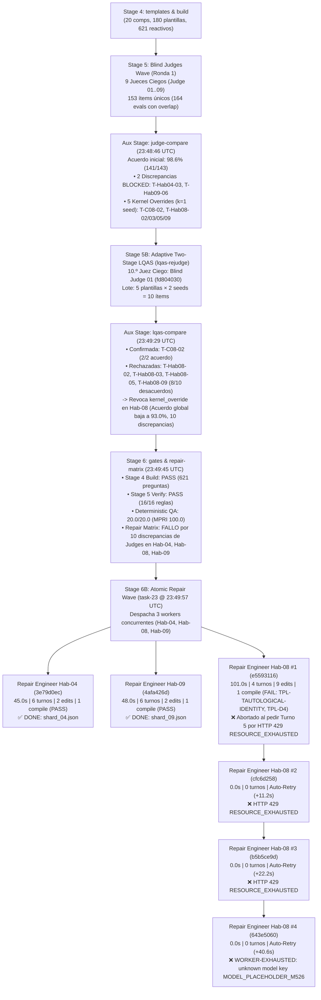

# Auditoría Forense Quirúrgica: Desempeño de Shards (Stage 3) y Anatomía de Reparación Multi-Ronda (Stages 5, 5B, 6 y 6B)
## Curso: Solow M20 V13 (`solow_m20_v13`) — Conversación [`35e55837-6418-4aae-b6c0-8544fa9519e7`](conversation://35e55837-6418-4aae-b6c0-8544fa9519e7)

**Fecha de Auditoría Forense:** `2026-11-23 UTC`  
**Conversación Orquestadora:** `35e55837-6418-4aae-b6c0-8544fa9519e7`  
**Directorio de Trabajo (`work_dir`):** [courses/solow_m20_v13/work](file:///d:/Augusto/personal_portfolio/Tops_academy/courses/solow_m20_v13/work)  
**Directorio de Reportes:** [reports/c2c_audits/20261122_185458_solow_m20_v13_35e55837](file:///d:/Augusto/personal_portfolio/Tops_academy/reports/c2c_audits/20261122_185458_solow_m20_v13_35e55837)

---

## 1. Resumen Ejecutivo de Hallazgos Forenses

1. **Desempeño de la Ola de Autores (Stage 3 — 20 Shards concurrentes):**
   - **Tasa de Aprobación al Primer Intento (`first_compile_pass_rate`):** **`6/20 shards` (`30.0%`)** compilaron limpiamente en su primera ejecución de `compile_shard.py` sin requerir ediciones (`edits = 0`, `compile_fails = 0`).
   - **Gold-Standard Clean-Room:** **`shard_19` (`C-10`)** con **`76.0s`** de tiempo total de pared (`60.0s` Pre-1st-Compile / `16.0s` Post-1st-Compile, `4` turnos, `1` `write_file`, `0` `edit_file`, `0` errores). Los otros 5 shards Clean-Room fueron `shard_15` (`C-06`, `80.0s`), `shard_14` (`C-05`, `81.0s`), `shard_17` (`C-08`, `95.0s`), `shard_13` (`C-04`, `112.0s`) y `shard_06` (`Hab-06`, `121.0s`).
   - **Tasa de Recuperación en Stage 3:** **`20/20 shards` (`100.0%`)** terminaron en estado `PASS` (`DONE`). De los 14 shards que fallaron la 1.ª compilación, **13 shards resolvieron sus errores en la 2.ª compilación** (`compile_runs = 2`, `compile_fails = 1`) y solo **1 shard (`shard_09` / `Hab-09`) requirió una 3.ª compilación** (`compile_runs = 3`, `compile_fails = 2`).
   - **Straggler Crítico de Stage 3:** **`shard_05` (`Hab-05`)** con **`196.0s`** (`+70.0s` sobre la mediana de `126.0s`), dividido exactamente en **`98.0s` Pre-1st-Compile** y **`98.0s` Post-1st-Compile** debido a 4 violaciones (`1× [VERIFIER-TAUTOLOGY-DETECTED]` en `T-Hab05-03` y `3× [TPL-D4]` en `T-Hab05-03`, `T-Hab05-04`, `T-Hab05-06`) que exigieron **5 llamadas secuenciales a `edit_file`** antes de recompilar.

2. **Anatomía Exacta de los 6 Subagentes de Reparación (`Repairs: 6`) y las Rondas de Arbitraje (Stages 5, 5B, 6 y 6B):**
   - **¿Por qué hubo 10 Jueces Ciegos (`9 + 1`) antes de la reparación?**
     - En **Stage 5 (Ronda 1 — Baseline Blind Judges)** se desplegaron **9 jueces** (`Blind Judge 01..09`) sobre `153 reactivos` (`164 evaluaciones` incluyendo solapamiento inter-juez de 21 ítems). El resultado en [judge-compare.log](file:///d:/Augusto/personal_portfolio/Tops_academy/courses/solow_m20_v13/work/logs/judge-compare.log) fue **2 bloqueos epistémicos directos (`BLOCKED`)**: `T-Hab09-06_judge_1` (`Hab-09`) y `T-Hab04-03_judge_1` (`Hab-04`), además de **5 ítems con discrepancia matemática que recibieron `kernel_override` (k=1 seed)**: `T-C08-02` (`C-08`) y 4 plantillas de `Hab-08` (`T-Hab08-02`, `T-Hab08-03`, `T-Hab08-05`, `T-Hab08-09`).
     - Esto activó automáticamente **Stage 5B (`lqas-rejudge` — Adaptive Two-Stage LQAS Confirmation)** para auditar esas 5 plantillas con `kernel_override` en `k=1` usando 2 semillas nuevas (`5 × 2 = 10 ítems`) despachadas a un **10.º juez ciego (`Blind Judge 01`, ID `fd804030`)**.
     - En `lqas-compare`, la plantilla `T-C08-02` fue **confirmada** (`lqas_confirmed_templates: ["T-C08-02"]`), pero las **4 plantillas de `Hab-08` fueron rechazadas** (`lqas_rejected_templates: ["T-Hab08-02", "T-Hab08-03", "T-Hab08-05", "T-Hab08-09"]`) con `8/10` desacuerdos (tasa de acuerdo `20%`), revocando el override del kernel porque el autor de `shard_08` había usado una fórmula macroeconómica errónea para el progreso técnico Hicks-neutral ($\dot{Y}/Y = n + (a/b)g$ en vez de $\dot{Y}/Y = n + g/b$, omitiendo el aporte directo $+g$ del factor $e^{gt}$).
   - **¿Por qué se registraron 6 subagentes de reparación (`Repairs: 6`) si `repair_matrix.json` solo tenía 3 competencias (`Hab-04`, `Hab-08`, `Hab-09`) en 1 sola ola?**
     - Hubo **1 sola ola lógica de reparación (`Atomic Repair Wave`)** despachada en `task-23.log` para **3 trabajadores concurrentes**: `Repair Engineer Hab-04`, `Repair Engineer Hab-08` y `Repair Engineer Hab-09`.
     - `Repair Engineer Hab-04` (`3e79d0ec`, `45.0s`, `6` turnos) y `Repair Engineer Hab-09` (`4afa426d`, `48.0s`, `6` turnos) repararon sus plantillas, compilaron al primer intento (`PASS`) y finalizaron con `DONE`.
     - En cambio, **`Repair Engineer Hab-08` consumió 4 instancias de subagente (`1 intento activo + 3 reintentos de cuota/modelo = 4 subagentes`)**, lo que sumado a `Hab-04` (1) y `Hab-09` (1) explica exactamente los **`6` subagentes de reparación**:
       1. **Intento 1 (`e5593116`, `101.0s`, `4` turnos):** Realizó 9 ediciones (`edit_file`) en `shard_08_data.py` para corregir la fórmula Hicks-neutral en todo el shard, ejecutó `compile_shard.py` (`step 17/18`), el cual **falló (`exit code 1`)** con 2 errores (`[TPL-TAUTOLOGICAL-IDENTITY]` y `[TPL-D4]`). Justo al intentar generar el Turno 5 para corregir esos 2 errores, **la API abortó por agotamiento de cuota (`RESOURCE_EXHAUSTED (code 429): Individual quota reached. Resets in 137h26m24s`)**.
       2. **Intento 2 (`cfc6d258`, `0.0s`, `0` turnos):** Reintento automático (`[AUTO-RETRY] attempt 2/5` tras `11.2s`) que colapsó instantáneamente en Turno 0 con `RESOURCE_EXHAUSTED (code 429)`.
       3. **Intento 3 (`b5b5ce9d`, `0.0s`, `0` turnos):** Reintento automático (`[AUTO-RETRY] attempt 3/5` tras `22.2s`) que colapsó instantáneamente en Turno 0 con `RESOURCE_EXHAUSTED (code 429)`.
       4. **Intento 4 (`643e5060`, `0.0s`, `0` turnos):** Reintento automático (`attempt 4/5` tras `40.6s`) que falló instantáneamente con `unknown model key MODEL_PLACEHOLDER_M526: model not found`, abortando el workflow `task-23` con `[WORKER-EXHAUSTED]`.

---

## 2. Análisis Forense de los 20 Shards (Stage 3 — Shard Authors Wave)

### 2.1. Métricas Consolidadas y Distribución Pre/Post-1st-Compile

- **Total de Shards Despachados:** `20 shards` (`1 competencia por shard`, `3 plantillas por modalidad activa = 9 plantillas/shard`, `180 plantillas totales`).
- **First-Compile Pass Rate:** **`6 / 20` (`30.0%`)**.
  - **Nota sobre competencias Cognitivas (`Concept` / `Fact`) vs. Habilidades (`Skill`):**
    - De las **11 competencias de Concepto/Hecho (`shard_10..20`)**, **5 pasaron al primer intento (`45.5%`)** (`shard_13`, `shard_14`, `shard_15`, `shard_17`, `shard_19`).
    - De las **9 competencias de Habilidad (`shard_01..09`, que exigen `open_symbolic`, `adversarial_break`, `fill_in_the_blank`, `unstructured_model`)**, **solo 1 pasó al primer intento (`11.1%`)**: `shard_06` (`Hab-06`).
- **Distribución de Tiempos de Pared:**
  - **Mínimo (Gold Standard Clean-Room):** `76.0s` (`shard_19` / `C-10`)
  - **Mediana:** `126.0s`
  - **Máximo (Straggler Crítico):** `196.0s` (`shard_05` / `Hab-05`, retraso de sincronización de `+70.0s` sobre la mediana y `+120.0s` sobre el más rápido).

### 2.2. Tabla Maestra de los 20 Shards (Ordenada por Tiempo de Pared Descendente)

| Rank | Shard ID | Comp ID | Categoría / Estado 1st Compile | Wall Time (s) | Pre-1st-Compile (s) | Post-1st-Compile (s) | Compiles (Fails) | Turnos | Writes / Edits | Tokens Activos (Think) | Costo USD | Reglas Fallidas (Bloqueantes) en Compilación | Warnings / Auto-Fixes No Bloqueantes |
| :---: | :--- | :---: | :--- | :---: | :---: | :---: | :---: | :---: | :---: | :---: | :---: | :--- | :--- |
| 1 | **`shard_05`** 🛑 | `Hab-05` | ❌ Remediado (Straggler #1) | **196.0s** | `98.0s` | `98.0s` | `2 (1)` | 8 | `1 / 5` | 89,065 (3,747) | `$0.31` | **C1 (4 err):** `1× [VERIFIER-TAUTOLOGY-DETECTED]` (`T-Hab05-03`), `3× [TPL-D4]` (`T-Hab05-03`, `T-Hab05-04`, `T-Hab05-06`) | `[TPL-ORPHAN-VARS]` (`T-Hab05-02`), `[BLOOM-SUPERIOR-TARGET]` (66.7%) |
| 2 | **`shard_04`** | `Hab-04` | ❌ Remediado (Straggler #2) | **172.0s** | `97.0s` | `75.0s` | `2 (1)` | 8 | `1 / 2` | 87,681 (2,349) | `$0.30` | **C1 (2 err):** `1× [VERIFIER-TAUTOLOGY-DETECTED]` (`T-Hab04-01`), `1× [TPL-D4]` (`T-Hab04-01`) | `SyntaxWarning: \d` (L561), `rf"..."` (`{{{`), `AUTO-FIXED [TPL-ORPHAN-VARS]` (`T-Hab04-01..09`) |
| 3 | **`shard_09`** | `Hab-09` | ❌ Remediado (2 Fallos / #3) | **156.0s** | `70.0s` | `86.0s` | `3 (2)` | 12 | `1 / 5` | 86,751 (1,595) | `$0.28` | **C1 (2 err):** `2× [INVARIANT]` FIB answer leak (`T-Hab09-04`, `T-Hab09-05`) **C2 (1 err):** `1× [INVARIANT]` FIB answer leak (`T-Hab09-05`) | `[TPL-ORPHAN-VARS]` (`T-Hab09-01`), `[TPL-STEM-SYMBOL-PARITY]` (`$s_ef$` en `T-Hab09-04`, `09`) |
| 4 | **`shard_01`** | `Hab-01` | ❌ Remediado (Straggler #4) | **150.0s** | `81.0s` | `69.0s` | `2 (1)` | 8 | `1 / 2` | 83,778 (3,559) | `$0.29` | **C1 (2 err):** `2× [INVARIANT]` KaTeX parse error `\cdot@a@` (`T-Hab01-04`, `T-Hab01-05`) | Ninguno |
| 5 | **`shard_18`** | `C-09` | ❌ Remediado (Straggler #5) | **147.0s** | `86.0s` | `61.0s` | `2 (1)` | 9 | `1 / 3` | 133,864 (4,193) | `$0.36` | **C1 (1 err):** `1× [R-15-MS]` MS length anti-giveaway (`avg_true=61.0` vs `avg_false=72.0`, ratio `0.85x < 0.85x`) | `3× [TPL-DYNAMIC-RATIONALE]` (precheck), `2× [TPL-STEM-SYMBOL-PARITY]` (`T-C09-05`, `06`) |
| 6 | **`shard_02`** | `Hab-02` | ❌ Remediado (1 Fallo) | **146.0s** | `78.0s` | `68.0s` | `2 (1)` | 8 | `1 / 1` | 80,754 (2,462) | `$0.27` | **C1 (1 err):** `1× [OPEN-SYM-DISJOINT]` free symbolic var `'s'` bound to `'2'` in `vars` | `11× Warning rf"..."` (`{{{`), `4× AUTO-FIXED [TPL-ORPHAN-VARS]` (`T-Hab02-05,07,08,09`) |
| 7 | **`shard_03`** | `Hab-03` | ❌ Remediado (1 Fallo) | **139.0s** | `84.0s` | `55.0s` | `2 (1)` | 8 | `1 / 1` | 83,249 (2,821) | `$0.28` | **C1 (1 err):** `1× [TPL-STEM-VARIANT-PARITY]` (`T-Hab03-08` `stem_variants[1]` omite `@b@`) | Ninguno |
| 8 | **`shard_12`** | `C-03` | ❌ Remediado (1 Fallo / Overwrite) | **137.0s** | `73.0s` | `64.0s` | `2 (1)` | 6 | `2 / 0` | 92,232 (3,026) | `$0.34` | **C1 (9 err):** `2× [INVARIANT / CANVAS-OUT-OF-BOUNDS]` (`T-C03-01`), `1× [INVARIANT]` KaTeX `\to@a` (`T-C03-03`), `5× [TPL-ASM]` (`[ADV-WITNESS-INVALID]` / `[ADV-WITNESS-BOUNDS]`), `1× [TPL-VAR]` (`T-C03-05`) | `3× AUTO-FIXED [TPL-ORPHAN-VARS]` (`T-C03-02,03,04`), `[BLOOM-SUPERIOR-TARGET]` (55.6%) |
| 9 | **`shard_07`** | `Hab-07` | ❌ Remediado (1 Fallo) | **131.0s** | `77.0s` | `54.0s` | `2 (1)` | 8 | `1 / 3` | 84,137 (3,252) | `$0.29` | **C1 (3 err):** `1× [INVARIANT]` FIB answer `'0.24'` leak (`T-Hab07-05`), `1× [TPL-D4]` (`T-Hab07-06`), `1× [TPL-STATIC-OPT]` (`T-Hab07-06`: `9/10` unique answers) | `SyntaxWarning: \s` (L391), `AUTO-FIXED [TPL-ORPHAN-VARS]` (`T-Hab07-03`) |
| 10 | **`shard_08`** | `Hab-08` | ❌ Remediado (1 Fallo) | **126.0s** | `70.0s` | `56.0s` | `2 (1)` | 8 | `1 / 1` | 82,713 (2,899) | `$0.28` | **C1 (4 err):** `1× [VERIFIER-TAUTOLOGY-DETECTED]` (`T-Hab08-04`), `2× [TPL-D4]` (`T-Hab08-05`, `T-Hab08-06`), `1× [INVARIANT]` FIB answer `'0.03'` leak (`T-Hab08-05`) | `3× AUTO-FIXED [TPL-ORPHAN-VARS]` (`T-Hab08-01,02,06`) |
| 11 | **`shard_06`** | `Hab-06` | ✅ **Clean-Room Pass** | **121.0s** | `86.0s` | `35.0s` | `1 (0)` | 5 | `1 / 0` | 74,107 (2,971) | `$0.25` | *0 errores bloqueantes* | `3× Warning rf"..."` (`{{{`), `[BLOOM-SUPERIOR-TARGET]` (66.7%) |
| 12 | **`shard_11`** | `C-02` | ❌ Remediado (1 Fallo) | **117.0s** | `71.0s` | `46.0s` | `2 (1)` | 7 | `1 / 4` | 76,482 (2,708) | `$0.25` | **C1 (1 err):** `1× [R-15-MS]` MS length anti-giveaway (`avg_true=85.0` vs `avg_false=101.7`, ratio `0.84x < 0.85x`) | `AUTO-FIXED [TPL-ORPHAN-VARS]` (`T-C02-09`), `[BLOOM-SUPERIOR-TARGET]` (66.7%) |
| 13 | **`shard_10`** | `C-01` | ❌ Remediado (1 Fallo) | **113.0s** | `72.0s` | `41.0s` | `2 (1)` | 6 | `1 / 2` | 71,083 (2,467) | `$0.24` | **C1 (1 err):** `1× [TPL-ASM]` (`[ADV-WITNESS-INVALID]` `sample_witness {'K': 24}` failed `'P1'`) | `[TPL-AD-HOC-PERTURBATION]` / `[TPL-UNBOUNDED-LOOP]` (`while` en `gen_5`, `T-C01-05`) |
| 14 | **`shard_13`** | `C-04` | ✅ **Clean-Room Pass** | **112.0s** | `85.0s` | `27.0s` | `1 (0)` | 5 | `1 / 0` | 72,463 (2,869) | `$0.24` | *0 errores bloqueantes* | **0 warnings (100% impecable)** |
| 15 | **`shard_16`** | `C-07` | ❌ Remediado (1 Fallo) | **109.0s** | `66.0s` | `43.0s` | `2 (1)` | 8 | `1 / 2` | 70,748 (2,232) | `$0.22` | **C1 (1 err):** `1× [M3-BLOOM-COHERENCE]` (`T-C07-07`: `multiple_select` `direct` con `Bloom='Remember'`) | `[TPL-ORPHAN-VARS]` (`T-C07-02`, `08`), `1 edit_file` previo a C1 para quitar bucle `while` |
| 16 | **`shard_20`** | `H-01` | ❌ Remediado (1 Fallo) | **97.0s** | `63.0s` | `34.0s` | `2 (1)` | 6 | `1 / 1` | 67,985 (1,875) | `$0.22` | **C1 (1 err):** `1× [M3-BLOOM-COHERENCE]` (`T-H01-04`: `multiple_select` `direct` con `Bloom='Remember'`) | `Warning rf"..."` (`{{{`), `[BLOOM-SUPERIOR-TARGET]` (33.3%) |
| 17 | **`shard_17`** | `C-08` | ✅ **Clean-Room Pass** | **95.0s** | `76.0s` | `19.0s` | `1 (0)` | 5 | `1 / 0` | 70,811 (3,531) | `$0.23` | *0 errores bloqueantes* | `3× [TPL-DYNAMIC-RATIONALE]` (precheck), `[BLOOM-SUPERIOR-TARGET]` (66.7%) |
| 18 | **`shard_14`** | `C-05` | ✅ **Clean-Room Pass** | **81.0s** | `65.0s` | `16.0s` | `1 (0)` | 4 | `1 / 0` | 63,693 (1,875) | `$0.21` | *0 errores bloqueantes* | `AUTO-FIXED [TPL-ORPHAN-VARS]` (`T-C05-03`) |
| 19 | **`shard_15`** | `C-06` | ✅ **Clean-Room Pass** | **80.0s** | `64.0s` | `16.0s` | `1 (0)` | 4 | `1 / 0` | 58,942 (2,047) | `$0.18` | *0 errores bloqueantes* | `[BLOOM-SUPERIOR-TARGET]` (66.7%) |
| 20 | **`shard_19`** 🏆 | `C-10` | ✅ **Gold Standard Clean-Room** | **76.0s** | `60.0s` | `16.0s` | `1 (0)` | 4 | `1 / 0` | 60,726 (1,197) | `$0.19` | *0 errores bloqueantes* | `[TPL-STEM-SYMBOL-PARITY]` (`$K_uso$` en `T-C10-09`), `[BLOOM-SUPERIOR-TARGET]` (66.7%) |

---

### 2.3. Radiografía Forense Turno a Turno de los 14 Shards con Fallos de Compilación

A continuación se documenta el diagnóstico exacto extraído de los logs de compilación (`steps/*/output.txt` y `tasks/task-*.log`) de cada uno de los 14 subagentes autores que fallaron su primera compilación:

#### 1. `shard_05` (`Hab-05`) — Straggler Crítico #1 (`196.0s` | Pre: `98.0s`, Post: `98.0s` | `5 edits`)
- **Compilación 1 (`[COMPILE 1/10]`, Step 7, `exit code 1`, 4 errores):**
  1. `[VERIFIER-TAUTOLOGY-DETECTED]` en `T-Hab05-03` (L103): *Verificador `ver_fn 'ver_3'` en `'T-Hab05-03'` no refuta distractor `'1/(1.0-a)**2'`.*
  2. `[TPL-D4: DISTRACTOR IDÉNTICO A RESPUESTA CORRECTA]` en `T-Hab05-03` (L431..436): *`distractor matches correct answer '1/(1.0-a)**2' (invariant violation)`.*
  3. `[TPL-D4: DISTRACTOR IDÉNTICO A RESPUESTA CORRECTA]` en `T-Hab05-04` (L431..436): *`distractor matches correct answer '1.0' (invariant violation)`.*
  4. `[TPL-D4: DISTRACTOR IDÉNTICO A RESPUESTA CORRECTA]` en `T-Hab05-06` (L431..436): *`distractor matches correct answer '1.0' (invariant violation)`.*
- **Acción de Remediación:** El subagente ejecutó **5 llamadas a `edit_file` en paralelo** (Steps 11..15) corrigiendo `gen_3`, `ver_3`, `gen_4` y `gen_6`, además de podar la variable huérfana `coef` en `T-Hab05-02`.
- **Compilación 2 (`[COMPILE 2/10]`, Step 17, `exit code 0`):** `PASS` en 50 semillas.

#### 2. `shard_04` (`Hab-04`) — Straggler #2 (`172.0s` | Pre: `97.0s`, Post: `75.0s` | `2 edits`)
- **Compilación 1 (`[COMPILE 1/10]`, Step 6, `exit code 1`, 2 errores + `SyntaxWarning`):**
  1. `[VERIFIER-TAUTOLOGY-DETECTED]` en `T-Hab04-01` (L63): *Verificador `ver_fn 'ver_1'` en `'T-Hab04-01'` no refuta distractor `'(19*s)**(2)'`.*
  2. `[TPL-D4: DISTRACTOR IDÉNTICO A RESPUESTA CORRECTA]` en `T-Hab04-01` (L733..745): *`distractor matches correct answer '(24*s)**(2)' (invariant violation)`.* (En `gen_1`, cuando `a = 1/2`, `1/a = 2` coincidía con `inv_b = 2`).
  3. **Advertencia Sintáctica:** Múltiples `SyntaxWarning: invalid escape sequence '\d'` en línea 561 de `shard_04_data.py` por usar string normal en vez de raw string `r"..."`.
- **Acción de Remediación:** Ejecutó `2× edit_file` (Steps 10 y 11) desacoplando el exponente del distractor en `T-Hab04-01` y corrigiendo el escape LaTeX en L561.
- **Compilación 2 (`[COMPILE 2/10]`, Step 13, `exit code 0`):** `PASS` (con auto-poda `[AUTO-FIXED] [TPL-ORPHAN-VARS]` en `T-Hab04-01..09`).

#### 3. `shard_09` (`Hab-09`) — Straggler #3 y Único con 3 Compilaciones (`156.0s` | Pre: `70.0s`, Post: `86.0s` | `5 edits`)
- **Pre-compilación:** Tras `write_file` (Step 4), el agente notó un posible bucle en Step 5 y aplicó `1× edit_file` (Step 6) antes de lanzar su primera compilación.
- **Compilación 1 (`[COMPILE 1/10]`, Step 8, `exit code 1`, 2 errores):**
  1. `[INVARIANT]` en `T-Hab09-04` (`['seed=120']`): *`FIB correct answer '0.24' leaked as direct assignment in stem text.`*
  2. `[INVARIANT]` en `T-Hab09-05` (`['seed=117', 'seed=120']`): *`FIB correct answer '0.44' leaked as direct assignment in stem text.`*
- **Remediación 1:** Aplicó `2× edit_file` (Steps 12 y 13) en `gen_4` y `gen_5`.
- **Compilación 2 (`[COMPILE 2/10]`, Step 15, `exit code 1`, 1 error persistente):**
  1. `[INVARIANT]` en `T-Hab09-05` (`['seed=117', 'seed=120']`): *`FIB correct answer '0.44' leaked as direct assignment in stem text.`* (La condición de guarda seguía permitiendo que una variable del enunciado coincidiera numéricamente con la respuesta `0.44`).
- **Remediación 2:** Aplicó `2× edit_file` adicionales (Steps 19 y 20) garantizando disjunción estricta entre los parámetros del enunciado y la respuesta numérica en `T-Hab09-05`.
- **Compilación 3 (`[COMPILE 3/10]`, Step 22, `exit code 0`):** `PASS` en 50 semillas.

#### 4. `shard_01` (`Hab-01`) — Straggler #4 (`150.0s` | Pre: `81.0s`, Post: `69.0s` | `2 edits`)
- **Compilación 1 (`[COMPILE 1/10]`, Step 6, `exit code 1`, 2 errores):**
  1. `[INVARIANT]` en `T-Hab01-04` (`['stem_variants[0]', 'stem_variants[1]', 'stem_variants[2]']`): *`KaTeX parse error in stem_variants[0]: Undefined control sequence: \cdot@a@ at position 9: @sa@=@s@\cdot@a@`.*
  2. `[INVARIANT]` en `T-Hab01-05` (`['stem_variants[0]', 'stem_variants[1]', 'stem_variants[2]']`): *`KaTeX parse error in stem_variants[0]: Undefined control sequence: \cdot@a@ at position 9: @sa@=@s@\cdot@a@`.*
- **Causa Raíz:** Falta de espacio entre el comando LaTeX `\cdot` y el placeholder `@a@` (`\cdot@a@` en lugar de `\cdot @a@`).
- **Acción de Remediación:** `2× edit_file` (Steps 10 y 11) insertando el espacio en `S4` y `S5`.
- **Compilación 2 (`[COMPILE 2/10]`, Step 13, `exit code 0`):** `PASS`.

#### 5. `shard_18` (`C-09`) — Straggler #5 (`147.0s` | Pre: `86.0s`, Post: `61.0s` | `3 edits`)
- **Compilación 1 (`[COMPILE 1/10]`, Step 7, `exit code 1`, 1 error + warnings):**
  1. `[R-15-MS: EQUILIBRIO DE LONGITUD MS]` en `C-09.json` (L701..713): *`MS length anti-giveaway violation: correct options too short on average (avg_true=61.0 vs avg_false=72.0, ratio=0.85x < 0.85x)`.*
  2. Warnings concurrentes: `[TPL-STEM-SYMBOL-PARITY]` en `T-C09-05` (`$S_1$`) y `T-C09-06` (`$E_g$`).
- **Acción de Remediación:** Leyó las líneas afectadas con `3× read_file` (Steps 11, 12, 14) y ejecutó `3× edit_file` (Steps 16, 17, 18) equilibrando la longitud de las opciones verdaderas/falsas en `gen_8`/`gen_9` y normalizando los símbolos `$S_1$` y `$E_g$` en `S5` y `S6`.
- **Compilación 2 (`[COMPILE 2/10]`, Step 20, `exit code 0`):** `PASS`.

#### 6. `shard_02` (`Hab-02`) — (`146.0s` | Pre: `78.0s`, Post: `68.0s` | `1 edit`)
- **Compilación 1 (`[COMPILE 1/10]`, Step 6, `exit code 1`, 1 error):**
  1. `[OPEN-SYM-DISJOINT: FUGA NUMÉRICA EN SIMBÓLICO]` en `Hab-02.json` (L711..723): *`open_symbolic variable collision: free symbolic variable 's' is numerically bound to '2' in vars. Remove 's' from vars and reference it symbolically in error_rationale/hints.`*
- **Acción de Remediación:** `1× edit_file` (Step 10) eliminando `'s'` del diccionario `vars` en la plantilla `open_symbolic`.
- **Compilación 2 (`[COMPILE 2/10]`, Step 12, `exit code 0`):** `PASS`.

#### 7. `shard_03` (`Hab-03`) — (`139.0s` | Pre: `84.0s`, Post: `55.0s` | `1 edit`)
- **Compilación 1 (`[COMPILE 1/10]`, Step 6, `exit code 1`, 1 error):**
  1. `[TPL-STEM-VARIANT-PARITY: ASIMETRÍA DE PLACEHOLDERS EN STEM_VARIANTS]` en `T-Hab03-08` (L587..592): *`'stem_variants[1]' omite los placeholders @b@ presentes en el stem base o en la mayoría de las demás variantes.`*
- **Acción de Remediación:** `1× edit_file` (Step 10) incorporando `@b@` en `S8[1]`.
- **Compilación 2 (`[COMPILE 2/10]`, Step 12, `exit code 0`):** `PASS`.

#### 8. `shard_12` (`C-03`) — (`137.0s` | Pre: `73.0s`, Post: `64.0s` | `2 writes / 0 edits`)
- **Compilación 1 (`[COMPILE 1/10]`, Step 6, `exit code 1`, 9 errores consolidados — `[UMBRAL >= 6]`):**
  1. `2× [INVARIANT / CANVAS-OUT-OF-BOUNDS]` en `T-C03-01` (`['seed=112', 'seed=133']`): *`invariant_canvas.invariants[0] x=100 exceeds x_range=[0.0, 70.0]`* y *`target_state.points['P1'] x=100 exceeds x_range=[0.0, 70.0]`*.
  2. `1× [INVARIANT]` en `T-C03-03` (`['stem_variants[1]']`): *`KaTeX parse error in stem_variants[1]: Undefined control sequence: \to@a at position 13: @a0@\sqrt{k}\to@a1@\sqrt{k}`*.
  3. `3× [TPL-ASM / ADV-WITNESS-INVALID]` en `C-03.json`: `sample_witness` falló el predicado `'P1'` para `{'k': 144}` (2 semillas), `{'k': 81}` (1 semilla) y `{'k': 36}` (1 semilla).
  4. `2× [TPL-ASM / ADV-WITNESS-BOUNDS]` en `C-03.json`: `sample_witness['k']=256.0 > max 250` (5 semillas) y `sample_witness['k']=400.0 > max 250` (2 semillas).
  5. `1× [TPL-VAR: DIVERSIDAD DE REACTIVOS]` en `T-C03-05`: *`Failed to instantiate diversity quota (20 items): Template T-C03-05 failed during question assembly on seed 8563: [ADV-WITNESS-BOUNDS] sample_witness['k']=400.0 > max 250`*.
- **Acción de Remediación:** Al superar el umbral de 6 errores (`9 errores >= 6`), el hook habilitó `write_file(Overwrite=True)`. El subagente reescribió `shard_12_data.py` de forma atómica en Step 8 ampliando `x_range` a `[0, 120]`, separando `\to @a1@` y ajustando los testigos de `adversarial_break` dentro de `max 250`.
- **Compilación 2 (`[COMPILE 2/10]`, Step 10, `exit code 0`):** `PASS`.

#### 9. `shard_07` (`Hab-07`) — (`131.0s` | Pre: `77.0s`, Post: `54.0s` | `3 edits`)
- **Compilación 1 (`[COMPILE 1/10]`, Step 6, `exit code 1`, 3 errores + `SyntaxWarning: \s`):**
  1. `[INVARIANT]` en `T-Hab07-05` (`['seed=137', 'seed=139']`): *`FIB correct answer '0.24' leaked as direct assignment in stem text.`*
  2. `[TPL-D4]` en `T-Hab07-06`: *`distractor matches correct answer '1.0' (invariant violation).`*
  3. `[TPL-STATIC-OPT: BAJA VARIABILIDAD DE CLAVE]` en `T-Hab07-06`: *`Only 9/10 unique correct answers generated across 50 seeds. Required threshold is >=10.`*
- **Acción de Remediación:** `3× edit_file` (Steps 10, 11, 12) ampliando el espacio muestral en `gen_6`, evitando la colisión del distractor con `1.0`, eliminando la fuga en `gen_5` y corrigiendo `\s` en L391.
- **Compilación 2 (`[COMPILE 2/10]`, Step 14, `exit code 0`):** `PASS`.

#### 10. `shard_08` (`Hab-08`) — (`126.0s` | Pre: `70.0s`, Post: `56.0s` | `1 edit`)
- **Compilación 1 (`[COMPILE 1/10]`, Step 6, `exit code 1`, 4 errores):**
  1. `[VERIFIER-TAUTOLOGY-DETECTED]` en `T-Hab08-04` (L135): *Verificador `ver_fn 'ver_4'` en `'T-Hab08-04'` no refuta distractor `'0.012'`.* (La tolerancia `tol=0.005` solapaba el distractor).
  2. `[TPL-D4]` en `T-Hab08-05`: *`distractor matches correct answer '0.045'`.*
  3. `[TPL-D4]` en `T-Hab08-06`: *`distractor matches correct answer '0.5'`.*
  4. `[INVARIANT]` en `T-Hab08-05` (`['seed=105', 'seed=129', 'seed=136']`): *`FIB correct answer '0.03' leaked as direct assignment in stem text.`*
- **Acción de Remediación:** `1× edit_file` consolidado (Step 10) abarcando `gen_4/ver_4`, `gen_5` y `gen_6`.
- **Compilación 2 (`[COMPILE 2/10]`, Step 12, `exit code 0`):** `PASS`. *(Nota forense: Aunque compiló limpiamente, `shard_08` contenía errores conceptuales en las fórmulas de progreso técnico Hicks-neutral que luego fueron detectados en Stage 5/5B por los Blind Judges).*

#### 11. `shard_11` (`C-02`) — (`117.0s` | Pre: `71.0s`, Post: `46.0s` | `4 edits`)
- **Compilación 1 (`[COMPILE 1/10]`, Step 6, `exit code 1`, 1 error):**
  1. `[R-15-MS: EQUILIBRIO DE LONGITUD MS]` en `C-02.json` (L451..456): *`MS length anti-giveaway violation: correct options too short on average (avg_true=85.0 vs avg_false=101.7, ratio=0.84x < 0.85x)`.*
- **Acción de Remediación:** Leyó el bloque MS (`read_file`, Step 8) y aplicó `4× edit_file` (Steps 10..13) extendiendo la redacción de las opciones verdaderas en `gen_7`, `gen_8` y `gen_9`.
- **Compilación 2 (`[COMPILE 2/10]`, Step 15, `exit code 0`):** `PASS`.

#### 12. `shard_10` (`C-01`) — (`113.0s` | Pre: `72.0s`, Post: `41.0s` | `2 edits`)
- **Compilación 1 (`[COMPILE 1/10]`, Step 6, `exit code 1`, 1 error + 1 precheck warning):**
  1. `[TPL-ASM / ADV-WITNESS-INVALID]` en `C-01.json` (L606..618): *`No se pudo ensamblar el reactivo con la salida de generate_py para 1 semillas: [ADV-WITNESS-INVALID] sample_witness {'K': 24} failed predicate 'P1' (K >= 2 and abs(4 * (K * 6)**0.5 - 2 * K) > 0.01)`.* (En `K=24, L=6`, $4\sqrt{144} = 48 = 2(24)$, anulando la desigualdad).
  2. Precheck Warning: `L197 [TPL-AD-HOC-PERTURBATION] [TPL-UNBOUNDED-LOOP] while en 'gen_5'` (`T-C01-05`).
- **Acción de Remediación:** `2× edit_file` (Steps 8 y 9) eliminando el bucle `while` en `gen_5` y asegurando que `sample_witness` en `gen_6` nunca elija el punto fijo donde $A\sqrt{KL} = wK$.
- **Compilación 2 (`[COMPILE 2/10]`, Step 11, `exit code 0`):** `PASS`.

#### 13. `shard_16` (`C-07`) — (`109.0s` | Pre: `66.0s`, Post: `43.0s` | `2 edits`)
- **Pre-compilación:** Tras `write_file` (Step 4), el agente detectó proactivamente en Step 5 que había escrito un bucle `while` en `shard_16_data.py` y lo reemplazó con `1× edit_file` (Step 6) antes de compilar.
- **Compilación 1 (`[COMPILE 1/10]`, Step 8, `exit code 1`, 1 error):**
  1. `[GENERAL / M3-BLOOM-COHERENCE]` en `T-C07-07`: *`Modalidad 'multiple_select' (arquetipo='direct') con Bloom='Remember' está fuera del rango coherente [Understand..Evaluate].`*
- **Acción de Remediación:** `1× edit_file` (Step 10) elevando el nivel de Bloom de `T-C07-07` de `'Remember'` a `'Understand'`.
- **Compilación 2 (`[COMPILE 2/10]`, Step 12, `exit code 0`):** `PASS`.

#### 14. `shard_20` (`H-01`) — (`97.0s` | Pre: `63.0s`, Post: `34.0s` | `1 edit`)
- **Compilación 1 (`[COMPILE 1/10]`, Step 6, `exit code 1`, 1 error):**
  1. `[GENERAL / M3-BLOOM-COHERENCE]` en `T-H01-04`: *`Modalidad 'multiple_select' (arquetipo='direct') con Bloom='Remember' está fuera del rango coherente [Understand..Evaluate].`*
- **Acción de Remediación:** `1× edit_file` (Step 8) cambiando el nivel de Bloom en `T-H01-04` a `'Understand'`.
- **Compilación 2 (`[COMPILE 2/10]`, Step 10, `exit code 0`):** `PASS`.

---

## 3. Anatomía de las Rondas de Arbitraje Ciego y los 6 Subagentes de Reparación (Stages 5, 5B, 6 y 6B)

### 3.1. Diagrama de Secuencia del Flujo Forense (Stage 4 $\to$ Stage 5 $\to$ Stage 5B LQAS $\to$ Stage 6 Gates $\to$ Stage 6B Repair Wave)

---

### 3.2. Desglose Exacto de Discrepancias de los Blind Judges (`judge_report_baseline.json` $\to$ `judge_report_lqas.json` $\to$ `judge_report.json`)

En [gates.log](file:///d:/Augusto/personal_portfolio/Tops_academy/courses/solow_m20_v13/work/logs/gates.log), tanto `Stage 4 (build)` como `Stage 5 (verify: 16/16 rules)` y el `QA deterministic pass (20.0/20.0 — PLATINUM MASTERY, MPRI=100.0)` aprobaron con **0 errores deterministas**. **El único disparador de la matriz de reparación ([repair_matrix.json](file:///d:/Augusto/personal_portfolio/Tops_academy/courses/solow_m20_v13/work/repair_matrix.json)) fue el arbitraje de los Blind Judges (`sources: ["judge"]`)**, consolidado tras las dos etapas de evaluación ciega:

#### Fase A: Ronda 1 Baseline (`9 Blind Judges`, `153 ítems`, `23:48:46 UTC`)
1. **2 Discrepancias Directas por Bloqueo Epistémico (`BLOCKED` / `flaw_detected: true`):**
   - **`T-Hab04-03_judge_1` (`shard_04` / `Hab-04`, `open_symbolic`):**
     - **Voto del Judge:** `"BLOCKED: contradicción aritmética 4 * n_0 = 1/24 con n_0 = 1/6"`
     - **Ground Truth del Kernel (`expected`):** `"(24*s)**3"`
     - **Causa Raíz Exacta:** En `shard_04_data.py` (`gen_3`), el autor calculó el nuevo denominador de la tasa demográfica como `n_new_den = d0 * mult` (`6 * 4 = 24`, es decir, $n' = n_0 / 4 = 1/24$), pero en el texto de la variante `S3[0]` escribió erróneamente una multiplicación: `$n' = @mult@ \cdot n_0 = @n_str@$` ($4 \cdot (1/6) = 1/24$), creando una contradicción aritmética flagrante.
   - **`T-Hab09-06_judge_1` (`shard_09` / `Hab-09`, `fill_in_the_blank`):**
     - **Voto del Judge:** `"BLOCKED: falta definición de s_{ef}, v y t en el enunciado"`
     - **Ground Truth del Kernel (`expected`):** `"5.0652"`
     - **Causa Raíz Exacta:** En `shard_09_data.py` (`S6`), el enunciado pedía calcular $\dot{r} = s_{ef}F(r,1) - n(r)r$ dando valores numéricos para $s$, $v$ y $t$, pero omitió definir qué representaba económicamente $v$ (si era la fracción del recaudo fiscal invertida públicamente o consumida) y omitió la fórmula de la tasa de ahorro efectiva $s_{ef} = s + (v - s)t$, violando la clausura epistémica.
2. **5 Plantillas con `kernel_override` en Semilla Única (`k=1 seed`):**
   - En la Ronda 1, cuando un juez discrepa numérica o simbólicamente con el kernel sin declarar `BLOCKED` en 1 sola semilla, el sistema aplica inicialmente `"Kernel verified constructive proof overrides LLM calculation disagreement"`, pero marca la plantilla en `single_seed_override_templates` para confirmación obligatoria mediante **Adaptive Two-Stage LQAS**:
     - `T-C08-02_judge_1` (`C-08`, `interactive_canvas`): Judge devolvió `P2=(8,0), wq=3`.
     - `T-Hab08-02_judge_1` (`Hab-08`, `open_symbolic`): Judge votó `"0.8*(0.04-n)"` vs. Kernel `"4*(0.04-n)"`.
     - `T-Hab08-03_judge_1` (`Hab-08`, `open_symbolic`): Judge votó `"0.03+0.01/(1-a)"` vs. Kernel `"0.03+0.01*a/(1-a)"`.
     - `T-Hab08-05_judge_1` (`Hab-08`, `fill_in_the_blank`): Judge votó `0.15` vs. Kernel `"0.115"`.
     - `T-Hab08-09_judge_1` (`Hab-08`, `unstructured_model`): Judge votó `phase2: ["A1", "A2"]` vs. Kernel `["A1"]`.

#### Fase B: Ronda 2 — Confirmación Adaptativa LQAS (`10.º Blind Judge fd804030`, `10 ítems`, `23:49:29 UTC`)
El pipeline ejecutó `run.py --stage lqas-rejudge`, generando un lote de 10 reactivos (2 semillas nuevas `_judge_1` y `_judge_2` por cada una de las 5 plantillas en [lqas_scope.json](file:///d:/Augusto/personal_portfolio/Tops_academy/courses/solow_m20_v13/work/lqas_scope.json)) y despachando a `Blind Judge 01` (`fd804030`). Al comparar en `lqas-compare`:
- **`T-C08-02` (`shard_17` / `C-08`):** **CONFIRMADA** (`2/2` semillas en acuerdo con el kernel). Quedó absuelta y excluida de `repair_matrix.json`.
- **Las 4 plantillas de `Hab-08` (`shard_08`):** **RECHAZADAS (`0/8` semillas en acuerdo; 8 discrepancias nuevas)**, demostrando que el Juez Ciego tenía razón y el código Python de `shard_08_data.py` tenía errores matemáticos profundos en su modelado del progreso técnico Hicks-neutral $Y = e^{gt} K^a L^{1-a}$ (donde $b = 1-a$):
  - *Error conceptual del autor de `shard_08`:* Con $Y = e^{gt} K^a L^b$ y $\dot{L}/L = n$, en crecimiento balanceado la relación $K/Y$ es constante, por lo que $\dot{Y}/Y = \dot{K}/K = n + \frac{g}{1-a} = n + \frac{g}{b}$. Sin embargo, el autor de `shard_08` programó erróneamente $\dot{Y}/Y = n + \frac{a}{b}g$ (olvidando sumar el $+g$ directo del factor $e^{gt}$).

| ID Reactivo (Ciclo / Ronda) | Competencia (`shard_id`) | Plantilla (`interaction_type`) | Respuesta del Blind Judge | Respuesta Esperada por el Kernel (`expected`) | Diagnóstico Forense de la Discrepancia |
| :--- | :---: | :--- | :--- | :--- | :--- |
| **`T-Hab04-03_judge_1`** (R1 Baseline) | `Hab-04` (`shard_04`) | `T-Hab04-03` (`open_symbolic`) | `BLOCKED: contradicción aritmética 4 * n_0 = 1/24 con n_0 = 1/6` | `(24*s)**3` | **Fallo del Autor:** El texto en `S3[0]` decía $n' = 4 \cdot n_0 = 1/24$ cuando el código dividía $n_0 / 4 = 1/24$. |
| **`T-Hab09-06_judge_1`** (R1 Baseline) | `Hab-09` (`shard_09`) | `T-Hab09-06` (`fill_in_the_blank`) | `BLOCKED: falta definición de s_{ef}, v y t en el enunciado` | `5.0652` | **Fallo del Autor:** El enunciado `S6` usaba $s_{ef}$, $v$ y $t$ sin definir la identidad $s_{ef} = s + (v-s)t$ ni el rol de $v$. |
| **`T-Hab08-02_judge_1`** (R2 LQAS) | `Hab-08` (`shard_08`) | `T-Hab08-02` (`open_symbolic`) | `0.8*(0.09-n)` | `4*(0.09-n)` | **Fallo Matemático del Autor:** Al despejar $g$ desde $\dot{Y}/Y = n + g/b$ con $b=0.8$, lo correcto es $g = b(\dot{Y}/Y - n) = 0.8(0.09-n)$. El autor despejó desde $n + (a/b)g$ usando $(b/a) = 0.8/0.2 = 4$. |
| **`T-Hab08-02_judge_2`** (R2 LQAS) | `Hab-08` (`shard_08`) | `T-Hab08-02` (`open_symbolic`) | `0.8*(0.08-n)` | `4*(0.08-n)` | **Fallo Matemático del Autor:** Misma causa raíz que `T-Hab08-02_judge_1` para semilla con $\dot{Y}/Y = 0.08$ y $b=0.8$. |
| **`T-Hab08-03_judge_1`** (R2 LQAS) | `Hab-08` (`shard_08`) | `T-Hab08-03` (`open_symbolic`) | `BLOCKED: ambigüedad entre derivada (sensibilidad) y nivel de dY/Y en función de a` | `0.04+0.01*a/(1-a)` | **Doble Fallo del Autor:** 1) Llamó "sensibilidad asintótica de $\dot{Y}/Y$ respecto a $a$" (que denota $\partial(\dot{Y}/Y)/\partial a$) al nivel $\dot{Y}/Y$; 2) Usó la fórmula incorrecta $n + g\cdot a/(1-a)$ en vez de $n + g/(1-a)$. |
| **`T-Hab08-03_judge_2`** (R2 LQAS) | `Hab-08` (`shard_08`) | `T-Hab08-03` (`open_symbolic`) | `0.04+0.01/(1-a)` | `0.04+0.01*a/(1-a)` | **Fallo Matemático del Autor:** Con $n=0.04, g=0.01$, la tasa verdadera es $0.04 + 0.01/(1-a)$, no $0.04 + 0.01a/(1-a)$. |
| **`T-Hab08-05_judge_1`** (R2 LQAS) | `Hab-08` (`shard_08`) | `T-Hab08-05` (`fill_in_the_blank`) | `0.0483` | `0.0233` | **Fallo Matemático del Autor:** Con $g_1 = 0.025$, el juez calculó la tasa correcta $n + g_1/b = 0.0483$, mientras el autor restó $g_1$ omitiendo el aporte directo de $A(t)$ ($0.0483 - 0.0250 = 0.0233$). |
| **`T-Hab08-05_judge_2`** (R2 LQAS) | `Hab-08` (`shard_08`) | `T-Hab08-05` (`fill_in_the_blank`) | `0.0533` | `0.0283` | **Fallo Matemático del Autor:** Misma omisión de $+g_1 = 0.025$ en la segunda semilla ($0.0533 - 0.0250 = 0.0283$). |
| **`T-Hab08-09_judge_1`** (R2 LQAS) | `Hab-08` (`shard_08`) | `T-Hab08-09` (`unstructured_model`) | `phase2: ["A1", "A2"]` | `phase2: ["A1"]` | **Fallo de Diseño en `phase2_assumptions`:** La opción `A2` enunciaba una propiedad verdadera de los rendimientos constantes a escala (CRS) que el juez identificó legítimamente como supuesto requerido junto con `A1`. |
| **`T-Hab08-09_judge_2`** (R2 LQAS) | `Hab-08` (`shard_08`) | `T-Hab08-09` (`unstructured_model`) | `phase2: ["A1", "A2"]` | `phase2: ["A1"]` | **Fallo de Diseño en `phase2_assumptions`:** Idéntico desacuerdo estructural en la segunda semilla de `T-Hab08-09`. |

---

### 3.3. Ejecución Quirúrgica de los 6 Subagentes de Reparación (Stage 6B — `task-23.log`)

A las `23:49:57 UTC`, `dispatch.py dispatch-repair --ids Hab-04 Hab-08 Hab-09` generó [dispatch/repair.json](file:///d:/Augusto/personal_portfolio/Tops_academy/courses/solow_m20_v13/work/dispatch/repair.json) con `subagents_count: 3`, y el workflow `c2c_wave_workflow.py` (`mode: "repair_and_rejudge"`) lanzó 3 workers concurrentes con `max_retries=2` y `quota_max_retries=4`.

| # Instancia | Rol / Subagente | Conversation ID | Intento Worker | Estado Final | Duración (s) | Pre / Post 1st Compile | Turnos | Reads / Edits / Compiles | Tokens Activos (In / Out / Cache) | Costo USD | Diagnóstico Exacto de Ejecución y Terminación |
| :---: | :--- | :--- | :---: | :---: | :---: | :---: | :---: | :---: | :---: | :---: | :--- |
| **1** | **Repair Engineer Hab-04** | `3e79d0ec-cf1d-4a77-b138-d765c9bffdee` | Attempt 1/5 | ✅ **`DONE`** | **45.0s** | `22.0s` / `23.0s` | 6 | `4 / 2 / 1 (PASS)` | **51,404** (47,515 / 3,889 / 143,612) | `$0.11` | Leyó `repair_hab04_data.md`, `shard_04_Hab-04.json` y `shard_04_data.py`. Aplicó `2× edit_file` (L640 y L724) cambiando `$n' = @mult@ \cdot n_0$` por `$n' = n_0/@mult@$` en `S3` y `SOL3`. Compiló `shard_04` al 1.er intento (`PASS`) y cerró con `DONE: courses/solow_m20_v13/work/shards/shard_04.json`. |
| **2** | **Repair Engineer Hab-09** | `4afa426d-c79f-4c45-8709-e66c10e01d46` | Attempt 1/5 | ✅ **`DONE`** | **48.0s** | `24.0s` / `24.0s` | 6 | `4 / 2 / 1 (PASS)` | **46,748** (41,749 / 4,999 / 140,184) | `$0.11` | Leyó `repair_hab09_data.md`, `shard_09_Hab-09.json` y `shard_09_data.py`. Aplicó `2× edit_file` (L436 y L454) definiendo explícitamente $s_{ef} = s + (v - s)t$, ahorro privado $s$, impuesto $t$ y fracción pública invertida $v$ en todas las variantes de `S3` y `S6`. Compiló `shard_09` al 1.er intento (`PASS`) y cerró con `DONE: courses/solow_m20_v13/work/shards/shard_09.json`. |
| **3** | **Repair Engineer Hab-08** *(Ejecución Activa)* | `e5593116-4dd9-4dc8-a5b4-28822826296b` | Attempt 1/5 | ❌ **`ERROR (429)`** | **101.0s** | `98.0s` / `3.0s` | 4 | `4 / 9 / 1 (FAIL)` | **81,458** (57,896 / 23,562 / 74,971) | `$0.27` | Leyó `repair_hab08_data.md`, `shard_08_Hab-08.json` y `shard_08_data.py`. En Step 7 generó `22,729` tokens de salida con **9 llamadas paralelas a `edit_file`** refactorizando `RATS`, `gen_2`, `gen_3`, `gen_5`, `gen_6`, `gen_8`, `gen_9`, `S3`, `S6`, `S8`, `H2..H9` y `SOL2..SOL9` para implantar $\dot{Y}/Y = n + g/b$. En Step 17 lanzó `compile_shard.py`, que falló en Step 18 (`23:51:49 UTC`) con **2 errores fáciles**: `[TPL-TAUTOLOGICAL-IDENTITY]` (`0.75(0.08-n)=0.75(0.08-n)` en `SOL2`) y `[TPL-D4]` (distractor duplicado `'0.6'` en `T-Hab08-06`). Al pedir el Turno 5 para corregir esos 2 errores, **colapsó por `RESOURCE_EXHAUSTED (code 429): Individual quota reached. Resets in 137h26m24s`**. |
| **4** | **Repair Engineer Hab-08** *(Auto-Retry 1)* | `cfc6d258-4279-47e2-bc22-c4eda34773a1` | Attempt 2/5 | ❌ **`ERROR (429)`** | **0.0s** | `0.0s` / `0.0s` | 0 | `0 / 0 / 0` | **0** (0 / 0 / 0) | `$0.00` | Instanciado a las `23:52:01 UTC` tras backoff de `11.2s`. Recibió `USER_INPUT` en `L0` pero la primera llamada al modelo falló instantáneamente con `RESOURCE_EXHAUSTED (code 429) (Resets in 137h26m12s)`. |
| **5** | **Repair Engineer Hab-08** *(Auto-Retry 2)* | `b5b5ce9d-596f-4a42-a94d-309c9e2b0a79` | Attempt 3/5 | ❌ **`ERROR (429)`** | **0.0s** | `0.0s` / `0.0s` | 0 | `0 / 0 / 0` | **0** (0 / 0 / 0) | `$0.00` | Instanciado a las `23:52:24 UTC` tras backoff de `22.2s`. Recibió `USER_INPUT` en `L0` pero falló instantáneamente con `RESOURCE_EXHAUSTED (code 429) (Resets in 137h25m49s)`. |
| **6** | **Repair Engineer Hab-08** *(Auto-Retry 3)* | `643e5060-ffa5-42a6-853f-a1b3d9327360` | Attempt 4/5 | ❌ **`ERROR (M526)`** | **0.0s** | `0.0s` / `0.0s` | 0 | `0 / 0 / 0` | **0** (0 / 0 / 0) | `$0.00` | Instanciado a las `23:53:05 UTC` tras backoff de `40.6s`. Falló antes de iniciar inferencia con `unknown model key MODEL_PLACEHOLDER_M526: model not found`, disparando `[WORKER-EXHAUSTED]` y terminando `task-23`. |

---

## 4. Conclusiones Forenses y Causas Raíz Arquitectónicas

1. **Separación Clara entre Validador Sintáctico/Psicométrico (`compile_shard.py`) y Validador Epistémico (`Blind Judges` + `LQAS`):**
   - En Stage 3, `compile_shard.py` atrapó y forzó la corrección del **100% de los defectos estructurales, invariantes de ejecución, fugas de respuesta en el enunciado (`INVARIANT`), colisiones de distractores (`TPL-D4`), tautologías en verificadores (`VERIFIER-TAUTOLOGY-DETECTED`), paridad de longitud en selección múltiple (`R-15-MS`) y coherencia de Bloom (`M3-BLOOM-COHERENCE`)**, permitiendo que los 20 shards pasaran Stage 4 (`build`) y Stage 5 (`verify`) con **20.0/20.0 (MPRI 100.0)** en la evaluación determinista.
   - Sin embargo, ningún validador estático puede detectar una contradicción semántica en prosa (`4 * n_0 = 1/24` cuando $n_0 = 1/6$ en `Hab-04`), la omisión de la definición de una variable económica ($s_{ef}$ y $v$ en `Hab-09`), o una derivación algebraica equivocada del modelo de Solow ($\dot{Y}/Y = n + (a/b)g$ en vez de $n + g/b$ en `Hab-08`).
2. **Eficacia Quirúrgica del Protocolo Adaptive Two-Stage LQAS (Stage 5B):**
   - El mecanismo de `kernel_override` en Ronda 1 evitó falsas alarmas en `T-C08-02` (que fue confirmada con `2/2` acuerdos en Stage 5B por el 10.º juez ciego `fd804030`), pero al mismo tiempo la **Guardia LQAS (`lqas-rejudge` + `lqas-compare`)** impidió que un `kernel_override` espurio ocultara el error matemático real de `Hab-08`, rechazando las 4 plantillas (`T-Hab08-02`, `T-Hab08-03`, `T-Hab08-05`, `T-Hab08-09`) con evidencia estadística contundente (`8/10` desacuerdos en semillas frescas).
3. **Causa Raíz de la Interrupción en Stage 6B (`Repairs: 6`):**
   - La reparación de `Hab-04` (`45s`) y `Hab-09` (`48s`) fue exitosa al primer intento de compilación.
   - La reparación de `Hab-08` (`e5593116`) ya había completado el trabajo pesado (9 ediciones que corrigieron toda la matemática de `shard_08_data.py`) y solo tenía pendientes 2 ajustes cosméticos menores (`[TPL-TAUTOLOGICAL-IDENTITY]` en `SOL2` y `[TPL-D4]` en un distractor de `gen_6`, registrados en `.check_attempts/compile_shard_08.json`), pero fue interrumpida a las `23:51:49 UTC` por el límite externo de cuota de la suscripción (`HTTP 429 RESOURCE_EXHAUSTED`), lo cual generó los 3 reintentos de `0.0s` (`cfc6d258`, `b5b5ce9d`, `643e5060`) que elevaron el conteo total de subagentes `c2c_repair` de 3 a 6.
